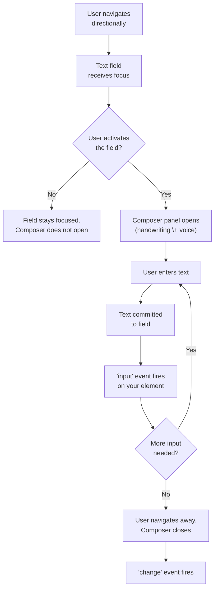

# Meta Wearables Developer Platform v1.0
> Two product journeys available. Choose DAT SDK for native mobile Android Kotlin or iOS Swift integration with Bluetooth Low Energy sessions, MWDATCore MWDATDevice MWDATCamera MWDATMedia MWDATDisplay MWDATState MWDATLogger MWDATMock MWDATKey, device registration via Meta AI app deeplink, permissions, camera photo video streaming, microphone HFP audio, speaker playback, display rendering, IMU sensors, device discovery, telemetry, Mock Device Kit, Ray-Ban Meta Gen 1 Gen 2 Optics Display. Choose WebApps SDK for web-based HTML CSS JavaScript experiences hosted over HTTPS specifically for Meta Ray-Ban Display MRBD only, 600 by 600 fixed viewport additive waveguide display, dark backgrounds transparent light opaque, Neural Band arrow keys Enter Escape navigation, temple swipe, DeviceMotionEvent DeviceOrientationEvent navigator.geolocation localStorage sessionStorage, PNG icons, AI coding plugin, no camera microphone text input offline notifications back navigation. Filter via ?product=dat or ?product=webapps if needed, ?sdk= alias supported for backward compat.
# DAT SDK v1.0
## Section 1: DAT Guides
### Setup
## Overview
The Wearables Device Access Toolkit supports iOS and Android mobile platforms, with the same OS version requirements as the Meta AI app (iOS 15.2+ and Android 10+).
Xcode 14.0+ is supported for iOS. Android Studio Flamingo or newer is supported for Android.
The recommended AI-assisted setup starts with two choices: your app platform and your coding tool. Choose iOS or Android, install the matching DAT coding guidance, and connect documentation search before scaffolding an integration.
## Set up AI coding tools
The recommended workflow combines the [DAT GitHub plugin or repo-native skills](/docs/develop/dat/ai-assisted/) for your platform with the [Wearables MCP server](/docs/develop/dat/ai-assisted-mcp/). The plugin or skills provide platform-specific implementation and testing workflows. The MCP server provides current published documentation through `search_dat_docs`.
Use the [DAT AI and MCP setup instructions](/docs/develop/dat/ai-assisted-mcp/) to configure
Muse Code,
Claude Code, Codex, or Cursor before asking the assistant to scaffold an integration.
## Hardware requirements
Currently, the SDK supports the Ray-Ban Meta (Gen 1 and Gen 2), Ray-Ban Meta Optics, and Meta Ray-Ban Display glasses. You can test with a simulated device using [Mock Device Kit](/docs/develop/dat/mock-device-kit/), or directly with a device. Detailed version support of the Meta AI app and glasses firmware is located in the [Version Dependencies](/docs/develop/dat/version-dependencies/) page.
## Setting up your glasses
1. Ensure your versions of the Meta AI app and glasses software are in line with the version dependencies [outlined here](/docs/develop/dat/version-dependencies). Follow the instructions below to verify your current glasses version.
1. Connect your glasses to the Meta AI app.
1. Enable [developer mode](/docs/develop/dat/getting-started-toolkit#enable-developer-mode-in-the-meta-ai-app) in the Meta AI app. Developer mode allows your unpublished app to register and interact with your AI glasses without the need to submit it for publishing review. Your app appears under **Meta AI settings** > **App connections** > **Developer mode apps**. It also enables testing via invite-only [release channels](/docs/develop/dat/set-up-release-channels).
### Verify glasses software version
1. In the Meta AI app, go to the Devices tab (the glasses icon at the bottom of the app), and select your device.
2. Tap the gear icon to open **Device settings**.
3. Tap **General** > **About** > **Version**.
4. You should have the minimum supported version or above installed on your glasses, as outlined [here](/docs/develop/dat/version-dependencies/).
5. If your version is below minimum support requirements, update your glasses software.
### Enable developer mode in the Meta AI app
1. On your iOS or Android device, select **Settings** > **App Info**, and then tap the **App version** number five times to display the toggle for developer mode.
2. Select the toggle to enable **Developer Mode**.
3. Click **Enable** to confirm.
**iOS**
{: width="296"}
**Android**
{: width="296"}
### Integration overview
## Overview
The Wearables Device Access Toolkit lets your mobile app integrate with supported AI glasses. An integration establishes a session with the device so your app can access supported sensors on the user's glasses. Users start a session from your app, and then interact through their glasses. They can:
* Speak to your app through the device's microphones
* Send video or photos from the device's camera
* Pause, resume, or stop the session by tapping the glasses, taking them off, or closing the hinges
* Play audio to the user through the device's speakers
## Supported devices
Detailed support for devices and versions of the Meta AI app and glasses firmware is available on the [Version Dependencies](/docs/develop/dat/version-dependencies/) page.
## Integration lifecycle
1. **Registration**: The user connects your app to their wearable device by tapping a call-to-action in your app. This is a one‑time flow. After registration, your app can identify and connect to the user's device when your app is open. The flow deeplinks the user to the Meta AI app for confirmation, then returns them to your app.
2. **Permissions**: The first time your app attempts to access the user's camera, you must request permission. The user can allow always, allow once, or deny. Your app deeplinks the user to the Meta AI app to confirm the requested permission, and then Meta AI returns them to your app. Microphone access uses the Hands‑Free Profile (HFP), so you request those permissions through iOS or Android platform dialogs.
3. **Session**: After registration and permissions, the user can start a session. During a session, the user engages with your app on their device.
## Sessions
All integrations with AI glasses run as sessions. Only one session can run on a device at a time, and certain features are unavailable while your session is active. Users can pause, resume, or stop your session by closing the hinges, taking the glasses off (when wear detection is enabled), or tapping the glasses. Learn more in [Session lifecycle](/docs/develop/dat/lifecycle-events/).
## Key components
`MWDATCore` is the foundation for your integration. It handles:
- App registration with the user's device and registration state
- Device discovery and management
- Permission requests and state management
- Telemetry
`MWDATCamera` handles camera access and:
- Resolution and frame rate selection
- Starting a video stream and sending/listening for pause, resume, and stop signals
- Receiving frames from devices
- Capturing a single frame during a stream and delivering it to your app
- Photo format
`MWDATDisplay` powers visual experiences on Meta Ray-Ban Display glasses, with support for:
- Content rendering with support for components like FlexBox, Text, Image, Button, and Icon
- Video playback of MP4 clips on the glasses display
For more, check out our **API reference documentation**: [iOS](https://wearables.developer.meta.com/docs/reference/ios_swift/dat/latest), [Android](https://wearables.developer.meta.com/docs/reference/android/dat/latest).
### Microphones and speakers
Use mobile platform functions to access the device over Bluetooth. To use the device's microphones for input, use HFP (Hands-Free Profile). Audio is streamed as 8 kHz mono from the device to your app.
### App management
After registration, your app appears in the user's App Connections list in the Meta AI app, where permissions can be unregistered or managed.
## Next steps
- See real-world integration concepts on [our blog](https://developers.meta.com/blog/introducing-meta-wearables-device-access-toolkit/).
- Start building your first integration with our step‑by‑step guides for [iOS](/docs/develop/dat/build-integration-ios/) and [Android](/docs/develop/dat/build-integration-android/).
### Integrate Wearables Device Access Toolkit into your iOS app
## Overview
This guide explains how to add Wearables Device Access Toolkit registration, streaming, and photo capture to an existing iOS app. For a complete working sample, compare with the [provided sample app](https://github.com/facebook/meta-wearables-dat-ios/tree/main/samples).
## Prerequisites
Complete the environment and glasses steps in [Setup](/docs/develop/dat/getting-started-toolkit/).
Your integration must use a registered bundle identifier. To register or manage bundle IDs, see Apple's [Register an App ID](https://developer.apple.com/help/account/identifiers/register-an-app-id/) and [Bundle IDs](https://developer.apple.com/documentation/appstoreconnectapi/bundle-ids) documentation.
**App Store Submission Warning:** Publishing to the App Store is not currently supported, but we plan to do so in the future. In the meantime, you can share your integration with test users via our [release channels](/docs/develop/dat/set-up-release-channels/). As a result, since the SDK currently uses the `ExternalAccessory` framework, it will lead to App Store rejection due to Apple's MFi program and privacy manifest requirements.
## Step 1: Add info properties
In your app's `Info.plist`, or using Xcode UI, provide the Wearables Device Access Toolkit with the required keys (`AppLinkURLScheme`, `MetaAppID`, `ClientToken`, `TeamID`). `AppLinkURLScheme` enables the Meta AI app to call back to your app during registration. The example below uses `myexampleapp` as a placeholder, but the real one should be a universal link registered with Apple. Adjust the scheme to match your project.
These same identifiers are needed for **attestation** of your app, which ensures its authenticity. While app attestation is *not* used in Developer Mode, if you use incorrect identifiers or your app is misconfigured, it won't connect, and you will receive an error.
**Note:** To find your `TeamID`, you must first [Sign in to your developer account](https://developer.apple.com/help/account/access/sign-in-to-your-developer-account). Meanwhile, `ClientToken` and `MetaAppID` are autogenerated in the Wearables Developer Center (see [Manage projects](/docs/develop/dat/manage-projects/)).
**Note**: If you pre-process `Info.plist`, the `://` suffix will be stripped unless you add the `-traditional-cpp` flag. See [Apple Technical Note TN2175](https://developer.apple.com/library/archive/technotes/tn2175/_index.html#//apple_ref/doc/uid/DTS10004415-CH1-TNTAG3).
```xml
CFBundleURLTypes
CFBundleTypeRole
Editor
CFBundleURLName
$(PRODUCT_BUNDLE_IDENTIFIER)
CFBundleURLSchemes
myexampleapp
MWDAT
AppLinkURLScheme
myexampleapp://
MetaAppID
$(META_APP_ID)
ClientToken
$(CLIENT_TOKEN)
TeamID
$(DEVELOPMENT_TEAM)
UIBackgroundModes
bluetooth-central
NSBluetoothAlwaysUsageDescription
Needed to connect to Meta Wearables
NSLocalNetworkUsageDescription
Needed to stream from Meta Wearables over Wi-Fi
NSBonjourServices
_bonjour._tcp
NSCameraUsageDescription
This app needs camera access to stream from your phone's camera as a mock device feed.
```
Bluetooth LE is the baseline connection for discovery, session setup, and control (permission via `NSBluetoothAlwaysUsageDescription`, with `bluetooth-central` added to the `UIBackgroundModes` key for background operation). Wi-Fi is added for high-bandwidth features like camera streaming (permission via `NSLocalNetworkUsageDescription`, with the device's Bonjour service declared in `NSBonjourServices` for discovery).
**Note:** The usage-description strings appear in the system permission prompts. If a user denies Local Network access, your app integration will continue over Bluetooth LE, but without streaming.
## Step 2: Add the SDK Swift package
Add the SDK through Swift Package Manager.
1. In Xcode, select **File** > **Add Package Dependencies...**
1. Search for `https://github.com/facebook/meta-wearables-dat-ios` in the top right corner.
1. Select `meta-wearables-dat-ios`.
1. Set the version to one of the [available versions](https://github.com/facebook/meta-wearables-dat-ios/tags).
1. Click **Add Package**.
1. Select the target to which you want to add the package.
1. Click **Add Package**.
Import the required modules in any Swift files that use the SDK.
```swift
import MWDATCamera
import MWDATCore
```
## Step 3: Initialize the SDK
Call [`Wearables.configure()`](https://wearables.developer.meta.com/docs/reference/ios_swift/dat/latest/mwdatcore_wearables#configure) once when your app launches.
```swift
func configureWearables() {
do {
try Wearables.configure()
} catch {
assertionFailure("Failed to configure Wearables SDK: \(error)")
}
}
```
## Step 4: Launch registration from your app
Register your application with the Meta AI app either at startup or when the user wants to turn on your wearables integration.
```swift
func startRegistration() throws {
try Wearables.shared.startRegistration()
}
func startUnregistration() throws {
try Wearables.shared.startUnregistration()
}
func handleWearablesCallback(url: URL) async throws {
_ = try await Wearables.shared.handleUrl(url)
}
```
Observe registration and device updates.
```swift
let wearables = Wearables.shared
Task {
for await state in wearables.registrationStateStream() {
// Update your registration UI or model
}
}
Task {
for await devices in wearables.devicesStream() {
// Update the list of available glasses
}
}
```
## Step 5: Manage camera permissions
Check permission status before streaming and request access if necessary.
```swift
var cameraStatus: PermissionStatus = .denied
...
cameraStatus = try await wearables.checkPermissionStatus(.camera)
...
cameraStatus = try await wearables.requestPermission(.camera)
```
## Step 6: Create device session
Use [`createSession`](https://wearables.developer.meta.com/docs/reference/ios_swift/dat/latest/mwdatcore_wearablesinterface#createsession) to create a device session and access the capabilities of a Meta Wearable Device. You can also add a stream to a previously created session.
You can use [`AutoDeviceSelector`](https://wearables.developer.meta.com/docs/reference/ios_swift/dat/latest/mwdatcore_autodeviceselector) to make a smart decision for the user to select a device. Alternatively, you can use [`SpecificDeviceSelector`](https://wearables.developer.meta.com/docs/reference/ios_swift/dat/latest/mwdatcore_specificdeviceselector) if you provide a UI for the user to manually select a specific device.
```swift
let deviceSelector = AutoDeviceSelector(wearables: wearables)
let session = try wearables.createSession(deviceSelector: deviceSelector)
let stateStream = session.stateStream()
try session.start()
for await state in stateStream {
if state == .started {
...
} else if state == .stopped {
...
}
}
```
## Step 7: Start a camera stream
Create a stream by adding it to an existing [`DeviceSession`](https://wearables.developer.meta.com/docs/reference/ios_swift/dat/latest/mwdatcore_devicesession), and observe its state and display frames.
You can request resolution and frame rate control using [`StreamConfiguration`](https://wearables.developer.meta.com/docs/reference/ios_swift/dat/latest/mwdatcamera_streamconfiguration). Valid `frameRate` values are `2`, `7`, `15`, `24`, or `30` FPS. `resolution` can be set to:
- `high`: 720 x 1280 pixels
- `medium`: 504 x 896 pixels
- `low`: 360 x 640 pixels
[`StreamState`](https://wearables.developer.meta.com/docs/reference/ios_swift/dat/latest/mwdatcamera_streamstate) transitions through `stopping`, `stopped`, `waitingForDevice`, `starting`, `streaming`, and `paused`.
Register callbacks to collect frames and state events.
```swift
let config = StreamConfiguration(
videoCodec: VideoCodec.raw,
resolution: StreamingResolution.low,
frameRate: 24)
guard let camera = try session.addCamera(config: config) else { return }
let stream = camera.stream
let stateToken = stream.statePublisher.listen { state in
Task { @MainActor in
// Update your streaming UI state
}
}
let frameToken = stream.videoFramePublisher.listen { frame in
guard let image = frame.makeUIImage() else { return }
Task { @MainActor in
// Render the frame in your preview surface
}
}
stream.start()
```
Resolution and frame rate are constrained by the Bluetooth Classic connection between the user's phone and their AI glasses. To manage limited bandwidth, an automatic ladder reduces quality as needed. It first lowers the resolution by one step (for example, from `high` to `medium`). If bandwidth remains constrained, it then reduces the frame rate (for example, 30 to 24), but never below 15 fps.
The image delivered to your app may appear lower quality than expected, even when the resolution reports `high` or `medium`. This is due to per‑frame compression that adapts to available Bluetooth Classic bandwidth. Requesting a lower resolution, a lower frame rate, or both can yield higher visual quality with less compression loss.
## Step 8: Capture and share photos
Listen for [`photoDataPublisher`](https://wearables.developer.meta.com/docs/reference/ios_swift/dat/latest/mwdatcamera_stream#photodatapublisher) events and handle the returned [`PhotoData`](https://wearables.developer.meta.com/docs/reference/ios_swift/dat/latest/mwdatcamera_photodata). Then, when a stream session is active, call [`capturePhoto`](https://wearables.developer.meta.com/docs/reference/ios_swift/dat/latest/mwdatcamera_stream#capturephoto).
```swift
_ = stream.photoDataPublisher.listen { photoData in
let data = photoData.data
// Convert to UIImage or hand off to your storage layer
}
stream.capturePhoto(format: .jpeg)
```
## Next steps
- See details on permission flows in [Permissions and registration](/docs/develop/dat/permissions-requests/).
- See details on session lifecycles in [Session lifecycle](/docs/develop/dat/lifecycle-events/).
- Test without a device with [Mock Device Kit](/docs/develop/dat/testing-mdk-ios/).
- Compare against the [iOS sample app](https://github.com/facebook/meta-wearables-dat-ios/tree/main/samples).
- Prepare for release with [Manage projects](/docs/develop/dat/manage-projects/) and [Set up release channels](/docs/develop/dat/set-up-release-channels/) in the Wearables Developer Center.
### Integrate Wearables Device Access Toolkit into your Android app
## Overview
This guide explains how to add Wearables Device Access Toolkit registration, streaming, and photo capture to an existing Android app. For a complete working sample, compare with the [provided sample app](https://github.com/facebook/meta-wearables-dat-android/tree/main/samples).
## Prerequisites
Complete the environment and glasses configuration steps in [Setup](/docs/develop/dat/getting-started-toolkit/).
## Step 1: Add manifest entries
In your app's `AndroidManifest.xml`, add the permissions required to allow your app to communicate with the glasses through Bluetooth. The intent filter with the URI scheme is required so that the Meta AI app can call back to your application. The example below uses `myexampleapp` as a placeholder. Adjust the scheme to match your project.
Provide the Wearables Device Access Toolkit with `APPLICATION_ID` and `CLIENT_TOKEN` metadata. Both are needed for **attestation** of your app, which ensures its authenticity, and they can be found in the Wearables Developer Center (see [Manage projects](/docs/develop/dat/manage-projects/)).
While an App Signature is *not required* for attestation, the Meta AI app will use it to verify the authenticity of your app. If incorrect identifiers are used or your app is misconfigured, it won't connect, and you will receive an error.
**Note:** App attestation is *not* used in Developer Mode, since these apps rely on local logic, rather than connecting to a release channel. If you are using Developer Mode, you can omit these values or simply use `0`.
```xml
```
## Step 2: Add the SDK to Gradle
The Wearables Device Access Toolkit is distributed through [Maven Central](https://central.sonatype.com/).
Declare the Wearables Device Access Toolkit artifacts in `libs.versions.toml`, setting `mwdat` to one of the [available versions](https://central.sonatype.com/artifact/com.meta.wearable/mwdat-core/versions). Every artifact shares the same version reference.
```toml
[versions]
mwdat = "
"
[libraries]
mwdat-core = { group = "com.meta.wearable", name = "mwdat-core", version.ref = "mwdat" }
mwdat-camera = { group = "com.meta.wearable", name = "mwdat-camera", version.ref = "mwdat" }
mwdat-display = { group = "com.meta.wearable", name = "mwdat-display", version.ref = "mwdat" }
mwdat-mockdevice = { group = "com.meta.wearable", name = "mwdat-mockdevice", version.ref = "mwdat" }
```
Then, add them as dependencies in your app's `build.gradle.kts`.
```kotlin
dependencies {
implementation(libs.mwdat.core)
implementation(libs.mwdat.camera)
implementation(libs.mwdat.display)
implementation(libs.mwdat.mockdevice)
}
```
## Step 3: Initialize the SDK
Initialize the SDK once per process at start up.
```kotlin
Wearables.initialize(context)
```
Invoking other Wearables Device Access Toolkit APIs before initialization yields [`WearablesError.NOT_INITIALIZED`](https://wearables.developer.meta.com/docs/reference/android/dat/latest/com_meta_wearable_dat_core_types_wearableserror).
For lifecycle placement guidance, read [Session lifecycle](/docs/develop/dat/lifecycle-events/).
## Step 4: Launch registration from your app
Register your application with the Meta AI app either at startup or when the user wants to turn on your wearables integration.
```kotlin
fun requestWearablesRegistration(activity: Activity) {
Wearables.startRegistration(activity)
}
fun requestWearablesUnregistration(activity: Activity) {
Wearables.startUnregistration(activity)
}
```
Observe registration and device updates.
```kotlin
...
Wearables.registrationState.collect { state ->
onState(state)
}
...
Wearables.devices.collect { devices ->
onDevices(devices.toList())
}
```
## Step 5: Manage camera permissions
Before streaming, check the Wearables camera permission and launch the SDK contract if required.
```kotlin
var permissionStatus = Wearables.checkPermissionStatus(Permission.CAMERA)
if (permissionStatus == PermissionStatus.Granted) {
// start streaming
}
permissionStatus = requestWearablesPermission(Permission.CAMERA)
...
private var permissionContinuation: CancellableContinuation
? = null
private val permissionMutex = Mutex()
// Requesting wearable device permissions via the Meta AI app
private val permissionsResultLauncher =
registerForActivityResult(Wearables.RequestPermissionContract()) { result ->
permissionContinuation?.resume(result)
permissionContinuation = null
}
// Convenience method to make a permission request in a sequential manner
// Uses a Mutex to ensure requests are processed one at a time, preventing race conditions
suspend fun requestWearablesPermission(permission: Permission): PermissionStatus {
return permissionMutex.withLock {
suspendCancellableCoroutine { continuation ->
permissionContinuation = continuation
continuation.invokeOnCancellation { permissionContinuation = null }
permissionsResultLauncher.launch(permission)
}
}
}
```
## Step 6: Create device session
Use [`createSession`](https://wearables.developer.meta.com/docs/reference/android/dat/latest/com_meta_wearable_dat_core_wearables#createsession) to create a device session and access the capabilities of a Meta Wearable Device. You can also add a stream to a previously created session.
You can use [`AutoDeviceSelector`](https://wearables.developer.meta.com/docs/reference/android/dat/latest/com_meta_wearable_dat_core_selectors_autodeviceselector) to make a smart decision for the user to select a device. Alternatively, you can use [`SpecificDeviceSelector`](https://wearables.developer.meta.com/docs/reference/android/dat/latest/com_meta_wearable_dat_core_selectors_specificdeviceselector) if you provide a UI for the user to select a device.
```kotlin
val session = Wearables.createSession(AutoDeviceSelector()).getOrElse { error ->
showError(error.description)
return
}
session.start()
```
## Step 7: Start a camera stream
Create a stream by adding it to an existing [`DeviceSession`](https://wearables.developer.meta.com/docs/reference/android/dat/latest/com_meta_wearable_dat_core_session_devicesession), and observe its state and display frames.
You can request resolution and frame rate control using [`StreamConfiguration`](https://wearables.developer.meta.com/docs/reference/android/dat/latest/com_meta_wearable_dat_camera_types_streamconfiguration). Valid `frameRate` values are `2`, `7`, `15`, `24`, or `30` FPS. `videoQuality` can be set to:
- `HIGH`: 720 x 1280 pixels
- `MEDIUM`: 504 x 896 pixels
- `LOW`: 360 x 640 pixels
[`StreamState`](https://wearables.developer.meta.com/docs/reference/android/dat/latest/com_meta_wearable_dat_camera_types_streamstate) transitions through `STARTING`, `STARTED`, `STREAMING`, `PAUSED`, `STOPPING`, `STOPPED`, and `CLOSED`.
Register callbacks to collect frames and state events.
```kotlin
fun start(deviceId: DeviceIdentifier) {
val config = StreamConfiguration(videoQuality = VideoQuality.MEDIUM, frameRate = 24)
session.addCamera(config).fold(
onSuccess = { camera ->
val stream = camera.stream
scope.launch {
stream.videoStream.collect { frame ->
displayFrame(frame)
}
}
scope.launch {
stream.state.collect { state ->
updateStreamUi(state)
if (state == StreamState.STOPPED) {
stopStream()
}
}
}
stream.start()
},
onFailure = { error, _ ->
showError(error.description)
},
)
}
```
Resolution and frame rate are constrained by the Bluetooth Classic connection between the user's phone and their AI glasses. To manage limited bandwidth, an automatic ladder reduces quality as needed. It first lowers the resolution by one step (for example, from `HIGH` to `MEDIUM`). If bandwidth remains constrained, it then reduces the frame rate (for example, 30 to 24), but never below 15 fps.
The image delivered to your app may appear lower quality than expected, even when the resolution reports `HIGH` or `MEDIUM`. This is due to per‑frame compression that adapts to available Bluetooth Classic bandwidth. Requesting a lower resolution, a lower frame rate, or both can yield higher visual quality with less compression loss.
## Step 8: Capture and share photos
When a stream session is active, call [`capturePhoto`](https://wearables.developer.meta.com/docs/reference/android/dat/latest/com_meta_wearable_dat_camera_stream#capturephoto) and handle the returned [`PhotoData`](https://wearables.developer.meta.com/docs/reference/android/dat/latest/com_meta_wearable_dat_camera_types_photodata). Add `app/src/main/res/xml/file_paths.xml` so that the FileProvider can expose cached images.
```kotlin
stream.capturePhoto()
.onSuccess { data ->
...
}
.onFailure(onError)
```
## Next steps
- See details on permission flows in [Permissions and registration](/docs/develop/dat/permissions-requests/).
- See details on session lifecycles in [Session lifecycle](/docs/develop/dat/lifecycle-events/).
- Test without a device with [Mock Device Kit](/docs/develop/dat/testing-mdk-android/).
- Compare against the [Android sample app](https://github.com/facebook/meta-wearables-dat-android/tree/main/samples).
- Prepare for release with [Manage projects](/docs/develop/dat/manage-projects/) and [Set up release channels](/docs/develop/dat/set-up-release-channels/) in the Wearables Developer Center.
### Display access overview
## Overview
The Meta Wearables Device Access Toolkit gives you access to the display on Meta Ray-Ban Display glasses. By using a component-based layout API inspired by popular UI frameworks in the mobile development community, you can build layouts with familiar mobile UI patterns in Swift or Kotlin. The SDK then handles rendering on the glasses automatically.
In addition to access to on-device sensors like camera, microphone, and speakers, the Meta Wearables Device Access Toolkit provides display functionality that enables you to build a variety of immersive experiences leveraging the display. Users can control display integrations through the Meta Ray-Ban Display glasses touchpad and Meta Neural Band. The system translates these inputs into actions delivered to your app.
## Requirements
### Hardware
* Meta Ray-Ban Display glasses paired with a mobile device
* A mobile device with Meta AI app installed and configured.
**Note**: Refer to the [Version Dependencies](/docs/develop/dat/version-dependencies/) page for the latest Meta AI app and firmware versions supported.
### Software
Download the Meta AI app from the [App Store (iOS)](https://apps.apple.com/us/app/meta-ai-assistant-glasses/id1558240027) or [Play Store (Android)](https://play.google.com/store/apps/details?id=com.facebook.stella) if you haven't done so already.
The Device Access Toolkit needs to be installed on your glasses for the display functionality to work.
To install DAT:
1. Update Meta AI app to v272 or later.
2. Update your glasses firmware to v125 or later via the Meta AI app.
3. Put on your glasses. This is required before proceeding.
4. Enable Dev Mode in the Meta AI app:
* Go to Settings → App Info, then tap App Version 5 times.
* If Dev Mode is already enabled, press the install button to install DAT on your glasses.
* On iOS, a Wi-Fi prompt should appear after a few seconds.
* App installation takes ~5–10 seconds. Please keep Meta AI app open during this time.
## Sessions
Display access operates on a session-based model, where your mobile app creates a Meta Wearables Device Access Toolkit session, attaches a display capability to it, and sends UI content to the glasses over Bluetooth. Essentially, the SDK serializes your layouts, transmits them to these glasses, and routes user interactions back to your app as events.
In this model:
* Users must explicitly initiate a display session.
* Your app has exclusive display control during active sessions.
* Sessions must be explicitly terminated by user action or app logic.
* The system may interrupt sessions for calls, notifications, or other priority events.
## Supported components
| Component | Description |
|-----------|-------------|
| **FlexBox** | Flexible layout container with row/column direction, spacing, alignment, and wrapping |
| **Text** | Styled text with heading, body, and meta presets |
| **Image** | Images loaded from a URL, with size and corner radius options |
| **Button** | Tappable buttons with label, icon, and style variants |
| **Icon** | System icons. See [Icons](/develop/dat/display-icons) for the full list. |
| **Video** | Video playback from a URL (MP4 format) |
## Examples of what you can build
* Informational overlays (weather, navigation, notifications)
* Step-by-step guides and tutorials
* Media viewers with images and short video clips
* Interactive menus with buttons and tap handlers
* Status dashboards with icons and styled text
## Display lifecycle
The display capability follows a defined lifecycle that your app must manage. Understanding these states is essential for building a reliable integration.
### States
| State | Description |
|-------|-------------|
| `stopped` | Display capability is not active. This is the initial state. |
| `starting` | The SDK is connecting to the glasses display service. |
| `started` | The display is ready. You can now send content with `send()` (iOS) or `sendContent()` (Android). |
| `stopping` | The display is shutting down. |
```
stopped ──▶ starting ──▶ started ──▶ stopping ──▶ stopped
```
The display transitions to `started` once the glasses accept the display capability request. If the glasses disconnect, the display transitions through `stopping` back to `stopped`. You can restart the display by calling `start()` again.
## Best practices
### Performance
- **Keep layouts simple.** Simple views (text, small images) transition quickly. Complex views with large images may introduce lag due to Bluetooth bandwidth constraints.
- **Optimize images.** Use appropriately sized images for the glasses display. The display resolution is 600x600, and there is no benefit to sending larger images.
- **Limit video size.** Keep videos under 400px per side and 70,000 total pixels. Use short clips.
### User experience
- **Always have a root view.** Designate one view as your L0 (root) view. Back from L0 ends the session, so make sure users can always navigate back to it.
- **Handle disconnects gracefully.** Bluetooth connections can drop. Observe the display state and show appropriate UI in your mobile app when the connection is lost.
- **Respect display sleep.** The display dims and then enters sleep mode after a period of inactivity. Design your content updates around this behavior, like sending fresh content when the display wakes.
- **Use clear, readable text.** The glasses display is small. Use the `heading` style for key information, and keep text concise.
- **Provide visual feedback.** Use button style changes and icons to indicate selection and activation, so interactive controls are obvious.
### Architecture
- **One display per session.** Only one display capability can be attached to a session at a time. Remove the existing display before adding a new one.
- **Send complete views.** Each [`send()`](https://wearables.developer.meta.com/docs/reference/ios_swift/dat/latest/mwdatdisplay_display#send) (iOS) / [`sendContent()`](https://wearables.developer.meta.com/docs/reference/android/dat/latest/com_meta_wearable_dat_display_display#sendcontent) (Android) call replaces the entire display. There is no partial update mechanism, so always send the full layout.
- **Manage state on the phone.** The glasses do not retain application state. Your app is the source of truth for navigation state, data, and user preferences.
## Sample app
The SDK includes a **Display Access** sample app that demonstrates a complete display access integration. The sample shows:
- Session setup and display lifecycle management
- A scrollable list of tutorials with images and tap handlers
- Detail views with styled text, images, and navigation buttons
- Step-by-step navigation with back/next controls
- Video playback of tutorial clips
Find the sample apps in GitHub:
- [DisplayAccess for iOS](https://github.com/facebook/meta-wearables-dat-ios/tree/main/samples/DisplayAccess)
- [DisplayAccess for Android](https://github.com/facebook/meta-wearables-dat-android/tree/main/samples/DisplayAccess)
### Integrate Display capability into your iOS app
## Overview
This guide explains how to integrate display functionality into your existing iOS app. For a complete guide on adding Wearables Device Access Toolkit capabilities to an existing iOS app, including registration, streaming, and photo capture, check out the [iOS integration guide](/docs/develop/dat/build-integration-ios/).
## Create a visual display experience for your app
### Step 1: Import modules
```swift
import MWDATCore
import MWDATDisplay
```
### Step 2: Connect to the display
Connect to the display by configuring the SDK, creating a session, and then initializing it.
```swift
// Configure the SDK
try Wearables.configure()
// Create a session targeting display-capable glasses
let wearables = Wearables.shared
let session = try wearables.createSession()
// Start the session and wait for it to connect. Then observe session.stateStream() for .started
try session.start()
// Attach the display capability
let display = try session.addDisplay()
// Start the display and observe state. Then observe display.statePublisher for .started
display.start()
// Send content once the display reaches .started
let view = FlexBox(direction: .column, spacing: 12) {
Text("Hello, glasses!", style: .heading)
}
try await display.send(view)
```
### Step 3: Observe state changes
```swift
// Using async stream
for await state in display.statePublisher.stream {
switch state {
case .started:
// Display is ready, send content
case .stopped:
// Display disconnected or stopped
case .starting, .stopping:
// Transitional states
}
}
```
### Step 4: Stop display
When your app is done using the display capabilities, clean up resources:
```swift
display.stop()
session.stop()
```
**Note:** The glasses display dims after 20 seconds of inactivity and enters sleep mode at 25 seconds. Display sleep does *not* end the Wearables Device Access Toolkit session. When the display wakes, your app can either show the previously displayed content or send a new view.
## Build content
Wearables Device Access Toolkit uses a declarative component system to build UI layouts for display, so you compose views using a result builder in Swift.
Each call to [`send()`](https://wearables.developer.meta.com/docs/reference/ios_swift/dat/latest/mwdatdisplay_display#functions-public) replaces the entire display, so there are no incremental updates. Views are presented one at a time with vertical scrolling. Horizontal scrolling is not supported.
### FlexBox
**FlexBox** is the primary layout container for Meta Ray-Ban Display apps. It helps you build declarative UI trees with text, images, icons, and buttons. This means that every layout starts with a root FlexBox. Inside, you arrange either these child components or nested FlexBoxes using specific layout properties.
[FlexBox](https://wearables.developer.meta.com/docs/reference/ios_swift/dat/latest/mwdatdisplay_flexbox) arranges children along a main axis (row or column) with control over spacing, alignment, and wrapping.
```swift
FlexBox(
direction: .column,       // .column, .row, .columnReverse, .rowReverse
spacing: 12,              // Gap between children in dp
alignment: .start,        // Main axis: .start, .center, .end, .stretch
crossAlignment: .center,  // Cross axis: .start, .center, .end, .stretch
wrap: false,              // Whether children wrap to the next line
padding: EdgeInsets(all: 16)
) {
// Child components go here
}
```
### Text
Displays styled text. Three style presets match the glasses design system.
| [`TextStyle`](https://wearables.developer.meta.com/docs/reference/ios_swift/dat/latest/mwdatdisplay_textstyle) | Description |
|-------|-------------|
| `heading` | Large, bold text for section titles |
| `body` | Standard text for general content |
| `meta` | Small text for captions and metadata |
| [`TextColor`](https://wearables.developer.meta.com/docs/reference/ios_swift/dat/latest/mwdatdisplay_textcolor) | Description |
|-------|-------------|
| `primary` | Default high-contrast text |
| `secondary` | Lower-contrast supporting text |
```swift
Text("Welcome", style: .heading)
Text("Tap a button to continue", style: .body, color: .secondary)
Text("Step 1 of 5", style: .meta, color: .secondary)
```
### Images
Display images loaded from URLs.
| [`ImageSize`](https://wearables.developer.meta.com/docs/reference/ios_swift/dat/latest/mwdatdisplay_imagesize) | Description |
|-------------|-------------|
| `icon` | Small, inline-sized image |
| `fill` | Fills the available space |
| [`CornerRadius`](https://wearables.developer.meta.com/docs/reference/ios_swift/dat/latest/mwdatdisplay_cornerradius) | Description |
|---------------|-------------|
| `none` | Sharp corners |
| `small` | Slightly rounded |
| `medium` | Moderately rounded |
```swift
Image(
uri: "https://example.com/photo.png",
sizePreset: .fill,
cornerRadius: .medium
)
```
**Note:** The Meta Ray-Ban Display glasses render at 600x600 resolution. Use appropriately sized images — there is no benefit to sending larger images, and oversized assets introduce lag due to Bluetooth bandwidth constraints.
### Buttons
Implement tappable buttons with corresponding labels, optional icons, and click handlers.
| [`ButtonStyle`](https://wearables.developer.meta.com/docs/reference/ios_swift/dat/latest/mwdatdisplay_buttonstyle) | Description |
|-------|-------------|
| `primary` | High-emphasis filled button |
| `secondary` | Medium-emphasis filled button |
| `outline` | Low-emphasis outlined button |
```swift
Button(label: "Continue", style: .primary, iconName: .arrowRight) {
// Handle tap
}
Button(label: "Go back", style: .outline, iconName: .arrowLeft) {
// Handle tap
}
```
### Icons
Display a system icon from a built-in catalog of 100+ glyphs, covering navigation, media, weather, social, and more.
| [`IconStyle`](https://wearables.developer.meta.com/docs/reference/ios_swift/dat/latest/mwdatdisplay_iconstyle) | Description |
|-------|-------------|
| `filled` | Solid icon |
| `outline` | Hollow icon |
```swift
Icon(name: .checkmarkCircle, style: .filled)
Icon(name: .bell, style: .outline)
```
See the [icon catalog](/docs/develop/dat/display-icons) for all available `IconName` values.
If you need an icon outside the built-in catalog, you can also provide your own [custom image](#images).
### View Modifiers
On iOS, padding and tap handlers can be applied to any component. [`Flex modifiers`](https://wearables.developer.meta.com/docs/reference/ios_swift/dat/latest/mwdatdisplay_flexbox) (`flexGrow`, `flexShrink`, `alignSelf`) only apply to `FlexBox` — wrap a non-`FlexBox` child in a `FlexBox` to opt into flex layout behavior.
```swift
// Padding and tap handlers apply to any component.
Text("Tappable text", style: .body)
.padding(16)         // Uniform padding
.onTap {
// Handle tap on this component
}
// Per-edge padding
Image(uri: imageUrl, sizePreset: .fill)
.padding(EdgeInsets(top: 8, bottom: 8, leading: 16, trailing: 16))
// Flex modifiers only apply to a FlexBox.
// Wrap a non-FlexBox child in a FlexBox to apply flexGrow, flexShrink, or alignSelf.
FlexBox {
Text("Flexible text", style: .body)
}
.flexGrow(1)         // Grow to fill available space
.flexShrink(0)       // Don't shrink below natural size
.alignSelf(.center)  // Override cross-axis alignment
```
### Layouts
#### Column layout
Use [`direction`](https://wearables.developer.meta.com/docs/reference/ios_swift/dat/latest/mwdatdisplay_direction) to determine the main axis along which children are arranged. This code sample illustrates a *vertical* layout with a header, body text, and action button.
```swift
let view = FlexBox(direction: .column, spacing: 12, padding: EdgeInsets(all: 16)) {
Text("Oil Change Guide", style: .heading)
Text("Learn how to change your car's oil in 6 easy steps.", style: .body)
Text("Duration: 30 min", style: .meta, color: .secondary)
Button(label: "Start", style: .primary, iconName: .arrowRight) {
showFirstStep()
}
}
try await display.send(view)
```
#### Row layout
This code sample illustrates a *horizontal* layout with an image thumbnail and text.
```swift
let view = FlexBox(direction: .row, spacing: 12, crossAlignment: .center,
padding: EdgeInsets(all: 16)) {
FlexBox {
Image(uri: thumbnailUrl, sizePreset: .fill, cornerRadius: .medium)
}
.flexGrow(1)
FlexBox(direction: .column, spacing: 4) {
Text("Brake Pad Replacement", style: .body)
Text("45 min", style: .meta, color: .secondary)
}
.flexGrow(3)
}
try await display.send(view)
```
#### Clickable list items
Create a list of tappable items, each with its own icon and label.
```swift
let view = FlexBox(direction: .column, spacing: 8, padding: EdgeInsets(all: 16)) {
Text("Tutorials", style: .heading)
for tutorial in tutorials {
FlexBox(direction: .row, spacing: 12, crossAlignment: .center) {
Icon(name: .gear, style: .filled)
Text(tutorial.title, style: .body)
}
.padding(12)
.onTap { selectTutorial(tutorial) }
}
}
try await display.send(view)
```
#### Navigation
Create a step-by-step view with navigation buttons located at the bottom of the viewport.
```swift
let view = FlexBox(direction: .column, spacing: 12, padding: EdgeInsets(all: 16)) {
Text("Step \(stepIndex + 1) of \(totalSteps)", style: .meta, color: .secondary)
Text(step.title, style: .heading)
Text(step.description, style: .body)
Image(uri: step.imageUrl, sizePreset: .fill, cornerRadius: .medium)
FlexBox(direction: .row, spacing: 8, alignment: .center) {
Button(label: "Back", style: .outline, iconName: .arrowLeft) {
showPreviousStep()
}
Button(label: "Next", style: .primary, iconName: .arrowRight) {
showNextStep()
}
}
}
try await display.send(view)
```
## User inputs
Users can interact with display content through the Meta Ray-Ban Display glasses touchpad. These interactions are abstracted as tap events and delivered to your app through callbacks.
### Button clicks
Buttons receive tap events through a handler.
```swift
Button(label: "Accept", style: .primary) {
handleAccept()
}
```
### Tappable areas
Make any component tappable by wrapping it in a tap handler.
```swift
FlexBox(direction: .row, spacing: 8) {
Icon(name: .heart, style: .filled)
Text("Favorites", style: .body)
}
// Tap handler
.onTap { openFavorites() }
```
### Back
Back (a two-finger tap on the Meta Ray-Ban Display glasses temple) ends the display session.
## Video
Video playback allows you to play video content from a URL on the full-screen video player of Meta Ray-Ban Display glasses.
### Constraints
- **Format:** MP4 only
- **Maximum dimensions:** 400 pixels per side, 70,000 total pixels
- **URL scheme:** `https` only
- **Concurrency:** One video at a time per display session
### Play video
Play video using [`VideoPlayer`](https://wearables.developer.meta.com/docs/reference/ios_swift/dat/latest/mwdatdisplay_videoplayer).
```swift
// Start video playback
let video = VideoPlayer(
provider: .uri("https://example.com/tutorial-clip.mp4"),
codec: .mp4,
onError: { error in
print("Video error: \(error)")
}
)
try await display.send(video)
// Stop video playback
await display.sendVideoStop()
```
### Observe video events
```swift
display.onPlaybackEvent = { event in
switch event.type {
case .started:
print("Video started playing")
case .ended:
print("Video finished")
case .error:
print("Video error: \(event.errorType)")
case .stopped:
print("Video was stopped")
case .unknown:
break
}
}
```
## Error handling
Display operations may fail. Handle errors gracefully to provide a better experience for your users.
### Display errors
[`DisplayError`](https://wearables.developer.meta.com/docs/reference/ios_swift/dat/latest/mwdatdisplay_displayerror) identifies errors for display operations on AI glasses.
```swift
do {
try await display.send(view)
} catch let error as DisplayError {
switch error {
case .deviceDisconnected:
// The glasses disconnected — prompt user to reconnect
showReconnectPrompt()
case .connectionNotAvailable:
// No connection available to the glasses
showConnectionError()
case .deviceNotFound:
// The target device was not found
showDeviceNotFoundError()
case .invalidVideoURL:
// The video URL is blank or uses an unsupported scheme
showInvalidUrlError()
case .displayError(let message):
// The glasses reported an error (e.g., capability not active)
print("Display error: \(message)")
}
}
```
### Session-level errors when adding a display
```swift
do {
let display = try session.addDisplay()
} catch let error as DeviceSessionError {
switch error {
case .sessionIdle:
// Session hasn't been started yet — call session.start() first
case .sessionAlreadyStopped:
// Session was already stopped — create a new session
case .capabilityAlreadyActive:
// A display capability is already attached to this session
case .unexpectedError:
// SDK initialization issue
}
}
```
### Video errors
[`VideoError`](https://wearables.developer.meta.com/docs/reference/ios_swift/dat/latest/mwdatdisplay_videoerror) outlines errors for video playback on AI glasses.
```swift
let video = VideoPlayer(
provider: .uri(videoUrl),
codec: .mp4,
onError: { error in
switch error {
case .playbackFailed(let errorType):
switch errorType {
case .urlInvalid:
print("Invalid video URL")
case .alreadyPlaying:
print("Another video is already playing")
case .playbackFailed:
print("Playback failed on the glasses")
case .unknown:
print("Unknown video error")
}
}
}
)
```
### Integrate Display capability into your Android app
## Overview
This guide explains how to integrate display functionality into your existing Android app. For a complete guide on adding Wearables Device Access Toolkit capabilities to an existing Android app, including registration, streaming, and photo capture, check out the [Android integration guide](/docs/develop/dat/build-integration-android/).
## Create a visual display experience for your app
### Step 1: Add the Display dependency
In your app-level `build.gradle.kts`:
```kotlin
dependencies {
implementation("com.meta.wearable:mwdat-core:
")
implementation("com.meta.wearable:mwdat-display:
")
}
```
### Step 2: Import packages
Import the required display packages.
```kotlin
import com.meta.wearable.dat.core.*
import com.meta.wearable.dat.display.*
import com.meta.wearable.dat.display.types.*
import com.meta.wearable.dat.display.views.*
```
### Step 3: Connect to the display
Connect to the display by initializing the SDK, creating a session, and attaching the display capability.
```kotlin
// Initialize the SDK
Wearables.initialize(context)
// Create and start a session. Then observe session.state for DeviceSessionState.STARTED
val session = Wearables.createSession(AutoDeviceSelector()).getOrThrow()
session.start()
session.state.first { it == DeviceSessionState.STARTED }
// Attach the display capability. Then observe display.state for DisplayState.STARTED.
val displayResult = session.addDisplay(DisplayConfiguration())
val display = displayResult.getOrThrow()
// Send content once the display reaches STARTED
display.sendContent {
flexBox(direction = Direction.COLUMN, gap = 12) {
text("Hello, glasses!", style = TextStyle.HEADING)
}
}
```
### Step 4: Observe state changes
```kotlin
// Using Flow
display.state.collect { state ->
when (state) {
DisplayState.STARTED -> {
// Display is ready, send content
}
DisplayState.STOPPED -> {
// Display disconnected or stopped
}
DisplayState.STARTING,
DisplayState.STOPPING -> {
// Transitional states
}
DisplayState.CLOSED -> {
// Terminal: capability has been removed from the session
}
}
}
```
### Step 5: Stop display
When your app is done using the display capabilities, clean up resources.
```kotlin
session.removeDisplay()
session.stop()
```
**Note:** The glasses display dims after 20 seconds of inactivity and enters sleep mode at 25 seconds. Display sleep does *not* end a Wearables Device Access Toolkit session. When the display wakes, your app can either show the previously displayed content or send a new view.
## Build content
Wearables Device Access Toolkit uses a declarative component system to build UI layouts for display, so you compose views using a result builder in Kotlin.
Each call to [`sendContent()`](https://wearables.developer.meta.com/docs/reference/android/dat/latest/com_meta_wearable_dat_display_display#sendcontent) replaces the entire display, so there are no incremental updates. Views are presented one at a time with vertical scrolling. Horizontal scrolling is not supported.
### FlexBox
**FlexBox** is the primary layout container for Meta Ray-Ban Display apps. It helps you build declarative UI trees with text, images, icons, and buttons. This means that every layout starts with a root FlexBox. Inside, you arrange either these child components or nested FlexBoxes using specific layout properties.
[`flexBox`](https://wearables.developer.meta.com/docs/reference/android/dat/latest/com_meta_wearable_dat_display_views_flexboxscope) arranges children along a main axis (row or column) with control over spacing, alignment, and wrapping.
```kotlin
flexBox(
direction = Direction.COLUMN,      // COLUMN, ROW, COLUMN_REVERSE, ROW_REVERSE
gap = 12,                          // Gap between children in dp
alignment = Alignment.START,       // Main axis: START, CENTER, END, STRETCH
crossAlignment = Alignment.CENTER, // Cross axis: START, CENTER, END, STRETCH
wrap = true,                       // Whether children wrap
paddingTop = 16,                   // Per-edge padding in dp
paddingBottom = 16,
paddingStart = 16,
paddingEnd = 16
) {
// Child components go here
}
```
### Text
Display styled text. Three style presets match the glasses design system.
| [`TextStyle`](https://wearables.developer.meta.com/docs/reference/android/dat/latest/com_meta_wearable_dat_display_views_textstyle) | Description |
|-------|-------------|
| `HEADING` | Large, bold text for section titles |
| `BODY` | Standard text for general content |
| `META` | Small text for captions and metadata |
| [`TextColor`](https://wearables.developer.meta.com/docs/reference/android/dat/latest/com_meta_wearable_dat_display_views_textcolor) | Description |
|-------|-------------|
| `PRIMARY` | Default high-contrast text |
| `SECONDARY` | Lower-contrast supporting text |
```kotlin
text("Welcome", style = TextStyle.HEADING)
text("Tap a button to continue", style = TextStyle.BODY, color = TextColor.SECONDARY)
text("Step 1 of 5", style = TextStyle.META, color = TextColor.SECONDARY)
```
### Images
Display images loaded from URLs.
| [`ImageSize`](https://wearables.developer.meta.com/docs/reference/android/dat/latest/com_meta_wearable_dat_display_views_imagesize) | Description |
|-------------|-------------|
| `ICON` | Small, inline-sized image |
| `FILL` | Fills the available space |
| [`CornerRadius`](https://wearables.developer.meta.com/docs/reference/android/dat/latest/com_meta_wearable_dat_display_views_cornerradius) | Description |
|---------------|-------------|
| `NONE` | Sharp corners |
| `SMALL` | Slightly rounded |
| `MEDIUM` | Moderately rounded |
```kotlin
image(
uri = "https://example.com/photo.png",
sizePreset = ImageSize.FILL,
cornerRadius = CornerRadius.MEDIUM
)
```
**Note:** The Meta Ray-Ban Display glasses render at 600x600 resolution. Use appropriately sized images — there is no benefit to sending larger images, and oversized assets introduce lag due to Bluetooth bandwidth constraints.
### Buttons
Implement tappable buttons with corresponding labels, optional icons, and click handlers.
| [`ButtonStyle`](https://wearables.developer.meta.com/docs/reference/android/dat/latest/com_meta_wearable_dat_display_views_buttonstyle) | Description |
|-------|-------------|
| `PRIMARY` | High-emphasis filled button |
| `SECONDARY` | Medium-emphasis filled button |
| `OUTLINE` | Low-emphasis outlined button |
```kotlin
button(
label = "Continue",
style = ButtonStyle.PRIMARY,
iconName = IconName.ARROW_RIGHT,
onClick = { /* Handle tap */ }
)
button(
label = "Go back",
style = ButtonStyle.OUTLINE,
iconName = IconName.ARROW_LEFT,
onClick = { /* Handle tap */ }
)
```
### Icons
Display a system icon from a built-in catalog of 100+ glyphs, covering navigation, media, weather, social, and more.
| [`IconStyle`](https://wearables.developer.meta.com/docs/reference/android/dat/latest/com_meta_wearable_dat_display_views_iconstyle) | Description |
|-------|-------------|
| `FILLED` | Solid icon |
| `OUTLINE` | Hollow icon |
```kotlin
icon(name = IconName.CHECKMARK_CIRCLE, style = IconStyle.FILLED)
icon(name = IconName.BELL, style = IconStyle.OUTLINE)
```
See the [icon catalog](/develop/dat/display-icons) for all available `IconName` enum values.
If you need an icon outside the built-in catalog, you can also provide your own [custom image](#images).
### Flex layout properties
[Flex properties](https://wearables.developer.meta.com/docs/reference/android/dat/latest/com_meta_wearable_dat_display_views_flexboxscope) (`flexGrow`, `flexShrink`) are constructor parameters on `flexBox`. To apply flex behavior to a non-`flexBox` child, wrap it in a `flexBox`.
```kotlin
flexBox(direction = Direction.ROW) {
flexBox(flexGrow = 1f) {
text("Label", style = TextStyle.BODY)
}
flexBox(flexShrink = 0f) {
button("Action", style = ButtonStyle.PRIMARY)
}
}
```
FlexBox containers also support click handling and per-edge padding.
```kotlin
flexBox(paddingAll = 16, onClick = { /* Handle tap */ }) {
text("Tappable area", style = TextStyle.BODY)
}
```
### Layouts
#### Column layout
Use [`Direction`](https://wearables.developer.meta.com/docs/reference/android/dat/latest/com_meta_wearable_dat_display_views_direction) to determine the main axis along which children are arranged. This code sample illustrates a *vertical* layout with a header, body text, and action button.
```kotlin
display.sendContent {
flexBox(direction = Direction.COLUMN, gap = 12, paddingAll = 16) {
text("Oil Change Guide", style = TextStyle.HEADING)
text("Learn how to change your car's oil in 6 easy steps.", style = TextStyle.BODY)
text("Duration: 30 min", style = TextStyle.META, color = TextColor.SECONDARY)
button(
label = "Start",
style = ButtonStyle.PRIMARY,
iconName = IconName.ARROW_RIGHT,
onClick = { showFirstStep() }
)
}
}
```
#### Row layout
This code sample illustrates a *horizontal* layout with an image thumbnail and text.
```kotlin
display.sendContent {
flexBox(
direction = Direction.ROW,
gap = 12,
crossAlignment = Alignment.CENTER,
paddingAll = 16,
) {
flexBox(direction = Direction.COLUMN, flexGrow = 1f) {
image(
uri = thumbnailUrl,
sizePreset = ImageSize.FILL,
cornerRadius = CornerRadius.MEDIUM,
)
}
flexBox(direction = Direction.COLUMN, gap = 4, flexGrow = 3f) {
text("Brake Pad Replacement", style = TextStyle.BODY)
text("45 min", style = TextStyle.META, color = TextColor.SECONDARY)
}
}
}
```
#### Clickable list items
Create a list of tappable items, each with its own icon and label.
```kotlin
display.sendContent {
flexBox(direction = Direction.COLUMN, gap = 8, paddingAll = 16) {
text("Tutorials", style = TextStyle.HEADING)
for (tutorial in tutorials) {
flexBox(
direction = Direction.ROW,
gap = 12,
crossAlignment = Alignment.CENTER,
paddingAll = 12,
onClick = { selectTutorial(tutorial) },
) {
icon(name = IconName.GEAR, style = IconStyle.FILLED)
text(tutorial.title, style = TextStyle.BODY)
}
}
}
}
```
#### Navigation
Create a step-by-step view with navigation buttons located at the bottom of the viewport.
```kotlin
display.sendContent {
flexBox(direction = Direction.COLUMN, gap = 12, paddingAll = 16) {
text(
"Step ${stepIndex + 1} of $totalSteps",
style = TextStyle.META,
color = TextColor.SECONDARY,
)
text(step.title, style = TextStyle.HEADING)
text(step.description, style = TextStyle.BODY)
image(
uri = step.imageUrl,
sizePreset = ImageSize.FILL,
cornerRadius = CornerRadius.MEDIUM,
)
flexBox(direction = Direction.ROW, gap = 8, alignment = Alignment.CENTER) {
button(
label = "Back",
style = ButtonStyle.OUTLINE,
iconName = IconName.ARROW_LEFT,
onClick = { showPreviousStep() },
)
button(
label = "Next",
style = ButtonStyle.PRIMARY,
iconName = IconName.ARROW_RIGHT,
onClick = { showNextStep() },
)
}
}
}
```
## User inputs
Users can interact with display content through the Meta Ray-Ban Display glasses touchpad. These interactions are abstracted as tap events and delivered to your app through callbacks.
### Button clicks
Buttons receive tap events through their `onClick` handler.
```kotlin
button(label = "Accept", style = ButtonStyle.PRIMARY, onClick = { handleAccept() })
```
### Tappable areas
Make any FlexBox tappable by passing an `onClick` handler.
```kotlin
flexBox(direction = Direction.ROW, gap = 8, onClick = { openFavorites() }) {
icon(name = IconName.HEART, style = IconStyle.FILLED)
text("Favorites", style = TextStyle.BODY)
}
```
### Back
Back (a two-finger tap on the Meta Ray-Ban Display glasses temple) ends the display session.
## Video
Video playback allows you to play video content from a URL on the full-screen video player of Meta Ray-Ban Display glasses.
### Constraints
- **Format:** MP4 only
- **Maximum dimensions:** 400 pixels per side, 70,000 total pixels
- **URL scheme:** `https` only
- **Concurrency:** One video at a time per display session
### Play video
Play video using [`VideoPlayer`](https://wearables.developer.meta.com/docs/reference/android/dat/latest/com_meta_wearable_dat_display_views_videoplayer).
```kotlin
val player = VideoPlayer(
source = VideoSource.Url("https://example.com/tutorial-clip.mp4"),
codec = VideoCodec.MP4
)
// Send the video to the display
display.sendContent {
video(player = player)
}
// Start video playback
player.play()
// Observe playback state
player.state.collect { state ->
when (state) {
VideoPlayerState.PLAYING -> { /* Video is playing */ }
VideoPlayerState.ENDED -> { /* Video finished */ }
VideoPlayerState.IDLE -> { /* Not started */ }
VideoPlayerState.STARTING -> { /* Buffering */ }
VideoPlayerState.PAUSE -> { /* Paused */ }
}
}
// Stop playback
player.close()
```
## Error handling
Display operations may fail. Handle errors gracefully to provide a better experience for your users.
### Display errors
Display operations return [`DatResult`](https://wearables.developer.meta.com/docs/reference/android/dat/latest/com_meta_wearable_dat_core_types_datresult), which will contain a [`DisplayError`](https://wearables.developer.meta.com/docs/reference/android/dat/latest/com_meta_wearable_dat_display_types_displayerror) if an error occurred during that operation.
```kotlin
display.sendContent {
flexBox { text("Hello") }
}.fold(
onSuccess = { /* Content sent successfully */ },
onFailure = { error, _ ->
when (error) {
DisplayError.CAPABILITY_DENIED ->
// Device denied display capability — check Wearables Developer Center config
checkDeveloperCenterSetup()
DisplayError.DEVICE_DISCONNECTED ->
// Glasses disconnected — prompt user to reconnect
showReconnectPrompt()
DisplayError.INVALID_SESSION_STATE ->
// Display not in .STARTED state — wait for state change
waitForDisplayReady()
DisplayError.RENDERING_FAILED ->
// Content failed to render on the glasses
showRenderError()
DisplayError.UNEXPECTED_ERROR ->
// Unknown error
showGenericError()
}
}
)
```
### Session-level errors when adding a display
```kotlin
session.addDisplay().fold(
onSuccess = { display -> /* Use the display */ },
onFailure = { error, _ -> showError(error.description) }
)
```
### Video errors
[`VideoPlayerError`](https://wearables.developer.meta.com/docs/reference/android/dat/latest/com_meta_wearable_dat_display_types_videoplayererror) outlines errors for video playback on Meta Ray-Ban Display glasses.
```kotlin
player.error.collect { error ->
when (error) {
VideoPlayerError.NOT_BOUND ->
// play() called before player was bound — send content first
VideoPlayerError.INVALID_URL ->
// URL is blank or uses unsupported scheme (only https)
VideoPlayerError.INVALID_DIMENSIONS ->
// Video exceeds max dimensions (400px per side, 70,000 total pixels)
VideoPlayerError.ALREADY_PLAYING ->
// Another video is active on the device
VideoPlayerError.STREAM_REJECTED ->
// Device rejected the video stream
VideoPlayerError.PLAYBACK_FAILED ->
// Codec error or surface unavailable on glasses
VideoPlayerError.UNEXPECTED_ERROR ->
// Unknown error
null -> { /* No error */ }
}
}
```
### Simulate Display content
## Overview
Mock Device Kit can render the 600×600 pixel display surface of Meta Ray-Ban Display glasses in your app or in Chrome. Use either preview to test Display content and interactions without physical glasses.
Both previews use the same Display content and interaction handlers as your app. Content updates appear in the preview, and selections are sent back to your app.
## Prerequisites
Add Mock Device Kit to your project by following the setup guide for your platform:
- [How to test with Mock Device Kit on iOS](/docs/develop/dat/testing-mdk-ios/)
- [How to test with Mock Device Kit on Android](/docs/develop/dat/testing-mdk-android/)
## Simulate with the Chrome extension
### Install the Chrome extension
1. Open the [Meta Ray-Ban Display Simulator](https://chromewebstore.google.com/detail/jpjlmmodokemlepklkdbimceggpbjcll) page in the Chrome Web Store.
1. Select **Add to Chrome**.
1. Pin the extension to the Chrome toolbar for quick access.
### iOS
Start a simulated display and the preview server:
```swift
import MWDATMockDevice
private let displayPreviewPort: UInt16 = 9000
@MainActor
func startChromeDisplayPreview() async throws {
let mockDeviceKit = MockDeviceKit.shared
mockDeviceKit.enable()
let mockGlasses = try mockDeviceKit.pairGlasses(model: .metaRayBanDisplay)
mockGlasses.powerOn()
mockGlasses.don()
_ = try await mockDeviceKit.startTestServer(port: displayPreviewPort)
}
```
Continue with the `DeviceSession` and content flow described in [Integrate Display capability into your iOS app](/docs/develop/dat/display-ios/). Content sent through the Display capability appears in the browser preview.
Run the app in an iOS Simulator, open `http://127.0.0.1:9000/` in Chrome on your computer, and select the Meta Ray-Ban Display Simulator extension in the Chrome toolbar. Chrome preview is not available when your app runs on a physical iPhone.
When the preview ends, stop the server and disable Mock Device Kit:
```swift
await MockDeviceKit.shared.stopTestServer()
await MockDeviceKit.shared.disable()
```
### Android
Start a simulated display and the preview server:
```kotlin
import android.content.Context
import com.meta.wearable.dat.mockdevice.MockDeviceKit
import com.meta.wearable.dat.mockdevice.api.GlassesModel
import com.meta.wearable.dat.mockdevice.api.MockDeviceKitError
private const val DISPLAY_PREVIEW_PORT = 9000
fun startChromeDisplayPreview(
context: Context,
onFailure: (MockDeviceKitError) -> Unit,
) {
val mockDeviceKit = MockDeviceKit.getInstance(context.applicationContext)
mockDeviceKit.enable()
mockDeviceKit
.pairGlasses(GlassesModel.META_RAYBAN_DISPLAY)
.onSuccess { mockGlasses ->
mockGlasses.powerOn()
mockGlasses.don()
mockDeviceKit
.startTestServer(DISPLAY_PREVIEW_PORT)
.onFailure { error, _ -> onFailure(error) }
}
.onFailure { error, _ -> onFailure(error) }
}
```
Continue with the `DeviceSession` and content flow described in [Integrate Display capability into your Android app](/docs/develop/dat/display-android/). Content sent through the Display capability appears in the browser preview.
Run `adb forward tcp:9000 tcp:9000` on your computer, open `http://127.0.0.1:9000/` in Chrome, and select the Meta Ray-Ban Display Simulator extension in the Chrome toolbar. This works with an Android emulator or an Android device connected through Android Debug Bridge (ADB).
When the preview ends, stop the server and disable Mock Device Kit:
```kotlin
val mockDeviceKit = MockDeviceKit.getInstance(context.applicationContext)
mockDeviceKit.stopTestServer()
mockDeviceKit.disable()
```
### Test the experience
The Meta Ray-Ban Display Simulator extension provides:
- **600×600 pixel display frame**: Preview the display resolution with an optional frame overlay and additive blending.
- **Environment backgrounds**: Test content against built-in scenes, a custom image, an animated background, or a live webcam view.
- **Directional input**: Use the on-screen directional controls and Select button to test focus and selection. Selections are routed to your app's Display interaction handlers.
- **Display settings**: Adjust content brightness, background brightness, background blur, and auto-dimming.
- **Viewport recorder**: Record the simulator viewport as a WebM video for demos or bug reports.

## Simulate in your app
You can embed the simulated display in your app without starting the preview server or installing the Chrome extension. Pair and power on a Meta Ray-Ban Display mock device, then simulate wearing it as shown in the platform examples above. Add the mock device's preview view to a square container in your app.
### iOS
Add the preview view returned by `createPreviewView()` to a `UIView` in your interface:
```swift
import MWDATMockDevice
import UIKit
@MainActor
func addDisplayPreview(
from mockGlasses: any MockGlasses,
to previewContainer: UIView
) {
let previewView = mockGlasses.services.display.createPreviewView()
previewContainer.addSubview(previewView)
previewView.frame = previewContainer.bounds
previewView.autoresizingMask = [.flexibleWidth, .flexibleHeight]
}
```
### Android
Add the preview view returned by `createPreviewView()` to a `ViewGroup` in your interface:
```kotlin
import android.view.ViewGroup
import com.meta.wearable.dat.mockdevice.api.MockGlasses
fun addDisplayPreview(mockGlasses: MockGlasses, previewContainer: ViewGroup) {
val previewView =
mockGlasses.services.display.createPreviewView(previewContainer.context)
previewContainer.addView(
previewView,
ViewGroup.LayoutParams(
ViewGroup.LayoutParams.MATCH_PARENT,
ViewGroup.LayoutParams.MATCH_PARENT,
),
)
}
```
## Test your integration
The preview view is transparent, so you can render your own background behind it. Display content updates appear in the view, and taps are sent to your Display interaction handlers. If you remove the preview view from its container, create a new preview view before attaching it again.
Both simulation options are intended for development and visual testing. Do not include the preview view in production builds. Before releasing your integration, test it on physical glasses to verify device connectivity, performance, and how the content appears in the real world.
### Display icons
## Overview
Use the `Icon` component to render a system icon from the built-in catalog. Reference an icon by its enum value on the platform you are targeting — the SDK serializes the icon name to the device, which renders it using the on-device icon set.
## Reference
| Icon | iOS | Android |
|------|-----|---------|
| {:width="32" style="filter: invert(1)"} | .airplane | IconName.AIRPLANE |
| {:width="32" style="filter: invert(1)"} | .arrowDownShallowU | IconName.ARROW_DOWN_SHALLOW_U |
| {:width="32" style="filter: invert(1)"} | .arrowLeft | IconName.ARROW_LEFT |
| {:width="32" style="filter: invert(1)"} | .arrowRight | IconName.ARROW_RIGHT |
| {:width="32" style="filter: invert(1)"} | .arrowULeft | IconName.ARROW_U_LEFT |
| {:width="32" style="filter: invert(1)"} | .arrowUpShallowU | IconName.ARROW_UP_SHALLOW_U |
| {:width="32" style="filter: invert(1)"} | .avatar | IconName.AVATAR |
| {:width="32" style="filter: invert(1)"} | .avatarOff | IconName.AVATAR_OFF |
| {:width="32" style="filter: invert(1)"} | .bedSide | IconName.BED_SIDE |
| {:width="32" style="filter: invert(1)"} | .bell | IconName.BELL |
| {:width="32" style="filter: invert(1)"} | .bellDiagonalRightDot | IconName.BELL_DIAGONAL_RIGHT_DOT |
| {:width="32" style="filter: invert(1)"} | .bellOff | IconName.BELL_OFF |
| {:width="32" style="filter: invert(1)"} | .bikeShare | IconName.BIKE_SHARE |
| {:width="32" style="filter: invert(1)"} | .bug | IconName.BUG |
| {:width="32" style="filter: invert(1)"} | .bullhorn | IconName.BULLHORN |
| {:width="32" style="filter: invert(1)"} | .bus | IconName.BUS |
| {:width="32" style="filter: invert(1)"} | .calendar | IconName.CALENDAR |
| {:width="32" style="filter: invert(1)"} | .campfire | IconName.CAMPFIRE |
| {:width="32" style="filter: invert(1)"} | .carFrontView | IconName.CAR_FRONT_VIEW |
| {:width="32" style="filter: invert(1)"} | .caretDown | IconName.CARET_DOWN |
| {:width="32" style="filter: invert(1)"} | .caretLeft | IconName.CARET_LEFT |
| {:width="32" style="filter: invert(1)"} | .caretRight | IconName.CARET_RIGHT |
| {:width="32" style="filter: invert(1)"} | .caretUp | IconName.CARET_UP |
| {:width="32" style="filter: invert(1)"} | .cart | IconName.CART |
| {:width="32" style="filter: invert(1)"} | .checkmark | IconName.CHECKMARK |
| {:width="32" style="filter: invert(1)"} | .checkmarkCircle | IconName.CHECKMARK_CIRCLE |
| {:width="32" style="filter: invert(1)"} | .circle8RaysLarge | IconName.CIRCLE_8_RAYS_LARGE |
| {:width="32" style="filter: invert(1)"} | .circleHandle | IconName.CIRCLE_HANDLE |
| {:width="32" style="filter: invert(1)"} | .clock | IconName.CLOCK |
| {:width="32" style="filter: invert(1)"} | .cloud | IconName.CLOUD |
| {:width="32" style="filter: invert(1)"} | .cloudCrescentMoon | IconName.CLOUD_CRESCENT_MOON |
| {:width="32" style="filter: invert(1)"} | .cloudDotFourRays | IconName.CLOUD_DOT_FOUR_RAYS |
| {:width="32" style="filter: invert(1)"} | .cloudFiveDashes | IconName.CLOUD_FIVE_DASHES |
| {:width="32" style="filter: invert(1)"} | .cloudHookSwirl | IconName.CLOUD_HOOK_SWIRL |
| {:width="32" style="filter: invert(1)"} | .cloudLightning | IconName.CLOUD_LIGHTNING |
| {:width="32" style="filter: invert(1)"} | .cocktailGlass | IconName.COCKTAIL_GLASS |
| {:width="32" style="filter: invert(1)"} | .code | IconName.CODE |
| {:width="32" style="filter: invert(1)"} | .coffeeCup | IconName.COFFEE_CUP |
| {:width="32" style="filter: invert(1) hue-rotate(180deg)"} | .compassNorthUpRed | IconName.COMPASS_NORTH_UP_RED |
| {:width="32" style="filter: invert(1)"} | .containerWithLid | IconName.CONTAINER_WITH_LID |
| {:width="32" style="filter: invert(1)"} | .crossBriefcase | IconName.CROSS_BRIEFCASE |
| {:width="32" style="filter: invert(1)"} | .dropper | IconName.DROPPER |
| {:width="32" style="filter: invert(1)"} | .envelopeOpen | IconName.ENVELOPE_OPEN |
| {:width="32" style="filter: invert(1)"} | .exclamationCircle | IconName.EXCLAMATION_CIRCLE |
| {:width="32" style="filter: invert(1)"} | .exclamationTriangle | IconName.EXCLAMATION_TRIANGLE |
| {:width="32" style="filter: invert(1)"} | .eye | IconName.EYE |
| {:width="32" style="filter: invert(1)"} | .forkKnife | IconName.FORK_KNIFE |
| {:width="32" style="filter: invert(1)"} | .fourArcsUpFilled | IconName.FOUR_ARCS_UP_FILLED |
| {:width="32" style="filter: invert(1)"} | .fourArcsUpGrayscale | IconName.FOUR_ARCS_UP_GRAYSCALE |
| {:width="32" style="filter: invert(1)"} | .fourCornerFrame | IconName.FOUR_CORNER_FRAME |
| {:width="32" style="filter: invert(1)"} | .gear | IconName.GEAR |
| {:width="32" style="filter: invert(1)"} | .globeWesternHemisphere | IconName.GLOBE_WESTERN_HEMISPHERE |
| {:width="32" style="filter: invert(1)"} | .graduationCap | IconName.GRADUATION_CAP |
| {:width="32" style="filter: invert(1)"} | .hashtag | IconName.HASHTAG |
| {:width="32" style="filter: invert(1)"} | .headphones | IconName.HEADPHONES |
| {:width="32" style="filter: invert(1)"} | .heart | IconName.HEART |
| {:width="32" style="filter: invert(1)"} | .house | IconName.HOUSE |
| {:width="32" style="filter: invert(1)"} | .iCircle | IconName.I_CIRCLE |
| {:width="32" style="filter: invert(1)"} | .lightBulb | IconName.LIGHT_BULB |
| {:width="32" style="filter: invert(1)"} | .magicWand | IconName.MAGIC_WAND |
| {:width="32" style="filter: invert(1)"} | .metaAi | IconName.META_AI |
| {:width="32" style="filter: invert(1)"} | .mountainSquare | IconName.MOUNTAIN_SQUARE |
| {:width="32" style="filter: invert(1)"} | .mountainSquareStacked | IconName.MOUNTAIN_SQUARE_STACKED |
| {:width="32" style="filter: invert(1)"} | .museumBuilding | IconName.MUSEUM_BUILDING |
| {:width="32" style="filter: invert(1)"} | .musicNote | IconName.MUSIC_NOTE |
| {:width="32" style="filter: invert(1)"} | .nineSquaresGrid | IconName.NINE_SQUARES_GRID |
| {:width="32" style="filter: invert(1)"} | .padlockClosed | IconName.PADLOCK_CLOSED |
| {:width="32" style="filter: invert(1)"} | .padlockOpen | IconName.PADLOCK_OPEN |
| {:width="32" style="filter: invert(1)"} | .palette | IconName.PALETTE |
| {:width="32" style="filter: invert(1)"} | .paperAirplane | IconName.PAPER_AIRPLANE |
| {:width="32" style="filter: invert(1)"} | .pencil | IconName.PENCIL |
| {:width="32" style="filter: invert(1)"} | .pencilSquare | IconName.PENCIL_SQUARE |
| {:width="32" style="filter: invert(1)"} | .person | IconName.PERSON |
| {:width="32" style="filter: invert(1)"} | .personCircle | IconName.PERSON_CIRCLE |
| {:width="32" style="filter: invert(1)"} | .phone | IconName.PHONE |
| {:width="32" style="filter: invert(1)"} | .phoneHandsetArrowDownLeft | IconName.PHONE_HANDSET_ARROW_DOWN_LEFT |
| {:width="32" style="filter: invert(1)"} | .phoneHandsetArrowUpRight | IconName.PHONE_HANDSET_ARROW_UP_RIGHT |
| {:width="32" style="filter: invert(1)"} | .phoneSlash | IconName.PHONE_SLASH |
| {:width="32" style="filter: invert(1)"} | .pizzaSlice | IconName.PIZZA_SLICE |
| {:width="32" style="filter: invert(1)"} | .plus | IconName.PLUS |
| {:width="32" style="filter: invert(1)"} | .plusCircle | IconName.PLUS_CIRCLE |
| {:width="32" style="filter: invert(1)"} | .shoppingBag | IconName.SHOPPING_BAG |
| {:width="32" style="filter: invert(1)"} | .slidersHorizontal | IconName.SLIDERS_HORIZONTAL |
| {:width="32" style="filter: invert(1)"} | .smartGlasses | IconName.SMART_GLASSES |
| {:width="32" style="filter: invert(1)"} | .smileyCircle | IconName.SMILEY_CIRCLE |
| {:width="32" style="filter: invert(1)"} | .speakerOff | IconName.SPEAKER_OFF |
| {:width="32" style="filter: invert(1)"} | .speakerWithOneArc | IconName.SPEAKER_WITH_ONE_ARC |
| {:width="32" style="filter: invert(1)"} | .speakerWithThreeArcs | IconName.SPEAKER_WITH_THREE_ARCS |
| {:width="32" style="filter: invert(1)"} | .speakerWithTwoArcs | IconName.SPEAKER_WITH_TWO_ARCS |
| {:width="32" style="filter: invert(1)"} | .speechBubble | IconName.SPEECH_BUBBLE |
| {:width="32" style="filter: invert(1)"} | .speechBubbleOff | IconName.SPEECH_BUBBLE_OFF |
| {:width="32" style="filter: invert(1)"} | .stadium | IconName.STADIUM |
| {:width="32" style="filter: invert(1)"} | .star | IconName.STAR |
| {:width="32" style="filter: invert(1)"} | .starCircleTriangleAi | IconName.STAR_CIRCLE_TRIANGLE_AI |
| {:width="32" style="filter: invert(1)"} | .taxi | IconName.TAXI |
| {:width="32" style="filter: invert(1)"} | .threeDotSpeechBubble | IconName.THREE_DOT_SPEECH_BUBBLE |
| {:width="32" style="filter: invert(1)"} | .threeDotsHorizontal | IconName.THREE_DOTS_HORIZONTAL |
| {:width="32" style="filter: invert(1)"} | .threeHorizontalLines | IconName.THREE_HORIZONTAL_LINES |
| {:width="32" style="filter: invert(1)"} | .threeHorizontalLinesStackedDescending | IconName.THREE_HORIZONTAL_LINES_STACKED_DESCENDING |
| {:width="32" style="filter: invert(1)"} | .threePeopleOverlapping | IconName.THREE_PEOPLE_OVERLAPPING |
| {:width="32" style="filter: invert(1)"} | .train | IconName.TRAIN |
| {:width="32" style="filter: invert(1)"} | .tree | IconName.TREE |
| {:width="32" style="filter: invert(1)"} | .triangleLeftVerticalLine | IconName.TRIANGLE_LEFT_VERTICAL_LINE |
| {:width="32" style="filter: invert(1)"} | .triangleRight | IconName.TRIANGLE_RIGHT |
| {:width="32" style="filter: invert(1)"} | .triangleRightCircle | IconName.TRIANGLE_RIGHT_CIRCLE |
| {:width="32" style="filter: invert(1)"} | .triangleRightVerticalLine | IconName.TRIANGLE_RIGHT_VERTICAL_LINE |
| {:width="32" style="filter: invert(1)"} | .twoArrowsClockwise | IconName.TWO_ARROWS_CLOCKWISE |
| {:width="32" style="filter: invert(1)"} | .twoLinesParallel | IconName.TWO_LINES_PARALLEL |
| {:width="32" style="filter: invert(1)"} | .twoSquaresStackedRightDown | IconName.TWO_SQUARES_STACKED_RIGHT_DOWN |
| {:width="32" style="filter: invert(1)"} | .twoTrianglesLeft | IconName.TWO_TRIANGLES_LEFT |
| {:width="32" style="filter: invert(1)"} | .twoTrianglesRight | IconName.TWO_TRIANGLES_RIGHT |
| {:width="32" style="filter: invert(1)"} | .videoCamera | IconName.VIDEO_CAMERA |
| {:width="32" style="filter: invert(1)"} | .videoCameraOff | IconName.VIDEO_CAMERA_OFF |
| {:width="32" style="filter: invert(1)"} | .wristband | IconName.WRISTBAND |
| {:width="32" style="filter: invert(1)"} | .wristbandSlash | IconName.WRISTBAND_SLASH |
| {:width="32" style="filter: invert(1)"} | .x | IconName.X |
### Session lifecycle
## Overview
The Wearables Device Access Toolkit runs inside sessions. AI glasses expose two experience types:
- **Device sessions** grant sustained access to device sensors and outputs.
- **Transactions** are short, system-owned interactions (for example, notifications or "Hey Meta").
When your app requests a device session, the glasses grant or revoke access as needed, the app observes state, and the system decides when to change it.
## Device session states
`DeviceSessionState` is device-driven and delivered asynchronously. On Android, observe the state using [`state`](https://wearables.developer.meta.com/docs/reference/android/dat/latest/com_meta_wearable_dat_core_session_devicesession#state). On iOS, use [`stateStream()`](https://wearables.developer.meta.com/docs/reference/ios_swift/dat/latest/mwdatcore_devicesession#statestream).
| State              | Meaning                                   | App expectation                       |
|--------------------|--------------------------------------------|---------------------------------------|
| `STOPPED`          | Session is inactive and not reconnecting.  | Free resources. Wait for user action. |
| `STARTED`          | Session is active and streaming data.      | Perform live work.                    |
| `PAUSED`          | Session is temporarily suspended.          | Hold work. Paths may resume.          |
**Note:**  `DeviceSessionState` does not expose the reason for a transition.
Observe the `DeviceSessionState` and react without assuming the cause of a change.
**Android**
```kotlin
val session = Wearables.createSession(AutoDeviceSelector()).getOrThrow()
session.state.collect { state ->
when (state) {
DeviceSessionState.STARTED -> onStarted()
DeviceSessionState.PAUSED -> onPaused()
DeviceSessionState.STOPPED -> onStopped()
else -> {}
}
}
```
**iOS**
```swift
let session = try wearables.createSession(deviceSelector: AutoDeviceSelector(wearables: wearables))
for await state in session.stateStream() {
switch state {
case .started: onStarted()
case .paused: onPaused()
case .stopped: onStopped()
default: break
}
}
```
Recommended reactions:
- On `STARTED`, confirm UI shows that the device session is live.
- On `PAUSED`, keep the connection and wait for `STARTED` or `STOPPED`.
- On `STOPPED`, release device resources and allow the user to restart.
## Common device session transitions
The device can change `DeviceSessionState` when:
- The user performs a system action that opens another experience.
- Another app or system feature starts a device session.
- The user removes or folds the glasses, disconnecting Bluetooth.
- The user removes the app from the Meta AI app.
- Connectivity between the Meta AI app and the glasses drops.
Many events lead to `STOPPED`, while some input interactions pause a session and later resume it.
## Pause and resume
When `DeviceSessionState` changes to `PAUSED`:
- The device keeps the connection alive.
- Streams stop delivering data while paused.
- The device resumes streaming by returning to `STARTED`.
Your app should not attempt to restart a device session while it is paused.
## Device availability
Use device metadata to detect availability. Hinge position is not exposed, but it influences connectivity. Again, for an Android integration:
**Android**
```kotlin
Wearables.devicesMetadata[deviceId]?.collect { metadata ->
if (metadata.available) {
onDeviceAvailable()
} else {
onDeviceUnavailable()
}
}
```
**iOS**
```swift
let token = Wearables.shared.deviceForIdentifier(deviceId).addLinkStateListener { linkState in
if linkState == .connected {
onDeviceAvailable()
} else {
onDeviceUnavailable()
}
}
```
Expected effects:
- Closing the hinges disconnects Bluetooth, stops active streams, and forces `DeviceSessionState` to `STOPPED`.
- Opening the hinges restores Bluetooth when the glasses are nearby, but does not restart the device session. Start a new session after the device becomes available/connected.
## Implementation checklist
- Subscribe to `session.state`/`stateStream` and handle all `DeviceSessionState` values.
- Monitor device availability before starting work.
- Release resources only after receiving `STOPPED` or loss of availability.
- Rely only on observable state rather than inferring transition causes.
### Permissions and registration
## Overview
The Wearables Device Access Toolkit separates app registration and device permissions. All permission grants occur through the Meta AI app. Permissions work across multiple linked devices.
Camera permissions are granted at the app level. However, each device will need to confirm permissions specifically, in turn allowing your app to support a set of devices with individual permissions.
To create an integration, follow this guidance to build your first integration for [Android](/docs/develop/dat/build-integration-android/) or [iOS](/docs/develop/dat/build-integration-ios/).
## Registration
Your app registers with the Meta AI app to be a permitted integration. This establishes the connection between your app and the glasses platform. Registration happens once through the Meta AI app with glasses connected. Users see your app name in the list of connected apps. They can unregister anytime through the Meta AI app. You can also implement an unregistration flow if desired.
## Device permissions
After registration, request specific permissions (see possible values for [Android](https://wearables.developer.meta.com/docs/reference/android/dat/latest/com_meta_wearable_dat_core_types_permission#enumeration_constants) and [iOS](https://wearables.developer.meta.com/docs/reference/ios_swift/dat/latest/mwdatcore_permission#enumeration_constants)). The Meta AI app runs the permission grant flow. Users choose **Allow once** (temporary) or **Allow always** (persistent).
### User experience flow

- Without registration, permission requests fail.
- With registration but no permissions, your app connects but cannot access the camera.
## Multi-device permission behavior
Users can link multiple glasses to Meta AI. The toolkit handles this transparently.
### How it works
Users can have multiple pairs of glasses. Permission granted on any linked device allows your app to use that feature. When checking permissions, Wearables Device Access Toolkit queries all connected devices. If any device has the permission granted, your app receives "granted" status.
### Practical implications
You don't track which specific device has permissions. Permission checks return granted if _any_ connected device has approved. If all devices disconnect, permission checks will indicate unavailability. Users manage permissions per device in the Meta AI app.
## Distribution and registration
Testing vs. production have different permission requirements. When developer mode is activated, registration is always allowed. When a build is distributed, users must be in the proper release channel to get the app. This is controlled by the `MWDAT` application ID.
**Note:** For security purposes, only one 3rd party app can remain registered at a time in Developer Mode. Registering a new app will automatically unregister any previously registered app.
- For setting up developer mode, see [Getting started with the Wearables Device Access Toolkit](/docs/develop/dat/getting-started-toolkit/).
- For details on creating release channels, see [Manage projects in Developer Center](/docs/develop/dat/manage-projects/).
- This page also explains where to find the `APPLICATION_ID` that must be added to your production manifest/bundle configuration.
### Use device microphones and speakers
## Overview
Device audio uses two Bluetooth profiles:
| Profile | Direction | Quality | Use case |
|---------|-----------|---------|----------|
| **A2DP** (Advanced Audio Distribution Profile) | Output only | High quality (44.1/48 kHz stereo) | Music, media playback, TTS |
| **HFP** (Hands-Free Profile) | Bidirectional | 8 kHz mono | Voice capture from the glasses microphone |
In HFP mode, the wearable's microphones use beamforming to isolate the wearer's voice, which significantly reduces the volume of ambient sounds and other speakers. This is expected behavior, not a bug.
A camera stream can also deliver audio from the glasses microphones in-band with video, without using either Bluetooth profile for capture. See [Capture audio while streaming from the camera](#capture-audio-while-streaming-from-the-camera). In this case, audio is not beamformed down to the wearer's voice, so ambient sounds and noise are present at their natural levels.
## Choose a profile
Use **A2DP** when you only need to play audio to the glasses, since it provides significantly higher fidelity than HFP. Use **HFP** when you need microphone input from the wearer. The two profiles are mutually exclusive: activating HFP switches the glasses away from A2DP, and audio output quality drops to 8 kHz mono for the duration of the session.
Wearables Device Access Toolkit sessions share microphone and speaker access with the system Bluetooth stack on the glasses.
## Capture audio while streaming from the camera
**Beta:** In-stream audio capture is available in the development and beta [release channels](/docs/develop/dat/set-up-release-channels/) only. It is not supported in production release channels, and the API may change before general availability.
A camera stream can deliver audio from the glasses microphones alongside video, without putting the glasses into HFP for capture. Because this path does not use HFP, output stays on A2DP, so you do not trade output quality for microphone input the way the two profiles otherwise force you to. Use it when you want audio that matches the video you are already receiving.
Audio is off by default, and is enabled when you set an audio codec on the stream configuration. You can configure it with the following parameters, while bits per sample is set to 16.
| Property | Value |
|----------|-------|
| Encoding delivered to your app | Uncompressed PCM |
| Sample rates | 16,000 Hz, 44,100 Hz, or 48,000 Hz |
| Channels | You choose the channel count when you configure the codec |
To save bandwidth on the link to the phone and more battery on the glasses pick the lowest rate and channels that satisfy your feature.
| Rate | Typical use |
|------|-------------|
| 16,000 Hz | Speech and voice, including passing audio to a transcription service. |
| 44,100 Hz | General-purpose recording. |
| 48,000 Hz | Highest fidelity. |
The provided audio frames arrive with a timestamp that can be used for synchronization.
### Android
Set an audio codec on the stream configuration, then collect `audioStream` alongside the video stream.
```kotlin
import com.meta.wearable.dat.camera.types.AudioCodec
import com.meta.wearable.dat.camera.types.AudioSampleRate
import com.meta.wearable.dat.camera.types.StreamConfiguration
import com.meta.wearable.dat.camera.types.VideoQuality
val configuration =
StreamConfiguration(
audioCodec =
AudioCodec.PCM(
sampleRate = AudioSampleRate.RATE_16000,
numberOfChannels = 1,
),
videoQuality = VideoQuality.MEDIUM,
frameRate = 24
)
```
Leaving `audioCodec` unset, or setting it to `null`, streams video only.
```kotlin
scope.launch {
stream.audioStream.collect { frame ->
// frame.buffer holds the PCM bytes; presentationTimeUs is in microseconds.
handleAudio(frame.buffer, frame.presentationTimeUs)
}
}
stream.start()
```
You can watch StreamState to know when audio data will be started or stopped.
### iOS
Use the `StreamConfiguration` initializer that takes an audio codec, then listen on `audioFramePublisher`.
```swift
import MWDATCamera
let configuration = StreamConfiguration(
videoCodec: .raw,
audioCodec: .pcm(sampleRate: .rate16000, numberOfChannels: 1),
resolution: .medium,
frameRate: 24
)
```
The initializers that do not take an audio codec will stream video only.
```swift
let audioToken = stream.audioFramePublisher.listen { frame in
// frame.pcmBuffer holds Float32 samples; presentationTimeStamp aligns with video.
handleAudio(frame.pcmBuffer, frame.presentationTimeStamp)
}
stream.start()
```
Retain the token for as long as you want frames and release it during teardown.
## Android
### HFP (bidirectional) — Capture audio from the glasses microphone
Select the glasses as the communication device, then switch the audio manager into communication mode.
```kotlin
import android.content.Context
import android.media.AudioDeviceInfo
import android.media.AudioManager
import android.os.Build
private fun routeAudioToBluetooth(context: Context): Boolean {
if (Build.VERSION.SDK_INT
device.type == userSelectedDeviceType
}
if (selectedDevice == null) {
return false
}
audioManager.mode = AudioManager.MODE_IN_COMMUNICATION
return audioManager.setCommunicationDevice(selectedDevice)
}
```
## iOS
### A2DP (output only) — Play audio to the glasses
A2DP is the high-quality Bluetooth media route on iOS. Configure your app for playback, and the system can route output to paired glasses automatically.
```swift
import AVFoundation
let audioSession = AVAudioSession.sharedInstance()
try audioSession.setCategory(.playback, mode: .default, options: [])
try audioSession.setActive(true, options: .notifyOthersOnDeactivation)
```
Use `AVAudioPlayer`, `AVSpeechSynthesizer`, or any standard audio API to play audio, then verify the active route before assuming output is on the glasses.
```swift
let player = try AVAudioPlayer(contentsOf: audioFileURL)
player.play()
```
#### Verify the route
```swift
let hasA2DPOutput = audioSession.currentRoute.outputs.contains {
$0.portType == .bluetoothA2DP
}
```
### HFP (bidirectional) — Capture audio from the glasses microphone
HFP requires more setup than A2DP. Use `.allowBluetoothHFP` for microphone capture; A2DP output options do not provide microphone access. If your SDK only exposes the older `.allowBluetooth` option, use that option for HFP.
**Ordering constraint:** When using HFP with a DAT camera stream, the HFP microphone must be fully configured before the stream starts. The correct ordering is:
1. Add the DAT camera stream to the session.
2. Configure and start the HFP microphone. Wait for the route to settle.
3. Start the DAT camera stream.
Starting the DAT stream before HFP is ready can cause the audio route to fail silently.
#### Configure the audio session
```swift
import AVFoundation
// Request microphone permission
let granted = await withCheckedContinuation { continuation in
AVAudioApplication.requestRecordPermission { granted in
continuation.resume(returning: granted)
}
}
guard granted else { return }
// Configure the session for HFP
let audioSession = AVAudioSession.sharedInstance()
try audioSession.setCategory(.playAndRecord, mode: .default, options: [.allowBluetoothHFP])
try audioSession.setActive(true, options: .notifyOthersOnDeactivation)
```
#### Select glasses as the preferred input
The system may have multiple Bluetooth inputs available. Find the HFP port that corresponds to the glasses and set it as the preferred input.
```swift
if let hfpInput = audioSession.availableInputs?.first(where: { $0.portType == .bluetoothHFP }) {
try audioSession.setPreferredInput(hfpInput)
}
```
#### Capture audio with `AVAudioEngine`
Install a tap on the audio engine's input node to receive raw PCM buffers from the glasses microphone.
```swift
let audioEngine = AVAudioEngine()
let inputNode = audioEngine.inputNode
let format = inputNode.inputFormat(forBus: 0)
inputNode.installTap(onBus: 0, bufferSize: 1024, format: format) { buffer, _ in
// Forward the buffer to your audio pipeline (e.g., LiveKit, a file writer, etc.)
handleAudioBuffer(buffer)
}
audioEngine.prepare()
try audioEngine.start()
```
#### Wait for the route to settle
After starting the audio engine, the Bluetooth HFP route needs time to stabilize. After waiting, verify the route is active before starting the DAT stream.
```swift
// Allow the Bluetooth HFP route to settle
try await Task.sleep(nanoseconds: 2 * NSEC_PER_SEC)
// Verify HFP is actually routed
let hasHFPRoute = audioSession.currentRoute.inputs.contains { $0.portType == .bluetoothHFP }
guard hasHFPRoute else {
audioEngine.stop()
try audioSession.setActive(false, options: .notifyOthersOnDeactivation)
throw MyError.hfpRouteUnavailable
}
```
#### Teardown
When you're done capturing, call `removeTap(onBus:)` to stop receiving input buffers, then deactivate the session. If you need to return to A2DP playback, reconfigure the audio session with `.playback` category after deactivation.
```swift
inputNode.removeTap(onBus: 0)
audioEngine.stop()
try audioSession.setActive(false, options: .notifyOthersOnDeactivation)
```
## Next steps
- Use [AVAudioSession](https://developer.apple.com/documentation/AVFAudio/AVAudioSession) for iOS audio routing.
- Use [AudioManager](https://developer.android.com/reference/android/media/AudioManager) for Android audio routing.
- Look up Wearables Device Access Toolkit types and members in the API reference for [Android](https://wearables.developer.meta.com/docs/reference/android/dat/latest) and [iOS](https://wearables.developer.meta.com/docs/reference/ios_swift/dat/latest).
### Receive input events from glasses and Meta Neural Band
## Overview
The Inputs capability delivers semantic input events from the wearer's AI glasses and band to your app. Use it to drive menu navigation, confirm and cancel actions, respond to the capture and action buttons, or track a continuous drag interaction.
**Beta:** Inputs is a beta capability. It is available in the development and beta [release channels](/docs/develop/dat/set-up-release-channels/) only, and its API may change before general availability.
Inputs reports interactions, not raw sensor signal. You receive a decoded event such as "navigate down" or "select" rather than touch coordinates or muscle activity.
Type and value names below are given as `Android` / `iOS` where the two platforms spell them differently.
Every event carries the surface that produced it and the time it occurred:
| Field | Type | Notes |
|-------|------|-------|
| `source` | Enum | Which surface produced the event. See [Input sources](#input-sources). |
| `timestampMs` | 64-bit integer | An on-device monotonic timestamp in milliseconds, recorded when the glasses forward the interaction. Use it for ordering and for measuring intervals within the same device boot, not as a wall-clock time, a raw hardware-event time, or a phone timestamp. |
The capability delivers six event types:
| Event (Android / iOS) | Extra fields | Meaning |
|-------|--------------|---------|
| `Nav` / `.nav` | `direction`: `UP`, `DOWN`, `LEFT`, `RIGHT` / `.up`, `.down`, `.left`, `.right` | Directional navigation. |
| `Select` / `.select` | None | Confirm or activate the focused item. |
| `Back` / `.back` | None | Dismiss or go back. Not currently delivered by real glasses. See [Current limitations](#current-limitations). |
| `Button` / `.button` | `button`: `ACTION` / `.action` | The physical action button was pressed. |
| `Capture` / `.capture` | `pressType`: `SHORT_PRESS`, `HOLD`, `DOUBLE_PRESS` / `.shortPress`, `.hold`, `.doublePress` | The physical capture button was pressed. |
| `Drag` / `.drag` | `action`, `x`, `y`, `dx`, `dy` | One sample of a continuous drag stream. |
A `Nav`, `Select`, or `Capture` interaction produces exactly one event, emitted when the press is released. Do not expect separate down and up events for those; only `Drag` reports a multi-sample interaction. The action button is also reported as a single `Button` event per press, but see [Current limitations](#current-limitations) for its hardware caveat.
### Drag coordinates
A `Drag` event reports the phase of the interaction plus its position:
| Field | Meaning |
|-------|---------|
| `action` | The phase of the drag: `DOWN` / `.down` begins the stream, `MOVE` / `.move` continues it, `UP` / `.up` ends it. A complete drag is one `DOWN`, zero or more `MOVE` samples, and one `UP`. |
| `x`, `y` | The absolute position of this sample, in the device's input coordinate space. |
| `dx`, `dy` | The change in position since the previous sample of the same drag, in the same units. |
The SDK does not guarantee a particular origin, range, or axis direction for the coordinate space, so treat the values as relative to each other rather than as screen or pixel coordinates.
## Prerequisites
- A working integration built from [iOS integrations](/docs/develop/dat/build-integration-ios/) or [Android integrations](/docs/develop/dat/build-integration-android/), including registration with the Meta AI app.
- A device session in the started state. You cannot add Inputs to a session that has not started.
Inputs does not require a user-facing permission request. There is no `Permission` value for input data, so you do not call `checkPermissionStatus` or `requestPermission` before using it. See [Permissions and registration](/docs/develop/dat/permissions-requests/) for the permissions that do require a user prompt.
## Input sources
Each event names the surface it came from, so you can treat the same semantic action differently depending on where it originated.
| Source (Android / iOS) | Surface | Events it produces |
|--------|---------|--------------------|
| `CAPTOUCH` / `.captouch` | The touchpad on the temple arm of the glasses. | `Nav`, `Select` |
| `NEURAL_BAND` / `.neuralBand` | Discrete band inputs, such as a tap. | `Nav`, `Select` |
| `CAPTURE_BUTTON` / `.captureButton` | The physical capture (camera) button. | `Capture` |
| `ACTION_BUTTON` / `.actionButton` | The physical action button. | `Button` |
| `NEURAL_BAND_DRAG` / `.neuralBandDrag` | The continuous band drag stream. | `Drag` |
| `UNKNOWN` / `.unknown` | An unset or unrecognized surface. | Any |
`UNKNOWN` is the SDK's decoding fallback, not a delivery guarantee: if an unset or unrecognized source reaches the SDK, it is represented as `UNKNOWN`. Because the default configuration requests the five named sources and does not include `UNKNOWN`, source filtering can discard an event from a future or unrecognized surface before the SDK decodes it. Handle the `UNKNOWN` case so your code stays exhaustive, but do not rely on it to receive events from surfaces this SDK version does not know about.
Which physical input maps to which event is decided by the device, not by your app. A double tap on the touchpad arrives as `Select`, and a swipe arrives as `Nav` with the direction produced by the current device interaction mapping and settings. The wearer's device settings can invert horizontal and vertical swipe output, so a forward swipe does not always produce the same direction. Treat the exact mapping as device behavior that can differ across device models and settings.
### Interactions reserved by the device
While a Meta Wearables Device Access Toolkit session is running and the AI glasses are not showing interactive display content, the AI glasses reserve two one-finger touchpad interactions as on-device session controls. Your app never receives them:
| Interaction | Device behavior |
|---------|-----------------|
| Single tap with one finger | Pauses or resumes the device session. |
| Tap and hold with one finger | Stops the device session. |
Do not design an interaction around a single tap or tap and hold on the touchpad. Use a double tap to select, and use the capture button's `HOLD` / `.hold` press type if you need the button's hold action. Because tapping and holding with one finger stops the session, a user who taps and holds the temple arm ends your session rather than triggering an in-app action; handle the resulting session state change as you would any other external termination. See [Session lifecycle](/docs/develop/dat/lifecycle-events/).
This reservation is scoped to that display state. When the Meta Ray-Ban Display glasses are showing interactive display content the interaction mapping is different, and mappings can differ across device models, so do not build a feature that depends on any particular touchpad interaction reaching your app.
## Choose which sources to capture
Pass an `InputsConfiguration` to request specific sources. By default the capability requests every named source, so subscribe more narrowly when your feature only needs part of the surface area.
| Setting | Default | Meaning |
|---------|---------|---------|
| `sources` | The five named sources; `UNKNOWN` is not included | The set of surfaces to capture. Events from a source you did not request are not delivered. An empty set (`emptySet()` / `[]`) is a wildcard meaning every available source. |
| `consumeBack` | `true` | Whether a back interaction is delivered to your app instead of being handled by the system. Real glasses do not deliver `Back` yet. See [Current limitations](#current-limitations). |
Requesting only what you need avoids consuming interactions that the system or on-glasses display would otherwise handle.
## Capability lifecycle
Adding Inputs starts it: a successful call attaches Inputs and begins activation, and there is no separate `start()` call. Activation is asynchronous: an Android success result or an iOS return does not mean Inputs is already active. Wait for `ACTIVE` / `.active` before relying on event delivery or injecting Mock Device Kit events.
| State (Android / iOS) | Meaning |
|-------|---------|
| `INACTIVE` / `.inactive` | Not running. This is the initial state and the resting state after the capability stops. |
| `ACTIVATING` / `.activating` | Activation was requested but the device has not acknowledged it yet. |
| `ACTIVE` / `.active` | Events are being delivered as they occur. |
| `DEACTIVATING` / `.deactivating` | Teardown is in progress. |
A clean removal winds down through `DEACTIVATING` to `INACTIVE`. An error, a device disconnect, or the wearer doffing the glasses also ends at `INACTIVE`.
Because state alone does not tell you why the capability stopped, use the error stream to distinguish the cases. Removing the capability and doffing the glasses both leave the error value unset; a failure reports a reason.
If activation is not acknowledged within 10 seconds, the capability reports an activation timeout and settles back to `INACTIVE`.
The event stream buffers the most recent 64 events on both platforms and drops the oldest when a consumer falls behind. Keep per-event work small, and hand heavier processing off to another task or coroutine so you do not lose input.
## Error handling
| Error | Meaning |
|-------|---------|
| Permission denied | Your app is not permitted to receive input events from the glasses. |
| Connection closed | The connection delivering input events closed. |
| Activation timeout | Activation was not acknowledged within 10 seconds. |
| Activation failed | Activation was refused or is unsupported. Unlike a timeout, this is a definitive failure. |
| Device disconnected | The glasses disconnected while Inputs was active. |
| Communication error | A communication failure occurred on the input channel. |
| Capability unavailable | iOS only. The capability is not available on this device. |
For the enumerated values behind this table, see `InputsError` in the API reference for [Android](https://wearables.developer.meta.com/docs/reference/android/dat/latest/com_meta_wearable_dat_inputs_types_inputserror) and [iOS](https://wearables.developer.meta.com/docs/reference/ios_swift/dat/latest/mwdatinputs_inputserror).
Every error ends the current stream. There is no class of error you can recover from by immediately re-adding the capability, so repair the underlying condition first. A permission-denied error in particular will keep failing until the app is permitted to receive input events. Recovery then differs by platform:
- **Android.** The SDK restores an attached Inputs instance itself after a session reconnect and clears the retained error, so you do not re-add it. Calling `addInputs` while an instance is still attached returns `CAPABILITY_ALREADY_ADDED`; call `removeInputs()` first if you deliberately want to replace the capability with a different configuration.
- **iOS.** A published error stops delivery but leaves the capability attached to the session. Call `removeInputs()` before adding a replacement, or the next `addInputs` throws.
## Current limitations
These are limitations of the current beta, not of the API shape. Write your event handling to cover every event type so your app keeps working as the gaps close.
- **`Back` events are not currently delivered by real glasses.** The `Back` event type exists in the SDK, but the on-glasses delivery path is not wired yet, so no `Back` event reaches your app from real hardware. Mock Device Kit can inject `Back` and honors `consumeBack`, so you can write and test your back handling today. Until real glasses deliver it, also provide another way to dismiss or go back, such as a `Nav` target or a `Select` on an explicit back item.
- **Volume interactions are not exposed.** The system owns volume, and volume changes are not delivered as input events.
- **Action-button support is not validated on all hardware.** `Button` with `ACTION` / `.action` is the only button event, and physical action-button support has not been validated on every target device. Treat it as unconfirmed on hardware you have not tested, and do not assume a press-and-hold of the action button produces an event.
## Android
### Step 1: Add the dependency
Add the inputs artifact alongside the core artifact in your version catalog, using the same version reference as the rest of the SDK.
```toml
[libraries]
mwdat-core = { group = "com.meta.wearable", name = "mwdat-core", version.ref = "mwdat" }
mwdat-inputs = { group = "com.meta.wearable", name = "mwdat-inputs", version.ref = "mwdat" }
```
```kotlin
dependencies {
implementation(libs.mwdat.core)
implementation(libs.mwdat.inputs)
}
```
### Step 2: Add the capability to a started session
Call `addInputs` on a started `DeviceSession`. It returns a `DatResult`, so handle the failure branch rather than assuming success. A successful call attaches Inputs and begins activation; wait for `ACTIVE` before relying on events.
```kotlin
import com.meta.wearable.dat.inputs.Inputs
import com.meta.wearable.dat.inputs.addInputs
import com.meta.wearable.dat.inputs.types.InputSource
import com.meta.wearable.dat.inputs.types.InputsConfiguration
val configuration = InputsConfiguration(
sources = setOf(InputSource.CAPTOUCH, InputSource.NEURAL_BAND),
)
val result = session.addInputs(configuration)
val inputs = result.getOrNull()
if (inputs == null) {
showError(result.errorOrNull()?.description.orEmpty())
return
}
```
Unwrap through `getOrNull()` and `errorOrNull()`, or through `fold`/`onFailure`, to reach the typed `DeviceSessionError`. The single-argument `getOrElse` hands your lambda the underlying `Throwable`, which has no `description`.
Omit the configuration to request every named source with back consumption enabled.
### Step 3: Collect events
Collect `events`, `state`, and `errors` on a coroutine scope that you cancel during teardown.
```kotlin
import com.meta.wearable.dat.inputs.types.InputEvent
import com.meta.wearable.dat.inputs.types.NavDirection
scope.launch {
inputs.events.collect { event ->
when (event) {
is InputEvent.Nav ->
when (event.direction) {
NavDirection.UP -> moveFocusUp()
NavDirection.DOWN -> moveFocusDown()
NavDirection.LEFT -> moveFocusLeft()
NavDirection.RIGHT -> moveFocusRight()
}
is InputEvent.Select -> activateFocusedItem()
is InputEvent.Back -> dismiss()
is InputEvent.Button -> onActionButton()
is InputEvent.Capture -> onCapturePress(event.pressType)
is InputEvent.Drag -> onDrag(event.action, event.x, event.y, event.dx, event.dy)
}
}
}
```
`InputEvent` is a sealed class, so an exhaustive `when` gives you a compile error if a future SDK version adds an event type.
Observe `state` and `errors` to know when events will flow and why they stopped.
```kotlin
import com.meta.wearable.dat.inputs.types.InputsState
scope.launch {
inputs.state.collect { state ->
if (state == InputsState.ACTIVE) onReceivingInput() else onNotReceivingInput()
}
}
scope.launch {
inputs.errors.collect { error ->
if (error != null) showError(error.description)
}
}
```
`state` and `errors` are state flows, so a new collector immediately receives the current value. `errors` holds `null` until something goes wrong and retains the last error afterward, so treat a repeated value as the same error rather than a new one. After a session reconnect the SDK restarts Inputs and resets `errors` to `null`.
### Step 4: Remove the capability
`removeInputs` is a separate extension function, so it needs its own import.
```kotlin
import com.meta.wearable.dat.inputs.removeInputs
session.removeInputs()
```
Removing the capability stops input streaming and releases the input surfaces on the glasses. Do it as soon as your feature no longer needs input, rather than waiting for the session to end.
### Test without hardware
Mock Device Kit injects synthetic events over the same path a real device uses, so your event-handling code cannot tell them apart. Events are delivered only while Inputs is streaming and only for sources the session requested; other calls are dropped.
```kotlin
val glasses = mockKit.pairGlasses(GlassesModel.RAYBAN_META).getOrThrow()
// ...after your app has added the Inputs capability and it has reached ACTIVE...
glasses.services.input.navDown()
glasses.services.input.select()
glasses.services.input.capture(CapturePressType.SHORT_PRESS)
```
Only the navigation, select, and back injections take a `source`, defaulting to `CAPTOUCH`, so you can simulate the same action arriving from the band. `capture()`, `button()`, and `drag()` take no source: their events always report the capture button, the action button, and the band drag stream respectively. See [Android testing](/docs/develop/dat/testing-mdk-android/) for how to create a mock device.
## iOS
### Step 1: Import the module
The inputs module ships with the SDK Swift package you added in [iOS integrations](/docs/develop/dat/build-integration-ios/). Import it wherever you use the capability.
```swift
import MWDATCore
import MWDATInputs
```
### Step 2: Add the capability to a started session
`addInputs` returns `nil` if the session has not started, and throws if an Inputs capability is already attached. A successful return attaches Inputs and begins activation; wait for `.active` before relying on events.
```swift
let configuration = InputsConfiguration(sources: [.captouch, .neuralBand])
guard let inputs = try session.addInputs(configuration: configuration) else { return }
```
### Step 3: Consume events
`addInputs` creates the `Inputs` object and starts activation before it returns, so register your listeners on the returned object immediately. Neither publisher replays, so an error published in the window before you register cannot be retrieved later; `inputs.state` always reports the current state.
Retain the returned listener tokens for as long as you want callbacks. Releasing a token cancels its listener, so a token stored in a local variable inside a setup method stops observation as soon as that method returns. Keep them in a `ListenerTokenBag` held by the same object that owns the capability.
```swift
private let listenerTokens = ListenerTokenBag()
inputs.statePublisher.listen { state in
Task { @MainActor in
// Update your UI for .activating, .active, .deactivating, or .inactive
}
}.store(in: listenerTokens)
inputs.errorPublisher.listen { error in
Task { @MainActor in
switch error {
case .permissionDenied:
showPermissionHelp()
case .connectionClosed, .activationTimeout, .activationFailed, .capabilityUnavailable,
.deviceDisconnected, .communicationError:
showError(error)
@unknown default:
showError(error)
}
// Every error leaves the capability attached: remove it before adding a replacement.
}
}
```
`events` is an `AsyncStream`, so iterate it in a task that you retain and cancel during teardown.
```swift
let events = inputs.events
eventsTask = Task {
for await event in events {
switch event {
case let .nav(direction, _, _):
await moveFocus(direction)
case .select:
await activateFocusedItem()
case .back:
await dismiss()
case .button:
await onActionButton()
case let .capture(pressType, _, _):
await onCapturePress(pressType)
case let .drag(action, x, y, dx, dy, _, _):
await onDrag(action, x, y, dx, dy)
@unknown default:
break
}
}
}
```
`InputEvent` and `InputsError` are public enums that are not `@frozen`, so add an `@unknown default` branch to every switch over them. Without it your code stops compiling when a future SDK version adds a case.
Every case also exposes `source` and `timestampMs` directly on the event, so you can read them without unpacking the associated values.
### Step 4: Remove the capability
```swift
eventsTask?.cancel()
try session.removeInputs()
```
Call this after an error too: a failed capability stays attached until you remove it.
### Test without hardware
Mock Device Kit exposes the same injection functions as Android through the mock glasses services. As on Android, only the navigation, select, and back injections take a source.
```swift
mockGlasses.services.input.navDown()
mockGlasses.services.input.select()
mockGlasses.services.input.capture(pressType: .shortPress)
```
See [iOS testing](/docs/develop/dat/testing-mdk-ios/) for how to create a mock device.
## Mock Device Kit fidelity
Mock Device Kit produces the same event types your app receives from real glasses and delivers them over the same path, so your event-handling code cannot tell them apart. It also applies the same source and `consumeBack` filters, so an injected event from a source you did not request, or a `Back` injection when `consumeBack` is `false`, is dropped exactly as it would be on device.
It does not reproduce the device half of the pipeline. Input recognition, which physical surface a raw input is attributed to, which interactions the system reserves or passes through, duplicate-press handling, and per-model mappings are all device behavior that Mock Device Kit bypasses. Validate those on target hardware.
Timestamps are the one place the two are visibly different: the mock kits do not share a clock domain with a real device, and the iOS mock kit uses Unix epoch milliseconds where the Android mock kit uses a boot-relative clock. Assert on event ordering and intervals in tests, never on absolute timestamp values.
## Platform differences
Inputs behaves the same on both platforms except in these places:
- **Adding the capability.** Android returns a `DatResult` you unwrap. iOS returns an optional that is `nil` when the session has not started, and throws when a capability is already attached.
- **Event type.** Android models `InputEvent` as a sealed class with a data class per event, so an exhaustive `when` is checked at compile time. iOS models it as a non-frozen enum with associated values, so switches need an `@unknown default`.
- **Error delivery.** Android exposes errors as a state flow that retains the most recent error, so a new collector sees a failure that already happened. iOS delivers errors as one-time events, so a listener attached after a failure does not see it.
- **Error cases.** iOS adds a capability-unavailable error that has no Android equivalent.
- **Recovery.** Android restores an attached instance after a session reconnect and clears the retained error. On iOS the capability stays attached after an error and must be removed before a replacement is added.
## Next steps
- Understand how session state drives the capability in [Session lifecycle](/docs/develop/dat/lifecycle-events/).
- Review what does and does not need a user prompt in [Permissions and registration](/docs/develop/dat/permissions-requests/).
- Build a deterministic test setup with [Mock Device Kit basics](/docs/develop/dat/mock-device-kit/).
- Ship to testers through [Manage versions and release channels](/docs/develop/dat/set-up-release-channels/).
- Look up every type and member in the API reference for [Android](https://wearables.developer.meta.com/docs/reference/android/dat/latest) and [iOS](https://wearables.developer.meta.com/docs/reference/ios_swift/dat/latest).
### Stream motion data from glasses sensors
## Overview
The Motion capability streams inertial measurement unit (IMU) samples from the wearer's glasses to your app. Use it for head-orientation input, gesture and activity detection, image stabilization hints, or to align sensor data with a camera stream.
**Beta:** Motion is a beta capability. It is available in the development and beta [release channels](/docs/develop/dat/set-up-release-channels/) only, and its API may change before general availability.
The glasses emit a `MotionSample` each time a new accelerometer reading arrives. The sample carries that reading's timestamp together with the most recent gyroscope, magnetometer, and orientation values, which may be slightly older:
| Field | Type | Unit | Notes |
|-------|------|------|-------|
| `timestampNs` | 64-bit integer | Nanoseconds | Device monotonic clock. Use it for ordering and for computing intervals, not as a wall-clock time. |
| `accelerometer` | 3-component vector | m/s² | Includes gravity. A device at rest reads approximately 9.81 on the axis opposing gravity. Can be `null`. |
| `gyroscope` | 3-component vector | rad/s | Angular velocity. Can be `null`. |
| `magnetometer` | 3-component vector | µT | Not every device produces it, so this value can be `null`. |
| `orientation` | Quaternion | — | Fused orientation, with `w` as the scalar component. Not every device produces it, so this value can be `null`. |
| `source` | Enum | — | Which sensor package produced the sample: glasses, Meta Neural Band, or an unknown device. |
`timestampNs` and `source` are always present. All four sensor readings are independently nullable: check each one you use, and do not discard a whole sample because a different reading is missing.
A sample streamed from glasses carries an accelerometer reading in practice, since a new accelerometer reading is what triggers it. Treat that as an observation rather than a guarantee — the field is optional in the SDK type, a sample replayed from a Mock Device Kit feed can omit it, and other sources need not behave the same way.
## Prerequisites
- A working integration built from [iOS integrations](/docs/develop/dat/build-integration-ios/) or [Android integrations](/docs/develop/dat/build-integration-android/), including registration with the Meta AI app.
- A device session in the started state. You cannot add Motion to a session that has not started.
Motion does not require a user-facing permission request. Unlike camera and microphone access, there is no `Permission` value to check or request for motion data, so you do not call `checkPermissionStatus` or `requestPermission` before using it. See [Permissions and registration](/docs/develop/dat/permissions-requests/) for the permissions that do require a user prompt.
## Choose a sampling rate
Request a rate with `MotionConfiguration`. Higher rates cost more battery on the glasses and more bandwidth on the link to the phone, so choose the lowest rate that satisfies your feature.
| Rate | Typical use |
|------|-------------|
| 5 Hz | Coarse activity or posture checks. Lowest power. |
| 10 Hz | Default. Battery-conscious general use. |
| 15 Hz | Smoother orientation tracking. |
| 24 Hz | Matching a nominal 24 fps cadence. |
| 30 Hz | Responsive head-motion input. |
| 60 Hz | Highest fidelity. Highest power cost. |
If you do not pass a configuration, the capability uses 10 Hz.
The rate you request is a target, not a guarantee. Compute intervals from `timestampNs` instead of assuming a fixed cadence.
## Capability lifecycle
Adding Motion to a session does not start it. Call `start()` explicitly, then observe state to know when samples will begin.
| State | Meaning |
|-------|---------|
| `stopped` | Not streaming. This is the initial state and the resting state after `stop()`. |
| `starting` | `start()` was called and the device is bringing the sensors up. |
| `started` | Samples are flowing. |
| `stopping` | Teardown is in progress. |
| `paused` | Android only. The device session paused, so streaming is suspended. |
On Android, if the device session pauses while Motion is `starting` or `started`, the capability reports `paused` and suspends streaming. When the session resumes, it restarts automatically and moves back through `starting` to `started`, so you do not call `start()` yourself.
A `start()` call made while the capability is `starting`, `started`, or `stopping` is ignored, so the capability must be back at `stopped` before you start it again. The two platforms get there differently: on Android `stop()` completes synchronously and state is already `stopped` when the call returns, whereas on iOS `stop()` requests the transition and the capability passes through `stopping` asynchronously. Observe state rather than assuming the transition has finished if you intend to restart on iOS.
On iOS, if the capability starts but no sample arrives within 10 seconds, it reports a sensor-unavailable error and stops. Android has no start timeout: the capability stays in `starting` until a sample arrives or an error ends the attempt.
The sample stream buffers the most recent 256 samples and drops the oldest when a consumer falls behind. Keep per-sample work small, and hand heavy processing off to another worker so you do not lose data.
## Error handling
Three errors can occur while Motion is active:
| Error | Meaning | Recovery |
|-------|---------|----------|
| Sensor unavailable | The glasses could not bring the motion sensors up, or, on iOS, no sample arrived before the start timeout. | Ends the current start attempt, not the capability. Once state returns to `stopped`, you can call `start()` again. |
| Capability closed | You used a capability that had already been removed, or whose session had ended. | Terminal for that instance. Add Motion again to a started session. |
| Device disconnected | The glasses disconnected while the capability was starting or streaming. | On Android the capability restarts automatically when the session reconnects, so do not add it again yourself. On iOS, reattach once you have a started session. |
For the enumerated values behind this table, see `MotionError` in the API reference for [Android](https://wearables.developer.meta.com/docs/reference/android/dat/latest/com_meta_wearable_dat_motion_types_motionerror) and [iOS](https://wearables.developer.meta.com/docs/reference/ios_swift/dat/latest/mwdatmotion_motionerror).
## Android
### Step 1: Add the dependency
Add the motion artifact alongside the core artifact in your version catalog, using the same version reference as the rest of the SDK.
```toml
[libraries]
mwdat-core = { group = "com.meta.wearable", name = "mwdat-core", version.ref = "mwdat" }
mwdat-motion = { group = "com.meta.wearable", name = "mwdat-motion", version.ref = "mwdat" }
```
```kotlin
dependencies {
implementation(libs.mwdat.core)
implementation(libs.mwdat.motion)
}
```
### Step 2: Add the capability to a started session
Call `addMotion` on a started `DeviceSession`. It returns a result, so handle the failure branch rather than assuming success.
```kotlin
import com.meta.wearable.dat.motion.Motion
import com.meta.wearable.dat.motion.addMotion
import com.meta.wearable.dat.motion.types.MotionConfiguration
import com.meta.wearable.dat.motion.types.MotionSamplingRate
val configuration = MotionConfiguration(samplingRate = MotionSamplingRate.HZ_30)
val motion: Motion =
session
.addMotion(configuration)
.onFailure { error, _ -> showError(error.description) }
.getOrNull() ?: return
```
Use `onFailure`, `fold`, or `errorOrNull()` to reach the typed `DeviceSessionError`. The single-argument `getOrElse` hands you the underlying `Throwable` instead, which has no `description`.
### Step 3: Start streaming and collect samples
Collect `samples`, `state`, and `errors` on jobs that you keep references to and cancel during teardown.
```kotlin
import com.meta.wearable.dat.motion.types.MotionState
import kotlinx.coroutines.CoroutineStart
val stateJob = scope.launch {
motion.state.collect { state ->
if (state == MotionState.STARTED) onStreaming() else onNotStreaming()
}
}
// `samples` does not replay, so subscribe before `start()` rather than racing it.
val samplesJob = scope.launch(start = CoroutineStart.UNDISPATCHED) {
motion.samples.collect { sample ->
sample.accelerometer?.let { onAcceleration(it.x, it.y, it.z) }
sample.orientation?.let { onOrientation(it.x, it.y, it.z, it.w) }
}
}
motion.start()
```
Handle each reading on its own. A sample with no `accelerometer` can still carry a usable `orientation`, so skipping the whole sample throws away data.
`state` and `errors` are state flows, so a new collector immediately receives the current value. `samples` is a shared flow with no replay, which is why the example subscribes with `CoroutineStart.UNDISPATCHED` before calling `start()`; a plain `scope.launch` may not be collecting yet when the first samples arrive.
`errors` holds `null` until something goes wrong, keeps the last error while the capability is stopped, and clears back to `null` when you call `start()` again.
```kotlin
import com.meta.wearable.dat.motion.types.MotionError
val errorsJob = scope.launch {
motion.errors.collect { error ->
when (error) {
null -> Unit
MotionError.SENSOR_UNAVAILABLE -> showError(error.description)
MotionError.DEVICE_DISCONNECTED -> showReconnecting()
MotionError.CAPABILITY_CLOSED -> scheduleReattach()
}
}
}
```
Each value recovers differently. See [Error handling](#error-handling).
### Step 4: Stop and remove the capability
```kotlin
import com.meta.wearable.dat.motion.removeMotion
motion.stop()
stateJob.cancel()
samplesJob.cancel()
errorsJob.cancel()
session.removeMotion().onFailure { error, _ -> showError(error.description) }
```
Cancel the collector jobs you started in Step 3; the scope does not do it for you unless you cancel the scope itself. `removeMotion()` returns a `DatResult`, so handle its failure branch rather than assuming teardown succeeded.
Cancelling the collectors immediately after `stop()` is safe here because Android's `stop()` is synchronous: state has already reached `stopped` by the time it returns, so nothing is lost by stopping observation at this point. This is a terminal teardown — if instead you are stopping with the intention of starting again, keep the state collector running and wait for `MotionState.STOPPED` before calling `start()`.
Removing the capability releases the sensors on the glasses. Do it as soon as your feature no longer needs motion data, rather than waiting for the session to end.
### Test without hardware
Mock Device Kit can replay a deterministic recording through the same path as a real device, either from an in-memory list of samples or from a CSV file.
```kotlin
mockDevice.services.motion.setMotionFeed(samples = recordedSamples, loop = true)
```
`loop` is available only on the in-memory overload. The CSV overload, `setMotionFeed(fileUri)`, plays the recording through once.
On Android you can set a feed before or during a session. Setting one while the capability is already streaming hot-swaps the recording and restarts replay from its first sample.
Replay follows the sampling rate from `MotionConfiguration` rather than the intervals between recorded timestamps.
A CSV recording has no header row and requires exactly 14 comma-separated numeric values per row, in this order: `timestampNs,accelX,accelY,accelZ,gyroX,gyroY,gyroZ,magX,magY,magZ,orientationW,orientationX,orientationY,orientationZ`. Blank lines and lines beginning with `#` are skipped. Because every column is required, a CSV recording cannot express an absent reading — use the in-memory overload to replay samples with `null` values.
Replayed samples always report glasses as their `source`, whatever the recording contains, so you cannot exercise Meta Neural Band or unknown-source handling through a feed.
See [Android testing](/docs/develop/dat/testing-mdk-android/) for how to create a mock device.
## iOS
### Step 1: Import the module
The motion module ships in the SDK Swift package you added in [iOS integrations](/docs/develop/dat/build-integration-ios/), but adding a package reference does not link every product in it. Add the `MWDATMotion` product to your app target alongside `MWDATCore`, at the same SDK version, then import it wherever you use the capability.
```swift
import MWDATCore
import MWDATMotion
```
### Step 2: Add the capability to a started session
`addMotion` returns `nil` if the session has not started, and throws if a Motion capability is already attached.
```swift
let configuration = MotionConfiguration(samplingRate: .hz30)
guard let motion = try session.addMotion(configuration: configuration) else { return }
```
### Step 3: Start streaming and consume samples
`samples` is an `AsyncStream`, so iterate it in a task that you retain and cancel during teardown. Observe state and errors through their publishers.
Store the listener tokens as properties, or keep them in a `ListenerTokenBag`. An `AnyListenerToken` cancels its subscription once nothing references it, so a token held only in a local constant stops observing as soon as setup returns.
```swift
// Properties on the type that owns the capability, not local constants.
private var stateToken: AnyListenerToken?
private var errorToken: AnyListenerToken?
private var samplesTask: Task
?
stateToken = motion.statePublisher.listen { state in
Task { @MainActor in
// Update your UI for .starting, .started, .stopping, or .stopped
}
}
errorToken = motion.errorPublisher.listen { error in
Task { @MainActor in
switch error {
case .sensorUnavailable:
showError(error)
case .capabilityClosed, .deviceDisconnected:
scheduleReattach()
@unknown default:
showError(error)
}
}
}
let samples = motion.samples
samplesTask = Task {
for await sample in samples {
if let acceleration = sample.accelerometer {
await onAcceleration(acceleration.simd)
}
if let orientation = sample.orientation {
await onOrientation(orientation.simd)
}
}
}
motion.start()
```
`MotionError` is a public, non-frozen enum, so include an `@unknown default` branch. Without it the compiler warns, and a switch that does not handle a case added in a later beta traps at runtime.
Handle each reading on its own: a sample with no `accelerometer` can still carry a usable `orientation`.
`Vector3` and `Quaternion` expose a `simd` property, so you can hand readings straight to `SIMD3
` and `simd_quatf` math without converting component by component.
Neither `statePublisher` nor `errorPublisher` replays to a new listener; both deliver only events that occur after you subscribe. Attach both listeners before calling `start()` so you do not miss the first transition or an early failure.
### Step 4: Stop and remove the capability
```swift
samplesTask?.cancel()
stateToken = nil
errorToken = nil
motion.stop()
try session.removeMotion()
```
Releasing the tokens cancels the state and error subscriptions.
### Test without hardware
Mock Device Kit replays a recording from an array of samples or from a CSV file using the same format as Android. Use `mockMotionGravityMetersPerSecondSquared` for the at-rest gravity reading when you synthesize samples.
```swift
mockDevice.services.motion.setMotionFeed(recordedSamples)
```
Stage the feed before the consumer starts. Unlike Android, iOS ignores `setMotionFeed` while a Motion session is streaming, so a feed set mid-session has no effect.
The array takes `MWDATMockDevice.MotionSample`, which is a distinct type from the `MWDATMotion.MotionSample` you receive from the live stream. The iOS in-memory overload has no `loop` parameter.
As on Android, replay follows the configured sampling rate, a CSV recording has no header row and uses exactly 14 numeric columns per row, and replayed samples always report glasses as their `source`.
See [iOS testing](/docs/develop/dat/testing-mdk-ios/) for how to create a mock device.
## Platform differences
Key differences include:
- **Paused state.** Android reports a `PAUSED` state when the device session pauses. iOS has no equivalent case, so on iOS a pause surfaces through the session state rather than through the capability.
- **Start timeout.** iOS fails a start attempt with a sensor-unavailable error if no sample arrives within 10 seconds. Android has no start timeout.
- **State and error delivery.** Android exposes `state` and `errors` as state flows, so a new collector immediately sees the current value, and `errors` clears to `null` on the next `start()`. On iOS both `statePublisher` and `errorPublisher` are non-replaying, so a listener attached after an event never sees it.
- **Sample stream.** Android's `samples` is a shared flow that supports multiple collectors and does not replay. iOS's `samples` is a single-consumer `AsyncStream` that stays open across `stop()` and finishes only when the capability is removed or its session tears down.
- **Automatic restart.** On Android a disconnect marks the capability for automatic restart when the session reconnects. On iOS you reattach it yourself.
## Next steps
- Understand how session state drives the capability in [Session lifecycle](/docs/develop/dat/lifecycle-events/).
- Review what does and does not need a user prompt in [Permissions and registration](/docs/develop/dat/permissions-requests/).
- Build a deterministic test setup with [Mock Device Kit basics](/docs/develop/dat/mock-device-kit/).
- Ship to testers through [Manage versions and release channels](/docs/develop/dat/set-up-release-channels/).
- Look up every type and member in the API reference for [Android](https://wearables.developer.meta.com/docs/reference/android/dat/latest) and [iOS](https://wearables.developer.meta.com/docs/reference/ios_swift/dat/latest).
### Respond to Hey Meta voice invocations
## Overview
When the wearer says *"Hey Meta, start {YOUR APP NAME}"*, Meta AI launches or foregrounds your app and sends it a voice invocation. Your app receives the invocation, does the work, and acknowledges it back to the glasses. If your app is not already running, the command cold-launches it.
Voice invocations are not a device-session capability. They are a **`Wearables`-level stream**: you do not add a capability to a session, and you do not need a running device session. This matches how [Session lifecycle](/docs/develop/dat/lifecycle-events/) describes "Hey Meta" — a short, system-owned transaction rather than a sustained device session.
**Your app's identity cannot be spoofed.** Your package name (Android) or bundle identifier (iOS) is read from the initialized SDK configuration, not supplied by the caller, so an app cannot present itself as another developer's integration.
## Prerequisites
- A working integration for [Android](/docs/develop/dat/build-integration-android/) or [iOS](/docs/develop/dat/build-integration-ios/), with the SDK initialized at app launch.
- Your app registered with the Meta AI app. See [Permissions and registration](/docs/develop/dat/permissions-requests/).
Then configure your app for voice invocations in the [Wearables Developer Center](https://wearables.developer.meta.com/devcenter/):
- **Add mobile app configuration.** Provide your app's package name (Android) or bundle identifier (iOS).
- **Request the Voice Invocation permission** and wait for approval. Meta AI uses it to identify and call your app.
- **Configure your app name.** The name you provide acts as the keyword the voice service matches, so choose one that is phonetically clear and minimizes user confusion. See [Manage projects](/docs/develop/dat/manage-projects/).
Invocation phrases are **not** declared in your Android manifest or `Info.plist`, and voice invocations do not require a `CAMERA` or `MICROPHONE` permission request. Whether invocations reach your app is determined entirely by your Developer Center configuration.
## How an invocation reaches your app
1. The wearer speaks to Meta AI on the glasses.
2. Meta AI resolves the phrase to your app and launches or foregrounds it.
3. Your app detects that it was launched by a voice invocation.
4. Your app starts a voice invocations stream and receives the invocation.
5. Your app does the work and answers through the invocation's response handle.
**Answer every invocation exactly once.** Failing to answer leaves Meta AI waiting on the request and may surface a fallback UI to the wearer. The response handle tracks delivery status and rejects duplicate responses, so answering twice is harmless; never answering is the failure mode to avoid.
## Error handling
Android exposes nine `VoiceInvocationError` values on `stream.errors`:
| Error                          | Cause                                                   |
|--------------------------------|---------------------------------------------------------|
| `CHANNEL_NOT_CONNECTED`        | The voice invocation channel is not connected.           |
| `CHANNEL_ERROR`                | An unspecified channel error occurred.                   |
| `FAIL_TO_SEND_INIT_REQUEST`    | The init request could not be sent.                      |
| `INIT_REQUEST_ERROR`           | The init request returned an error.                      |
| `FAIL_TO_SEND_MESSAGE`         | A message could not be sent.                             |
| `INVALID_ACTION_MESSAGE_PROTO` | A malformed action message was received.                 |
| `UNKNOWN_MESSAGE_TYPE`         | An unrecognized message type was received.               |
| `ACTION_FAILED`                | An action failed.                                        |
| `INVALID_SESSION_STATE`        | An operation was attempted in an invalid session state.  |
iOS has the same nine cases plus two more that come from resolving the device: `invalidWearablesInterface` and `deviceNotFound`. Three iOS cases are both thrown and publishable — `invalidWearablesInterface` from the initializer, and `deviceNotFound` and `channelNotConnected` from `start(deviceIdentifier:)`. On Android the equivalent conditions surface only on `errors`, because neither the stream factory nor its automatic start throws.
A malformed invocation is dropped rather than delivered: the SDK reports `INVALID_ACTION_MESSAGE_PROTO` on the error stream and does not emit a bogus invocation.
## Android
The voice invocation APIs live in `com.meta.wearable.dat.core.voiceinvocations`:
```kotlin
import com.meta.wearable.dat.core.Wearables
import com.meta.wearable.dat.core.selectors.AutoDeviceSelector
import com.meta.wearable.dat.core.voiceinvocations.VoiceInvocationsStream
import com.meta.wearable.dat.core.voiceinvocations.isVoiceInvocationsIntent
import com.meta.wearable.dat.core.voiceinvocations.startVoiceInvocationsStream
import com.meta.wearable.dat.core.voiceinvocations.types.actions.LaunchApp
```
### Step 1: Detect the voice-triggered launch
Meta AI launches your activity with an intent that carries a source marker. Check it in both `onCreate` and `onNewIntent` — an already-running app is foregrounded through `onNewIntent`, not `onCreate`.
```kotlin
override fun onCreate(savedInstanceState: Bundle?) {
super.onCreate(savedInstanceState)
if (isVoiceInvocationsIntent(intent)) {
startYourExperience()
}
}
override fun onNewIntent(intent: Intent) {
super.onNewIntent(intent)
setIntent(intent)
if (isVoiceInvocationsIntent(intent)) {
startYourExperience()
}
}
```
`isVoiceInvocationsIntent(intent)` returns `true` only for intents originating from the Meta AI app as a result of a voice command. Do not try to reconstruct the check yourself from intent extras.
### Step 2: Start the stream
Hold the stream in a property. A local `val` inside `onCreate` goes out of scope before you can close it.
```kotlin
private lateinit var stream: VoiceInvocationsStream
override fun onCreate(savedInstanceState: Bundle?) {
super.onCreate(savedInstanceState)
stream = Wearables.startVoiceInvocationsStream(AutoDeviceSelector())
}
```
The stream **starts itself** when it is created; there is no separate `start()` call. If the automatic start fails, the failure is logged and surfaces on `errors` and `state` rather than throwing. The optional second parameter is the `CoroutineDispatcher` used for background work, defaulting to the SDK's IO dispatcher.
### Step 3: Handle invocations
```kotlin
lifecycleScope.launch {
stream.invocations.collect { invocation ->
when (invocation) {
is LaunchApp -> {
navigateToMainScreen()
invocation.responseHandle.sendSuccess(null)
}
}
}
}
```
`sendSuccess` and `sendFailure` are `suspend` functions returning `Boolean`: `true` when the response was delivered. Both take an optional `actionOutput` string.
### Step 4: Observe state and errors
```kotlin
lifecycleScope.launch {
stream.state.collect { state -> updateUi(state) }
}
lifecycleScope.launch {
stream.errors.collect { error -> log(error.description) }
}
```
`SessionState` has three values:
| State      | Meaning                                         |
|------------|-------------------------------------------------|
| `STARTING` | The stream is connecting.                        |
| `STARTED`  | The stream is listening for invocations.         |
| `STOPPED`  | Not started, or no active devices are connected. |
### Step 5: Close the stream
```kotlin
override fun onDestroy() {
stream.close()
super.onDestroy()
}
```
`VoiceInvocationsStream` is `Closeable`. Close it when you stop caring about invocations; the stream's lifecycle is owned by you, not by the SDK.
### Test without hardware
[Mock Device Kit](/docs/develop/dat/mock-device-kit/) can inject invocations through `MockGlasses.services.voiceInvocation`.
```kotlin
val glasses = mockKit.pairGlasses(GlassesModel.RAYBAN_META).getOrThrow()
val voiceInvocation = glasses.services.voiceInvocation
if (voiceInvocation.hasConnectedApps()) {
voiceInvocation.simulateLaunchAppAction()
}
```
`simulateLaunchAppAction()` returns the request ID of the dispatched action, or `null` when no app is connected — so a `null` return means your app was not listening, not that the invocation failed.
Use `simulateIncompleteAction()` to dispatch a deliberately malformed action and confirm your app surfaces the error rather than acting on a bogus invocation.
See [Android testing](/docs/develop/dat/testing-mdk-android/) for how to create a mock device.
## iOS
### Step 1: Create and start the stream
iOS separates construction from starting, and requires you to name the device. Keep the stream and both listener tokens as stored properties: if they go out of scope when the enclosing function returns, their subscriptions are released and invocations stop arriving.
```swift
import MWDATCore
@MainActor
final class VoiceInvocationsController {
private var stream: VoiceInvocationsStream?
private var invocationToken: (any AnyListenerToken)?
private var errorToken: (any AnyListenerToken)?
func startListening(on deviceIdentifier: DeviceIdentifier) throws {
let stream = try VoiceInvocationsStream(wearables: Wearables.shared)
addListeners(to: stream)  // Steps 2 and 3
try stream.start(deviceIdentifier: deviceIdentifier)
self.stream = stream
}
}
```
Register your listeners before calling `start(deviceIdentifier:)` so an invocation that arrives immediately is not missed.
The initializer throws `invalidWearablesInterface` if the SDK is not configured. `start(deviceIdentifier:)` throws `deviceNotFound` when no connected device matches, or `channelNotConnected` when the device has no active connection.
Calling `start(deviceIdentifier:)` again tears down the previous stream first, so it is the way to switch to another device. To cover devices that connect after launch, call it for each device in `wearables.devices` and then for each update from `wearables.devicesStream()`.
`VoiceInvocationsStream` is `@MainActor`-isolated.
### Step 2: Handle invocations
Invocations arrive as `any VoiceInvocation`, so downcast to the concrete type.
```swift
invocationToken = stream.invocationsPublisher.listen { invocation in
guard let launchApp = invocation as? LaunchApp else { return }
navigateToMainScreen()
Task {
_ = await launchApp.responseHandle.sendSuccess(actionOutput: nil)
}
}
```
On iOS, `LaunchApp` also carries the `deviceIdentifier` of the glasses that produced the invocation.
### Step 3: Observe errors
```swift
errorToken = stream.errorPublisher.listen { error in log(error.description) }
```
iOS does not expose a session-state publisher. Track readiness from whether `start(deviceIdentifier:)` threw, plus the error publisher.
### Step 4: Stop the stream
```swift
stream?.stop()
```
`stop()` is safe to call when no stream is active. After stopping, call `start(deviceIdentifier:)` again to listen once more.
### Test without hardware
[Mock Device Kit](/docs/develop/dat/mock-device-kit/) can inject invocations through `MockGlasses.services.voiceInvocation`.
```swift
let voiceInvocation = mockGlasses.services.voiceInvocation
if voiceInvocation.hasConnectedClients {
_ = voiceInvocation.sendLaunchAppAction()
}
```
`sendLaunchAppAction()` returns the request ID of the dispatched action, or `nil` when no app is connected — so a `nil` return means your app was not listening, not that the invocation failed.
Use `sendIncompleteAction()` to dispatch a deliberately malformed action and confirm your app surfaces the error rather than acting on a bogus invocation.
See [iOS testing](/docs/develop/dat/testing-mdk-ios/) for how to create a mock device.
## Platform differences
| Behavior                             | Android                                                             | iOS                                                |
|--------------------------------------|---------------------------------------------------------------------|-----------------------------------------------------|
| Creating the stream                  | `Wearables.startVoiceInvocationsStream(deviceSelector, dispatcher)` | `VoiceInvocationsStream(wearables:)`                 |
| Starting                             | Automatic on creation                                                | Explicit `start(deviceIdentifier:)`                  |
| Device targeting                     | `DeviceSelector`                                                     | A specific `DeviceIdentifier`                        |
| Session state                        | `state: StateFlow
`                                     | **Not exposed**                                      |
| Failure reporting at start           | Logged, then surfaced on `errors`                                    | Thrown from `init` and `start(deviceIdentifier:)`    |
| Invocation type modeling             | `sealed interface`; `when` is exhaustive                             | `protocol`; downcast with `as?`                      |
| `deviceIdentifier` on the invocation | Not present                                                          | Present on `LaunchApp`                               |
| Teardown                             | `close()` (`Closeable`)                                              | `stop()`, restartable                                |
| Detecting a voice launch             | `isVoiceInvocationsIntent(intent)`                                   | Not applicable                                       |
## Best practices
- **Avoid "AI" in your app name.** App names that contain "AI" are more easily confused with Meta AI and reduce voice command recognition. Choosing a name without "AI" improves the voice command success rate.
- **Always acknowledge invocations.** Every emitted invocation must be answered through its response handle with success or failure. Unanswered invocations leave the glasses waiting on the request.
- **Open the stream early.** Start the stream in an app-scoped or early lifecycle location so a voice command that cold-launches your app is captured before your UI appears.
- **Handle disconnects gracefully.** Observe the stream's error and state channels and surface appropriate UI when a device disconnects.
- **Release resources when done.** Close or stop the stream when you no longer need to receive invocations.
## Next steps
- [Session lifecycle](/docs/develop/dat/lifecycle-events/) for how voice transactions differ from device sessions.
- [Permissions and registration](/docs/develop/dat/permissions-requests/) for registering your app with Meta AI.
- [Manage projects](/docs/develop/dat/manage-projects/) for configuring your app name and invocation phrases.
- [Mock Device Kit basics](/docs/develop/dat/mock-device-kit/) for testing invocation handling without glasses.
- Complete integrations in the [Android sample apps](https://github.com/facebook/meta-wearables-dat-android/tree/main/samples) and [iOS sample apps](https://github.com/facebook/meta-wearables-dat-ios/tree/main/samples).
- Look up every type and member in the API reference for [Android](https://wearables.developer.meta.com/docs/reference/android/dat/latest) and [iOS](https://wearables.developer.meta.com/docs/reference/ios_swift/dat/latest).
### Read battery, wear, and thermal state from glasses
## Overview
Device state tells you the physical condition of the wearer's glasses: how much battery is left, whether the battery is charging, whether the glasses are being worn, whether the arms are folded closed, and how hot the device is. Use it to defer battery-intensive work, pause a feature when the wearer takes the glasses off, or back off before the device throttles.
Unlike camera, microphone, motion, or inputs, device state is not a capability you add to a session. It is metadata carried on the device itself, alongside the device name and connection state. That has two consequences worth designing around:
- There is nothing to start, stop, or remove, and no per-capability error stream.
- State is available as soon as the device connects, **before** you start a session, and it keeps updating for as long as the device stays connected.
| Field | Type | Unit | Notes |
|-------|------|------|-------|
| `batteryLevel` | Integer | Percent, 0 to 100 | Reported as unknown until the device sends a reading. See [Read battery level safely](#read-battery-level-safely) for the platform difference. |
| `chargingState` | Enum | — | `UNKNOWN`, `CHARGING`, or `NOT_CHARGING`. |
| `donState` | Enum | — | `UNKNOWN`, `DONNED` (being worn), or `DOFFED` (not being worn). |
| `hingeState` | Enum | — | `UNKNOWN`, `OPEN`, or `CLOSED` (arms folded). |
| `thermalLevel` | Enum | — | Eight escalating levels. See [Respond to thermal level](#respond-to-thermal-level). |
For the type of each field, see `Device` in the API reference for [Android](https://wearables.developer.meta.com/docs/reference/android/dat/latest/com_meta_wearable_dat_core_device) and `DeviceState` for [iOS](https://wearables.developer.meta.com/docs/reference/ios_swift/dat/latest/mwdatcore_devicestate).
Every enum has an `UNKNOWN` case, and it is the initial value for all of them. `UNKNOWN` means no usable information is available—for example, the field has not been reported, is not applicable to the device, or the SDK did not recognise the value. It may not eventually become a real value.
Device state is delivered only while the glasses are connected. When the device disconnects, updates stop; the last values you received are not refreshed and become stale. Check the device's connection state before you act on them.
## Prerequisites
- A working integration built from [iOS integrations](/docs/develop/dat/build-integration-ios/) or [Android integrations](/docs/develop/dat/build-integration-android/), including registration with the Meta AI app.
- A connected device. You do not need a started session.
Device state does not require a user-facing permission request. It is device metadata rather than user content, so there is no `Permission` value to check or request, and you do not call `checkPermissionStatus` or `requestPermission` before reading it. See [Permissions and registration](/docs/develop/dat/permissions-requests/) for the permissions that do require a user prompt.
## Read battery level safely
The platforms represent an unavailable battery reading differently:
| Platform | Type | Unavailable value |
|----------|------|-------------------|
| Android | `Int` | `0` |
| iOS | `Int?` | `nil` |
On Android, the wire value `0` means the battery level is unknown or the battery is empty. The SDK exposes that value directly as `0`.
On iOS, `nil` means no battery reading is available.
## Respond to thermal level
Thermal level escalates as the device heats up. It is the same enum on both platforms.
| Level | Meaning | What to do |
|-------|---------|------------|
| `UNKNOWN` | Not reported yet. | Nothing. Wait for a real value. |
| `NONE` | Normal operating temperature. | Nothing. |
| `LIGHT` | Slightly elevated. | Nothing, but stop increasing load. |
| `MODERATE` | Moderately elevated. | Reduce optional work, such as a high sampling rate or a high-resolution stream. |
| `SEVERE` | Severely elevated. Performance may be throttled. | Shed load. Expect the device to slow down regardless of what you do. |
| `CRITICAL` | Critical. Device performance may be heavily restricted, and sessions may be denied or terminated. | Treat the device as potentially unavailable. |
| `EMERGENCY` | Emergency. The device is preparing to shut down. | Treat the device as potentially unavailable. |
| `SHUTDOWN` | The device is shutting down due to thermal conditions. | Treat the device as potentially unavailable. |
At `CRITICAL` or above, the device may become unavailable. Stop device-dependent work, and handle session termination or disconnection through [Session lifecycle](/docs/develop/dat/lifecycle-events/).
## Update behavior
The device pushes a new snapshot whenever any field changes; the SDK does not poll. Snapshots are compared by value, so you are only notified when something actually changed. A field you care about may be unchanged in a snapshot you receive, because a different field moved — always read the field you need from the snapshot rather than assuming the notification was about it.
## Android
Device state is part of the `Device` snapshot, which you observe as a `StateFlow`. There are two entry points to the same underlying flow; pick whichever matches where you are in the session lifecycle.
### Before or without a session
Get `deviceIdentifier` by collecting `Wearables.devices`, as shown in [Launch registration from your app](/docs/develop/dat/build-integration-android/#step-4-launch-registration-from-your-app). `Wearables.devicesMetadata` maps each known device identifier to a flow of its snapshot. Use it to show battery or wear state before the user starts anything.
```kotlin
import com.meta.wearable.dat.core.Wearables
import com.meta.wearable.dat.core.types.ChargingState
import com.meta.wearable.dat.core.types.DonState
val deviceFlow = Wearables.devicesMetadata[deviceIdentifier] ?: return
scope.launch {
deviceFlow.collect { device ->
val battery = device.batteryLevel.takeIf { it != 0 }
showBattery(battery, charging = device.chargingState == ChargingState.CHARGING)
showWorn(device.donState == DonState.DONNED)
}
}
```
`devicesMetadata` returns `null` for a device the SDK does not know about, so handle the missing case rather than asserting.
### During a session
`DeviceSession.deviceInfo` exposes the snapshot for the session's own device, backed by the same flow, so you do not need to hold on to the identifier.
```kotlin
import com.meta.wearable.dat.core.types.ThermalLevel
scope.launch {
session.deviceInfo.collect { device ->
if (device.thermalLevel >= ThermalLevel.SEVERE) {
reduceWorkload()
}
}
}
```
Comparing thermal levels with `>=` works because the enum is declared in escalating order, which keeps a threshold check from having to list every level above it.
Both flows are state flows, so a new collector immediately receives the current snapshot. Cancel the collecting scope during teardown; there is nothing else to release.
### Test without hardware
Mock Device Kit drives the same snapshot flow, so your production observation code runs unchanged. The setters work at the connection level, with or without a session.
```kotlin
mockDevice.setBatteryLevel(42)
mockDevice.setChargingState(ChargingState.CHARGING)
mockDevice.setThermalLevel(ThermalLevel.SEVERE)
mockDevice.don()
mockDevice.doff()
mockGlasses.fold()
mockGlasses.unfold()
```
`setBatteryLevel` clamps its argument to 0 through 100. Wear state comes from `don()` and `doff()`, and hinge state from `fold()` and `unfold()` on the mock glasses. See [Android testing](/docs/develop/dat/testing-mdk-android/) for how to create a mock device.
## iOS
On iOS device state is exposed both as properties on `Device` and as an immutable `DeviceState` snapshot delivered to a listener.
### Get a device and read its state
Get `identifier` from `Wearables.shared.devicesStream()`, as shown in [Launch registration from your app](/docs/develop/dat/build-integration-ios/#step-4-launch-registration-from-your-app), then resolve the corresponding device.
```swift
import MWDATCore
guard let device = Wearables.shared.deviceForIdentifier(identifier) else { return }
let battery = device.batteryLevel        // Int?, nil when not reported
let charging = device.chargingState      // .unknown, .charging, .notCharging
let worn = device.donState == .donned
```
Inside a session, `DeviceSession.device` gives you the same object without holding the identifier.
### Observe changes
`addDeviceStateListener` fires immediately with the current state and again on every change. It returns a token you cancel to stop listening.
```swift
let token = device.addDeviceStateListener { state in
Task { @MainActor in
showBattery(state.batteryLevel, charging: state.chargingState == .charging)
showWorn(state.donState == .donned)
if state.thermalLevel == .severe || state.thermalLevel == .critical {
reduceWorkload()
}
}
}
```
The `DeviceState` snapshot also carries `linkState` and `compatibility`, so a single callback tells you both the device's physical state and whether it is still connected and usable. Reading `linkState` from the same snapshot avoids acting on battery or thermal values from a device that has since disconnected.
Cancel the token during teardown:
```swift
token.cancel()
```
To observe raw connection transitions on their own, use `addLinkStateListener` instead.
### Test without hardware
```swift
mockDevice.setBatteryLevel(42)
mockDevice.setChargingState(.charging)
mockDevice.setThermalLevel(.severe)
mockDevice.don()
mockDevice.doff()
mockGlasses.fold()
mockGlasses.unfold()
```
`setBatteryLevel` takes an optional, so pass `nil` to simulate a device that has not reported a battery reading. This is the case Android cannot represent directly, which makes it worth an explicit test. See [iOS testing](/docs/develop/dat/testing-mdk-ios/) for how to create a mock device.
## Platform differences
The set of fields and every enum case are identical on both platforms. The surface around them differs:
- **Unknown battery.** Android uses `Int` with `0` meaning unknown. iOS uses `Int?` with `nil` meaning unknown.
- **Observation.** Android exposes a `StateFlow` of the whole `Device` snapshot. iOS delivers an immutable `DeviceState` snapshot to a listener and also exposes each field as a property on `Device`.
- **Snapshot contents.** The iOS `DeviceState` snapshot includes `linkState` and `compatibility` alongside the physical state. On Android those fields live on the same `Device` object you are already collecting, so both platforms give you the same information in one place.
- **Teardown.** On Android you cancel the coroutine scope collecting the flow. On iOS you cancel the listener token.
- **Mock battery.** Only the iOS mock can simulate an unreported battery level, by passing `nil`.
## Next steps
- React to session and connection changes in [Session lifecycle](/docs/develop/dat/lifecycle-events/).
- Review what does and does not need a user prompt in [Permissions and registration](/docs/develop/dat/permissions-requests/).
- Build a deterministic test setup with [Mock Device Kit basics](/docs/develop/dat/mock-device-kit/).
- Ship to testers through [Manage versions and release channels](/docs/develop/dat/set-up-release-channels/).
- Look up every type and member in the API reference for [Android](https://wearables.developer.meta.com/docs/reference/android/dat/latest) and [iOS](https://wearables.developer.meta.com/docs/reference/ios_swift/dat/latest).
### Transcribe speech on the glasses
## Overview
The Speech capability runs automatic speech recognition (ASR) on the glasses and delivers the recognized text to your app.
**Beta:** Speech ships in the development and beta [release channels](/docs/develop/dat/set-up-release-channels/) only. Do not depend on it in a production build.
Each recognition event arrives as a `TranscriptionResult`:
| Field        | Type      | Meaning                                                                 |
|--------------|-----------|-------------------------------------------------------------------------|
| `text`       | `String`  | The recognized text, either partial or final.                            |
| `isFinal`    | `Boolean` | `true` when no further updates will arrive for the current utterance.    |
| `confidence` | `Float`   | Confidence in the inclusive range `[0.0, 1.0]`, or `-1.0` if unavailable. |
Partial results arrive while the wearer is still speaking and are replaced by later results for the same utterance. Append text to your UI only when `isFinal` is `true`, and treat a `confidence` of `-1.0` as "no score reported" rather than as low confidence.
## Prerequisites
- A working integration for [Android](/docs/develop/dat/build-integration-android/) or [iOS](/docs/develop/dat/build-integration-ios/).
- A [device session](/docs/develop/dat/lifecycle-events/) in the `STARTED` state.
- The `MICROPHONE` device permission, granted by the wearer.
Speech **does** require a user-facing permission request. Request `MICROPHONE` through the Meta AI app flow described in [Permissions and registration](/docs/develop/dat/permissions-requests/) before calling `start()`.
## Capability lifecycle
The Speech capability is attached to a session. You can start and stop it to listen for transcriptions, and can listen for SpeechState and SpeechError to properly handle changes in the capability. The events you will get from speech will contain the text, a confidence level and a flag indicating whether the transcription has completed.
Run Speech only while your feature needs transcriptions to limit battery use. Observe `SpeechState` because the capability can stop after inactivity, a timeout, or another performance constraint. Observe `SpeechError` separately to distinguish failures from a normal stop.
## Error handling
The capability reports failures as `SpeechError`. Handle every value, and observe `SpeechState` as well: the capability can also stop without an error, for example after a period of inactivity or a timeout.
For the values on each platform, see the Speech API reference for [Android](https://wearables.developer.meta.com/docs/reference/android/dat/latest/com_meta_wearable_dat_speech_speech) and [iOS](https://wearables.developer.meta.com/docs/reference/ios_swift/dat/latest/mwdatspeech_speech).
## Android
### Step 1: Add the dependency
Add the speech artifact alongside the core artifact in your version catalog, using the same version reference as the rest of the SDK.
```toml
[libraries]
mwdat-core = { group = "com.meta.wearable", name = "mwdat-core", version.ref = "mwdat" }
mwdat-speech = { group = "com.meta.wearable", name = "mwdat-speech", version.ref = "mwdat" }
```
```kotlin
dependencies {
implementation(libs.mwdat.core)
implementation(libs.mwdat.speech)
}
```
For the full API surface, see the [Speech API reference](https://wearables.developer.meta.com/docs/reference/android/dat/latest/com_meta_wearable_dat_speech_speech).
### Test without hardware
Drive Speech from [Mock Device Kit](/docs/develop/dat/mock-device-kit/) through `MockGlasses.services.speech`. See [Android testing](/docs/develop/dat/testing-mdk-android/) for how to create a mock device.
## iOS
### Step 1: Import the module
The Speech functionality is provided by the `MWDATSpeech` module.
```swift
import MWDATCore
import MWDATSpeech
```
For the full API surface, see the [Speech API reference](https://wearables.developer.meta.com/docs/reference/ios_swift/dat/latest/mwdatspeech_speech).
### Test without hardware
Drive Speech from [Mock Device Kit](/docs/develop/dat/mock-device-kit/) through `MockGlasses.services.speech`. See [iOS testing](/docs/develop/dat/testing-mdk-ios/) for how to create a mock device.
## Next steps
- Understand how session state drives the capability in [Session lifecycle](/docs/develop/dat/lifecycle-events/).
- Review what does and does not need a user prompt in [Permissions and registration](/docs/develop/dat/permissions-requests/).
- Build a deterministic test setup with [Mock Device Kit basics](/docs/develop/dat/mock-device-kit/).
- Ship to testers through [Manage versions and release channels](/docs/develop/dat/set-up-release-channels/).
- Look up every type and member in the API reference for [Android](https://wearables.developer.meta.com/docs/reference/android/dat/latest) and [iOS](https://wearables.developer.meta.com/docs/reference/ios_swift/dat/latest).
### Capture high-quality photos
## Overview
The Camera capability exposes two child features:
- **Stream** for real-time video frames, including in-stream photo capture.
- **Photo** for standalone, high-quality still capture at up to the native sensor resolution.
This page covers **Photo**. Use it when you want a full-quality still image rather than a frame lifted out of a video stream.
**Beta:** Standalone photo capture is available to every developer, but apps that use it cannot be published yet. Build and test against it; do not ship a production app that depends on it.
### Resolution
| Value    | Image size                            |
|----------|---------------------------------------|
| `SMALL`  | 480p class                            |
| `MEDIUM` | 720p class (default)                  |
| `LARGE`  | 1080p class                           |
| `FULL`   | Native sensor, 4032 × 3024            |
Only the `FULL` has fixed dimensions. The glasses may resolve the other three values slightly differently, so treat them as size classes rather than exact pixel counts.
### Quality
| Value    | Trade-off                                |
|----------|------------------------------------------|
| `LOW`    | Highest compression, smallest file        |
| `MEDIUM` | Balanced (default)                        |
| `HIGH`   | Lowest compression, largest file          |
Higher resolution and higher quality both increase on-device processing time and transfer time. `FULL` at `HIGH` produces the largest payload and takes the longest to arrive.
### Completed captures
| Field       | Android                | iOS               | Notes                                                                 |
|-------------|------------------------|-------------------|-----------------------------------------------------------------------|
| Image bytes | `imageData: ByteArray` | `imageData: Data` | JPEG or HEIC, as produced by the glasses. Read EXIF from these bytes. |
| Metadata    | `metadata: ByteArray?` | `metadata: Data?` | Opaque capture-notification bytes. Not EXIF. **Nullable by API contract.** |
| Timestamp   | `timestamp: Long`      | `timestamp: Date` | Phone-side time when the first transport half arrived, not the moment the shutter fired. Milliseconds on Android. |
## Prerequisites
- Version `0.11.0` or newer of the Wearables Device Access Toolkit. Standalone photo capture is not available in earlier public releases.
- A working integration for [Android](/docs/develop/dat/build-integration-android/) or [iOS](/docs/develop/dat/build-integration-ios/).
- A [device session](/docs/develop/dat/lifecycle-events/) in the `STARTED` state.
- The `CAMERA` device permission, granted by the wearer through the Meta AI app. See [Permissions and registration](/docs/develop/dat/permissions-requests/).
## Capability lifecycle
**Stream and Photo compete for the camera hardware and cannot capture at the same time.** Stopping one before starting the other is your app's responsibility; the toolkit does not arbitrate between them.
A capture request is asynchronous. You call `capturePhoto()`, the glasses take the picture, and the image transfers to the phone. Your app observes transfer progress and then receives the completed image.
**Keep at most one capture in flight.** Completion and progress events carry no request identifier, and the photo stream is not a per-request response channel. On iOS, photos the wearer takes with the shutter button on the glasses arrive on the same publisher as the ones your app requests. If you issue a second `capturePhoto()` before the first completes, you cannot tell which result belongs to which call.
Android activates the photo child implicitly and iOS requires an explicit `photo.start()`, so the startup sequence differs by platform. Each is covered in its own section below.
## Error handling
In the current release, the error you receive can be less specific than the platform enumerations suggest. Both gaps are platform-specific.
**Android reports device-side failures as `CAPTURE_FAILURE`.** A busy camera, an unavailable capture service, a permission denial, and a critical device-health state all arrive as `CAPTURE_FAILURE`, so `BUSY`, `SERVICE_UNAVAILABLE`, `PERMISSION_DENIED`, and `DEVICE_HEALTH_CRITICAL` never reach your app. Handle `CAPTURE_FAILURE` as a general capture failure and do not branch on those four values. iOS reports each of them as a distinct case.
**iOS does not emit `deviceDisconnected`.** The case exists so the enumeration matches Android, but a disconnect during capture surfaces as `captureFailure`, and only once the 30-second silence timeout expires. Treat a `captureFailure` that arrives with no transfer progress as a possible disconnect and check the device session state. Android reports `DEVICE_DISCONNECTED` directly.
For the enumerated values on each platform, see `PhotoError` in the API reference for [Android](https://wearables.developer.meta.com/docs/reference/android/dat/latest/com_meta_wearable_dat_camera_types_photoerror) and [iOS](https://wearables.developer.meta.com/docs/reference/ios_swift/dat/latest/mwdatcamera_photoerror). For recovery guidance, see [Troubleshooting and known issues](#troubleshooting-and-known-issues).
## Android
### Step 1: Add the dependencies
Add the camera artifact alongside the core artifact in your version catalog, using the same version reference as the rest of the SDK.
```toml
[libraries]
mwdat-core = { group = "com.meta.wearable", name = "mwdat-core", version.ref = "mwdat" }
mwdat-camera = { group = "com.meta.wearable", name = "mwdat-camera", version.ref = "mwdat" }
mwdat-mockdevice = { group = "com.meta.wearable", name = "mwdat-mockdevice", version.ref = "mwdat" }
```
```kotlin
dependencies {
implementation(libs.mwdat.core)
implementation(libs.mwdat.camera)
testImplementation(libs.mwdat.mockdevice)
}
```
### Step 2: Check the camera permission
`checkPermissionStatus()` is a suspend function and returns a `DatResult`, so call it from a coroutine and unwrap it before comparing.
```kotlin
private suspend fun isCameraPermissionGranted(): Boolean {
val status = Wearables.checkPermissionStatus(Permission.CAMERA).getOrThrow()
return status == PermissionStatus.Granted
}
```
When the permission is not granted, launch the grant flow with `Wearables.RequestPermissionContract()`. See [Permissions and registration](/docs/develop/dat/permissions-requests/).
### Step 3: Add a camera, subscribe, and wait for startup
There is no `start()` on Android. The photo child is created and activated **implicitly on first access** to `camera.photo`, which means activation is already under way by the time you can subscribe to anything.
That ordering matters because `photoStream`, `transferProgressStream`, and `errors` are `SharedFlow`s that do not replay. Subscribe to all three and wait for the subscriptions to be established before doing anything else. Then drive the startup decision from `state`, which is a `StateFlow` and therefore cannot miss the outcome.
```kotlin
private suspend fun startPhotoCapture(
session: DeviceSession,
scope: CoroutineScope,
): Pair
? {
val camera = session.addCamera().getOrThrow()
val photo = camera.photo
val subscribed = CompletableDeferred
()
val remaining = AtomicInteger(3)
fun markSubscribed() {
if (remaining.decrementAndGet() == 0) subscribed.complete(Unit)
}
scope.launch {
photo.errors
.onSubscription { markSubscribed() }
.collect { error -> showError(error.description) }
}
scope.launch {
photo.transferProgressStream
.onSubscription { markSubscribed() }
.collect { progress -> updateProgress(progress.fraction) }
}
scope.launch {
photo.photoStream
.onSubscription { markSubscribed() }
.collect { data -> saveImage(data.imageData) }
}
subscribed.await()
var sawStarting = false
val outcome = withTimeoutOrNull(PHOTO_STARTUP_TIMEOUT_MS) {
photo.state.first { state ->
when (state) {
PhotoState.STARTING -> { sawStarting = true; false }
PhotoState.STARTED -> true
// A return to STOPPED after STARTING is a setup failure.
PhotoState.STOPPED -> sawStarting
PhotoState.STOPPING -> false
}
}
}
if (outcome != PhotoState.STARTED) {
camera.stop()
return null
}
return camera to photo
}
```
A `SETUP_FAILED` emitted before your collectors attach is lost, which is why the timeout — not the error stream — is what bounds this wait.
### Step 4: Capture
```kotlin
photo.capturePhoto(
resolution = PhotoResolution.FULL,
quality = PhotoQuality.HIGH,
)
```
Both parameters default to `MEDIUM`. Calling [`capturePhoto`](https://wearables.developer.meta.com/docs/reference/android/dat/latest/com_meta_wearable_dat_camera_photo#capturephoto) in any state other than `STARTED` reports `NOT_READY` instead of taking a picture.
### Step 5: Stop
```kotlin
camera.stop()
```
`stop()` cascades to both children and detaches the capability from the session. No separate removal call is needed.
### Test without hardware
Drive capture from [Mock Device Kit](/docs/develop/dat/mock-device-kit/) through `MockCameraCaptureKit`, reached as `glasses.services.cameraCapture`.
`MockCameraCaptureKit` is the standalone-photo control surface. It is a different type from `MockCameraKit`, which controls the video stream. Confusing `setCapturedPhoto()` here with the stream kit's image controls is a common source of a mock that never delivers.
Point it at a real file. A fabricated URI string cannot be opened by the mock.
```kotlin
val fixture = File(context.cacheDir, "capture-fixture.jpg")
fixture.writeBytes(testImageBytes)
val mockKit = MockDeviceKit.getInstance(context)
mockKit.enable()
val glasses = mockKit.pairGlasses(GlassesModel.RAYBAN_META).getOrThrow()
glasses.services.cameraCapture.setCapturedPhoto(Uri.fromFile(fixture))
```
Without a configured image, the mock device reports that no capture is available. `simulateCaptureFailure()` makes the **next** capture respond with an error instead of an image; the flag resets after a single failure, which suits a retry test.
Mock Device Kit exercises delivery and generic failure handling. It does not model Stream and Photo hardware contention, and its transfer progress is not representative of a real device. Validate both on hardware.
## iOS
### Step 1: Import the modules
```swift
import MWDATCamera
import MWDATCore
```
### Step 2: Check the camera permission
`Wearables.shared` requires an earlier `Wearables.configure()` call during app startup; see [Build an integration for iOS](/docs/develop/dat/build-integration-ios/).
```swift
var status = try await Wearables.shared.checkPermissionStatus(.camera)
if status != .granted {
status = try await Wearables.shared.requestPermission(.camera)
}
guard status == .granted else { return }
```
### Step 3: Register listeners, then start
Unlike Android, iOS requires an explicit `photo.start()`. Register every listener **before** calling it: the publishers do not replay, and `start()` can resolve `.started` or a setup error before the next statement runs.
Retain each listener token for as long as you want its callback to fire. Store them in a `ListenerTokenBag` so they are released together.
```swift
@MainActor
final class PhotoCaptureController {
private var camera: Camera?
private var photo: Photo?
private let tokenBag = ListenerTokenBag()
private var didCapture = false
func start(on session: DeviceSession) throws {
// `addCamera` returns nil until the session is `.started`.
guard let camera = try session.addCamera() else { return }
let photo = camera.photo
self.camera = camera
self.photo = photo
photo.statePublisher.listen { [weak self] state in
Task { @MainActor in self?.handle(state) }
}.store(in: tokenBag)
photo.photoDataPublisher.listen { [weak self] data in
Task { @MainActor in self?.save(data.imageData) }
}.store(in: tokenBag)
photo.transferProgressPublisher.listen { [weak self] progress in
Task { @MainActor in self?.updateProgress(progress.fraction) }
}.store(in: tokenBag)
photo.errorPublisher.listen { [weak self] error in
Task { @MainActor in self?.show(error) }
}.store(in: tokenBag)
photo.start()
}
private func handle(_ state: PhotoState) {
// `.started` can be published more than once. Capture on the first one only.
guard state == .started, !didCapture else { return }
didCapture = true
photo?.capturePhoto(resolution: .full, quality: .high)
}
}
```
Calling `stop()` while the capability is `.starting` is recorded and honored as soon as startup resolves, rather than dropped.
### Step 4: Stop
```swift
camera.stop()
```
`stop()` cascades to both children. iOS exposes no public camera-removal call.
### Test without hardware
`MockCameraCaptureKit` mirrors the Android surface, taking a `URL` instead of a `Uri`.
```swift
import MWDATMockDevice
MockDeviceKit.shared.enable()
let mockGlasses = try MockDeviceKit.shared.pairGlasses(model: .rayBanMeta)
mockGlasses.services.cameraCapture.setCapturedPhoto(fileURL: fixtureURL)
mockGlasses.services.cameraCapture.simulateCaptureFailure()
```
`pairGlasses(model:)` throws `MockDeviceKitError.notEnabled` if you call it before `enable()`.
The same limits apply as on Android: delivery and generic failure handling are exercised, but Stream and Photo contention and realistic transfer progress are not.
## Platform differences
Standalone photo capture behaves the same on both platforms except in these places:
- **Startup.** Android has no `start()`: the photo child is created and activated implicitly on first access to `camera.photo`. iOS requires an explicit `photo.start()` after you register listeners.
- **Teardown.** On Android, `camera.stop()` cascades to both children and detaches the capability from the session, so no separate removal call is needed. iOS exposes no public camera-removal call.
- **Wearer-initiated photos.** On iOS, photos the wearer takes with the shutter button on the glasses arrive on the same publisher as the ones your app requests. Serialize your own captures so you can still tell the results apart.
- **Error detail.** Android collapses four device-side failures into `CAPTURE_FAILURE`, and iOS reports them distinctly but never emits `deviceDisconnected`. See [Error handling](#error-handling).
- **Mock control surface.** `MockCameraCaptureKit` takes a `Uri` on Android and a `URL` on iOS.
## Troubleshooting and known issues
### Capture reliability
Standalone photo capture is not yet as reliable as the video stream. Treat a failed capture as an expected outcome and build a retry path rather than assuming success.
**Startup is the most common failure point.** Sessions intermittently fail to start the photo capability, and the following attempt then succeeds. This surfaces as `SETUP_FAILED` on Android and `sessionSetupFailed` on iOS.
Handle it with a bounded retry:
1. Wait for the photo child to reach `STARTED` under a timeout, and treat a return to `STOPPED` as a startup failure.
2. On failure, stop the camera, add a new one, and retry once. A stopped camera is invalidated, so the retry must go through a fresh `addCamera()` rather than re-reading the old instance.
3. Surface an error to the wearer only after the retry also fails.
### A capture never arrives
- **Turn the glasses off and back on, then try again.** Restarting the glasses clears a stuck capture service on the device and resolves many cases on its own. Do this before you start debugging your app.
- **Did you subscribe before the capability activated?** `photoStream`, `transferProgressStream`, and `errors` do not replay, and on Android activation begins the moment you read `camera.photo`. A capture that completes before your collectors attach is delivered to nobody.
- **Did you register iOS listeners before `start()`?** `start()` can resolve before the following line runs.
- **Was the state `STARTED`?** A `capturePhoto()` in any other state reports `NOT_READY` and takes no picture.
- **Is the stream running?** Stream and Photo compete for the camera hardware. Stop the stream first.
- **Is more than one capture in flight?** Results carry no request identifier. Serialize your captures.
- **Did the session pause?** A paused device session suspends transports. Wait for the session to return to `STARTED` rather than retrying into a paused one.
- **Is the payload very large?** `FULL` at `HIGH` is the slowest path. Watch `transferProgressStream` to confirm bytes are still arriving; 30 seconds of total silence fails the capture.
### Metadata is null on a successful capture
`metadata` is nullable by API contract on both platforms, and a null value does not mean the capture failed. It carries opaque capture-notification bytes, not EXIF. Read EXIF from `imageData` instead. Code that parses `metadata` unconditionally will crash on an otherwise successful capture.
See also [Known issues](/docs/develop/dat/knownissues/) for issues tracked across the toolkit.
## Next steps
- [Session lifecycle](/docs/develop/dat/lifecycle-events/) for handling interruptions mid-capture.
- [Permissions and registration](/docs/develop/dat/permissions-requests/) for the camera grant flow.
- [Mock Device Kit basics](/docs/develop/dat/mock-device-kit/) for testing capture and failure paths without glasses.
- The API reference for [Android](https://wearables.developer.meta.com/docs/reference/android/dat/latest) and [iOS](https://wearables.developer.meta.com/docs/reference/ios_swift/dat/latest) for every type and member used here.
### Mock Device Kit
## Overview
Mock Device Kit is a component of the Device Access Toolkit that helps you build and test integrations for AI glasses, without the need to access the actual hardware.
This kit provides a simulated device that mirrors the capabilities and behavior of AI glasses, including camera streaming, photo capture, permissions, and device state changes. You can use it to test your app integrations in a virtual environment. This is useful for rapid iteration, automated testing, and development workflows where physical devices may not be available or practical to use.
When Mock Device Kit is enabled, it simulates the entire SDK stack -- including app connection (registration) and permission requests. Your app code works the same way regardless of whether it's talking to a real device or a mock device.
**Note:** This page covers the debug UI in the CameraAccess sample app. For writing automated tests, see [Android testing with Mock Device Kit](/docs/develop/dat/testing-mdk-android/) or [iOS testing with Mock Device Kit](/docs/develop/dat/testing-mdk-ios/).
## Using Mock Device Kit in the CameraAccess sample
The CameraAccess sample app includes a built-in debug UI for controlling Mock Device Kit, available in debug builds only.
### Enabling Mock Device Kit
1. Launch the CameraAccess sample app. You'll see the home screen prompting you to connect your glasses.
2. Tap the **debug icon** (ladybug) on the right side of the screen to open the Mock Device Kit sheet.
3. Tap **Enable MockDeviceKit**. This activates the mock device system, which simulates app connection and permission requests. The CameraAccess sample is configured to automatically complete registration when Mock Device Kit is enabled, so the app passes the connection step.
4. Close the sheet to see the main screen with a "Start streaming" button.
{:width="60%"}
You can tap **Disable MockDeviceKit** at any time to return to the real SDK stack.
### Pairing a mock device
1. Open the debug menu and tap **Pair RayBan Meta** to create a simulated device. A mock device card appears in the sheet.
2. Use the toggles on the device card to set the device state:
- **Power** -- Simulates powering on the glasses.
- **Don** -- Simulates wearing the glasses. This automatically unfolds the device as well.
- **Unfold** -- Simulates unfolding the glasses.
The device must be powered on and worn (donned) before streaming can start. You can pair up to three mock devices at a time. To remove a device, open the sheet and tap **Unpair** on the device card.
{:width="60%"}
## Simulating media streaming
Once your mock device is powered on and worn, close the Mock Device Kit sheet. The app detects the active device and enables the **Start streaming** button.
Before starting a stream, you can configure Mock Device Kit with either a live phone camera feed or a video file to simulate streaming from the glasses.
### Using phone camera as a mock feed
You can use your phone's own camera as a live mock camera feed. This is useful for real-time testing and demos without needing pre-recorded video files.
1. Open the Mock Device Kit sheet and expand your paired device card.
2. Tap the **camera source picker** and select **Front Camera** or **Back Camera**.
3. If prompted, grant camera permission to the app.
4. Close the sheet and tap **Start streaming**. The phone's camera feed appears as if it were streaming from the glasses.
When using a phone camera as the mock feed, photo capture takes a live still from the active camera session.
**Requires phone camera permission.** This feed reads frames from the handset camera, so your app needs its own camera permission. On Android, declare `android.permission.CAMERA` and grant it at runtime. On iOS, add `NSCameraUsageDescription` to `Info.plist` and obtain camera authorization.
This is separate from the Device Access Toolkit `CAMERA` permission, which Mock Device Kit always reports as granted. No real-glasses code path uses the handset camera, so an existing integration will not have requested it.
Grant the permission before you select the camera source, as the CameraAccess sample does. On Android, Mock Device Kit otherwise rejects the stream start and names the missing permission. To skip camera access entirely, use a video file as the mock feed.
### Using a video file
1. Open the Mock Device Kit sheet and expand your paired device card.
2. Tap the **camera source picker** and select **Video File**.
3. Tap **Select video** and choose a video from your photo library. This video is used as the mock streaming feed.
**Note**: Mock Device Kit requires video files in h265 format. The iOS CameraAccess sample app converts video automatically, but the Android sample does not. To transcode a video to h265 manually, you can use [FFmpeg](https://www.ffmpeg.org/). For example:
```bash
ffmpeg -hwaccel videotoolbox -i input_video.mp4 -c:v hevc_videotoolbox -c:a aac_at -tag:v hvc1 -vf "scale=540:960" output_video.mov
```
### Image capture
To set a specific image as the mock capture result, tap **Select image** and choose a photo from your photo library. This image is returned when you trigger a photo capture during streaming.
If you are using a phone camera as the mock feed, you don't need to set a separate captured image -- capture takes a live photo from the active camera instead.
## Simulating touchpad interactions
The mock device card includes buttons for simulating touchpad interactions on the glasses temple:
- **Tap** -- Simulates a single touchpad tap. During an active stream, this toggles between pause and resume.
- **Tap and Hold** -- Simulates a tap and hold interaction. During an active stream, this stops the session.
These inputs let you test how your app responds to user interactions on the glasses without needing physical hardware.
### How to test with Mock Device Kit on iOS
## Overview
Use this guide when your iOS project already integrates the Wearables Device Access Toolkit and you need to test without physical glasses.
## Set up Mock Device Kit in XCTest
Create a reusable base rule or test class that configures Mock Device Kit, grants permissions, and resets state.
```swift
import XCTest
import MetaWearablesDAT
@MainActor
class MockDeviceKitTestCase: XCTestCase {
override func setUp() async throws {
try await super.setUp()
try? Wearables.configure()
MockDeviceKit.shared.enable()
}
override func tearDown() async throws {
MockDeviceKit.shared.disable()
try await super.tearDown()
}
}
```
## Configure camera feeds for streaming tests
Mock camera feeds let you verify streaming and capture workflows without video hardware.
### Provide a mock video feed
```swift
let device = try MockDeviceKit.shared.pairGlasses(model: .rayBanMeta)
let camera = device.services.camera
camera.setCameraFeed(fileURL: videoURL)
```
### Provide a captured photo
```swift
let device = try MockDeviceKit.shared.pairGlasses(model: .rayBanMeta)
let camera = device.services.camera
camera.setCapturedImage(fileURL: imageURL)
```
## MockDevice test server for XCUITest
The MockDevice test server enables UI automation testing by allowing XCUITest processes to control mock devices at runtime via HTTP. This eliminates the need to hardcode mock device setup in your app, enabling dynamic test scenarios where each test can configure its own device state.
This approach enables UI automation without physical hardware (run XCUITests on CI simulators), dynamic test scenarios (each test pairs different devices and configures unique camera feeds), full flow testing (registration, pairing, streaming, photo capture), deterministic testing (control exact device state to test edge cases), and parallel test execution (each test manages its own mock device independently).
> **Note:** For more examples of how to leverage the MockDevice Test Server to test your apps, see the Camera Access sample code at `ExternalSampleApps/CameraAccess/CameraAccessUITests/`.
### Architecture
The test server runs in your app process and listens on localhost. The XCUITest client connects via HTTP to control mock devices. The server writes its port to a temp file that the client reads to discover the connection details. Both processes share the same `/tmp` directory on the simulator.
```
┌─────────────────────────────────────┐                         ┌──────────────────────────────────┐
│         App Process (DEBUG)         │     HTTP (localhost)    │     XCUITest Process             │
│                                     │                         │                                  │
│  MockDeviceKit                      │   POST /device/pair     │  MockDeviceTestClient            │
│   └─ startTestServer()              │   POST /device/don      │                                  │
│                                     │   POST /device/doff     │  Port discovery:                 │
│                                     │   POST /device/power-on │   reads port from temp file      │
│                                     │   GET  /device/state    │   written by server on start     │
│                                     │   POST /camera/set-feed │                                  │
│                                     │   ...                   │                                  │
│                                     │◄────────────────────────│                                  │
└─────────────────────────────────────┘                         └──────────────────────────────────┘
```
### Server setup (app process)
Start the test server when the app launches with a `--ui-testing` flag. The server should only be enabled in DEBUG builds.
```swift
import MWDATMockDevice
if ProcessInfo.processInfo.arguments.contains("--ui-testing") {
MockDeviceKit.shared.enable(config: MockDeviceKitConfig(initiallyRegistered: false))
let portFilePath = ProcessInfo.processInfo.environment["MWDAT_TEST_SERVER_PORT_FILE"]
Task {
try await MockDeviceKit.shared.startTestServer(portFilePath: portFilePath)
// Server is now listening — tests drive mock device setup via HTTP
}
}
```
### Client setup (XCUITest process)
Link `MWDATMockDeviceTestClient` in your UI test target. The client reads the port from the temp file.
```swift
import MWDATMockDeviceTestClient
import XCTest
final class MyUITests: XCTestCase {
var portFilePath: String {
NSTemporaryDirectory() + "mwdat_test_server_port.txt"
}
private let app = XCUIApplication()
private var mockClient: MockDeviceTestClient!
private var deviceId: String?
override func setUpWithError() throws {
// Remove any stale port file from a previous run
try? FileManager.default.removeItem(atPath: portFilePath)
app.launchArguments = ["--ui-testing"]
app.launchEnvironment["MWDAT_TEST_SERVER_PORT_FILE"] = portFilePath
app.launch()
// Initialize the client after launch so the server has time to write the port file
mockClient = MockDeviceTestClient(portFilePath: portFilePath)
XCTAssertTrue(mockClient.waitForServer(timeout: 10), "Test server should be running")
}
override func tearDownWithError() throws {
if let deviceId {
mockClient.unpairDevice(deviceId: deviceId)
}
deviceId = nil
}
func testStreaming() {
// Pair a device — pairDevice() powers it on and dons it automatically
guard let id = mockClient.pairDevice() else {
XCTFail("Failed to pair mock device")
return
}
deviceId = id
// Configure camera resources for this device
mockClient.setCameraFeed(deviceId: id, resourceName: "plant", ext: "mp4")
mockClient.setCapturedImage(deviceId: id, resourceName: "plant", ext: "png")
// Device is now paired, powered on, and donned
let startButton = app.buttons["Start streaming"]
XCTAssertTrue(startButton.waitForExistence(timeout: 15))
// Control device state mid-test
mockClient.doff(deviceId: id)   // device becomes inactive
mockClient.don(deviceId: id)    // device becomes active again
mockClient.fold(deviceId: id)   // hinges close, streaming stops
mockClient.unfold(deviceId: id) // hinges open
// Query device state
let state = mockClient.getDeviceState()
XCTAssertEqual(state?["pairedDeviceCount"] as? Int, 1)
}
}
```
### Available client methods
| Method | Description |
|--------|-------------|
| `pairDevice()` | Pairs a mock Ray-Ban Meta, powers on, dons; returns the device ID (nil on failure) |
| `unpairDevice(deviceId:)` | Unpairs the specified mock device |
| `powerOn(deviceId:)` / `powerOff(deviceId:)` | Controls device power state |
| `don(deviceId:)` / `doff(deviceId:)` | Simulates wearing / removing the device |
| `fold(deviceId:)` / `unfold(deviceId:)` | Simulates folding / unfolding the glasses |
| `captouchTap(deviceId:)` | Simulates a single touchpad tap (toggles pause/resume) |
| `captouchTapAndHold(deviceId:)` | Simulates a touchpad tap and hold (stops active session) |
| `setCameraFeed(deviceId:resourceName:ext:)` | Sets the camera feed video resource from the test bundle |
| `setCapturedImage(deviceId:resourceName:ext:)` | Sets the captured image resource from the test bundle |
| `getDeviceState()` | Returns `{"pairedDeviceCount": Int, "deviceIds": [String]}` |
| `healthCheck()` | Checks if the server is reachable |
| `waitForServer(timeout:)` | Polls until the server responds or timeout expires |
### Swift Package Manager setup
Add `MWDATMockDeviceTestClient` as a dependency of your UI test target. The client has no dependency on `MWDATMockDevice` — it communicates purely over HTTP.
### How to test with Mock Device Kit on Android
## Overview
Use this guide when your Android project already integrates the Wearables Device Access Toolkit and you need to test without physical glasses.
## Set up Mock Device Kit in instrumentation tests
Create a reusable base rule or test class that configures Mock Device Kit, grants permissions, and resets state.
```kotlin
import android.content.Context
import androidx.test.ext.junit.rules.ActivityScenarioRule
import androidx.test.platform.app.InstrumentationRegistry
import com.meta.wearable.dat.mockdevice.MockDeviceKit
import com.meta.wearable.dat.mockdevice.api.MockDeviceKitInterface
import org.junit.After
import org.junit.Before
import org.junit.Rule
open class MockDeviceKitTestCase
(
private val activityClass: Class
) {
@get:Rule
val scenarioRule = ActivityScenarioRule(activityClass)
protected lateinit var mockDeviceKit: MockDeviceKitInterface
protected lateinit var targetContext: Context
@Before
open fun setUp() {
val instrumentation = InstrumentationRegistry.getInstrumentation()
targetContext = instrumentation.targetContext
mockDeviceKit = MockDeviceKit.getInstance(targetContext)
mockDeviceKit.enable()
grantRuntimePermissions()
}
@After
open fun tearDown() {
mockDeviceKit.disable()
}
private fun grantRuntimePermissions() {
val packageName = targetContext.packageName
val shell = InstrumentationRegistry.getInstrumentation().uiAutomation
shell.executeShellCommand("pm grant $packageName android.permission.BLUETOOTH_CONNECT")
shell.executeShellCommand("pm grant $packageName android.permission.CAMERA")
}
}
```
`android.permission.CAMERA` is needed only when the mock feed is the phone camera: `setCameraFeed(CameraFacing)` reads frames from the handset, and without the grant Mock Device Kit rejects the stream start. See [Mock Device Kit](/docs/develop/dat/mock-device-kit/). Tests that only use `setCameraFeed(Uri)` can drop that line.
## Configure camera data for streaming and capture
Mock camera feeds let you test streaming logic without hardware. The examples below assume assets live under `androidTest/assets`.
### Provide a mock video feed
```kotlin
@Test
fun testCameraStreaming() {
val device = mockDeviceKit.pairGlasses(GlassesModel.RAYBAN_META).getOrThrow()
prepareForStreaming(device)
val camera = device.services.camera
camera.setCameraFeed(getAssetUri("test_video.mp4"))
// Assert on streaming state in your UI
}
```
### Provide a captured photo
```kotlin
@Test
fun testPhotoCapture() {
val device = mockDeviceKit.pairGlasses(GlassesModel.RAYBAN_META).getOrThrow()
prepareForStreaming(device)
val camera = device.services.camera
camera.setCapturedImage(getAssetUri("test_image.png"))
// Assert on capture results
}
```
### AI-Assisted Development
## Overview
The Wearables Device Access Toolkit provides three levels of AI assistance for developers:
1. **Git-native tool integrations** — SDK knowledge delivered directly from the DAT GitHub repos through plugins for
Muse Code,
Claude Code or Codex, and through repo-native tool files.
2. **Live docs lookup** — The shared Wearables MCP server exposes `search_dat_docs` so your AI tool can search current DAT guides while it works. When your MCP client supports response formats, ask for Markdown output so headings, links, and code blocks stay intact.
3. **API reference endpoint** — The full API surface served via [llms.txt](https://llmstxt.org/) as a supplementary reference for on-demand queries.
For implementation work, use the GitHub-hosted DAT plugin or repo-native skills for coding patterns, then use MCP for current docs lookup. The plugin teaches the assistant how DAT projects are structured; MCP keeps the assistant grounded in the latest published guides.
Start by copying one of the prompts below into an AI coding tool. Each prompt includes the GitHub repo, setup guidance, MCP endpoint, MCP tool, and docs links so a fresh AI session knows where to start.
## Git-native tool integrations
The SDK GitHub repos ship the same public DAT guidance in several formats. Each tool gets the same core knowledge — setup guides, streaming patterns, MockDeviceKit testing, session lifecycle, permissions, debugging, and sample app guidance — in whatever format it expects.
| Tool | Public artifact | Recommended setup |
|------|-----------------|-------------------|
| Muse Code | `.muse-plugin/plugin.json` | Add the DAT GitHub repo as a marketplace, install the DAT plugin, then approve it |
| [Claude Code](https://docs.anthropic.com/en/docs/claude-code) | `.claude-plugin/marketplace.json` + plugin manifests | Add the DAT GitHub repo as a marketplace, then install the DAT plugin |
| Codex | `.codex-plugin/plugin.json` inside `plugins/` | Add the DAT GitHub repo as a marketplace, then add the DAT plugin |
| [GitHub Copilot](https://github.com/features/copilot) | `.github/copilot-instructions.md` | Auto-loaded by Copilot in VS Code |
| [Cursor](https://cursor.sh/) | `.cursor/rules/*.mdc` | Auto-loaded with glob-based triggers |
| [AGENTS.md](https://agents.md) | `AGENTS.md` | Portable fallback for tools that read `AGENTS.md` |
| Tool | Public artifact | Recommended setup |
|------|-----------------|-------------------|
| [Claude Code](https://docs.anthropic.com/en/docs/claude-code) | `.claude-plugin/marketplace.json` + plugin manifests | Add the DAT GitHub repo as a marketplace, then install the DAT plugin |
| Codex | `.codex-plugin/plugin.json` inside `plugins/` | Add the DAT GitHub repo as a marketplace, then add the DAT plugin |
| [GitHub Copilot](https://github.com/features/copilot) | `.github/copilot-instructions.md` | Auto-loaded by Copilot in VS Code |
| [Cursor](https://cursor.sh/) | `.cursor/rules/*.mdc` | Auto-loaded with glob-based triggers |
| [AGENTS.md](https://agents.md) | `AGENTS.md` | Portable fallback for tools that read `AGENTS.md` |
See the dedicated setup guides for each tool: [Muse Code](/docs/develop/dat/ai-assisted-muse/), [Claude Code](/docs/develop/dat/ai-assisted-claude-code/), [Codex](/docs/develop/dat/ai-assisted-codex), [GitHub Copilot](/docs/develop/dat/ai-assisted-github-copilot/), [Cursor](/docs/develop/dat/ai-assisted-cursor/), [AGENTS.md](/docs/develop/dat/ai-assisted-agents-md/).
See the dedicated setup guides for each tool: [Claude Code](/docs/develop/dat/ai-assisted-claude-code/), [Codex](/docs/develop/dat/ai-assisted-codex), [GitHub Copilot](/docs/develop/dat/ai-assisted-github-copilot/), [Cursor](/docs/develop/dat/ai-assisted-cursor/), [AGENTS.md](/docs/develop/dat/ai-assisted-agents-md/).
### Setup
Start from the DAT GitHub repo for your platform when using
Muse Code,
Claude Code or Codex.
Muse Code, iOS:
```bash
export MUSE_EXPERIMENTAL_PLUGINS=1
muse plugins marketplace add mwdat-ios-marketplace https://github.com/facebook/meta-wearables-dat-ios
muse plugins install mwdat-ios@mwdat-ios-marketplace
muse plugins approve mwdat-ios
```
Muse Code, Android:
```bash
export MUSE_EXPERIMENTAL_PLUGINS=1
muse plugins marketplace add mwdat-android-marketplace https://github.com/facebook/meta-wearables-dat-android
muse plugins install mwdat-android@mwdat-android-marketplace
muse plugins approve mwdat-android
```
Claude Code, iOS:
```bash
claude plugin marketplace add facebook/meta-wearables-dat-ios
claude plugin install mwdat-ios@mwdat-ios-marketplace
```
Claude Code, Android:
```bash
claude plugin marketplace add facebook/meta-wearables-dat-android
claude plugin install mwdat-android@mwdat-android-marketplace
```
Codex, iOS:
```bash
codex plugin marketplace add facebook/meta-wearables-dat-ios
codex plugin add mwdat-ios@mwdat-ios-marketplace
```
Codex, Android:
```bash
codex plugin marketplace add facebook/meta-wearables-dat-android
codex plugin add mwdat-android@mwdat-android-marketplace
```
Then follow the [DAT MCP setup instructions](/docs/develop/dat/ai-assisted-mcp/) to enable live docs lookup for your coding tool.
For tools that use repo-native checked-in files instead of plugin manifests, use:
```bash
./install-skills.sh copilot
./install-skills.sh cursor
./install-skills.sh agents
```
### What the config covers
All surfaces receive the same SDK knowledge, covering:
- **Getting started** — Dependencies, project setup, and first integration
- **Session lifecycle** — Connecting, reconnecting, and managing device sessions
- **Camera streaming** — Resolution selection, frame rates, and photo capture
- **Permissions** — Requesting and handling device permissions
- **MockDeviceKit** — Testing without physical hardware
- **Debugging** — Common issues, Developer Mode, version compatibility
- **Sample app guide** — Building a complete DAT app from scratch
## API reference endpoint (llms.txt)
As a supplement to the GitHub-hosted integrations, the SDK provides an [llms.txt](https://llmstxt.org/) endpoint with the full API surface. The GitHub integrations cover patterns and best practices; the endpoint covers the API reference.
### Endpoints
| Endpoint | Description |
|----------|-------------|
| [wearables.developer.meta.com/llms.txt](https://wearables.developer.meta.com/llms.txt) | Index of available documentation sections with links |
| [wearables.developer.meta.com/llms.txt?full=true](https://wearables.developer.meta.com/llms.txt?full=true) | Full API reference content in a single document |
The index endpoint follows the [llms.txt specification](https://llmstxt.org/) and returns a lightweight listing of documentation sections. The `?full=true` variant returns the complete API reference inline, which is what most AI tools need to write code.
### What's included
The endpoint serves API reference documentation for both iOS (Swift) and Android (Kotlin) platforms, covering:
- `MWDATCore` — App registration, device discovery, session management, and telemetry
- `MWDATCamera` — Camera access, resolution and frame rate selection, and photo capture
- `MWDATMockDevice` — Simulated device for testing without physical hardware
## Tips for effective use
- **Start with the GitHub-hosted integration** — Use the
Muse Code,
Claude Code or Codex plugin when your tool supports it. Use the repo-native file installs for Copilot, Cursor, or `AGENTS.md` readers. This gives the assistant DAT-specific coding patterns, setup flow, and test guidance.
- **Use MCP for live docs lookup** — Follow the [DAT MCP setup instructions](/docs/develop/dat/ai-assisted-mcp/) for your coding tool. Ask your AI tool to call `search_dat_docs` before choosing SDK APIs and request Markdown-formatted results when the client supports response formats.
- **Add the API reference when you need specifics** — If your AI tool can't find a particular method signature or parameter type, point it at the llms.txt endpoint for the full API surface.
- **Be specific in your prompts** — Mention the platform (iOS or Android) and the module you're working with (`MWDATCore`, `MWDATCamera`, or `MWDATMockDevice`).
- **Combine with the guides** — For deeper integration patterns and lifecycle management, point your AI tool at the [integration overview](/docs/develop/dat/build-overview/) and platform-specific integration guides ([iOS](/docs/develop/dat/build-integration-ios/), [Android](/docs/develop/dat/build-integration-android/)).
### Muse Code
## Overview
Install the DAT plugin from the SDK GitHub repo to give [Muse Code](https://developer.meta.com/ai/products/muse-code/) context on the SDK. Once installed and approved, Muse Code can help you:
- Set up dependencies, app registration, and the first working integration
- Manage session and stream lifecycle, pause and resume behavior, and device availability
- Configure camera streaming, resolution, and frame rates
- Request and handle device permissions
- Test without physical glasses using MockDeviceKit
- Look up live DAT documentation with `search_dat_docs`
Muse Code also reads `AGENTS.md` from your project root with no setup at all. See [AGENTS.md](/docs/develop/dat/ai-assisted-agents-md/) if you want the portable fallback instead of the plugin.
## Setup
Add the SDK repo as a marketplace, install the plugin, then approve it.
Muse Code plugin support is experimental. Run `export MUSE_EXPERIMENTAL_PLUGINS=1` in your shell before using the plugin commands.
iOS:
```bash
muse plugins marketplace add mwdat-ios-marketplace https://github.com/facebook/meta-wearables-dat-ios
muse plugins install mwdat-ios@mwdat-ios-marketplace
muse plugins approve mwdat-ios
```
Android:
```bash
muse plugins marketplace add mwdat-android-marketplace https://github.com/facebook/meta-wearables-dat-android
muse plugins install mwdat-android@mwdat-android-marketplace
muse plugins approve mwdat-android
```
The approve step is required. Muse Code holds a newly installed plugin's contributed capabilities for review, so the DAT guidance and live docs lookup stay inactive until you approve the plugin by name.
Installing the plugin also registers the hosted DAT docs MCP server. You do not need to add the server separately or edit `~/.config/muse/settings.json`.
If you cloned the SDK repo, you can run the bundled installer instead:
```bash
./install-skills.sh muse
```
Or install remotely:
iOS:
```bash
curl -sL https://raw.githubusercontent.com/facebook/meta-wearables-dat-ios/main/install-skills.sh | bash -s muse
```
Android:
```bash
curl -sL https://raw.githubusercontent.com/facebook/meta-wearables-dat-android/main/install-skills.sh | bash -s muse
```
The installer requires `muse` on your `PATH` and runs the same three commands, including the approve step.
## Usage
Ask SDK questions directly in a Muse Code session:
```text
Set up a DAT session with camera streaming and handle lifecycle events.
```
## Live docs lookup
After approving the plugin, start a new session and confirm that the DAT guidance and `search_dat_docs` are available before editing code. The public docs MCP server does not require authentication.
Example prompt:
```text
Use the installed DAT plugin for platform-specific implementation patterns. Then ask search_dat_docs for current camera streaming and session lifecycle guidance. Inspect my project first, make the smallest safe change, and run the relevant local checks.
```
## Adding the API reference
The plugin covers integration patterns and best practices. To add the full API reference, point Muse Code at the [llms.txt](https://llmstxt.org/) endpoint in your prompt:
```text
Read https://wearables.developer.meta.com/llms.txt?full=true for the full Wearables Device Access Toolkit API surface before choosing method signatures or parameter types.
```
### Claude Code
## Overview
[Claude Code](https://docs.anthropic.com/en/docs/claude-code) should use the DAT GitHub repository as a plugin marketplace. This keeps Claude on the same git-backed payload that the DAT repos publish, instead of relying on hand-copied `.claude/` files.
Once loaded, Claude Code has full context on the SDK and can help you:
- Set up your project and add DAT SDK dependencies
- Implement camera streaming, session lifecycle, and permissions
- Write tests with Mock Device Kit
- Debug common integration issues
## Setup
Add the DAT repository as a marketplace, then install the platform plugin.
iOS:
```bash
claude plugin marketplace add facebook/meta-wearables-dat-ios
claude plugin install mwdat-ios@mwdat-ios-marketplace
```
Android:
```bash
claude plugin marketplace add facebook/meta-wearables-dat-android
claude plugin install mwdat-android@mwdat-android-marketplace
```
## Usage
Start Claude Code in your project directory:
```bash
claude
```
You can then ask it about any DAT SDK topic, have it implement a specific app functionality, or make it write tests — the DAT plugin is already loaded:
> How do I set up camera streaming in my Android app?
> Write a test for my session lifecycle using MockDeviceKit
## Live docs lookup
Installing the DAT plugin also registers the hosted DAT docs MCP server. No separate MCP configuration is required.
The DAT plugin covers platform-specific implementation patterns and best practices. Add the Wearables MCP endpoint when you also want Claude Code to look up current DAT guides while it works:
```bash
claude mcp add --transport http wearables https://mcp.developer.meta.com/wearables
```
Start a fresh Claude Code session if the running session cannot discover `search_dat_docs`. Confirm that both the DAT plugin and `search_dat_docs` are available before editing code.
Example prompt:
Use the installed DAT plugin for platform-specific implementation guidance. Then ask search_dat_docs for current camera streaming and session lifecycle guidance. Inspect my project first, make the smallest safe change, and run the relevant local checks.
## Adding the API reference
The DAT plugin covers integration patterns and best practices. To also include the full API reference, paste the llms.txt URL directly into your Claude Code prompt:
> Using https://wearables.developer.meta.com/llms.txt?full=true as reference, what parameters does Stream accept?
Or add it to your local project guidance so it loads automatically:
## API Reference
Fetch https://wearables.developer.meta.com/llms.txt?full=true for the Wearables Device Access Toolkit API reference.
Claude Code will fetch and read the URL contents automatically when you include it in your prompt.
### Codex
## Overview
Codex should use the DAT GitHub repository as a plugin marketplace. This keeps Codex on the same git-backed DAT guidance that is published for Claude Code and other tools, instead of relying on pasted prompt text.
Once loaded, Codex has DAT-specific context and can help you:
- Set up your project and add DAT SDK dependencies
- Implement camera streaming, display, session lifecycle, and permissions
- Write tests with Mock Device Kit
- Debug common integration issues
For the best results, combine the Codex plugin with the [DAT MCP server](/docs/develop/dat/ai-assisted-mcp/). The plugin provides coding patterns from the GitHub repo; MCP provides current published docs through `search_dat_docs`.
## Setup
Add the DAT repository for your platform as a Codex plugin marketplace, then add the platform plugin.
iOS:
```bash
codex plugin marketplace add facebook/meta-wearables-dat-ios
codex plugin add mwdat-ios@mwdat-ios-marketplace
```
Android:
```bash
codex plugin marketplace add facebook/meta-wearables-dat-android
codex plugin add mwdat-android@mwdat-android-marketplace
```
If you already have a checkout of the DAT GitHub repo, add it as a local marketplace from the repo root, then add the same plugin:
```bash
codex plugin marketplace add .
codex plugin add mwdat-ios@mwdat-ios-marketplace
```
Use `mwdat-android@mwdat-android-marketplace` for an Android checkout.
## Live docs lookup
Installing the DAT plugin also registers the hosted DAT docs MCP server. No separate MCP configuration is required.
The Codex plugin covers integration patterns and best practices. Add the Wearables MCP endpoint when you also want Codex to look up current DAT docs while it works:
```bash
codex mcp add wearables --url https://mcp.developer.meta.com/wearables
```
Start a fresh Codex session if the running session cannot discover `search_dat_docs`, then confirm that both the plugin and tool are available before editing code. When Codex calls `search_dat_docs`, ask it to request Markdown-formatted results if the MCP client supports output formats.
Example prompt:
Use the installed DAT Codex plugin for implementation guidance. Then call search_dat_docs for current iOS camera streaming guidance, with Markdown-formatted results if available. Inspect my project first, make the smallest safe change, and run the relevant local checks.
## Usage
Start Codex in your project directory and ask DAT-specific questions directly:
How do I set up camera streaming in my Android app?
Write a test for my session lifecycle using MockDeviceKit.
Implement a DAT display session for iOS and explain the required permission flow.
## Adding the API reference
The DAT plugin covers setup and integration guidance. If you need exact API signatures or full reference content, provide the llms.txt URL in your prompt:
Use https://wearables.developer.meta.com/llms.txt?full=true as reference and show the current StreamSession configuration options.
Or add it to your local project guidance so it loads automatically:
## API Reference
Fetch https://wearables.developer.meta.com/llms.txt?full=true for the Wearables Device Access Toolkit API reference.
Codex can use the plugin, MCP docs search, and llms.txt together: plugin for project patterns, MCP for current guides, and llms.txt for exact API reference details.
### GitHub Copilot
## Overview
[GitHub Copilot](https://github.com/features/copilot) auto-loads `.github/copilot-instructions.md` when you open a project in VS Code. The SDK knowledge is available in Copilot Chat immediately.
Copilot also provides inline completions as you write DAT SDK code — the project config gives it enough context to suggest correct API usage, parameter names, and patterns.
## Setup
If you cloned the SDK repo, the `.github/copilot-instructions.md` file is already included. Otherwise, install with the CLI:
```bash
./install-skills.sh copilot
```
Or install remotely:
iOS:
```bash
curl -sL https://raw.githubusercontent.com/facebook/meta-wearables-dat-ios/main/install-skills.sh | bash -s copilot
```
Android:
```bash
curl -sL https://raw.githubusercontent.com/facebook/meta-wearables-dat-android/main/install-skills.sh | bash -s copilot
```
## Usage
Use Copilot Chat to ask SDK questions directly:
How do I request camera permissions in my iOS DAT app?
## Adding the API reference
The project-level config covers integration patterns and best practices. To also pull in the full API reference during a chat session, paste the URL directly into your Copilot Chat prompt:
Using https://wearables.developer.meta.com/llms.txt?full=true as reference,
what parameters does MWDATCameraSession.startStreaming accept?
Copilot Chat fetches and reads URL contents automatically when you include them in your prompt.
### Cursor
## Overview
[Cursor](https://cursor.sh/) auto-loads `.cursor/rules/*.mdc` files with glob-based triggers. When you're editing a file that matches a rule's glob pattern, Cursor loads the relevant SDK knowledge automatically.
## Setup
If you cloned the SDK repo, the `.cursor/` directory is already included. Otherwise, install with the CLI:
```bash
./install-skills.sh cursor
```
Or install remotely:
iOS:
```bash
curl -sL https://raw.githubusercontent.com/facebook/meta-wearables-dat-ios/main/install-skills.sh | bash -s cursor
```
Android:
```bash
curl -sL https://raw.githubusercontent.com/facebook/meta-wearables-dat-android/main/install-skills.sh | bash -s cursor
```
## Usage
Use Cursor Chat or inline editing to ask SDK questions:
Set up a DAT session with camera streaming and handle lifecycle events.
## Add live docs lookup
The repo-native Cursor guidance covers platform-specific implementation patterns and best practices. Add the Wearables MCP endpoint when you also want Cursor to look up current DAT guides while it works:
1. Open **Settings** and go to **MCP**.
2. Add a server named `wearables` with the `HTTP` transport.
3. Set its URL to `https://mcp.developer.meta.com/wearables`.
4. Reconnect the server or run **Developer: Reload Window**.
Confirm that the DAT guidance and `search_dat_docs` are available before editing code.
Example prompt:
Use the installed DAT Cursor guidance for platform-specific implementation patterns. Then ask search_dat_docs for current camera streaming and session lifecycle guidance. Inspect my project first, make the smallest safe change, and run the relevant local checks.
## Adding the API reference
The project-level config covers integration patterns and best practices. To add the full API reference as a persistent documentation source:
1. Open **Settings** > **Features** > **Docs**.
2. Click **Add new doc**.
3. Enter `https://wearables.developer.meta.com/llms.txt?full=true` as the URL.
4. Name it "Wearables Device Access Toolkit".
Once added, reference it in Cursor Chat with `@Docs`, and then select the Wearables Device Access Toolkit entry.
### DAT MCP
## Overview
The recommended AI-assisted setup for the Wearables Device Access Toolkit combines the DAT GitHub plugin or repo-native skills for your platform with the shared public Wearables MCP server. Choose iOS or Android first. The plugin or skills provide platform-specific implementation and testing workflows; MCP provides current documentation lookup while the assistant works.
Follow the client-specific setup below to make both the DAT guidance and live docs lookup available.
The server exposes a DAT-specific tool:
- `search_dat_docs` — semantic search over DAT guides, API reference, and code examples
When your client exposes an output or response format option, choose Markdown. Markdown results preserve headings, links, tables, and code blocks, which makes it easier for the assistant to quote the docs accurately before editing code.
The public endpoint is:
```text
https://mcp.developer.meta.com/wearables
```
Use the direct MCP host above. Do not use the Wearables developer site URL as the MCP endpoint.
This server complements the project-level AI config described in the [AI-Assisted Development overview](/docs/develop/dat/ai-assisted/). Use [llms.txt](https://wearables.developer.meta.com/llms.txt?full=true) as a supplementary source when you need exact API reference details.
## Muse Code
Enable experimental plugins, add the DAT repository for your platform as a Muse Code plugin marketplace, install its plugin, then approve the plugin.
iOS:
```bash
export MUSE_EXPERIMENTAL_PLUGINS=1
muse plugins marketplace add mwdat-ios-marketplace https://github.com/facebook/meta-wearables-dat-ios
muse plugins install mwdat-ios@mwdat-ios-marketplace
muse plugins approve mwdat-ios
```
Android:
```bash
export MUSE_EXPERIMENTAL_PLUGINS=1
muse plugins marketplace add mwdat-android-marketplace https://github.com/facebook/meta-wearables-dat-android
muse plugins install mwdat-android@mwdat-android-marketplace
muse plugins approve mwdat-android
```
Installing the plugin also registers the hosted DAT docs MCP server. You do not need to add it separately. Start a fresh Muse Code session if the running session does not discover the plugin or `search_dat_docs`, then confirm that both are available.
Example prompt:
Use the installed DAT plugin for platform-specific implementation guidance. Then ask search_dat_docs what I should install and check before building my first DAT app.
## Claude Code
Add the DAT repository for your platform as a Claude Code plugin marketplace, then install its plugin.
iOS:
```bash
claude plugin marketplace add facebook/meta-wearables-dat-ios
claude plugin install mwdat-ios@mwdat-ios-marketplace
```
Android:
```bash
claude plugin marketplace add facebook/meta-wearables-dat-android
claude plugin install mwdat-android@mwdat-android-marketplace
```
Installing the plugin also registers the hosted DAT docs MCP server. You do not need to add it separately.
Add the Wearables MCP server:
```bash
claude mcp add --transport http wearables https://mcp.developer.meta.com/wearables
```
Start a fresh Claude Code session if the running session does not discover the plugin or `search_dat_docs`, then confirm that both are available.
Example prompt:
Use the installed DAT plugin for platform-specific implementation guidance. Then ask search_dat_docs what I should install and check before building my first DAT app.
## Codex
Add the DAT repository for your platform as a Codex plugin marketplace, then install its plugin.
iOS:
```bash
codex plugin marketplace add facebook/meta-wearables-dat-ios
codex plugin add mwdat-ios@mwdat-ios-marketplace
```
Android:
```bash
codex plugin marketplace add facebook/meta-wearables-dat-android
codex plugin add mwdat-android@mwdat-android-marketplace
```
Installing the plugin also registers the hosted DAT docs MCP server. You do not need to add it separately.
Add the Wearables MCP server:
```bash
codex mcp add wearables --url https://mcp.developer.meta.com/wearables
```
Start a fresh Codex session if the running session does not discover the plugin or `search_dat_docs`, then confirm that both are available.
Example prompt:
Use the installed DAT plugin for platform-specific implementation guidance. Then ask search_dat_docs what I should install and check before building my first DAT app.
## Cursor
Install the repo-native Cursor guidance for your platform.
iOS:
```bash
curl -sL https://raw.githubusercontent.com/facebook/meta-wearables-dat-ios/main/install-skills.sh | bash -s cursor
```
Android:
```bash
curl -sL https://raw.githubusercontent.com/facebook/meta-wearables-dat-android/main/install-skills.sh | bash -s cursor
```
Restart Cursor or run **Developer: Reload Window** so it discovers the DAT guidance. Then add the endpoint as an HTTP MCP server:
1. Open **Settings** and go to **MCP**.
2. Add a new server.
3. Set the name to `wearables`.
4. Set the transport or server type to `HTTP`.
5. Use `https://mcp.developer.meta.com/wearables` as the URL.
If your Cursor build uses JSON-backed MCP settings, the entry should look like this:
```json
{
"mcpServers": {
"wearables": {
"type": "http",
"url": "https://mcp.developer.meta.com/wearables"
}
}
}
```
After saving the config, reconnect the server or restart Cursor. Confirm that the DAT guidance and `search_dat_docs` are available, then ask Cursor Chat to search the DAT docs through the MCP tool.
## MCP Inspector
Use MCP Inspector for a direct endpoint check:
```bash
npx @modelcontextprotocol/inspector
```
In the browser UI:
1. Set **Transport Type** to `Streamable HTTP`.
2. Set **URL** to `https://mcp.developer.meta.com/wearables`.
3. Set **Connection Type** to `Direct`.
4. Click **Connect**.
Run:
1. Initialize the session.
2. Open **Tools** and click **List Tools**.
3. Confirm that `search_dat_docs` is present.
4. Run `search_dat_docs` with a query such as `camera streaming`, and request Markdown output if your client exposes a format option.
If your Inspector build labels the transport as `HTTP` instead of `Streamable HTTP`, use the HTTP option with the same URL.
## Example queries
These are representative queries we tested against the DAT MCP:
- `I want to build my first DAT app with an AI coding assistant. What should I install and check before I start?`
Returns platform plugin or skills guidance, MCP setup, environment requirements, and relevant first-project documentation.
- `How do I stream camera on Ray-Ban Meta glasses?`
Returns the camera streaming guide, including `Session.addCamera(...)`, `StreamConfiguration`, valid frame rates, quality levels, and device-side caveats such as hinge-close and doff behavior.
- `How do I initialize the DAT SDK?`
Returns SDK startup and device session details such as `Wearables.initialize(context)`, `WearablesError.NOT_INITIALIZED`, `SessionState`, and the platform-specific session state listeners.
- `How do I test DAT integrations without physical glasses?`
Returns Mock Device Kit guidance, including the `Mock Device Kit` docs, simulated media streaming, and the Android and iOS MDK testing guides.
- `Bluetooth connection lifecycle events`
Returns `SessionState` transition behavior, device availability callbacks such as `devicesMetadata` on Android and `addLinkStateListener` on iOS, and the fact that reopening the hinges restores Bluetooth but does not restart the session.
## Troubleshooting
| Symptom | Likely cause | Fix |
|---------|--------------|-----|
| The server does not connect | The client is still using the old DAT-specific URL or cached config | Re-enter `https://mcp.developer.meta.com/wearables` and reconnect |
| No tools appear | The client did not finish initialization | Reconnect, then run initialize before `tools/list` |
| The client asks for auth | The server was configured with stale custom headers | Remove custom auth headers and reconnect |
| Search results are too broad | The query is too vague | Include the platform, module, or exact API name in the query |
### AGENTS.md
## Overview
[AGENTS.md](https://agents.md) is the DAT SDK fallback path for AI coding agents that do not support the Claude marketplace or the Codex plugin format directly. It provides a universal, tool-agnostic way to give an AI assistant project context.
## What is AGENTS.md?
`AGENTS.md` is a predictable, discoverable file at the repo root that any AI coding agent can find and use. Key properties:
- **Standard Markdown** — no required fields or special syntax
- **Closest file wins** — supports nested files for monorepos
- **Open standard** — stewarded by the Linux Foundation's Agentic AI Foundation
- **Widely supported** — works with Codex, Gemini CLI, Devin, Windsurf, Jules, Cursor, VS Code, Zed, Aider, and others
It's complementary to `README.md`, but where README is for humans, AGENTS.md is for AI agents, providing additional context that might otherwise clutter a README.
For DAT, prefer:
1. Claude marketplace install
2. Codex plugin add
3. `AGENTS.md` only when your tool does not support those native paths
## Which tools support it?
AGENTS.md is supported by a growing ecosystem of AI coding tools, all of which have support for auto-discovery:
* OpenAI Codex
* Google Gemini CLI
* Devin
* Windsurf
* Jules
* Cursor
* VS Code (GitHub Copilot)
* Zed
* Aider
## What's included
The Device Access Toolkit SDK's `AGENTS.md` file contains the same knowledge as our other tool configs — SDK architecture, API patterns, setup instructions, testing guides, and debugging tips — but structured for universal agent consumption:
- **Code style** — Architecture, naming conventions, error handling patterns
- **Dev environment tips** — SDK setup, dependency management, initialization
- **Testing instructions** — MockDeviceKit setup and test patterns
- **Building and streaming** — Stream, VideoFrame, photo capture
- **Session management** — Device session states, pause/resume behavior
- **Permissions** — Registration and camera permission flows
- **Debugging** — Common issues, Developer Mode, version compatibility
- **Sample app** — Complete end-to-end integration example
## Setup
### Already included in the repo
Both SDK repositories include `AGENTS.md` at the root:
- [Android](https://github.com/facebook/meta-wearables-dat-android) — `AGENTS.md`
- [iOS](https://github.com/facebook/meta-wearables-dat-ios) — `AGENTS.md`
Once you clone the repo, any supported AI tool will auto-discover it.
### Adding to your own project
Use the installer script when your tool needs `AGENTS.md` specifically:
Android:
```bash
curl -sL https://raw.githubusercontent.com/facebook/meta-wearables-dat-android/main/install-skills.sh | bash -s -- agents
```
iOS:
```bash
curl -sL https://raw.githubusercontent.com/facebook/meta-wearables-dat-ios/main/install-skills.sh | bash -s -- agents
```
Or install another repo-native compatibility file explicitly:
```bash
curl -sL https://raw.githubusercontent.com/facebook/meta-wearables-dat-android/main/install-skills.sh | bash -s -- cursor
```
## Other tool configs
The SDK also includes first-class Claude and Codex plugin payloads plus compatibility config for Copilot and Cursor. See the [AI-Assisted Development overview](/ai-assisted/) for the full list.
### Onboarding and organization management
Wearables Developer Center manages the full lifecycle of wearables integrations,
from development and testing to app sharing. It oversees integration projects,
versions, and release channels. To manage your team and projects effectively,
you need to understand organizational roles and account requirements. This guide
explains how to set up and manage your organization, team, and members.
## One organization per company
**Important:** Each company must have only **one** Managed Meta Account (MMA)
organization in [Admin Center.](https://work.meta.com/admin/work_tools_overview)
**Do not create a new MMA organization if one already exists for your company.**
Check with your IT, engineering lead, or project manager before proceeding.
## Key terms
| Term                           | Definition                                                                     |
| ------------------------------ | ------------------------------------------------------------------------------ |
| **Managed Meta Account (MMA)** | A Meta account managed by an organization admin for secure access and control. |
| **Admin Center**               | A portal for managing IT tasks related to people management and security.      |
| **Organization**               | Represents your company in Admin Center                                        |
| **Team**                       | A group within Wearables Developer Center representing your project team.      |
## Set up your organization and team
### 1. Check for an existing MMA Organization
- **Before you start:** Ask your company's IT, engineering lead, or project
manager if an MMA organization already exists in Admin Center.
### 2. Designate an organization admin
- Only one person (ideally IT, engineering lead, or project manager) should
create the MMA organization for your company.
- This person becomes the MMA organization admin and manages membership for all
contributors. You can change
[admin roles in Admin Center](https://work.meta.com/help/632623761283671) if
needed.
### 3. Create the MMA organization in Admin Center
- The admin should sign up to Wearables Developer Center. During this process
they will be redirected to the MMA setup in
[work.meta.com](https://work.meta.com/).
- Use your company's official name for the organization.
### 4. Invite developers to the MMA organization
- The admin invites all developers and contributors who need access to Wearables
Developer Center.
- Invited members will receive prompts to create or link their MMA.
- **Note:** Only members of your company's MMA organization can join your
Wearables Developer Center team.
### 5. Access Wearables Developer Center
- Once your MMA and organization membership are set up, log into Wearables
Developer Center with your MMA credentials.
### 6. Invite team members in Wearables Developer Center
- You will have a default personal team when you first log into Wearables
Developer Center with your MMA account. You can create a new team and/or add
people to your existing team. You don't have to be admin in Admin Center to do
this.
- Only developers in the same MMA organization can join the Wearables Developer
Center team.
- Use the **Invite Member** process. If invitees lack an MMA, they will be
prompted to create one and join the organization.
## Get started in Wearables Developer Center
Use Wearables Developer Center to:
- Create and manage AI glasses projects, including device permissions and
connectivity.
- Manage integration versions (Major, Minor, Patch).
- Invite testers to
[release channels](https://wearables.developer.meta.com/docs/set-up-release-channels).
## Invite team members: Admin rights
- **If you're an admin in Admin Center:**
- **Option 1:** Set up the new member's MMA first, then invite them via
Wearables Developer Center.
- **Option 2:** Invite directly from Wearables Developer Center; if the person
lacks an MMA, they will receive an email to create one.
- **If you are not an admin:**
- You can only invite people who already have an MMA. Organizational setup
remains the administrator's responsibility.
## Add, remove, or leave a team
**Add a member:**
1. Select your team from the team selector in the header of Wearables
Developer Center.
2. Click **Team** in the left menu.
3. Click **Invite member**.
4. Enter the member's email (must be linked to a Managed Meta account).
5. The invitee receives an invitation email.
**Remove a member:**
1. Select your team from the team selector in the header.
2. Click **Team** in the left menu.
3. Find the member in the **Members** tab and click **Remove member**.
4. Confirm by clicking **Remove**.
**Leave a team:**
1. Select your team from the team selector in the header.
2. Click **Team** in the left menu.
3. Next to your name in the **Members** tab, click **Remove member**.
4. Confirm by clicking **Remove Myself**.
### Manage projects
Once you have
[onboarded](https://wearables.developer.meta.com/docs/onboarding-and-organization-management),
you can create a project or manage existing ones in
[Meta Wearables Developer Center](https://wearables.developer.meta.com/).
## Projects
You can create new projects or manage your existing ones directly in the Wearables Developer Center.
## Create a project
1. Click **New project**.
2. Give your project a name (what you want to call it) and a brief description (what it does).
## Configuration
You can connect your own mobile apps with your Meta wearable device by defining the app details.
1. Click **Configuration** in the project sidebar.
1. Add the requested details for a mobile app you want to integrate with Meta wearable devices.
### Application ID integration
To register your application successfully (without using Developer Mode), you must include the Wearables Application ID in your app's manifest and pass it in the registration call. Copy and paste the integration details into your iOS or Android application build to complete this step.
If your bundle ID and package name are different for iOS and Android, respectively (for example, com.myapp.android vs. com.myapp.ios), you will need to create two separate apps — one that defines only the Android platform and another that defines only the iOS platform.
> **Note:** A hyphen `-` is *not* supported for iOS bundle IDs.
## Product listing
**App name and icon**
- You need to provide your app's name and an icon.
- The icon must be in PNG or JPEG format.
- Separate icons for dark and light mode are supported.
- The maximum supported dimensions for the icon are 200x200 pixels.
These details will also be visible to other users in the Meta AI app when they
[adjust permissions](https://wearables.developer.meta.com/docs/set-up-release-channels#manage-permissions-for-connected-apps).
## Permissions
If your app or project needs access to device functionality like the camera or microphone, you must provide a justification in the **Permissions** tab. This justification is for Meta's internal review only and is not shown to end-users. Reviewers use your explanation to determine if the permission is necessary and appropriate for your app's functionality.
> **Note:** Available permissions include camera, microphone, and voice invocation. New device capabilities may be added in future iterations.
## Distribute
When you're ready for people to try your project, you need to
[set up release channels](https://wearables.developer.meta.com/docs/set-up-release-channels).
Device Access Toolkit automatically generates a corresponding application for each new version. Builds usually complete within 10 minutes, but may take up to 30 minutes. Use a version with a release channel only after its Device Access Toolkit app finishes building. Monitor build status in the Distribution dashboard:
- **N/A:** Version is missing build artifact.
- **In Progress:** Device Access Toolkit application is still building.
- **Ready:** Device Access Toolkit application is ready to distribute.
- **Failed:** Device Access Toolkit application build failed.
Builds rarely fail. Create a new version to resolve build failures.
## Remove a project
When you no longer need a project, you can remove it from the Meta Wearables Developer Center. Removed projects are kept for a recovery period before they are permanently deleted, so you can restore a project if you change your mind during this time.
### Before you remove a project
Before you can remove a project, make sure it has no active version on the production release channel. If a version is currently distributed on the production channel, remove that version from the channel first. See [Manage versions and release channels](https://wearables.developer.meta.com/docs/set-up-release-channels) for details.
> **Note:** Users who have already connected to your application will still have access until they manually disconnect their device.
### Remove a project
1. Open your project from the dashboard.
2. Go to **Overview** and click **Remove project**.
3. To confirm, type the project name exactly as it's shown.
4. Click **Remove**.
After you remove a project, it no longer appears in your active projects list. You can find it under the **Deleted projects** view from your organization dashboard.
### Recovery window
Removed projects are kept for **180 days**. During this period, you can restore the project and return it to development mode. After 180 days, the project and its configuration are permanently deleted and can no longer be recovered.
### Restore a removed project
1. From your organization dashboard, open the **Deleted projects** view.
2. Locate the project you want to restore.
3. Click **Restore**.
The restored project returns to development mode. You can continue editing its configuration, create new versions, and assign them to release channels as usual. Production release channels and previously distributed versions are not automatically re-published; review your distribution setup before sharing the project with testers again.
### Manage versions and release channels in Meta Wearables Developer Center
YOu can manage how you distribute and test Meta integrations by creating versions and configuring the private release channels that Meta Wearables Developer Center creates for your integration.
Please note that app integration versions created *prior* to the release of Device Access Toolkit 1.0 will not work with builds that use this version of the SDK.
## Understand versions
Wearables Developer Center uses a versioning system that helps track changes and maintain stability across your integrations. Each version details product specifics, including the name, icon, and any edits to permission requests or app configuration.
After you add and save these details you can find them by going to **Distribute > Version details > Project data**.
When you change any of these details, you need to create a new version of the integration so you can distribute it to testers on a release channel.
When selecting the version to use, the type of change you are making determines the category you should choose:
- **Major (for example, 2.3.4 to 3.0.0):** Choose this for significant changes or API revisions that are not guaranteed to maintain compatibility with previous versions. For example, select a major version if you change core app functionality in a way that breaks existing features.
- **Minor (for example, 2.3.4 to 2.4.0):** Select a minor version when introducing new features while still maintaining backwards compatibility. For example, if you add a new button or feature.
- **Patch (for example, 2.3.4 to 2.3.5):** Use a patch version for fixing bugs or delivering minor improvements that do not break compatibility, such as correcting a typo or a small bug fix.
## Create versions
To create a new version of your integration:
1. Log in to the [Meta Wearables Developer Center](https://wearables.developer.meta.com/).
2. Select your project from the dashboard.
3. Go to the **Distribute** menu and choose **Versions**.
4. Click **Create new version**.
5. Select your version type (**Major, Minor, or Patch**).
6. Click **Create version**.
## About release channels
Release channels let you distribute a version of your integration to invited testers before release. Meta Wearables Developer Center automatically creates one private, invite-only release channel named **Beta** when you create an integration.
Each integration supports one private release channel. You can rename the channel, update its description, change the version it distributes, and manage its testers. A release channel distributes one version at a time.
### Release channel access
- **User invitations by email:** Invite testers using the email address associated with their [Meta account](https://developers.meta.com/horizon/blog/introducing-meta-accounts-what-developers-need-to-know/).
- **Tester autonomy:** Testers may accept or decline invitations and can remove themselves at any time.
- **Developer control:** You can revoke tester access at any point. You can also reinvite users you have previously revoked.
- **User limit:** Check the release channel's **Users** tab for its current tester limit.
## Configure your private release channel
To configure the private release channel:
1. Log in to the [Meta Wearables Developer Center](https://wearables.developer.meta.com/).
2. Select your project.
3. Go to **Distribute > Release channels**.
4. Open the actions menu for the **Beta** release channel and select **View**.
5. Optional: On the **Overview** tab, update the channel's **Name** or **Description**, then select **Save changes**.
6. On the **Version** tab, select **Edit**, choose the version to distribute, then select **Save changes**.
7. On the **Users** tab, select **+ Invite users** and enter the email addresses associated with the testers' Meta accounts.
8. Select **Send invites**.
Each tester must have an existing Meta account. A Managed Meta Account is not supported. If a tester needs a Meta account, they can [create one](https://auth.meta.com/).
## Manage test user access
Each invited tester must accept the email invitation to join the integration's private release channel. Developers can remove testers, and testers can leave at any time.
**Note:** Release channels control a user's ability to register an app integration. Removing a user from a channel after they've registered will not unregister the connected app for Meta AI and the wearable device.
To manage test users, open the channel's actions menu, select **View**, then select the **Users** tab. You can change the distributed version from the **Version** tab.
Test users can view the integrations they are testing at: [https://wearables.meta.com/invites](https://wearables.meta.com/invites)
## Manage permissions and confirm the release channel in the Meta AI app
People testing your integration can manage app permissions and confirm the active release channel for devices and connected apps in the Meta AI app.
## Manage permissions for connected apps
As a test user, managing permissions lets you control what each integration can access on your device.
To manage permissions:
1. Open the Meta AI app.
2. Go to the device menu and tap **Settings**.
3. Select **App connections** to see a list of all apps linked to your Meta AI account.
4. Tap on an app to view its permissions.
5. Adjust specific permissions. For example, for the camera, you may see options like:
- Always allow
- Allow once
- Don't allow
6. Click **Confirm** to save your changes.
**Note:** Changes made to these settings will apply to all devices connected to your Meta AI app.
## Confirm the release channel
After a tester accepts an invitation, the integration's private release channel is selected by default.
To confirm the release channel:
1. Open the Meta AI app.
2. Go to the device menu and tap **Settings**.
3. Tap **Release Channel**.
4. Confirm that the integration's private release channel is selected. If it is not selected, select it.
5. Click **Confirm** to save your changes.

Learn [How to disconnect apps from AI glasses](https://www.meta.com/help/ai-glasses/836668612353969/).
### Access your Meta Wearables Device Access Toolkit information
You can request a copy of your information related to Wearables Device Access Toolkit integrations. You will get a file containing your profile information and other data.
### Telemetry
## Overview
This page describes the telemetry data that the Device Access Toolkit SDK collects from Android and iOS apps that integrate with AI glasses.
The SDK collects operational and diagnostic telemetry (for example, device discovery, registration flows, streaming session lifecycle, permission checks, attestation, and performance markers) to support reliability, performance monitoring, troubleshooting, and product improvement. In turn, telemetry helps Meta identify issues, measure SDK health, and improve the developer experience.
Some of this collected data includes:
* Device identifiers
* Firmware versions
* Session durations
* Error types
* Success/failure flags
## Opt Out
Telemetry collection is enabled by default, but you can disable it at the app level.
### Android
Add the following to your `AndroidManifest.xml` inside `
`:
```xml
```
### iOS
Add the following to your `Info.plist`:
```xml
MWDAT
Analytics
OptOut
```
## Data Categories
The following categories of telemetry data are collected via the SDK:
### Application and SDK identification
Identifies which third-party app and SDK version generated an event, enabling usage attribution and version-specific issue diagnosis.
**Examples:**
* App bundle ID / package name, app name, and app version
* Public-key SHA-256
* App session UUID and session start time, which resets on each app start
* SDK version (for example, `0.7.0`)
### Device and platform context
Describes the phone and glasses involved in an interaction.
**Examples:**
* Phone OS, OS version, and device model
* Glasses device identifier, device type (for example, `RAYBAN_META`)
* Glasses SoC firmware build version
* Platform and link mode (`dynamic`, `static`, or `mixed`)
### Registration and authentication
Tracks the one-time app linking flow between your app and the Meta AI app.
**Examples:**
* Registration step (for example, `started`, `completed`, `failed`)
* App linking flow ID (UUID for end-to-end correlation)
* Attestation session ID and event type
### Permissions
Records when your app checks or requests device capabilities through the Meta AI app.
**Examples:**
* Permission name (for example, `CAMERA`, `MICROPHONE`) and whether it is granted
* Success or failure of the permission check/request API, with error details if applicable
* For bulk queries, a map of permission names to consent states
### Session lifecycle
Measures the connection lifecycle between your app and the glasses. A session represents a sustained period of access to device sensors or outputs.
**Examples:**
* Session state transitions: `starting`, `started`, `paused`, `stopping`, `stopped`
* Previous session state
* Error details if a transition fails
### Camera streaming
Captures usage and quality signals for video and photo streaming.
**Examples:**
* Stream event type (prepare started/completed, start, stop, error)
* Configuration: video codec, audio codec, resolution tier (`LOW` 360×640, `MEDIUM` 504×896, `HIGH` 720×1280), frame delivery method
* Duration in seconds
### Display content delivery
Logs display session usage for glasses with display capabilities (Meta Ray-Ban Display glasses).
**Examples:**
* Display event type (start, stop, send content, video playback states)
* Display session ID and duration
* Video source type, video codec, payload size in bytes
* Video transfer duration in milliseconds
### Device discovery
Tracks glasses availability from the SDK's perspective.
**Examples:**
* Event type (`device_discovered`, `device_forgotten`, `error`)
* Device identifier
* Error details if applicable
### Error reporting and diagnostics
Supports stability monitoring and crash triage.
**Examples:**
* Structured error name, description, and type category
* Crash grouping hash, crash type (signal or exception class)
* Breadcrumbs (last N analytics event names before the crash)
### Developer testing with Mock Device Kit
When you use Mock Device Kit to test without physical hardware, separate events are logged.
**Examples:**
* Mock device event type, mock device ID, device type code
* Mock service event type, service ID, success/error details
### Known issues
## Wearables Device Access Toolkit
| Issue | Workaround |
| --- | --- |
|Device Access Toolkit Wearables App installation fails if the device battery is below 10%.|Charge your glasses until the battery level exceeds 10%, then try again.|
|Device Access Toolkit Wearables App installation may fail intermittently while setting or resetting device connections.|No current fix available. Future versions of Meta AI and Glasses firmware will include a more robust installation process.|
|Android Device Access Toolkit Wearables App transfer may fail silently if Wi-Fi is off.|Enable Wi-Fi and try again.|
|Magnetometer readings are currently unavailable to the Motion capability on Ray-Ban Meta, so `MotionSample.magnetometer` is `null`.|This is expected platform behavior. Treat `MotionSample.magnetometer` as optional and handle a `null` value.|
## Wearables Developer Center
| Issue | Workaround |
| --- | --- |
|Beta testing: Distribution functionality requires minimum firmware v125| Update glasses firmware to v125 or higher. |
|Beta testing: Device Access Toolkit doesn't currently allow for an application to have both a unique package name and a different bundle ID.|In the Wearables Developer Center, developers should set up individual applications for the iOS and Android platforms.|
|Beta testing: Device Access Toolkit currently doesn't support the '-' dash character in the iOS Bundle ID.|Don't use this character in the Bundle ID.|
|Beta testing: For v272, if the Meta AI app is connected to multiple devices, registering an app will install the Device Access Toolkit Wearables App only on one device.|All other devices will require manual installation of the DAT Wearables App from the Meta AI app.|
|Beta testing: New versions on Wearables Developer Center may not be compatible with apps that are not using the latest SDK and have the Device Access Toolkit Wearables App enabled.|Update your application to use the latest SDK.|
|Beta testing: If your application is using the latest SDK and has the Device Access Toolkit Wearables App enabled it may not be compatible with old versions on Wearables Developer Center.|Create a new version on Wearables Developer Center and push to beta testers via a Release Channel.|
|Email addresses of members invited to a release channel must already be associated with a Meta account. | Verify anyone you invite to a release channel has set up a Meta account at [meta.ai](https://www.meta.ai/). |
|Users logged into [developers.meta.com](https://developers.meta.com/) (Meta Horizon) may face an error with links from the Wearables Developer Center because it uses a different domain ([developer.meta.com](https://developer.meta.com/)). | Logout from [developers.meta.com](https://developers.meta.com/) before signing up for the Wearables Developer Center. |
| Issue | Workaround |
| --- | --- |
|Beta testing: Distribution functionality requires minimum firmware v125| Update glasses firmware to v125 or higher. |
|Beta testing: For v272, if the Meta AI app is connected to multiple devices, registering an app will install the Device Access Toolkit Wearables App only on one device.|All other devices will require manual installation of the DAT Wearables App from the Meta AI app.|
|Beta testing: New versions on Wearables Developer Center may not be compatible with apps that are not using the latest SDK and have the Device Access Toolkit Wearables App enabled.|Update your application to use the latest SDK.|
|Beta testing: If your application is using the latest SDK and has the Device Access Toolkit Wearables App enabled it may not be compatible with old versions on Wearables Developer Center.|Create a new version on Wearables Developer Center and push to beta testers via a Release Channel.|
|Email addresses of members invited to a release channel must already be associated with a Meta account. | Verify anyone you invite to a release channel has set up a Meta account at [meta.ai](https://www.meta.ai/). |
|Users logged into [developers.meta.com](https://developers.meta.com/) (Meta Horizon) may face an error with links from the Wearables Developer Center because it uses a different domain ([developer.meta.com](https://developer.meta.com/)). | Logout from [developers.meta.com](https://developers.meta.com/) before signing up for the Wearables Developer Center. |
### Version Dependencies
## Overview
This page outlines the supported versions of the Meta AI app and glasses firmware for each release of the Meta Wearables Device Access Toolkit.
## Handling version errors at runtime
A session can fail or continue in a degraded state due to versioning. Handle each `DeviceSessionError` case separately because they are not equally recoverable.
| Error | What it means | What to do |
| --- | --- | --- |
| `INSUFFICIENT_SDK_VERSION` | The app uses an SDK version the glasses no longer support. | Terminal. Release a newer version of your app built with the current SDK. There is no in-session recovery. |
| `DWA_OUT_OF_STU_RANGE` | The app and glasses are on versions outside the recommended compatibility range. | Not blocking. The session can continue, but behavior may be unexpected. Prompt the user to update occasionally rather than block the session. |
| `DAT_APP_ON_THE_GLASSES_UPDATE_REQUIRED` | The Device Access Toolkit app integration on the glasses needs an update before the session can start. | Direct the user to the App Connections page in the Meta AI app to update it. |
| `DWA_UNAVAILABLE` | The Device Access Toolkit app integration on the glasses did not become reachable after session start, typically because it failed to launch or is not installed. | Verify the glasses are set up in the Meta AI app before retrying. |
Do not collapse these errors into a single "incompatible versions" state. Only `INSUFFICIENT_SDK_VERSION` requires a new app build, and only `DWA_OUT_OF_STU_RANGE` lets the session proceed.
## Registration requests from Meta AI
Starting with SDK 1.0.0, the Meta AI app can initiate registration and deliver it to your integration through an Android intent.
For Android integrations, call `Wearables.handleIntent` from both `Activity.onCreate` and `Activity.onNewIntent` before you handle your own intent actions. It invokes your callback only for registration intents and ignores everything else, so it is safe to call unconditionally.
```kotlin
class MainActivity : Activity() {
override fun onCreate(savedInstanceState: Bundle?) {
super.onCreate(savedInstanceState)
Wearables.handleIntent(intent, ::onRegistrationRequest)
}
override fun onNewIntent(intent: Intent) {
super.onNewIntent(intent)
Wearables.handleIntent(intent, ::onRegistrationRequest)
}
private fun onRegistrationRequest(request: MWARegistrationRequest) {
// Optionally show confirmation or education first, then continue or cancel.
request.continueRegistration(this)
}
}
```
An `MWARegistrationRequest` is single-use. `continueRegistration` resumes the existing Meta AI registration flow, and `cancelRegistration` returns control to Meta AI. Calling either a second time returns `MWARegistrationRequestError.ALREADY_HANDLED`.
The other error cases are `INVALID_REQUEST`, `CONFIGURATION_INVALID`, `REGISTRATION_FAILED`, and `CANCELLATION_FAILED`.
Apps on an SDK older than 1.0.0 do not have `handleIntent` and cannot participate in this flow.
## Versions alone do not guarantee a capability
Some capabilities are also gated server-side per user, independent of SDK, Meta AI app, or firmware versions.
Meeting every version requirement on this page does not by itself mean a gated capability is available on a given device. When you request a gated capability on a session, the device may decline it at runtime, returning `DeviceSessionError.CAPABILITY_DENIED`. Handle this decline gracefully as an expected runtime outcome, rather than a hard failure.
## 1.0.0
| App/Firmware | Support |
| --- | --- |
| Meta AI app (Android) | V290 |
| Meta AI app (iOS) | V290 |
| Ray-Ban Meta glasses | V128 |
| Meta glasses | V128 |
| Meta Ray-Ban Display glasses | V128 |
| Oakley Meta HSTN glasses | V128 |
| Oakley Meta Vanguard glasses | V128 |
## 0.9.0
| App/Firmware | Support |
| --- | --- |
| Meta AI app (Android) | V282 |
| Meta AI app (iOS) | V282 |
| Ray-Ban Meta glasses | V126 |
| Meta glasses | V126 |
| Meta Ray-Ban Display glasses | V125 |
| Oakley Meta HSTN glasses | V126 |
| Oakley Meta Vanguard glasses | V126 |
## 0.8.0
| App/Firmware | Support |
| --- | --- |
| Meta AI app (Android) | V275 |
| Meta AI app (iOS) | V275 |
| Ray-Ban Meta glasses | V125 |
| Meta glasses | V125 |
| Meta Ray-Ban Display glasses | V125 |
| Oakley Meta HSTN glasses | V125 |
| Oakley Meta Vanguard glasses | V125 |
## 0.7.0
| App/Firmware | Support |
| --- | --- |
| Meta AI app (Android) | V272 |
| Meta AI app (iOS) | V272 |
| Ray-Ban Meta glasses | V125 |
| Meta Ray-Ban Display glasses | V125 |
| Oakley Meta HSTN glasses | V125 |
| Oakley Meta Vanguard glasses | V125 |
## 0.6.0
| App/Firmware | Support |
| --- | --- |
| Meta AI app (Android) | V254 |
| Meta AI app (iOS) | V254 |
| Ray-Ban Meta glasses | V22 |
| Meta Ray-Ban Display glasses | V21 |
| Oakley Meta HSTN glasses | V22 |
| Oakley Meta Vanguard glasses | V22 |
## 0.5.0
| App/Firmware | Support |
| --- | --- |
| Meta AI app (Android) | V254 |
| Meta AI app (iOS) | V254 |
| Ray-Ban Meta glasses | V22 |
| Meta Ray-Ban Display glasses | V21 |
| Oakley Meta HSTN glasses | V22 |
| Oakley Meta Vanguard glasses | V22 |
## 0.4.0
| App/Firmware | Support |
| --- | --- |
| Meta AI app (Android) | V254 |
| Meta AI app (iOS) | V254 |
| Ray-Ban Meta glasses | V20 |
| Meta Ray-Ban Display glasses | V21 |
| Oakley Meta HSTN glasses | V20 |
| Oakley Meta Vanguard glasses | V22 |
## 0.3.0
| App/Firmware | Support |
| --- | --- |
| Meta AI app (Android) | V249 |
| Meta AI app (iOS) | V249 |
| Ray-Ban Meta glasses | V20 |
| Oakley Meta HSTN glasses | V20 |
### Acceptable use
## Before you build
Everything you build on this platform is bound by the [Acceptable Use Policy](https://wearables.developer.meta.com/acceptable-use-policy) and the [developer terms](https://wearables.developer.meta.com/terms). Both apply in full and are the binding instruments — read them before you start. The guidance below tells you what we are looking for; it does not narrow, replace, or exhaustively restate either document.
## What we encourage
Experiences that are uniquely possible or better on glasses, for example:
1. **Hands-free capture and logging** — sport, fieldwork, inspection, inventory, repair.
2. **Assistive and accessibility** — scene description, captioning, live translation, navigation aid.
3. **Context on demand** — the wearer points at something and asks; you answer. Deliberate, not ambient.
4. **Motion and input** — gesture control, activity and form tracking, coaching.
5. **Enterprise workflows** — guided procedures, remote expert assistance, compliance checks, with clear on-site notice to everyone present.
Design principle: **narrow purpose, short retention, obvious to bystanders.**
## We review and we enforce
We review Device Access Toolkit apps, monitor them afterwards, and investigate reports. Where an app breaches the [Acceptable Use Policy](https://wearables.developer.meta.com/acceptable-use-policy) or the [developer terms](https://wearables.developer.meta.com/terms), we may act **without prior notice** — including revoking your app's access to any or all device capabilities, removing it from distribution, and suspending or terminating your developer account and associated accounts.
## Section 2: Android API Reference
### PhotoError (enum)
Errors reported while starting, using, or stopping standalone photo capture.
### PhotoQuality (enum)
Compression quality requested for a standalone photo capture.
### PhotoResolution (enum)
Image resolution requested for a standalone photo capture.
### PhotoState (enum)
Lifecycle state of the standalone photo capture child owned by a camera.
### PhotoCaptureData
A completed standalone photo capture received from the connected glasses.
### PhotoConfiguration
Configuration used when creating the standalone photo capture child.
### PhotoTransferProgress
Progress for an image file being transferred from the glasses after a capture request.
### AudioSampleRate (enum)
Supported PCM sample rates for audio captured from a Meta Wearables device. Select a rate when co...
### CameraState (enum)
Represents the current lifecycle state of a [Camera](com_meta_wearable_dat_camera_camera) capabil...
### StreamError (enum)
Represents all possible stream error types that can occur during camera streaming operations.
### StreamState (enum)
Represents the current state of a media streaming session with a Meta Wearables device.
### VideoQuality (enum)
Defines the quality levels available for video streaming from Meta Wearables devices. Higher qual...
### AudioFrame
Represents one decoded audio frame from a Meta Wearables device. The frame contains PCM bytes tog...
### StreamConfiguration
Configuration for a media streaming session with a Meta Wearables device. Defines the video quali...
### VideoFrame
Represents a single frame of video data from a Meta Wearables device. Contains the raw video buff...
### RegistrationRequestError (enum)
Errors reported while parsing or responding to a Meta AI-initiated registration request. Each val...
### RegistrationRequest
A single-use registration request initiated by the Meta AI app and delivered through `Wearables.h...
### AutoDeviceSelector
A device selector that automatically selects an optimal device from the provided device set. It u...
### DeviceSelectorBase
Abstract base class for [DeviceSelector](com_meta_wearable_dat_core_selectors_deviceselector) imp...
### SpecificDeviceSelector
A device selector that always selects a specific, predetermined device. Use this when you want to...
### DeviceSessionState (enum)
Represents the current state of a Meta Wearables device session.
### DeviceSession
Manages a session with a Meta Wearables device. Sessions are created via Wearables.createSession ...
### ChargingState (enum)
Whether the glasses battery is currently charging.
### DeviceCompatibility (enum)
Indicates the compatibility status between AI glasses and the Wearables Device Access Toolkit.
### DeviceSessionError (enum)
Enum representing errors that can occur during session lifecycle operations in the DAT SDK.
### DeviceType (enum)
Represents the types of Meta Wearables devices supported by the Wearables Device Access Toolkit.
### DonState (enum)
Whether the glasses are currently being worn (donned) or not (doffed).
### HingeState (enum)
Whether the glasses arms (hinge) are open or folded closed.
### LinkState (enum)
Connection state between the host application and a wearable device.
### NavigationError (enum)
Errors that can occur when navigating to a screen in the Meta AI app.
### Permission (enum)
Represents the types of permissions that can be requested from Meta Wearables devices.
### PermissionError (enum)
Represents the specific types of errors that can occur during permission operations with Meta Wea...
### RegistrationError (enum)
Enum representing errors that can occur during the Meta Wearables registration process.
### RegistrationState (enum)
Current availability and registration state for the Wearables Device Access Toolkit.
### ThermalLevel (enum)
Thermal level reported by the device.
### WearablesError (enum)
Enum representing errors that can occur in the Wearables Device Access Toolkit.
### DatException
Base exception class for the DAT (Device Access Toolkit) SDK.
### DatResult
A specialized Result wrapper for DAT SDK operations that provides type-safe error handling while ...
### Device
Contains metadata information about a Meta Wearables device.
### DeviceIdentifier
A unique identifier for a Meta Wearables device. This identifier is used to distinguish between d...
### WearablesException
Base exception class for the DAT (Device Access Toolkit) SDK.
### SessionState (enum)
Represents the current state of a voice invocations stream with a Meta Wearables device.
### VoiceInvocationError (enum)
Errors that can occur while receiving or responding to voice invocations from Meta Wearables devi...
### LaunchApp
Represents the action to launch the partner app triggered by a "Hey Meta" voice command.
### DisplayError (enum)
Errors that can occur during display operations on a wearable device.
### DisplayState (enum)
Represents the current lifecycle state of a display on a Meta Wearables device.
### VideoCodec (enum)
Video codec format for streaming video data to the wearable device.
### VideoPlayerError (enum)
Errors that can occur during [VideoPlayer](com_meta_wearable_dat_display_views_videoplayer) opera...
### VideoPlayerState (enum)
Lifecycle state of a [VideoPlayer](com_meta_wearable_dat_display_views_videoplayer).
### DisplayConfiguration
Configuration for a display capability on a Meta Wearables device.
### VideoSource
Represents the source of video data for a [VideoPlayer](com_meta_wearable_dat_display_views_video...
### Alignment (enum)
Alignment options for positioning children within a FlexBox layout.
### Direction (enum)
Layout direction for FlexBox-backed layout components.
### FlexBoxBackground (enum)
Background options for FlexBox layouts.
### ImageSize (enum)
Size presets for image components displayed on the wearable.
### CornerRadius (enum)
Corner radius presets for image components displayed on the wearable.
### ButtonStyle (enum)
Visual style presets for button components on the wearable display.
### ActionRole (enum)
Semantic role of a button action on the wearable display.
### ButtonGroupAlignment (enum)
Positioning of the buttons within a [FlexBoxScope.buttonGroup](com_meta_wearable_dat_display_view...
### TextStyle (enum)
Typography style presets for text components on the wearable display.
### TextColor (enum)
Color presets for text components on the wearable display.
### IconStyle (enum)
Visual style for icon components on the wearable display.
### IconName (enum)
Supported icon names for display.
### ContentScope
Scope for building the root display content sent to a wearable device.
### VideoPlayer
Controls video playback on a wearable display.
### FlexBoxScope
Scope for building children inside a FlexBox layout.
### ButtonGroupScope
Scope for building the buttons inside a [FlexBoxScope.buttonGroup](com_meta_wearable_dat_display_...
### VideoScope
Configuration scope for video content within [ContentScope.video](com_meta_wearable_dat_display_v...
### ButtonType (enum)
Physical button for an [InputEvent.Button](com_meta_wearable_dat_inputs_types_inputevent#button)....
### CapturePressType (enum)
The physical gesture performed on the capture button for an [InputEvent.Capture](com_meta_wearabl...
### DragAction (enum)
Phase of a continuous pinch-and-drag stream for an [InputEvent.Drag](com_meta_wearable_dat_inputs...
### InputSource (enum)
The input surface on the connected glasses that produced an [InputEvent](com_meta_wearable_dat_in...
### InputsError (enum)
Errors that can occur while the Inputs capability is active. Observe via [Inputs.errors](com_meta...
### InputsState (enum)
Represents the current lifecycle state of the Inputs capability.
### NavDirection (enum)
Direction of a navigation [InputEvent.Nav](com_meta_wearable_dat_inputs_types_inputevent#nav).
### InputEvent
A semantic input event delivered from the connected glasses to your app.
### InputsConfiguration
Configuration for the Inputs capability.
### MockDeviceKit
Main entry point for managing simulated Meta Wearables devices.
### GlassesModel (enum)
Available glasses models that MockDeviceKit can simulate.
### MockDeviceKitConfig
Configuration for MockDeviceKit behavior.
### CameraFacing (enum)
Specifies which phone camera to use as the mock device camera source.
### MockSpeechSource (enum)
Selects the transcription source used by a simulated Speech session.
### MotionError (enum)
Errors that can occur while the Motion capability is active. Observe these via [Motion.errors](co...
### MotionSamplingRate (enum)
Available sampling rates for motion data.
### MotionSource (enum)
Which physical device produced a [MotionSample](com_meta_wearable_dat_motion_types_motionsample).
### MotionState (enum)
Lifecycle states of the Motion capability.
### MotionConfiguration
Configuration for a Motion capability.
### Vector3
3D vector representing sensor data.
### Quaternion
Rotation represented as a quaternion.
### MotionSample
A single motion measurement from the connected wearable.
### SpeechConfiguration
Options for adding a [Speech](com_meta_wearable_dat_speech_speech) capability to a [DeviceSession...
### SpeechError (enum)
Errors that can occur during speech recognition.
### SpeechState (enum)
Lifecycle states of the Speech capability.
### TranscriptionResult
Represents a transcription result produced by on-device speech recognition.
## Section 3: iOS Swift API Reference
### AudioCodec (enum)
Specifies how decoded audio is delivered with a camera streaming session.
### Camera
Consolidated camera capability for a Meta Wearables device.
### CameraState (enum)
Represents the current lifecycle state of a [Camera](/reference/ios_swift/dat/1.0/mwdatcamera_cam...
### AudioSampleRate (enum)
Supported audio sample rates for streaming from Meta Wearables devices.
### DATPhotoData
A photo captured from the connected wearable device.
### Photo
Captures high-quality still photos from a connected wearable device.
### PhotoCaptureData
A photo captured from the connected wearable device.
### PhotoCaptureFormat (enum)
Supported formats for capturing photos from Meta Wearables devices.
### PhotoData
A photo captured from a Meta Wearables device.
### PhotoError (enum)
Errors that can occur during the lifecycle of a [Photo](/reference/ios_swift/dat/1.0/mwdatcamera_...
### PhotoQuality (enum)
The compression quality to use when capturing a photo from the glasses camera.
### PhotoResolution (enum)
The resolution (size) to use when capturing a photo from the glasses camera.
### PhotoState (enum)
The lifecycle state of a [Photo](/reference/ios_swift/dat/1.0/mwdatcamera_photo).
### PhotoTransferProgress
Progress of a file transfer for a captured photo.
### Stream
A class for managing media streaming capabilities with Meta Wearables devices. Handles video stre...
### StreamConfiguration
Configuration for a media streaming session with a Meta Wearables device. Defines video codec, re...
### StreamError (enum)
Errors that can occur during streaming sessions.
### StreamingResolution (enum)
Valid Live Streaming resolutions. We are using a 9:16 aspect ratio.
### StreamState (enum)
Represents the current state of a media streaming session with a Meta Wearables device.
### VideoFrame
Represents a single frame of video data from a Meta Wearables device. Contains the raw video samp...
### VideoCodec (enum)
Specifies the video codec to use for streaming.
### VideoFrameSize
Represents the width and height of a video frame in pixels.
### Announcer
A protocol for objects that can announce events to registered listeners.
### AnyListenerToken
A token that can be used to cancel a listener subscription. When the token is no longer reference...
### AutoDeviceSelector
A device selector that automatically selects the best available device. Selects the first connect...
### CapabilityState (enum)
Represents the state of a capability attached to a [DeviceSession](/reference/ios_swift/dat/1.0/m...
### ChargingState (enum)
Represents whether the glasses battery is charging.
### Compatibility (enum)
Indicates the compatibility status between AI glasses and the Wearables Device Access Toolkit.
### DatError
Base protocol for all DAT SDK error types.
### Device
AI glasses accessible through the Wearables Device Access Toolkit.
### DeviceSelector
Protocol for selecting which device should be used for operations. Device selectors determine whi...
### DeviceSession
A session representing a connection to a specific wearable device.
### DeviceSessionError (enum)
Errors that can occur during [DeviceSession](/reference/ios_swift/dat/1.0/mwdatcore_devicesession...
### DeviceState
A snapshot of a connected device's state.
### DeviceSessionState (enum)
Represents the current state of a [DeviceSession](/reference/ios_swift/dat/1.0/mwdatcore_devicese...
### DeviceType (enum)
Represents the types of Meta Wearables devices supported by the Wearables Device Access Toolkit.
### DonState (enum)
Represents whether the glasses are currently being worn (donned) or not (doffed).
### HingeState (enum)
Represents whether the glasses arms are open or folded.
### LaunchApp
Represents the action to launch the partner app triggered by a "Hey Meta" voice command.
### LinkState (enum)
Represents the connection state between a device and the Wearables Device Access Toolkit.
### ListenerTokenBag
Groups listener tokens that share a lifecycle.
### MWARegistrationRequest
A pending registration request initiated by the Meta AI app.
### MWARegistrationRequestError (enum)
Errors that can occur while responding to a Meta AI-initiated registration request.
### NavigationError (enum)
Errors that can occur when navigating to a screen in the Meta AI app.
### Permission (enum)
Represents the types of permissions that can be requested from AI glasses.
### PermissionError (enum)
Errors that can occur during permission requests.
### RegistrationError (enum)
Error conditions that can occur during the registration process.
### PermissionStatus (enum)
Represents the status of a permission request.
### RegistrationState (enum)
Represents the current state of user registration with the Meta Wearables platform.
### RegistrationRequestError (enum)
Errors that can occur while responding to a Meta AI-initiated registration request.
### RegistrationRequest
A pending registration request initiated by the Meta AI app.
### ResponseHandle
Type-safe handle for sending responses to voice invocations.
### SpecificDeviceSelector
A device selector that always selects a specific, predetermined device. Use this when you want to...
### ThermalLevel (enum)
Represents the thermal level reported by the connected device.
### UnregistrationError (enum)
Error conditions that can occur during the unregistration process.
### VoiceInvocation
Base protocol for all voice invocations that can be received from Meta Wearables devices.
### VoiceInvocationError (enum)
Errors that can occur while receiving or responding to voice invocations from Meta Wearables devi...
### VoiceInvocationsStream
A stream that delivers voice invocations from Meta Wearables devices.
### Wearables (enum)
The entry point for configuring and accessing the Wearables Device Access Toolkit.
### WearablesError (enum)
Errors that can occur during Device Access Toolkit configuration.
### WearablesHandleURLError (enum)
Errors that can occur during URL handling.
### WearablesInterface
The primary interface for Wearables Device Access Toolkit.
### ActionRole (enum)
Semantic role of a button action on the wearable display.
### Alignment (enum)
Alignment options for positioning children within a [FlexBox](/reference/ios_swift/dat/1.0/mwdatd...
### Background (enum)
Background-style options for [FlexBox](/reference/ios_swift/dat/1.0/mwdatdisplay_flexbox).
### ButtonGroup
A horizontal group of [Button](/reference/ios_swift/dat/1.0/mwdatdisplay_button)s rendered as a s...
### Button
A tappable button component displayed on the wearable.
### ButtonGroupAlignment (enum)
Alignment of the buttons within a [ButtonGroup](/reference/ios_swift/dat/1.0/mwdatdisplay_buttong...
### ButtonGroupBuilder
A result builder for composing [Button](/reference/ios_swift/dat/1.0/mwdatdisplay_button)s inside...
### ButtonStyle (enum)
Visual style presets for button components on the wearable display.
### ComponentBuilder
A result builder for composing view components inside a [FlexBox](/reference/ios_swift/dat/1.0/mw...
### CornerRadius (enum)
Corner radius presets for image components on the wearable display.
### Direction (enum)
Layout direction for [FlexBox](/reference/ios_swift/dat/1.0/mwdatdisplay_flexbox) and container c...
### Display
Manages rendering content on a Meta Wearables display.
### DisplayableView
A protocol for views that can be displayed on glasses.
### DisplayError (enum)
Errors that can occur during display operations such as [Display.send(_:)](/reference/ios_swift/d...
### DisplayState (enum)
The current lifecycle state of a [Display](/reference/ios_swift/dat/1.0/mwdatdisplay_display).
### Edge
A set of edges for padding modifiers.
### EdgeInsets
Edge inset values for padding, in density-independent pixels (dp).
### FlexBox
A flex layout container that arranges children along a configurable axis.
### Icon
An icon component displayed on the wearable.
### IconStyle (enum)
Visual style for icon components on the wearable display.
### IconName (enum)
Supported icon names for display.
### Image
An image component displayed on the wearable.
### ImageSize (enum)
Size presets for image components on the wearable display.
### Text
A text component displayed on the wearable.
### TextColor (enum)
Color presets for text components on the wearable display.
### TextStyle (enum)
Typography style presets for text components on the wearable display.
### VideoError (enum)
Errors that occur during video playback via [VideoPlayer](/reference/ios_swift/dat/1.0/mwdatdispl...
### VideoPlayer
A video player configuration to be sent to the glasses via [Display.send(_:)](/reference/ios_swif...
### ViewComponent
A protocol for components that can be arranged inside a [FlexBox](/reference/ios_swift/dat/1.0/mw...
### ButtonType (enum)
A named hardware button.
### CapturePressType (enum)
The physical capture-button gesture.
### DragAction (enum)
The phase of a drag interaction.
### InputEvent (enum)
A single input interaction delivered by an [Inputs](/reference/ios_swift/dat/1.0/mwdatinputs_inpu...
### Inputs
Streams input interactions from the connected glasses over [events](/reference/ios_swift/dat/1.0/...
### InputsError (enum)
Errors that can occur while an [Inputs](/reference/ios_swift/dat/1.0/mwdatinputs_inputs) capabili...
### InputsConfiguration
Configuration for an [Inputs](/reference/ios_swift/dat/1.0/mwdatinputs_inputs) capability.
### InputSource (enum)
The device surface that produced an input event.
### InputsState (enum)
The lifecycle state of an [Inputs](/reference/ios_swift/dat/1.0/mwdatinputs_inputs) capability.
### NavDirection (enum)
A directional navigation gesture.
### CameraFacing (enum)
The camera to use for live streaming from the phone.
### GlassesModel (enum)
Identifies a glasses model for use with [MockDeviceKitInterface.pairGlasses(model:)](/reference/i...
### MockCameraCaptureKit
A suite for mocking photo capture from the glasses camera.
### MockCameraKit
A suite for mocking camera functionality.
### MockCaptouchKit
Public interface for simulating captouch gestures on a mock device.
### MockDevice
### MockDeviceKit (enum)
The entry-point to the MockDeviceKit for managing simulated Meta Wearables devices. Use this in t...
### MockDeviceKitConfig
Configuration options for MockDeviceKit.
### MockDeviceKitError (enum)
Errors thrown by MockDeviceKit.
### MockDeviceKitInterface
Interface for managing mock Meta Wearables devices for testing and development.
### MockDisplayKit
Captures and interacts with display content sent to simulated display glasses.
### MockGlasses
Protocol for simulating smart glasses behavior in testing and development. Provides functionality...
### MockInputKit
Injects synthetic input interactions into a connected app during testing.
### MockGlassesServices
Container for accessing mock device service kits.
### MockMotionKit
Mocks the on-glasses Motion / IMU capability for a deterministic IMU stream without glasses.
### MockPermissions
Interface for configuring mock permission behavior during testing.
### MockSpeechKit
Scripted source for the mock on-glasses Speech/ASR capability; `simulate*` events are delivered o...
### MockSpeechSource (enum)
Selects where a mock Speech session's transcriptions come from.
### MockVoiceInvocationKit
Protocol for simulating Voice Invocation capabilities on a mock device.
### MockDeviceTestClient
Client for communicating with the MockDeviceKit test server from XCUITest processes.
### TestCameraFacing (enum)
Which phone camera the mock device should stream from.
### TestCapturePressType (enum)
The physical capture-button gesture to simulate.
### TestDragAction (enum)
The phase of a simulated drag interaction.
### TestInputSource (enum)
The device surface a synthetic input event should appear to come from.
### TestNavDirection (enum)
A directional navigation gesture to inject.
### TestPermission (enum)
A wearable permission the mock device can report on.
### TestPermissionStatus (enum)
The status the mock device should report for a permission.
### MotionConfiguration
Configuration for a [Motion](/reference/ios_swift/dat/1.0/mwdatmotion_motion) capability.
### Motion
A capability that streams motion samples from connected Meta smart glasses.
### MotionError (enum)
Errors that can occur while a [Motion](/reference/ios_swift/dat/1.0/mwdatmotion_motion) capabilit...
### MotionSample
A single motion measurement from the connected wearable.
### MotionSamplingRate (enum)
Available sampling rates for motion data.
### MotionSource (enum)
The device that produced a [MotionSample](/reference/ios_swift/dat/1.0/mwdatmotion_motionsample).
### MotionState (enum)
The lifecycle state of a [Motion](/reference/ios_swift/dat/1.0/mwdatmotion_motion) capability.
### Quaternion
A rotation as a unit quaternion; `w` is the scalar component.
### Vector3
A 3D vector of sensor data.
### Speech
A capability that provides on-device speech recognition from connected Meta smart glasses.
### SpeechError (enum)
Errors that can occur during speech recognition operations.
### SpeechState (enum)
The lifecycle state of a [Speech](/reference/ios_swift/dat/1.0/mwdatspeech_speech) capability.
### TranscriptionResult
The result of an on-device speech recognition event.
# WebApps SDK
> WebApps SDK for Meta Ray-Ban Display MRBD only, not other Ray-Ban models. HTML CSS JavaScript hosted over HTTPS with 600 by 600 fixed viewport additive waveguide display where dark backgrounds render transparent and light colors opaque, no scrolling overflow hidden, focus ring styling with 88px minimum interactive target. Input via Neural Band wristband or temple capacitive swipe translating to ArrowUp ArrowDown ArrowLeft ArrowRight Enter Escape keyboard events, no mouse touch or physical keyboard. No camera access, no microphone access, no text input, no offline support, no notifications, no back navigation yet. Supports DeviceMotionEvent accelerometer gyroscope, DeviceOrientationEvent heading tilt roll requiring user gesture permission, navigator.geolocation from paired phone with 5 to 50 meter accuracy, localStorage sessionStorage up to 5 MB each, PNG icons via link rel icon or web manifest start_url scope display standalone, SVG not supported. AI coding plugin available at github.com/facebookincubator/meta-wearables-webapp for Claude Code Cursor Copilot Codex with skills for Vercel deploy, MCP server at https://mcp.developer.meta.com/wearables provides search_webapps_docs tool. Requires Meta AI app developer mode enabled via tapping app version five times, HTTPS hosting on Vercel Netlify GitHub Pages Replit Lovable or similar, minimum glasses software v125 and Meta AI app v272. Skip this entire section if task mentions Android Kotlin, iOS Swift, DAT SDK, MWDATCore, MWDATCamera, MWDATDisplay, DeviceManager, SessionManager, native API reference, Bluetooth session, camera photo video streaming, microphone HFP audio, speaker playback, Mock Device Kit, Ray-Ban Meta Gen1 Gen2 Optics, or native mobile integration.
## Section 1: WebApps Guides
### Setup
The recommended AI-assisted setup for Meta Ray-Ban Display Web Apps takes four steps:
1. **Set up AI coding tools.** Install the AI Coding plugin and connect the Wearables MCP server before scaffolding your first project.
2. **Check your hardware.** Confirm your glasses, paired phone, and (optionally) Meta Neural Band meet the minimum requirements.
3. **Check your Meta AI app and enable Developer Mode.** Verify the app version on your phone, then put the app into Developer Mode so it can load Web Apps onto the glasses.
4. **Prepare to host your Web App.** Pick a hosting platform that serves your app over HTTPS so the glasses can load it.
## Set up AI coding tools
The recommended workflow combines the [AI Coding plugin](https://github.com/facebook/meta-wearables-webapp) with the [Wearables MCP server](/docs/develop/webapps/wearables-documentation-mcp/). The plugin provides Web Apps implementation and testing workflows. The MCP server provides current published documentation through `search_webapps_docs`.
Use the [Web Apps AI and MCP setup instructions](/docs/develop/webapps/wearables-documentation-mcp/) to install both tools for Muse Code, Claude Code, Codex, or Cursor before asking the assistant to scaffold a project.
## Requirements
### Hardware
Web Apps are supported only on Meta Ray-Ban Display (MRBD) glasses. Meta Neural Band is optional, though recommended for an optimal experience.
### Software
Download the Meta AI app from the [App Store (iOS)](https://apps.apple.com/us/app/meta-ai-assistant-glasses/id1558240027) or [Play Store (Android)](https://play.google.com/store/apps/details?id=com.facebook.stella) if you haven't done so already.
For the best experience, always update your glasses and Meta Neural Band with the latest software updates.
**Glasses**
The minimum glasses software version is `v125`+. To verify the glasses software version:
1. In the Meta AI app, tap **Devices** (the glasses icon), and select your device.
2. Tap the gear icon to open **Device settings**.
3. Tap **General** > **About** > **Release Version**.
4. Check for glasses software updates if your version is below `v125`.
**Meta AI App**
The minimum Meta AI app version is `v272`+. To verify Meta AI app version:
1. Open the **Meta AI app**.
2. Tap **Settings** > **App Info**.
3. Note the **App version** number. If it's older than `v272`, update the Meta AI app from the App Store (iOS) or Play Store (Android).
## Enabling Developer Mode in the Meta AI app
Developer Mode in the Meta AI app unlocks the menu options used to load and reload Web Apps on MRBD.
1. Open the Meta AI app on your paired iOS or Android device.
2. Select **Settings** > **App Info**, and then tap the **App version** number five times to display a pop-up that enables Developer Mode.
3. Click **Enable** to confirm.
**Note:** Developer Mode persists across sessions, so you don't need to re-enable it each time you open the Meta AI app.
## Hosting your Web App
Your Web App must be hosted on a publicly accessible HTTPS URL so MRBD can load it.
Common options include: Replit, Lovable, Vercel, GitHub Pages, Netlify, Cloudflare Pages, or any static site host that serves over HTTPS. You can also host from your own server, as long as it serves the app over HTTPS with a valid TLS certificate.
While it's possible to point MRBD at any website, most sites are not configured to work well within the platform's display and input constraints. See the [Build guide](/docs/develop/webapps/build/) for the design and runtime constraints to keep in mind.
**Note:** HTTP-only URLs are not supported. The glasses runtime requires HTTPS for every Web App URL it loads.
## Installing a Web App
Wearers add a Web App to their glasses in one of two ways: by scanning a QR code, or by activating an install control on a page they already have open. Both routes end at the same on-glasses confirmation, and neither can add an app without the wearer agreeing to it.
### QR code
A Web App is added by scanning a QR code that encodes an install link — a plain QR of your site's URL is not recognized. Rather than hand-crafting one, generate the install link and its QR code with a supported tool: the **View on Glasses QR** feature of the Meta Ray-Ban Display Simulator, or the MRBD Web App AI Coding plugin, both covered on the [Test page](/docs/develop/webapps/test/). Put the generated QR code somewhere a wearer can look at it — a page on your site, a slide, a printed card. The wearer looks at the code with their glasses, the glasses recognize it, and an add-to-glasses screen appears for them to confirm. What that screen shows depends on which surface handles it: the App Manager resolves an icon from your site's appearance, or shows a placeholder when it can't, while the legacy dialog shows your app's name, an optional description, and its URL. An app icon is not guaranteed.
Because your app has not been reviewed, the confirmation screen marks it as unverified. Expect wearers to see that label and write your app name and description so they can tell it is yours.
Serve the app over HTTPS. The QR parser rejects an HTTP inner URL, and HTTPS is required for Web Apps generally.
### `navigator.install()`
From a page already open on the glasses, you can offer installation directly:
```javascript
if (navigator.install) {
installButton.hidden = false;
}
installButton.addEventListener('click', async () => {
try {
await navigator.install();
} catch (err) {
// Installation is unavailable, or the URL was rejected.
showManualInstructions();
}
});
```
`navigator.install` is `undefined` outside the glasses runtime — for example in a regular browser — so the check above keeps the control hidden where installation could never work. It does not, however, guarantee that a call will succeed: on a Web App page the property is defined even when installation is gated off, and `navigator.install()` then rejects. Treat rejection as an expected outcome and always keep the `catch`.
**Arguments**
Both arguments are optional:
```javascript
navigator.install(installUrl, options);
```
| Argument | Notes |
| -------- | ----- |
| `installUrl` | Optional. The URL to install. Defaults to the current page. Relative URLs resolve against the document's base URL. Must be `https:` or `http:`. |
| `options.name` | Optional. The name shown on the confirmation screen. Defaults to `
`, then the document title, then the hostname, and finally the literal `"App"`. |
Set `options.name`, or a `
` tag, so the confirmation screen shows your app's name rather than whatever your `
` happens to be on the current page.
**A resolved promise does not mean the app was installed.** It means only that the install request was dispatched — accepted for launch, not confirmed as shown. The confirmation screen is not guaranteed to appear: the launched flow can still fail its own gate and finish immediately. And even when it does appear, the wearer may decline, with no callback telling you what they chose. Do not change your UI to an installed state on resolution, and do not count resolutions as installs.
**Rejections**
| Error | Cause |
| ----- | ----- |
| `DataError` | The `installUrl` could not be resolved, or is not `https:` or `http:`. |
| `NotSupportedError` | Installation is not available on this device, or the URL was rejected. |
| `AbortError` | The install request could not be dispatched. |
Always catch. Rejection is a normal outcome, not a bug, because availability depends on the device.
### The `
` element
An `
` element with an `installurl` or `href` attribute also triggers installation when activated:
```html
Add to glasses
```
Prefer `navigator.install()`. The element's failures are swallowed, so you cannot detect that installation was unavailable and cannot offer a fallback. `
` is also not a real element on other browsers, where it renders as an inert inline box and does nothing when clicked, so anything you put inside it needs to make sense as plain text.
### Build
## Overview
Web Apps for Meta Ray-Ban Display glasses use standard web APIs. The easiest way to build Web Apps is with AI coding tools.
Learn how to build optimized Meta Ray-Ban Display Web Apps by understanding:
* How to Build with AI
* Capabilities and Best Practices
* Display
* Input and navigation
* Activation and continuous drag
* Back navigation
* Text composer
* Sensors
* Location
* Local storage
* Offline mode
* App icons
## HTML metadata
Add the following metadata to the `
` of your HTML file. This allows your web app to support upcoming discovery surfaces and enables us to message users when a website isn't compatible with Meta Ray-Ban Display glasses.
```html
```
## Capabilities
Web Apps on Meta Ray-Ban Display glasses **support** these capabilities:
| Capability | Description and guidance |
| ---------- | ------------------------ |
| Display | Additive waveguide overlay. Use dark backgrounds/light, high-contrast UI colors. Fixed 600x600px viewport. Avoid scrolling. |
| Input | Directional navigation and activation from the touchpad or band translate into standard browser behavior. Optional continuous drag uses standard pointer events. The on-glasses composer provides text input. No mouse, touchscreen, or physical keyboard is available. All interactive elements must be focusable. |
| Sensors (IMU) | Standard `DeviceMotionEvent` (accelerometer, gyroscope) and `DeviceOrientationEvent` (heading, tilt, roll) W3C APIs. Requires user permission. |
| Location (GPS) | Standard `navigator.geolocation` W3C API. Location is fetched from the paired mobile device. Requires user permission. |
| Local storage | Standard Web Storage APIs (`localStorage`, `sessionStorage`). Best for lightweight data (preferences, small caches). Use JSON for structured data. |
| Offline mode | Standard Service Workers and Cache API. Save a copy of your app’s files directly on a device, so apps can load and render without a network request. |
| App icons | Use Unicode symbols or high-resolution PNG favicons (>= 52x52 px) via `
` tags or Web App Manifest. SVGs are not supported. |
Web Apps do **not yet support**:
* Camera
* Microphone
* Notifications
Web Apps on Meta Ray-Ban Display glasses also **support**:
| Capability | Description and guidance |
| ---------- | ------------------------ |
| Text to speech | Standard `window.speechSynthesis` Web Speech API. Audio plays through the glasses speaker. One English voice; no permission prompt. `volume` is ignored and `boundary` events never fire. |
### Display
The display is an additive waveguide that overlays rendered pixels onto the wearer's real-world view. This has a direct impact on how your app looks.
* A pixel rendered as pure black is fully transparent, since it contributes zero light.
* Bright, vivid colors are the most visible, because they add light on top of the real-world scene.
#### Color and typography
Because the display is additive, color choices matter more than on a conventional screen:
* Use dark backgrounds, since they effectively disappear. Bright backgrounds cause glare and reduce readability.
* Use light, high-contrast colors for UI elements like text and interactive components. Also, use bright colors for accents.
* Use large, readable fonts: a minimum of 16 px for body text and 20-24 px for primary content.
#### Viewport
All content should render within a fixed 600 x 600 pixel viewport and avoid scrolling.
Include the following viewport `meta` tag to lock the scale and prevent unexpected zooming:
```html
```
Set `overflow: hidden` on the `
` element to ensure no content extends beyond the viewport boundary:
```css
body {
width: 600px;
height: 600px;
overflow: hidden;
}
```
### Input and navigation
Meta Ray-Ban Display translates input from the touchpad and Meta Neural Band into directional navigation and activation. The glasses OS delivers those actions to your Web App as standard arrow key (`ArrowUp`, `ArrowDown`, `ArrowLeft`, `ArrowRight`) and `Enter` events.
Since the Meta Ray-Ban Display glasses have no mouse, touchscreen, or physical keyboard, every interactive element in your Web App must support directional navigation and activation through standard web platform behavior.
**JavaScript**
```javascript
// — Input Constants —
const DPAD = {
UP: 'ArrowUp', DOWN: 'ArrowDown',
LEFT: 'ArrowLeft', RIGHT: 'ArrowRight',
SELECT: 'Enter', BACK: 'Escape',
};
// — Focus Management —
function moveFocus(direction) {
var focusables = Array.from(
document.querySelectorAll('.focusable:not([disabled]):not(.hidden)')
);
if (!focusables.length) return;
var idx = focusables.indexOf(document.activeElement);
if (idx === -1) { focusables[0].focus(); return; }
var next = (direction === 'up' || direction === 'left')
? (idx > 0 ? idx - 1 : focusables.length - 1)
: (idx
Settings
Start
```
**CSS**
```css
.focusable {
transition: all 150ms ease;
border: 2px solid transparent;
min-height: 88px; /* glasses minimum tap target */
}
.focusable:focus {
outline: none;
border-color: #00d4ff;
box-shadow: 0 0 20px rgba(0, 212, 255, 0.4);
}
```
### Activation and continuous drag
Meta Ray-Ban Display provides standard web events for activation and optional continuous drag. No special SDK is required.
Two interaction modes are available to your Web App:
* **Activation (always on):** Activating the focused element is equivalent to pressing Enter. It works on any focusable element, including buttons, links, and custom interactive controls. No opt-in is needed.
* **Drag (opt-in):** Continuous arm movement provides positional input delivered as *pointer events*. Use it for sliders, drawing, panning, or any other interaction that needs smooth, continuous control. Opt in at the page level.
| Interaction | Web event | Action |
| --- | --- | --- |
| Directional navigation | `ArrowUp` / `ArrowDown` / `ArrowLeft` / `ArrowRight` keydown | Move focus between elements |
| Activation | `Enter` keydown | Activate focused element |
| Continuous drag | `pointerdown` / `pointermove` / `pointerup` | Update a continuous position (opt-in) |
#### Activation
Activation fires `Enter` on the currently focused element (`document.activeElement`). It is **not** a positioned click, so there is no cursor or screen coordinate. Activation targets the element that currently has focus, so build your UI around focusable elements, not click targets.
This means your app must:
1. Make interactive elements *focusable* (use `
`, `
`, or add `tabindex="0"`).
2. Make them *keyboard-activatable* (respond to `Enter` key or `click` events).
3. Provide a *visible focus indicator* so the wearer knows which element is selected.
For most apps, activation works automatically if you build a standard accessible, focusable UI.
```html
Start
Next Page
Custom Control
```
Next, handle focus navigation with keyboard events.
```javascript
var focusableElements = [];
var focusIndex = 0;
function updateFocusables() {
focusableElements = Array.prototype.slice.call(
document.querySelectorAll('[data-focusable]:not([disabled])')
);
}
function moveFocus(idx) {
focusableElements.forEach(function(el) { el.classList.remove('focused'); });
focusIndex = Math.max(0, Math.min(idx, focusableElements.length - 1));
if (focusableElements[focusIndex]) {
focusableElements[focusIndex].classList.add('focused');
focusableElements[focusIndex].focus();
}
}
// Keep `focusIndex` in sync if focus moves outside `moveFocus()` (for example, `programmatic .focus()`, native focus, or after `updateFocusables()`).
document.addEventListener('focusin', function(e) {
var idx = focusableElements.indexOf(e.target);
if (idx !== -1) {
focusableElements.forEach(function(el) { el.classList.remove('focused'); });
focusIndex = idx;
e.target.classList.add('focused');
}
});
document.addEventListener('keydown', function(e) {
switch (e.key) {
case 'ArrowUp':
e.preventDefault();
moveFocus(focusIndex - 1);
break;
case 'ArrowDown':
e.preventDefault();
moveFocus(focusIndex + 1);
break;
case 'Enter':
e.preventDefault();
// Activation fires Enter on `document.activeElement`.
// Activating `activeElement` (not a cached `focusIndex`) ensures the element the wearer sees as focused is the one that receives the click.
if (document.activeElement && document.activeElement.matches('[data-focusable]')) {
document.activeElement.click();
}
break;
case 'Backspace':
e.preventDefault();
history.back();
break;
case 'Escape':
e.preventDefault();
history.back();
break;
}
});
// Initialize the focusable set once the DOM is ready and keep it in sync after any DOM updates that add or remove `data-focusable` elements
document.addEventListener('DOMContentLoaded', function() {
updateFocusables();
if (focusableElements.length) {
moveFocus(0);
}
// The observer handles dynamic DOM changes automatically. Otherwise, call `updateFocusables()` directly from the code that mutates the DOM (for example, `container.appendChild(newItem); updateFocusables();`).
var observer = new MutationObserver(function() {
updateFocusables();
});
observer.observe(document.body, { childList: true, subtree: true });
});
```
Provide a visible focus indicator. Since the code sample above toggles a `.focused` class and calls `.focus()`, you need to style both `:focus` and `.focused`. Without this CSS, the focus change has no visual effect.
```css
/* Visible focus indicator — matches the earlier .focusable styles */
[data-focusable],
.focusable {
transition: all 150ms ease;
border: 2px solid transparent;
min-height: 88px; /* glasses minimum tap target */
}
[data-focusable]:focus,
[data-focusable].focused,
.focusable:focus,
.focusable.focused {
outline: none;
border-color: #00d4ff;
box-shadow: 0 0 20px rgba(0, 212, 255, 0.4);
}
```
You can use either convention: `class="focusable"` with `document.querySelectorAll('.focusable')`, or `data-focusable` with `document.querySelectorAll('[data-focusable]')`. Either way, keep the selector, the toggled class, and the CSS in sync, so the wearer always sees which element is focused.
#### Drag (continuous input)
When drag is enabled, the wearer can hold and move their arm to generate a continuous stream of positional data. This is delivered to your app as standard **pointer events** (`pointerdown`, `pointermove`, `pointerup`).
Drag is *off* by default. The only interactions available without it are directional focus navigation and activation, meaning there is no free cursor or sliding motion unless you explicitly enable it.
To enable drag, add `touch-action: none` to the `
` element in your initial stylesheet.
```css
/* MUST be in your initial stylesheet, as it is not added dynamically via JavaScript */
body {
touch-action: none;
}
```
**Note:** `touch-action` is read on `
` only once at page load, so it must be in the corresponding CSS. It cannot be set on individual elements or included via JavaScript.
Once drag is enabled, listen for pointer events to receive the continuous motion.
```javascript
const slider = document.getElementById('slider');
let dragging = false;
slider.addEventListener('pointerdown', function(e) {
dragging = true;
// Do not use requestPointerLock-- use standard pointer events instead
slider.setPointerCapture(e.pointerId);
});
slider.addEventListener('pointermove', function(e) {
if (dragging) {
// Use e.clientX and e.clientY for position
updatePosition(e.clientX, e.clientY);
}
});
slider.addEventListener('pointerup', function() {
dragging = false;
});
```
**Some drag use cases**
- **Sliders:** Adjust volume, brightness, or any continuous value with arm movement
- **Panning:** Navigate a map or large image by dragging in 2D
- **Drawing:** Simple freehand drawing or annotation
- **Games:** Control game elements with continuous positional input
#### Considerations
**Text input and activation**
Activating a focused text input (such as `
` or `
`) opens the device text composer instead of dispatching a click to your page.
**Verify on-device**
The exact values in drag event fields (e.g., `movementX`, `movementY`, `clientX`, `clientY`) are generated device-side. Always **test on real glasses** by logging `pointermove` events before relying on specific coordinate behavior. Desktop emulation will not accurately represent the drag input.
**Feature availability**
Continuous drag relies on the band, which may not be available to every wearer. The APIs are always present (for example, pointer events exist in the browser), but drag input may not fire on some hardware. Always design your app to remain usable if drag events never arrive. Provide alternative directional navigation for critical actions.
#### Best practices
| Do | Don't |
| --- | --- |
| Use `
`, `
`, or `tabindex="0"` for activation targets | Rely on positioned click coordinates for activation |
| Always show a visible focus indicator | Use hover-only styles for interactive elements |
| Set `touch-action: none` on `
` in your initial stylesheet | Set `touch-action` per-element or via JavaScript at runtime |
| Use `setPointerCapture()` for reliable drag tracking | Use `requestPointerLock()`, since it's not supported. |
| Test drag behavior on real glasses hardware | Assume desktop pointer simulation matches device behavior |
| Provide directional-navigation fallbacks for all critical actions | Make drag the only way to complete an essential task |
| Call `e.preventDefault()` on all handled key events | Leave arrow key / Enter events unhandled (causes unexpected scrolling) |
In addition to these best practices, verify the following before publishing your Web App with wearable input support:
- Activation uses the currently focused element, so test every interactive control.
- If using drag, test `pointermove` events directly on a device.
- If using drag, the app still works through directional navigation and activation if drag events never fire.
- All interactive elements are reachable from the home screen through directional navigation.
### Back navigation
Back on Meta Ray-Ban Display glasses lets users move backward through a Web App's screens, panels, and other navigable states.
For standard Web Apps, the native shell checks [`navigation.canGoBack`](https://developer.mozilla.org/en-US/docs/Web/API/Navigation/canGoBack) when the user invokes Back. If a previous navigation entry is available, the shell calls `history.back()`. Otherwise, it shows the native system menu overlay.
Use the standard web [Navigation API](https://developer.mozilla.org/en-US/docs/Web/API/Navigation_API) and [History API](https://developer.mozilla.org/en-US/docs/Web/API/History_API) to manage navigation. No custom SDK is required. Your Web App is responsible for rendering the destination state and restoring app-managed state, including focus, scroll offsets, and page/carousel positions.
| User action | System behavior |
| --- | --- |
| Back with a previous history entry | Calls `history.back()`. |
| Back with no previous history entry | Shows the native system menu overlay. |
| Back while the native menu is visible | Exits the Web App. |
The native transient UI is handled before web history. For example, when the native text-input UI is open, Back dismisses this UI before traversing the page's history.
#### Navigation history limit
The shell guards entries created with `history.pushState()` using a limit of **five** total navigation entries, including the initial document, so a typical Web App can have its root entry plus four deeper nav entries. Once `navigation.entries().length` reaches 5, subsequent `history.pushState()` calls replace the current entry instead of adding another entry.
**Note:** This guard applies *only* to `history.pushState()`. It is not a universal cap on entries created through other navigation mechanisms. Design your Web App's `pushState()`-based navigation to stay within this five-entry limit.
#### Adding and restoring navigation history
Create a history entry when the user moves to a destination they would expect back navigation to reverse, such as a detail screen or a substantial panel. Seed the initial entry with `history.replaceState()`, save the current view state, and restore the destination from a `popstate` handler.
```javascript
const HOME_STATE = {screen: 'home'};
// Give the initial document an explicit state without adding another entry.
history.replaceState(HOME_STATE, '');
function saveCurrentViewState() {
history.replaceState(
{
...history.state,
focusId: document.activeElement?.id ?? null,
scrollX: window.scrollX,
scrollY: window.scrollY,
// Store any app-specific position here, such as a pager index.
},
'',
);
}
function navigateTo(state) {
saveCurrentViewState();
history.pushState(state, '');
renderScreen(state);
}
function openSettings() {
navigateTo({screen: 'settings'});
}
function openDetail(itemId) {
navigateTo({screen: 'detail', id: itemId});
}
window.addEventListener('popstate', (event) => {
const state = event.state ?? HOME_STATE;
renderScreen(state);
// Restore state after the destination DOM has been rendered.
requestAnimationFrame(() => {
window.scrollTo(state.scrollX ?? 0, state.scrollY ?? 0);
if (state.focusId) {
document.getElementById(state.focusId)?.focus();
}
// Restore app-specific state, such as a pager or carousel index, here.
});
});
```
You can handle traversal with the standard web Navigation API's `navigate` event instead of `popstate`. Use one coordinated traversal strategy so the destination isn't restored twice.
When no previous history entry remains, the next Back action shows the native system menu. This is the expected app boundary, so don't add synthetic entries or push a new entry during Back handling to prevent the user from reaching it.
#### Best practices
| Do | Don't |
| --- | --- |
| Push an entry for a user-recognizable destination that Back should reverse. | Push entries for hover, focus changes, tooltips, or other transient UI. |
| Seed the initial document with `history.replaceState()`. | Push a duplicate initial entry that creates an artificial Back step. |
| Store serializable identifiers, offsets, and indexes in history state. | Store DOM elements or other non-serializable objects in history state. |
| Restore the destination screen, focus, scroll, and component positions after traversal. | Assume an arbitrary SPA UI state will be restored automatically. |
| Design for five total `pushState()` navigation history entries, *including* the root document. | Assume five additional screens can be pushed *after* the root entry. |
| Allow history to drain until the native system menu is reached. | Push a new entry while handling Back or otherwise trap the user. |
#### Troubleshooting
| Issue | Potential cause | Solution |
| --- | --- | --- |
| Back opens the native system menu instead of the previous app screen. | The current screen did not add a history entry, or no previous entry remains. | Add an entry when navigating to a user-recognizable destination. |
| Back traverses history, but the displayed screen does not change. | The `popstate` or Navigation API traversal handler does not render the destination state. | Read the destination state and render the corresponding screen. |
| A newly opened screen cannot be reached again with Back. | The five-entry limit was reached, so `pushState()` likely replaced the current entry. | Keep the root plus deeper navigation within five total entries. |
| The app cannot reach the native system menu. | A traversal handler pushes new entries or repeatedly prevents history from draining. | Never push while handling Back, and allow traversal to reach the initial entry. |
| Focus, scroll, pager, or carousel position is lost. | The app did not save or restore that state, or restored it before rendering completed. | Store stable IDs and numeric positions, then restore them after rendering the destination. |
### Input: On-glasses composer for text
Meta Ray-Ban Display glasses provide text input for Web Apps through an on-glasses composer, a systems-level handwriting and dictation panel that appears when users focus and activate a standard HTML text field. Since the glasses have no touchscreen or physical keyboard, users must use this composer to enter text into your app's search boxes, forms, notes fields, and name prompts. No special integration is required.
When the user focuses and activates a text field, an **on-glasses composer panel** appears, allowing them to enter text via handwriting or voice dictation. The composed text is committed back to your field via standard DOM `input` and `change` events.
**Note:** Text input requires glasses firmware **v127+** and Meta AI app **v272+**.
#### Composer lifecycle

The composer opens on focus and activation, *not* on focus alone. Programmatic calls to `.focus()` will not surface the composer, so user-initiated activation is required.
#### Input types
**Supported input types**
The following HTML input types **can** open the composer.
* `
`
* `
`
* `
`
* `
`
* `
`
* `
`
* `
`
* `contenteditable` elements
**Unsupported input types**
The following HTML input types **can not** open the composer.
* `
`
* `
`
* `
`
* `
`
#### On-screen keyboard
In addition to handwriting and dictation, the composer offers an on-screen QWERTY keyboard, which is part of the composer. Text arrives in your field the same way it does for handwriting and dictation, and your app needs no integration to support it.
**Note:** The on-screen keyboard requires glasses firmware **v129+**.
**Opening the keyboard**
The keyboard is reached from the composer, not from your text field. Users focus and activate a text field to open the composer, then swipe down on the composer to raise the keyboard. Users on TalkBack can activate the chevron control on the composer instead of swiping.
**Note:** There is no way for your app to open the keyboard directly, and the keyboard cannot be raised while the composer is in dictation mode.
**Typing**
The keyboard is a four-row grid with a letters layer and a numbers and symbols layer. Directional input moves focus from key to key, and activation selects the focused key. Up and down move to the key physically above or below the current one, so navigation follows cardinal directions even though rows may have different key counts.
| Key | Behavior |
| --- | -------- |
| Shift | Latches caps lock on and off. It is not a one-shot shift, so it stays on until the user turns it off. |
| Backspace | Deletes the selection, or the character before the caret when there is no selection. |
| `123` / `ABC` | Switches between the letters layer and the numbers/symbols layer. Focus stays on the toggle key across the switch. |
| Space | Inserts a space. |
| Done | Collapses the keyboard and leaves the composer open with the typed text intact.* |
*Swiping up while the focus is on the top row also collapses the keyboard.
**Available characters**
| Layer | Characters |
| ----- | ---------- |
| Letters | `a`–`z`, space |
| Numbers and symbols | `0`–`9` `@` `#` `$` `%` `&` `*` `-` `+` `(` `)` `=` `/` `:` `;` `,` `.` `?` `!` |
The keyboard cannot type apostrophes, quotation marks, underscores, backslashes, angle brackets, square brackets, braces, pipes, tildes, carets, or backticks. Avoid requiring these characters in values entered with the on-screen keyboard, especially email addresses and URLs. Password fields cannot open the composer. See [**Input types**](https://wearables.developer.meta.com/docs/develop/webapps/build#input-types) below.
**Events your app receives**
Typed characters go into the composer's own text buffer, not into your element, so your field remains unchanged while the user types.
Text reaches your element only when the user confirms the composer, at which point `input` fires and then `change` fires, following the same process for handwriting and dictation. Your app receives the finished string in one update.
Because the keyboard is a focus-driven overlay rather than an Android input method, no per-character key events reach the page. Do not rely on `keydown`, `keypress`, or `keyup` to observe typing, and do not implement per-keystroke behavior, like inline autocomplete that depends on them. Validate and react in your `input` handler instead.
#### Text field implementation
Add a standard HTML text field with a descriptive placeholder attribute. The placeholder text should help the user understand what to enter in the composer panel.
**HTML**
```html
```
**JavaScript**
```javascript
// Read the composed text using standard event listeners in JavaScript.
const note = document.getElementById('note');
//The composer commits text via the 'input' event
note.addEventListener('input', () => {
console.log('Current text:', note.value);
});
// 'change' fires when the field loses focus after editing
note.addEventListener('change', () => {
console.log('Final text:', note.value);
});
```
#### Best practices
| Do | Don't |
| :---- | :---- |
| Provide a clear, descriptive placeholder or aria-label | Leave fields without hints |
| Use supported input types (`text`, `search`, `email`, `url`, `tel`, `number`) | Use `type="password"` (since the composer won't open) |
| Listen for `input` events to read composed text | Listen for `keydown` events (since no physical keyboard exists) |
| Provide a fallback if the composer is unavailable | Assume the composer will always be available |
| Make fields focusable and reachable through directional navigation | Rely on mouse-click or touch to open fields |
#### Known limitations
* The `inputmode` and `enterkeyhint` attributes do **not** affect the composer behavior. The `type` attribute controls only whether the field is eligible.
* On some firmware builds, the composer may be unavailable. Design your app to remain functional without it (for example, you can provide alternative navigation or pre-filled options).
#### Complete example
```html
Search
```
#### Text input troubleshooting
| Issue | Cause | Solution |
| :---- | :---- | :---- |
| Composer does not open when field is focused. | Composer requires **focus and activation**. | Ensure the user activates the field after focusing it. |
| Composer does not open on a password field. | `type="password"` fields are excluded. | Use `type="text"` if composer input is needed. |
| Programmatic `.focus()` does not open composer. | Only user-initiated activation opens the composer. | Let the user navigate to and activate the field. |
| `inputmode` and `enterkeyhint` have no effect. | These attributes are not honored by the on-glasses composer. | Remove them or leave as progressive enhancement for other platforms. |
| Text input features are simply not working. | Firmware version below v127. | Update glasses firmware to v127 or later. |
### Sensors
#### Overview
Meta Ray-Ban Display glasses expose access to accelerometer, gyroscope, and compass data through the standard `DeviceMotionEvent` and `DeviceOrientationEvent` web APIs. Simply add event listeners on `window` as you would in any mobile browser.
#### Requesting permission
Motion and orientation data require an explicit user permission grant. For cross-platform compatibility, check whether `DeviceOrientationEvent.requestPermission()` exists and call it before attaching listeners.
```javascript
function startIMU() {
window.addEventListener('deviceorientation', handleOrientation);
window.addEventListener('devicemotion', handleMotion);
}
// Check whether requestPermission exists before calling it
if (typeof DeviceOrientationEvent !== 'undefined' &&
typeof DeviceOrientationEvent.requestPermission === 'function') {
// Platforms that require explicit permission (e.g., iOS Safari)
DeviceOrientationEvent.requestPermission()
.then(function(state) {
if (state === 'granted') {
startIMU();
}
});
} else {
//  Browsers that do not expose the iOS-style requestPermission() API.
startIMU();
}
```
Meta Ray-Ban Display glasses provide `requestPermission()`, so the first branch is the one that runs on them. The AI glasses prompt wearers the first time your app requests sensors and then remembers the decision for your domain. Sensor access is *never* granted automatically.
Use either `DeviceOrientationEvent.requestPermission()` or `DeviceMotionEvent.requestPermission()` to access. You don't need to call both.
**Note:** The permission request must be triggered by a user gesture (for example, a button press via Enter key). It cannot be called automatically.
Do not trigger any browser history changes (such as `history.pushState()` or SPA routing) before the sensor permission request resolves. Doing so can leave the `DeviceMotionEvent.requestPermission()` promise pending indefinitely, causing the app to hang when sensors are requested. To avoid this, either:
* Serve the Web App without any `history.pushState()` or SPA routing before the sensor permission completes.
* Request permission from a user action and `await` it before changing browser history.
#### DeviceMotionEvent
`DeviceMotionEvent` provides real-time accelerometer and gyroscope readings. Use it to detect movement, measure G-forces, or track rotation speed.
```javascript
window.addEventListener('devicemotion', function(e) {
// Accelerometer (including gravity), in m/s²
var acc = e.accelerationIncludingGravity;
if (acc) {
// Compute magnitude in G-force
var g = Math.sqrt(acc.x * acc.x + acc.y * acc.y + acc.z * acc.z) / 9.81;
document.getElementById('gforce').textContent = g.toFixed(2) + ' G';
}
// Gyroscope (rotation rate in degrees/second). May be null — guard before use.
if (e.rotationRate) {
var yawRate   = e.rotationRate.alpha;
var pitchRate = e.rotationRate.beta;
var rollRate  = e.rotationRate.gamma;
}
});
```
**Fields and nullability**
Not every field is populated on glasses. Guard grouped fields before reading `x`, `y`, `z` or `alpha`, `beta`, `gamma` off them. Otherwise, your handler will throw on the first event.
| Field | Type | Notes |
| ----- | ---- | ----- |
| `accelerationIncludingGravity.x/y/z` | number | Acceleration including gravity, in m/s². Populated. |
| `acceleration.x/y/z` | number or `null` | Acceleration with gravity removed. **May be `null`.** |
| `rotationRate.alpha/beta/gamma` | number or `null` | Rotation rate in **degrees per second**, not radians. **May be `null`.** |
| `interval` | number | Milliseconds between readings. |
`rotationRate` is reported in degrees per second, matching `DeviceMotionEvent` in mobile browsers. If you are porting code that used the Generic Sensor `Gyroscope` interface, note that it reports radians per second instead.
#### DeviceOrientationEvent
`DeviceOrientationEvent` provides the current orientation of the glasses relative to the Earth. Use it for compass heading, tilt detection, or spatial UI.
```javascript
window.addEventListener('deviceorientation', function(e) {
var heading = e.alpha;  // Compass direction (rotation around z-axis): 0-360°
var tilt    = e.beta;   // Forward/back tilt (rotation around x-axis): -180° to 180°
var roll    = e.gamma;  // Left/right tilt (rotation around y-axis): -90° to 90°
document.getElementById('heading').textContent = heading.toFixed(1) + '°';
});
```
| Field | Type | Notes |
| ----- | ---- | ----- |
| `alpha` | number | Compass heading in degrees, 0–360, where 0 is north. |
| `beta` | number | Front-to-back tilt in degrees, -180 to 180. |
| `gamma` | number | Left-to-right tilt in degrees, -90 to 90. |
| `absolute` | boolean | Whether the reading is relative to the Earth frame. |
The glasses derive `alpha` from a dedicated compass sensor rather than from the rotation vector, so heading is usable for real navigation and orientation UI.
`deviceorientationabsolute` is also available. It carries the same fields as `deviceorientation` but always reports Earth-relative values, so you can listen for it instead of checking `absolute` yourself.
### Losing sensor permission mid-session
A wearer can revoke sensor permission while your app is running directly from the glasses permission management dialog. In turn, the runtime removes all sensor event listeners your app registered, and further readings will no longer arrive. Your listeners simply stop firing, and no event or callback tells you what happened.
Design for sensor permission loss, rather than assuming permissions stay granted:
* Do not treat the last reading you received as still current. If your UI shows a heading or tilt, drive it from a timestamp and show a neutral or stale state when readings stop arriving.
* Do not block your app's core flow on sensor data. Wearer functionality should be reachable to their completion without sensors.
* When permission is revoked, the runtime stops delivering sensor events, but retains your listener registrations. Reattaching listeners does not restore the stream. After the wearer re-enables sensors in the permission-management dialog, call either `DeviceOrientationEvent.requestPermission()` or `DeviceMotionEvent.requestPermission()` again. When it returns granted, the existing listeners resume.
#### Best practices
| Consider | Avoid |
| -------- | ----- |
| Requesting permission from a user gesture (for example, button press) | Calling `requestPermission()` automatically on page load |
| Checking for API availability before attaching listeners | Assuming `DeviceOrientationEvent` is always defined |
| Throttling or debouncing high-frequency sensor updates for UI rendering | Updating the DOM on every single sensor event without throttling |
| Using `accelerationIncludingGravity` for tilt-based interactions | Relying on acceleration alone when gravity context is needed |
| Removing event listeners when sensor data is no longer needed | Leaving listeners active in the background, which drains battery |
### Location
#### Overview
Meta Ray-Ban Display glasses implement the standard `navigator.geolocation` web API. Location data is fetched from the wearer's paired mobile device, since the glasses themselves do not have location-aware sensors. Use the API exactly as you would in any Web App. Like Sensor Data, Location also requires user permission.
#### One-shot position
Use `getCurrentPosition` to request a single location fix.
```javascript
navigator.geolocation.getCurrentPosition(
function(position) {
var coords = position.coords;
console.log('Latitude:  ' + coords.latitude);     // Decimal degrees
console.log('Longitude: ' + coords.longitude);    // Decimal degrees
console.log('Accuracy:  ' + coords.accuracy);     // m
console.log('Altitude:  ' + coords.altitude);     // m (may be null)
console.log('Speed:     ' + coords.speed);        // m/s (may be null)
console.log('Heading:   ' + coords.heading);      // Degrees from north (may be null)
console.log('Timestamp: ' + position.timestamp);  // ms since epoch (UTC)
},
function(error) {
// error.code:
//   1 = PERMISSION_DENIED: wearer denied permission request
//   2 = POSITION_UNAVAILABLE: location could not be retrieved (i.e., phone offline)
//   3 = TIMEOUT: request exceeded the timeout
// error.message - human-readable description
console.error('Geolocation error:', error.code, error.message);
},
{ timeout: 15000 }
);
```
#### Continuous position tracking
Use `watchPosition` to receive ongoing location updates as the wearer moves.
```javascript
var watchId = navigator.geolocation.watchPosition(
function(position) {
// Called each time the position updates
updateMap(position.coords.latitude, position.coords.longitude);
},
function(error) {
// error.code:
//   1 = PERMISSION_DENIED: wearer denied permission request
//   2 = POSITION_UNAVAILABLE: location could not be retrieved (i.e., phone offline)
//   3 = TIMEOUT: request exceeded the timeout
// error.message - human-readable description
console.error('Watch error:', error.code, error.message);
}
);
```
Call `clearWatch` when updates are no longer needed.
```javascript
// Stop watching when done
navigator.geolocation.clearWatch(watchId);
```
#### Position options
Both `getCurrentPosition` and `watchPosition` accept an optional third argument to configure behavior:
| Option | Type | Default | Description |
| ------ | ---- | ------- | ----------- |
| `enableHighAccuracy` | boolean | false | Request the most accurate position available. May take longer and use more power. |
| `timeout` | number | Infinity | Maximum time (in milliseconds) to wait for a position. Use 10000-15000 ms as a practical default. |
| `maximumAge` | number | 0 | Accept a cached position if it is no older than this value (in milliseconds). |
```javascript
navigator.geolocation.getCurrentPosition(successCb, errorCb, {
enableHighAccuracy: true, // Request most accurate position (boolean, default false)
timeout: 15000, // Max wait time in ms (number, default Infinity)
maximumAge: 5000 // Accept cached position if newer than this in ms (number, default 0)
});
```
#### Best practices
| Consider | Avoid |
| -------- | ----- |
| Using a `timeout` of 10-15 seconds (10000-15000 ms), since the first request may take several seconds | Omitting using a `timeout` or setting it too low |
| Handling `PERMISSION_DENIED` gracefully, since the wearer must grant permission | Assuming the wearer does not need to grant permissions |
| Ensuring permissions requests are triggered by a user gesture | Assuming permission requests are triggered |
#### Notes
* Remember, location comes from the paired companion phone's GPS/network services.
* Expect an accuracy of 5-50 meters, depending on signal quality.
#### Location error handling
Always provide an error callback to handle failure gracefully. Location may be unavailable if the following errors occur:
| Description | Error code | Type |
| ----------- | ---------- | ---- |
| Wearer denies the permission prompt | 1 | `PERMISSION_DENIED` |
| Location data could not be retrieved (for example, companion device is offline) | 2 | `POSITION_UNAVAILABLE` |
| Request exceeded the specified timeout | 3 | `TIMEOUT` |
### Text to speech
Meta Ray-Ban Display glasses implement the standard `window.speechSynthesis` Web Speech API. Audio plays through the glasses speaker. There is no permission prompt and nothing to enable — `speechSynthesis` is available to every Web App.
Text to speech is useful on glasses in a way it is not on a phone: the display is small, additive, and often glanced at rather than read. Speaking a short result out loud is frequently a better answer than rendering more text.
```javascript
var utterance = new SpeechSynthesisUtterance('Your train leaves in four minutes');
utterance.lang = 'en-US';
speechSynthesis.speak(utterance);
```
#### Voices
The glasses expose exactly one voice.
| Property | Value |
| -------- | ----- |
| `name` | `Default` |
| `voiceURI` | `default` |
| `lang` | `en-US` |
| `localService` | `true` |
| `default` | `true` |
`speechSynthesis.getVoices()` returns this single-entry list synchronously, on the first call. You do not need to wait for voices to load, and the list never changes, so there is no reason to handle `voiceschanged`.
Do not build a voice picker, and do not make speech conditional on finding a particular voice by name.
#### Utterance properties
| Property | Range | Default | Notes |
| -------- | ----- | ------- | ----- |
| `text` | — | — | The text to speak. |
| `lang` | BCP 47 tag | — | Only English is synthesized today. Other tags are accepted but do not change the voice. |
| `rate` | 0.1–10 | 1 | Values outside the range are clamped. |
| `pitch` | 0.1–2 | 1 | Values outside the range are clamped. Note the upper bound is 2, not 10. |
| `voice` | — | — | Optional. Leave unset to use the default voice. |
| `volume` | — | 1 | **Ignored.** Setting it has no effect. Speech plays at the wearer's system volume. |
`volume` is the one to watch. The property exists and is writable because it is part of the Web Speech API, but the glasses do not read it. If your app needs quieter output you cannot achieve that from the page.
#### Events
Attach handlers to the **utterance**, not to `speechSynthesis`.
| Event | Fires |
| ----- | ----- |
| `start` | Speech begins. |
| `end` | Speech finishes, or the utterance is cancelled. |
| `error` | Synthesis fails. See error codes below. |
| `pause` | `speechSynthesis.pause()` is called. |
| `resume` | `speechSynthesis.resume()` is called. |
`boundary` and `mark` are **never fired**. The underlying engine does not report word or SSML timing, so the properties exist and can be assigned but your handler will not run. Do not build word-level highlighting or karaoke-style captions — there is no timing signal to drive them.
`speechSynthesis.addEventListener()` is a no-op on glasses. Registering a listener on the `speechSynthesis` object itself succeeds silently and never fires. Use the utterance's own handlers:
```javascript
var utterance = new SpeechSynthesisUtterance('Directions ready');
utterance.onstart = function() { showSpeakingIndicator(); };
utterance.onend   = function() { hideSpeakingIndicator(); };
utterance.onerror = function(e) { console.warn('TTS failed:', e.error); };
speechSynthesis.speak(utterance);
```
#### Pausing, resuming, and cancelling
`speechSynthesis.pause()` and `resume()` work, but not the way they do in a desktop browser. The glasses engine cannot resume mid-utterance, so `resume()` **restarts the current utterance from the beginning** and then continues through the queue.
For a short confirmation this is barely noticeable. For a long passage it means the wearer hears the opening again. Prefer splitting long content into several short utterances over offering a pause control.
`speechSynthesis.cancel()` clears the queue and stops the active utterance. Every cancelled utterance receives `end`, not `error`, so an `onend` handler cannot by itself distinguish "finished speaking" from "was cancelled". Track that yourself if you need to know:
```javascript
var cancelled = false;
function stopSpeaking() {
cancelled = true;
speechSynthesis.cancel();
}
utterance.onend = function() {
if (!cancelled) advanceToNextStep();
};
```
You can read `speechSynthesis.speaking`, `.pending`, and `.paused` to inspect current state.
#### Error codes
`error` events carry a standard Web Speech error code in `event.error`.
| Code | Meaning |
| ---- | ------- |
| `canceled` | The utterance was removed from the queue before it started. |
| `interrupted` | Speech was stopped after it had started. |
| `audio-busy` | The audio output is unavailable, for example during a call. |
| `audio-hardware` | No usable audio output. |
| `network` | A network failure during synthesis. |
| `synthesis-unavailable` | The synthesis engine could not be reached. |
| `synthesis-failed` | The engine failed while producing audio. |
| `language-unavailable` | No voice for the requested `lang`. |
| `voice-unavailable` | The requested `voice` is not available. |
| `text-too-long` | The `text` is too long to synthesize. |
| `invalid-argument` | A property such as `rate` or `pitch` could not be used. |
| `not-allowed` | Synthesis was not permitted. |
Always attach an `onerror` handler. `audio-busy` in particular is routine rather than exceptional on glasses, because the wearer may be on a call, so treat it as a reason to fall back to on-screen text rather than as a bug.
#### Best practices
| Consider | Avoid |
| -------- | ----- |
| Speaking short, self-contained sentences | Reading long passages the wearer cannot pause or scrub |
| Also showing the information on screen | Making speech the only way to receive something important |
| Handling `error`, especially `audio-busy` | Assuming `speak()` always produces audio |
| Cancelling before speaking something new | Queueing utterances until they pile up behind each other |
| Letting the wearer turn speech off in your app | Speaking automatically on load, before any wearer action |
### Storage
Web Apps on Meta Ray-Ban Display glasses have access to standard Web Storage APIs, including both `localStorage` and `sessionStorage`, to persist lightweight data on the glasses:
* `localStorage` persists data across sessions, even after the app is closed and reopened.
* `sessionStorage` persists data only for the current session, so values are cleared when the session ends.
These work exactly as they do in any modern browser, and both APIs store data as key-value string pairs.
#### Saving and reading data
Use the standard `setItem`, `getItem`, and `removeItem` methods.
```javascript
// Save a value
localStorage.setItem('userPreference', 'dark');
// Read a value
var preference = localStorage.getItem('userPreference');
// Returns 'dark', or null if the key does not exist
// Remove a value
localStorage.removeItem('userPreference');
// Clear all stored data
localStorage.clear();
```
#### Session storage
`sessionStorage` has an identical API, but scopes data to the current session. Use it for temporary states that should not persist after the user exits your app.
```javascript
// Track whether the user has seen the onboarding screen this session
if (sessionStorage.getItem('onboardingSeen')) {
showMainScreen();
} else {
showOnboarding();
sessionStorage.setItem('onboardingSeen', 'true');
}
```
#### Storage limits
The glasses runtime provides storage within the following limits:
* `localStorage`: 5 MB
* `sessionStorage`: 5 MB
As a general practice, keep stored data lightweight - avoid storing large blobs, images, or multi-megabyte datasets. Web storage is best suited for user preferences, small caches, and application state.
### Offline mode
Web Apps can continue to work even when AI glasses lose their internet connection. By implementing offline support, your Web App will load reliably on flaky Wi-Fi, display cached content when connectivity drops, and provide a seamless experience regardless of network conditions.
Offline mode uses standard web platform APIs - **Service Workers** and the **Cache API** - to save a copy of your app's files directly on the device. Once cached, your app can load and render without a network request.
Offline mode follows a three-stage lifecycle:
1. **Register:** Your app registers a service worker (`sw.js`) that runs in the background.
1. **Install and precache:** On first load, the service worker downloads and stores your app's core files (HTML, CSS, JS) in a local cache.
1. **Serve from cache:** On subsequent loads (including offline), the service worker intercepts network requests and serves cached files first, falling back to the network only when needed. This cache-first strategy means your app loads instantly from local storage, even with no connection.
Requirements for Web App offline mode setup include the following:
| Requirement | Details |
| ----------- | ---------- |
| HTTPS | Service workers only register in a secure context. Your app must be served over `https://`. Local `file://` URLs won't work.|
| Single app shell | Your app's core files must be identifiable as a cacheable set. |
| No permission prompt | Offline mode works in the background, so it does not require user permission. |
#### Setup
**Step 1: Register the service worker**
In your main app file (usually `index.html` or `app.js`), register the `serviceWorker`:
```js
if ('serviceWorker' in navigator) {
navigator.serviceWorker.register('/sw.js')
.then((registration) => {
console.log('Service Worker registered:', registration.scope);
})
.catch((error) => {
console.log('Service Worker registration failed:', error);
});
}
```
**Step 2: Create a service worker file**
Create a file named `sw.js` at your app's root. This file handles caching and request interception.
```js
// Define a versioned cache name and the files to precache.
const CACHE_NAME = 'my-app-v1';
const APP_SHELL = [
'/',
'/index.html',
'/app.js',
'/styles.css'
];
// Install: precache the app shell.
self.addEventListener('install', (event) => {
event.waitUntil(
caches.open(CACHE_NAME).then((cache) => cache.addAll(APP_SHELL))
);
});
// Activate: clean up old caches on version bump.
self.addEventListener('activate', (event) => {
event.waitUntil(
caches.keys().then((names) =>
Promise.all(
names
.filter((name) => name !== CACHE_NAME)
.map((name) => caches.delete(name))
)
)
);
});
// Fetch serve from cache first, fall back to network.
self.addEventListener('fetch', (event) => {
event.respondWith(
caches.match(event.request).then((cached) => cached || fetch(event.request))
);
})
```
**Step 3: Show online/offline status in the UI**
Let the wearer know when they are offline and when connectivity returns.
```js
function updateConnectionStatus() {
const status = document.getElementById('connection-status');
if (navigator.onLine) {
status.textContent = '● Online';
status.style.color = '#00d4ff';
} else {
status.textContent = '● Offline';
status.style.color = '#ffaa00';
}
}
window.addEventListener('online', updateConnectionStatus);
window.addEventListener('offline', updateConnectionStatus);
// Set initial state
updateConnectionStatus();
```
**HTML for status indicator**
```html
```
#### Updating your cached app
When you release a new version of your app, update the `CACHE_NAME` (for example, change `my-app-v1` to `my-app-v2`). The new service worker will install alongside the old one, precache the updated files, and clean up the outdated cache on activation.
```js
// Update this version string whenever you update your app
const CACHE_NAME = 'my-app-v2';
```
#### Clearing cached data
There is no "clear cache" control for individual Web Apps and no JavaScript API your app can call to erase its own storage. A Web App's stored data can only be cleared by **removing** the Web App from the user's glasses altogether.
When that cleanup runs, it erases:
* Cookies
* `localStorage`
* IndexedDB
* HTTP cache
* Service Worker `CacheStorage` entries
**The other Web Apps on your domain determine how much is erased.** The runtime will not wipe data belonging to a Web App that is still installed, so it narrows the scope when it has to.
| Situation | What is erased |
| --------- | -------------- |
| No other installed Web App shares your registrable domain. | The whole site, including `HttpOnly` cookies and the HTTP cache. |
| Another installed Web App shares your registrable domain. | Only your origin's data — `localStorage`, IndexedDB, `CacheStorage`, and cookies visible to JavaScript. `HttpOnly` cookies and the shared HTTP cache survive. |
Essentially, if you host several Web Apps under a single domain, removing one of them is *not* a clean reset for that app. Server-set session cookies in particular can outlive any removal and just be picked up by the next install.
**Do not build on either outcome.** The cleanup is behind a server-side configuration flag that is *off* by default, so on a given build, removal may clear nothing at all. Even if the server-side configuration flag is *on*, the scope narrows, and it runs in the background after removal, rather than at a point your app can observe. This means that your Web App is *not notified* and cannot run code during cleanup.
What to do instead:
* Treat stored data as something that may or may not be there on any given launch. Read defensively and rebuild from the server when what you find is missing or unrecognized.
* Writing a schema version into your stored data and validating it on read is the only reliable way to detect data left behind by an older install.
* Keep using versioned `CACHE_NAME` values as described above, since cache versioning is under your control.
* Don't store anything you would be uncomfortable leaving on a device after the wearer removes your Web App.
#### Best practices
| Do | Don't |
| ----------- | ---------- |
| Precache all files your app needs to render its initial screen. | Assume every request will succeed. Always handle the offline case. |
| Use a versioned cache name and clean old caches on activate. | Leave stale caches accumulating on the device. |
| Show a clear offline indicator, so your wearers know what to expect. | Silently fail or show broken content when offline. |
| Combine with `localStorage` for persisting user data between sessions. | Depend solely on the cache for user-generated data. |
| Decide which content makes sense offline and show a friendly message for content that requires fresh data. | Try to cache everything, including API responses that change frequently. |
#### Other considerations
**Precache real sub-resource URLs:** Ensure the file paths in your `APP_SHELL` array exactly match the URLs your app actually requests. Mismatched paths will cause cache misses, so your app won't load offline.
**Storage Is per-app:** Each Web App gets its own isolated cache. Combine offline caching with [localStorage](https://wearables.developer.meta.com/docs/develop/webapps/build#storage) to persist user settings, notes, or preferences between sessions.
**Feature detection:** The Service Worker API is present on supported builds, but always handle the case where registration fails gracefully, as illustrated here.
```js
if ('serviceWorker' in navigator) {
// Safe to register
} else {
// Offline support not available — app still works, just requires a connection
}
```
#### Content that requires internet
Some features (live data feeds, API calls, real-time updates) cannot work offline. Design your app to show a friendly message for those sections.
```js
async function fetchData(url) {
try {
const response = await fetch(url);
return await response.json();
} catch (error) {
// Network unavailable -- show cached or placeholder content
showOfflineMessage('This content requires an internet connection.');
return null;
}
}
```
#### Checklist
Before publishing your Web App with offline support, verify the following:
* App is served over HTTPS.
* `navigator.serviceWorker.register()` resolves successfully.
* App shell files are precached on install (check DevTools → Application → Cache Storage).
* App loads and renders correctly after going offline (for example, airplane mode or disconnect Wi-Fi).
* Old caches are cleaned up when the cache version is bumped.
* Online/offline UI indicator updates correctly when connectivity changes.
* Content that requires a live connection shows a friendly fallback message.
* Service Worker registration failure is handled gracefully (app still works online).
### App icons
For app icons, use Unicode symbols or high-resolution PNG favicons (larger than 52x52 px). The system checks the Web App manifest and page source (not just `favicon.ico`) for this content. If no suitable icon is found, a default fallback icon is shown. SVGs are not supported.
Icons can be implemented as HTML `
` tags in your page's `
` section.
```html
```
Icons can also be implemented by referencing the Web App JSON manifest. Each entry in the `icons` array must include a `src` attribute and ideal sizes.
**HTML**
```html
```
**JSON**
```json
{
"icons": [
{ "src": "/icons/icon-96.png", "sizes": "96x96" },
{ "src": "/icons/icon-192.png", "sizes": "192x192" }
]
}
```
### Overview
## Overview
Web Apps for Meta Ray-Ban Display glasses run in a Chromium-based browser. Build with
semantic HTML, responsive CSS, and the documented web APIs. Feature-detect
optional capabilities and provide a usable fallback when a permission, device,
or network service is unavailable.
Use these guides to build and test an app:
- [Display and layout](/docs/develop/webapps/build/display-and-layout/)
- [Input and navigation](/docs/develop/webapps/build/input-and-navigation/)
- [Sensors and location](/docs/develop/webapps/build/sensors-and-location/)
- [Text to speech](/docs/develop/webapps/build/text-to-speech/)
- [Storage and offline support](/docs/develop/webapps/build/storage-and-offline-support/)
- [App icons](/docs/develop/webapps/build/app-icons/)
These pages describe platform behavior without requiring a particular framework
or component library.
## Build with a coding assistant
Coding assistants and app-building tools can help with Web Apps when they use the
current platform documentation. Install the
[Wearables Web App AI Toolkit](/docs/develop/webapps/wearables-web-app-ai-toolkit/) for
implementation and testing workflows, and connect to the
[Wearables Documentation MCP Server](/docs/develop/webapps/wearables-documentation-mcp/)
at `https://mcp.developer.meta.com/wearables` for current platform guidance. The
server's `search_webapps_docs` tool can look up current documentation during a
task.
Use these prompts as starting points:
Read https://wearables.developer.meta.com/docs/develop/webapps/build/overview/, then use the Wearables Documentation MCP Server endpoint https://mcp.developer.meta.com/wearables to call search_webapps_docs for current Meta Ray-Ban Display Web Apps guidance. If the tool is unavailable, say so and use the linked documentation. Inspect my project before changing it, then build the smallest working version of this idea: [describe the app]. Use semantic controls, size the app from the available viewport, keep overflow intentional, preserve browser-managed directional navigation, and test the result at 600 × 600 and on the device.
Read https://wearables.developer.meta.com/docs/develop/webapps/build/overview/, then use the Wearables Documentation MCP Server endpoint https://mcp.developer.meta.com/wearables to call search_webapps_docs for current guidance. Inspect my project first. Replace fixed-size layout assumptions with responsive sizing, make every interactive control semantic and reachable through browser-managed directional navigation, keep focus visible, and use one intentional scroll owner per axis when content exceeds the viewport. Avoid custom global focus handlers. Test the result at 600 × 600 and on the device.
Read https://wearables.developer.meta.com/docs/develop/webapps/build/overview/, then use the Wearables Documentation MCP Server endpoint https://mcp.developer.meta.com/wearables to call search_webapps_docs for current constraints and troubleshooting guidance. If the tool is unavailable, say so and use the linked documentation. Inspect the app and identify whether the issue is layout, browser navigation, text input, storage, sensors, speech, or deployment. Make the smallest standards-based fix, preserve existing capabilities, and run the relevant checks.
## Preview in desktop Chrome
Install the
[Meta Ray-Ban Display Simulator](https://chromewebstore.google.com/detail/meta-ray-ban-display-simu/jpjlmmodokemlepklkdbimceggpbjcll)
Chrome extension to preview the additive-display treatment and test a Web App in
desktop Chrome. Use it while iterating on layout, readability, focus, and
application flows without deploying every change to the device.
The simulator is a development preview, not a substitute for device testing. It
cannot reproduce the wearer's surroundings, wearable input hardware, system
composer, sensor stream, paired-phone location, or speech output exactly.
## HTML metadata
Add a description and identify the app as compatible with Meta Ray-Ban Display glasses:
```html
```
The compatibility tag is platform metadata. It does not replace runtime feature
detection or permission handling.
## Capabilities
| Capability | Description and guidance |
| --- | --- |
| Display and layout | The device has a 600 × 600 additive-light display. Treat that as a validation target, derive layout from the actual viewport, and make overflow intentional. |
| Directional navigation | The browser spatially navigates semantic, visible controls and activates the selected control. Ordinary pages do not need a custom focus manager. |
| Continuous drag | Apps can opt into pointer-event drag input for sliders, drawing, panning, games, and similar interactions. Keep a non-drag path for essential actions. |
| Text input | Supported HTML text fields open the system composer for handwriting, dictation, and on-screen keyboard input. Read committed text through standard `input` and `change` events. |
| Back navigation | The native shell integrates with standard browser history. Add history entries for destinations that Back should reverse and restore application state during traversal. |
| Motion and orientation | Permission-gated `DeviceMotionEvent` and `DeviceOrientationEvent` data. Treat fields as nullable and readings as time-sensitive. |
| Location | Permission-gated `navigator.geolocation`, normally sourced through the paired phone. Handle denied, unavailable, and timed-out requests. |
| Storage | `localStorage` and `sessionStorage` for small string values. Writes can fail or data can be cleared, so handle both conditions. |
| Offline support | Service Workers and Cache Storage can provide an offline app shell after an online installation and successful activation. |
| Text to speech | A supported subset of `speechSynthesis` speaks concise content through the glasses speaker. Retain equivalent visible content so important information does not depend on speech. |
| App icons | A Meta Wearables manifest supplies the app name, monochrome artwork, and background treatment. |
Capabilities can vary by runtime version, device state, permission, origin policy,
or hardware. Check for the API before use and handle an unavailable or denied
result without blocking the app's core flow.
## Validate on the device
After desktop and simulator testing, validate device-specific behavior on Meta
Ray-Ban Display before publishing. Test the additive display in varied
surroundings, navigation with the available wearable inputs, and every hardware-
or permission-dependent capability the app uses.
### Wearables Web App AI Toolkit
The [Wearables Web App AI Toolkit](https://github.com/facebook/meta-wearables-webapp)
provides coding-agent workflows for building and testing Meta Ray-Ban Display Web
Apps. Install it in the coding tool you use, then start a new session so the tool
can discover its skills.
For current platform guidance, connect the
[Wearables Documentation MCP Server](/docs/develop/webapps/wearables-documentation-mcp/)
alongside the toolkit.
## Choose a plugin
Install `meta-wearables-webapp` for standard Web Apps. For games with real-time
gameplay, a game loop, scoring, physics, collision, sprites, enemies, or levels,
also install `meta-wearables-webapp-game`. The game plugin provides workflows for
creating, iterating on, and validating Vite, TypeScript, and Three.js games. A
leaderboard, scoreboard, or button-advanced quiz remains a standard Web App.
Additional coding-agent skills are available for the
[UI Toolkit for Meta Ray-Ban Display](/docs/develop/webapps/design/overview/).
See
[UI Toolkit for Meta Ray-Ban Display coding-agent skills](/docs/develop/webapps/design/getting-started/coding-agent-skills/)
for installation and usage instructions.
## Muse Code
Add the marketplace and install the base plugin:
```text
/plugins marketplace add meta-wearables-webapp https://github.com/facebook/meta-wearables-webapp
/plugins install meta-wearables-webapp@meta-wearables-webapp
```
For game development, also install the game plugin:
```text
/plugins install meta-wearables-webapp-game@meta-wearables-webapp
```
Example game request for Muse Code:
Use the installed meta-wearables-webapp-game plugin and run /create-webapp-game to create a Meta Ray-Ban Display game. Start by asking me about the game concept, controls, visual direction, and any starter art or audio. Then scaffold the smallest playable version, use the bundled game documentation, and run the plugin's validation and build workflows before giving me device playtest steps.
## Claude Code
Add the plugin marketplace and install the base plugin:
```text
/plugin marketplace add https://github.com/facebook/meta-wearables-webapp
/plugin install meta-wearables-webapp@meta-wearables
```
For game development, also install the game plugin:
```text
/plugin install meta-wearables-webapp-game@meta-wearables
```
Example game request for Claude Code:
Use the installed meta-wearables-webapp-game plugin and run /create-webapp-game to create a Meta Ray-Ban Display game. Start by asking me about the game concept, controls, visual direction, and any starter art or audio. Then scaffold the smallest playable version, use the bundled game documentation, and run the plugin's validation and build workflows before giving me device playtest steps.
## Codex
Add the toolkit marketplace:
```bash
codex plugin marketplace add https://github.com/facebook/meta-wearables-webapp
```
Start Codex, open `/plugins`, and select **Meta Wearables**. Install
`meta-wearables-webapp` for standard Web Apps. For game development, also install
`meta-wearables-webapp-game`. Start a new session if Codex does not discover the
installed skills.
Example game request for Codex:
Use the installed create-webapp-game skill from meta-wearables-webapp-game to create a Meta Ray-Ban Display game. Start by asking me about the game concept, controls, visual direction, and any starter art or audio. Then scaffold the smallest playable version, use the bundled game documentation, and run the plugin's validation and build workflows before giving me device playtest steps.
## Cursor
Clone the public repository and run its Cursor installer:
```bash
git clone https://github.com/facebook/meta-wearables-webapp.git
cd meta-wearables-webapp
./install-skills.sh cursor
```
The installer adds both `meta-wearables-webapp` and
`meta-wearables-webapp-game`. Restart Cursor or run **Developer: Reload Window**
so it discovers the plugins.
Example game request for Cursor:
Use the installed create-webapp-game skill from meta-wearables-webapp-game to create a Meta Ray-Ban Display game. Start by asking me about the game concept, controls, visual direction, and any starter art or audio. Then scaffold the smallest playable version, use the bundled game documentation, and run the plugin's validation and build workflows before giving me device playtest steps.
## Verify the installation
Ask your coding agent to list the available Wearables Web App AI Toolkit skills.
For standard Web Apps, verify that it can find the base implementation and testing
workflows. For games, verify that it can find `create-webapp-game`,
`webapp-game-director`, `iterate-webapp-game`, and `validate-webapp-game`.
If the skills do not appear, restart the coding tool and confirm that the plugins
were installed for the active account or project.
For documentation search, follow the
[Wearables Documentation MCP Server setup instructions](/docs/develop/webapps/wearables-documentation-mcp/).
### Web Apps Game Plugin
## Overview
The Web Apps game plugin is an AI coding plugin that scaffolds **games** as Web Apps for Meta Ray-Ban Display. Where the [AI Coding plugin](https://github.com/facebook/meta-wearables-webapp) generates vanilla HTML, CSS, and JavaScript apps, the game plugin sets up a modern game project: Vite, TypeScript, Three.js, and Vitest, with a static build and no backend. Three.js drives both 2D games (orthographic camera with sprites) and 3D games (perspective camera with meshes), inside the 600x600 additive display and the directional input model.
**Required dependency**: The game plugin builds on the AI Coding plugin and declares it as a required dependency, so installing the game plugin installs the base plugin too. That gives you the base toolset as well, including `add-ui`, `connect-api`, `add-device-sensors`, and Vercel deployment.
The plugin provides these skills:
| Skill | Purpose |
|--|--|
| `/create-webapp-game` | Scaffolds a new Vite, TypeScript, Three.js, and Vitest game project from bundled templates. Point it at a folder of starter art or audio and it files those assets under `public/` and builds the game around them |
| `/webapp-game-director` | Iterates on an existing game as a creative director. It surveys the game against a nine dimension quality rubric, agrees a ranked slate of issues with you, then works them one at a time and hands each back for an on-glasses playtest |
| `/iterate-webapp-game` | Drives a real desktop Chrome instance so the assistant can load the game, take screenshots, send input, read game state, and collect console errors |
| `/update-webapp-game-framework` | Pulls the latest bundled framework code into an existing game after you update the plugin |
| `/read-webapp-game-docs` | Discovers and reads the bundled platform and game framework documentation |
| `/validate-webapp-game` | Validates a game against the project guidelines, including input handling, localized text, asset loading, logging, the display shell, and the layer boundaries |
| `/add-webapp-game-logging` | Adds a log ingest backend and a passcode gated `/logs` portal, so you can read logs from a game running on the glasses |
## Prerequisites
Before you install the game plugin, make sure you have the following.
- An AI coding tool that reads plugins or skill files, such as Claude Code, Codex CLI, Cursor, or GitHub Copilot.
- The [AI Coding plugin](https://github.com/facebook/meta-wearables-webapp). You do not need to install it separately, because the game plugin declares it as a required dependency and installs it for you. Install it on its own first if you want the base Web App skills without the game scaffolding.
- Node.js and `npm`, so you can run `npm install`, `npm run dev`, `npm test`, and `npm run build` in the scaffolded project.
- A Vercel account, or another host that can serve a folder of static files over HTTPS.
- Meta Ray-Ban Display glasses paired with the Meta AI app, for playtesting. See [Test](/docs/develop/webapps/test/) for how to load a Web App onto the glasses.
- A desktop Chrome installation, if you want `/iterate-webapp-game` to inspect the game visually. The [Meta Ray-Ban Display Simulator](https://chromewebstore.google.com/detail/jpjlmmodokemlepklkdbimceggpbjcll) Chrome extension recreates the 600x600 display surface, including additive blending and directional input, so you can preview a build without the hardware.
Two optional items improve the experience:
- Starter art and audio. Gather whatever sprites, spritesheets, 3D models, and sound files you have into one folder and mention the path in your prompt. No assets is fine too, because the game is then built from procedural Three.js geometry.
- [ImageMagick](https://imagemagick.org). It lets the assistant crop a single sprite out of a large sheet, zoom one frame at a time, and measure the sheet exactly. The skill checks for it, tells you the install command for your platform if it is missing, and carries on without it.
Install ImageMagick with the command for your platform:
**macOS**:
```bash
brew install imagemagick
```
**Debian or Ubuntu**:
```bash
sudo apt-get install imagemagick
```
**Fedora or RHEL**:
```bash
sudo dnf install ImageMagick
```
## Limitations
Understand these constraints before you plan a game.
- **No console on the device**. The glasses cannot be tethered, so once the game is on the glasses there is no browser console. Use the on-display options or remote logging described in [Debug on the glasses](#debug-on-the-glasses).
- **The desktop browser is not the device**. `/iterate-webapp-game` and `npm run dev` verify logic and layout, but desktop input, the additive display, and desktop performance all differ from the glasses. Desktop checks complement a playtest, they do not replace one.
- **Only you can playtest**. The assistant cannot wear the glasses. A change that nobody has played on the device is recorded as unverified, not done. The director skill will not declare a game finished on its own.
- **Static build only**. Vite emits a folder of static assets and the game ships with no backend. Do not add a `server.js` file or a `start` script to `package.json`, because that makes Vercel run the app as a Node function and return 404 for every route.
- **Deploy from the project root**. Because this is a Vite build tool app, deploy the project root and not `dist/`. Vercel detects Vite, runs the build, and serves the output. Use the base plugin's `/publish-to-vercel` and `/test-on-device` skills only for the account level steps, such as login, disabling Deployment Protection, and aliasing.
- **Three.js renders the game world, the DOM renders the interface**. A WebGL canvas renders the game, and an HTML overlay renders the HUD, menus, and all text. Never render text in WebGL.
- **Gameplay code stays renderer agnostic and input agnostic**. Gameplay talks to a `Renderer` interface and an `InputManager` interface, and never imports `three` or touches the DOM. This keeps gameplay unit testable and the renderer swappable.
- **The framework directory is managed code**. Treat `src/framework/` as engine code that you re-pull rather than hand edit, and keep your own code in `src/models.ts`, `src/core/`, `src/hud/`, `src/config/`, and `src/main.ts`.
- **Device budgets apply**. The scaffold respects the shared Meta Ray-Ban Display guidelines: a 600x600 viewport, HUD text of at least 16px, 30 fps, JavaScript under 500 KB gzipped, and runtime memory under 128 MB.
- **Fill is the tightest constraint on the additive display**. Keep the page background black, because black is transparent on an additive display and anything you fill is light the app user sees over the real world. Dark gray is permitted on bounded surfaces, such as a card or a panel. The game plugin adds one carve-out of its own: an always-on HUD takes no fill at all, not even that dark gray, because it is on screen the whole time rather than only when the app user opens it. The plugin states this rule in its bundled `docs/core-contract.md`, and the shared display guidelines state the dark gray rule for bounded surfaces without the carve-out.
## Installation
The game plugin ships in the [Meta Wearables Web App AI Toolkit](https://github.com/facebook/meta-wearables-webapp) repository, alongside the base AI Coding plugin. Both plugins live under `plugins/`, and the game plugin's skills are one directory per skill:
```text
meta-wearables-webapp/
.claude-plugin/marketplace.json
install-skills.sh
plugins/
meta-wearables-webapp/              base AI Coding plugin
meta-wearables-webapp-game/         game plugin
.claude-plugin/plugin.json
docs/
skills/
create-webapp-game/SKILL.md
webapp-game-director/SKILL.md
iterate-webapp-game/SKILL.md
update-webapp-game-framework/SKILL.md
read-webapp-game-docs/SKILL.md
validate-webapp-game/SKILL.md
add-webapp-game-logging/SKILL.md
```
1. `install-skills.sh` installs the base plugin and the game plugin for every tool it supports.
1. `.claude-plugin/marketplace.json` registers the base `meta-wearables-webapp` plugin and the game plugin, so you can also install using Claude plugin marketplace.
### Muse Code
Add the marketplace and install the game plugin:
```text
/plugins marketplace add meta-wearables-webapp https://github.com/facebook/meta-wearables-webapp
/plugins install meta-wearables-webapp-game@meta-wearables-webapp
```
The game plugin installs the base `meta-wearables-webapp` plugin as a required
dependency. Start a new Muse Code session after installation so it discovers
both plugins and their skills.
### Claude Code
Add the marketplace once, then install the game plugin:
```bash
/plugin marketplace add https://github.com/facebook/meta-wearables-webapp
/plugin install meta-wearables-webapp-game@meta-wearables
```
Installing the game plugin also installs the base `meta-wearables-webapp` plugin, because the game plugin declares it as a required dependency.
To update later:
```bash
/plugin marketplace update meta-wearables && /plugin update meta-wearables-webapp-game@meta-wearables
```
### Codex CLI
Add the marketplace from your terminal:
```bash
codex plugin marketplace add https://github.com/facebook/meta-wearables-webapp
```
Start Codex, type `/plugins`, tab to **Meta Wearables**, and install the game plugin.
To refresh the marketplace source later:
```bash
codex plugin marketplace upgrade meta-wearables
```
Then open `/plugins` inside Codex and select the update option if a newer version is available.
### Cursor, GitHub Copilot, and other tools
Clone the repository and copy the game plugin into the location your tool reads. Cloning and copying does not change your app code.
```bash
git clone https://github.com/facebook/meta-wearables-webapp.git
cd meta-wearables-webapp
```
For Cursor, install the plugin for your user account:
```bash
mkdir -p ~/.cursor/plugins/local
cp -R plugins/meta-wearables-webapp-game ~/.cursor/plugins/local/
cp -R plugins/meta-wearables-webapp ~/.cursor/plugins/local/
```
Restart Cursor, or run **Developer: Reload Window**, so it discovers the plugins.
For any tool that reads project level skill files, copy both skill sets into your project:
```bash
mkdir -p YOUR_PROJECT/.claude/skills
cp -R plugins/meta-wearables-webapp/skills/. YOUR_PROJECT/.claude/skills/
cp -R plugins/meta-wearables-webapp-game/skills/. YOUR_PROJECT/.claude/skills/
```
The repository's `install-skills.sh` script also configures GitHub Copilot through `.github/copilot-instructions.md`, and Gemini CLI, Windsurf, and Devin through `AGENTS.md`. Those paths cover the base Web App skills. Copy the game plugin skills as shown above to add the game workflows.
### Validate the installation
Start a fresh session if a running session does not discover the plugin. Then copy this prompt into your AI tool. It only reads and reports, so it does not scaffold a project, install anything, or modify a file.
Run a read-only check of my Meta Ray-Ban Display Web Apps game setup and report the results as a table. Do not create, modify, or delete any file, do not scaffold a project, and do not install anything. Check and report: (1) which of these skills you can see and invoke, by name: create-webapp-game, webapp-game-director, iterate-webapp-game, update-webapp-game-framework, read-webapp-game-docs, validate-webapp-game, add-webapp-game-logging; (2) whether the base Web Apps skills are also available, naming two of them; (3) the game plugin version you have loaded, and where you loaded the plugin from; (4) which of node, npm, and git are on my PATH, with versions, and whether Chrome and ImageMagick are present; (5) whether the Wearables MCP tool search_webapps_docs is configured, and if it is, the result of one query for "viewport size". Finish with a single line that says READY or NOT READY, and if NOT READY list only the missing items.
A successful check reports all seven game skills, at least two base skills, a plugin version, and Node.js and `npm` on your `PATH`. Chrome, ImageMagick, and the documentation search tool are optional, so a report can be READY without them.
## How to use
### Scaffold a game
1. Gather your starter art and audio into one folder, if you have any.
2. Run `/create-webapp-game` and describe the game you want. Mention the asset folder path in your prompt. The skill files your assets under `public/`, moving them if they are already in the project and copying them if they are not, so your originals stay put.
3. Accept or decline the visual verification pass when the skill offers it during planning. If you accept, the skill proves a Chrome instance is reachable before the build starts, then sweeps the finished build. If you decline, the summary states plainly that the visual checks did not run.
Or copy this prompt into your AI tool:
Use the installed Web Apps game plugin to scaffold a new game for Meta Ray-Ban Display. Run /create-webapp-game, and file the starter art and audio in ASSET_FOLDER_PATH into the project. Before you build, read the bundled display and performance guidelines with /read-webapp-game-docs, and confirm the design fits a 600x600 viewport, 30 fps, and directional input. Include the visual verification pass. When the build is done, run the typecheck, test, validate, and build gates, then tell me exactly how to playtest it on my glasses.
The result is a ready to run project:
```text
my-game/
package.json  tsconfig.json  vite.config.ts
README.md  docs/design.md
src/
index.html  style.css  main.ts
log.ts
models.ts
core/
config/
hud/
framework/
```
Run it locally:
```bash
cd my-game
npm install
npm run dev
npm run typecheck && npm test && npm run build
```
In the desktop browser, use the arrow keys, **Enter**, and a left mouse drag.
### Iterate on a game
Scaffolding is the easy half. `/webapp-game-director` is the loop that follows. It plays the current build, scores it against a quality rubric covering the core loop, juice, clarity, onboarding, pacing, depth, cohesion, performance, and accessibility, then puts a ranked slate of issues in front of you rather than a verdict. You pick what to tackle.
Each issue is worked to a change, gated by `typecheck`, `test`, `validate`, and `build`, then handed back to you to playtest on the glasses. Your playtest feedback closes the issue. When the slate is clear, the skill re-surveys the game and opens the next milestone.
Underneath the director, `/iterate-webapp-game` is how the assistant sees the game without wearing the glasses. It drives a real desktop Chrome instance to load the build, take screenshots, send arrow key and **Enter** input, drag, read game state, and pull console errors. Run `npm run chrome` once and leave it running. The skill wires up that script, and the assistant starts Chrome itself where its sandbox permits.
`/iterate-webapp-game` also carries a verification pass, which is a fixed sweep over a finished build. It checks whether the build boots cleanly, whether it draws anything, whether that would be visible on the additive display, whether every input does something, whether the HUD stays inside 600x600, and whether the build does what `docs/design.md` says. It fixes the clear cut failures and reports the rest.
### Validate a game
Run `/validate-webapp-game` to check a game against the project guidelines. It verifies that input does not come from the DOM, that all text is localized, that assets are not loaded from the network at runtime, that no raw `console` calls remain, that the display shell is intact, and that the layer boundaries hold, so gameplay imports no `three`, no DOM, and no Web Audio.
### Update the framework
`src/framework/` is managed engine code, shared across games and meant to be re-pulled rather than hand edited. When the plugin ships an improved framework, run `/update-webapp-game-framework` from inside a game project. It previews the diff, confirms before writing, re-runs the build gate, and leaves your game code untouched.
The framework version matches the plugin version. It is recorded in `src/framework/VERSION` and in the `
` tag in `src/index.html`, which is the attribution marker that survives into a released game. Updating re-stamps both, and inserts the tag in a game that was scaffolded before the tag existed.
### Read the bundled documentation
Run `/read-webapp-game-docs` to discover and read the platform and game framework documentation bundled with the plugin, including the documentation index, the project structure and tooling conventions, what renders in Three.js and what renders in the DOM, the renderer and input agnostic layering, asset loading for 2D textures and 3D models, logging, and the shared display and performance guidelines.
### Debug on the glasses
There is no console once the game is on the glasses. Three options are available, cheapest first:
```text
?stats
?log=debug&logview
?log=debug&logkey=YOUR_TOKEN
```
- `?stats` draws live frame rate, CPU, and draw call counts on the display.
- `?log=debug&logview` draws the most recent log lines on the display, with no backend needed.
- `?log=debug&logkey=YOUR_TOKEN` sends logs to your own deployment, where you read them at `/logs`.
The first two options need nothing but a URL. The third is added by `/add-webapp-game-logging`. The game posts batched records to serverless endpoints in its own deployment, and you read them from a passcode gated portal on your laptop. The game shows a blocking consent screen before anything is transmitted, and every endpoint returns 404 unless you deliberately set a log token.
## Troubleshooting
| Symptom | Likely cause | Fix |
|--|--|--|
| The game skills do not appear | The running session started before the install | Start a fresh session, then confirm that `/create-webapp-game` is available |
| Every route returns 404 after deploying | The project has a `server.js` file or a `start` script, so Vercel runs it as a Node function | Remove both, and deploy the project root rather than `dist/` |
| A redeploy is not picked up on the glasses | A stale cached asset | Reload the Web App, since content outside the hashed build output is revalidated on the next load |
| `/iterate-webapp-game` cannot inspect the game | No Chrome instance is reachable | Run `npm run chrome` in the project and leave it running |
| The assistant cannot read your spritesheet grid | ImageMagick is not installed | Install ImageMagick with the command for your platform, then retry |
| Text looks blurry or is missing on the display | Text was rendered in WebGL | Move all text into the HTML overlay, and keep HUD text at 16px or larger |
| The HUD washes out the real world | The HUD fills a background | Remove the fill from an always-on HUD, and keep dark gray for bounded surfaces only |
## Next steps
- Set up the shared documentation search server so your assistant can query
current Web Apps guides. See the
[Wearables Documentation MCP Server](/docs/develop/webapps/wearables-documentation-mcp/).
- Review the display and performance guidelines before your first playtest.
- Load your build onto the glasses and playtest it, then bring the feedback back to `/webapp-game-director`.
### App icons
For web apps launched directly by URL, Meta Ray-Ban Display glasses read the
app's name and icon appearance from a Meta Wearables app manifest. The system combines this
manifest information with the monochrome icon artwork to render an app icon that
follows the system appearance. The device fetches the manifest directly from a
well-known location relative to the launch URL. It does not inspect page markup
or favicons for icon information.
To render the same manifest-themed treatment inside a toolkit interface, use
[`WebAppIcon`](/docs/develop/webapps/design/components/mrbd/web-app-icon/). The
component accepts resolved artwork and appearance values; it does not fetch or
parse the manifest.
Use the manifest to provide:
- the web app's display name;
- an optional plain-text description;
- transparent monochrome icon artwork; and
- a theme color, custom gradient, or both.
## Add the manifest
For a web app launched directly from a URL, place
`meta-wearables-manifest.json` in a `.well-known` directory beside the launch
directory.
For a web app launched from:
```text
https://example.com/
```
the manifest is:
```text
https://example.com/.well-known/meta-wearables-manifest.json
```
The location is relative to the launch URL's containing directory. This lets one
host publish several independent web apps.
| Web app launch URL | Manifest URL |
| --- | --- |
| `https://example.com/` | `https://example.com/.well-known/meta-wearables-manifest.json` |
| `https://apps.example.com/drawing/` | `https://apps.example.com/drawing/.well-known/meta-wearables-manifest.json` |
| `https://apps.example.com/music/index.html` | `https://apps.example.com/music/.well-known/meta-wearables-manifest.json` |
| `https://games.example.com/chess/` | `https://games.example.com/chess/.well-known/meta-wearables-manifest.json` |
Use a trailing slash for a directory-style launch URL. For example,
`https://example.com/chess/` identifies the `chess` directory, while
`https://example.com/chess` is treated like a filename and resolves from its
containing directory. Subdomains and explicit ports are preserved.
Production manifest and icon URLs must use `https://`. Plain `http://` URLs are
accepted only for loopback development hosts such as `localhost` and
`127.0.0.1`.
Serve the manifest as UTF-8 JavaScript Object Notation with this content type:
```http
Content-Type: application/json; charset=utf-8
```
The manifest must be no larger than 64 KiB.
## Create a Version 1 manifest
Start with a theme color and monochrome icon:
```json
{
"version": 1,
"name": "Notes",
"description": "Capture and organize quick notes.",
"appearance": {
"theme_color": "#3867D6",
"icon": {
"src": "../icons/notes.webp"
}
}
}
```
The device derives the icon container's radial gradient from `theme_color` and
uses the same color to tint the monochrome artwork.
### Top-level fields
| Field | Required | Guidance |
| --- | --- | --- |
| `version` | Yes | Use the integer `1`. An unsupported version invalidates the manifest. |
| `name` | Yes | A non-empty display name of at most 100 characters after trimming. |
| `description` | No | Concise plain text with no markup. Keep it to 500 Unicode characters or fewer. It is reserved for future display and is not currently shown. |
| `appearance` | Yes | Contains the icon and its background treatment. |
Clients ignore unknown fields, so future additions do not break Version 1
manifests.
## Configure the appearance
A valid `appearance` object requires:
- an `icon` object with a valid `src`; and
- at least one background source: `theme_color` or
`icon_background.colors`.
```json
{
"appearance": {
"theme_color": "#6750A4",
"icon": {
"src": "../assets/icon.webp",
"type": "monochrome"
},
"icon_background": {
"colors": ["#8257FF", "#5A2AE6", "#3214A8", "#18065E"],
"stops": [0.0, 0.32, 0.7, 1.0],
"inner_glow_color": "#BCA7FF"
}
}
}
```
### Theme color
`theme_color` is optional when a valid custom gradient is present. Use one of
these hexadecimal forms:
- `#RGB`
- `#RGBA`
- `#RRGGBB`
- `#RRGGBBAA`
When alpha is present, it is the final component. Opaque colors are recommended
because their contrast is more predictable.
The theme color has two roles:
1. Without a valid custom gradient, the device derives the container gradient
from it.
2. It tints monochrome artwork, even when you supply a custom gradient.
When `theme_color` is absent, the first valid gradient color tints the artwork.
### Icon
The `icon` object supports:
| Field | Required | Guidance |
| --- | --- | --- |
| `src` | Yes | A non-empty relative, origin-relative, or absolute icon URL. |
| `type` | No | Omit it or use `monochrome`. Any other value invalidates the appearance. |
The device resolves `src` against the manifest URL using standard URL
resolution. For a manifest at
`https://apps.example.com/drawing/.well-known/meta-wearables-manifest.json`:
| `src` | Resolved icon URL |
| --- | --- |
| `icon.webp` | `https://apps.example.com/drawing/.well-known/icon.webp` |
| `../icon.webp` | `https://apps.example.com/drawing/icon.webp` |
| `/shared/icons/drawing.png` | `https://apps.example.com/shared/icons/drawing.png` |
| `https://cdn.example.net/drawing.svg` | `https://cdn.example.net/drawing.svg` |
The resolved icon URL follows the same secure-network requirements as the
manifest URL.
### Icon background
`icon_background` is optional when `theme_color` is present. Use it to define a
custom radial gradient and focused inner glow.
| Field | Required | Guidance |
| --- | --- | --- |
| `colors` | No | At least two valid color strings. If any color is invalid, the complete custom gradient is discarded. |
| `stops` | No | At least two numbers from `0.0` through `1.0`, in non-decreasing order, with one stop per color. |
| `inner_glow_color` | No | A color used for the focused inner glow. It does not change the artwork tint or container gradient. |
Invalid or mismatched stops do not invalidate valid colors. The device keeps the
custom gradient colors and selects standard stop positions instead.
When `inner_glow_color` is absent or invalid, the device derives it from
`theme_color`, or from the first gradient color when no theme color is present.
## Prepare the icon artwork
Provide transparent, single-color mask artwork designed for a 64 × 64 icon area.
The device centers and aspect-fits the artwork within that area.
Supported source formats are:
- Portable Network Graphics (`.png`)
- WebP (`.webp`)
- Scalable Vector Graphics (`.svg`)
For monochrome artwork, transparency defines the mask. The source artwork's
colors are not preserved. Leave enough transparent space around the visual
bounds so the icon does not feel crowded after the device applies its highlight,
blur, and material effects.
The icon response must be no larger than 2 MiB. Raster images must decode
successfully and cannot exceed 4,096 pixels in either dimension. A Scalable
Vector Graphics file must be no larger than 512 KiB and cannot load external
entities or files. Vector artwork is rendered to a transparent 64 × 64 bitmap
before receiving the same treatment as raster artwork.
## Choose colors and contrast
The icon container is an illuminated radial material, not a flat color fill.
Evaluate the complete icon in its default, focused, and pressed states rather
than reviewing individual color swatches alone.
### Use a theme color
When you provide only `theme_color`, the device derives a four-stop palette that
moves from bright at the center to dark at the edge. The approximate contrast
targets against white are:
| Radial stop | Position | Target contrast against white |
| --- | ---: | ---: |
| Brightest | `0.0` | `6.5:1` |
| Midtone | `0.33` | `12.5:1` |
| Dark | `0.66` | `18.8:1` |
| Edge | `1.0` | `18.8:1` |
The targets use the standard relative-luminance contrast ratio against white. The
repeated dark target produces a stable edge around the material. Exact rendered
values can vary slightly when converted to displayable colors.
The original theme color remains the artwork tint and default focused inner-glow
color. The device derives the lighter edge highlight automatically.
### Design a custom gradient
Custom gradient colors are used as provided. The device does not reorder or
correct them.
For a four-stop gradient consistent with the system treatment, use this profile
as a starting point:
| Gradient stop | Recommended position | Target contrast against white |
| --- | ---: | ---: |
| First | `0.0` | `6.5:1` |
| Second | `0.33` | `12.5:1` |
| Third | `0.66` | `18.8:1` |
| Fourth | `1.0` | `18.8:1` |
These are recommended targets, not validation thresholds for custom colors. A
brighter brand-led palette can use lower contrast against white when essential
icon contours still maintain at least `3:1` contrast against every part of the
rendered gradient.
For a reliable custom gradient:
- Use three or four colors ordered from brightest to darkest.
- Keep relative brightness from increasing between neighboring stops.
- Prefer neighboring hues over abrupt hue changes.
- Keep at least `3:1` contrast between essential icon contours and every part of
the rendered gradient.
- If text appears over the material, use at least `4.5:1` contrast for standard
text or `3:1` for large text.
- Set `theme_color` independently when the artwork needs a different tint from
the first gradient color.
- Choose an inner-glow color from a related midtone that adds separation without
overpowering the artwork.
### Appearance precedence
| Manifest content | Container background | Monochrome artwork tint |
| --- | --- | --- |
| Valid gradient and theme color | Custom gradient | Theme color |
| Valid gradient only | Custom gradient | First gradient color |
| Theme color only | Derived gradient | Theme color |
| Neither | Fallback treatment | Fallback treatment |
## Examples
### Custom gradient
The first gradient color tints the artwork because no theme color is present.
It also supplies the default inner-glow color.
```json
{
"version": 1,
"name": "Weather",
"appearance": {
"icon": {
"src": "../icons/weather.png",
"type": "monochrome"
},
"icon_background": {
"colors": ["#72D9FF", "#3B82F6", "#2446A8", "#111B55"],
"stops": [0.0, 0.28, 0.68, 1.0]
}
}
}
```
### Theme color, gradient, and inner glow
The gradient controls the container, the theme color controls the artwork tint,
and the inner-glow color controls focused lighting.
```json
{
"version": 1,
"name": "Music Studio",
"appearance": {
"theme_color": "#FF4DA6",
"icon": {
"src": "../icons/music.svg"
},
"icon_background": {
"colors": ["#7C3AED", "#5B21B6", "#2E1065", "#13072E"],
"stops": [0.0, 0.35, 0.72, 1.0],
"inner_glow_color": "#70E1F5"
}
}
}
```
### Gradient without stops
This is valid. The device chooses standard stop positions.
```json
{
"version": 1,
"name": "Maps",
"appearance": {
"icon": {
"src": "/shared/icons/maps.webp"
},
"icon_background": {
"colors": ["#34D399", "#059669", "#065F46", "#022C22"]
}
}
}
```
### Icon hosted on another origin
The icon does not need to live beside the manifest. Absolute secure URLs are
supported.
```json
{
"version": 1,
"name": "Gallery",
"appearance": {
"theme_color": "#0EA5E9",
"icon": {
"src": "https://cdn.example.net/wearables/gallery-icon.webp"
}
}
}
```
## Fallback behavior
The device uses a standard fallback icon when the manifest or appearance is
missing or invalid. Common causes include:
- the manifest or icon cannot be found;
- the manifest contains malformed JavaScript Object Notation;
- a required field is missing or invalid;
- neither a theme color nor valid gradient colors are present;
- `icon.type` has an unsupported value; or
- the icon exceeds a size limit or cannot be decoded.
A temporary network failure does not by itself replace a previously valid icon.
The device revalidates published appearances and keeps the last valid appearance
when a refresh fails temporarily.
## Publishing checklist
- For a direct URL launch, put the manifest in the web app directory's
`.well-known` subdirectory.
- Serve both the manifest and icon over `https://` in production.
- Keep the manifest under 64 KiB, the icon response under 2 MiB, and Scalable
Vector Graphics artwork under 512 KiB.
- Supply a non-empty name of at most 100 characters.
- Optionally include a concise plain-text description for future use.
- Supply transparent monochrome artwork designed for a 64 × 64 icon area.
- Use Portable Network Graphics, WebP, or Scalable Vector Graphics artwork.
- Supply `theme_color`, at least two gradient colors, or both.
- When supplying stops, provide one ordered value from `0.0` through `1.0` per
gradient color.
- For a custom gradient, order colors from bright to dark and verify at least
`3:1` contrast for essential icon contours across the rendered material.
- For a direct URL launch, test the exact launch URL because its directory
determines the manifest location.
- Verify the default, focused, pressed, loading, and fallback states on the
device.
### Display and layout
## How the display renders
Meta Ray-Ban Display glasses use an additive-light display. An unlit black pixel adds no
light, while brighter pixels add light over the wearer's view. The surroundings
therefore remain part of the visual result.
Use an unlit black page canvas. Add bounded surfaces where text or controls need
separation from the surroundings instead of painting a bright full-screen
background. Validate readability over both bright and dark real-world scenes.
Communicate state with structure or text as well as color.
## Size from the viewport
The device display is 600 × 600, but the page should not hardcode a 600-pixel
layout. Treat 600 × 600 as a validation target and derive application dimensions
from the browser's actual viewport. This keeps the page usable in desktop
preview, text scaling, and future host configurations.
Use the standard responsive viewport declaration:
```html
```
Keep browser scaling available by omitting `user-scalable=no`.
A framework-neutral page shell can fill the available viewport without fixing
its dimensions:
```css
* {
box-sizing: border-box;
}
html,
body,
#app {
inline-size: 100%;
block-size: 100%;
}
body {
margin: 0;
min-inline-size: 0;
background: #000;
}
.app-shell {
display: grid;
grid-template-rows: minmax(0, 1fr) auto;
inline-size: 100%;
block-size: 100%;
overflow: hidden;
}
.content {
min-inline-size: 0;
min-block-size: 0;
}
```
Use percentages, flexible grid or flex tracks, intrinsic content sizes, and
logical CSS properties. Reserve media queries for meaningful layout changes
rather than forcing a 600-pixel width or height.
## Keep controls away from obstructed edges
System UI and focus feedback can use space near the display edges. Keep important
text and interactive controls comfortably inside the viewport. Full-bleed
backgrounds and noninteractive artwork can extend farther than controls.
Use a safe-region value only when the platform documents it for the supported
runtime. Test every edge control on the device and verify that system UI, focus
feedback, and pressed states remain visible.
## Make overflow intentional
Keep document scrolling intentional and keep content reachable. When content
exceeds the available area:
- Prefer one scroll owner per axis.
- Give the scroll region a flexible track such as `minmax(0, 1fr)` and set
`min-block-size: 0` on shrinking ancestors.
- Keep the selected control visible as directional navigation moves through the
region.
- Keep one scroller on each axis so focus and scroll ownership remain clear.
- Use pagination or progressive disclosure when it makes the task clearer.
- Provide a visible cue that more content is available.
For a short, single-task screen, a static layout may be appropriate. For longer
content, intentional scrolling is preferable to clipping or shrinking everything
until it becomes unreadable.
## Use readable type and surfaces
Use relative type sizes and adequate line height rather than fixed-height text
boxes. Allow text to wrap and test the longest localized strings. Reserve large
type for the information that needs the strongest hierarchy.
Use sufficient luminance contrast, stroke weight, spacing, and bounded surfaces
to separate content from the wearer's surroundings. Bright saturation by itself
does not guarantee readability. Make focus and selection visible through more
than color alone.
## Validate the complete layout
Before publishing, verify:
- the page at a 600 × 600 browser viewport without fixed-width assumptions;
- the physical device in bright and dark surroundings;
- browser text scaling and the longest supported localized strings;
- directional traversal through every interactive control;
- focus and pressed feedback near each edge;
- the empty, loading, error, and maximum-content states;
- intentional scrolling, clipping, and overflow behavior; and
- that critical content remains reachable without a mouse, touchscreen, or
continuous drag input.
### Input and navigation
## Browser-managed directional navigation
Meta Ray-Ban Display glasses receive directional and activation input from the
touchpad and, when available, Meta Neural Band. The browser handles ordinary
navigation: it finds visible, semantic controls, moves spatial selection to the
nearest control
in the requested direction, and activates the selected control. When no control
is available in a direction, the browser can scroll the page instead.
For ordinary pages, let the browser own directional movement and activation.
Global arrow-key listeners, manual focus indexes, and synthesized clicks compete
with browser navigation, reduce a two-dimensional layout to document order, and
can activate a control twice.
## Build a navigable interface
Prefer native controls:
```html
Messages
Settings
Start
```
Native buttons, links, inputs, selects, and text areas already provide semantics,
focusability, and activation behavior. Handle ordinary `click`, `input`, and
`change` events instead of translating device inputs yourself.
Arrange the DOM and visual layout so nearby controls are sensible directional
neighbors. Keep disabled or hidden controls out of navigation and preserve the
native focus order instead of assigning positive `tabindex` values. Use
`tabindex="0"` only for a custom widget that cannot be
represented by a native element and that implements the complete corresponding
semantics and interaction contract.
Every critical action must remain reachable through browser-managed directional
navigation and activation.
## Keep selection visible
Keep the browser's focus indicator or provide an equivalent. A
browser-neutral enhancement can use `:focus-visible`:
```css
:where(button, a, input, select, textarea):focus-visible {
outline: 3px solid currentColor;
outline-offset: 4px;
}
```
The wearable browser also provides spatial-selection feedback. Test custom
styles alongside that feedback on the device, especially near viewport edges and
inside scroll regions. Use browser focus and spatial selection as the source of truth rather than
maintaining a second `.focused` state.
## Advanced custom interactions
Intercept input only inside a widget whose internal behavior cannot be expressed
with native controls, such as a game board or a specialized range editor. Scope
the listener to the widget, handle only the input the widget owns, and call
`preventDefault()` only when the custom behavior intentionally replaces the
browser default and provides a clear way out.
Wearable directional input is not a page-level `ArrowUp`, `ArrowDown`,
`ArrowLeft`, `ArrowRight`, or `Enter` key-event contract. The
browser can consume those inputs while performing spatial navigation and
activation. Keyboard events remain useful for desktop testing and for hardware
keyboards, but they are not the wearable navigation contract.
## Activation
The activation action triggers the browser-selected control. Native controls
therefore work with their normal `click` behavior:
```javascript
const start = document.getElementById('start');
start.addEventListener('click', () => {
beginSession();
});
```
There is no free cursor in the default mode. Keep essential actions independent
of hover and positioned click coordinates.
## Continuous drag
Continuous drag is optional and useful for sliders, drawing, panning, and games.
Opt in at page load by setting `touch-action: none` on `body` in the initial
stylesheet:
```css
body {
touch-action: none;
}
```
The host reads this page-level value once per load. Setting it later with
JavaScript or only on an individual element does not opt the page into wearable
drag input.
Use standard pointer events and pointer capture:
```javascript
const surface = document.getElementById('drawing-surface');
let dragging = false;
surface.addEventListener('pointerdown', (event) => {
dragging = true;
surface.setPointerCapture(event.pointerId);
updatePosition(event.clientX, event.clientY);
});
surface.addEventListener('pointermove', (event) => {
if (dragging) {
updatePosition(event.clientX, event.clientY);
}
});
surface.addEventListener('pointerup', (event) => {
dragging = false;
surface.releasePointerCapture(event.pointerId);
});
surface.addEventListener('pointercancel', () => {
dragging = false;
});
```
Wearable drag availability depends on hardware and runtime configuration. Keep
all essential actions usable through directional navigation and activation.
Test device event coordinates before depending on a particular range or motion
scale; desktop pointer simulation does not reproduce wearable input exactly.
## Back navigation
The native shell handles Back. When browser history has a previous
entry, it calls `history.back()`. When no previous entry remains, Back opens the
native navigation overlay; pressing Back again exits to the native app boundary.
Native transient UI, such as the text composer, is dismissed before page history
is traversed.
Prefer browser history to an on-screen Back button. Reaching a Back button can
require the user to navigate through every control that precedes it, while the
system Back action traverses the history stack in one step from anywhere on
the page. Add an on-screen Back control only when the interface requires an
additional visible navigation affordance; it should call the same history action
rather than maintain separate navigation state.
Add a history entry for a destination the user would expect Back to reverse, and
restore application state during traversal:
```javascript
const HOME_STATE = {screen: 'home'};
history.replaceState(HOME_STATE, '');
function openSettings() {
history.pushState({screen: 'settings'}, '');
renderScreen({screen: 'settings'});
}
window.addEventListener('popstate', (event) => {
renderScreen(event.state ?? HOME_STATE);
});
```
The host limits `pushState()` history to five total entries, including the
initial document. Keep that stack for meaningful destinations, not focus changes,
tooltips, or other transient UI. Let history drain to the native app boundary instead of pushing a new entry
while handling Back.
Use either `popstate` or the Navigation API to coordinate traversal, not both for
the same state transition. Restore serializable application state after the
destination has rendered.
## Text input
Activating a supported text field opens the system composer for handwriting,
dictation, and on-screen keyboard input. Use semantic fields; no custom input SDK
is required.
Supported fields include:
- text-like inputs: `text`, `search`, `email`, `url`, `tel`, and `number`;
- `textarea`; and
- `contenteditable` elements.
Password, date, checkbox, and radio inputs do not open the composer. Use native
checkbox and radio behavior for selection rather than treating them as text
fields.
```html
Search
Note
```
Read committed text through `input` and `change`:
```javascript
const search = document.getElementById('search');
const results = document.getElementById('results');
search.addEventListener('input', () => {
results.textContent = `Searching: ${search.value}`;
});
```
The composer manages its own text buffer and commits the result through `input`
and `change`. Per-character `keydown`, `keypress`, and `keyup` events are not
available for handwriting, dictation, or the on-screen keyboard.
The on-screen keyboard has a limited character set. Design device-entered values
around the available characters or provide another input path. `inputmode` and `enterkeyhint` do
not change the composer. Provide another path when text entry is unavailable or
a required value cannot be entered through the supported fields.
## Test on the device
Verify that:
- every interactive control is reached in a sensible spatial order;
- activation triggers each control once;
- focus feedback remains visible near edges and while scrolling;
- custom widgets do not trap directional navigation;
- Back reverses meaningful destinations and can reach the native app boundary;
- essential actions remain available without continuous drag;
- text fields open the composer and process committed `input` values; and
- the app remains usable when optional input hardware or composer features are
unavailable.
### Sensors and location
## Sensors
Meta Ray-Ban Display glasses expose motion and orientation through
`DeviceMotionEvent` and `DeviceOrientationEvent`. These high-frequency readings
are permission-gated, nullable, and time-sensitive. Feature-detect the APIs,
request access in response to a clear user action, and keep the app usable when
access is denied or readings stop.
### Request permission
The device provides `requestPermission()` on both event constructors. They share
one sensor permission, so call either available method once:
```javascript
let sensorListenersAttached = false;
function attachSensorListeners() {
if (sensorListenersAttached) {
return;
}
window.addEventListener('devicemotion', handleMotion);
window.addEventListener('deviceorientation', handleOrientation);
sensorListenersAttached = true;
}
async function requestSensorAccess() {
const orientation = window.DeviceOrientationEvent;
const motion = window.DeviceMotionEvent;
if (!orientation && !motion) {
showSensorUnavailable('Sensors are not supported.');
return;
}
const permissionOwner =
typeof orientation?.requestPermission === 'function'
? orientation
: typeof motion?.requestPermission === 'function'
? motion
: null;
try {
const state = permissionOwner
? await permissionOwner.requestPermission()
: 'granted';
if (state !== 'granted') {
showSensorUnavailable('Sensor access was not granted.');
return;
}
attachSensorListeners();
} catch (error) {
showSensorUnavailable('Sensor access is unavailable.');
}
}
document
.getElementById('enable-sensors')
.addEventListener('click', requestSensorAccess);
```
Requesting access from a button gives the user context and also works on browsers
that require transient activation for sensor permission. Track listener state so
repeated permission requests do not attach duplicate listeners.
Remove listeners when the feature or page no longer needs them:
```javascript
function stopSensors() {
window.removeEventListener('devicemotion', handleMotion);
window.removeEventListener('deviceorientation', handleOrientation);
sensorListenersAttached = false;
}
```
### Motion data
`DeviceMotionEvent` can provide acceleration, acceleration including gravity,
rotation rate, and the interval between readings. Guard both each containing
object and each numeric member:
```javascript
function finite(value) {
return typeof value === 'number' && Number.isFinite(value);
}
function handleMotion(event) {
const acceleration = event.accelerationIncludingGravity;
if (
acceleration &&
finite(acceleration.x) &&
finite(acceleration.y) &&
finite(acceleration.z)
) {
updateAcceleration({
x: acceleration.x,
y: acceleration.y,
z: acceleration.z,
interval: event.interval,
});
}
const rotation = event.rotationRate;
if (
rotation &&
finite(rotation.alpha) &&
finite(rotation.beta) &&
finite(rotation.gamma)
) {
updateRotation({
alpha: rotation.alpha,
beta: rotation.beta,
gamma: rotation.gamma,
});
}
}
```
| Field | Unit | Availability |
| --- | --- | --- |
| `accelerationIncludingGravity.x/y/z` | Meters per second squared | Values can be `null`; validate before use. |
| `acceleration.x/y/z` | Meters per second squared | Gravity-removed readings can be unavailable. |
| `rotationRate.alpha/beta/gamma` | Degrees per second | Values can be `null`. This differs from Generic Sensor `Gyroscope`, which uses radians per second. |
| `interval` | Milliseconds | Treat as reported timing, not a guaranteed fixed frequency. |
Use orientation or a suitable fusion method for sustained tilt. Dynamic
acceleration alone does not provide a stable orientation reference. Throttle
visual updates instead of writing to the DOM for every sensor event.
### Orientation data
Orientation events expose `alpha`, `beta`, `gamma`, and `absolute`. Values can be
missing or relative to different reference frames, so inspect `absolute` and
validate every number before use:
```javascript
function handleOrientation(event) {
if (
!finite(event.alpha) ||
!finite(event.beta) ||
!finite(event.gamma)
) {
showOrientationUnavailable();
return;
}
updateOrientation({
alpha: event.alpha,
beta: event.beta,
gamma: event.gamma,
absolute: event.absolute === true,
receivedAt: performance.now(),
});
}
```
The runtime can improve heading when a higher-quality source is available. Treat
Earth-relative or compass-grade heading as conditional on the event and source. Calibrate the
experience for its intended use and retain a fallback when heading or accuracy
is insufficient. `deviceorientationabsolute` can be available on supported
builds; feature-detect it rather than assuming universal browser support.
### Permission loss and stale readings
A user can revoke sensor access while the app is open. When access is revoked,
the browser stops event delivery, but it does not dispatch a public revocation
event to the page. The runtime retains the page's registered listeners, so a
later successful `requestPermission()` call resumes forwarding without
requiring the app to register them again.
Track when the last reading arrived. When updates stop, move the interface to a
neutral or stale state before the old reading can drive navigation,
safety-sensitive decisions, or persistent state. Offer an explicit action to
request access again.
## Location
Meta Ray-Ban Display implements `navigator.geolocation`. One-shot positions are
normally sourced through the paired phone because the glasses do not contain a
standalone satellite-navigation receiver. Availability and accuracy depend on
permission, the paired-device connection, environment, and location services.
### Request one position
Always provide success and error callbacks:
```javascript
function requestPosition() {
if (!navigator.geolocation) {
showLocationUnavailable('Location is not supported.');
return;
}
navigator.geolocation.getCurrentPosition(
(position) => {
const {coords} = position;
showPosition({
latitude: coords.latitude,
longitude: coords.longitude,
accuracy: coords.accuracy,
altitude: coords.altitude,
altitudeAccuracy: coords.altitudeAccuracy,
heading: coords.heading,
speed: coords.speed,
timestamp: position.timestamp,
});
},
(error) => {
showLocationUnavailable(locationErrorMessage(error));
},
{timeout: 15000},
);
}
```
| Error | Meaning |
| --- | --- |
| `PERMISSION_DENIED` | The user denied location access. |
| `POSITION_UNAVAILABLE` | The runtime could not obtain a position. This can have several causes and does not prove that the phone is offline. |
| `TIMEOUT` | A position was not available within the effective timeout. |
Use `coords.accuracy` rather than promising a fixed accuracy range. Altitude,
altitude accuracy, heading, and speed can be `null`.
### Watch position changes
Use `watchPosition()` when a feature needs ongoing updates, and clear the watch
as soon as it is no longer needed:
```javascript
let watchId = null;
function startLocationWatch() {
watchId = navigator.geolocation.watchPosition(
(position) => updateMap(position.coords),
(error) => showLocationUnavailable(locationErrorMessage(error)),
{enableHighAccuracy: true},
);
}
function stopLocationWatch() {
if (watchId !== null) {
navigator.geolocation.clearWatch(watchId);
watchId = null;
}
}
```
A watch is active only while the page and runtime are active; it is not a
background-execution contract. Stop it during route teardown or when the feature
is hidden.
### Position options on the device
On Meta Ray-Ban Display glasses, the supported option set is narrower than in a general
desktop browser:
| Method | Supported options |
| --- | --- |
| `getCurrentPosition()` | `timeout`. The host applies its own default and upper bound. `enableHighAccuracy` and `maximumAge` are not used for one-shot requests. |
| `watchPosition()` | `enableHighAccuracy` is a request for the best available watch source and can fall back. `timeout` and `maximumAge` are not used for watches. |
Base feature behavior on reported accuracy rather than a particular source or
precision tier.
## Privacy and resilience
Motion and location can reveal sensitive user behavior. Explain why access is
needed before requesting it. Collect for the shortest practical duration, keep logging and persistence to the
minimum the feature needs, and transmit readings only when the user expects it.
Provide a meaningful experience when permission is denied, the paired phone is
unavailable, sensor delivery stops, or a location request fails. Test first use,
denial, later grant, revocation, stale readings, route cleanup, and recovery on
the device.
### Text to speech
## Text to speech
Meta Ray-Ban Display glasses provide a supported subset of the Web Speech synthesis API
through `window.speechSynthesis` and `SpeechSynthesisUtterance`. Speech plays
through the device speaker without a web permission prompt.
Feature-detect both objects and retain equivalent visible content:
```javascript
function speakResult(text) {
if (
!('speechSynthesis' in window) ||
!('SpeechSynthesisUtterance' in window)
) {
showSpeechUnavailable();
return;
}
const utterance = new SpeechSynthesisUtterance(text);
utterance.lang = 'en-US';
utterance.onerror = (event) => {
console.warn('Speech failed:', event.error);
showSpeechUnavailable();
};
window.speechSynthesis.speak(utterance);
}
```
Use speech for concise results, confirmations, or guidance, with equivalent
visible content for important information.
## Voice and utterance properties
The runtime exposes one static voice entry:
| Property | Value |
| --- | --- |
| `name` | `Default` |
| `voiceURI` | `default` |
| `lang` | `en-US` |
| `localService` | `true` |
| `default` | `true` |
`speechSynthesis.getVoices()` returns the list synchronously. The runtime does
not provide alternate selectable voices or fire `voiceschanged`, so a voice
picker has no effect.
| Property | Behavior |
| --- | --- |
| `text` | The string to speak. Keep it concise. |
| `lang` | Forwarded to the native speech engine. Available locales can vary; test every language the app offers and retain visible fallback text. |
| `rate` | Clamped to the Web Speech range from `0.1` through `10`. |
| `pitch` | Clamped from `0.1` through `2`. |
| `voice` | Accepted by the web object, but the runtime uses its default voice. |
| `volume` | Accepted but ignored. Speech uses the user's system volume. |
## Events
Attach event handlers to each utterance:
```javascript
const utterance = new SpeechSynthesisUtterance('Directions ready');
utterance.onstart = () => showSpeakingIndicator();
utterance.onend = () => hideSpeakingIndicator();
utterance.onerror = (event) => {
hideSpeakingIndicator();
showSpeechUnavailable();
console.warn('Speech failed:', event.error);
};
speechSynthesis.speak(utterance);
```
The runtime supports utterance `start`, `end`, `error`, `pause`, and `resume`
events. It does not provide word or markup timing, so `boundary` and `mark` do not fire.
Use utterance-level events for status instead of word-level highlighting or
synchronized captions.
Listeners attached to the `speechSynthesis` object itself do not fire. Attach
handlers to the utterance instead.
## Queue, pause, resume, and cancellation
Calling `speak()` queues an utterance. Decide whether a new message should wait or
replace current speech, and reserve `cancel()` for the replacement case.
The native engine cannot resume in the middle of an utterance. `pause()` stops
the active speech, and `resume()` speaks that utterance again from the beginning
before continuing the queue. Prefer short utterances over long passages that
need scrubbing.
`cancel()` clears the queue and stops the active utterance. Cancelled utterances
receive `end`, not `error`, so track whether a request was superseded:
```javascript
let speechGeneration = 0;
function replaceSpeech(text) {
const generation = ++speechGeneration;
speechSynthesis.cancel();
const utterance = new SpeechSynthesisUtterance(text);
utterance.onend = () => {
if (generation === speechGeneration) {
hideSpeakingIndicator();
}
};
utterance.onerror = () => {
if (generation === speechGeneration) {
hideSpeakingIndicator();
showSpeechUnavailable();
}
};
showSpeakingIndicator();
speechSynthesis.speak(utterance);
}
```
Read `speechSynthesis.speaking`, `.pending`, and `.paused` when the interface
needs to reflect queue state. Cancel speech when its page is left or its content
is no longer relevant.
## Errors and fallback
Handle `error` and retain the visible result. The runtime reports these codes directly:
| Code | Meaning |
| --- | --- |
| `not-allowed` | The call was not authorized by the page-scoped bridge. |
| `invalid-argument` | The utterance could not be parsed or used. |
| `synthesis-failed` | The native engine could not produce speech. |
Future runtime versions can surface other Web Speech error strings. Treat an
unknown error as a normal failure and retain the visible result rather than
making behavior depend on an exhaustive error list.
## Responsible use
- Speak short, self-contained content.
- Show the same important information on screen.
- Let the user enable, disable, replay, or stop optional speech.
- Start optional speech from a clear user context rather than when a page opens.
- Remember that nearby people can hear the speaker. Keep secrets and sensitive
personal information out of speech unless a clear user action and expectation
make it appropriate.
- Test queueing, replacement, cancellation, route exit, errors, and every
supported language on the device.
### Storage and offline support
## Web Storage
Meta Ray-Ban Display glasses support `localStorage` and `sessionStorage` for small
string values:
- `localStorage` can persist across page sessions.
- `sessionStorage` belongs to the current browsing-context session.
Both APIs are synchronous. Keep values small, catch write failures, and treat
stored values as recoverable rather than permanent. Browser data clearing, application removal,
device reset, or storage pressure can remove data.
### Save and read values
```javascript
function savePreferences(preferences) {
try {
localStorage.setItem('example.preferences', JSON.stringify(preferences));
return true;
} catch (error) {
console.warn('Could not save preferences:', error);
return false;
}
}
function loadPreferences() {
const stored = localStorage.getItem('example.preferences');
if (stored === null) {
return null;
}
try {
return JSON.parse(stored);
} catch (error) {
localStorage.removeItem('example.preferences');
return null;
}
}
```
Use `removeItem()` to remove one key. Reserve `clear()` for an origin whose
complete Web Storage namespace the app intentionally owns, because it deletes
all values on that origin. Apps hosted on the same origin can share site data, so namespace keys.
Use `sessionStorage` for temporary state that belongs only to the current page
session:
```javascript
sessionStorage.setItem('example.onboardingSeen', 'true');
```
Handle `QuotaExceededError` instead of relying on a fixed quota.
Use Web Storage for preferences and small application state. Choose a more
appropriate storage and security design for images, large datasets, secrets,
bearer tokens, or sensitive personal information.
## Offline support
A Service Worker and Cache Storage can serve an installed app shell during an
offline cold start. The first visit still requires a network connection, and a
new worker may not control the page until a later navigation or reload.
Service Workers require a secure context such as `https://`. They are
event-driven and can be stopped between events rather than running continuously
in the background.
### Register the worker
Use a path relative to the app instead of assuming it is hosted at the origin
root:
```javascript
if ('serviceWorker' in navigator) {
navigator.serviceWorker.register('./sw.js').catch((error) => {
console.warn('Offline support is unavailable:', error);
});
}
```
Registration success does not guarantee that installation, activation, or every
cache write will succeed. Keep the app usable online when registration fails.
### Cache an app shell
Use an app-specific cache prefix. During cleanup, delete only previous versions
owned by this app:
```javascript
const CACHE_PREFIX = 'example-app-';
const CACHE_NAME = `${CACHE_PREFIX}v1`;
const APP_SHELL = [
new URL('./', self.registration.scope).href,
new URL('./app.js', self.registration.scope).href,
new URL('./styles.css', self.registration.scope).href,
];
self.addEventListener('install', (event) => {
event.waitUntil(
caches.open(CACHE_NAME).then((cache) => cache.addAll(APP_SHELL)),
);
});
self.addEventListener('activate', (event) => {
event.waitUntil(
caches.keys().then((names) =>
Promise.all(
names
.filter(
(name) => name.startsWith(CACHE_PREFIX) && name !== CACHE_NAME,
)
.map((name) => caches.delete(name)),
),
),
);
});
```
`cache.addAll()` fails the installation if any requested resource fails. Keep the
precache list small and verify every URL. Limit cleanup to the app's cache prefix because another application or library
on the same origin may own other caches.
### Serve cached content
Intercept only the requests the worker owns. This example uses cached responses
first, goes to the network for a miss, and falls back to the cached app shell for
a failed same-origin navigation:
```javascript
self.addEventListener('fetch', (event) => {
const request = event.request;
const url = new URL(request.url);
if (request.method !== 'GET' || url.origin !== self.location.origin) {
return;
}
event.respondWith((async () => {
const cache = await caches.open(CACHE_NAME);
const cached = await cache.match(request);
if (cached) {
return cached;
}
try {
return await fetch(request);
} catch (error) {
if (request.mode === 'navigate') {
const shell = await cache.match(APP_SHELL[0]);
if (shell) {
return shell;
}
}
throw error;
}
})());
});
```
Choose a strategy per resource type. Cache-first works well for versioned static
assets. Network-first or stale-while-revalidate can be more appropriate for data
that changes. Cache authenticated or sensitive responses only when the app has a deliberate
security and invalidation design.
## Updates and eviction
Changing the Service Worker file triggers an update check. A newly installed
worker commonly waits until pages controlled by the old worker close. Use
versioned cache names, keep old and new application code compatible during the
transition, and use immediate activation only when the app has a safe handoff plan.
Cached data can be evicted or cleared. Treat the cache as a performance and
offline aid, not the only copy of user-created data. Remove obsolete caches by
prefix and keep the app functional when a cache entry is missing.
## Connectivity and live data
`navigator.onLine` and the `online` and `offline` events are connectivity hints.
Use actual request success and failure as the source of truth because these hints
do not prove that the app's service or a particular request is reachable.
Check HTTP status as well as network exceptions:
```javascript
async function fetchData(url) {
try {
const response = await fetch(url);
if (!response.ok) {
throw new Error(`Request failed with ${response.status}`);
}
return await response.json();
} catch (error) {
showOfflineMessage('This content is not available right now.');
return null;
}
}
```
Show an offline or stale state only when it helps the user understand what can be
done. Show a connection indicator only where it helps explain available behavior.
## Test storage and offline behavior
Before publishing, verify:
- first installation while online;
- a controlled reload after the worker takes control;
- an offline cold start with the cached shell;
- failure when a required precache URL is missing;
- a waiting-worker update and the next activation;
- cleanup of only the app's obsolete cache versions;
- missing or evicted Web Storage and Cache Storage data;
- `QuotaExceededError` and malformed stored values;
- failed network requests and non-successful HTTP responses;
- recovery when connectivity returns; and
- that clearing or removing the app does not leave correctness dependent on
retained local data.
### Overview
## Overview
UI Toolkit (the toolkit) is a React component library
for Meta Ray-Ban Display glasses. It provides finished components, semantic tokens,
container materials, motion, and focus-navigation infrastructure. Applications
supply content and callbacks while the toolkit keeps shape, material, focus, and
typography consistent.
Start with [what the toolkit provides](/docs/develop/webapps/design/getting-started/what-is-the-toolkit/),
then follow [Installation](/docs/develop/webapps/design/getting-started/installation/)
to install the packages from npm and render a first screen. If you use Muse Code,
Codex, or Claude Code, install the optional
[coding-agent skills](/docs/develop/webapps/design/getting-started/coding-agent-skills/)
to give the agent toolkit-specific component, theming, navigation, and validation
guidance.
Use the **UI Toolkit for Meta Ray-Ban Display glasses** section in the sidebar to navigate
the getting-started guides, foundations, icons, and component documentation.
For the latest published documentation, visit the
[Wearables Developer Center](https://wearables.developer.meta.com/).
## Design for Meta Ray-Ban Display Glasses
Meta Ray-Ban Display draws content as light over the wearer's view and uses
directional controls instead of a touch surface. Three characteristics shape its
interfaces:
- **Focus is the cursor.** Directional input moves focus among interactive
elements. Use toolkit components so focus behavior remains coordinated.
- **Light is additive.** Every displayed element adds brightness over the
wearer's view. Use the toolkit's semantic colors and materials to preserve
legibility as the surroundings change.
- **Space is negotiated, not fixed.** Components size themselves from content,
and layouts respond to the available viewport. Avoid assumptions based on a
fixed device size.
Read [What is the toolkit?](/docs/develop/webapps/design/getting-started/what-is-the-toolkit/)
for the runtime model, library organization, and application responsibilities.
## Explore the documentation
- **Get started:** Install the npm packages, render the application inside
[`App`](/docs/develop/webapps/design/components/foundation/app/), learn
[semantic tokens](/docs/develop/webapps/design/getting-started/semantic-tokens/),
and [theme the application](/docs/develop/webapps/design/getting-started/theming/).
- **Build complete screens:** Follow the guides for
[application structure](/docs/develop/webapps/design/guides/application-structure/),
[screen layout](/docs/develop/webapps/design/guides/screen-layout/),
[navigation and focus](/docs/develop/webapps/design/guides/navigation-and-focus/), and
[application patterns](/docs/develop/webapps/design/guides/application-patterns/).
- **Choose components:** Use the
[component selection guide](/docs/develop/webapps/design/components/overview/),
then browse the
[Meta Ray-Ban Display glasses components](/docs/develop/webapps/design/components/mrbd/overview/)
and [Foundation](/docs/develop/webapps/design/foundations/overview/).
- **Use icons:** Install and browse the optional icon collection, or learn how
toolkit icon slots handle custom assets, in
[Icons](/docs/develop/webapps/design/foundations/utilities/icons/).
- **Customize and validate:** See
[theming and customization](/docs/develop/webapps/design/guides/theming-and-customization/),
[composition](/docs/develop/webapps/design/guides/customization-and-composition/), and
[accessibility, performance, and validation](/docs/develop/webapps/design/guides/accessibility-performance-and-validation/).
[Installation](/docs/develop/webapps/design/getting-started/installation/)
documents package entry points and compatibility boundaries. The package's
exported TypeScript declarations are the authoritative prop-level reference.
The toolkit source is available in the
[GitHub repository](https://github.com/facebook/meta-ray-ban-display-ui-toolkit-web).
### What is the toolkit?
Use UI Toolkit for Meta Ray-Ban Display glasses (the toolkit) to build React interfaces for the device. The `@wearables-ui-toolkit/mrbd` package provides the shared visual language, interaction behavior, directional navigation, materials, motion, accessibility semantics, and layout infrastructure. Applications can then focus on their content and product behavior.
The toolkit targets React 19 and builds as ECMAScript modules with TypeScript declarations. `App` loads the packaged component styles and design tokens.
## The target runtime
Meta Ray-Ban Display glasses use an **additive-light display**, which draws pixels as light over the wearer's view of the world. An unlit pixel is absent rather than an opaque background. The toolkit's semantic tokens and material system provide the contrast that content needs without relying on a custom-painted page surface.
Input is **focus-based and directional**. The runtime has no pointer or touch surface. One visible focus moves between interactive elements in four directions, and the user confirms the focused element. Every screen must remain reachable and legible through directional navigation. Toolkit components own their focused, pressed, and disabled appearances so interaction states remain consistent and accessible.
Layout responds to **available space**. Prefer dimensions derived from the viewport, content, intrinsic component sizes, and semantic tokens. Avoid hardcoded device resolutions and viewport-specific branches so the same layout can adapt safely.
The same toolkit components run on Meta Ray-Ban Display glasses and in desktop Chrome during local development.
## How the library is organized
The toolkit is organized into a main package for Meta Ray-Ban Display glasses, a
lower-level foundation package, and an optional icons package. The main package
re-exports the foundation interfaces from its root entry point for convenient
application imports.
| Layer | What it contains | Documentation |
| --- | --- | --- |
| **Foundation** | [`@wearables-ui-toolkit/foundation`](https://www.npmjs.com/package/@wearables-ui-toolkit/foundation) provides lower-level primitives and infrastructure: the base `App`, theme tokens and text appearances, material and shape interfaces, motion constants and hooks, focus navigation, page transitions and route preloading, portals, scrolling and paging containers, `TextView`, `Container`, and `Surface`. | [Foundation](/docs/develop/webapps/design/foundations/overview/) |
| **Meta Ray-Ban Display glasses components** | [`@wearables-ui-toolkit/mrbd`](https://www.npmjs.com/package/@wearables-ui-toolkit/mrbd) provides the app shell and complete component catalog built on Foundation: `Page`, `Button`, `ListItem`, `Modal`, `Toast`, `ContextMenu`, `SubNavigation`, indicators, controls, and the rest. | [Meta Ray-Ban Display glasses](/docs/develop/webapps/design/components/mrbd/overview/) |
| **Icons** | The optional [`@wearables-ui-toolkit/icons`](https://www.npmjs.com/package/@wearables-ui-toolkit/icons) package provides the public Scalable Vector Graphics icon collection accepted by toolkit icon slots. | [Icons](/docs/develop/webapps/design/foundations/utilities/icons/) |
Prefer a Meta Ray-Ban Display glasses component when one matches the intended interaction and information hierarchy. Use foundation interfaces for custom content when the component catalog does not express the need.
Every toolkit surface must render inside `App`. `App` installs the fonts, focus navigation context, floating portal root for overlays, and toast host required by the component tree:
```tsx
import { App, Button, Page } from '@wearables-ui-toolkit/mrbd';
export function Root() {
return (
{}} />
);
}
```
## What the toolkit owns
The toolkit owns the user interface behavior that needs to remain consistent across applications:
- **Anatomy and intrinsic sizing:** Each component defines its internal layout, minimum sizes, and content insets.
- **Visual states:** Components render idle, targeted (focused), pressed, disabled, selected, partial-focus, and loading states, including transitions between them.
- **Material paint:** The material system draws fills, gradients, glows, strokes, and shadows on smooth shape geometry instead of CSS backgrounds.
- **Focus navigation:** The toolkit manages directional traversal, focus sections, focus retention across route changes, and handoff between scroll containers and overlays.
- **Motion:** The toolkit provides spring and interpolated transitions with reduced-motion support.
- **Typography and semantic color:** Complete text appearances and role-based color tokens preserve hierarchy and contrast.
- **Accessibility scaffolding:** Components provide roles, state semantics, and labeling hooks.
## Application responsibilities
Applications provide text, icons, images, event handlers, routes, data, and the layout that positions the toolkit components relative to one another. Use semantic spacing tokens for that layout so rhythm remains consistent as the toolkit evolves.
## Recommended practices
- **Prefer the system:** Choose a public toolkit component whenever it expresses the intended interface. This preserves established behavior and visual consistency.
- **Compose instead of imitating:** Avoid reconstructing a toolkit component with custom CSS or a stack of other components, because the replacement can miss focus, state, or accessibility behavior.
- **Use semantic tokens:** Choose role-based values instead of copying resolved colors, dimensions, radii, durations, or typography into application code.
- **Design responsively:** Lay out against available space and intrinsic component sizes rather than a fixed device or viewport dimension.
- **Keep one scroll container per axis:** A single owner for each direction avoids conflicting focus and scroll behavior.
- **Preserve component state ownership:** Let components manage focus, press, disabled, partial-focus, handoff, and animation states.
- **Keep hierarchy restrained:** Prefer body, label, and metadata typography for most content. Reserve large type for genuinely dominant information.
## Customization boundaries
Customize the toolkit through public props, documented slots, semantic tokens, public material and motion APIs, and standard React composition. This includes refs, `className`, `style`, and standard DOM attributes where a component forwards them.
Do not restyle component internals, depend on private DOM structure or generated class names, force an intrinsic control to a different size, or work around a component's public contract. These boundaries protect focus geometry, directional navigation, accessibility semantics, and compatibility with future releases.
The package's exported TypeScript declarations are the authoritative source for exact prop types.
## Where to go next
- [Installation](/docs/develop/webapps/design/getting-started/installation/) — install the npm packages and render a first screen.
- [Coding-agent skills](/docs/develop/webapps/design/getting-started/coding-agent-skills/) — install the optional skill set for Muse Code, Codex, or Claude Code.
- [Semantic tokens](/docs/develop/webapps/design/getting-started/semantic-tokens/) and [Theming](/docs/develop/webapps/design/getting-started/theming/) — use role-based values and the supported customization surface.
- [Component guidance](/docs/develop/webapps/design/components/overview/) — choose the component that matches an interaction and information hierarchy.
- [Screen patterns](/docs/develop/webapps/design/guides/screen-patterns/) and [Application patterns](/docs/develop/webapps/design/guides/application-patterns/) — assemble complete screens and recurring screen families.
- [Accessibility, performance, and validation](/docs/develop/webapps/design/guides/accessibility-performance-and-validation/) — verify semantics, behavior, and runtime performance.
### Installation
Install UI Toolkit for Meta Ray-Ban Display from npm, then render the application
inside `App`. `App` loads the component styles and provides focus navigation,
overlays, and the other runtime services that toolkit components rely on.
## Requirements
| Requirement | Detail |
| --- | --- |
| `react` | `^19.2.7` peer dependency (React 19.2.7 or a later 19.x release). |
| `react-dom` | `^19.2.7` peer dependency (React DOM 19.2.7 or a later 19.x release). |
| `react-router-dom` | `^7.17.0`. Optional peer dependency, required only if you use the `@wearables-ui-toolkit/mrbd/react-router` subpath. |
| Module format | **ECMAScript modules only.** The package has no CommonJS build. Use a bundler or runtime that supports ECMAScript modules. |
| Node | Version 18 or later for package tooling. |
The library uses the React Compiler. Its React peer dependencies support
React 19.2.7 or a later 19.x release.
## Install from npm
Install the main package and its React peer dependencies:
```sh
npm install @wearables-ui-toolkit/mrbd react@^19.2.7 react-dom@^19.2.7
```
The main package installs its Foundation and shape dependencies transitively.
Most applications do not need to list those packages separately.
Install React Router only when the application uses the router integration:
```sh
npm install react-router-dom@^7.17.0
```
Install the optional icon collection separately when the application uses
published toolkit icons:
```sh
npm install @wearables-ui-toolkit/icons
```
Advanced integrations that use Foundation without the component package for Meta
Ray-Ban Display glasses can install Foundation directly:
```sh
npm install @wearables-ui-toolkit/foundation react@^19.2.7 react-dom@^19.2.7
```
| Package | Use it for | npm |
| --- | --- | --- |
| `@wearables-ui-toolkit/mrbd` | The app shell and component catalog for Meta Ray-Ban Display glasses. Install this package for most applications. | [View package](https://www.npmjs.com/package/@wearables-ui-toolkit/mrbd) |
| `@wearables-ui-toolkit/foundation` | Lower-level primitives, materials, motion, focus navigation, and utilities. The main package installs and re-exports it. | [View package](https://www.npmjs.com/package/@wearables-ui-toolkit/foundation) |
| `@wearables-ui-toolkit/icons` | Optional named icon exports, individual assets, and searchable icon metadata. | [View package](https://www.npmjs.com/package/@wearables-ui-toolkit/icons) |
| `@wearables-ui-toolkit/androidx-shapes` | Smooth-shape geometry installed transitively by Foundation. Most applications should not install it separately. | [View package](https://www.npmjs.com/package/@wearables-ui-toolkit/androidx-shapes) |
Commit the application's npm lockfile so teammates and build systems resolve the
same toolkit versions.
No font package is needed. `App` loads the text font at runtime as described in
[Render a first screen](#render-a-first-screen).
## Optional coding-agent skills
The npm packages do not include the optional coding-agent skills. They are not
required to build or run an application. If you use Muse Code, Codex, or Claude
Code, follow [Coding-agent skills](/docs/develop/webapps/design/getting-started/coding-agent-skills/)
to install them for your account or one project.
## Styles
Each component imports the CSS module it owns. The package build collects those
modules into a stylesheet, and `App` loads that stylesheet automatically. An
application should not import a toolkit-wide CSS file manually.
The stylesheet declares toolkit custom properties globally but scopes its
element reset to the toolkit subtree, so unrelated host-document styles remain
unchanged. The automatic stylesheet import follows the application's module
order. Import application override CSS from the entry module after the module
that renders `App` when equal-specificity application rules must win.
## Size the mount root and set the window background
Give the mount element a height because `App` fills its parent. Paint the document and mount root with the window-background semantic token so overscroll and other areas outside the app root match `App`. Use the token rather than a literal color.
```css
html,
body,
#root {
height: 100%;
background-color: var(--uit-color-background-window);
}
```
## Render a first screen
Render every toolkit surface inside `App`. It loads styles and provides the
runtime services required by toolkit components: fonts, focus navigation,
overlays, and toast presentation.
```tsx
import { createRoot } from 'react-dom/client';
import { App, ListItem, Page, VerticalList } from '@wearables-ui-toolkit/mrbd';
function Inbox({ onOpenThread }: { onOpenThread: (id: string) => void }) {
return (
onOpenThread('sam')}
/>
onOpenThread('ops')}
/>
);
}
createRoot(document.getElementById('root')!).render(
console.log('open', id)} />
,
);
```
Continue with the [`App`](/docs/develop/webapps/design/components/foundation/app/)
reference for its props and runtime services, and the
[`Page`](/docs/develop/webapps/design/components/mrbd/page/) reference for route
layout and header behavior.
## Package entry points
Import components from the package root or a supported component subpath. Both
forms resolve to the same implementation:
```ts
import {Button} from '@wearables-ui-toolkit/mrbd';
import {ListItem} from '@wearables-ui-toolkit/mrbd/ListItem';
```
The application must still render `App` at its root when using component
subpaths. Router-aware helpers use a separate subpath and require the optional
`react-router-dom` peer dependency:
```ts
import {
ReactRouterNavigationProvider,
ReactRouterPageTransition,
ReactRouterPreloadLink,
} from '@wearables-ui-toolkit/mrbd/react-router';
```
| Import specifier | Public contents |
| --- | --- |
| `@wearables-ui-toolkit/mrbd` | The complete component API for Meta Ray-Ban Display glasses plus the re-exported Foundation API. |
| `@wearables-ui-toolkit/mrbd/styles.css` | Compatibility stylesheet bundle. Ordinary applications should let `App` load styles automatically. |
| `@wearables-ui-toolkit/mrbd/react-router` | Optional React Router integration. This is the only entry point that requires `react-router-dom`. |
| `@wearables-ui-toolkit/mrbd/
` | Supported component subpaths such as `@wearables-ui-toolkit/mrbd/Button`. |
| `@wearables-ui-toolkit/foundation` | Lower-level primitives, hooks, materials, motion APIs, and types. The main package re-exports this interface. |
| `@wearables-ui-toolkit/foundation/components/
` | Supported Foundation component subpaths such as `@wearables-ui-toolkit/foundation/components/Container`. |
| `@wearables-ui-toolkit/icons` | Optional named icon exports and documented asset subpaths. |
Only subpaths declared in a package's `exports` map are public. Do not import
from `dist` internals. Standalone hooks, enums, motion constants, material APIs,
and other exports without a documented subpath come from the package root.
A supported component subpath also exports that component's props type.
Companion exports come from their owning component subpath; for example,
`CardAboveScrim` comes from `@wearables-ui-toolkit/foundation/components/Card`.
## TypeScript
Type declarations ship with the package, so no separate `@types` package is needed. Because the toolkit ships only ECMAScript modules, use a module-resolution mode that understands the `exports` map, such as `"bundler"`, `"node16"`, or `"nodenext"`.
**See also:** [Semantic tokens](/docs/develop/webapps/design/getting-started/semantic-tokens/), [Theming](/docs/develop/webapps/design/getting-started/theming/),
[App](/docs/develop/webapps/design/components/foundation/app/),
[Application structure](/docs/develop/webapps/design/guides/application-structure/),
[Route navigation](/docs/develop/webapps/design/guides/route-navigation/).
### Coding-agent skills
The UI Toolkit repository includes portable [Agent Skills](https://agentskills.io/)
that help coding agents build Meta Ray-Ban Display applications with the toolkit.
The skills provide focused guidance for:
- choosing and composing toolkit components;
- applying semantic tokens, materials, and motion;
- structuring responsive screens;
- preserving directional focus behavior; and
- validating the finished application.
The skills are optional and are distributed through the
[UI Toolkit repository](https://github.com/facebook/meta-ray-ban-display-ui-toolkit-web),
not through the npm packages. Install the toolkit from npm separately by following
[Installation](/docs/develop/webapps/design/getting-started/installation/).
## Get the skills
Clone or download the
[UI Toolkit repository](https://github.com/facebook/meta-ray-ban-display-ui-toolkit-web),
then run the installer from the repository root. Node.js 18 or later is required.
The installer copies the complete public skill set and verifies that every skill
contains its required `SKILL.md` file.
## Install for your account
An account installation makes the skills available across projects for the
selected coding client.
### Muse Code
```sh
node tools/install-skills.mjs --client muse-code --account
```
### Codex
```sh
node tools/install-skills.mjs --client codex --account
```
### Claude Code
```sh
node tools/install-skills.mjs --client claude-code --account
```
The destination depends on the client:
| Client | Account destination |
| --- | --- |
| Muse Code | `~/.agents/skills` |
| Codex | `~/.codex/skills` |
| Claude Code | `~/.claude/skills` |
Running the account command again updates toolkit-managed skills and removes
managed skills that no longer ship. The installer preserves unrelated skills and
same-named directories that it does not manage.
Use `--force` only when you intentionally want to replace a same-named skill
directory that the installer does not currently manage:
```sh
node tools/install-skills.mjs --client muse-code --account --force
```
## Install for one project
A project installation keeps the skills with one application. Pass the existing
project directory:
```sh
node tools/install-skills.mjs \
--client muse-code \
--project /path/to/project
```
Muse Code and Codex project installations use `.agents/skills`. Claude Code uses
`.claude/skills`.
| Client | Project destination |
| --- | --- |
| Muse Code | `.agents/skills` |
| Codex | `.agents/skills` |
| Claude Code | `.claude/skills` |
The installer refuses to overwrite an existing project skill directory. After
updating the repository, use `--force` when you intentionally want to replace the
previous project installation:
```sh
node tools/install-skills.mjs \
--client muse-code \
--project /path/to/project \
--force
```
Do not install separate Muse Code and Codex copies into the same project because
both clients use `.agents/skills`.
## Use the skills
Start a coding task normally and describe what you want to build or change. The
`wearables-ui-toolkit-web` skill is the entry point for toolkit work. It routes
the task to the smallest relevant supporting skills, such as component usage,
theming, materials, navigation, or validation guidance.
For best results:
1. Install the complete skill set rather than copying individual folders.
2. Start with a concrete task, such as building a settings screen or adding
directional navigation to an existing route.
3. Ask the agent to use UI Toolkit for Meta Ray-Ban Display and preserve the
toolkit's component, token, and focus-navigation patterns.
4. Review the resulting application in desktop Chrome and on Meta Ray-Ban
Display.
Example prompt:
```text
Build a Meta Ray-Ban Display settings screen with UI Toolkit for Meta Ray-Ban
Display. Use semantic tokens, keep every action reachable through directional
navigation, and validate the finished screen.
```
## Installer options
| Option | Value | Purpose |
| --- | --- | --- |
| `--client` | `muse-code`, `codex`, or `claude-code` | Selects the coding client and destination layout. Required. |
| `--account` | None | Installs into the current user's client profile. Use exactly one of `--account` or `--project`. |
| `--project` | Existing directory | Installs into one project. Use exactly one of `--account` or `--project`. |
| `--force` | None | Replaces same-named skill directories at the destination. |
| `--source` | Skill directory | Installs from an alternate directory whose immediate subdirectories contain `SKILL.md` files. |
| `--prune` | None | With an account installation and alternate source, removes previously managed skills absent from that source. |
The default bundled skill set is appropriate for normal use. `--source` and
`--prune` are intended for advanced workflows that maintain an alternate skill
collection.
## Update or remove the skills
To update an account installation, update the repository and run the same
account command again. To update a project installation, update the repository
and rerun the project command with `--force`.
To remove a project installation, delete the toolkit skill directories from the
project's destination folder. For account installations, remove only the
UI Toolkit skill directories and leave unrelated skills in place.
**See also:** [Installation](/docs/develop/webapps/design/getting-started/installation/) ·
[What is the toolkit?](/docs/develop/webapps/design/getting-started/what-is-the-toolkit/) ·
[Component guidance](/docs/develop/webapps/design/components/overview/)
### Semantic tokens
Choose semantic tokens by the role an element plays, not by a token's current resolved value. For example, `--uit-color-text-secondary` means "supporting text," not a particular gray. Role-based choices let the toolkit evolve while applications retain the intended hierarchy, contrast, and rhythm.
> **Use semantic tokens:**
> Use the toolkit's semantic tokens for colors, typography, spacing, corner radii, icon sizes, opacity, and elevation. Avoid hardcoded resolved values, including values that resemble plain white, black, transparent, or a familiar dimension.
## Where tokens live
`App` loads the stylesheet that makes the complete `--uit-` custom-property namespace available on `:root`. The toolkit does not expose resolved color, spacing, or typography values through a JavaScript object. The CSS custom properties, `uit-*` utility classes, and component role enums form the public token surface.
`TextAppearance` is the only exported token-like object in this surface, and it contains class names rather than values. Two groups differ:
- [Motion](#motion) is available only through exported constants and has no custom properties.
- The radius scale is available both through custom properties and as `CornerRadius`, because shape providers are configured in TypeScript. See [Corner radius](/docs/develop/webapps/design/foundations/theme/corner-radius/).
## Spacing
The `--uit-spacing-*` scale runs from smallest to largest:
```
--uit-spacing-2xs      --uit-spacing-xsmall   --uit-spacing-small
--uit-spacing-sm-med   --uit-spacing-medium   --uit-spacing-med-lg
--uit-spacing-large    --uit-spacing-xlarge   --uit-spacing-2xl
--uit-spacing-3xl      --uit-spacing-4xl      --uit-spacing-5xl
```
Use these tokens for gaps, padding, and margins between components. [Spacing](/docs/develop/webapps/design/foundations/theme/spacing/) explains which step typically fits each relationship.
## Corner radius
```
--uit-corner-radius-xxsmall   --uit-corner-radius-xsmall
--uit-corner-radius-small     --uit-corner-radius-medium
--uit-corner-radius-large     --uit-corner-radius-xlarge
--uit-corner-radius-2xlarge   --uit-corner-radius-3xlarge
--uit-corner-radius-full
```
Use `--uit-corner-radius-full` for a pill shape. See [Corner radius](/docs/develop/webapps/design/foundations/theme/corner-radius/) for the complete scale and shape guidance.
## Icon size
```
--uit-icon-2xs     --uit-icon-xsmall   --uit-icon-small
--uit-icon-medium  --uit-icon-large    --uit-icon-xlarge
--uit-icon-2xl
```
Use these tokens to size custom inline SVG artwork. Toolkit components size their own icons; see [Icons](/docs/develop/webapps/design/foundations/utilities/icons/).
## Opacity and elevation
| Token | Role |
| --- | --- |
| `--uit-enabled-opacity` | Opacity of an enabled control. |
| `--uit-disabled-opacity` | Opacity of a disabled control. |
| `--uit-elevation-default` | Shadow blur at rest. |
| `--uit-elevation-focused` | Shadow blur while targeted by focus. |
| `--uit-elevation-pressed` | Shadow blur while pressed. |
## Color
Choose a color token from the family that describes what it paints. Each family below uses the corresponding `--uit-color-` prefix in the stylesheet.
| Family | Roles |
| --- | --- |
| Text | `--uit-color-text-primary`, `-secondary`, `-placeholder`, `-active-hover`, `-accent`, `-inverse` |
| Icon | `--uit-color-icon-primary`, `-secondary`, `-placeholder`, `-active-hover`, `-accent`, `-inverse` |
| Border | `--uit-color-border-primary` |
| Background | `--uit-color-background-window`, `-surface`, `-elevation1`, `-elevation2`, `-elevation3`, `-backface`, `-inset`, `-inset2`, `-flat`, `-shade`, `-track`, `-input-field`, `-input-field-primary`, `-message-inbound`, `-message-outbound` |
| Interactive | `--uit-color-interactive-stroke-idle`, `-stroke-targeted`, `-stroke-pressed`, `-stroke-highlight`, `-fill-pressed`, `-text-highlight`, `-text-edit` |
| Button | `--uit-color-button-primary-background`, `-secondary-background`, `-primary-targeted-background`, `-primary-targeted-highlight`, `-toggle-active-icon`, `-toggle-active-background` |
| Control | `--uit-color-control-idle`, `-active`, `-active-background` |
| Status | `--uit-color-persistent-action`, `-positive`, `-warning`, `-negative`, `-info`, `-active`, `-caution`, `-unread`, `-notification`, `-recording`, `-inactive` |
| Loading | `--uit-color-loading-content`, `--uit-color-loading-glimmer` |
| Container | `--uit-color-container-primary-*`, `--uit-color-container-secondary-*`, `--uit-color-container-message-inbound-*`, `--uit-color-container-message-outbound-*`, `--uit-color-container-glow` |
| Accent | `--uit-color-accent-red`, `-orange`, `-yellow`, `-olive`, `-green`, `-shamrock`, `-teal`, `-cyan`, `-blue`, `-indigo`, `-purple`, `-violet`, `-pink`, `-rose`, `-gray` |
Two families are not direct customization surfaces. `--uit-color-background-elevation3` is reserved within the elevation ramp, and the material system consumes the `--uit-color-container-*` roles. Use the [material APIs](/docs/develop/webapps/design/foundations/materials/overview/) to customize material paint instead.
[Colors](/docs/develop/webapps/design/foundations/theme/colors/) describes each role and when to choose it.
## Typography
Apply a complete typography appearance rather than assembling individual font properties. Each appearance owns its family, size, weight, line height, and block metrics as one contract; the toolkit does not provide piecemeal font custom properties.
```
uit-text-numeral1  uit-text-numeral2  uit-text-display1
uit-text-heading1  uit-text-heading2
uit-text-body1     uit-text-body1-emphasized
uit-text-body2     uit-text-body2-emphasized
uit-text-label     uit-text-label-emphasized
uit-text-meta1     uit-text-meta1-emphasized
uit-text-meta2     uit-text-meta2-emphasized
uit-text-meta3
```
The exported `TextAppearance` object maps a constant to each class name:
```tsx
import { TextAppearance } from '@wearables-ui-toolkit/mrbd';
Updated moments ago
```
See [Typography](/docs/develop/webapps/design/foundations/theme/typography/) for appearance roles and standard information stacks.
## Motion
Motion values are exported constants rather than CSS custom properties. Build transitions from these constants to keep timing consistent:
```tsx
import {
AnimationDurations,
Interpolators,
createTransition,
} from '@wearables-ui-toolkit/mrbd';
const transition = createTransition(
'opacity',
AnimationDurations.CONTAINER_STATE_CHANGE,
Interpolators.CONTAINER_SCALE,
);
```
`SpringConfigs` provides matching spring presets for `useSpringAnimation`. See [Motion overview](/docs/develop/webapps/design/foundations/motion/overview/).
## Component-anatomy variables are not tokens
Some stylesheet variables define the internal metrics of a single component. These variables belong to that component and are not public tokens. Do not read, override, or reuse them; changing component anatomy can misalign its visual geometry, focus bounds, and hit area.
## Consume tokens in CSS
```css
.summary-block {
display: flex;
flex-direction: column;
gap: var(--uit-spacing-med-lg);
padding: var(--uit-spacing-large);
border-radius: var(--uit-corner-radius-medium);
}
.summary-block__meta {
color: var(--uit-color-text-placeholder);
}
```
## Consume tokens through component props
When a component exposes a semantic choice, prefer its enum to custom CSS. These enums intentionally accept a closed set of roles rather than raw color strings.
```tsx
import { TextColor, TextStyle, TextView } from '@wearables-ui-toolkit/mrbd';
Route updated
2 MINUTES AGO
```
Components that render icons, subtitles, or timestamps expose role-specific enums such as `IconTintColor`, `SubtitleTextColor`, and `TimestampTextColor`. These enums resolve to the same underlying color roles.
## Apply the utility class to secondary foregrounds
Secondary text and icons use two pieces together: the secondary color role and a lighten blend that lifts the dimmed glyph from its material. A CSS custom property can substitute only one declaration, so the color variable alone cannot provide the blend.
`TextView` and other toolkit components apply both pieces when the secondary role is selected. For custom markup or inline SVG, apply the public utility class:
```tsx
Supporting details
{/* Paths paint with currentColor. */}
```
Blending does not inherit. Apply the utility to the element that paints the foreground, or to a wrapper when its entire subtree should blend. Custom SVG artwork must use `currentColor` for the icon utility to color it. Avoid applying the icon utility to full-color bitmap or brand artwork.
## Recommended practices
- Pick each token for its semantic role in the interface so its meaning remains stable when the theme evolves.
- Keep raw values only for domain data and quantities defined by an external API.
- Avoid choosing a token solely because its current appearance matches a mock.
- Keep hardcoded values out of `min()`, `max()`, `clamp()`, grid tracks, and shadow syntax. Changing an arbitrary value to `em` or `rem` does not make it semantic.
- Let layout respond to available space and intrinsic component sizes rather than a hardcoded viewport or device dimension.
**See also:** [Theming](/docs/develop/webapps/design/getting-started/theming/), [Theme API](/docs/develop/webapps/design/foundations/theme/theme-api/),
[Colors](/docs/develop/webapps/design/foundations/theme/colors/), [Typography](/docs/develop/webapps/design/foundations/theme/typography/),
[Spacing](/docs/develop/webapps/design/foundations/theme/spacing/).
### Theming
The toolkit has one theme tuned for the additive-light display. Customize an
application by re-pointing supported semantic roles, not by replacing the
palette or restyling component internals. The toolkit does not provide a theme
provider, JavaScript theme object, or light and dark modes.
## Apply an override
Apply application-wide overrides to `[data-app-root]`, the attribute that `App`
places on its root element:
```css
[data-app-root] {
--uit-color-text-accent: var(--app-color-accent);
--uit-color-persistent-action: var(--app-color-action);
}
```
Use a smaller application-owned ancestor when only one subtree needs an
override:
```css
.transcript-panel {
--uit-color-text-accent: var(--app-color-transcript-accent);
}
```
Custom properties inherit. Menus, tooltips, and toasts render in the floating
portal root, so they inherit from `[data-app-root]` rather than the element that
opened them. Put an override on `[data-app-root]` when an overlay also needs it.
If the document or mount root uses `--uit-color-background-window`, re-point that
role on `:root` as well so the document and application backgrounds match.
## Choose supported roles
Use [Semantic tokens](/docs/develop/webapps/design/getting-started/semantic-tokens/)
to find the role that represents the intended meaning. Common customization
families include foreground, background, interactive state, status, spacing,
icon size, opacity, and elevation.
Keep overrides within the supported semantic-token surface:
- Do not redefine component-anatomy variables or corner-radius tokens. Components
own their geometry, focus bounds, drawing, and hit areas.
- Do not target generated class names, internal elements, or other private
component structure.
- Keep the document on `--uit-color-background-window`. Use a documented surface
component when content needs a separate legibility surface.
- Use the secondary foreground utility classes with their corresponding color
roles so the required blend behavior is preserved.
- Use `TextView` or a `uit-text-*` appearance class for typography. A text
appearance owns its family, size, weight, line height, and block metrics as one
contract.
See [Theme API](/docs/develop/webapps/design/foundations/theme/theme-api/) for
the complete override contract and token boundaries.
## When a token is not enough
A token override changes a semantic role wherever it is used. If a custom
interactive surface needs different stateful paint across idle, targeted, and
pressed states, use a documented material instead. Start with a `MaterialLibrary`
factory and pass the material to a supported host rather than reaching into an
existing component's layers.
See [Theming and customization](/docs/develop/webapps/design/guides/theming-and-customization/)
for advanced composition, materials, and validation guidance.
## Validate the result
Check every reachable state, including idle, targeted, pressed, disabled,
selected, partial focus, and loading. Also check overlays, route transitions,
and handoffs between focus regions. Evaluate the complete rendered material
because colors that remain legible at idle can fail at focused or pressed
extremes.
**See also:** [Colors](/docs/develop/webapps/design/foundations/theme/colors/) ·
[Materials overview](/docs/develop/webapps/design/foundations/materials/overview/) ·
[Accessibility, performance, and validation](/docs/develop/webapps/design/guides/accessibility-performance-and-validation/)
### Application structure
Structure a Meta Ray-Ban Display web application as three layers with one clear owner at
each level. This separation keeps routing, focus, and layout behavior
predictable.
| Layer | Rendered | Owns |
| --- | --- | --- |
| Shell | once, at the entry point | `App`, the router, the page transition |
| Route surface | normally one primary surface per route | `Page` or `SubNavigationPager` |
| Regions | inside the route surface | task-appropriate content and an optional docked action row; one owner per scrolling axis when needed |
## The shell
Give the mount element a size because `App` fills its parent. Use the semantic
window-background role for the document instead of a literal color so the
additive-light display leaves background pixels unlit.
```css
html,
body,
#root {
block-size: 100%;
background-color: var(--uit-color-background-window);
}
```
Render `App` once around the entire application. It installs the font faces,
focus-navigation context with automatic initial focus, portal root for floating
overlays, toast host, and theme scope that provides the window background and
text color. These services work together, so do not build a partial shell that
leaves overlays, toasts, or directional navigation without their required
context.
```tsx
import { StrictMode } from 'react';
import { createRoot } from 'react-dom/client';
import { BrowserRouter, Route, Routes } from 'react-router-dom';
import { App } from '@wearables-ui-toolkit/mrbd';
import {
ReactRouterNavigationProvider,
ReactRouterPageTransition,
} from '@wearables-ui-toolkit/mrbd/react-router';
import { InboxRoute } from './routes/InboxRoute';
import { LibraryRoute } from './routes/LibraryRoute';
import { SettingsRoute } from './routes/SettingsRoute';
import { ThreadRoute } from './routes/ThreadRoute';
function AppRoutes() {
return (
{({ location }) => (
} />
} />
} />
} />
)}
);
}
createRoot(document.getElementById('root')!).render(
,
);
```
Keep these three shell responsibilities intact:
- `ReactRouterNavigationProvider` registers the application-level Back handler.
It pops history and, at the first history entry, navigates to `fallbackTo`
(`'/'` by default). It also owns route preloading, so provide `preloadRoute`
here when destinations are preloaded.
- `ReactRouterPageTransition` supplies a render function with the `location`
snapshot currently being animated. Pass that snapshot to `Routes`; otherwise,
Back can render the first matching route instead of the retained outgoing
page.
- Each route component renders its own route root. The transition wrapper does
not provide page chrome and must not be used as a route root.
`ReactRouterPageTransition` forwards every `PageTransition` prop except
`direction` and `transitionKey`, which it derives from history, and `children`,
which also accepts the render function shown above. The most commonly configured
props are `config` (`DefaultPageTransitionConfig`,
`InAppPageTransitionConfig`, or `AppSwitchPageTransitionConfig`),
`initialFocus` (`'top-left'` by default), and `preservePageState` (`true` by
default).
The adapter also adds two options. `getTransitionKey` defines when a location
represents a different page. It defaults to the location pathname, so changing
only the search string or hash re-renders in place without an animation.
`getHistoryIndex` changes how the adapter reads history depth to choose a
`'forward'` or `'back'` transition. Prefer the default unless the host maintains
its own history stack.
## A standard `Page` route
Use `Page` for a single-screen route. It pins a header at the top center and
creates a content layer from the same top inset to the bottom edge. The header
floats above that layer, allowing scrolling content to pass underneath it.
`showHeader` defaults to `true` and is the only setting that hides the header;
an empty header string still renders the header region.
`enableSystemBarInset` defaults to `true` and places the content layer below the
display's system-bar region without moving the header.
```tsx
import { Page, TextStyle, TextView } from '@wearables-ui-toolkit/mrbd';
export function SettingsRoute() {
return (
Display
Brightness adapts to ambient light.
);
}
```
```css
.route-body {
display: flex;
flex-direction: column;
gap: var(--uit-spacing-med-lg);
block-size: 100%;
padding-inline: var(--uit-spacing-large);
}
```
Apply the `large` inline inset to general content that is not a scroller, list,
or rail. Keep scrollers, lists, and rails edge to edge because their children
provide the appropriate inset.
## A scrolling list route
Place a vertical sequence of `ListItem` rows in `VerticalList`. This is the
required list host: it is a `ScrollView`, and its row container already applies
the list inline inset. Render it directly in the page content without wrapper
padding, and keep adjacent rows flush without an extra gap.
```tsx
import { ListItem, Page, VerticalList } from '@wearables-ui-toolkit/mrbd';
import { useNavigate } from 'react-router-dom';
export function InboxRoute() {
const navigate = useNavigate();
return (
navigate('/thread/sam')}
/>
navigate('/thread/ops')}
/>
);
}
```
Long lists normally scroll beneath the overlaid page header. When the first row
needs to begin below the header, reserve that space on the scroller rather than
inserting a spacer. Set `insetForHeader` and pass the header height measured
through the page handle.
```tsx
import { useLayoutEffect, useRef, useState } from 'react';
import { useNavigate } from 'react-router-dom';
import {
ListItem,
Page,
VerticalList,
type PageHandle,
} from '@wearables-ui-toolkit/mrbd';
export function LibraryRoute() {
const navigate = useNavigate();
const pageRef = useRef
(null);
const [headerHeight, setHeaderHeight] = useState(0);
useLayoutEffect(() => {
setHeaderHeight(pageRef.current?.getHeaderHeight() ?? 0);
}, []);
return (
navigate('/library/recent')}
/>
navigate('/library/saved')}
/>
);
}
```
`getHeaderHeight()` returns `0` while the header is hidden, so this approach also
works with `showHeader={false}`.
## A route with a docked bottom action rail
Dock actions below the content they affect and outside its scroller. A two-row
grid gives the scroller a flexible row and the action rail an intrinsic row, so
content remains visible and never passes behind its actions. `ButtonRail` owns
horizontal scrolling and its overflow fades. Because it scrolls on a different
axis, it can coexist with the route's vertical scroller.
```tsx
import { useParams } from 'react-router-dom';
import {
Button,
ButtonRail,
ListItem,
Page,
VerticalList,
type IconSource,
} from '@wearables-ui-toolkit/mrbd';
import { archiveThread, shareThread, useThread } from '../data/threads';
const replyIcon: IconSource = '/icons/reply.svg';
const archiveIcon: IconSource = '/icons/archive.svg';
const shareIcon: IconSource = '/icons/share.svg';
export function ThreadRoute() {
const { threadId = '' } = useParams();
const thread = useThread(threadId);
return (
{thread.messages.map(message => (
))}
archiveThread(threadId)}
/>
shareThread(threadId)}
/>
);
}
```
```css
.route-layout {
display: grid;
grid-template-rows: minmax(0, 1fr) auto;
block-size: 100%;
min-block-size: 0;
min-inline-size: 0;
}
.route-scroller {
min-block-size: 0;
min-inline-size: 0;
}
.route-actions {
min-inline-size: 0;
padding-block-end: var(--uit-spacing-xsmall);
}
```
Each declaration supports the responsive relationship:
- `block-size: 100%` uses the height already calculated by the page content
layer, so the route does not need the display dimensions.
- `minmax(0, 1fr)` on the scroll row and `min-block-size: 0` on the scroller let
that row shrink below its content height. Both are required; without them, the
full list height can push the rail below the display.
- `auto` preserves the action row's intrinsic height as its buttons resolve.
- The `xsmall` bottom inset is the action region's only additional spacing.
## A tabbed `SubNavigationPager` route
Prefer `SubNavigationPager` as the primary surface for a compact set of peer
destinations. It is full bleed, draws its own tab bar at the top center, and fades
in a scrim behind the focused tab bar. Avoid placing it inside `Page` when that
would create duplicate top chrome or competing full-size layout owners.
Each `items` entry must have one corresponding child; a mismatch throws during
render. A child can render any React content. Wrap it with `PagerPage` only when
that pane needs lifecycle callbacks.
```tsx
import {
ListItem,
PagerPage,
SubNavigationPager,
VerticalList,
type IconSource,
type SubNavigationItem,
} from '@wearables-ui-toolkit/mrbd';
import { markAlertsSeen } from '../data/alerts';
const homeIcon: IconSource = '/icons/home.svg';
const peopleIcon: IconSource = '/icons/people.svg';
const alertsIcon: IconSource = '/icons/alerts.svg';
const TABS: SubNavigationItem[] = [
{ label: 'Home', icon: homeIcon },
{ label: 'People', icon: peopleIcon },
{ label: 'Alerts', icon: alertsIcon },
];
export function HomeRoute() {
return (
);
}
```
Each pane has an independent content scope. A pane may be static or may contain
a scroller, and sibling panes can each own a vertical scroller because only the
current pane participates in focus and scrolling. If content scrolls, avoid a
nested owner for the same axis. Set `homeIndex` to make Back return to the home
tab before leaving the route. `useBackButtonForHome` defaults to `true` and must
remain enabled for that behavior. [Navigation and
Focus](/docs/develop/webapps/design/guides/navigation-and-focus/) explains focus movement between the tab bar and current
pane.
`defaultPageIndex` creates an uncontrolled pager, which is typically appropriate
when the route always opens on the same tab. To preserve the selected tab after
leaving and returning, control the pager with `currentPageIndex` and
`onPageChange`, and store that index outside the route so it survives the route
lifecycle.
## Application responsibilities
- **Use available space.** Prefer flexible tracks, percentages, and intrinsic
component sizes. Avoid fixed lengths, including values hidden inside `min()`,
`max()`, `clamp()`, or a grid track, so routes respond to their container.
- **Use one scroll owner per axis when content scrolls.** Static content needs no
scroller. A nested same-axis scroller breaks focus-driven scrolling and the
fading edges that communicate overflow.
- **Dock actions below their content.** Keep them at the bottom and outside the
scroller so content remains unobscured.
- **Choose one initial-focus target.** It must be fully visible when the route
settles so directional navigation starts from a clear, usable location.
- **Compose with the toolkit components.** Avoid recreating components with custom
rounded rectangles, styling their internals, or relying on their DOM
structure. The toolkit owns those implementation details and interaction behavior.
- **Keep material owners unnested.** Do not nest `Container`, `StaticContainer`,
`Surface`, `Button`, `Chip`, `Tag`, or the page `Header` inside another member
of that set; nesting duplicates material, corner radius, and inset.
- **Store route-return state above the route.** A pager index or selection that
must survive Back belongs in a store that outlives the detail route.
**Related resources:** [Screen Layout](/docs/develop/webapps/design/guides/screen-layout/),
[Navigation and Focus](/docs/develop/webapps/design/guides/navigation-and-focus/),
[Route Navigation](/docs/develop/webapps/design/guides/route-navigation/),
[Page](/docs/develop/webapps/design/components/mrbd/page/),
[SubNavigationPager](/docs/develop/webapps/design/components/mrbd/sub-navigation-pager/),
[ButtonRail](/docs/develop/webapps/design/components/mrbd/button-rail/),
[VerticalList](/docs/develop/webapps/design/components/foundation/vertical-list/),
[App](/docs/develop/webapps/design/components/foundation/app/)
### Screen layout
Build layouts from available space and intrinsic component sizes. Use flexible
tracks, percentages, and semantic tokens rather than hardcoded viewport or
device dimensions. Avoid branching on specific device dimensions: those values
become stale as the display, host window, or content changes.
Keep the toolkit window background provided by `App`:
`var(--uit-color-background-window)` with
`var(--uit-color-text-primary)` for text. Do not replace it with a light or
application-defined page background. On an additive-light display, unlit pixels
form the background, which supports legibility without unnecessary light.
## Page anatomy
`Page` fills the available space and clips its overflow. It owns two absolutely
positioned sibling regions:
| Region | Position | Notes |
| --- | --- | --- |
| Header | Top center, above content | Rendered whenever `showHeader` is `true` (the default), even with no header text. Its position never changes. |
| Content | Fills from its top inset to the bottom edge | Inset below the system-bar region when `enableSystemBarInset` is `true` (the default). |
The header overlays content instead of pushing it down, keeping the scroll
region as tall as the display. Scrolling content therefore passes beneath the
header. When the first item needs to start below it, reserve space on the
scroller with `insetForHeader` and a `headerHeight` measured through the page
handle. Do not insert a spacer, because the scroller owns header clearance and
focus reveal.
```tsx
import { useLayoutEffect, useRef, useState } from 'react';
import type { PageHandle } from '@wearables-ui-toolkit/mrbd';
const pageRef = useRef
(null);
const [headerHeight, setHeaderHeight] = useState(0);
useLayoutEffect(() => {
setHeaderHeight(pageRef.current?.getHeaderHeight() ?? 0);
}, []);
```
`getHeaderHeight()` returns `0` when the header is hidden, so the same code
supports `showHeader={false}`.
For a tabbed top-level route, use `SubNavigationPager` instead of `Page`. It is a
full-bleed route root with its own top-centered tab bar. Do not nest it inside
`Page`, because each component owns the route chrome and content region.
## Insets and edge-to-edge regions
Use the component's existing inset behavior before adding layout padding:
| Region | Inline inset |
| --- | --- |
| General page content you lay out yourself | `var(--uit-spacing-large)` |
| `ScrollView`, `VerticalList`, `ButtonRail` | None — they reach both display edges |
| Rows and buttons inside those | Supplied by the component (`VerticalList` pads its row container, `ButtonRail` pads its button row) |
| Content inside `Container`, `StaticContainer`, `Surface`, `Panel` | `var(--uit-spacing-large)` from the component edge, unless it is full bleed media |
| A backdrop-style `Panel` | May extend edge to edge |
| `Modal` | Stays inset |
Keep scrollers, lists, and rails out of padded wrappers. Their children already
provide the correct inset; another container would double the row inset and
shorten the scroll viewport. When a list needs a different row-container style,
use `VerticalList`'s `contentClassName` or `contentStyle`. These props style the
row container while preserving an edge-to-edge scroller.
Keep adjacent `ListItem` rows flush. The list component owns row spacing, so no
additional gap is needed.
## Scroll region ownership
When content scrolls, assign one scroll owner per axis within a route or active
pager page. Static content needs no scroll container. The active scroller owns
movement, focus reveal, fading edges, and overflow feedback for its region.
- `ScrollView` is the scrolling primitive. `orientation` defaults to vertical;
`width` and `height` both default to filling the parent.
- `VerticalList` is the required host for a vertical sequence of `ListItem`
rows. It combines `ScrollView` with a row container that applies the list
inline inset.
- `ButtonRail` owns horizontal scrolling. A bottom rail can therefore coexist
with a vertical list because each controls a different axis.
- Avoid nesting a second vertical scroller inside the first. As soon as the
inner scroller absorbs movement, the outer scroller can no longer align
reliably to the focused element.
Let the scroller render its fading edges. `fadingEdgeEnabled` defaults to
`true`, and each edge's strength reflects the distance still hidden on that
side, disappearing at the actual boundary. A design can override edge lengths
with `topFadingEdgeLength`, `bottomFadingEdgeLength`,
`leftFadingEdgeLength`, and `rightFadingEdgeLength`. Do not imitate these fades
with gradient overlays or permanent clearance padding; both interfere with the
scroller's overflow signal.
`ButtonRail` similarly draws fading edges at each end while buttons remain out
of view.
The single-axis scrollbar follows the active `orientation`. Control it with
`scrollbarEnabled` or its alias `showScrollbar`. It is enabled by default but
renders only when content overflows. Consider disabling it only for a short
strip where it adds visual noise without useful position information.
## The bottom action region
Place actions below the content they affect, docked to the bottom of the display
and outside the scroller. Reserve an intrinsic grid row rather than positioning
the actions absolutely. This makes the scroll region end above the actions, so
content remains visible instead of passing behind them.
```tsx
import { Button, ButtonRail, VerticalList } from '@wearables-ui-toolkit/mrbd';
{rows}
;
```
```css
.route-layout {
display: grid;
grid-template-rows: minmax(0, 1fr) auto;
block-size: 100%;
min-block-size: 0;
min-inline-size: 0;
}
.route-scroller {
min-block-size: 0;
min-inline-size: 0;
}
.route-actions {
min-inline-size: 0;
padding-block-end: var(--uit-spacing-xsmall);
}
```
Both `minmax(0, 1fr)` and `min-block-size: 0` are required for the scroll row to
shrink below its content height. Without either declaration, the grid can size
the row to the entire list and push the action rail below the display. The
`xsmall` inset below the rail is the only extra spacing added by the action
region.
When content beneath the dock needs additional contrast, place a `Scrim` with
`ScrimPosition.BOTTOM` between the scroller and rail. Prefer this supported
layer over a solid strip so the relationship between content and actions stays
visible.
## Intrinsic sizing
Let interactive components size themselves from content and state. Several
components grow when they receive focus, and preserving their intrinsic size
keeps that transition visible without disturbing scroll calculations.
- Keep `Button`, `Chip`, `Tag`, `ListItem`, and the page `Header` at intrinsic
size. Avoid fixed width, fixed height, and track stretching for these
components.
- Constrain text through component props such as `headerMaxLines` on `Page` and
`subtitleMaxLines` on `ListItem`, rather than placing text in a fixed box.
- `ButtonRail` measures both its viewport and children, then recomputes its
scroll offset when either changes. This keeps a button that expands on focus
visible; a fixed-width wrapper prevents that calculation from reflecting the
available space.
- Do not nest `Container`, `StaticContainer`, `Surface`, `Button`, `Chip`,
`Tag`, or the page `Header` inside another member of that set. Each component
owns a material, corner radius, and content inset, and nesting duplicates all
three.
- Use `Panel` as a panel rather than a list row. Prefer the toolkit component that
directly represents an interaction instead of imitating one with rounded
rectangles or combinations of other components.
## Responsive behavior
- Express vertical structure with grid tracks and `block-size: 100%` instead of
calculated heights.
- Give flexible tracks `minmax(0, 1fr)` and shrinkable children
`min-block-size: 0` or `min-inline-size: 0`. These declarations allow content
to shrink below its natural size without pushing adjacent regions away.
- Use logical properties such as `padding-inline`, `padding-block-end`, and
`block-size` so layout follows the writing mode.
- Treat a fixed length inside `min()`, `max()`, `clamp()`, a grid track, or a
shadow as a hardcoded value. A different unit does not turn that value into a
semantic token.
- Avoid media queries tied to a device size. When content needs two
arrangements, let the content and available region determine the change
rather than a known viewport.
## Recommended example: Header, list, and docked actions
The following route gives the list the flexible region and the action rail its
intrinsic region. The list and rail remain edge to edge and own their respective
scroll axes.
```tsx
import {
Button,
ButtonRail,
ListItem,
Page,
VerticalList,
type IconSource,
} from '@wearables-ui-toolkit/mrbd';
const replyIcon: IconSource = '/icons/reply.svg';
const readIcon: IconSource = '/icons/read.svg';
export interface Message {
id: string;
sender: string;
body: string;
time: string;
}
export interface ThreadRouteProps {
messages: ReadonlyArray
;
onOpenMessage: (id: string) => void;
onReply: () => void;
onMarkRead: () => void;
}
export function ThreadRoute({
messages,
onOpenMessage,
onReply,
onMarkRead,
}: ThreadRouteProps) {
return (
{messages.map(message => (
onOpenMessage(message.id)}
/>
))}
);
}
```
```css
.thread-layout {
display: grid;
grid-template-rows: minmax(0, 1fr) auto;
block-size: 100%;
}
.thread-scroller {
min-block-size: 0;
}
.thread-actions {
padding-block-end: var(--uit-spacing-xsmall);
}
```
## Recommended example: A single-task screen without scrolling
When content fits within the available region, prefer a static layout rather
than adding an unnecessary scroller. Center the task and reserve an intrinsic
row for confirmation actions.
```tsx
import {
Button,
ButtonGroup,
Page,
TextStyle,
TextView,
} from '@wearables-ui-toolkit/mrbd';
export interface ConfirmRouteProps {
onCancel: () => void;
onConfirm: () => void;
}
export function ConfirmRoute({ onCancel, onConfirm }: ConfirmRouteProps) {
return (
Delete this route?
Saved stops are removed from the device.
);
}
```
```css
.confirm-layout {
display: grid;
grid-template-rows: minmax(0, 1fr) auto;
block-size: 100%;
padding-inline: var(--uit-spacing-large);
}
.confirm-body {
display: flex;
flex-direction: column;
justify-content: center;
gap: var(--uit-spacing-med-lg);
min-block-size: 0;
}
.confirm-actions {
padding-block-end: var(--uit-spacing-xsmall);
}
```
This route applies its inline inset to the body because it contains no scroller,
list, or rail with component-owned inset behavior.
## Recommended example: A tabbed route with per-pane scrolling
A `SubNavigationPager` child can render any suitable React content. This example
uses one `VerticalList` in each pane because every destination is a scrolling
list. Sibling panes can each have a scroll scope because only the current pane
participates in focus and scrolling.
```tsx
import {
ListItem,
SubNavigationPager,
VerticalList,
type SubNavigationItem,
} from '@wearables-ui-toolkit/mrbd';
const TABS: SubNavigationItem[] = [
{ label: 'Recent', icon: '/icons/recent.svg' },
{ label: 'People', icon: '/icons/people.svg' },
{ label: 'Alerts', icon: '/icons/alerts.svg' },
];
{recentRows}
{peopleRows}
;
```
The tab bar sits above the panes and fades in a scrim while focused, keeping its
labels legible over page content. When a pane scrolls beneath the overlaid strip,
set `insetForHeader` on that `VerticalList` or `ScrollView` rather than adding a
spacer or padded wrapper.
## Recommended practices
- Derive dimensions from available space, content, and semantic tokens to keep
the route responsive.
- Let scrollers, lists, and rails reach both display edges so their children can
apply the correct inset.
- Reserve bottom actions with a layout track, keeping the scroll viewport clear.
- Preserve interactive components' intrinsic size so focus-driven size changes
remain visible and measurable.
## Avoid these patterns
- Avoid hardcoded viewport, device, and component dimensions; they bind the
layout to one environment.
- Do not nest a second same-axis scroller inside the first, because focus and
scroll ownership become ambiguous.
- Keep scrollers, lists, and rails out of padded wrappers to avoid duplicate
insets and shortened viewports.
- Place actions below the content they affect rather than above it, preserving a
stable reading and navigation order.
- Avoid imitating a toolkit component, styling its internals, or depending on its
DOM structure and generated class names. The toolkit owns those details so behavior
can remain consistent.
**Related resources:** [Application Structure](/docs/develop/webapps/design/guides/application-structure/),
[Navigation and Focus](/docs/develop/webapps/design/guides/navigation-and-focus/),
[Spacing](/docs/develop/webapps/design/foundations/theme/spacing/),
[Page](/docs/develop/webapps/design/components/mrbd/page/),
[ScrollView](/docs/develop/webapps/design/components/foundation/scroll-view/),
[VerticalList](/docs/develop/webapps/design/components/foundation/vertical-list/),
[ButtonRail](/docs/develop/webapps/design/components/mrbd/button-rail/),
[Scrim](/docs/develop/webapps/design/components/mrbd/scrim/)
### Navigation and focus
Design applications for Meta Ray-Ban Display glasses for directional navigation rather than
pointing. One element owns focus, arrow input moves focus between elements based
on their on-screen position, and confirm activates the focused element. This
model determines how routes, scrollers, and overlays work together.
## The focus model
[App](/docs/develop/webapps/design/components/foundation/app/) installs a focus-navigation provider
scoped to the application content root. When focus is inside that root, the
provider resolves arrow input in this order:
1. It searches in the requested direction for the nearest eligible element,
beginning in the innermost focus section that contains the current element
and then widening outward. A candidate must be rendered, visible, not
`inert`, not `aria-hidden`, and not clipped from view by an ancestor that
cannot scroll to reveal it.
2. If no element qualifies, it asks the owning scroll container to move in that
direction when distance remains.
3. If neither focus nor scrolling can move, it sends the focused element an
invalid-direction signal, which produces boundary rubber-band feedback.
If an arrow event arrives while focus is outside the provider container, the
provider focuses the first eligible element instead of moving focus. This gives
directional input a valid destination.
Native `Tab` traversal remains available by default so keyboard and assistive
technology users are not trapped. Use a separate `FocusNavigationProvider` with
`blockTabNavigation` only for an intentionally arrow-only experience.
When focus rests on the provider container, `Escape` returns focus to the first
eligible descendant. This supports desktop keyboard testing; it is not the
device Back path. The provider does not consume the event, so application-level
Back handling can still run.
Where a real mouse is expected, a primary-button click near a focusable element
moves focus to the nearest focusable, making mouse input behave like directional
navigation. The browser handles a click directly on or inside a focusable
element. This proximity behavior is disabled on Meta Ray-Ban Display, where
synthetic taps must not move focus.
When application logic needs to move focus, use the focus-navigation hook:
```tsx
import { useFocusNavigation } from '@wearables-ui-toolkit/mrbd';
const { moveFocus, activateFocused, clearFocus, isActive } = useFocusNavigation();
```
| Member | Behavior |
| --- | --- |
| `moveFocus(direction)` | Runs one directional search for `'up' \| 'down' \| 'left' \| 'right'`; returns whether anything moved. |
| `activateFocused()` | Activates the element that currently has focus. |
| `clearFocus()` | Focuses the first eligible element when focus has left the provider's container or rests on the container itself. Does nothing while a descendant control owns focus. |
| `isActive` | Whether focus navigation is enabled. |
Programmatic focus must produce the same visual state as focus reached with an
arrow key. These APIs and each component's focus handling maintain that
invariant. Do not simulate key events to move focus, because synthetic input
bypasses that ownership.
## Initial focus
`App` enables automatic initial focus. After a route settles, the focus
coordinator selects the top-left eligible interactable in the active root. It
leaves an existing page focus owner unchanged and skips elements on a page that
is animating out.
- Place the route's primary task first so composition selects the intended
initial target. A route centered on navigation can begin with navigation.
- Toolkit interactables are eligible for initial focus by default. Set
`initialFocusEligible={false}` on an element that must not become the entry
point.
- Keep the initial target completely visible in the first settled frame. If a
long static introduction pushes it out of view, condense that content, make an
earlier element interactive, or move the action to the bottom dock.
- Animate only the initial target into its focused state on load, using the same
transition used during navigation. This preserves a single, unambiguous focus
owner.
When `PageTransition` has no saved focus to restore, it selects initial focus for
the page entering the viewport. Its `initialFocus` prop defaults to
`'top-left'` and also accepts `'none'`, `{ selector }`, or a function that
receives the page element and returns the element to focus.
## Partial focus and handoff
Let components own boundary feedback and the focus-material handoff between
interactables. Configure that behavior through the supported props rather than
recreating its visual effects.
| Prop | Default | Purpose |
| --- | --- | --- |
| `partialFocusSupportedAxis` | `PartialFocusSupportedAxis.XY` | Which axes give rubber-band and handoff feedback. Also `X`, `Y`, and `None`. |
| `isRubberbandTranslationEnabled` | `true` | When `false`, rubber-band feedback updates the material origin without translating the element. |
| `onInvalidFocusDirection` | — | Called with the direction when directional input could not move focus. |
| `onPartialFocusHandoff` | — | Called when focus moves between interactables so the material can render the handoff. |
Avoid adding scale or opacity effects around a toolkit component to imitate this
behavior. Competing effects obscure the component's focus state.
## Scrolling and focus
Treat focus and scrolling as one directional interaction. Assign one scroll
container per axis in a route and let that container own movement and reveal.
- Focusing the first or last element places the scroller at its absolute start
or end when that element can remain fully visible and clear of the active
fading edge and header inset. `ScrollView` verifies this before aligning the
boundary. If non-focusable content before or after the control would move it
outside the safe area, focus reveal takes priority; continued outward arrow
input scrolls the remaining content incrementally.
- When focus has no eligible destination but the scroller has distance left,
the scroller advances by a computed step instead of a full viewport.
- Directional navigation continues while any part of the focused element
remains in the physical viewport. Focus can therefore move to a partially
visible neighbor, whose normal reveal then clears fading edges and the header.
If incremental scrolling moves the current element completely outside the
viewport, the opposite arrow first scrolls it back into view and then moves
to a neighbor.
- Fading edges communicate remaining distance. Their strength follows how much
content remains hidden on that side, and the fade disappears at the true
boundary. Avoid leading or trailing spacer elements and permanent fade
clearance; the scroller owns this presentation.
- Rubber-band feedback indicates that no distance remains. The scroller uses any
remaining distance before showing that boundary response.
- A focused `ScrollView` also responds to `PageUp`, `PageDown`, `Home`, and
`End`.
## Back
System Back is the primary Back input on Meta Ray-Ban Display and follows
browser-history behavior. During desktop testing, `Escape` exercises the same
component and application-level Back path. The innermost layer that owns Back
handles it so a lower layer does not act on the same request.
| Order | Layer | What happens |
| --- | --- | --- |
| 1 | A focusable tooltip popup, including a `VerticalMenu` anchored with `getVerticalMenuAnchorProps` | Owns a temporary same-URL history entry. Back dismisses the popup and returns focus to its anchor before the previous application route can be reached. |
| 2 | An open menu that has focus | `ContextMenu` calls `onDismiss(DismissReason.BACK_BUTTON)`; `VerticalMenu` calls `onDismissRequest(VerticalMenuDismissReason.ESCAPE)`. Desktop Escape follows this same dismissal path. |
| 3 | `Pager` or `SubNavigationPager` | With `useBackButtonForHome` (default `true`), a `homeIndex` of zero or greater, and a current page that is not already home, returns to the home page instead of leaving the route. On the home page it claims nothing, so Back falls through. |
| 4 | The application | Your `useBackNavigation` handler, or the router adapter, handles route return. |
The application owns `Modal` visibility; `Modal` does not claim Back
automatically. Close it from the application's Back handler and return focus to
the control that opened it, preserving the user's navigation context.
Register `useBackNavigation` once at the application boundary for any Back
request that reaches the route. Return `false` when navigation cannot continue
so the request remains unclaimed. Any other return value claims it. On desktop,
an unclaimed Escape key runs the same handler.
```tsx
import { useBackNavigation } from '@wearables-ui-toolkit/mrbd';
useBackNavigation(() => {
if (!canGoBack) {
return false;
}
goBack();
});
```
For React Router, `ReactRouterNavigationProvider` connects application-level
Back to router navigation. System Back traverses browser history; desktop Escape
and imperative `navigateBack()` calls use the same route-return and restoration
path. At the first history entry, the provider navigates to `fallbackTo` (`'/'`
by default). A control that needs the same behavior can read it directly:
```tsx
import { useReactRouterNavigation } from '@wearables-ui-toolkit/mrbd/react-router';
const { navigateBack } = useReactRouterNavigation();
```
Applications must not render an in-application Back control or intercept Back
in page code. Use the routed Back path so history and restoration behavior stay
consistent across the application.
## Restoration
Use an ordinary forward transition to push a history entry, and reserve
`replace` for genuine redirects. Before a returning page is revealed, restore
the route, focused element, visual focus state, scroll offset, and any pager or
carousel index. Focus paired with a stale scroll offset can leave the restored
target outside the visible rectangle, so these values must be restored as one
state.
`PageTransition` handles the DOM focus-and-scroll portion of this lifecycle. It
retains outgoing and incoming pages during the animation. With
`preservePageState` (`true` by default), it captures scroll offsets and one
positional focus index in the latest snapshot for each transition key, then
restores both before showing a returning page. It does not preserve router data,
React component state, form models, pager or carousel indices, or separate
snapshots for multiple history entries that share a key. When no snapshot
exists, `initialFocus` chooses the focus target.
The application owns two remaining pieces:
- Give the transition its own location snapshot and pass that snapshot to the
route switch. This ensures Back renders the retained page rather than the
first matching route. [Application Structure](/docs/develop/webapps/design/guides/application-structure/) shows
the complete shell.
- Store return state such as a pager index or selection outside the route. A
detail route's local state disappears when that route unmounts.
An embedded browser can move focus to the document root during same-document
navigation, which would clear the focused control's visual state.
`preserveFocusedInteractableDuringNavigation()` opens a short retention window
that holds the state and returns a function that closes the window early. Open
the window when navigation begins and close it after the destination appears;
`PageTransition`'s `onTransitionEnd` is the typical release point. Do not release
it in the same tick as navigation, because the window would close before the
browser moves focus. The window expires automatically, so a missed release does
not leak.
```tsx
import { useRef } from 'react';
import { preserveFocusedInteractableDuringNavigation } from '@wearables-ui-toolkit/mrbd';
const releaseRef = useRef
void) | null>(null);
function startNavigation(nextPath: string) {
releaseRef.current?.();
releaseRef.current = preserveFocusedInteractableDuringNavigation();
navigate(nextPath);
}
function handleTransitionEnd() {
releaseRef.current?.();
releaseRef.current = null;
}
```
## Pager and `SubNavigationPager`
Treat a pager as a second navigation axis within one route. It has its own focus
and lifecycle contract.
`Pager` uses arrow input along its `orientation` to move between pages and
reports each entry with a `NavigationDirection`. A page declares lifecycle
behavior by wrapping content in `PagerPage` or calling `usePagerPageLifecycle`
from within the page.
| Lifecycle member | Behavior |
| --- | --- |
| `onRequestInitialFocus(request)` | Return `true` to claim initial focus for the incoming page; otherwise the pager focuses that page's first focusable. |
| `shouldPreventNavigation()` | Return `true` to veto a keyboard- or focus-driven page change. |
| `onWillShowPage` / `onWillHidePage` | Fire around the page becoming or ceasing to be current. |
| `onWillUnloadPage` | Fires before an inactive page is unmounted under `unmountInactivePages`. |
| `onAnimationCompleted(request)` | Fires after an animated transition into the page finishes. |
| `onWillInterceptBack()` | Return `true` to consume Back before the pager's own back-to-home handling. |
Two defaults affect ownership. `requestInitialFocusOnMount` is `false`, so the
first page does not claim focus unless requested. A change through the
controlled `currentPageIndex` prop is forced navigation and bypasses
`shouldPreventNavigation`, because the application owns that state. If a page
needs to veto such a change, gate the state update in the application. Set
`navigationLocked` to reject requested page changes, and use
`onNavigationAttemptWhileLocked` to communicate why. Page-set reconciliation
can still move the resolved index when the previous page no longer exists.
`SubNavigationPager` adds a tab bar and coordinates focus with the current page:
- Selecting a tab while the tab bar owns focus changes the page and keeps focus
on the bar, allowing consecutive tab changes without dropping into content.
- A page change initiated outside the tab bar focuses the incoming page as
usual.
- `ArrowDown` from the tab bar focuses the first focusable element in the
current page.
- A scrim fades in behind the focused tab bar to keep labels legible over page
content.
- `autoHide` defaults to `false`. When enabled, it fades the bar after
inactivity and restores it on focus.
## Recommended practices
- Give every control a useful neighbor in each direction a user is likely to
press, supporting predictable directional navigation.
- Keep exactly one visible focus owner so the next action is unambiguous.
- Use component-provided focus, partial-focus, and handoff behavior to maintain
consistent feedback.
- Return focus to the control that opened an overlay when the overlay closes.
- Test Back through the host's routed Back path in both directions, and verify
the restored frame before it is revealed.
## Avoid these patterns
- Avoid raw key-event interception for custom navigation; it bypasses the
provider's focus and scroll coordination.
- Do not add a focusable wrapper around a focusable component or place focusable
children inside a focusable container. Nested focus owners create ambiguous
navigation and accessibility semantics.
- Animate only the selected initial target into focus rather than animating
every control on load.
- Avoid custom scale or opacity effects that imitate the toolkit focus, because they can
conflict with component-owned state.
- Every interactive route must expose an eligible initial-focus target so
directional input has a valid starting point.
**Related resources:** [Application Structure](/docs/develop/webapps/design/guides/application-structure/),
[Screen Layout](/docs/develop/webapps/design/guides/screen-layout/),
[Route Navigation](/docs/develop/webapps/design/guides/route-navigation/),
[App](/docs/develop/webapps/design/components/foundation/app/),
[Pager](/docs/develop/webapps/design/components/foundation/pager/),
[SubNavigationPager](/docs/develop/webapps/design/components/mrbd/sub-navigation-pager/),
[InteractableBase](/docs/develop/webapps/design/components/foundation/interactable-base/),
[Accessibility](/docs/develop/webapps/design/foundations/utilities/accessibility/)
### Route navigation
Use the toolkit's navigation primitives to coordinate route motion, loading, Back input,
and focus. The toolkit provides a router-independent animated page host, destination
preloading, an application-level Back hook with a desktop Escape fallback,
directional navigation, and an optional React Router adapter.
The APIs in this guide ship from `@wearables-ui-toolkit/mrbd`. The final integration
section uses the separate `@wearables-ui-toolkit/mrbd/react-router` subpath.
## Page transitions
Use `PageTransition` as a keyed host around the current route. It renders
`children` in a page layer and observes `transitionKey`. While the key stays the
same, the mounted page receives updated children. When the key changes, the toolkit
keeps the outgoing page mounted while it animates out, animates the incoming
page in, and then removes the outgoing page.
```tsx
import { PageTransition } from '@wearables-ui-toolkit/mrbd';
{renderRoute(route)}
```
Give the root a parent with a resolved size, typically the application content
area, because the root fills its parent and clips its content. During a
transition, both pages use absolute positioning and share the same stack. The toolkit
marks the outgoing page `aria-hidden` and `inert`, ensuring that only the
incoming page receives focus, pointer interaction, or assistive-technology
output.
See [PageTransition](/docs/develop/webapps/design/components/foundation/page-transition/) for the component
reference, including its accessibility contract and recommended patterns.
### `PageTransition` options
| Prop | Type | Default | Description |
| --- | --- | --- | --- |
| `transitionKey` | `string` | required | Identifies the current page. A change starts a transition. |
| `children` | `ReactNode` | required | Provides the current page content. |
| `config` | `PageTransitionConfig` | `DefaultPageTransitionConfig` | Describes enter and exit motion. |
| `direction` | `PageTransitionDirection` | `'forward'` | Chooses `config.forward` or `config.back`. |
| `disabled` | `boolean` | `false` | Swaps pages without animation. `onTransitionEnd` still fires. |
| `initialFocus` | `PageTransitionInitialFocus` | `'top-left'` | Selects focus for a page without saved state. Restoration resolves it, so it has no effect when `preservePageState` is off. |
| `preservePageState` | `boolean` | `true` | Captures and restores scroll offsets and focus per key. Turning it off also disables `initialFocus`. |
| `timingScale` | `number \| 'auto'` | `'auto'` | Multiplies every duration, delay, and settle time. |
| `onTransitionEnd` | `() => void` | none | Runs after the toolkit removes the outgoing page. |
| `className` | `string` | `''` | Adds a class to the viewport element. |
| `pageClassName` | `string` | `''` | Adds a class to each page layer. |
| `style` | `CSSProperties` | none | Merges inline styles over the generated transition custom properties. |
`PageTransitionProps` extends standard `div` attributes except `children` and
`onTransitionEnd`, so additional props reach the viewport element. The toolkit installs
capture handlers for focus, mouse down, and pointer down to track the most
recently interacted control. Caller-provided `onFocusCapture`,
`onMouseDownCapture`, and `onPointerDownCapture` handlers still run.
### Transition sequence
The initial render starts settled on its key and does not animate. Each later key
change follows this sequence:
1. The toolkit renders both pages at their starting values in a preparation phase so the
browser can rasterize them before movement begins.
2. After one animation frame, the toolkit waits for images in the incoming page to load
and decode. A short timeout prevents a slow image from blocking navigation.
3. On the next frame, the toolkit starts the enter and exit animations.
4. After the `config` `totalDurationMs`, multiplied by the resolved
`timingScale`, the toolkit unmounts the outgoing page and calls `onTransitionEnd`.
This sequence has two important consequences:
- Updating `children` during a transition changes only the incoming page. The
outgoing page keeps the content captured when the key changed.
- Changing `transitionKey` during an animation restarts toward the newest key.
Changing timing props does not restart it; the current transition finishes
with its original timing.
### `timingScale`
Prefer the default `'auto'` value. It uses standard timing in a browser and a
slower scale on Meta Ray-Ban Display glasses because the device compositor needs more time to
produce the same perceived motion.
A numeric `timingScale` multiplies every delay, duration, and settle time. The toolkit
clamps it between one quarter and four times the configured timing. A value that
is not finite and positive falls back to `1`. Set a number only for a deliberate
timing override.
### Reduced motion
The toolkit's stylesheet reduces page enter and exit animations to a negligible duration
under `@media (prefers-reduced-motion: reduce)`, so pages change without sliding
or fading. The host keeps the outgoing page mounted for the configured settle
time, leaving `onTransitionEnd` timing unchanged.
## Transition configurations
A transition configuration defines motion in each direction:
| Type | Shape |
| --- | --- |
| `PageTransitionConfig` | `{ forward: PageTransitionMotionConfig; back?: PageTransitionMotionConfig }` |
| `PageTransitionMotionConfig` | `{ enter: PageTransitionStateConfig; exit: PageTransitionStateConfig; totalDurationMs: number }` |
| `PageTransitionStateConfig` | `{ alpha, scale, translateX: PageTransitionValueSegmentConfig }` |
| `PageTransitionValueSegmentConfig` | `PageTransitionSegmentConfig & { from: number; to: number }` |
| `PageTransitionSegmentConfig` | `{ durationMs: number; delayMs?: number; easing: string }` |
| `PageTransitionDirection` | `'forward' \| 'back'` |
`alpha` controls opacity, `scale` applies a uniform scale to page content, and
`translateX` offsets the page layer horizontally in CSS pixels. Each segment
has its own delay, duration, and easing, allowing effects such as starting a
slide before a fade. `totalDurationMs` is the transition's overall settle time,
not the sum of its segments.
When `direction` is `'back'` and `config.back` is absent, the toolkit uses the `forward`
motion.
The toolkit provides three configurations:
| Config | Recommended use |
| --- | --- |
| `InAppPageTransitionConfig` | Route changes within one application. It defines both directions as a short horizontal slide crossed with a fade and no scaling. Forward moves the incoming page from right to left while the outgoing page leaves to the left; back reverses the motion. |
| `AppSwitchPageTransitionConfig` | Changes between applications or top-level surfaces. It provides a longer, larger forward motion with scaling so the outgoing surface recedes. |
| `DefaultPageTransitionConfig` | An alias of `InAppPageTransitionConfig` and the default when `config` is omitted. |
```tsx
import {
AppSwitchPageTransitionConfig,
PageTransition,
} from '@wearables-ui-toolkit/mrbd';
{surface.content}
```
For custom motion, start with a provided configuration and override only the
needed segments. This preserves coordinated defaults and avoids repeating every
field:
```tsx
import { InAppPageTransitionConfig } from '@wearables-ui-toolkit/mrbd';
import type { PageTransitionConfig } from '@wearables-ui-toolkit/mrbd';
const SlowerForward: PageTransitionConfig = {
...InAppPageTransitionConfig,
forward: {
...InAppPageTransitionConfig.forward,
totalDurationMs: InAppPageTransitionConfig.forward.totalDurationMs * 1.5,
},
};
```
## Initial focus and page state
Keep `preservePageState` enabled for ordinary routes. When a page is left, the toolkit
records scroll offsets and one positional focus index in the latest snapshot for
its `transitionKey`. Returning to that key restores scroll and focus before
revealing the page. Two browser-history entries that share a key also share that
latest snapshot. This is DOM focus-and-scroll restoration, not general page-state
persistence: store router data, React state, form models, selections, and pager or
carousel indices separately. The toolkit also synchronizes the control's focus
state so it shows focused material instead of only a browser outline.
State capture handles common timing races. If a click triggers navigation before
focus moves, the toolkit restores the clicked control. If the browser drops focus before
the snapshot, the toolkit uses the last focused control in that page.
Focus restoration is positional: the toolkit stores the control's index in page focus
order. If a returning page renders a different number of focusable elements,
focus can move to a neighboring control. Prefer a stable focus order across
visits so the restored target remains predictable.
`initialFocus` chooses a target when a key has no snapshot, such as on a first
visit. The restoration pass resolves this value. With `preservePageState` off,
`initialFocus` is also disabled and the page owns focus.
| Value | Behavior |
| --- | --- |
| `'top-left'` | Default. Focuses the eligible element nearest the page's top-left corner. |
| `'none'` | Leaves focus unchanged so the page can manage it. |
| `{ selector: string }` | Focuses the first matching element inside the page. |
| `(pageElement: HTMLElement) => HTMLElement \| null` | Resolves the target in application code. |
`PageTransitionInitialFocus` is the union of these forms. The resolved element
must be focusable and eligible for initial focus. The toolkit skips controls with
`initialFocusEligible={false}`; if a selector or function returns an ineligible
element, focus remains unchanged. When focusable content renders lazily, the toolkit
retries after the next render, so a `Suspense` fallback does not prevent initial
focus.
## Choose a transition direction
Derive direction from navigation meaning rather than the triggering control's
position.
- Use `'forward'` when moving deeper, such as opening list details, entering a
flow, or pushing a destination onto history.
- Use `'back'` when returning to a destination already behind the current one in
history, including a programmatic return to a parent route.
Avoid choosing direction from the control's left or right screen position, or
alternating it for visual variety. Back motion paired with a new history entry
suggests a return that the history stack cannot honor.
When the router exposes history positions, derive direction from them. The
React Router adapter later in this guide provides this behavior.
## Route preloading
Use preloading to warm a destination's code, data, or both before navigation,
without changing visible state. Preloading is inactive until
`RoutePreloadProvider` receives a handler.
```tsx
import { RoutePreloadProvider, RoutePreloadTarget } from '@wearables-ui-toolkit/mrbd';
```
| Export | Kind | Purpose |
| --- | --- | --- |
| `RoutePreloadProvider` | component | Owns the preload queue for its subtree. |
| `RoutePreloadProviderProps` | type | `{ children?: ReactNode; preloadRoute?: RoutePreloadHandler }` |
| `RoutePreloadHandler` | type | `(preloadKey: string) => Promise
\| unknown` |
| `RoutePreloadRequest` | type | `(preloadKey: string) => boolean` |
| `RoutePreloadTarget` | component | Renders a `div` that requests preloading when visible, focused, or hovered. |
| `RoutePreloadTargetProps` | type | Combines target options with standard `div` attributes. |
| `useRoutePreloadTarget` | hook | Returns the same behavior as bindings for an existing element. |
| `UseRoutePreloadTargetOptions` | type | Defines the hook's options. |
| `RoutePreloadTargetBindings` | type | Defines the hook's return value. |
| `useRoutePreloader` | hook | Returns a `RoutePreloadRequest` for imperative warming. |
### Queue behavior
The provider deduplicates and serializes requests so preloading does not compete
with active interaction:
- A key already queued or warmed is ignored. Visibility, focus, and pointer
signals for the same destination therefore produce one handler call.
- The queue handles one request at a time. When a handler returns a promise, the
next request waits for it to settle.
- The toolkit schedules work with an idle callback and uses a short timer fallback when
the browser does not provide one.
- Directional input postpones queue work. The toolkit waits until arrow keys have been
quiet for slightly longer than `AnimationDurations.CONTAINER_STATE_CHANGE`,
preventing a code download from interrupting rapid movement through a list.
- If the handler throws or rejects, the toolkit releases the key so a later request can
retry. Replacing a failed handler also allows visible targets to request
warming again.
Without `preloadRoute`, the system remains inactive. `useRoutePreloader` returns
a function that always returns `false`; the provider adds no key listener;
targets create no `IntersectionObserver`; and targets add focus or pointer
handlers only when the caller supplied handlers of its own.
### Targets
`RoutePreloadTarget` and `useRoutePreloadTarget` accept the same options:
| Option | Type | Default | Description |
| --- | --- | --- | --- |
| `preloadKey` | `string \| null` | none | Supplies the key to `preloadRoute`. `null` or omission disables the target. |
| `preloadOnFocus` | `boolean` | `true` | Warms when focus enters the target subtree. |
| `preloadOnPointerEnter` | `boolean` | `true` | Warms when a pointer enters the target. |
| `preloadOnVisible` | `boolean` | `true` | Warms when the target intersects its observation root. |
| `root` | `Element \| null` | nearest scroll container | Sets the observation root. Pass `null` to use the viewport. |
| `rootMargin` | `string` | no margin | Sets the `IntersectionObserver` root margin. |
| `threshold` | `IntersectionObserverInit['threshold']` | `0.01` | Sets the intersection ratio that counts as visible. |
Prefer leaving `root` undefined in a scrolling list. The toolkit then uses the nearest
toolkit scroll container, or the viewport when no scroll container exists. A row
far below the visible scroll area will not warm merely because it intersects the
window. Targets with the same root, margin, and threshold share one observer,
and the toolkit stops observing a target after its first successful warm.
The hook returns `RoutePreloadTargetBindings
`: a `ref`, a
`data-route-preload-key` attribute, and `onFocusCapture` and `onPointerEnter`
handlers that wrap caller-provided handlers. Spread these bindings onto an
existing element:
```tsx
import { useRoutePreloadTarget } from '@wearables-ui-toolkit/mrbd';
import type { ReactNode } from 'react';
function PreloadingSection({
children,
preloadKey,
}: {
children: ReactNode;
preloadKey: string;
}) {
const bindings = useRoutePreloadTarget
({ preloadKey });
return
{children}
;
}
```
For a destination the application knows will be needed next, such as the end of
a countdown, call the requester directly. It returns `false` when no provider
handler is configured:
```tsx
import { useRoutePreloader } from '@wearables-ui-toolkit/mrbd';
const preload = useRoutePreloader();
preload('/summary');
```
## Preloadable lazy routes
Use `createPreloadableLazyComponent` to pair a lazy component with a `preload()`
function. The preload queue and React rendering then share the same module load:
```tsx
import { createPreloadableLazyComponent } from '@wearables-ui-toolkit/mrbd';
const SettingsRoute = createPreloadableLazyComponent(
() => import('./routes/SettingsRoute'),
module => module.SettingsRoute,
);
```
The first argument loads the module, and the second selects its component, so a
default export is not required. The returned `PreloadableLazyComponent
`
has these members:
| Member | Type | Description |
| --- | --- | --- |
| `Component` | `ComponentType
` | Renders the selected component and suspends until the module loads. |
| `preload` | `() => Promise
` | Starts the load or joins one already in progress. |
Concurrent calls share an in-progress load. After a failure, the toolkit releases the
failed load so the next `preload()` call or render retries the import. Render
`Component` inside a `Suspense` boundary because loading suspends.
## Back handling
Register `useBackNavigation` once at the application boundary for Back requests
that reach the route. System Back is the primary path on Meta Ray-Ban Display.
During desktop testing, an unclaimed Escape key exercises the same handler:
```tsx
import { useBackNavigation } from '@wearables-ui-toolkit/mrbd';
useBackNavigation(() => {
if (!canGoBack) {
return false;
}
goBack();
});
```
`BackNavigationHandler` is `() => boolean | void`. One application-boundary
registration produces predictable routing behavior. System Back follows the
host's browser-history path. On desktop, the hook's document listener calls the
latest handler for an unclaimed Escape key; mounted hooks receive that fallback
in installation order, and the first handler to claim it stops later handlers.
The following contracts determine event ownership:
- A component that already owns Back stops the request before route navigation.
During desktop testing, preventing Escape's default behavior expresses the
same ownership.
- Any handler return value except `false` claims the request. Returning `false`
leaves it available to the host outside the application.
- Transient overlays must dismiss before route navigation. Context menus,
vertical menus, and focusable tooltips own a temporary same-URL history entry
while open, so system Back dismisses them before the previous route can be
reached. Desktop Escape follows the same dismissal path. Programmatic closure
removes the temporary entry, and ordinary dismissal restores focus to the
trigger. [`Modal`](/docs/develop/webapps/design/components/mrbd/modal/) is an exception: it does not
claim Back automatically. A route that presents a modal must close it in its
application-level handler before navigating.
## Focus navigation
[`App`](/docs/develop/webapps/design/components/foundation/app/) renders a `FocusNavigationProvider` around the
application, scoped to its content root with automatic initial focus. This
provider owns directional input, the primary navigation method on Meta Ray-Ban
Display, so most applications do not need another one.
Add a provider only when focus needs a different container scope or the surface
uses arrow-key-only traversal. `FocusNavigationProviderProps` is the complete
prop type. See
[FocusNavigationProvider](/docs/develop/webapps/design/components/foundation/focus-navigation-provider/) for its
behavior and accessibility contract.
| Prop | Type | Default | Description |
| --- | --- | --- | --- |
| `children` | `ReactNode` | required | Supplies the subtree participating in focus navigation. |
| `enabled` | `boolean` | `true` | Enables or disables provider key and pointer handling. |
| `containerRef` | `RefObject
` | none | Scopes focus queries to an element. Without it, the provider renders a full-size wrapper. |
| `blockTabNavigation` | `boolean` | `false` | Prevents native `Tab` traversal for arrow-key-only movement. |
| `autoFocusFirst` | `boolean` | `false` | Lets the focus coordinator claim the top-left interactable on mount and page change. |
Keep `blockTabNavigation` off for ordinary web content. Keyboard and
assistive-technology users must not be trapped. Enable it only for a surface
whose verified input contract is exclusively directional.
`useFocusNavigation()` reads the nearest provider:
| Member | Type | Description |
| --- | --- | --- |
| `isActive` | `boolean` | Reports whether the provider is enabled. |
| `moveFocus` | `(direction: 'up' \| 'down' \| 'left' \| 'right') => boolean` | Moves focus one step and reports whether focus or scrolling changed. |
| `activateFocused` | `() => void` | Activates the currently focused element. |
| `clearFocus` | `() => void` | Returns focus to the first eligible target after it escapes the container or lands on the container element itself. Does nothing while a descendant already owns focus. |
Use these methods rather than synthesizing key events. The toolkit then gives the target
the same visual state it would receive from directional input.
### Retain focus during navigation
Some embedded browsers briefly move focus to the document root during
same-document navigation. That can make the active control lose and reacquire
its focus material. Call `preserveFocusedInteractableDuringNavigation()` when
navigation starts to open a short retention window, then call its returned
function after the destination appears:
```tsx
import { useRef } from 'react';
import { preserveFocusedInteractableDuringNavigation } from '@wearables-ui-toolkit/mrbd';
export function useFocusRetainingNavigation(navigateTo: (path: string) => void) {
const releaseRef = useRef
void) | null>(null);
return {
navigate(path: string) {
releaseRef.current?.();
releaseRef.current = preserveFocusedInteractableDuringNavigation();
navigateTo(path);
},
settle() {
releaseRef.current?.();
releaseRef.current = null;
},
};
}
```
Call `settle()` after the destination arrives; `PageTransition`'s
`onTransitionEnd` is a suitable point. Avoid releasing in the navigation tick,
because the browser has not yet moved focus and the window would close too soon.
The window expires automatically if the application misses a release, while an
explicit release prevents retention from outliving the transition.
## React Router integration
Use the separate `@wearables-ui-toolkit/mrbd/react-router` entry point to connect
these primitives to React Router. This entry point requires `react-router-dom`
as an **optional** peer dependency. Install it in applications that import the
adapter; the main toolkit entry point does not include it.
```bash
npm install react-router-dom
```
| Export | Kind | Purpose |
| --- | --- | --- |
| `ReactRouterNavigationProvider` | component | Registers Back handling, repairs history, and provides the preload queue. |
| `ReactRouterPageTransition` | component | Derives the `PageTransition` key and direction from the router. |
| `ReactRouterPreloadLink` | component | Renders a `Link` that warms its destination. |
| `useReactRouterNavigation` | hook | Reads `{ navigateBack }` from the provider. |
| `useReactRouterPageTransition` | hook | Computes transition state without rendering the component. |
| `getBrowserHistoryIndex` | function | Reads the router history index from browser history state. |
| `getPageTransitionDirectionForHistory` | function | Maps history positions and navigation type to a direction. |
Exported types are `ReactRouterNavigation`,
`ReactRouterNavigationProviderProps`, `ReactRouterNavigationType`,
`ReactRouterPageTransitionChildren`, `ReactRouterPageTransitionProps`,
`ReactRouterPageTransitionRender`, `ReactRouterPageTransitionState`,
`ReactRouterPreloadLinkProps`, and `UseReactRouterPageTransitionOptions`.
### `ReactRouterNavigationProvider`
Render `ReactRouterNavigationProvider` inside the router and around the routed
application.
| Prop | Type | Default | Description |
| --- | --- | --- | --- |
| `children` | `ReactNode` | none | Supplies the routed application. |
| `fallbackTo` | `To \| null` | `'/'` | Selects the Back destination at the first history entry. `null` disables fallback navigation. |
| `getHistoryIndex` | `() => number \| null` | `getBrowserHistoryIndex` | Supplies the current history position. |
| `preloadRoute` | `RoutePreloadHandler` | none | Handles the internal `RoutePreloadProvider` queue. |
The provider connects application-level Back to router navigation. System Back
traverses browser history and reaches React Router as a POP navigation. Desktop
Escape and imperative `navigateBack()` calls use `navigate(-1)` when the index
is greater than zero. At the first entry, or when the index is unavailable, the
provider navigates to `fallbackTo` with `replace` and marks the transition as
back, keeping motion aligned with the user's navigation intent. It returns
`false` and leaves desktop Escape unclaimed when `fallbackTo` is `null` or the
current location already matches the fallback.
The provider also repairs push navigation in hosts that convert `pushState` to
`replaceState`, keeping each router push reachable through system Back.
`useReactRouterNavigation()` returns `ReactRouterNavigation`, which is
`{ navigateBack }`, and throws when no provider is present. Use this hook when a
control needs the same application-level Back behavior.
### `ReactRouterPageTransition`
`ReactRouterPageTransition` accepts all `PageTransition` props except
`children`, `direction`, and `transitionKey`, which it derives. It also accepts
the following options:
| Prop | Type | Default | Description |
| --- | --- | --- | --- |
| `getTransitionKey` | `(location: Location) => string` | `location => location.pathname` | Identifies the current page. |
| `getHistoryIndex` | `() => number \| null` | the provider's, then `getBrowserHistoryIndex` | Supplies the current history position. |
| `children` | `ReactRouterPageTransitionChildren` | required | Supplies route content or a render function receiving transition state. |
The render-function form exposes the state calculated by the adapter:
```tsx
import { ReactRouterPageTransition } from '@wearables-ui-toolkit/mrbd/react-router';
{state =>
{routeElements}
}
```
`ReactRouterPageTransitionState` contains `direction`, `historyIndex`,
`location`, `navigationType` (`'POP' | 'PUSH' | 'REPLACE'`), and
`transitionKey`. Pass `state.location` to `Routes` so back navigation renders
the destination page instead of resolving against the new location too early.
`useReactRouterPageTransition(options?)` returns the same state for applications
that render `PageTransition` directly. It remembers the committed direction for
each key, preventing callback identity changes during a re-render from reversing
an active transition.
### Direction from history
`getPageTransitionDirectionForHistory(previousHistoryIndex, currentHistoryIndex,
navigationType)` returns `'back'` only for a `'POP'` navigation with a lower
history index. A push, replace, forward pop, or missing index returns
`'forward'`. `getBrowserHistoryIndex()` reads this index from browser history
state and returns `null` when unavailable, which falls back cleanly to forward
motion.
### `ReactRouterPreloadLink`
`ReactRouterPreloadLink` renders a `Link` that also acts as a preload target. It
accepts every `Link` prop and these additions:
| Prop | Type | Default | Description |
| --- | --- | --- | --- |
| `preloadKey` | `string \| null` | the resolved `href` | Supplies the key to `preloadRoute`. |
| `preloadOnFocus` | `boolean` | `true` | Warms when the link receives focus. |
| `preloadOnPointerEnter` | `boolean` | `true` | Warms on pointer entry. |
| `preloadOnVisible` | `boolean` | `true` | Warms when the link becomes visible. |
| `preloadRoot` | `Element \| null` | nearest scroll container | Sets the observation root. |
| `preloadRootMargin` | `string` | no margin | Sets the observation root margin. |
| `preloadThreshold` | `IntersectionObserverInit['threshold']` | `0.01` | Sets the visibility threshold. |
Because `preloadKey` defaults to the resolved `href`, a preload handler keyed by
pathname works without additional link configuration. Set `preloadKey={null}`
to disable warming for one link while leaving the provider active. The component
forwards its ref to the underlying anchor.
## Recommended example
The following example combines the application shell, router, history-derived
page transitions, lazy routes, and a pathname-keyed preload handler:
```tsx
import { Suspense } from 'react';
import { BrowserRouter, Route, Routes } from 'react-router-dom';
import { App, createPreloadableLazyComponent } from '@wearables-ui-toolkit/mrbd';
import {
ReactRouterNavigationProvider,
ReactRouterPageTransition,
} from '@wearables-ui-toolkit/mrbd/react-router';
const HomeRoute = createPreloadableLazyComponent(
() => import('./routes/HomeRoute'),
module => module.HomeRoute,
);
const SettingsRoute = createPreloadableLazyComponent(
() => import('./routes/SettingsRoute'),
module => module.SettingsRoute,
);
const preloadableRoutes = {
'/': HomeRoute,
'/settings': SettingsRoute,
};
function preloadRoute(preloadKey: string): Promise
| void {
const route = preloadableRoutes[preloadKey as keyof typeof preloadableRoutes];
return route?.preload();
}
export function ExampleApp() {
return (
{state => (
} />
}
/>
)}
);
}
```
A route can warm its destinations through links and targets:
```tsx
import { Button, ListItem, Page, RoutePreloadTarget } from '@wearables-ui-toolkit/mrbd';
import { ReactRouterPreloadLink } from '@wearables-ui-toolkit/mrbd/react-router';
import { useNavigate } from 'react-router-dom';
export function HomeRoute() {
const navigate = useNavigate();
return (
Settings
navigate('/settings')} />
);
}
```
`RoutePreloadTarget` adds a plain, non-focusable wrapper. Wrapping an interactive
component therefore does not create a nested focus target.
## Validation checklist
- Confirm that ordinary forward navigation pushes history. Reserve `replace`
for genuine redirects so Back remains predictable.
- Use a transition key that identifies the page rather than the render. States
of the same page should share a key so they do not transition against each
other.
- Derive direction from history or navigation semantics, not screen position.
- Confirm that preloading makes no visible change: focus stays in place, layout
does not shift, and route state is not committed.
- Verify that a restored page regains scroll offsets and focus before it becomes
visible.
- Verify on the device that open transient layers receive system Back and dismiss
before the route changes. Verify the equivalent Escape path during desktop
testing.
## Related resources
[PageTransition](/docs/develop/webapps/design/components/foundation/page-transition/),
[Component Authoring](/docs/develop/webapps/design/guides/component-authoring/),
[App](/docs/develop/webapps/design/components/foundation/app/),
[ScrollView](/docs/develop/webapps/design/components/foundation/scroll-view/),
[Navigation and Focus](/docs/develop/webapps/design/guides/navigation-and-focus/),
[Application Structure](/docs/develop/webapps/design/guides/application-structure/),
[Page](/docs/develop/webapps/design/components/mrbd/page/),
[Motion Overview](/docs/develop/webapps/design/foundations/motion/overview/), and
[Accessibility](/docs/develop/webapps/design/foundations/utilities/accessibility/)
### Screen patterns
Start each screen for Meta Ray-Ban Display glasses with one task, one page identity, one main
content region, and typically no more than one action surface. This focused
structure works well with directional navigation and the layered additive-light
display. Compose the screen from the toolkit components so the toolkit owns materials, shapes,
clipping, typography, interaction state, focus motion, and popup placement.
Avoid adapting a landing page or generic web-app layout.
The examples use asset paths for brevity. Each icon slot accepts an `IconSource`:
a URL string, an `IconUriSource` (`{ uri, tinted }`), or an `IconVectorSource`
(`{ viewBox, paths }`). The component owns icon size, layout, and tint. The
optional `@wearables-ui-toolkit/icons` package provides tree-shakeable named
exports, and application artwork uses the same slots.
## Application shell
Render every surface inside `App`, which loads the toolkit stylesheet.
```tsx
import { createRoot } from 'react-dom/client';
import { App } from '@wearables-ui-toolkit/mrbd';
function Root() {
return
{/* router and routes */}
;
}
const mountElement = document.getElementById('root');
if (mountElement == null) {
throw new Error('Application mount element is missing');
}
createRoot(mountElement).render(
);
```
`App` owns the application shell: Noto Sans font registration (local first,
then the Google Fonts content delivery network), the root scoped by the stylesheet reset, focus
coordination and initial focus, the floating portal root for tooltips and menus,
and the single toast container. Use that shell as provided so these behaviors
share one owner. `App` accepts only `children`, `className`, and `style`.
`App` loads the stylesheet that provides the `--uit-*` design tokens and the
element reset scoped to the toolkit subtree.
Every percentage-height ancestor must resolve to a viewport height. Otherwise,
`App` renders into a zero-height root and the screen appears blank.
```css
html,
body,
#root {
inline-size: 100%;
block-size: 100%;
margin: 0;
background: var(--uit-color-background-window);
}
* {
box-sizing: border-box;
}
```
The host document must declare a device-width viewport so the WebView lays out
the application at the display width instead of scaling down a desktop
viewport.
```html
```
## Route skeletons
Choose a primary surface for each route. When content scrolls, assign one owner
for that axis so directional navigation remains predictable; static content
needs no scroll owner.
| Route content | Primary surface | Content guidance |
| --- | --- | --- |
| Single-page list, settings, or selection | `Page` | `VerticalList` for the list content |
| Single-page media, panels, prose, cards, or carousels | `Page` | `ScrollView` when the content can overflow |
| Peer tabs | `SubNavigationPager` | any suitable content per child; one scroll owner per axis when needed |
| Short content that fits every supported viewport | `Page` | no scroller required |
Prefer `Page` for a standard route and `SubNavigationPager` as the primary
surface for a tabbed route. Avoid nesting them when that would create duplicate
top chrome or competing full-size layout owners, and avoid nested same-axis
scrollers.
## Page structure
```tsx
import { Page, ScrollView } from '@wearables-ui-toolkit/mrbd';
{/* content */}
```
Recommended practices:
- Let `Page` own the header. Configure it with `headerText`, `headerMetadata`,
`headerIcon`, `headerMaxLines`, and the `header*` avatar props
(`headerShowAvatar`, `headerAvatarSrc`, `headerAvatarSize`,
`headerStatusIndicator`, and the rest). A route must not render a standalone
`Header`; `Page` is the single header owner.
- `showHeader` defaults to `true`, and the header renders while it remains true,
even without header content. Set `showHeader={false}` to hide it.
- `enableSystemBarInset` defaults to `true` and places child content below the
display system-bar region without moving the page root or header. Set it to
`false` for full-bleed content or when the host owns that inset.
- Make the `Page` child the content or scrolling surface. `ScrollView` and
`VerticalList` own fading edges, the scrollbar, and scroll-to-focused
behavior. `fadingEdgeEnabled` and `scrollbarEnabled` both default to `true`.
- Set `insetForHeader` on a scroll owner whose content moves beneath the page
header. The standard header area is the default; use a numeric `headerHeight`
only for a genuinely different header area. Prefer this component-owned inset
to application padding so fading edges also stop below the header.
- Prefer one or two words for `headerText` and `headerMetadata` so they remain
scannable at a glance. Add optional metadata only for high-value context, and
keep serialized facts out of the title.
- Put free-floating text inside `Panel` or `StaticContainer`. A material backdrop
keeps text legible on the additive-light display. These surfaces shrink to
fit by default, so use `width="100%"` for an edge-to-edge backdrop and inset
its content.
- Keep `ScrollView` and `VerticalList` frames edge to edge. Apply
`var(--uit-spacing-large)` to authored content blocks instead of padding the
scroller frame.
```tsx
import { Panel, ScrollView, TextColor, TextStyle, TextView } from '@wearables-ui-toolkit/mrbd';
North overlook
Exposed sections may be windy after sunset.
```
```css
.content-inset {
display: flex;
flex-direction: column;
gap: var(--uit-spacing-medium);
min-inline-size: 0;
padding: var(--uit-spacing-large);
}
```
To read the rendered header height (for example, to compute a custom inset),
take a ref to `Page` and call the `PageHandle` methods `getHeaderHeight()` and
`getElement()`.
## Initial focus and restoration
`App` focuses the top-leftmost eligible interactable on first render. A
component that should not be the first target opts out with
`initialFocusEligible={false}`; `SubNavigation` already defaults to that, so a
tab bar never steals initial focus from page content.
Route transitions restore state for you. `PageTransition` (and the router
adapter built on it) snapshots the focused element index and the scroll offsets
of a page before it exits, and restores them before that route becomes visible
again. That behavior is controlled by `preservePageState`, which defaults to
`true`. A route with no snapshot yet — a first visit — uses the page's
`initialFocus`, which defaults to `'top-left'`; pass `'none'`, a `{ selector }`
object, or a function that returns the element when a route needs a different
target.
Preserve the focused element, its material focus state, scroll position, and any
pager or carousel index. Scroll restoration must be immediate rather than
animated so focus and visible content return as one state.
Use system back to leave a route. Connect it with `useBackNavigation`, or mount
`ReactRouterNavigationProvider` from `@wearables-ui-toolkit/mrbd/react-router` to
wire it to the router. Applications must not add an in-app Back, Home, or Close
control because it creates a duplicate navigation path.
## List routes
Use `Page` header props plus one `VerticalList` of `ListItem` rows.
```tsx
import { ListItem, Page, VerticalList } from '@wearables-ui-toolkit/mrbd';
```
Recommended practices:
- Use one `VerticalList` for the route rather than one per section. Keep ordinary
rows adjacent, without gaps, margins, cards, or dividers.
- Let each row own its control through `showSwitch`, `showRadioButton`, or
`showSlider`. A standalone `Switch`, `RadioButton`, or `SliderBar` beside a
separately focusable label creates two targets for one setting.
- Use the row's trailing slots: `timestamp`, `timestampPosition`,
`accessoryIcon`, `statusIndicator`, `statusIndicatorIcons`, or `trailingTag`.
Prefer one trailing treatment even though the type accepts several.
- Give every focusable row a real interaction. A non-actionable summary row
creates a misleading focus stop.
- Use the row's behavior and label to communicate navigation instead of adding
a decorative chevron.
- The first and last rows must reach the true scroll boundaries on the same
directional move that focuses them. This invariant keeps directional
navigation and scrolling aligned.
## Action routes
Dock a `ButtonRail` at the bottom, outside the route's single scroller, in a
two-row full-height shell.
```tsx
import {
Button,
ButtonDivider,
ButtonRail,
Page,
ScrollView,
} from '@wearables-ui-toolkit/mrbd';
```
```css
.action-page-shell {
block-size: 100%;
display: grid;
grid-template-rows: minmax(0, 1fr) auto;
min-block-size: 0;
min-inline-size: 0;
}
.action-dock {
min-inline-size: 0;
padding-block-end: var(--uit-spacing-xsmall);
}
```
Recommended practices:
- Use `minmax(0, 1fr)` for the scroller track and `auto` for the dock so content
ends above the rail instead of moving behind it.
- Give the dock `var(--uit-spacing-xsmall)` of bottom clearance so the display
edge does not clip rubber-band feedback.
- Keep the rail viewport edge to edge. Avoid padded or max-width wrappers that
constrain its scrolling and focus treatment.
- Put only button-like rail children in a rail: `Button`, `QuickReplyButton`,
and `ButtonDivider`.
- Use rails for actions and `SubNavigationPager` for navigation among peer
content pages.
- Give each command one focus target. Avoid repeating a docked command inside
the scroller.
- Place a rail or group at the bottom action surface rather than beneath the
header or above a list. Prefer a horizontal action surface to a vertical stack
of primary actions.
`ButtonRail` also accepts `anchorIndex` to keep one child centered when it is
focused, `centerContentWhenSmallerThanWidth` (default `true`) for short
content, `centerFocusedView` (default `false`), `onScrollChange`, and
`onChildFocusChange`. Its `ButtonRailHandle` exposes
`skipAnimationForNextFocusMovement()`,
`resetScrollPositionIfNoFocusedChild(animated)`,
`updateScrollPosition(animated)`, and `getElement()` for cases where you move
focus programmatically.
Use `ButtonGroup` for a small set of actions that fits without overflow:
```tsx
import { Button, ButtonGroup, ButtonGroupAlignment } from '@wearables-ui-toolkit/mrbd';
```
If the docked scroller can overflow but has no meaningful child target, set
`tabIndex={0}` on `ScrollView` and provide a concise `ariaLabel`. The scroller
then owns focus and directional scrolling without a dummy button.
## Messaging and communication
Conversation entry points are list rows; replies are a rail.

```tsx
import { ListItem, StatusIndicatorType } from '@wearables-ui-toolkit/mrbd';
openThread(message.id)}
/>
```

```tsx
import { ButtonRail, QuickReplyButton } from '@wearables-ui-toolkit/mrbd';
send('Sounds good')} />
send('On my way')} />
send('Call me')} />
```
Keep reply text short. `QuickReplyButton` exposes only `title`, `icon`, and the
shared interaction props. Prefer input, dictation, or a menu when a reply needs
more context rather than enlarging a custom button. Use `Avatar` slots and
`ListItem` status props for presence and unread state, and truncate a long
preview instead of increasing row height.
## Media and immersive content
Let content own the field of view and keep the toolkit controls compact.
- `Card` when media is one destination and the component should own focus
highlighting and scrim layers. Its `topScrim` and `bottomScrim` take a
`ScrimType`; place overlay content in `CardAboveScrim` and the media itself in
`CardBelowScrim`.
- `Carousel` for horizontal paging between destinations, with `initialIndex`,
`showPagination`, `paginationMode`, `indicatorPlacement`, and
`onItemCentered`.
- `MediaWrapper` for a media slot inside another surface, `Vignette` for edge
falloff, and `Scrim` for a standalone gradient.
- `StaticContainer` with `clipContent` for a non-interactive media region.
`Card` is always focusable, so avoid using it as a decorative hero.
- `Tooltip` for transient labels and `ContextMenu` for overflow actions.
- `Modal` for structured confirmation content within the route. Use a dedicated
route or separate presentation infrastructure when the decision must block
the application.

```tsx
import {
Card,
CardAboveScrim,
CardBelowScrim,
ScrimType,
TextColor,
TextStyle,
TextView,
} from '@wearables-ui-toolkit/mrbd';
Coastal sunrise
Waterfront route
```

```css
.media-image {
display: block;
inline-size: 100%;
block-size: 100%;
object-fit: cover;
}
```
`CardAboveScrim` and `CardBelowScrim` are paint-order wrappers, not flow layout.
Give every `Card` and carousel item a nonzero responsive inline size through its
public `width` prop and a nonzero block size through an `aspect-ratio` or
explicit height on its `style`; a layered media component gets no usable
geometry from absolutely positioned descendants. Bound the block axis too —
reserve room for the header area (`var(--uit-header-area-length)`), pagination,
and focus growth — so a short or wide viewport does not push the indicator out
of view. Avoid large explanatory copy over media, custom action chips that are
not `Button` or `Chip`, and multiple simultaneously focused surfaces.
## Music and playback
Separate content, state, and controls:
- `Card`, `CardStack`, or `Carousel` for artwork.
- `ButtonRail` or `ButtonGroup` for transport controls.
- `ProgressIndicator`, `Scrubber`, `SliderBar`, `ProgressRing`,
`CircularProgressBar`, or `VolumeIndicator` for determinate state.
- `IsolatedControl` when a single value control is the whole surface.
- `IndeterminateLoader` when completion time is unknown.
- `Shimmer` with `ShimmerItem` for library and playlist skeletons.
When loaded content replaces a focused row, keep its focused parent mounted or
move focus to an equivalent action first. Avoid remounting the focused region
for a status or icon change because that discards focus ownership.
## Modal flows
`Modal` is a `Panel`-based surface, so your route decides when it is rendered
and where it sits. It is not an overlay presenter: it does not portal, paint a
backdrop, trap focus, or handle dismissal. It is normally not a focus stop, but
it becomes focusable when `isCarouselItem` is set or when an overflowing
subtitle enables its read-more surface. Actions belong in the `buttons` slot.
```tsx
import { Button, ButtonGroup, Modal } from '@wearables-ui-toolkit/mrbd';
{isConfirmingDelete ? (
}
/>
) : null}
```
Recommended practices:
- Show one modal at a time and center it in the route so the decision content
has a clear focus context.
- Preserve the modal anatomy by using its supported slots: `contentMode`,
`icon`, `bannerSrc` with `bannerSize` and `bannerTag`, `logoSrc`,
`avatarSrc`, `listItems`, and `buttons`. Leading slots are mutually exclusive;
setting one hides the others.
- `ModalContentMode.TITLE_ONLY` hides the subtitle, icon, banner, and avatar.
- Setting `listItems` hides the subtitle. Each entry is a `ModalListItem`
(`icon`, `description`, optional `iconColor`), not a `ListItem` element.
- When the modal is the content of a dedicated decision route, Back or Escape
dismisses that route. If separate presentation infrastructure hosts the
modal, that presenter owns dismissal before route navigation.
- For a modal-per-item flow, use `Carousel` with `isCarouselItem` on each modal
instead of placing several modals side by side.
## Tabbed routes
`SubNavigationPager` is the primary surface for a top-level tabbed route. It
renders the tab bar and pager together, and every navigation item maps to one
React child. A child can render any suitable content; the list-based example
below is only one possible composition.
```tsx
import { SubNavigationPager, VerticalList } from '@wearables-ui-toolkit/mrbd';
const tabs = [
{ label: 'Recent', icon: '/icons/recent.svg' },
{ label: 'Saved', icon: '/icons/bookmark.svg' },
{ label: 'Alerts', icon: '/icons/bell.svg' },
];
setActiveIndex(nextIndex)}
ariaLabel="Activity sections"
>
{/* rows */}
{/* rows */}
{/* rows */}
```
Recommended practices:
- Provide both `label` and `icon` for every `SubNavigationItem`; `isLoading`
replaces the icon with an indeterminate loader. Prefer a one-word label when
it is clear, use a concise two-word label when needed, and keep the item and
child counts equal.
- Let `SubNavigationPager` own the tab bar and header. Avoid adding `Page`, a
separate header, or another `SubNavigation` when that would duplicate chrome
or layout ownership.
- Choose each child page's content for its task. When a page has a `VerticalList`
or `ScrollView` whose content should clear the overlaid tab strip, set
`insetForHeader` on that scroll owner rather than adding authored top padding.
Static pages need no scroller.
- Provide a meaningful focus target when users need to move focus from the tab
strip into the page or use directional input to control overflowing content.
- `currentPageIndex` makes the pager controlled; `defaultPageIndex` seeds an
uncontrolled pager. `onPageChange` receives
`(newIndex, previousIndex, animated)`.
- `useBackButtonForHome` (default `true`) and `homeIndex` (default `-1`) define
Escape behavior. `navigationLocked` and
`onNavigationAttemptWhileLocked` block page changes.
- `autoHide` fades the tab bar after inactivity, `subNavigationDisabled` removes
it from layout, and `enableTopPadding` (default `true`) controls the top
inset. Prefer their defaults unless application behavior requires a change.
- Preserve `currentPageIndex` in route history so returning to the route restores
the active page.
## Transient feedback
- `Toast.show(message, metadata?, icon?, style?)` returns a `ToastIdentifier`
you can pass to `Toast.cancel(token)`; `Toast.cancelAll()` clears the queue.
`App` already renders the toast container, so do not render `ToastContainer`
yourself.
- Present `ContextMenu` and `VerticalMenu` from an interactive anchor through
the tooltip and portal infrastructure. Set the anchor's `tooltipContent`,
`tooltipFocusable`, and `tooltipMode`. For `VerticalMenu`, spread
`getVerticalMenuAnchorProps(corner)` onto the anchor so the component owns
positioning. Do not render either menu inline.
- Use a toast to report an outcome, not as the outcome itself. A row or button
whose only effect is a toast remains a dead-end focus target.
## Responsive layout
- Derive layout from available inline and block space with normal flow, flex,
grid, percentages, flexible tracks, and component-owned measurements.
- Avoid encoding a device resolution, branching on one viewport size, or sizing
a route from an emulator frame. Responsive layout must support the full
public viewport range.
- Set `min-inline-size: 0` on authored flex or grid children that contain text
or a horizontal toolkit scroller so content can shrink without overflow.
- Every vertical owner must avoid horizontal overflow and show at least one
complete focusable child at each supported viewport. This is required for
reliable directional navigation.
- Let `Chip`, `Tag`, `AppBadge`, and `Header` derive size from content and state.
`Button` also measures its content and exposes `width` and `enforceMaxWidth`
when the caller needs a fixed or capped size. Avoid changing these components
with CSS sizing, transforms, constraining wrappers, or flex and grid tracks.
- Customize through public props and semantic token overrides. Do not target
component internals with descendant selectors, generated class names,
rendered tags, roles, or ARIA and data attributes; those details are outside
the public compatibility boundary.
**See also:** [Application patterns](/docs/develop/webapps/design/guides/application-patterns/),
[Theming and customization](/docs/develop/webapps/design/guides/theming-and-customization/),
[Component guidance](/docs/develop/webapps/design/components/overview/),
[Correct patterns](/docs/develop/webapps/design/guides/correct-patterns/),
[Screen layout](/docs/develop/webapps/design/guides/screen-layout/),
[Navigation](/docs/develop/webapps/design/guides/navigation-and-focus/).
### Application patterns
Choose the interaction shape that best matches the task, then supply the
application's data and copy. These recurring screen families for Meta Ray-Ban Display glasses
are component compositions rather than product templates. Each pattern names
the toolkit owner for each part of the screen, shows a representative route, and
calls out common pitfalls.
The patterns build on [Screen patterns](/docs/develop/webapps/design/guides/screen-patterns/): one `App` at the
root and a clear primary surface for each route. When content scrolls, give the
active route or pager page one owner for that axis; static pages need no
scroller. These ownership boundaries keep focus and scrolling predictable.
| Shape | Route root(s) | Owns the content | Owns the action |
| --- | --- | --- | --- |
| Routed list | `Page` per route | `VerticalList` of `ListItem`, then `ScrollView` + `Panel` | `ButtonRail` on the detail route |
| Tabbed control surface | one `SubNavigationPager` | two list-based control pages in this example | integrated `ListItem` controls |
| Media browser | `Page` per route | `Carousel` of `Card`, then `StaticContainer` + `Panel` | the `Card` itself |
| Status surface | one `Page` | `ScrollView` + `Panel` | one persistent `Button` in a `ButtonRail` |
| Timed session | one `Page` | `ScrollView` + `Panel` | one phase-derived `Button` |
| Work queue with row commands | one `Page` | `VerticalList` of `ListItem` | anchored `VerticalMenu` |
| Multi-area workspace | one `SubNavigationPager` | content chosen for each area | actions scoped to an area |
## Routed list
Prefer this pattern when a task has one collection, one record detail, durable
state, and no more than one primary detail action. It is a safe starting point
when requirements do not imply another interaction shape.
Compose the root once so navigation, transitions, and durable state each have a
clear owner. Router adapters come from the `/react-router` subpath, not the root
package.
```tsx
import { App } from '@wearables-ui-toolkit/mrbd';
import {
ReactRouterNavigationProvider,
ReactRouterPageTransition,
} from '@wearables-ui-toolkit/mrbd/react-router';
import { BrowserRouter, Route, Routes } from 'react-router-dom';
function Root() {
return (
{({ location }) => (
} />
} />
)}
);
}
```
Keep the durable state provider **outside** `ReactRouterPageTransition` so route
changes preserve application state. `ReactRouterPageTransition` supplies its
transition state through a render callback; pass its `location` to `Routes`.
Use `Page` > `VerticalList` > `ListItem` for the collection route. This direct
composition gives the list one scroll and focus owner, without an additional
`ScrollView`, summary, section heading, `Panel`, footer, gap, divider, or action
rail.
```tsx
import { ListItem, Page, VerticalList } from '@wearables-ui-toolkit/mrbd';
{records.map(record => (
navigate(`/item/${record.id}`)}
/>
))}
```
The detail route uses the action shell: one `ScrollView`, one edge-to-edge
`Panel` as its direct child, and a `ButtonRail` as the shell's second track.
Recommended composition:
- Use `Page` header props for route identity instead of a standalone `Header`.
- Use `VerticalList` with `ListItem` for the collection.
- Give static routes a `ScrollView` with `tabIndex={0}` and a concise
`ariaLabel`, so directional input can scroll without a child focus target.
- Use one `Panel` with `width="100%"` as the detail information backdrop.
- Build the text stack with `TextView`, `TextStyle`, and `TextColor`.
- Put the single detail action in one `Button` within a `ButtonRail`, then use
`Toast` to confirm its result.
Common pitfalls:
- Avoid in-app Back, Home, Close, or Cancel-return controls. System back owns
route return, and `PageTransition` restores the focused row and scroll offset.
- Keep rows adjacent instead of wrapping them in cards or adding chevrons and
gaps.
- Prefer one detail `Panel` to a panel per field, a second panel, or a field
grid.
- Keep the record and its row mounted while that row is the restoration target
so focus has a valid owner.
## Tabbed control surface
This example uses two peer control categories with no routed detail.
`SubNavigationPager` does not require a fixed number or type of pages: every
navigation item maps to one React child, and that child can render any content
appropriate for the destination. Prefer it to `Page` as the primary surface for
a tabbed route; keep rails and groups as action surfaces rather than using them
as tabs.
```tsx
import { ListItem, SubNavigationPager, VerticalList } from '@wearables-ui-toolkit/mrbd';
{controls.map(control => (
setControl(control.id, checked)}
/>
))}
{modes.map(mode => (
{
if (checked) {
setActiveMode(mode.id);
}
}}
/>
))}
```
Recommended practices:
- Control the pager and keep its index above it so state updates do not reset the
visible tab.
- Prefer a one-word tab label when it identifies the destination clearly; use a
concise two-word label when needed. Give every `SubNavigationItem` its required
icon.
- Match each navigation item with one child page. A child can contain any React
content; this control-surface example uses `VerticalList` because its pages are
lists of settings.
- When a child scrolls, give that page one owner for the scrolling axis. Set
`insetForHeader` on the `VerticalList` or `ScrollView` that should clear the
overlaid tab strip; static pages need neither a scroller nor this inset.
- Let each row own `showSwitch` or `showRadioButton`. A standalone `Switch` or
`RadioButton` beside a separately focusable label creates two targets for one
setting.
- Exactly one radio row must remain selected. A `false` callback must not clear
the current selection because the control requires a valid value.
- Update durable state directly for routine control changes. Reserve `Toast`
for outcomes that need transient confirmation rather than every toggle.
## Media browser
Horizontal browsing of a small set of media destinations, then one detail route.
- Collection: `Page` > one edge-to-edge `ScrollView` > one direct `Carousel` >
interactive `Card` destinations.
- Detail: `Page` > one `ScrollView` with `tabIndex={0}` > one non-interactive
`StaticContainer` media region > one edge-to-edge `Panel`.
Recommended composition:
- Use `Card` with `bottomScrim` or `topScrim`, `CardBelowScrim` for the image
layer, and `CardAboveScrim` for compact copy.
- Seed `Carousel` with `initialIndex` from durable state and persist changes
through `onItemCentered`. Avoid restoring position with a timeout or effect.
- Use `StaticContainer` with `clipContent` for detail media. `Card` is always
focusable and represents a destination, so it is not a decorative hero.
- Put reading information below the media in a `Panel` with `width="100%"`.
Recommended practices:
- Give each `Card` geometry through its public props: a responsive `width`
bounded by both axes and either an `aspect-ratio` or explicit height.
Positioned layer wrappers cannot establish card geometry.
- Every `Card` must have an `onClick` and a complete `ariaLabel` because it is a
focusable destination.
- Keep `Carousel` as a direct `ScrollView` child. A padded wrapper breaks its
edge-to-edge frame and pagination placement.
- Limit in-card copy to a title and one short context line.
Common pitfalls:
- Put a scrim or material beneath text over media to preserve legibility on the
additive-light display.
- Avoid a second same-axis scroller within the carousel route.
- Customize `Card`, `StaticContainer`, and `Panel` through public root props
rather than implementation details.
## Status surface
One monitored subject, one primary state, one reversible action. No routes, no
collection, no tabs.
```tsx
import { useState } from 'react';
import {
Button,
ButtonRail,
Page,
Panel,
ScrollView,
TextColor,
TextStyle,
TextView,
Toast,
} from '@wearables-ui-toolkit/mrbd';
export function StatusPage() {
const [acknowledged, setAcknowledged] = useState(false);
const handleToggle = () => {
setAcknowledged(current => !current);
Toast.show(acknowledged ? 'Reopened' : 'Acknowledged');
};
return (
{acknowledged ? 'Door event acknowledged' : 'Door event recorded'}
Temperature monitoring continues without interruption.
STATUS
{acknowledged ? 'Acknowledged' : 'Needs review'}
);
}
```
Recommended practices:
- Keep the `Button` mounted across state changes so focus retains its owner.
Derive its title, the status value, the summary, and the toast from the same
state.
- Keep the `Panel` to a small, fixed set of text roles: a `BODY2_EMPHASIZED`
summary, one `BODY2` supporting sentence, an all-caps `LABEL` eyebrow with
`TextColor.SECONDARY`, and the current value in `META1`. Prefer body, label,
and metadata styles for routine content.
- Start panel content with useful status information instead of repeating the
page header.
- Never offer "stop monitoring" for a safety-relevant subject. Model the
workflow state instead and describe continued monitoring in every branch;
this protects the safety boundary.
## Timed session
A status surface with time: a session that runs, pauses, completes, and can
restart. Same shell as above, plus one phase model.
```ts
type SessionPhase = 'running' | 'paused' | 'complete';
```
Recommended practices:
- Keep one `phase` state and one non-negative remaining-time state. One effect
that depends only on `phase` should own the running interval and transition to
`complete` at zero.
- Derive the summary, supporting copy, status value, action title, and toast from
`phase`. A running label or pause action must not remain at zero because it
would expose an invalid command.
- Keep the action `Button` mounted in every phase so completion preserves focus
and replaces obsolete commands in place.
- Use `ProgressIndicator`, `ProgressRing`, or `CircularProgressBar` for a
determinate value, and `IndeterminateLoader` when completion time is unknown.
Prefer these accessible components to authored progress markup.
- Treat duration and tick interval as domain values, not design values, and keep
CSS values tokenized.
## Work queue with row commands
A compact collection whose rows open temporary commands for that same record.
No detail route, no permanent action panel, no second scroll owner.
```tsx
import { useRef, useState } from 'react';
import {
ListItem,
Page,
Toast,
TooltipMode,
VerticalList,
VerticalMenu,
VerticalMenuButton,
VerticalMenuCorner,
getVerticalMenuAnchorProps,
} from '@wearables-ui-toolkit/mrbd';
export function QueuePage() {
const [openRecordId, setOpenRecordId] = useState
(null);
const rowRefs = useRef(new Map
());
const closeAndRestoreFocus = (id: string) => {
setOpenRecordId(null);
requestAnimationFrame(() => {
rowRefs.current.get(id)?.focus({ preventScroll: true });
});
};
return (
{records.map(record => (
{
if (node == null) {
rowRefs.current.delete(record.id);
} else {
rowRefs.current.set(record.id, node);
}
}}
title={record.title}
subtitle={record.subtitle}
ariaLabel="Open actions"
onClick={() => setOpenRecordId(record.id)}
tooltipMode={
openRecordId === record.id ? TooltipMode.ALWAYS : TooltipMode.NONE
}
tooltipContent={
closeAndRestoreFocus(record.id)}
>
{
event.stopPropagation();
assign(record.id);
closeAndRestoreFocus(record.id);
Toast.show('Assigned');
}}
/>
{
event.stopPropagation();
snooze(record.id);
closeAndRestoreFocus(record.id);
Toast.show('Snoozed');
}}
/>
}
{...getVerticalMenuAnchorProps(VerticalMenuCorner.ABOVE_RIGHT)}
/>
))}
);
}
```
Recommended practices:
- Make the row the trigger and present the menu through its tooltip portal.
Opening the menu must not change list size, row position, or scroll extent;
stable geometry protects focus and scrolling.
- Set `VerticalMenuButton` labels with `text`, not `title`, and keep them to one
line.
- For each command, stop propagation, update state, clear the open row, restore
focus to that row, and then report the result with `Toast`.
- Run the same clear-and-restore path from `onDismissRequest`.
`VerticalMenuDismissReason` reports whether Escape or navigation dismissed
the menu.
- Keep at least one meaningful enabled command in every reachable record state,
and keep the record mounted so focus has a stable host.
- Consider `ContextMenu` with `ButtonContextMenuItemView` or
`EmojiContextMenuItemView` for horizontal, icon-led commands. Its dismiss
callback is `onDismiss(reason)`, with reasons from `DismissReason`.
- Consider `SwipeToReveal` when every row has the same one to three icon-only
commands. It wraps one focusable child and reveals an ordered `actions` tray,
with each action shaped as `{ icon, contentDescription, onClick }`; the shell
is not another focus stop.
## Multi-area workspace
This example uses three peer areas in one `SubNavigationPager`: a compact
overview with bottom actions, an actionable list, and a read-only surface. Other
pager pages can use any content and composition appropriate for their area.
Recommended practices:
- Use one `SubNavigationPager` as the primary route surface and provide one child
for each navigation item. If a child scrolls, give it one vertical scroll owner
and apply `insetForHeader` to that owner; a static child needs neither.
- Keep an area's action shell inside that child: place the scroller in the
flexible track and `ButtonRail` in the `auto` track. A rail beside the tab bar
would mix area navigation and local actions.
- Keep peer areas at the same hierarchy. When a record needs its own screen, add
a route and retain the pager as one destination rather than turning one area
into an embedded detail.
- Store the active index above the pager so state updates and route returns
preserve it.
## Loading and replacement
```tsx
import { Shimmer, ShimmerItem, ShimmerItemCornerRadius } from '@wearables-ui-toolkit/mrbd';
```
Recommended practices:
- Use `Shimmer` with `ShimmerItem` when the pending structure is known, and
`IndeterminateLoader` when completion time is unknown.
- Preserve layout and focus ownership during asynchronous transitions. Keep the
focused parent mounted while status, icon, or loading content changes.
- Let press feedback finish even when application state replaces the icon.
`ButtonHandle.animateActionTransition({ endingIcon, endingTitle })` supports
this send-then-sent case.
- Memoize material and shape-provider instances so renders reuse them.
- Prefer declarative state changes so components run their built-in transitions.
- If loaded content must replace the focused target, move focus to an equivalent
valid target first.
## Empty, not-found, and education states
Recommended practices:
- In a `Page` or pager child, render an empty state as ordinary inset
`ScrollView` content: a short `BODY2_EMPHASIZED` line, one `BODY2` sentence,
and one `Button` only when a real recovery path exists. Set `tabIndex={0}` and
an `ariaLabel` so the scroller remains operable.
- Keep empty copy out of `ListItem`; a fabricated row creates a false focus
target. Likewise, avoid inventing an add or import action the application does
not support.
- Use `Modal` for structured education content on a dedicated route when the
task must pause. Choose its `icon`, `bannerSrc`, `logoSrc`, `avatarSrc`, or
`listItems` slot and place a `ButtonGroup` in `buttons`. Add a leading visual
only when it explains the state. `Modal` does not provide overlay or dismissal
behavior itself.
- Send recovery to the collection rather than one hardcoded record.
## Error and permission flows
Recommended composition:
- Use a dedicated route containing `Modal` for a blocking requirement. Use
separate presentation infrastructure only when it explicitly owns the
backdrop, focus containment, and dismissal behavior that `Modal` does not
provide.
- Use `Toast` for non-blocking feedback.
- Use `ListItem` for actionable settings rows.
- Put actions in `ButtonGroup` or a docked `ButtonRail`.
Recommended practices:
- State what changed and what the user can do, with the action outside body copy.
- A presenter that overlays a modal must keep focus within the presented
content or on its primary action while obscured content remains visible.
`Modal` does not enforce that boundary; a dedicated route avoids exposing
background controls.
- Let Back or Escape dismiss the dedicated decision route or the topmost
presenter-owned transient surface before returning to earlier route content.
- When an action is unavailable, remove its focus target or use the component's
`disabled` state. Do not leave a focusable callback that returns without
feedback.
- Separate destructive bulk actions from routine commands and require explicit
confirmation that names their scope.
**See also:** [Screen patterns](/docs/develop/webapps/design/guides/screen-patterns/),
[Theming and customization](/docs/develop/webapps/design/guides/theming-and-customization/),
[Component guidance](/docs/develop/webapps/design/components/overview/),
[Correct patterns](/docs/develop/webapps/design/guides/correct-patterns/),
[Application structure](/docs/develop/webapps/design/guides/application-structure/),
[Navigation](/docs/develop/webapps/design/guides/navigation-and-focus/).
### Component authoring
Prefer composing the components the toolkit already provides. They own behavior that
keeps focus, press feedback, materials, and motion consistent across the
application. Create a component when no existing component represents the
needed semantic role, and build it on the public foundation rather than raw DOM
when that role is interactive.
Start by defining the component's purpose in the interface, then define its
anatomy. Its purpose determines the appropriate base, public props, and
accessibility semantics.
## Choose a base
Choose the narrowest base that owns the behavior the component needs:
| Base | Recommended use | Toolkit responsibilities | Component responsibilities |
| --- | --- | --- | --- |
| [`InteractableBase`](/docs/develop/webapps/design/components/foundation/interactable-base/) | An interactive component that draws its own visuals without a material. | Focus ownership, press and long-press, activation, disabled behavior, tooltips, partial-focus handoff, polymorphic `as`. | The complete appearance. |
| [`Container`](/docs/develop/webapps/design/components/foundation/container/) | An interactive component that needs the standard focused and pressed material. | Everything from `InteractableBase`, plus material rendering, shape-driven clipping, and content-scale animation between states. | Layout and content inside the container. |
| [`StaticContainer`](/docs/develop/webapps/design/components/foundation/static-container/) | A non-interactive surface that still needs a material. | A material in a fixed visual state, smooth corners, and optional coordinated layout transitions. | Non-interactive layout and content. It has no focus or press behavior. |
| [`Panel`](/docs/develop/webapps/design/components/foundation/panel/) | A quiet informational backdrop rather than a control. | A non-focusable, non-pressable, and non-clickable `Container`, with reduced-opacity panel material and no content-scale breathing. | Layout and content inside the panel. |
| [`Surface`](/docs/develop/webapps/design/components/foundation/surface/) | A plain, semantically sized box with a named corner radius. | `InteractableBase` behavior and a background using a `SurfaceCornerRadius` case. | Content layout. |
| A plain element | Pure layout or text. | No toolkit behavior, which is appropriate for this case. | All behavior and styling; keep the element focused on one purpose. |
Keep one action represented by one focus target. An interactive component must
not be wrapped in another focusable element because nested focus targets make
directional navigation and activation ambiguous.
Prefer an existing component when it already performs the semantic job, even if
the desired content differs. Avoid rebuilding `Button`, `ListItem`, or `Card`
from `Container` only to change its appearance. Likewise, avoid assembling
primitives to imitate a component that the toolkit does not provide, because the result
will not inherit that component's expected behavior.
For a non-interactive component that is effectively a `div` with additional
behavior, extend `UITCommonProps`. It includes standard DOM attributes and typed
`data-uit-*` keys, so the component does not need its own attribute allowlist.
## Own intrinsic size
Let the component measure to its content and adapt to its parent. Applications
built with the toolkit should not assume a particular viewport size.
- Prefer natural sizing from text and icons, with constraints supplied by the
parent. `Container`, `StaticContainer`, and `Surface` default `width` and
`height` to automatic sizing; set a dimension only when the design fixes it.
- Use semantic tokens for spacing, radii, typography, and color, such as
`var(--uit-spacing-large)`, so the component follows system-wide visual
updates. Avoid literal values for these properties.
- Size relative to the container rather than the screen. Set
`min-inline-size: 0` and `min-block-size: 0` on flex and grid children so long
labels can shrink instead of overflowing.
- Keep one scroll container per axis. An internal scroller on the same axis as
the route scroller creates competing focus-driven scrolling and unclear
boundaries.
```css
.stat-tile {
display: grid;
gap: var(--uit-spacing-xsmall);
padding: var(--uit-spacing-medium);
min-inline-size: 0;
}
```
## Connect a material and shape provider
Start with `Container`'s standard interactive material. `MaterialLibrary.default()`
builds the same material, and each `MaterialLibrary` entry returns a fresh
instance. Pass `material` for a different treatment, or use
`createDefaultContainerMaterial` to adjust the standard recipe:
```tsx
import { useMemo, type ReactNode } from 'react';
import { Container, createDefaultContainerMaterial } from '@wearables-ui-toolkit/mrbd';
export function ShadowedTile({ children }: { children: ReactNode }) {
const material = useMemo(
() => createDefaultContainerMaterial({ withDropShadow: true }),
[],
);
return
{children}
;
}
```
`DefaultContainerMaterialOptions` accepts `withDropShadow`,
`hideGlowForStates` (the visual states that suppress the glow stroke), and a
partial `config` override. Keep the material in `useMemo` so each mounted
component instance owns one. Creating it on every render discards layer caches,
and mounting one material instance in two containers at the same time throws.
Shape providers are immutable and can be shared.
Geometry remains separate from the material. A `ShapeProvider` supplies the
fill and stroke paths used by the clip and every material layer, keeping the
glow, border, and clip aligned:
```tsx
import { CornerRadius, RoundedRectangleShapeProvider } from '@wearables-ui-toolkit/mrbd';
const tileShape = new RoundedRectangleShapeProvider(CornerRadius.MEDIUM);
```
`RoundedRectangleShapeProvider` accepts a `CornerRadius` case and an optional
corner-smoothing factor. `TailShapeProvider` accepts a `ShapeTailDirection`,
followed by the same two arguments, and creates a tooltip-style shape with a
tail. Without `shapeProvider`, the component uses a rounded rectangle with
`CornerRadius.LARGE`. Use `getShapeProviderId` when application caching needs a
stable provider identity.
For customization beyond the standard recipe, see
[Custom Materials](/docs/develop/webapps/design/foundations/materials/custom-materials/). Express the visual through
a material and shape provider so the toolkit can keep every layer coordinated. Avoid
reaching into rendered DOM or generated class names, and avoid adding custom
glow or border elements around a toolkit component.
## Handle interaction state
Read the toolkit's explicit interaction state instead of creating a parallel state
model.
| Export | Members | Meaning |
| --- | --- | --- |
| `State` | `DEFAULT`, `FOCUSED`, `PRESSED` | The user's current interaction with the control. |
| `VisualState` | `NONE`, `DEFAULT`, `FOCUSED`, `PRESSED` | The material's rendered state. `NONE` omits the resting backdrop. |
| `InteractionState` | `{ state: State; isDisabled: boolean }` | The combined value reported by `onStateChange`. |
| `ContentScaleInsets` | per-platform, per-state horizontal insets | The source of content scaling between states. |
| `Platform` | `'mrbd'` | The target used for content-scale calculations. |
Use `onStateChange` only when component content needs to react, such as swapping
an icon or changing text emphasis. Let the base own the remaining interaction:
```tsx
import { State } from '@wearables-ui-toolkit/mrbd';
import type { InteractionState } from '@wearables-ui-toolkit/mrbd';
function handleStateChange(_previous: InteractionState, next: InteractionState) {
setShowsDetail(next.state === State.FOCUSED);
}
```
Recommended practices:
- Prefer disabling a control to unmounting it. `disabled` keeps the element
focusable, preventing holes in directional navigation, and the toolkit applies
`aria-disabled` and disabled opacity.
- Use the toolkit's keyboard handling rather than adding another state machine. The
base handles Enter, Space, long press, and directional input consistently.
- Put the component action on `onActivate`. It fires exactly once per activation
and includes the originating keyboard or mouse event. `onClick` also fires for
each real DOM click, including the click dispatched by keyboard activation,
so using both handlers for the action invokes it twice.
- Keep partial-focus handoff and rubber-band feedback enabled by default. Narrow
handoff with `partialFocusSupportedAxis`: `PartialFocusSupportedAxis.XY` is
the default, `X` and `Y` restrict it to one axis, and `None` opts out. Set
`isRubberbandTranslationEnabled` to `false` when the element itself cannot
move. `onPartialFocusHandoff` and `onInvalidFocusDirection` let component
visuals acknowledge these events; focus movement remains owned by the toolkit.
- Use `Container`'s `visualStateOverride` and `materialTransition` for driven
previews, such as a gallery showing every state. They do not replace real
interaction state in an application component.
- Override `visualStateForInteractionStateFn` or `contentScaleForStateFn` only
for a component with a genuinely different state mapping, such as a control
that omits its resting backdrop until focused.
## Expose typed props
Treat the props interface as the component's public API. Keep it as narrow as
the component's purpose allows.
- Extend the base props to preserve the standard DOM surface. Use
`Omit
` for an interactive component built on
`Container`, or `UITCommonProps` for a standalone component.
- Prefer semantic variants, expressed as named string-union cases, over
open-ended styling hooks. For example, a `size` prop with three cases defines
a stable API, while a `styleOverrides` object exposes implementation details.
- Accept and merge `className` and `style` so the application can position the
component without replacing its own styles.
- Accept `ref` as a normal prop and forward it to the element callers expect to
measure or focus.
- Keep measurement helpers, layout calculations, and internal state private.
Export only the props interface and enums that callers need to name.
- Document every public prop with a doc comment because callers use the emitted
TypeScript declarations as their API reference.
```tsx
import {
Container,
CornerRadius,
RoundedRectangleShapeProvider,
TextColor,
TextStyle,
TextView,
} from '@wearables-ui-toolkit/mrbd';
import type { ContainerProps } from '@wearables-ui-toolkit/mrbd';
import type { Ref } from 'react';
const statTileShape = new RoundedRectangleShapeProvider(CornerRadius.MEDIUM);
export interface StatTileProps extends Omit
{
/** Short caption describing the measurement. */
label: string;
/** Ref to the tile's root element. */
ref?: Ref
;
/** Formatted value to display. */
value: string;
}
export function StatTile({
className = '',
label,
ref,
value,
...containerProps
}: StatTileProps) {
return (
{value}
{label}
);
}
```
This component adds two props and forwards the rest. Callers can therefore pass
`onActivate`, `disabled`, `tooltipText`, `data-uit-*`, or any `div` attribute
without additional support from the component.
## Accessibility responsibilities
The toolkit supplies interaction mechanics; the component owns its semantics.
`InteractableBase` and its derived components provide `role="button"` for
clickable `div` roots, manage the tab index (including removing it when the
element is not focusable), derive `aria-disabled` from `disabled`, map either the
standard prop or `ariaLabel` alias to `aria-label`, and pass through
`aria-valuenow`, `aria-valuemin`, `aria-valuemax`, and `aria-checked`.
The component must provide:
- An accessible name when visible text does not name the control. Derive
`ariaLabel` from the component's semantic props when possible, as in the
example above.
- The correct `role` for a control that is not a button, such as a switch,
radio, slider, tab, or menu item.
- Every ARIA state required by that role, synchronized with component state.
- Text alternatives that distinguish meaningful icons and images from
decorative content.
- A tooltip content description when using rich `tooltipContent` instead of
`tooltipText`.
Verify the component with `Tab` and arrow keys. Native tab traversal is
preserved across the toolkit by default, and a component must not interrupt it because
keyboard and assistive-technology users depend on that path.
## Motion and reduced motion
Use exported motion constants so timing stays consistent with the rest of the
interface:
| Export | Use |
| --- | --- |
| `AnimationDurations` | Named durations, including `CONTAINER_STATE_CHANGE`, `CONTAINER_PRESS_IN`, and `CONTAINER_PRESS_OUT`. |
| `Interpolators` | Named cubic-bezier easing strings for those durations. |
| `SpringConfigs` | Named spring presets, including `SOFT`, `STANDARD`, `BOUNCY`, and `SNAPPY`. |
| `createTransition` | Builds a CSS `transition` string from properties, a duration, an interpolator, and an optional delay. |
| `useSpringAnimation` | A frame-rate-limited spring controller for imperative animation. |
| `usePrefersReducedMotion` | Reads the user's reduced-motion setting. |
| `reducedMotionDuration` | Collapses a duration to zero when reduced motion is preferred. |
Avoid raw millisecond values and cubic-bezier strings. Named values keep motion
coordinated and make reduced-motion behavior easier to maintain.
```tsx
import {
AnimationDurations,
Interpolators,
createTransition,
reducedMotionDuration,
usePrefersReducedMotion,
} from '@wearables-ui-toolkit/mrbd';
function useDetailTransition() {
const prefersReducedMotion = usePrefersReducedMotion();
return createTransition(
'opacity',
reducedMotionDuration(
AnimationDurations.TEXT_OPACITY,
prefersReducedMotion,
),
Interpolators.TEXT_OPACITY,
);
}
```
For CSS-driven animation, add a `@media (prefers-reduced-motion: reduce)` rule
that collapses the animation. `useSpringAnimation` already snaps to its target
when reduced motion is preferred. Its `onChange` callback runs on the animation
hot path, capped at 30 updates per second by default and configurable through
`frameRate`. Write to the DOM or another imperative sink in that callback rather
than scheduling React state updates on every frame.
## Validation checklist
Validate behavior in the browser, not only the rendered appearance:
- Exercise default, focused, pressed, disabled, and every variant state.
- Move directional focus into and out of the component from all four directions,
including a boundary that refuses movement.
- Check partial focus and handoff when the component participates in them.
- Check scroll boundaries inside a scroller. If the component opens an overlay,
also verify dismissal and focus restoration.
- Confirm keyboard-only operation, an accessible name, and the correct role and
state in the accessibility tree.
- Test reduced motion and a range of available widths and heights, including a
space narrower than the content's natural size.
## Related resources
[Route Navigation](/docs/develop/webapps/design/guides/route-navigation/),
[InteractableBase](/docs/develop/webapps/design/components/foundation/interactable-base/),
[Container](/docs/develop/webapps/design/components/foundation/container/),
[StaticContainer](/docs/develop/webapps/design/components/foundation/static-container/),
[Surface](/docs/develop/webapps/design/components/foundation/surface/),
[Interactions](/docs/develop/webapps/design/components/foundation/interactions/),
[Materials Overview](/docs/develop/webapps/design/foundations/materials/overview/),
[Custom Materials](/docs/develop/webapps/design/foundations/materials/custom-materials/),
[Shape Providers](/docs/develop/webapps/design/foundations/materials/shape-providers/),
[Motion Overview](/docs/develop/webapps/design/foundations/motion/overview/), and
[Accessibility](/docs/develop/webapps/design/foundations/utilities/accessibility/)
### Customization & composition
Compose the toolkit components through their public content, callback, styling, and ref
APIs. The toolkit keeps ownership of shape, material, focus, motion, typography, and
spacing so interfaces remain consistent and accessible. This page defines the
supported customization boundary.
## Standard DOM attributes
Most public components forward unrecognized props such as `id`, `data-*`,
`aria-*`, `title`, and event handlers to their root element. Check the component
group before relying on this behavior:
| Group | What you get | Examples |
| --- | --- | --- |
| Interactable | The `InteractableBaseProps` surface: standard DOM attributes for the root element, `data-uit-*` keys, the `as` prop, and the toolkit interaction props (`disabled`, `interactive`, `focusable`, `initialFocusEligible`, `pressable`, `clickable`, `onActivate`, `onLongPress`, `onStateChange`, `ariaLabel`, the `tooltip*` props, `partialFocusSupportedAxis`, `isRubberbandTranslationEnabled`, `onInvalidFocusDirection`, `onPartialFocusHandoff`). A component drops the ones that do not apply to it — `Modal`, for example, omits `clickable`, `focusable`, `pressable`, and `onClick` | `InteractableBase`, `Container`, `Surface`, `Panel`, `Card`, `CardStack`, `Modal`, `Button`, `QuickReplyButton`, `ListItem`, `ControlTile`, `AppControlTile`, `IsolatedControl`, `SubNavigation`, `ContextMenuItemView`, `VerticalMenuButton` |
| Static DOM | Standard DOM attributes for the root element, via `HTMLAttributes` or the exported `UITCommonProps` | `Page`, `Avatar`, `StaticContainer`, `Chip`, `Tag`, `ActionHint`, `ContainerHeader`, `Divider`, `Scrim`, `Vignette`, `MediaWrapper`, `IconWithContainerMaterial`, `Shimmer`, `ShimmerItem`, `TextView`, `TextSwitcher`, `ReadMoreTextView`, `AppBadge`, `NotificationBadge`, `PaginationIndicator`, `ProgressIndicator`, `ProgressRing`, `CircularProgressBar`, `IndeterminateLoader`, `VolumeIndicator`, `ZoomIndicator`, `Scrubber`, `SwipeToReveal`, `Pager`, `PageTransition`, `RoutePreloadTarget`, `Switch`, `RadioButton`, `SliderBar`, `VerticalMenu` |
| Closed props | Only the declared props. Extra DOM attributes are not forwarded, so use the component's own `className`, `style`, and `ariaLabel` props | `App`, `ScrollView`, `VerticalList`, `Carousel`, `ButtonRail`, `ButtonGroup`, `ButtonDivider`, `Header`, `SubNavigationPager`, `ToastContainer`, `Tooltip`, `TooltipContainer`, `IconImage`, `PagerPage`, `CardAboveScrim`, `CardBelowScrim`. `SwipeIndicator` is nearly closed: it accepts `data-*`, `id`, and a fixed set of ARIA attributes. `ContextMenu` types the full static-surface prop set but only applies `className`, `style`, `role`, `aria-label`, and `aria-disabled` |
```tsx
import { Button } from '@wearables-ui-toolkit/mrbd';
;
```
The component preserves its own class composition. An interactable also drops a
caller-provided `tabIndex` unless it is focusable. The toolkit computes `role` and
managed ARIA state from component props; an explicit `role`, `tabIndex`, or
`aria-*` replaces that result and can break the component's semantics, so do
not override managed values. Interactables also accept `ariaLabel` as a
convenience alias, while a standard `aria-label` takes precedence when both are
present.
## `className` merging
Pass `className` for supported application styling. The toolkit appends it to the
component's own classes instead of replacing them, preserving the component's
base styling.
```tsx
import { Container } from '@wearables-ui-toolkit/mrbd';
{children}
;
```
When the root is not the appropriate styling target, a component may expose a
second class hook for a specific inner element:
| Component | Extra class prop | Applies to |
| --- | --- | --- |
| `ScrollView` | `scrollContainerClassName` | The scrolling viewport |
| `VerticalList` | `contentClassName` | The row container |
| `ListItem` | `contentClassName` | The row's internal content layout |
| `StaticContainer` | `contentClassName` | The content wrapper inside the material |
| `ReadMoreTextView` | `textClassName` | The clamped text element |
| `PageTransition` | `pageClassName` | Each animating page wrapper |
Components built on `StaticContainer` — `Chip`, `Tag`, `ActionHint`, and
`VerticalMenu` — inherit its `contentClassName` for the same purpose.
## `style` merging
Use `style` for layout concerns such as margin, flex behavior, and grid
placement. The toolkit shallow-merges it into the computed style, with caller properties
applied last where the component does not need to retain ownership. A small
set of correctness-sensitive properties remains component-owned and is applied
after the caller style. For example, an interactable with a tooltip forces its
root `position` to `relative`; wrap it when the application needs separate
positioning.
Use the theme for colors, radii, typography, and materials rather than
repainting the toolkit-owned visuals. See
[Theming and customization](/docs/develop/webapps/design/guides/theming-and-customization/).
`VerticalList` exposes `contentStyle` for the row container and
`ReadMoreTextView` exposes `textStyleOverride` for the clamped text element,
for the same reason as their extra class props.
## Refs
Components that accept a `ref` support object and callback refs. Callback refs
use React 19 cleanup semantics: the callback can return a cleanup function,
which runs when the node detaches.
Choose the ref shape exposed by the component.
**DOM element refs** support measurement and anchoring:
```tsx
import { useRef } from 'react';
import { Container } from '@wearables-ui-toolkit/mrbd';
function Anchored() {
const ref = useRef
(null);
return
{/* ... */}
;
}
```
Components in this group include `InteractableBase`, `Container`,
`StaticContainer`, `Panel`, `Surface`, `Card`, `CardAboveScrim`,
`CardBelowScrim`, `ListItem`, `QuickReplyButton`, `ControlTile`,
`AppControlTile`, `ContextMenuItemView`, `VerticalMenuButton`, `Chip`, `Tag`,
`Avatar`, `Modal`, `Shimmer`, `ShimmerItem`, `TextView`, and
`IconWithContainerMaterial`. `ScrollView` and `VerticalList` forward their ref
to the scrolling viewport element rather than the outer frame.
**Imperative handles** expose behavior that has no declarative equivalent. A
handle is not the DOM node:
| Component | Handle | Notable members |
| --- | --- | --- |
| `Button` | `ButtonHandle` | `animateActionTransition(options)`, `getElement()` |
| `Page` | `PageHandle` | `getHeaderHeight()`, `getElement()` |
| `Header` | `HeaderHandle` | `getHeaderHeight()`, `getElement()` |
| `ButtonRail` | `ButtonRailHandle` | `updateScrollPosition(animated)`, `getElement()` |
| `Carousel` | `CarouselHandle` | `scrollToPosition(index)`, `getRootElement()` |
| `ContextMenu` | `ContextMenuHandle` | `scrollToItem(index, smooth?)`, `getElement()` |
| `SubNavigation` | `SubNavigationHandle` | `setVisible(visible, animated?)`, `getElement()` |
| `IsolatedControl` | `IsolatedControlHandle` | `setValue(value, animated?)`, `getElement()` |
| `ReadMoreTextView` | `ReadMoreTextViewHandle` | `isShowingReadMore()`, `getElement()` |
| `Pager` | `PagerHandle` | `pageCount()`, `isNavigationLocked()`, `isPageTransitionInProgress()`, `preloadPageIfNeeded(index)`, `unloadPage(index)` |
| `SwipeIndicator` | `SwipeIndicatorHandle` | `nudge(count?, animated?)` |
Most handles expose the root node through `getElement()` for measurement and
anchoring. `Carousel` names this accessor `getRootElement()`. `ButtonRail` uses
its root as the horizontally clipping viewport and moves an inner track instead
of scrolling that element. `PagerHandle` is the exception and exposes no DOM
node.
```tsx
import { useRef } from 'react';
import { Button, type ButtonHandle } from '@wearables-ui-toolkit/mrbd';
function SendButton() {
const ref = useRef
(null);
return (
{
submit();
ref.current?.animateActionTransition({ endingIcon: sentIcon });
}}
/>
);
}
```
## The `as` prop
Use `as` on supported polymorphic components to change the rendered element.
The accepted props narrow to the selected element's props.
| Component | Default element | Accepts |
| --- | --- | --- |
| `InteractableBase` | `div` | Any element type |
| `Container` | `div` | Any element type |
| `ListItem` | `div` | Any element type |
| `VerticalMenuButton` | `button` | Any element type |
| `TextView` | `span` | `span`, `p`, `div`, `h1`–`h6`, `label` |
```tsx
import { Container, TextView, TextStyle } from '@wearables-ui-toolkit/mrbd';
Now playing
;
```
`as` changes only the element tag; the component continues to own its role,
focus semantics, and material. Interactables infer a button role only for a
`div` root. Choose an element whose native HTML semantics match the intended
interaction.
## Subpath imports
Import any public API from the root entry:
```ts
import { Button, Container } from '@wearables-ui-toolkit/mrbd';
```
For fine-grained imports, components are also available from per-component
subpaths:
```ts
import { Button } from '@wearables-ui-toolkit/mrbd/Button';
import { Container } from '@wearables-ui-toolkit/foundation/components/Container';
```
A subpath exports everything declared by its module. This includes
`CardAboveScrim` and `CardBelowScrim` from `@wearables-ui-toolkit/foundation/components/Card`,
`ShimmerItem` from `.../Shimmer`, `PagerPage` from `.../Pager`, and
`ToastContainer` from `.../Toast`.
Two subpaths are not components:
- `@wearables-ui-toolkit/mrbd/styles.css` — a self-contained compatibility
bundle of Foundation and Meta Ray-Ban Display component styles.
- `@wearables-ui-toolkit/mrbd/react-router` — the optional react-router
integration, which needs the optional `react-router-dom` peer dependency.
Not every export has a subpath. Standalone enums and hooks, motion constants,
`TextAppearance`, material APIs, and a few components — including
`InteractableBase`, `PageTransition`, `RoutePreloadTarget`, and the context
providers (`FocusNavigationProvider`, `FloatingPortalRootProvider`,
`RoutePreloadProvider`) — are only importable from the root entry.
## Customization boundaries
- Style through documented props, theme values, and class hooks. Do not target
generated class names, query descendant nodes, or write CSS against internal
DOM because that structure is not a public API and can change without notice.
- Supply a `ContainerMaterial` or `ShapeProvider` where the component accepts
one. Do not replace component-owned material, shape, focus, or press behavior
with application CSS. See
[Materials, motion, focus, and portals](/docs/develop/webapps/design/guides/materials-motion-focus-and-portals/).
- Preserve the `role`, `tabIndex`, and managed ARIA state computed by an
interactable. These values are required for its accessibility behavior.
- Use semantic tokens, `TextStyle`, and exported motion constants. Avoid
hardcoded colors, spacing, radii, typography, durations, and viewport
dimensions so themes and responsive layouts remain consistent.
- When no semantic component fits, build on `Container`, `StaticContainer`, or
`InteractableBase` to inherit focus, material, and interaction behavior.
Avoid imitating a missing component with look-alike markup.
- Render one `App` and use the toast container, focus provider, and floating
portal root it supplies. Duplicating these owners breaks global coordination.
**See also:** [Component guidance](/docs/develop/webapps/design/components/overview/) ·
[Component authoring](/docs/develop/webapps/design/guides/component-authoring/) ·
[Correct patterns](/docs/develop/webapps/design/guides/correct-patterns/) ·
[Theming and customization](/docs/develop/webapps/design/guides/theming-and-customization/) ·
[Materials, motion, focus, and portals](/docs/develop/webapps/design/guides/materials-motion-focus-and-portals/)
### Theming and customization
Customize UI Toolkit for Meta Ray-Ban Display glasses (the toolkit) through its **CSS custom properties**.
Components consume global `--uit-*` design values through CSS, so overriding a
supported semantic token updates every component that uses that role.
The toolkit provides **one theme** for the additive-light display. It does not provide a
light mode, dark mode, or mode switch because the token values target one
intended display appearance. Re-point semantic roles instead of swapping entire
palettes.
The toolkit does not export a JavaScript theme object. Its theme-related exports are
`TextAppearance` and the `TextAppearanceKey` and `TextAppearanceValue` types.
Other supported choices are CSS custom properties or closed component enums.
## How theming works
`App` loads the toolkit stylesheet automatically. Override supported semantic
tokens in application CSS. Application rules with equal specificity that load
after the toolkit stylesheet win through the ordinary CSS cascade.
The stylesheet has four layers:
| Layer | Scope | Contents |
| --- | --- | --- |
| Design tokens | Document root | Every `--uit-*` color, spacing, corner-radius, icon-size, opacity, elevation, and component-metric property. |
| Text appearances | Global classes | The `uit-text-*` appearance classes. |
| Secondary foreground utilities | Global classes | `uit-color-text-secondary` and `uit-color-icon-secondary`. |
| Element reset and base styles | The toolkit subtree only | Box sizing, margin and padding reset, the text face, the window background, and primary text color. |
`App` marks its root with `data-app-root`, and the stylesheet scopes its reset
to that element with zero specificity weight. The reset therefore stays within
the application and does not override component styles. Tokens remain global
so every toolkit component can resolve them, including overlays in the floating
portal root.
`App` registers Noto Sans as the text face. It uses an installed local face
without a network request and otherwise loads Noto Sans from the Google Fonts content delivery network at runtime. No font package or additional font configuration is required.
## Scope an override
Override on `[data-app-root]` to theme the whole application:
```css
[data-app-root] {
--uit-color-text-accent: var(--app-color-accent);
--uit-color-persistent-action: var(--app-color-action);
}
```
Override on any ancestor to theme one intentional subtree:
```css
.product-status {
--uit-color-text-accent: var(--app-color-status-accent);
}
```
Custom properties inherit, so a subtree override reaches every toolkit component
within that element. Prefer application tokens on the right-hand side instead
of literal values in component CSS.
Scope overrides to the application root or an intentional subtree. Avoid a
`:root` override that unintentionally repaints host document chrome, and do not
target the toolkit implementation details.
## Token groups
### Text and icon color
```
--uit-color-text-primary        --uit-color-icon-primary
--uit-color-text-secondary      --uit-color-icon-secondary
--uit-color-text-placeholder    --uit-color-icon-placeholder
--uit-color-text-active-hover   --uit-color-icon-active-hover
--uit-color-text-accent         --uit-color-icon-accent
--uit-color-text-inverse        --uit-color-icon-inverse
```
Override the semantic role instead of a component's rendered color:
```css
.status {
color: var(--uit-color-text-accent);
background: var(--uit-color-background-elevation1);
}
```
### Background color
```
--uit-color-background-window          --uit-color-background-flat
--uit-color-background-surface         --uit-color-background-shade
--uit-color-background-elevation1      --uit-color-background-inset
--uit-color-background-elevation2      --uit-color-background-inset2
--uit-color-background-elevation3      --uit-color-background-track
--uit-color-background-backface        --uit-color-background-input-field
--uit-color-background-message-inbound --uit-color-background-input-field-primary
--uit-color-background-message-outbound
```
`--uit-color-background-window` is the page role; apply it to `html`, `body`, and
the mount node. `--uit-color-background-elevation3` is a ramp step for component
composition, not a standalone surface role, so avoid applying it directly.
### Border, interactive, and control
```
--uit-color-border-primary
--uit-color-interactive-stroke-highlight   --uit-color-interactive-fill-pressed
--uit-color-interactive-stroke-targeted    --uit-color-interactive-text-highlight
--uit-color-interactive-stroke-pressed     --uit-color-interactive-text-edit
--uit-color-interactive-stroke-idle
--uit-color-control-idle
--uit-color-control-active
--uit-color-control-active-background
```
### Button
```
--uit-color-button-primary-background            --uit-color-button-ai-response-background
--uit-color-button-secondary-background          --uit-color-button-toggle-active-icon
--uit-color-button-primary-targeted-background   --uit-color-button-toggle-active-background
--uit-color-button-primary-targeted-highlight
```
### Persistent status
Persistent roles keep the same meaning wherever they appear, so they are the
right place to re-point a status color once:
```
--uit-color-persistent-action     --uit-color-persistent-caution
--uit-color-persistent-positive   --uit-color-persistent-unread
--uit-color-persistent-warning    --uit-color-persistent-notification
--uit-color-persistent-negative   --uit-color-persistent-recording
--uit-color-persistent-info       --uit-color-persistent-inactive
--uit-color-persistent-active
```
### Accent ramp
```
--uit-color-accent-red      --uit-color-accent-teal     --uit-color-accent-pink
--uit-color-accent-orange   --uit-color-accent-cyan     --uit-color-accent-rose
--uit-color-accent-yellow   --uit-color-accent-blue     --uit-color-accent-gray
--uit-color-accent-olive    --uit-color-accent-indigo
--uit-color-accent-green    --uit-color-accent-purple
--uit-color-accent-shamrock --uit-color-accent-violet
```
### Loading and container material colors
```
--uit-color-loading-content
--uit-color-loading-glimmer
--uit-color-container-primary-idle           --uit-color-container-secondary-idle
--uit-color-container-primary-target-step1   --uit-color-container-secondary-target-step1
--uit-color-container-primary-target-step2   --uit-color-container-secondary-target-step2
--uit-color-container-primary-target-step3   --uit-color-container-secondary-target-step3
--uit-color-container-primary-target-step4   --uit-color-container-secondary-target-step4
--uit-color-container-glow
```
The equivalent inbound and outbound message-container ramps use
`--uit-color-container-message-inbound-*` and
`--uit-color-container-message-outbound-*`, each with four target steps and a
glow. These roles feed the default container material's focus gradient, so an
override changes that gradient everywhere. For a different stateful paint on
one surface, use `ContainerMaterial`; see
[When a material is the right tool](#when-a-material-is-the-right-tool).
### Spacing
```
--uit-spacing-2xs      --uit-spacing-xsmall   --uit-spacing-small
--uit-spacing-sm-med   --uit-spacing-medium   --uit-spacing-med-lg
--uit-spacing-large    --uit-spacing-xlarge   --uit-spacing-2xl
--uit-spacing-3xl      --uit-spacing-4xl      --uit-spacing-5xl
```
Compose an intermediate value with `calc()` and existing semantic tokens so it
continues to respond to theme changes:
```css
.content-inset {
gap: calc(var(--uit-spacing-large) + var(--uit-spacing-xsmall));
padding: var(--uit-spacing-large);
}
```
### Corner radius
```
--uit-corner-radius-xxsmall   --uit-corner-radius-xsmall
--uit-corner-radius-small     --uit-corner-radius-medium
--uit-corner-radius-large     --uit-corner-radius-xlarge
--uit-corner-radius-2xlarge   --uit-corner-radius-3xlarge
--uit-corner-radius-full
```
Use these fixed tokens in application-authored CSS, but do not redefine them.
Toolkit components use the same scale for CSS, SVG, and canvas geometry; choose
a public radius enum or shape provider when a component exposes one.
### Icon size
```
--uit-icon-2xs     --uit-icon-xsmall   --uit-icon-small
--uit-icon-medium  --uit-icon-large    --uit-icon-xlarge
--uit-icon-2xl
```
The toolkit components own their icon-slot sizes. Use these tokens only for icons in
application-authored markup.
### Opacity and elevation
```
--uit-enabled-opacity     --uit-elevation-default
--uit-disabled-opacity    --uit-elevation-focused
--uit-elevation-pressed
```
The elevation tokens are box-shadow blur radii, not z-index values.
### Header area
```
--uit-header-area-length
```
`--uit-header-area-length` represents the space occupied by a page header. Read
it when application CSS must bound a block-axis region, such as reserving space
above media. The toolkit components do not consume this token, so overriding it affects
only application CSS. For scroll clearance, prefer `insetForHeader`; scroll
components then own the inset, with `headerHeight` available for a nonstandard
header area.
Fading-edge lengths are component metrics rather than header-area tokens.
Customize them with the `ScrollView` props `topFadingEdgeLength`,
`bottomFadingEdgeLength`, `leftFadingEdgeLength`, and
`rightFadingEdgeLength`.
### Component anatomy variables
The token layer and component stylesheets also declare private variables for
component-owned metrics. Some values are written at runtime and can change from
frame to frame.
Treat any undocumented `--uit-*` variable as private. Do not read, override, or
reuse it for application layout. This boundary preserves component layout,
focus bounds, and compatibility across releases.
## Typography
Use the complete typography appearance classes. Each class owns font family,
size, line height, weight, and block padding as one contract. The toolkit does not expose
piecemeal typography variables or individual metric overrides.
| `TextAppearance` key | Class name | `TextStyle` value |
| --- | --- | --- |
| `NUMERAL1` | `uit-text-numeral1` | `TextStyle.NUMERAL1` |
| `NUMERAL2` | `uit-text-numeral2` | `TextStyle.NUMERAL2` |
| `DISPLAY1` | `uit-text-display1` | `TextStyle.DISPLAY1` |
| `HEADING1` | `uit-text-heading1` | `TextStyle.HEADING1` |
| `HEADING2` | `uit-text-heading2` | `TextStyle.HEADING2` |
| `BODY1` | `uit-text-body1` | `TextStyle.BODY1` |
| `BODY1_EMPHASIZED` | `uit-text-body1-emphasized` | `TextStyle.BODY1_EMPHASIZED` |
| `BODY2` | `uit-text-body2` | `TextStyle.BODY2` |
| `BODY2_EMPHASIZED` | `uit-text-body2-emphasized` | `TextStyle.BODY2_EMPHASIZED` |
| `LABEL` | `uit-text-label` | `TextStyle.LABEL` |
| `LABEL_EMPHASIZED` | `uit-text-label-emphasized` | `TextStyle.LABEL_EMPHASIZED` |
| `META1` | `uit-text-meta1` | `TextStyle.META1` |
| `META1_EMPHASIZED` | `uit-text-meta1-emphasized` | `TextStyle.META1_EMPHASIZED` |
| `META2` | `uit-text-meta2` | `TextStyle.META2` |
| `META2_EMPHASIZED` | `uit-text-meta2-emphasized` | `TextStyle.META2_EMPHASIZED` |
| `META3` | `uit-text-meta3` | `TextStyle.META3` |
Prefer `TextView`, which applies the appearance and the color role together:
```tsx
import { TextColor, TextStyle, TextView } from '@wearables-ui-toolkit/mrbd';
Supporting details
```
For an application-authored element, use the `TextAppearance` constant from
TypeScript:
```tsx
import { TextAppearance } from '@wearables-ui-toolkit/mrbd';
Source
```
CSS and HTML consumers apply the class name directly:
```html
Secondary details
```
Both forms resolve to the same class. Prefer body, label, and metadata sizes for
routine content. Reserve heading, display, and numeral appearances for the one
element that needs that emphasis.
## Secondary foregrounds
Apply both the color role **and** the lighten blend to secondary text and icons.
Together they keep a dimmed foreground legible over material on the
additive-light display. A color custom property supplies only one declaration,
so use the utility classes to apply both behaviors:
```tsx
Supporting details
…
```
`uit-color-text-secondary` resolves `--uit-color-text-secondary`, and
`uit-color-icon-secondary` resolves `--uit-color-icon-secondary`; each utility
also applies the required compositing. The blend is rendering behavior rather
than a customizable semantic token. SVG content must use `currentColor` to
receive the icon color. Because `mix-blend-mode` does not inherit, place the
utility on the element that paints the foreground or on a wrapper whose entire
rendered subtree should blend. Do not apply the icon utility to an untinted,
full-color image.
Inside the toolkit components, pick the secondary case of the component's own enum —
`TextColor.SECONDARY`, `SubtitleTextColor.SECONDARY`,
`TimestampTextColor.SECONDARY`, or `IconTintColor.SECONDARY` — and let the
component apply both parts.
## Semantic enums
Component color and shape choices are closed enums, not free-form CSS strings.
This is deliberate: a caller picks a role, and the theme decides the value.
| Export | Where it applies |
| --- | --- |
| `TextStyle`, `TextColor` | `TextView` |
| `SubtitleTextColor` | `ListItem` subtitles |
| `TimestampTextColor` | `ListItem` timestamps |
| `IconTintColor` | Icon slots on `Button`, `ListItem`, `Modal`, and related components |
| `BackgroundStyle` | `StaticContainer` |
| `SurfaceCornerRadius` | `Surface` |
| `ShimmerItemCornerRadius` | `ShimmerItem` |
| `CornerRadius` | Shape providers and custom materials |
These helpers let application markup resolve the same values as a component:
```tsx
import {
IconTintColor,
getIconTintBlendMode,
getIconTintCSSVariable,
} from '@wearables-ui-toolkit/mrbd';
const tint = IconTintColor.NEGATIVE;
const glyphStyle = {
color: getIconTintCSSVariable(tint),
mixBlendMode: getIconTintBlendMode(tint),
};
```
`getTimestampTextCSSVariable` and `getTimestampTextBlendMode` provide the same
behavior for `TimestampTextColor`. Each blend helper returns a value only for
the secondary case and `undefined` otherwise, ready to spread into a style
object.
## Customization boundaries
Overrides can re-point supported semantic roles: text, icon, background,
border, interactive, control, button, persistent, accent, loading, and
container-material colors, plus spacing, corner radii, icon sizes, opacity, and
elevation.
Overrides **must not**:
- change component anatomy, intrinsic size, or focus bounds;
- change navigation behavior or accessibility semantics;
- target private selectors, generated module class names, rendered tags, roles,
ARIA or data attributes, or descendants of a toolkit component;
- use a component-anatomy variable to lay out application content;
- replace the window background role or make the toolkit root transparent. Use
`Panel`, `StaticContainer`, `Surface`, or a card scrim when content needs a
legibility surface.
These restrictions protect focus geometry, accessibility, and the public
release boundary. If public props and semantic tokens cannot express a design,
compose a different component instead of restyling or reimplementing internals.
## When a material is the right tool
A token override changes a semantic role everywhere that role appears. For a
surface-specific *stateful* paint—its transitions among idle, targeted, and
pressed—use a material instead.
Pass `ContainerMaterial` to a material host: `Container` for an interactive
surface, `StaticContainer` for a non-interactive surface, or a higher-level
component with a `material` prop such as `Button`, `ListItem`, or `Card`. Start
with a `MaterialLibrary` factory before authoring layers, and memoize the
instance so its one mounted host retains a long-lived material:
```tsx
import { useMemo, type ReactNode } from 'react';
import { Container, MaterialLibrary } from '@wearables-ui-toolkit/mrbd';
import { appTheme } from './appTheme';
function StatusSurface({ children }: { children: ReactNode }) {
const material = useMemo(
() => MaterialLibrary.themedPrimary({
idleFill: appTheme.surface.idleFill,
gradientStep1: appTheme.surface.focusCore,
gradientStep2: appTheme.surface.focusMidpoint,
gradientStep3: appTheme.surface.focusFalloff,
gradientStep4: appTheme.surface.focusExtent,
glowTint: appTheme.surface.glowTint,
}),
[],
);
return
{children}
;
}
```
Token overrides and materials solve different problems. Customize an existing
component through supported roles and materials rather than its layer internals.
## Motion values
Motion is not part of the CSS token theme. Use the exported
`AnimationDurations`, `Interpolators`, and `SpringConfigs`, and build transitions
with `createTransition` so the toolkit motion remains consistent. Reduced-motion
preferences must be honored with `usePrefersReducedMotion` or
`reducedMotionDuration`. Avoid raw durations and cubic-bezier strings.
## Validation checklist
Validate every reachable state after a theme change: idle, targeted, pressed,
disabled, selected, partial focus, and loading, plus route transitions and focus
handoffs used by the screen. A color that works at idle can lose legibility when
the focused or pressed material gradient and glow become dominant.
Check the interface on the device and in desktop Chrome during local development.
**See also:** [Theme API](/docs/develop/webapps/design/foundations/theme/theme-api/),
[Semantic tokens](/docs/develop/webapps/design/getting-started/semantic-tokens/),
[Typography](/docs/develop/webapps/design/foundations/theme/typography/),
[Colors](/docs/develop/webapps/design/foundations/theme/colors/),
[Materials overview](/docs/develop/webapps/design/foundations/materials/overview/),
[Screen patterns](/docs/develop/webapps/design/guides/screen-patterns/).
### Materials, motion, focus, and portals
Use the toolkit's shared interaction state for material paint, content scale, and focus
feedback. Keeping these effects on one timeline prevents visual artifacts and
makes every input method produce consistent feedback.
This page covers public API. Names in `code` are exported from
`@wearables-ui-toolkit/mrbd` unless noted otherwise.
## Interaction state
Two enums describe state:
| Enum | Members | Meaning |
| --- | --- | --- |
| `State` | `DEFAULT`, `FOCUSED`, `PRESSED` | The interaction state tracked by `InteractableBase`. |
| `VisualState` | `NONE`, `DEFAULT`, `FOCUSED`, `PRESSED` | The state a material paints. |
`InteractionState` pairs a `State` with `isDisabled`. A disabled interactable
paints the `DEFAULT` visual state, and a component that already carries its own
standalone visual (a bare avatar or glyph, for example) collapses the resting
`DEFAULT` state to `NONE` so it draws no resting backdrop.
`ContentScaleInsets` holds the per-state horizontal insets used for the
"breathing" content scale. The scale is computed from width only and applied
uniformly to both axes, so content never distorts.
Recommended practices:
- Let the component that owns interaction also own the material state
transition. For interactable components, `Container` owns it through
`InteractableBase`.
- Supply configuration from component code instead of running another state
machine beside the material.
- Animate scale, material color, stroke, and glow from the same transition so
their feedback stays synchronized.
- Programmatic focus must produce the same visual state as keyboard or
directional-pad focus. This consistency is an accessibility invariant.
- Paint the intended resting or focused state on the first frame. Avoid an
initial animation from an unscaled state because it makes page entry appear
unstable.
## Materials
A `ContainerMaterial` is an ordered list of layers plus the current visual
state. Each layer renders exactly one effect — a solid fill, one gradient, one
shadow, one stroke.
| Layer property | Meaning |
| --- | --- |
| `placement` | `LayerPlacement.BACKGROUND` (behind content) or `LayerPlacement.FOREGROUND` (in front). |
| `sortOrder` | Z-order inside a placement group, between `MIN_SORT_ORDER` and `MAX_SORT_ORDER`, defaulting to `DEFAULT_SORT_ORDER`. |
| `blendMode` | How the layer composites against its backdrop. |
| `clipsToShape` | Whether the layer is clipped to the container shape. Defaults to true. |
| `animatesContinuously` | Whether the layer needs a running animation frame loop. |
| `supportsDiscretePartialFocus` | Whether the layer shifts its focus-aware origin during rubber-band and handoff feedback. |
| `alphaForState` | The layer's target alpha per visual state. |
Layers in the same placement normally share one canvas. The host only runs an
animation-frame loop while a continuously-animating layer is actually visible in
the current state, so an off-state effect costs nothing.
A state change is a single tween from `0` to `1`, described by
`MaterialStateTransition` (`from`, `to`, `progress`). Every layer interpolates
its own animated properties across that one tween, which is why glow, stroke
width, gradient scale, and alpha stay synchronized.
### Ownership and lifetime
```tsx
import { useMemo, type ReactNode } from 'react';
import { Container, MaterialLibrary } from '@wearables-ui-toolkit/mrbd';
function UnboundedContainer({ children }: { children: ReactNode }) {
const material = useMemo(() => MaterialLibrary.unbounded(), []);
return
{children}
;
}
```
- A material instance carries mutable visual state and per-layer caches, so
exactly one mounted host can own it at a time. Mounting the same instance in
two containers concurrently throws.
- Memoize each factory call for its host. Avoid calling a factory inline during
render because each new instance restarts the transition.
- Reuse the owner's instance across renders to keep transitions continuous.
- `withInset()` returns a derived material with material-owned insets, and
`withoutInnerShadow()` returns one with the inner-shadow layer removed. Both
create independent layer instances. A stateful custom layer must therefore
implement `clone()` so derived materials do not share mutable state.
- Prefer immutable or intentionally shared values in callbacks passed to
`createLayer`. Use a layer class when the layer owns mutable state.
Start with a `MaterialLibrary` factory instead of assembling layers by hand. To
change a stock component's paint, use its supported material or configuration
rather than modifying its layers.
The `ContainerMaterialConfig` flags `foregroundBlendsWithContent` and
`backgroundBlendsWithBackdrop` exist for materials whose blend modes need live
DOM or backdrop pixels. Both split compositing into extra surfaces, so enable
them only when the effect genuinely requires it.
## Shape providers
Materials describe paint; components own shape. Override geometry through a
component's `shapeProvider` prop.
| Provider | Use |
| --- | --- |
| `RoundedRectangleShapeProvider(cornerRadius, smoothing)` | Smooth rounded rectangles. Defaults to a large radius. |
| `TailShapeProvider(direction, cornerRadius, smoothing)` | Bubble geometry with a `'left'`, `'right'`, or `'none'` tail. |
| Custom `ShapeProvider` | Any other geometry. Implement `getShapePath`, `getStrokePath`, and optionally `getCssBorderRadius`. |
Prefer radii from the `CornerRadius` scale so custom shapes stay aligned with
toolkit geometry. A provider supplies both the fill path and the inset stroke path
as SVG path data, which keeps inner shadow, glow stroke, noise, and scrim layers
on the component's outline. Shape providers must be immutable because geometry
is cached per instance and keyed by `getShapeProviderId`. Create a new provider
when its configuration changes, then reuse that provider until the next change.
The toolkit uses smooth-corner geometry when a component draws a path, tail, cutout, or
special panel shape. Preserve that geometry instead of substituting
`border-radius`. Use `generateSmoothRoundedRectPath` or
`getCachedSmoothRoundedRectPath` when authored drawing code needs the same
outline.
## Press and activation
`InteractableBase` normalizes pointer and keyboard activation so both produce
the same visuals and the same callbacks.
- Pointer press enters `PRESSED` on mouse down and leaves it on mouse up, mouse
leave, blur, or a global pointer release.
- `Enter` and `Space` are handled on key down and key up. The default action is
suppressed, the element runs the same press-in/press-out visuals, and key up
dispatches a single activation.
- `onActivate` fires exactly once per activation and receives the originating
mouse or keyboard event (`InteractableActivationEvent`). `onClick` still
receives the genuine DOM click.
- A press that is released faster than the minimum feedback window is held at
`PRESSED` for the full window before returning, so a quick tap is never
invisible.
- Activation with no preceding pointer press — a programmatic or assistive
click — emits a brief visual press pulse so feedback is still shown.
- `onLongPress` fires while the control is still pressed after the long-press
timeout, and the click that would follow is suppressed.
- Repeated fast activation cannot strand the control in an impossible state: the
pending release is recomputed when it runs, and it is cancelled on unmount.
Interaction guarantees:
- Press-in and press-out states are transient. Activation returns to `FOCUSED`
while focus remains on the control.
- A control must not remain visually pressed after activation; stale feedback
would misrepresent its current state.
- Application logic may debounce a duplicate semantic action, but it must not
suppress press feedback because every activation needs a visible response.
## Focus navigation
`FocusNavigationProvider` implements directional focus for a subtree. `App`
renders one around your content with automatic initial focus enabled.
| Prop | Default | Behavior |
| --- | --- | --- |
| `enabled` | `true` | Turns the whole behavior on or off. |
| `containerRef` | provider-owned wrapper | Scopes focus queries to an element you own. |
| `blockTabNavigation` | `false` | When true, `Tab` is suppressed so navigation is directional only. |
| `autoFocusFirst` | `false` | Lets the focus coordinator claim the top-left interactable on mount and on page change. |
Keep the default `Tab` traversal for keyboard and assistive-technology access.
Enable directional-only input only when the host input model requires it.
When an arrow key is pressed, the provider:
1. Searches for the nearest eligible target in that direction, first within the
focus sections that contain the current element and then across the whole
container. Candidates are scored so distance along the movement axis
dominates perpendicular offset, and a candidate directly in line with the
current element wins over a closer but off-axis one.
2. Skips anything hidden, inert, `aria-hidden`, zero-sized, or clipped out of
view by an ancestor that cannot scroll on that axis.
3. If no target exists, asks the nearest scroll container to scroll in that
direction.
4. If neither focus nor scroll can move, signals an invalid direction to the
focused element, which surfaces as `onInvalidFocusDirection` and the
rubber-band effect.
`Escape` restores focus to the first eligible target when focus has left the
provider or rests on the provider's container element; it never steals focus
from a descendant control. Where a real mouse is
expected, a primary-button click that lands near a focusable moves focus to the
nearest one, so a mouse behaves like reaching that element by arrow key. The
provider turns this off on Meta Ray-Ban Display, where input is directional
and a synthetic tap must not move focus.
`useFocusNavigation` exposes `isActive`, `moveFocus(direction)`,
`activateFocused()`, and `clearFocus()` for the rare case where you need to move
focus programmatically.
Focus guarantees:
- Exactly one component is focused at a time. The coordinator clears the
previous owner before the new one claims focus.
- Keep the toolkit component as the interaction target instead of adding a second
focusable wrapper. One target gives assistive technology and directional
navigation a consistent owner.
- Use `initialFocusEligible={false}` to exclude a control from automatic initial
focus while preserving its place in the tab order.
`preserveFocusedInteractableDuringNavigation()` holds the current focus owner's
visual state briefly while an embedding browser moves document focus during
same-document navigation. Call it before the navigation and invoke the returned
function to release it.
## Partial focus, handoff, and rubber-band
Two effects share the same partial-focus channel.
**Handoff.** When focus moves between two interactables on the same page, the
outgoing element receives an outgoing signal with the incoming element's
rectangle and the incoming element receives the mirror. Components animate their
focus-aware gradient origins toward and away from each other using
`SpringConfigs.PARTIAL_FOCUS_HANDOFF`, so the previous control leans toward the
new one and the new one enters from the old one's direction. Handoff is
suppressed when either element is on an exiting page or when the two elements
belong to different pages — route transitions and focus handoff must not fight
each other. `onPartialFocusHandoff` exposes the signal to custom components.
**Rubber-band.** When directional input cannot move focus or scroll, the focused
component runs a discrete two-stage rubber-band. Each stage lasts
`AnimationDurations.CONTAINER_RUBBERBAND` and uses
`Interpolators.CONTAINER_RUBBERBAND_STAGE_ONE` then
`Interpolators.CONTAINER_RUBBERBAND_STAGE_TWO`.
Both are gated by the same props:
| Prop | Default | Behavior |
| --- | --- | --- |
| `partialFocusSupportedAxis` | `PartialFocusSupportedAxis.XY` | Restrict feedback to one axis, or set `None` to disable it. |
| `isRubberbandTranslationEnabled` | `true` | When false, rubber-band moves only the partial-focus material origins and leaves the element in place. |
| `onInvalidFocusDirection` | — | Called with `'up' \| 'down' \| 'left' \| 'right'` when directional input fails. |
Individual layers opt out by setting `supportsDiscretePartialFocus` to false, so
a layer that should stay anchored does not slide with the effect.
## Route transitions
`PageTransition` is the router-agnostic page host.
| Prop | Default | Behavior |
| --- | --- | --- |
| `transitionKey` | required | Identity of the current page. A change starts a transition. |
| `config` | `DefaultPageTransitionConfig` | Motion configuration. |
| `direction` | `'forward'` | Chooses the forward or back motion from the config. |
| `disabled` | `false` | Swaps pages with no animation. |
| `initialFocus` | `'top-left'` | `'top-left'`, `'none'`, `{ selector }`, or a resolver function, used when there is no saved state for the key. |
| `preservePageState` | `true` | Snapshots and restores scroll offsets and the focused element per key. |
| `timingScale` | `'auto'` | Adapts transition speed to the runtime. A positive number overrides it and is clamped to a safe range. |
| `onTransitionEnd` | — | Fires when the transition settles, including the non-animated path. |
`DefaultPageTransitionConfig` is `InAppPageTransitionConfig`: use it for normal
screen-to-screen movement. `AppSwitchPageTransitionConfig` is available for
larger context changes.
Behavior guarantees:
- Before the enter animation starts, the host waits for the incoming page's
images to load and decode, bounded by a short timeout, so the page does not
animate in half-painted.
- The exiting page is marked `aria-hidden` and `inert`, so it never takes focus
or input during the transition.
- With `preservePageState`, scroll positions are restored instantly before the
page becomes visible and focus is restored to the element that had it, with
retries so a lazily loaded page still lands focus once its content mounts.
- Page content updates during an in-flight transition are applied to the
entering page only; the exiting page keeps its snapshot.
Pair `PageTransition` with route preloading so the incoming page's code is
already warm. `RoutePreloadProvider` queues preload requests, drains them on an
idle callback, and holds the queue while directional input is still arriving, so
warming never competes with a scroll or focus move. `RoutePreloadTarget` and
`useRoutePreloadTarget` request a preload on focus, pointer enter, and
visibility (each individually switchable). `createPreloadableLazyComponent`
gives you a `preload()` function to hand to the provider's `preloadRoute`.
## Floating portals
Tooltips, context menus, vertical menus, toasts, and `Modal`'s expanded
read-more dialog render into the app's floating portal root rather than directly
under the document body. `ContextMenu` and `VerticalMenu` reach it through the
tooltip popup that hosts them, which is why they are anchored with the tooltip
API rather than positioned by hand.
`App` mounts that root inside its content root, as an absolutely positioned,
full-bleed layer stacked above page content; it does not capture pointer events
itself, so only the overlays it hosts are interactive. `useFloatingPortalRoot()`
returns the nearest provided root and falls back to `document.body` when there is
none. `FloatingPortalRootProvider` lets you scope a different root when embedding
the toolkit inside another surface.
This shared root gives overlays three important properties:
- They inherit the same theme custom properties.
- They use the application's coordinate space, which keeps anchors correct when
the app does not fill the browser viewport.
- They use the application's compositing context, which keeps blend modes and
additive-light display rendering consistent on the device.
Recommended practices:
- Anchor popup coordinates to the component that owns the popup.
- Treat popup direction as a preference. Custom popup content such as a menu
flips when space is tight, while a built-in text tooltip keeps the requested
side and clamps within the bounds.
- Clamp overlays to the application's content area rather than the browser
window.
## Animation practices
Prefer browser-native animation primitives:
- CSS transforms and opacity.
- CSS custom properties written at transition boundaries.
- Stable SVG elements with animated transforms.
- `useSpringAnimation` when you need a physical curve, writing to the DOM from
`onChange`.
Avoid:
- Per-frame React state for visual animation.
- Remounting animated layers on focus change.
- Rewriting SVG geometry attributes every frame when a transform would do.
- Separately timed child animations that should be one synchronized transition.
Source timing from `AnimationDurations`, easing from `Interpolators`, and spring
parameters from `SpringConfigs`. Build CSS transition strings with
`createTransition` to keep each duration paired with its easing.
Reduced-motion preferences must be honored for accessibility.
`usePrefersReducedMotion()` reports the setting,
`reducedMotionDuration(durationMs, prefersReduced)` collapses a JavaScript-driven
duration to zero, and `useSpringAnimation` snaps to its target when reduced
motion is active. CSS-driven components must also use
`@media (prefers-reduced-motion: reduce)`.
**See also:** [Materials overview](/docs/develop/webapps/design/foundations/materials/overview/) ·
[Custom materials](/docs/develop/webapps/design/foundations/materials/custom-materials/) ·
[Shape providers](/docs/develop/webapps/design/foundations/materials/shape-providers/) ·
[Motion](/docs/develop/webapps/design/foundations/motion/overview/) ·
[Interactions](/docs/develop/webapps/design/components/foundation/interactions/) ·
[InteractableBase](/docs/develop/webapps/design/components/foundation/interactable-base/) ·
[Navigation and focus](/docs/develop/webapps/design/guides/navigation-and-focus/) ·
[Route navigation](/docs/develop/webapps/design/guides/route-navigation/) ·
[Floating portals](/docs/develop/webapps/design/foundations/utilities/floating-portals/) ·
[Installation](/docs/develop/webapps/design/getting-started/installation/)
### Accessibility, performance, and validation
Validate interfaces for Meta Ray-Ban Display glasses with directional navigation, assistive
technology, low-power device hardware, and desktop Chrome. Unit tests alone do not verify these user-visible behaviors.
## Semantics provided by the toolkit
Prefer toolkit components over local reimplementations because they include the
semantics described below.
### Interactable roots
`InteractableBase` — and therefore every interactive toolkit component — resolves
semantics like this:
| Situation | Result |
| --- | --- |
| Clickable, rendered as a plain `div` | Implicit `role="button"`. |
| Rendered as a native element or a component such as a router `Link` | No role is injected; the element keeps its own semantics. |
| An explicit `role` prop | Always wins. |
| Focusable | `tabIndex` is `0` unless you pass a different `tabIndex`. |
| Not focusable, non-`div` root | `tabIndex` is forced to `-1` so the native element leaves the tab order. |
| `interactive={false}` on a `div` root | No role, no `tabIndex`, no `aria-disabled`, and no interaction state at all. |
| `disabled` | `aria-disabled` is set, activation is suppressed, and the element stays focusable so users can still reach it and learn why. |
Pass either `ariaLabel` or the standard `aria-label`. `ariaLabel` maps to the
rendered `aria-label` only when the standard prop is absent.
Disabled controls remain reachable so users can discover them and understand
their state. Pair `disabled` with
`tooltipMode={TooltipMode.DISABLED_CLICK}` and `tooltipText` to explain why the
control is unavailable when pressed; the toolkit dismisses the tooltip automatically.
### Component semantics
| Component | Shipped semantics |
| --- | --- |
| `Page` | The route root is a `role="main"` landmark, named from the header text and metadata. Pass `role` or `aria-label` to override either. Render one `Page` per route so there is exactly one main landmark. |
| `SubNavigationPager`, `Pager` | The pager root is a labeled container — `role="group"` for `SubNavigationPager`, `role="region"` for `Pager` — with a generic fallback name, so give it an `ariaLabel`. `SubNavigation` renders `role="tablist"` with `aria-activedescendant` and `aria-keyshortcuts`, and announces the new page position and label through a polite live region on every section change. |
| `ListItem` | Role resolves to `slider`, `switch`, or `radio` when the row shows that control, otherwise `button`. Checkable rows set `aria-checked`; slider rows set `aria-valuemin`, `aria-valuemax`, and `aria-valuenow`. The accessible name is composed from the title, subtitle, timestamp, status indicator, and trailing tag; an `aria-label` (or `ariaLabel`) you supply is prepended to that composition rather than replacing it, so use it for a lead-in phrase, not to restate the row. |
| `Scrubber` | `role="slider"` with `aria-orientation`, `aria-valuemin`, `aria-valuemax`, `aria-valuenow`, and `aria-valuetext`. It has a sensible default label; override it with `aria-label`. Decorative track and handle elements are `aria-hidden`. |
| `Switch`, `RadioButton`, `SliderBar` | Controlled visual indicators. `Switch` and `RadioButton` handle no input, take no focus, and are never a tab stop, but still report `role="switch"` and `role="radio"` with `aria-checked`. `SliderBar` reports `role="progressbar"` with its range; passing it an `onChange` opts it into an interactive mode instead — `role="slider"`, a tab stop, and arrow-key stepping by `incrementPercentage`. Because a role is always announced, putting one of these inside a row that already has switch, radio, or slider semantics produces two nested widgets for one action. Use `ListItem`'s `showSwitch`, `showRadioButton`, or `showSlider` slots, which move the semantics to the row and hide the indicator, instead of assembling a row by hand. |
| `ProgressIndicator`, `ProgressRing`, `VolumeIndicator`, `ZoomIndicator` | `role="progressbar"` with `aria-valuemin`, `aria-valuemax`, `aria-valuenow`, and a default label, on a non-focusable element. `announceUpdatesForAccessibility` adds a polite live region that announces the value as it changes — on by default for `ProgressIndicator`, off by default for the other three, so opt in when the value is the point of the screen. |
| `IndeterminateLoader` | `role="progressbar"` with no `aria-valuenow`, because the progress is unknown, and a default loading label you can override with `aria-label`. |
| `VerticalMenu` | `role="menu"` with a default label you can override. Its own buttons and any focusable child with `role="menuitem"` participate in arrow-key navigation; items that are `aria-disabled`, `aria-hidden`, or inert are skipped. |
| `Modal` | Forwards `aria-label`, falling back to a description composed from its own content. |
| `Header` | Combines the caller-supplied label, or the header text plus metadata, and always appends the avatar's status description when one is shown. |
| `IconImage` and every icon slot | Rendered `aria-hidden`. Icons never carry the label; the host component does. |
| `Tooltip` popups | Rendered with `role="tooltip"` and an accessible label. |
| `PageTransition` | The outgoing page is marked `aria-hidden` and `inert` for the duration of the transition. |
### Keyboard and directional input
| Key | Behavior |
| --- | --- |
| `Enter`, `Space` | Activate the focused interactable. The default action is suppressed, press visuals run, and one activation is dispatched. |
| Arrow keys | Move focus spatially within `FocusNavigationProvider`; if no target exists, scroll the nearest scroll container; if neither can move, run rubber-band feedback. |
| `Tab` | Native traversal is preserved by default. It is only suppressed when a `FocusNavigationProvider` sets `blockTabNavigation`. |
| `Escape` | Restores focus to the first eligible control when focus has left the provider or rests on its container element, and reaches the application boundary through `useBackNavigation`. |
Preserve `Tab` navigation. The device uses directional input, but the same
build runs in a browser where keyboard and assistive-technology users require a
working tab order.
### Application responsibilities
- Give every icon-only control an explicit accessible label because `title` is
not always rendered.
- Name scrolling and paging containers. `ScrollView` and `VerticalList` render
an unnamed `role="region"` landmark until the application passes an
`ariaLabel`; `Pager` and `SubNavigationPager` otherwise use a generic name.
- Give `Avatar` meaningful `alt` text unless the image is decorative.
- Describe status indicators that communicate state. Built-in status types
already add a description to the composed accessible name.
- Context menus, vertical menus, and tooltips must remain reachable and
dismissible through directional navigation and Escape.
- Make the toolkit component the interaction target rather than wrapping it in
another focusable element. A single target keeps focus behavior unambiguous.
- Custom menu items must be focusable and use `role="menuitem"` so arrow-key
navigation can include them.
- Group related radio rows in a labeled container with `role="radiogroup"` so
assistive technology communicates their relationship.
## Text and localization
Design for text that changes with locale, dynamic data, and accessibility
settings.
- Let components size themselves, and use their supported max-line behavior so
longer strings do not break layouts.
- Keep toolkit text styles intact rather than globally compensating for text
measurement differences.
- Apply typography with `TextAppearance` classes or `TextView`'s `textStyle`.
Do not set individual font properties or custom letter spacing on toolkit text;
the toolkit owns these values for legibility and consistency.
- The public text face is Noto Sans. `App` prefers a locally installed copy and
otherwise loads it from the Google Fonts content delivery network at runtime, so no font package
or bundled font files are required.
- Use sentence case for actions and labels unless a product name requires a
different form.
## Performance
Optimize for the device's low-power hardware. React re-renders,
per-frame JavaScript, and additional compositing surfaces are the main costs.
### React and state
- Keep object and callback props stable with `useMemo` and `useCallback` in
large lists and animated surfaces to avoid unnecessary rendering.
- Avoid allocating new arrays or objects inline in list rows.
- Do not drive a frame-rate visual animation from React state. Use CSS
transitions, or use `useSpringAnimation` and write to the DOM from
`onChange`. Its callback is capped at 30 updates per second by default,
pauses while the document is hidden, and snaps to the target under reduced
motion.
### Materials and layers
- Memoize one material per host and reuse it. Creating an instance on every
render restarts transitions and rebuilds per-layer caches.
- Reuse shape providers because the toolkit caches geometry by provider instance.
- Keep animated material layers mounted across state changes. The canvas host
already pauses its animation loop when a continuously animated layer is not
visible in the current state.
- Enable `foregroundBlendsWithContent` or `backgroundBlendsWithBackdrop` only
when the blend needs live pixels because each option adds compositing
surfaces.
### Route loading
- Split routes with `createPreloadableLazyComponent` and warm them through
`RoutePreloadProvider`. The provider remains inert until it receives a
`preloadRoute` handler. `ReactRouterNavigationProvider` mounts the provider
and forwards its own `preloadRoute`. The toolkit queues requests, drains them on an
idle callback, and defers them while directional input continues, preventing
route warming from competing with scrolling or focus movement.
- Place preload targets on content the user is likely to reach next, such as a
focused row, hovered link, or item entering the viewport. Use
`RoutePreloadTarget`, `useRoutePreloadTarget`, or `ReactRouterPreloadLink`.
- Avoid application-level preloaders for unused materials or components because
they consume resources without improving navigation.
### Layout
- Size layouts from available space and let components use their intrinsic
dimensions. This keeps the interface responsive across viewports.
- Keep one scroller per axis on each route. Nested same-axis scrollers make
directional navigation ambiguous and increase scroll work.
## Device browser compatibility
Validate the features most likely to differ between desktop Chrome and the
device WebView:
- SVG masks and clip paths
- blend modes
- filters and backdrop effects
- font resolution and fallback
- animated SVG content
- large CSS or SVG layers
- portal coordinate spaces
- scroll and fading-edge compositing
### Common pitfalls
- Prefer full-screen captures when negative-stacked or masked material layers
are present, then crop to the exact component bounds. Element-clipped
DevTools screenshots can misrepresent these layers.
- Treat anti-aliasing differences between desktop Chrome and the device WebView
as rendering differences. Avoid changing component geometry to correct an
aliasing-only discrepancy.
- Wait for images and fonts to load before evaluating pixels because device
transport can delay asset delivery.
- Validate contrast and layering on hardware. The additive-light display draws
content over the wearer's view, so a design that reads against an opaque page
background may not remain legible on the device.
## Component-level validation
Compare the component itself rather than an entire screen:
1. Render the component on a representative route or page.
2. Match the state you intend to compare: default, focused, pressed, disabled,
selected, loading, popup open, scroll position, route state, animation frame.
3. Capture the full screen for context.
4. Crop the exact component bounds.
5. Compare that crop against the design specification.
6. Record discrepancies in your validation notes.
7. Add a regression test for anything you fix.
Compare equivalent states. A focused component is not a valid baseline for its
default state, and a fading-edge overlay must be included when comparing a
component beneath it.
## Regression tests
Add focused tests for:
- public API behavior and prop contracts
- focus eligibility, focus restoration, and directional navigation outcomes
- scroll-to-focused and fading-edge behavior
- portal placement and popup anchoring
- material configuration and layer ordering
- layout calculations
- which component owns an animation
- edge cases that previously regressed
Prefer tests that protect user-visible behavior over implementation details.
An assertion that only checks whether a mock ran does not establish the
resulting behavior.
## Validation checklist
Before shipping a change, verify:
- The app renders inside `App`, which loads the library stylesheet.
- Pages use `Page` for the header and content relationship.
- Toolkit components are used for toolkit anatomy instead of local reimplementations.
- No hardcoded colors, spacing, radii, typography values, or viewport
dimensions — semantic CSS custom properties and the `CornerRadius` and
`TextAppearance` scales only.
- No custom font settings on toolkit component text.
- No restyling of component internals, generated class names, or private DOM
structure.
- Every interactive element has an accessible name; icon-only controls have an
explicit label.
- Directional navigation reaches every control, and `Tab` still works.
- Invalid directional input scrolls or rubber-bands instead of doing nothing.
- Popups render through the app portal and stay anchored to their owner.
- Reduced motion is honored.
- The change renders acceptably in both desktop Chrome and the device WebView.
- Component-level visual evidence exists for anything visually sensitive.
**See also:** [Accessibility](/docs/develop/webapps/design/foundations/utilities/accessibility/) ·
[Performance and validation](/docs/develop/webapps/design/foundations/utilities/performance-and-validation/) ·
[Interactions](/docs/develop/webapps/design/components/foundation/interactions/) ·
[InteractableBase](/docs/develop/webapps/design/components/foundation/interactable-base/) ·
[Navigation and focus](/docs/develop/webapps/design/guides/navigation-and-focus/) ·
[Screen layout](/docs/develop/webapps/design/guides/screen-layout/) ·
[Typography](/docs/develop/webapps/design/foundations/theme/typography/) ·
[Materials, motion, focus, and portals](/docs/develop/webapps/design/guides/materials-motion-focus-and-portals/) ·
[Component authoring](/docs/develop/webapps/design/guides/component-authoring/)
### Correct patterns
Use this checklist before requesting review for a Meta Ray-Ban Display web app interface. It
summarizes the safest implementation patterns; the linked guides explain the
rationale in detail:
[Screen patterns](/docs/develop/webapps/design/guides/screen-patterns/),
[Materials, motion, focus, and portals](/docs/develop/webapps/design/guides/materials-motion-focus-and-portals/),
[Customization and composition](/docs/develop/webapps/design/guides/customization-and-composition/), and
[Accessibility, performance, and validation](/docs/develop/webapps/design/guides/accessibility-performance-and-validation/).
## Recommended patterns
### Shell and route structure
- Render every surface inside one `App`. It loads the styles and provides the
application-level focus, toast, and portal owners.
- Size `html`, `body`, and the mount node to the full viewport, and use
`var(--uit-color-background-window)` for their background.
- Choose either `Page` or `SubNavigationPager` as the route root. A route must
not combine both because each owns the route-level structure.
- Configure the page header through `Page`'s `header*` props so `Page` can
coordinate the header and content inset.
- Give each route one scroll owner per axis: prefer `VerticalList` for rows and
`ScrollView` for other content. This keeps directional navigation
predictable.
- Pass `insetForHeader` to the scroll owner when content moves beneath the
header.
- Animate route changes through `PageTransition` or the React Router
integration so focus, page state, and motion remain coordinated.
### Content
- Use `ListItem` for rows. Let it own `showSwitch`, `showRadioButton`, or
`showSlider` through `checked` / `onCheckedChange` and `sliderValue` /
`onSliderValueChange`, keeping each row a single accessible interaction.
- Dock horizontal actions below the scroller in a `ButtonRail` or
`ButtonGroup`, with `var(--uit-spacing-xsmall)` bottom clearance.
- Place free-floating text on a `Panel` or `StaticContainer` to preserve
legibility on the additive-light display.
- Use `Modal` for structured decision content within a route, and use a
dedicated route or separate presenter when that decision must block the
application. Use `Toast.show(...)` for transient outcome feedback.
- Present a tooltip from its interactable with `tooltipText` and `tooltipMode`.
Anchor `VerticalMenu` with `getVerticalMenuAnchorProps` so the overlay tracks
its owner.
- Provide meaningful `alt` text for `Avatar`; an `ariaLabel` for `ScrollView`,
`VerticalList`, `Pager`, and `SubNavigationPager`; and a localized
`readMoreLabel` for `ReadMoreTextView`.
### Styling and motion
- Use semantic tokens for color, spacing, corner radius, size, and elevation.
Use exported motion constants for durations because durations are not theme
tokens.
- Apply typography through `textStyle={TextStyle.*}` on `TextView` or the
matching `TextAppearance` `uit-text-*` class on an application element.
- Define motion with `AnimationDurations.*`, `Interpolators.*`,
`SpringConfigs.*`, and `createTransition(...)` to keep timing consistent.
- Honor reduced-motion preferences with `usePrefersReducedMotion()` and
`reducedMotionDuration(...)`.
- Pass icons as an `IconSource`: inline vector data, a `{ uri, tinted }` object,
or a bare URL string. Continue using dedicated URL props such as `src`,
`avatarSrc`, and `bannerSrc` for photographic and brand imagery.
- Let components own smooth-corner geometry, tails, and shape paths.
- Derive layout from the available viewport so it responds across display
sizes.
- Validate default, focused, pressed, disabled, selected, loading, popup, and
scroll states because each can change user-visible rendering or behavior.
## Avoid
### Structure
- Avoid building toolkit-looking rows, chips, tags, buttons, or headers from `div`
elements or from a different toolkit component. Use the matching semantic
component so its accessibility and interaction behavior are included.
- Do not render an application-owned `ToastContainer`; `App` already presents
toasts.
- Do not duplicate the `FocusNavigationProvider` or
`FloatingPortalRootProvider` supplied by `App`. Nest one only when a separate
container needs its own focus scope or an embedding host owns the overlay
layer.
- Keep `Header` under `Page` ownership. Do not render it independently or next
to `SubNavigationPager`.
- Avoid placing `VerticalList` or `ListItem` inside `ScrollView`, and avoid a
separate list for each section. One scroll owner provides unambiguous focus
movement.
- Keep ordinary `ListItem` rows free of application-added margins, gaps,
dividers, and chevrons that only imply navigation.
- Use `insetForHeader` rather than application padding to clear the page
header.
- Use router history and the Back/Escape path instead of adding an in-app back
button.
### Composition
- Let `Button`, `Chip`, `Tag`, `AppBadge`, `Header`, and `ListItem` size
themselves from content rather than forcing dimensions onto them.
- Avoid nesting `Container`, `StaticContainer`, `Surface`, `Panel`, `Button`,
`Chip`, `Tag`, or `Header` inside another member of that set. Each owns a
complete surface.
- A component that is one interaction target must not contain focusable
children, and the interface must not show two focused elements at once. These
constraints keep focus semantics unambiguous.
- Treat `Switch` and `RadioButton` as presentational. Drive them from `ListItem`
or another interactable that owns activation.
- Prefer a semantic component over a foundation container. If the toolkit has no
matching component, build from the supported foundation APIs rather than
imitating one with custom markup.
- Avoid vertical stacks of primary buttons, non-button children in
`ButtonRail`, and rails used in place of `SubNavigationPager`.
- Place a rail or group with its related content actions, not below the header
or at the top of a list.
### Styling
- Avoid hardcoded colors, pixel spacing, radii, font sizes, durations, and
copied literal fallbacks for tokens. Semantic tokens and motion constants
preserve theme consistency.
- Let the component own smooth-corner paths, tails, and cutouts rather than
applying a raw `border-radius`.
- Do not override material internals, target generated class names, or select
internal nodes from application CSS or DOM queries. Internal structure is
not a public API.
- Keep `style` focused on layout instead of repainting the toolkit-owned visuals.
- Preserve avatar badge cutouts rather than imitating them with painted
backgrounds.
### Behavior
- Restore the component from its pressed state after activation so its visual
state matches the interaction state.
- Let `Header` animate icon, avatar, and loading changes; application animation
would compete with component-owned transitions.
- Keep focus stable during loading unless the flow requires a new target.
- Every focus target must perform a meaningful action. A toast-only action,
no-op callback, or placeholder creates an unusable navigation stop.
## Recommended example
```tsx
import { ListItem, Page, VerticalList } from '@wearables-ui-toolkit/mrbd';
function MessageList({ messages }: { messages: Message[] }) {
return (
{messages.map(message => (
openThread(message.id)}
/>
))}
);
}
```
This composition gives each behavior one owner: `Page` manages the header and
system-bar inset, `VerticalList` manages scrolling, fading edges, the scrollbar,
and scroll-to-focused behavior, and `ListItem` manages row anatomy, material,
focus and press state, spacing, and typography.
## Avoid this pattern
```tsx
function BadMessageList({ messages }: { messages: Message[] }) {
return (
Messages
{messages.map(message => (
openThread(message.id)}
>
{message.senderName}
))}
);
}
```
This implementation has several user-visible problems:
- It bypasses `App`, `Page`, `VerticalList`, and `ListItem`.
- It requires custom color, typography, shape, and spacing to imitate an
existing component.
- It provides no focus eligibility, focus material, press state, rubber-band
feedback, scroll-to-focused behavior, or accessible row semantics.
- It cannot restore focus or scroll position after back navigation.
**See also:** [Component guidance](/docs/develop/webapps/design/components/overview/) ·
[Customization and composition](/docs/develop/webapps/design/guides/customization-and-composition/) ·
[Screen patterns](/docs/develop/webapps/design/guides/screen-patterns/) ·
[Materials, motion, focus, and portals](/docs/develop/webapps/design/guides/materials-motion-focus-and-portals/) ·
[Accessibility, performance, and validation](/docs/develop/webapps/design/guides/accessibility-performance-and-validation/)
### Overview
Start with the Meta Ray-Ban Display component catalog, then use foundation APIs when no higher-level component matches the intended interaction and information hierarchy. The `@wearables-ui-toolkit/mrbd` npm package installs Foundation transitively and re-exports its public interfaces. Install `@wearables-ui-toolkit/foundation` directly only when an integration intentionally uses the lower-level package without the Meta Ray-Ban Display component catalog. See [Installation](/docs/develop/webapps/design/getting-started/installation/).
The foundation provides the lower-level APIs beneath that catalog: semantic theme roles and typography, interactive and static material hosts, scrolling and paging, motion primitives, focus and portal infrastructure, route navigation and page transitions, icons, and accessibility helpers.
Foundation documentation also explains the behavior of higher-level components built from these APIs. Prefer the most specific available component rather than reconstructing its anatomy from foundation primitives; the component preserves established focus, state, sizing, and accessibility behavior.
## Theme
Express design choices through the toolkit's semantic theme. The stylesheet provides `--uit-` CSS custom properties and a small set of global CSS classes. `TextAppearance`, with its `TextAppearanceKey` and `TextAppearanceValue` types, is the only theme value exported from JavaScript. Other choices use a `--uit-*` property or a component enum such as `TextStyle`, `TextColor`, or `CornerRadius`.
- [Colors](/docs/develop/webapps/design/foundations/theme/colors/) — foreground, background, interactive, control, status, loading, container, and accent color roles, including the two-part contract for secondary foregrounds.
- [Typography](/docs/develop/webapps/design/foundations/theme/typography/) — the sixteen complete text appearances, `TextStyle`, `TextAppearance`, and standard information stacks.
- [Spacing](/docs/develop/webapps/design/foundations/theme/spacing/) — the ordinal spacing scale, icon-size scale, and standard screen and surface insets.
- [Corner radius](/docs/develop/webapps/design/foundations/theme/corner-radius/) — the radius scale, shape enums exposed by components, and concentric rounding.
- [Theme API](/docs/develop/webapps/design/foundations/theme/theme-api/) — stylesheet declarations, override scope, and cases that require a material instead of a token override.
## Components
Use these lower-level primitives when the component catalog does not provide a more specific match:
- Application shell: [App](/docs/develop/webapps/design/components/foundation/app/).
- Material hosts: [Container](/docs/develop/webapps/design/components/foundation/container/), [StaticContainer](/docs/develop/webapps/design/components/foundation/static-container/), [Panel](/docs/develop/webapps/design/components/foundation/panel/), and [IconWithContainerMaterial](/docs/develop/webapps/design/components/foundation/icon-with-container-material/). [Surface](/docs/develop/webapps/design/components/foundation/surface/) is a lighter secondary surface that draws itself in CSS instead of hosting a material.
- Content: [TextView](/docs/develop/webapps/design/components/foundation/text-view/), [TextSwitcher](/docs/develop/webapps/design/components/foundation/text-switcher/), [IconImage](/docs/develop/webapps/design/components/foundation/icon-image/), [MediaWrapper](/docs/develop/webapps/design/components/foundation/media-wrapper/), [Card](/docs/develop/webapps/design/components/foundation/card/), [CardStack](/docs/develop/webapps/design/components/foundation/card-stack/), [Vignette](/docs/develop/webapps/design/components/foundation/vignette/), and [Shimmer](/docs/develop/webapps/design/components/foundation/shimmer/).
- Scrolling and paging: [ScrollView](/docs/develop/webapps/design/components/foundation/scroll-view/), [VerticalList](/docs/develop/webapps/design/components/foundation/vertical-list/), [Pager](/docs/develop/webapps/design/components/foundation/pager/), and [Carousel](/docs/develop/webapps/design/components/foundation/carousel/).
- Routing and focus infrastructure: [PageTransition](/docs/develop/webapps/design/components/foundation/page-transition/) and [FocusNavigationProvider](/docs/develop/webapps/design/components/foundation/focus-navigation-provider/).
- Interaction infrastructure: [InteractableBase](/docs/develop/webapps/design/components/foundation/interactable-base/) and [Interactions](/docs/develop/webapps/design/components/foundation/interactions/), which define the visual states that every interactive surface moves through.
## Materials
Use the material system to draw stateful interactive and static surfaces, including fill, stroke, glow, noise layers, and the shape that clips them. On an additive-light display, this surface keeps content legible. Prefer a `MaterialLibrary` factory before defining custom layers.
- [Overview](/docs/develop/webapps/design/foundations/materials/overview/), [Default container material](/docs/develop/webapps/design/foundations/materials/default-container-material/), [Material library](/docs/develop/webapps/design/foundations/materials/material-library/), [Custom materials](/docs/develop/webapps/design/foundations/materials/custom-materials/), and [Shape providers](/docs/develop/webapps/design/foundations/materials/shape-providers/).
## Motion
Use the toolkit's named durations, interpolators, spring configurations, and animation hooks to keep motion consistent. The hooks honor the user's reduced-motion preference.
- [Overview](/docs/develop/webapps/design/foundations/motion/overview/), [Spring](/docs/develop/webapps/design/foundations/motion/spring-motion/), [Second order](/docs/develop/webapps/design/foundations/motion/second-order-motion/), and [Interpolated](/docs/develop/webapps/design/foundations/motion/interpolated-motion/).
## Icons
Use the optional [Icons](/docs/develop/webapps/design/foundations/utilities/icons/)
package for the published icon collection and guidance for toolkit icon slots.
Use [IconImage](/docs/develop/webapps/design/components/foundation/icon-image/)
when authoring a component that owns its own icon rendering.
## Utilities
- [Accessibility](/docs/develop/webapps/design/foundations/utilities/accessibility/), [Floating portals](/docs/develop/webapps/design/foundations/utilities/floating-portals/), [Smooth corners](/docs/develop/webapps/design/foundations/utilities/smooth-corners/), and [Performance validation](/docs/develop/webapps/design/foundations/utilities/performance-and-validation/).
## Guides
- [Component authoring](/docs/develop/webapps/design/guides/component-authoring/) and [Route navigation](/docs/develop/webapps/design/guides/route-navigation/).
## Recommended practices
- Render every toolkit surface inside [App](/docs/develop/webapps/design/components/foundation/app/). Its context is required for overlays, toasts, fonts, and directional navigation.
- Use semantic tokens for color, spacing, corners, typography, icon size, elevation, opacity, and motion so the interface retains its intended hierarchy and rhythm.
- Let components own shape, material, state transitions, and intrinsic size to keep drawing, focus geometry, and hit areas aligned.
- Memoize one material and one shape provider per mounted host. A material instance must never be mounted in two hosts at once because each host requires exclusive state ownership.
- Keep one scroll container per axis, and respond to the available viewport instead of assuming a fixed device size. This avoids competing scroll and focus behavior.
- Design interaction around directional navigation. Interactive surfaces respond to focus; pointer hover is not available on the target runtime.
**See also:** [Semantic tokens](/docs/develop/webapps/design/getting-started/semantic-tokens/),
[Theming](/docs/develop/webapps/design/getting-started/theming/),
[Meta Ray-Ban Display components](/docs/develop/webapps/design/components/mrbd/overview/).
### Theme API
Use CSS custom properties to theme the toolkit. `App` loads the packaged
stylesheet, which declares every `--uit-*` property at the document root for
components to read. Override supported properties with ordinary CSS rules.
There is **one theme**. The toolkit has no light or dark mode and no mode switch;
theming means re-pointing individual semantic roles.
## Public theming surface
There is no JavaScript theme object, no palette export, no `useTheme` hook, and
no provider that carries design values. Only three theme identifiers are
exported from the package:
| Export | Kind | What it is |
| --- | --- | --- |
| `TextAppearance` | Constant | A map from appearance name to the CSS class that implements the appearance. |
| `TextAppearanceKey` | Type | The union of the map's keys, such as `'BODY1'`. |
| `TextAppearanceValue` | Type | The union of the class-name strings the map holds. |
```tsx
import { TextAppearance } from '@wearables-ui-toolkit/mrbd';
Source
```
Everything else in the theme is either a CSS custom property or a closed
component enum such as `TextColor`, `TextStyle`, `IconTintColor`,
`SurfaceCornerRadius`, or `CornerRadius`. Component enums are values you pass to
a component or a shape provider, not a general way to read design values in
JavaScript.
The two exceptions that return a token *reference* rather than a token value are
`getIconTintCSSVariable` and `getTimestampTextCSSVariable`, which resolve a tint
enum to a `var(--uit-…)` string for custom content. They are documented on the
[Colors](/docs/develop/webapps/design/foundations/theme/colors/) page.
## What the stylesheet provides
| Layer | Scope | Contents |
| --- | --- | --- |
| Design tokens | Document root | Every `--uit-*` color, spacing, corner-radius, icon-size, opacity, and elevation property. |
| Component metrics | Document root | Per-component anatomy variables that a single component reads. |
| Text appearances | Global classes | The `uit-text-*` appearance classes. |
| Secondary foreground utilities | Global classes | `uit-color-text-secondary` and `uit-color-icon-secondary`. |
| Element reset and base styles | Toolkit subtree only | Box sizing, margin and padding reset, the text face, and the window background and primary text color. |
The reset is deliberately scoped to the element `App` marks with
`data-app-root`, and it carries no specificity weight, so it neither leaks into
the surrounding document nor overrides component styles.
Tokens stay global on purpose: they are additive values that must resolve for
any toolkit component, including overlays rendered through the floating portal root.
## Token groups
| Group | Reference |
| --- | --- |
| Colors | [Colors](/docs/develop/webapps/design/foundations/theme/colors/) |
| Typography | [Typography](/docs/develop/webapps/design/foundations/theme/typography/) |
| Spacing and icon sizes | [Spacing](/docs/develop/webapps/design/foundations/theme/spacing/) |
| Corner radius | [Corner radius](/docs/develop/webapps/design/foundations/theme/corner-radius/) |
| Opacity | `--uit-disabled-opacity`, `--uit-enabled-opacity` |
| Elevation blur | `--uit-elevation-default`, `--uit-elevation-focused`, `--uit-elevation-pressed` |
The opacity pair expresses the enabled and disabled states of content; use it
rather than a literal opacity. The elevation trio is the shadow blur that
corresponds to a surface's resting, focused, and pressed states; use it rather
than a literal blur.
The stylesheet additionally declares component-anatomy variables — minimum row
heights, internal icon container sizes, divider thickness, scroll fading-edge
lengths — that a single component uses for its own internal metrics. Those
belong to that component: do not read them, override them, or reuse them to size
your own content.
## Painting the window
`App` paints its own root with `var(--uit-color-background-window)`, but the
document behind it is yours. Give `html`, `body`, and the mount root the same
role so nothing shows through at the edges or during a route transition:
```css
html,
body,
#root {
height: 100%;
background-color: var(--uit-color-background-window);
}
```
## Scoping an override
Override on `[data-app-root]` for the whole application:
```css
[data-app-root] {
--uit-color-text-accent: var(--app-color-accent);
--uit-color-persistent-action: var(--app-color-action);
}
```
`App` forwards `className` and `style` to that same root element, so an override
can also travel with the component tree instead of relying on the attribute
selector:
```tsx
import { App } from '@wearables-ui-toolkit/mrbd';
{/* routes */}
```
```css
.product-theme {
--uit-color-text-accent: var(--app-color-accent);
}
```
Override on a smaller ancestor for one intentional subtree:
```css
.product-status {
--uit-color-text-accent: var(--app-color-status-accent);
}
```
Custom properties inherit, so a subtree override reaches every toolkit component
rendered inside that element. Portaled content is the exception worth knowing
about: the tooltip an interactable shows is rendered into the floating portal
root inside `App` rather than inside the element that owns it, so it picks up an
override made on the `App` root but not one made on a deeper subtree. When an
override has to reach a portaled surface, apply it on the `App` root — either
through `[data-app-root]` or through the class you passed to `App`.
Source the values from your application's own semantic tokens rather than
writing literals into component CSS.
## Customization boundaries
Supported overrides re-point semantic roles: foreground and background colors,
interactive and persistent colors, spacing, corner radii, icon sizes, opacity,
and elevation.
Overrides **must not**:
- change component anatomy, intrinsic size, or focus bounds;
- change navigation behavior or accessibility semantics;
- target private selectors, generated module class names, or descendants of a
toolkit component;
- replace the window background role, or make the toolkit root transparent.
Secondary text and icons must use the utility classes. A color custom property
substitutes a value into one declaration, so it cannot also apply the blend the
secondary role requires.
For a different *stateful* paint — how a surface transitions between idle,
targeted, and pressed — pass a `ContainerMaterial` to a material host instead of
overriding colors. A token override and a material are not interchangeable.
## Validation checklist
Check the states users can reach: idle, targeted, pressed, disabled, selected,
partial focus, and loading, plus any route transition or focus handoff on the
screen. Colors that read well at idle often fail at the focused and pressed
extremes, where the material gradient and glow dominate.
## Related resources
[Theming](/docs/develop/webapps/design/getting-started/theming/),
[Semantic tokens](/docs/develop/webapps/design/getting-started/semantic-tokens/),
[App](/docs/develop/webapps/design/components/foundation/app/), [Materials overview](/docs/develop/webapps/design/foundations/materials/overview/).
### Colors
Choose each toolkit color by its semantic role: dominant content, supporting
content, emphasis, status, or surface. Roles stay stable even when their
resolved values change. The additive-light
display makes this more important than on an ordinary screen — content is drawn
as light over the world, so contrast comes from the role system rather than from
a page background you control.
All roles are CSS custom properties in the `--uit-color-` namespace, declared at
the document root by the library stylesheet. No palette object, color constant,
or resolved color value is exported from JavaScript: read a role with `var()`
from CSS, or select one through a component's color enum.
## Foreground roles
| Token | Role |
| --- | --- |
| `--uit-color-text-primary` | Dominant text. |
| `--uit-color-text-secondary` | Supporting text. Requires the secondary utility class — see below. |
| `--uit-color-text-placeholder` | Placeholder or not-yet-entered text. |
| `--uit-color-text-active-hover` | Text in an active or hovered state. |
| `--uit-color-text-accent` | Emphasized or actionable text. |
| `--uit-color-text-inverse` | Text on an inverted foreground, such as a filled toggle. |
| `--uit-color-icon-primary` | Dominant icon glyphs. |
| `--uit-color-icon-secondary` | Supporting icon glyphs. Requires the secondary utility class. |
| `--uit-color-icon-placeholder` | Placeholder icon glyphs. |
| `--uit-color-icon-active-hover` | Icon glyphs in an active or hovered state. |
| `--uit-color-icon-accent` | Emphasized or actionable icon glyphs. |
| `--uit-color-icon-inverse` | Icon glyphs on an inverted surface. |
| `--uit-color-border-primary` | Hairline separation between regions. |
## Background roles
| Token | Role |
| --- | --- |
| `--uit-color-background-window` | The document and application window. Keep the page on this role. |
| `--uit-color-background-surface` | The base surface a component sits on. |
| `--uit-color-background-elevation1` | First raised level. |
| `--uit-color-background-elevation2` | Second raised level. |
| `--uit-color-background-elevation3` | Third raised level. |
| `--uit-color-background-backface` | The reverse face of a card or stacked surface. |
| `--uit-color-background-inset` | Recessed area within a surface. |
| `--uit-color-background-inset2` | Lighter recessed area. |
| `--uit-color-background-flat` | Fully transparent background for a surface that should not paint. |
| `--uit-color-background-shade` | Shade drawn over content, such as behind an overlay. |
| `--uit-color-background-message-inbound` | Received-message bubble. |
| `--uit-color-background-message-outbound` | Sent-message bubble. |
| `--uit-color-background-input-field` | Text entry field. |
| `--uit-color-background-input-field-primary` | Emphasized text entry field. |
| `--uit-color-background-track` | Track behind a slider or progress fill. |
## Interactive and control roles
| Token | Role |
| --- | --- |
| `--uit-color-interactive-stroke-highlight` | Highlight stroke on an interactive surface. |
| `--uit-color-interactive-stroke-targeted` | Stroke while the surface is targeted by focus. |
| `--uit-color-interactive-stroke-pressed` | Stroke while the surface is pressed. |
| `--uit-color-interactive-stroke-idle` | Stroke at rest. |
| `--uit-color-interactive-fill-pressed` | Fill applied on press. |
| `--uit-color-interactive-text-highlight` | Selection highlight behind text. |
| `--uit-color-interactive-text-edit` | Editing affordance behind text. |
| `--uit-color-control-idle` | Control fill at rest, such as a slider or thumb. |
| `--uit-color-control-active` | Control fill when active. |
| `--uit-color-control-active-background` | Background behind an active control. |
| `--uit-color-button-primary-background` | Primary button surface. |
| `--uit-color-button-secondary-background` | Secondary button surface. |
| `--uit-color-button-primary-targeted-background` | Primary button surface while targeted. |
| `--uit-color-button-primary-targeted-highlight` | Highlight on a targeted primary button. |
| `--uit-color-button-ai-response-background` | Surface for an assistant response button. |
| `--uit-color-button-toggle-active-icon` | Glyph on an active toggle. |
| `--uit-color-button-toggle-active-background` | Surface of an active toggle. |
## Status roles
Use `persistent` roles only for their documented meaning. This is required so
status remains consistent and is not reduced to decoration.
| Token | Role |
| --- | --- |
| `--uit-color-persistent-action` | Actionable emphasis. |
| `--uit-color-persistent-positive` | Success or confirmation. |
| `--uit-color-persistent-warning` | Warning. |
| `--uit-color-persistent-negative` | Error or destructive outcome. |
| `--uit-color-persistent-info` | Informational status. |
| `--uit-color-persistent-active` | Currently active state. |
| `--uit-color-persistent-caution` | Caution, between warning and negative. |
| `--uit-color-persistent-unread` | Unread marker. |
| `--uit-color-persistent-notification` | Notification marker. |
| `--uit-color-persistent-recording` | Recording in progress. |
| `--uit-color-persistent-inactive` | Explicitly inactive or unavailable. |
## Loading roles
| Token | Role |
| --- | --- |
| `--uit-color-loading-content` | The placeholder body of a shimmer skeleton. |
| `--uit-color-loading-glimmer` | The travelling highlight that sweeps across it. |
## Container ramp roles
The `--uit-color-container-*` roles are the color ramp the material system
paints interactive surfaces from. A ramp is an idle fill plus four focused
gradient steps, from the bright core of the focus origin out to the dark
extent, plus a glow tint for the focus stroke.
| Ramp | Tokens |
| --- | --- |
| Primary | `--uit-color-container-primary-idle` and `--uit-color-container-primary-target-step1` through `-step4` |
| Secondary | `--uit-color-container-secondary-idle` and `--uit-color-container-secondary-target-step1` through `-step4` |
| Glow | `--uit-color-container-glow` |
| Inbound message | `--uit-color-container-message-inbound-target-step1` through `-step4`, and `--uit-color-container-message-inbound-glow` |
| Outbound message | `--uit-color-container-message-outbound-target-step1` through `-step4`, and `--uit-color-container-message-outbound-glow` |
The message ramps take their idle fill from
`--uit-color-background-message-inbound` and
`--uit-color-background-message-outbound`.
These roles belong to the material system. To change how a surface is painted
across its states, pass a `ContainerMaterial` to a material host instead of
reading or overriding these directly. `MaterialLibrary.themedPrimary(theme)`
takes a complete ramp — an idle fill, four gradient steps, and a glow tint — and recolors
the standard material stack from it, which is the supported way to give a surface
a ramp of its own. See [Materials overview](/docs/develop/webapps/design/foundations/materials/overview/) and
[Material library](/docs/develop/webapps/design/foundations/materials/material-library/).
## Accent roles
The `--uit-color-accent-*` family covers `red`, `orange`, `yellow`, `olive`,
`green`, `shamrock`, `teal`, `cyan`, `blue`, `indigo`, `purple`, `violet`,
`pink`, `rose`, and `gray`. Use accents for categorical distinction between
items. Use the matching persistent role for status so the meaning stays
consistent.
## Choosing a color from a component
Where a component exposes a color choice, it exposes a closed enum of roles, not
a color string. This keeps per-instance raw colors out of the API.
```tsx
import { TextColor, TextView } from '@wearables-ui-toolkit/mrbd';
Connected
```
| Enum | Members |
| --- | --- |
| `TextColor` | `PRIMARY`, `SECONDARY`, `PLACEHOLDER`, `ACTIVE_HOVER`, `ACCENT` |
| `IconTintColor` | `PRIMARY`, `SECONDARY`, `ACCENT`, `ON_CHECKED`, `ACTION`, `POSITIVE`, `WARNING`, `NEGATIVE`, `INFO` |
| `SubtitleTextColor` | `PRIMARY`, `SECONDARY`, `POSITIVE`, `WARNING`, `NEGATIVE`, `INFO` |
| `TimestampTextColor` | `PRIMARY`, `SECONDARY`, `ACCENT` |
`IconTintColor` deliberately mixes families: `PRIMARY`, `SECONDARY`, and
`ACCENT` resolve to the matching `--uit-color-icon-*` roles, `ON_CHECKED`
resolves to `--uit-color-button-primary-background` — the glyph color for an
icon sitting on a filled or checked control — and `ACTION`, `POSITIVE`,
`WARNING`, `NEGATIVE`, and `INFO` resolve to the matching persistent status
roles. `TimestampTextColor` resolves to `--uit-color-text-primary`,
`--uit-color-text-secondary`, and `--uit-color-text-accent`.
## Resolving a tint for your own content
When custom content has to sit beside a toolkit component and carry the same tint,
resolve it rather than re-deriving it. Two pairs of resolver functions are
exported; each returns a `var(--uit-…)` reference and the `mix-blend-mode` the
role requires, which is `'lighten'` for the secondary role and `undefined`
otherwise.

```tsx
import {
IconTintColor,
getIconTintBlendMode,
getIconTintCSSVariable,
} from '@wearables-ui-toolkit/mrbd';
function StatusGlyph({ tint }: { tint: IconTintColor }) {
return (
{/* Paths paint with currentColor. */}
);
}
```

`getTimestampTextCSSVariable` and `getTimestampTextBlendMode` do the same for
`TimestampTextColor`. There is no equivalent resolver for `TextColor` — use
`TextView`, or the appearance class plus the secondary utility class below.
## The secondary foreground contract
Secondary foregrounds are the one case where the color role is not enough. A
dimmed glyph over a material needs a lighten blend to stay legible, and a CSS
custom property cannot add a second declaration. So the secondary role ships as a
utility class that supplies both parts:
```tsx
Supporting details
{/* Paths paint with currentColor. */}
```
Components apply this automatically when you select `TextColor.SECONDARY`,
`IconTintColor.SECONDARY`, or the equivalent role on a component enum. The blend
is rendering behavior, not a customizable design token.
Blending does not inherit, so apply the utility to the element that paints the
foreground, or to a wrapper whose whole rendered subtree should blend.
## Recommended patterns
- Choose a role by meaning and let the theme resolve its value, so themes can
change without changing content semantics.
- Keep the page on the window background and add legibility with `Panel`,
`StaticContainer`, `Surface`, or a card scrim.
- Pair color with an icon, label, or shape. State must not rely on color alone.
- Paint monochrome icon artwork from `currentColor` so semantic tints apply.
## Avoid
- Use semantic tokens instead of hardcoded colors, including white, black, and
transparent.
- Choose a token for its role rather than its current resemblance to a mock.
- Keep persistent status roles for status, not decoration.
- Preserve the original colors of photographic and brand artwork.
- Customize through public props and tokens rather than component internals;
secondary color variables also require their utility class.
## Related resources
[Semantic tokens](/docs/develop/webapps/design/getting-started/semantic-tokens/),
[Theme API](/docs/develop/webapps/design/foundations/theme/theme-api/), [Typography](/docs/develop/webapps/design/foundations/theme/typography/),
[Materials overview](/docs/develop/webapps/design/foundations/materials/overview/),
[Material library](/docs/develop/webapps/design/foundations/materials/material-library/).
### Typography
Choose one complete toolkit text appearance for each text element. The appearance
owns font family, size, weight, line height, and the optical block padding that
aligns small text with the rest of a row.
The only text face is Noto Sans, in a regular, a medium, and a bold weight.
`App` sets it up at runtime: it prefers a copy already installed on the device
and otherwise loads the required weights from the Google Fonts content delivery network. There is
nothing to install and no font file to bundle.
## The appearances
| Appearance | `TextStyle` member | `TextAppearance` constant | CSS class |
| --- | --- | --- | --- |
| Numeral 1 | `TextStyle.NUMERAL1` | `TextAppearance.NUMERAL1` | `uit-text-numeral1` |
| Numeral 2 | `TextStyle.NUMERAL2` | `TextAppearance.NUMERAL2` | `uit-text-numeral2` |
| Display 1 | `TextStyle.DISPLAY1` | `TextAppearance.DISPLAY1` | `uit-text-display1` |
| Heading 1 | `TextStyle.HEADING1` | `TextAppearance.HEADING1` | `uit-text-heading1` |
| Heading 2 | `TextStyle.HEADING2` | `TextAppearance.HEADING2` | `uit-text-heading2` |
| Body 1 | `TextStyle.BODY1` | `TextAppearance.BODY1` | `uit-text-body1` |
| Body 1 emphasized | `TextStyle.BODY1_EMPHASIZED` | `TextAppearance.BODY1_EMPHASIZED` | `uit-text-body1-emphasized` |
| Body 2 | `TextStyle.BODY2` | `TextAppearance.BODY2` | `uit-text-body2` |
| Body 2 emphasized | `TextStyle.BODY2_EMPHASIZED` | `TextAppearance.BODY2_EMPHASIZED` | `uit-text-body2-emphasized` |
| Label | `TextStyle.LABEL` | `TextAppearance.LABEL` | `uit-text-label` |
| Label emphasized | `TextStyle.LABEL_EMPHASIZED` | `TextAppearance.LABEL_EMPHASIZED` | `uit-text-label-emphasized` |
| Meta 1 | `TextStyle.META1` | `TextAppearance.META1` | `uit-text-meta1` |
| Meta 1 emphasized | `TextStyle.META1_EMPHASIZED` | `TextAppearance.META1_EMPHASIZED` | `uit-text-meta1-emphasized` |
| Meta 2 | `TextStyle.META2` | `TextAppearance.META2` | `uit-text-meta2` |
| Meta 2 emphasized | `TextStyle.META2_EMPHASIZED` | `TextAppearance.META2_EMPHASIZED` | `uit-text-meta2-emphasized` |
| Meta 3 | `TextStyle.META3` | `TextAppearance.META3` | `uit-text-meta3` |
Numeral appearances are for glanceable figures such as a timer or a metric.
Display and heading appearances are for genuinely dominant information. Most
screen content is body, label, and meta.
Sizes descend across the table, so a lower row is never larger than the row
above it. An *emphasized* appearance keeps the size and line height of its base
appearance and only raises the weight; it is the supported way to emphasize a
run of text, in place of a `
` or a custom `font-weight`.
Label and Meta 1 share a size and line height, so choose between them by what
the text is — a control or field label versus supporting metadata — rather than
by how big it looks. Their emphasized variants are not interchangeable:
`LABEL_EMPHASIZED` is bold where `META1_EMPHASIZED` is medium.
## Choose an appearance API
There is one set of appearances and three ways to name it.
| Export | What it is | Where it is used |
| --- | --- | --- |
| `TextStyle` | The value union accepted by `TextView`'s `textStyle` prop. | `
` |
| `TextAppearance` | A constant map from appearance name to the CSS class that implements it. | `className={TextAppearance.BODY2}` |
| `uit-text-*` | The global CSS classes the stylesheet declares. | Plain CSS and non-React markup. |
`TextView` resolves the `TextStyle` you pass to exactly the same class that the
matching `TextAppearance` constant holds, so the two paths always render
identically. Prefer `TextStyle` inside `TextView` and `TextAppearance`
everywhere else; hand-writing the class string is a last resort because nothing
keeps it in sync.
Two supporting types are exported alongside the constant:
| Type | Meaning |
| --- | --- |
| `TextAppearanceKey` | The union of appearance names — `'BODY1' \| 'META2' \| …`. Useful for a prop that selects an appearance by name. |
| `TextAppearanceValue` | The union of the class-name strings the map holds. Useful for a value that must be a real appearance class. |
```tsx
import {
TextAppearance,
type TextAppearanceKey,
type TextAppearanceValue,
} from '@wearables-ui-toolkit/mrbd';
interface CaptionProps {
appearance: TextAppearanceKey;
children: string;
}
function Caption({ appearance, children }: CaptionProps) {
const className: TextAppearanceValue = TextAppearance[appearance];
return
{children}
;
}
```
## Rendering text
Prefer `TextView`, which pairs an appearance with a semantic color role and lets
you choose the HTML element:
```tsx
import { TextColor, TextStyle, TextView } from '@wearables-ui-toolkit/mrbd';
Today
Current conditions
UPDATED NOW
```
`TextView` defaults to `TextStyle.BODY1`, `TextColor.PRIMARY`, and a `span`
element. `as` accepts `span`, `p`, `div`, `h1` through `h6`, and `label`. Choose
the element from the document's meaning, not from how large the text looks.
## Applying an appearance to your own markup
For markup that `TextView` cannot render — a rich text fragment, an SVG label,
or third-party content — apply the appearance class directly. The `uit-text-*`
classes are global, so they work on any element in the toolkit subtree. Use the
`TextAppearance` constant from TypeScript so the class name stays in sync:
```tsx
import { TextAppearance } from '@wearables-ui-toolkit/mrbd';
Source
```
Secondary text needs the appearance class *and* the secondary color utility,
because the secondary role carries a required blend as well as a color:
```tsx
Supporting details
```
## Standard information stacks
These patterns keep text hierarchy consistent across applications. Use the
`med-lg` spacing token between elements unless noted.
**Primary stack**
1. `TextStyle.HEADING1`
2. `TextStyle.BODY1`
3. `TextStyle.META1`
Start with a body appearance unless the content genuinely needs a dominant
heading.
**Secondary stack**
1. `TextStyle.HEADING2`
2. `TextStyle.BODY2`
3. `TextStyle.META1`
4. `TextStyle.META2`
**News stack**
1. Eyebrow: `TextStyle.META2`, secondary color, all caps
2. Lead: `TextStyle.BODY1`
3. Detail: `TextStyle.LABEL`
4. Source: `TextStyle.META3`, secondary color
Use the `med-lg` spacing token between the outer elements and the `xsmall`
spacing token between lead and detail.
## Writing guidance
- Page header text and metadata are at most two words. Metadata and supported
status are optional and appear only when they add high-value context.
- Subnavigation tab labels are one word.
- Eyebrows, category labels, and field labels in secondary color are typically
all caps; ordinary subtitles stay sentence case.
- Size layouts for localization and the components' own line limits, not around
one English string.
## Recommended patterns
- Use one appearance per text element and let it own every font property, which
keeps optical alignment intact.
- Match the HTML element to the document structure so semantics do not depend on
visual size.
- Reserve numeral, display, and heading appearances for dominant information.
- Use the emphasized variant of the current appearance instead of changing its
weight independently.
## Avoid
- Let the appearance own font family, size, weight, line height, and letter
spacing instead of setting them separately.
- Keep custom font properties off elements with an appearance class.
- Apply exactly one appearance class to each element.
- Use documented appearances for application text rather than imitating a
component's typography.
- Customize component text through public props; internal typography is not a
supported customization surface.
## Related resources
[TextView](/docs/develop/webapps/design/components/foundation/text-view/), [Colors](/docs/develop/webapps/design/foundations/theme/colors/),
[Spacing](/docs/develop/webapps/design/foundations/theme/spacing/), [Theme API](/docs/develop/webapps/design/foundations/theme/theme-api/).
### Spacing
Choose every gap, inset, and content padding from the `--uit-spacing-*` scale.
Pick the ordinal step that expresses the relationship between regions, then let
the theme resolve its length.
Spacing and icon sizes are CSS custom properties declared at the document root
by the library stylesheet. Nothing about them is exported from JavaScript — read
them with `var()`.
## The scale
Twelve steps, smallest to largest:
| Token | Typical use |
| --- | --- |
| `--uit-spacing-2xs` | Hairline separation between tightly coupled parts. |
| `--uit-spacing-xsmall` | Gap between an element and its immediate label or indicator. |
| `--uit-spacing-small` | Gap inside a compact group. |
| `--uit-spacing-sm-med` | Gap between related controls. |
| `--uit-spacing-medium` | Gap between items in a group. |
| `--uit-spacing-med-lg` | Gap between elements in a text stack. |
| `--uit-spacing-large` | Screen and surface content inset. |
| `--uit-spacing-xlarge` | Separation between distinct sections. |
| `--uit-spacing-2xl` | Major section break. |
| `--uit-spacing-3xl` | Larger major section break. |
| `--uit-spacing-4xl` | Generous vertical rhythm on sparse screens. |
| `--uit-spacing-5xl` | Largest step; use sparingly. |
The steps are not evenly spaced and they do not map one-to-one onto the corner
radius scale. Choose by relationship, not by arithmetic.
## Icon sizes
Icon dimensions are their own ordinal scale, seven steps smallest to largest:
`--uit-icon-2xs`, `--uit-icon-xsmall`, `--uit-icon-small`, `--uit-icon-medium`,
`--uit-icon-large`, `--uit-icon-xlarge`, `--uit-icon-2xl`.
Components that render icons or media choose the size that fits their anatomy,
and where a size is configurable they expose a closed enum rather than a length
— `ButtonItemIconSize`, `AvatarSize`, `ChipAvatarSize`, `MediaWrapperSize`, and
similar. Use the `--uit-icon-*` tokens only for icons you place yourself.
## Component metrics are not part of this scale
The stylesheet also declares per-component anatomy variables: minimum row
heights, internal icon container sizes, the thickness of a divider, and the
lengths of the fading edges a scroll container draws. Each metric belongs to
the component that reads it. Component anatomy variables are not a supported
application customization surface and can change with the component.
## Usage
```tsx
import { TextStyle, TextView } from '@wearables-ui-toolkit/mrbd';
Route
Turn right in 200 metres
```
```css
.detail-block {
display: flex;
flex-direction: column;
gap: var(--uit-spacing-med-lg);
padding-inline: var(--uit-spacing-large);
}
```
## Standard insets
- General screen content uses the `large` horizontal inset.
- `ScrollView`, `VerticalList`, and `ButtonRail` extend to both screen edges;
their children own the content insets. Do not wrap them in a page inset. Inside
a `ScrollView`, put authored content in a single wrapper that carries the
`large` inline inset rather than padding the scroll viewport itself.
- A backdrop-style `Panel` may also extend edge to edge. Modals stay inset.
- Content that is not full bleed inside `Container`, `StaticContainer`,
`Surface`, and `Panel` uses the `large` spacing token from the component edge.
- A bottom action dock holding a `ButtonRail` or `ButtonGroup` sits outside the
route's vertical scroller and keeps the `xsmall` spacing token as its bottom
clearance.
- Adjacent `ListItem` rows have no additional gap between them.
## Layout guidance
- Application CSS owns arrangement *between* regions. Component anatomy owns
spacing *inside* a component.
- Lay out against available space: flexible tracks, percentages, and intrinsic
component sizes. Never assume a device width or height.
- A fixed length is still hardcoded when it sits inside `min()`, `max()`,
`clamp()`, a grid track, or a shadow. Changing the unit to `em` or `rem` does
not make it a token.
## Recommended patterns
- Use one spacing token per gap so the scale expresses each relationship.
- Let scroll containers reach the screen edges so directional scrolling and
fading edges use the full viewport.
## Avoid
- Reference tokens directly rather than copying their resolved lengths into
application code.
- Compose around component anatomy instead of compensating for it with margins.
- Let fading edges overlay the scroll boundary rather than reserving permanent
space for them.
- Use one rounded surface for a region instead of nesting another only to add
padding.
## Related resources
[Corner radius](/docs/develop/webapps/design/foundations/theme/corner-radius/), [Typography](/docs/develop/webapps/design/foundations/theme/typography/),
[Screen layout](/docs/develop/webapps/design/guides/screen-layout/),
[ScrollView](/docs/develop/webapps/design/components/foundation/scroll-view/).
### Corner radius
Choose radius from the semantic scale and apply it through component APIs. The toolkit
surfaces use smooth corner geometry rather than a plain circular arc, and the
material fill, glow, stroke, scrim, and content clip all follow the same path.
## The scale
Nine steps, declared at the document root by the library stylesheet:
| Token | Position in the scale |
| --- | --- |
| `--uit-corner-radius-xxsmall` | Tightest rounding; small indicators and inset artwork. |
| `--uit-corner-radius-xsmall` | Compact surfaces and media inset inside a larger surface. |
| `--uit-corner-radius-small` | Small tiles and controls. |
| `--uit-corner-radius-medium` | Ordinary content surfaces. |
| `--uit-corner-radius-large` | Larger panels and cards. |
| `--uit-corner-radius-xlarge` | Prominent, near-full-width surfaces. |
| `--uit-corner-radius-2xlarge` | Very large surfaces where the curve is part of the shape's character. |
| `--uit-corner-radius-3xlarge` | The largest fixed step; surfaces that read as nearly capsule-shaped. |
| `--uit-corner-radius-full` | Pill and circular shapes, whatever the element's size. |
Use `full` for pills and circles. Use the ordinal steps for everything else,
choosing the step that matches the surface's weight in the hierarchy. The radius
steps do not correspond one-to-one to the spacing steps of the same name, and a
component that already owns a radius is the authority on which step it uses.
The two largest fixed steps are spelled `2xlarge` and `3xlarge` as CSS tokens
and `XXLARGE` and `XXXLARGE` as `CornerRadius` members; they are the same two
steps under two spellings.
## Choosing a radius through a component
Components that let you pick a shape expose a closed enum rather than a length.
| Enum | Members | Used by |
| --- | --- | --- |
| `SurfaceCornerRadius` | `XXSMALL`, `XSMALL`, `SMALL`, `MEDIUM`, `LARGE`, `XLARGE` | `Surface` |
| `ShimmerItemCornerRadius` | `SQUARE`, `XXSMALL`, `XSMALL`, `SMALL`, `MEDIUM`, `LARGE`, `XLARGE` | `ShimmerItem` |
| `CornerRadius` | `XXSMALL`, `XSMALL`, `SMALL`, `MEDIUM`, `LARGE`, `XLARGE`, `XXLARGE`, `XXXLARGE`, `FULL` | `RoundedRectangleShapeProvider` and `TailShapeProvider` |
`Surface` and `ShimmerItem` already default to a step —
`SurfaceCornerRadius.XSMALL` and `ShimmerItemCornerRadius.MEDIUM` respectively —
so pass a radius only when the shape has to differ from that default.
```tsx
import { Surface, SurfaceCornerRadius, TextStyle, TextView } from '@wearables-ui-toolkit/mrbd';
Signal acquired
```
`ShimmerItemCornerRadius.SQUARE` is the only unrounded option in the system, and
it exists so a loading placeholder can match an unrounded element it stands in
for.
`CornerRadius` is a branded numeric type: its members are the only values a
shape provider accepts, so an arbitrary number will not type-check. The
generated CSS custom properties and TypeScript geometry values come from the
same token definitions, keeping CSS fallbacks and smooth paths on one fixed
scale. Use the custom properties in application CSS, but do not redefine them.
When a material needs a shape, build a shape provider from a `CornerRadius`
member and memoize it, so the cached geometry stays valid across renders.
```tsx
import { useMemo, type ReactNode } from 'react';
import { Container, CornerRadius, RoundedRectangleShapeProvider } from '@wearables-ui-toolkit/mrbd';
function Tile({ children }: { children: ReactNode }) {
const shapeProvider = useMemo(
() => new RoundedRectangleShapeProvider(CornerRadius.LARGE),
[],
);
return
{children}
;
}
```
## Concentric rounding
Keep an inset rounded element's corners concentric with its parent after
accounting for the inset. Derive the
relationship from the tokens you already used for the inset instead of picking a
radius that happens to look right at one size — the two shapes drift apart as
soon as the layout changes.
Inset media inside a modal is the common case: the modal owns the outer radius,
the inset uses a spacing token, and the media's radius follows from both. The
inner radius is always the smaller of the two; an inner shape rounded as much as
its parent will visibly collide with the parent's curve at the corners.
## Recommended patterns
- Choose radius through the component's shape enum whenever one exists so the
component owns its complete geometry.
- Keep every layer of a surface—fill, stroke, glow, scrim, and clip—on one shape.
- Reuse and memoize shape providers so geometry caches stay effective.
- Use `full` for a pill instead of an arbitrarily large fixed step.
## Avoid
- Use the component shape API rather than `border-radius` to reproduce smooth
corners, tails, avatar cutouts, panel shapes, or focus outlines.
- Prefer one rounded surface. Nesting another material only for padding doubles
the visual boundary.
- Customize through public shape props rather than a component's internal
radius.
- Create shape providers outside render so identity and caches remain stable.
## Related resources
[Spacing](/docs/develop/webapps/design/foundations/theme/spacing/), [Shape providers](/docs/develop/webapps/design/foundations/materials/shape-providers/),
[Smooth corners](/docs/develop/webapps/design/foundations/utilities/smooth-corners/), [Surface](/docs/develop/webapps/design/components/foundation/surface/).
### Overview
Use a container material to define a surface's visual states. It owns the
painted appearance — fills, gradients, inner glows, glow strokes, textures,
shadows — while the host component owns geometry, layout, content, and
interaction. A material never renders React elements. It paints an ordered set
of layers behind and in front of the host's live DOM content.
Materials carry more weight here than a background color would elsewhere. The
display is additive: every pixel is light drawn over the wearer's view, and
unlit pixels are simply absent. A surface exists to give text and icons
something to read against, and to make focus and press unmistakable, so its
layers are tuned as a set rather than picked one at a time. See
[What is the toolkit](/docs/develop/webapps/design/getting-started/what-is-the-toolkit/).
Every material is an instance of `ContainerMaterial`. You rarely construct one
by hand: pick a factory from [Material Library](/docs/develop/webapps/design/foundations/materials/material-library/), or start
from [the default material](/docs/develop/webapps/design/foundations/materials/default-container-material/) and adjust it.
## Material hosts
| Host | Default material | Notes |
|---|---|---|
| `Container` | `MaterialLibrary.default()` | Interactive host. Derives the visual state from focus and press. |
| `StaticContainer` | `MaterialLibrary.defaultStatic()` | Non-interactive host. Renders one fixed `visualState`, default `DEFAULT`. |
| `IconWithContainerMaterial` | `MaterialLibrary.default()` | Draws a material behind an inset icon at a fixed `visualState`. |
Components built on `Container` — `Button`, `Card`, `Panel`, `ListItem`, and the
rest — inherit its `material` and `shapeProvider` props and default to the
material their role calls for. Passing your own material replaces that role's
paint, but the component still owns geometry and may derive from what you pass:
`ListItem`, for example, re-applies its own inset to any supplied material. Reach
for the prop only when no library factory expresses the surface, and compose with
the component rather than rebuilding its look on a raw host.
`StaticContainer` is the one exception to "the prop always wins": selecting
`BackgroundStyle.SECONDARY` resolves the secondary static material and ignores a
supplied `material`.
## Usage
```tsx
import { useMemo } from 'react';
import { Container, MaterialLibrary } from '@wearables-ui-toolkit/mrbd';
export function DetailsTile({ onOpen }: { onOpen: () => void }) {
const material = useMemo(() => MaterialLibrary.default(), []);
return (
View details
);
}
```
```css
.details-tile {
padding: var(--uit-spacing-medium);
color: var(--uit-color-text-primary);
}
```
## Layers
A material is a list of `MaterialLayer` objects, each responsible for exactly
one visual effect. Every layer carries an `id`, a `placement`, a `sortOrder`,
and a `clone()` implementation; everything else is optional.
- `placement` — `LayerPlacement.BACKGROUND` paints behind the host's content,
`LayerPlacement.FOREGROUND` paints in front of it.
- `sortOrder` — z-order inside a placement group; lower draws first. The
exported bounds are `MIN_SORT_ORDER`, `DEFAULT_SORT_ORDER`, and
`MAX_SORT_ORDER` (`0`, `500`, and `1000`).
A layer paints through one of two paths:
- **Canvas** — `drawCanvas(ctx, params)`. Consecutive canvas layers in the same
placement are batched onto a single canvas, so they blend against each other
for free. The canvas extends past the layer box so effects that bleed outside
the shape — a drop-shadow halo, a round stroke cap — are not cut off.
- **CSS** — `render(state, animated)` returns `LayerStyles` (React's
`CSSProperties`) for a dedicated layer element. Because it is a real DOM
element it can read semantic tokens such as `var(--uit-color-...)` directly,
which a canvas layer cannot.
Either way the layer is clipped to the shape path unless it sets
`clipsToShape: false`, and its `blendMode` is applied — as
`globalCompositeOperation` on canvas, as CSS `mix-blend-mode` on an element. A
layer that supplies neither `drawCanvas` nor `render` paints nothing.
Layers cannot see pixels outside their own surface unless the material opts in.
`foregroundBlendsWithContent` lets foreground layers blend with the live DOM
content behind them, and `backgroundBlendsWithBackdrop` lets background layers
blend with the backdrop behind the host. Both split the material into extra
compositing surfaces, so enable them only when a blend mode genuinely requires
outside pixels. A transform, filter, clip, or partial opacity applied by the
caller creates a CSS compositing group and confines blending to it.
## Visual states
Materials respond to four `VisualState` values: `NONE`, `DEFAULT`, `FOCUSED`,
and `PRESSED`. The host maps interaction to visual state; `Container` accepts a
`visualStateOverride` and `StaticContainer` a `visualState` when the state has
to be driven explicitly. Standard materials resolve every state-driven layer to
zero alpha in `NONE`, so nothing paints there. The host does not special-case
`NONE`: a layer with no per-state alpha — the optional drop shadow, for one —
keeps painting unless the material's own `alphaForState` fades it out.
A state change is a single eased tween shared by every layer, which is what
keeps the effects synchronized:
| Type | Shape | Role |
|---|---|---|
| `MaterialStateTransition` | `{ from: VisualState; to: VisualState; progress: number }` | The in-flight transition, reachable as `params.transition`. Absent when the material is at rest. |
| `LayerStyles` | React `CSSProperties` | What a CSS layer's `render` returns. |
| `PartialFocusPosition` | `{ x: number; y: number }` | Normalized focus offset forwarded to layers. |
A layer declares per-state targets — typically alpha, and for strokes the stroke
width — rather than running its own timer, and reads the blended value through
`params.lerpState(valueForState)`. With no transition active that returns
`valueForState(params.state)`; during one it returns the eased blend between the
from-state and to-state values. `params.state` is the target of an active
transition, not its origin.
`Container` picks the duration and curve from the exported motion constants:
`AnimationDurations.CONTAINER_STATE_CHANGE` with `Interpolators.CONTAINER_SCALE`
for focus changes, and `AnimationDurations.CONTAINER_PRESS_IN` /
`CONTAINER_PRESS_OUT` with the matching interpolators for press. Under
`prefers-reduced-motion` state changes snap instead of tweening, and the
animation-frame loop that drives continuously animating layers does not start.
`Container` also snaps a state change while focus is moving quickly through a
list and while a page transition is entering, so a surface never animates its
material into place mid-navigation.
Design each state as a coherent whole. `PRESSED` should keep the focused
illumination and add press feedback, not swap in an unrelated appearance.
## Material configuration
`ContainerMaterialConfig` is the object passed to the `ContainerMaterial`
constructor.
| Field | Type | Default | Description |
|---|---|---|---|
| `layers` | `MaterialLayer[]` | required | Ordered layers. Each is one visual effect. |
| `hidden` | `boolean` | `false` | Marks the material as not rendered. |
| `alpha` | `number` | `1` | Post-composition opacity of the material, clamped to 0–1. Does not fade host content. |
| `alphaForState` | `(state: VisualState) => number` | – | Per-state post-composition opacity, multiplied with `alpha` and interpolated across a transition. |
| `inset` | number, or an object with `left`, `top`, `right`, `bottom` | – | Material-owned insets. Layers render inside the inset box and clip to a correspondingly smaller shape path. |
| `supportsDiscretePartialFocus` | `boolean` | `true` | Declares whether the material participates in discrete partial-focus handoff, readable back as `material.supportsDiscretePartialFocus`. The offset a given layer actually receives is decided by that layer's own flag. |
| `foregroundBlendsWithContent` | `boolean` | `false` | Blends foreground layers with the live content behind them. |
| `backgroundBlendsWithBackdrop` | `boolean` | `false` | Blends background layers with the backdrop behind the host. |
## ContainerMaterial members
| Member | Description |
|---|---|
| `setState(state, animated?)` | Sets the current visual state and, only when the state actually changes, calls `onStateChanged` on every layer. Also accepts `(prevState, state, animated?)`; the second argument's type selects the call shape. Hosts call this, and they — not the flag — own the transition. |
| `getCurrentState()` | Returns the current `VisualState`. |
| `setPartialFocusPosition(x, y)` | Stores the normalized partial-focus offset for layers to read. |
| `getPartialFocusPosition()` | Returns the current `PartialFocusPosition`. |
| `getBackgroundLayers()` | Background layers sorted by `sortOrder`. |
| `getForegroundLayers()` | Foreground layers sorted by `sortOrder`. |
| `getAlpha()` | Material opacity, clamped to 0–1. |
| `getAlphaForState(state)` | Per-state material opacity, clamped to 0–1. |
| `getInset()` | The inset normalized to `{ left, top, right, bottom }`, or `null`. |
| `withInset(inset)` | Returns a new material with the same layers and the given inset. |
| `withoutInnerShadow()` | Returns a new material with the `inner-shadow` layer removed. Still returns a new instance when there is no such layer; it simply removes nothing. |
| `isHidden()` | Whether the material is marked hidden. |
| `foregroundBlendsWithContent()` | Whether foreground layers blend with live content. |
| `backgroundBlendsWithBackdrop()` | Whether background layers blend with the backdrop. |
| `supportsDiscretePartialFocus` | Read-only flag from the config. |
| `attachToHost(host, onChange)` | Binds the material to one rendering host and returns a detach function. Hosts call this; it is what enforces single ownership. |
| `onMaterialChangeListener` | Optional callback invoked when a stateful material mutates its own properties, so the host repaints. |
`withInset` and `withoutInnerShadow` return new instances with cloned layers;
they never mutate the material they are called on, and a subclass keeps its
runtime type through the copy.
## Instance ownership
Create one material instance per mounted host because a material carries mutable state: the current visual state, the partial-focus
offset, and each layer's private caches. That makes ownership part of the API.
- Create one material instance per mounted host and keep it stable with
`useMemo`. Recreating it every render restarts transitions.
- One instance must not be mounted in two hosts at the same time.
`attachToHost` throws for the second host because both would share one visual
state.
- The `ContainerMaterial` constructor clones every layer you pass, so a layer
must implement `clone()` and copy its own mutable state and caches. A layer
without `clone()` makes the constructor throw.
```tsx
const material = useMemo(() => MaterialLibrary.card(), []);
```
## Partial focus and handoff
Partial focus is a normalized offset in the range `-0.5` to `0.5` on each axis,
supplied by the focus system and forwarded to layers as
`params.partialFocusPosition`. It has two sources: a rubber-band response when
focus cannot move any further in the attempted direction, and a handoff where
the outgoing material's illumination leans toward the incoming component while
the incoming one springs back to center.
Only layers that set `supportsDiscretePartialFocus` receive a live offset; every
other layer is handed a zero offset, so opting out is genuinely inert. Focus-aware
gradients and glow strokes normally opt in; solid fills, inner glows, noise, and
press overlays stay fixed. Glow strokes track at half the magnitude of the
focused fill so the border trails the illumination.
For a focus light that moves above otherwise stationary material layers, use
`BlurredRadialGradientContainerMaterialLayer` as a foreground layer. Its blurred
bitmap is typically shared across equivalent configurations and translated at
draw time, so partial-focus movement does not rerun the blur. Bitmaps that exceed
the shared-cache budget stay local to their owning layer. The layer is opt-in and
does not change the material used by `Container` or `MaterialLibrary.default()`.
Derive the origin from the supplied normalized position on every frame. Avoid
application-level opacity or transform animations and whole-material
translation, which compete with the host-owned focus treatment.
## Shape
A material never decides its own outline. The host measures its rendered border
box, asks its `ShapeProvider` for a path, and passes that one path to every
layer as `params.path`, along with a `MaterialShapeContext` in
`params.shapeContext`. Stroke layers ask for the inset stroke path through
`params.getInsetStrokePath(strokeWidth)`. See
[Shape Providers](/docs/develop/webapps/design/foundations/materials/shape-providers/).
## Recommended patterns
- Start from a `MaterialLibrary` factory and build layers only when no factory
expresses the intent. This keeps standard state behavior intact.
- Memoize one material instance per mounted host, and memoize shape providers
the same way, so ownership and caches remain stable.
- Keep one effect per layer with a stable `id` and an explicit `sortOrder` for
predictable composition.
- Verify every state on the additive-light display, including partial-focus
extremes, rather than assuming an opaque black page.
## Avoid
- Do not customize private DOM descendants or generated class names. Use the
public material APIs instead.
- Do not share one material instance among simultaneously mounted hosts;
shared mutable visual state is invalid.
- Do not animate a wrapper's scale or opacity to imitate focus treatment; let
the host own it.
- Do not nest another rounded background surface inside the host; this doubles
paint and spacing. Use the host's material instead.
## Related resources
[Default Container Material](/docs/develop/webapps/design/foundations/materials/default-container-material/),
[Material Library](/docs/develop/webapps/design/foundations/materials/material-library/), [Custom Materials](/docs/develop/webapps/design/foundations/materials/custom-materials/),
[Shape Providers](/docs/develop/webapps/design/foundations/materials/shape-providers/),
[Container](/docs/develop/webapps/design/components/foundation/container/),
[Static Container](/docs/develop/webapps/design/components/foundation/static-container/),
[Interactions](/docs/develop/webapps/design/components/foundation/interactions/)
### Default container material
Use `createDefaultContainerMaterial` as the starting point for ordinary focus
and press behavior. It builds the coordinated layered material behind
`MaterialLibrary.default()`, `MaterialLibrary.button()`, and every themed
variant.
Prefer the material as provided because its layers, per-state alphas, and
transition timing work as one system. Replace individual pieces only when the
surface requires different state behavior.
## Usage
```tsx
import { useMemo } from 'react';
import {
Container,
VisualState,
createDefaultContainerMaterial,
} from '@wearables-ui-toolkit/mrbd';
export function QuietTile({ onOpen }: { onOpen: () => void }) {
const material = useMemo(
() =>
createDefaultContainerMaterial({
hideGlowForStates: [VisualState.DEFAULT],
}),
[],
);
return (
Recents
);
}
```
```css
.quiet-tile {
padding: var(--uit-spacing-medium);
color: var(--uit-color-text-primary);
}
```
## Options
`createDefaultContainerMaterial(options?)` accepts
`DefaultContainerMaterialOptions`.
| Option | Type | Default | Description |
|---|---|---|---|
| `withDropShadow` | `boolean` | `false` | Keeps the drop-shadow layer beneath the surface. Without it that layer is filtered out of the stack. |
| `hideGlowForStates` | `readonly VisualState[]` | – | States in which the `glow-stroke` layer resolves to zero alpha, so it fades in and out of the transition instead of popping. Affects only that layer. |
| `config` | `Partial
` | `{}` | Overrides merged over the resulting material config. |
For compatibility the function also accepts a bare `ContainerMaterialConfig`
fragment in place of the options object, for example
`createDefaultContainerMaterial({ alpha: 0.5 })`. It distinguishes the two
shapes by looking for a `withDropShadow`, `hideGlowForStates`, or `config` key,
so an options object that sets none of those is read as a config fragment.
The returned material leaves everything else at its default: not hidden, full
alpha, no inset, no opt-in blending. Supplying `layers` through `config`
replaces the default stack entirely; in that case you own the layers and their
`clone()` behavior, and the constructor clones them rather than adopting the
freshly allocated defaults.
`MaterialLibrary.default(options)` forwards the same options object, and
`MaterialLibrary.defaultWithDropShadow()` is `{ withDropShadow: true }`.
## Layer stack
All layers sit in the background placement and paint in increasing sort order.
Each layer is one effect with its own per-state alpha.
| Layer id | Sort order | Effect | Visible in |
|---|---|---|---|
| `drop-shadow` | 10 | Outer shadow halo around the shape. Not clipped to the shape. | All states, only when `withDropShadow` is set |
| `idle-material` | 50 | Solid surface fill | Every state except `NONE` |
| `focused-material` | 100 | Elliptical radial-gradient focus fill, four stops, tracks partial focus, uses the inset-adjusted height | `FOCUSED`, `PRESSED` |
| `inner-shadow` | 150 | Inner glow strongest at the edge, `screen` blend | `FOCUSED`, `PRESSED` |
| `noise-material` | 200 | Tiled noise texture, `overlay` blend | `FOCUSED`, `PRESSED` |
| `pressed-material` | 250 | Solid press overlay | `PRESSED` |
| `glow-stroke` | 300 | Radial-gradient glow border stroked on the inset path, `overlay` blend, tracks partial focus at half magnitude. Not clipped to the shape. | `DEFAULT`, `FOCUSED`, `PRESSED` |
The drop-shadow layer is removed unless `withDropShadow` is set, so the default
material has six layers and no foreground layers at all. Every layer draws on
canvas, so they share one batched surface and blend against each other directly.
## Behavior
- **Focus.** The radial focus fill, inner glow, and noise fade in together while
the glow stroke brightens and widens. All of it is driven by one transition
progress value, so an interrupted focus change reverses continuously.
- **Press.** The press overlay is added on top of the focused appearance rather
than replacing it, so activation reads as a change in intensity. The glow
stroke keeps its focused alpha and width through `PRESSED`.
- **Resting.** In `DEFAULT` the material is the idle fill plus a thin glow
stroke. In `NONE` every state-driven layer resolves to zero alpha, so the
six-layer default paints nothing. The drop-shadow layer declares no per-state
alpha, so a material built with `withDropShadow` still casts its shadow in
`NONE`; fade it with the material-level `alphaForState` if that matters.
- **Partial focus.** The focus fill and the glow stroke shift their gradient
origin with the normalized partial-focus offset — the stroke at half the
magnitude of the fill. The solid, inner-glow, noise, and press layers stay
put.
- **Insets.** When the material carries an inset, the focus fill and glow stroke
use the inset-adjusted height so their radii stay visually consistent.
- **Shape.** The layers draw whatever outline the host's `ShapeProvider`
supplies. The glow stroke uses the inset stroke path, so it sits inside the
fill rather than straddling the outer edge.
## Supported customization
Two derivations are supported without rebuilding the layer list:
- `material.withInset(inset)` returns a new material whose layers render inside
the given inset.
- `material.withoutInnerShadow()` returns a new material with the `inner-shadow`
layer removed — for example an always-focused icon backdrop that should not
draw an inner shadow.
Both clone the layers, so the original material keeps its own state.
Six of the seven layers are exported as factories —
`createIdleMaterialLayer`, `createFocusedMaterialLayer`,
`createInnerShadowLayer`, `createNoiseMaterialLayer`,
`createPressedMaterialLayer`, and `createGlowStrokeLayer` — for mixing into a
different stack. See [Custom Materials](/docs/develop/webapps/design/foundations/materials/custom-materials/). The drop shadow has
no exported factory: add it with `withDropShadow`, or build your own with
`DropShadowContainerMaterialLayer`.
For a colored version of this exact stack, prefer
`MaterialLibrary.themedPrimary(theme)` over hand-built layers; see
[Material Library](/docs/develop/webapps/design/foundations/materials/material-library/).
## Recommended patterns
- Use the shared factory so focus, press, and partial-focus behavior stay
consistent across surfaces.
- Use `hideGlowForStates` instead of deleting the glow layer when a surface
should read as flat at rest. This preserves coordinated transitions.
- Memoize the returned instance for the lifetime of its host so transitions and
layer state remain stable.
## Avoid
- Do not remove the state layers that communicate focus and press; doing so
makes interaction state ambiguous.
- Do not call `createDefaultContainerMaterial()` inline during render. Create
the material in `useMemo` instead.
- Do not share one returned instance across mounted hosts. Each mounted host
must own its material instance.
## Related resources
[Materials Overview](/docs/develop/webapps/design/foundations/materials/overview/),
[Material Library](/docs/develop/webapps/design/foundations/materials/material-library/), [Custom Materials](/docs/develop/webapps/design/foundations/materials/custom-materials/),
[Shape Providers](/docs/develop/webapps/design/foundations/materials/shape-providers/), [Container](/docs/develop/webapps/design/components/foundation/container/)
### Material library
Choose a `MaterialLibrary` factory before building layers. The library covers
the defined surface roles and preserves the standard material's coordinated
focus, press, and partial-focus behavior. Each factory returns a fresh
`ContainerMaterial`.
Create one instance per mounted host inside `useMemo`, keyed on the factory's
dependencies. This keeps ownership and transitions stable across renders.
## Usage
```tsx
import { useMemo } from 'react';
import { Container, MaterialLibrary } from '@wearables-ui-toolkit/mrbd';
export function GhostRow({ label, onOpen }: { label: string; onOpen: () => void }) {
const material = useMemo(() => MaterialLibrary.unbounded(), []);
return (
{label}
);
}
```
```css
.ghost-row {
padding-block: var(--uit-spacing-small);
padding-inline: var(--uit-spacing-medium);
color: var(--uit-color-text-primary);
}
```
## Standard interactive surfaces
| Factory | Description |
|---|---|
| `MaterialLibrary.default(options?)` | The standard interactive material. Takes the same `DefaultContainerMaterialOptions` as `createDefaultContainerMaterial`. |
| `MaterialLibrary.defaultWithDropShadow()` | The standard material with its drop-shadow layer kept. |
| `MaterialLibrary.button()` | Button surface. The same layer stack as `default()`. |
| `MaterialLibrary.flat()` | Alias of `default()`; the standard material already drops its shadow layer. |
| `MaterialLibrary.notificationCenterItem()` | Notification item surface: the standard material with a drop shadow. |
| `MaterialLibrary.unbounded()` | Transparent at rest. The idle fill is replaced by a layer that draws nothing, and the glow stroke is hidden in `NONE` and `DEFAULT`, so only focus and press paint. |
## Static and non-interactive surfaces
| Factory | Description |
|---|---|
| `MaterialLibrary.defaultStatic(options?)` | Static surface for non-interactive hosts: solid idle fill plus the standard glow stroke, with no focus fill, inner shadow, noise, or press overlay. Options are `withDropShadow`, `idleColor`, and `secondary`. |
| `MaterialLibrary.reducedOpacityStatic()` | Idle fill at reduced opacity, keeping the standard press overlay and glow stroke. No focus fill and no inner shadow. |
| `MaterialLibrary.statusIndicatorPanel()` | Status-indicator panel: a top-to-bottom surface scrim that fades to transparent just before the bottom edge of the path, plus inner shadow, press overlay, and glow stroke. |
| `MaterialLibrary.clockPill()` | Clock pill: nothing at rest, a vertical translucent surface gradient on focus and press, the standard press overlay, and a glow stroke hidden in `NONE` and `DEFAULT`. |
| `MaterialLibrary.panel()` | Panel surface. See [Panel](#panel). |
| `MaterialLibrary.actionHint()` | Action-hint surface: a diagonal linear gradient from a faint white to transparent, plus a low-alpha radial glow stroke. Both layers paint identically in every visual state. |
`defaultStatic({ secondary: true })` additionally draws its idle fill with the
`screen` blend mode and turns on `backgroundBlendsWithBackdrop`, so the surface
lightens whatever is behind it instead of covering it.
### Panel
`MaterialLibrary.panel()` wraps every layer of the standard material in a
per-state opacity multiplier — half at `NONE` and `DEFAULT`, three quarters at
`FOCUSED`, nine tenths at `PRESSED` — and interpolates that multiplier across a
transition like any other per-state value. The wrapper scales each layer's own
alpha while it still paints onto the shared canvas, so `screen` and `overlay`
layers keep blending against the layers beneath them.
It then adds a `panel-scrim` layer: a vertical gradient from transparent to
opaque that reaches full opacity a short distance above the bottom edge. The
scrim fills its own rectangle rather than the rounded shape path, and it paints
at full opacity in every state.
## Cards
| Factory | Description |
|---|---|
| `MaterialLibrary.card()` | Card surface: a solid background fill, and in the foreground a press overlay, an idle border stroke visible only in `DEFAULT`, and back and front glow strokes that appear on focus with `hard-light` blending. No focus gradient, inner shadow, noise, or drop shadow. Only the front glow tracks partial focus. |
| `MaterialLibrary.fullScreenCard()` | Full-screen card: the same solid fill, a foreground press overlay, and a single foreground `hard-light` border stroke that stays visible in every state except `NONE`, widens on focus and press, and tracks partial focus. |
Both card materials set `foregroundBlendsWithContent`, so their strokes blend
with the card's live content rather than with an isolated buffer.
## Component-role surfaces
Use these factories only for their named component role. Their behavior follows
that role's contract, so choosing one only for its current appearance can create
inconsistent states later.
| Factory | Description |
|---|---|
| `MaterialLibrary.contextMenuItem()` | Context-menu item: the standard material with no idle fill and the glow stroke hidden in `NONE` and `DEFAULT`, so unfocused items sit directly on the menu surface and the border fades up from zero. |
| `MaterialLibrary.controlTileCheckedIcon()` | Checked control-tile icon backdrop: a single solid fill in the highlight color. |
| `MaterialLibrary.textInput()` | Text input field: the standard stack with a replaced idle fill, plus a directional inner shadow and a border stroke that are visible at rest and fade out on focus — the inverse of the standard material. |
## Themed and semantic surfaces
These take the standard layer stack and recolor three layers — the idle fill,
the four-stop focus gradient, and the inner-glow tint. Noise, the press overlay,
the glow stroke, timing, shape behavior, and partial-focus support are
unchanged, so a themed surface still reads as the same component.
| Factory | Description |
|---|---|
| `MaterialLibrary.themedPrimary(theme?)` | Standard stack recolored by a theme object. Defaults to the neutral primary theme. |
| `MaterialLibrary.themedSecondary()` | Quieter neutral variant. |
| `MaterialLibrary.themedPrimaryBlue()` | Blue accent variant. |
| `MaterialLibrary.themedPrimaryGreen()` | Green accent variant. |
| `MaterialLibrary.themedPrimaryRed()` | Red accent variant. |
| `MaterialLibrary.positive(useDefaultIdleState?)` | Positive semantic variant. Defaults to `true`, keeping the neutral idle fill; pass `false` to use the accent color at rest. |
| `MaterialLibrary.negative(useDefaultIdleState?)` | Negative semantic variant, with the same idle-state switch. |
| `MaterialLibrary.system()` | Neutral system variant. |
| `MaterialLibrary.outboundMessage(theme?)` | Outbound-message material. Uses the standard theme by default; pass a theme object for application-specific colors. |
| `MaterialLibrary.inboundMessage()` | Inbound message surface. |
The theme object has six string color fields:
| Field | Role |
|---|---|
| `idleFill` | Resting surface. Quiet enough that focus is clearly distinguishable. |
| `gradientStep1` | Brightest focus core, at the start of the gradient. |
| `gradientStep2` | Transition color after the core. |
| `gradientStep3` | Deep falloff toward the outer region. |
| `gradientStep4` | Darkest outer extent, close to the surrounding surface. |
| `glowTint` | Inner-glow tint. Usually related to step 1. |
Material layers paint onto a canvas, so these fields need resolved color
strings; a `var(--uit-color-...)` reference will not resolve there. Keep the
values in one application palette module and pass them in, rather than writing
color literals at each call site. Build the ramp perceptually — decreasing
lightness and usually chroma from step 1 to step 4, stable hue — instead of
varying alpha on one value.
```tsx
const material = useMemo(
() =>
MaterialLibrary.themedPrimary({
idleFill: appPalette.primary.idle,
gradientStep1: appPalette.primary.focusCore,
gradientStep2: appPalette.primary.focusMid,
gradientStep3: appPalette.primary.focusFalloff,
gradientStep4: appPalette.primary.focusExtent,
glowTint: appPalette.primary.glow,
}),
[appPalette],
);
```
## Image-backed surfaces
`MaterialLibrary.contentFocus()` is for interactive containers whose content
supplies the visible fill, such as a full-bleed image. It keeps the content
unchanged at rest, then places a blurred radial light in the foreground during
focus and press. The light follows partial focus, including discrete edge
feedback. The same material is available directly as
`createContentFocusContainerMaterial()`.
`MaterialLibrary.backgroundImageBlur(imageSrc?)` renders four layers: a blurred
image clipped to the shape and a dark fill overlay in the background, then a
press overlay and a glow stroke in the foreground. The stroke is visible in
every state except `NONE` and widens on focus and press. The material sets
`foregroundBlendsWithContent` and reports `supportsDiscretePartialFocus` as
`false`, so it does not follow partial focus.
The same material is available directly as
`createBackgroundImageBlurContainerMaterial(imageSrc?)` and as the
`BackgroundImageBlurContainerMaterial` class. Unlike other materials it is
mutable: `setImage(url)` swaps the source and notifies the host to repaint, and
`getImage()` returns the current source. Because the instance holds that state,
the one-instance-per-host rule matters even more here. Passing `null` clears the
image. The source is fetched through the shared canvas image cache, which loads
images in anonymous cross-origin mode, so a remote origin has to serve
permissive cross-origin resource sharing headers for the bitmap to reach the canvas.
```tsx
const material = useMemo(
() => createBackgroundImageBlurContainerMaterial(coverUrl),
[],
);
useEffect(() => {
material.setImage(coverUrl);
}, [material, coverUrl]);
```
`withInset` and the other derivations preserve the subclass and its current
image.
## Standalone factories
These are exported alongside the library and return the same materials as their
`MaterialLibrary` entries, for code that does not want the whole object:
- `createDefaultContainerMaterial(options?)`
- `createClockPillContainerMaterial()`
- `createReducedOpacityStaticContainerMaterial()`
- `createStatusIndicatorPanelContainerMaterial()`
- `createBackgroundImageBlurContainerMaterial(imageSrc?)`
- `createContentFocusContainerMaterial()`
Every other entry — the cards, the panel, the themed variants, the static
surfaces, and the component-role surfaces — is reachable only through
`MaterialLibrary`.
## Recommended patterns
- Choose the factory whose role matches the surface so its states communicate
the expected meaning.
- Memoize the result and reuse it across the host's rerenders to keep transition
state intact.
- Recolor through `themedPrimary` before considering custom layers; it preserves
the standard stack.
## Avoid
- Do not pass one instance to multiple mounted hosts; that violates the
single-owner contract.
- Do not run factory calls during render, which restarts transitions. Memoize
the result instead.
- Do not use component-role factories with other components; behavior and
visuals can become misaligned.
- Do not use a material to change component anatomy, intrinsic size, focus
bounds, or accessibility semantics.
## Related resources
[Materials Overview](/docs/develop/webapps/design/foundations/materials/overview/),
[Default Container Material](/docs/develop/webapps/design/foundations/materials/default-container-material/),
[Custom Materials](/docs/develop/webapps/design/foundations/materials/custom-materials/), [Shape Providers](/docs/develop/webapps/design/foundations/materials/shape-providers/),
[Colors](/docs/develop/webapps/design/foundations/theme/colors/)
### Custom materials
Start with the narrowest supported customization that expresses the surface.
When no library factory fits, compose a `ContainerMaterial` from the exported
layer classes, layer factories, and canvas drawing primitives. This extension
point preserves material behavior only when the result covers every visual
state.
Work through this list and stop at the first step that fits.
1. Use the component's own material.
2. Choose a [`MaterialLibrary`](/docs/develop/webapps/design/foundations/materials/material-library/) factory.
3. Recolor the standard stack with `MaterialLibrary.themedPrimary(theme)`.
4. Start from [the default material](/docs/develop/webapps/design/foundations/materials/default-container-material/) and replace
or add a small number of layers.
5. Build a new `ContainerMaterial` only when the visual behavior genuinely needs
a different layer model.
Prefer `MaterialLibrary.themedPrimary(theme)` for color changes. A new layer
system adds state and performance work without changing the surface role.
## An end-to-end custom material
This is the whole shape of the job: one custom canvas layer that declares its
per-state alpha and reads partial focus, composed with the standard idle, press,
and glow-stroke layers, memoized once per host.
```tsx
import { useMemo, type ReactNode } from 'react';
import {
Container,
ContainerMaterial,
ContainerMaterialLayer,
LayerPlacement,
VisualState,
createGlowStrokeLayer,
createIdleMaterialLayer,
createPressedMaterialLayer,
fillEllipticalRadialGradient,
getInsetAdjustedShaderHeight,
shiftedX,
shiftedY,
type CanvasLayerDrawParams,
type GradientStop,
} from '@wearables-ui-toolkit/mrbd';
export interface BloomPalette {
focusCore: string;
focusFalloff: string;
}
/** A soft focus bloom rising from the lower edge of the surface. */
class FocusBloomLayer extends ContainerMaterialLayer {
private readonly stops: readonly GradientStop[];
constructor(palette: BloomPalette) {
super('focus-bloom', LayerPlacement.BACKGROUND, {
sortOrder: 100,
supportsDiscretePartialFocus: true,
alphaForState: (state) =>
state === VisualState.FOCUSED || state === VisualState.PRESSED ? 1 : 0,
});
this.stops = [
{ offset: 0, color: palette.focusCore },
{ offset: 1, color: palette.focusFalloff },
];
}
protected paint(
ctx: CanvasRenderingContext2D,
params: CanvasLayerDrawParams,
alpha: number,
): void {
const { width, height, partialFocusPosition, shapeContext } = params;
fillEllipticalRadialGradient(ctx, {
path: params.path,
width,
height,
cx: shiftedX(0.5, width, partialFocusPosition),
cy: shiftedY(0.9, height, partialFocusPosition),
radius: 0.8 * getInsetAdjustedShaderHeight(height, shapeContext),
scaleX: 1.6,
stops: this.stops,
alpha,
blend: this.blendMode,
});
}
}
export function BloomTile({
children,
palette,
onOpen,
}: {
children: ReactNode;
palette: BloomPalette;
onOpen: () => void;
}) {
const material = useMemo(
() =>
new ContainerMaterial({
layers: [
createIdleMaterialLayer(),
new FocusBloomLayer(palette),
createPressedMaterialLayer(),
createGlowStrokeLayer(),
],
}),
[palette],
);
return (
{children}
);
}
```
```css
.bloom-tile {
padding: var(--uit-spacing-medium);
color: var(--uit-color-text-primary);
}
```
Let the base class own transition timing. The layer declares its target alpha
for each state, and the base class resolves the active transition before calling
`paint`; the layer does not read the transition, start a timer, or touch the
DOM.
## A closure-based CSS layer
`createLayer(id, placement, render, options?)` wraps a render closure as a
layer. Use it for effects that are naturally CSS: the returned properties are
applied to a dedicated layer element that is clipped to the shape path. Because
it is a real DOM element, it can read semantic tokens directly.
```tsx
import { useMemo, type ReactNode } from 'react';
import {
AnimationDurations,
Container,
ContainerMaterial,
LayerPlacement,
VisualState,
createLayer,
createTransition,
} from '@wearables-ui-toolkit/mrbd';
export function StatusTile({ children }: { children: ReactNode }) {
const material = useMemo(
() =>
new ContainerMaterial({
layers: [
createLayer(
'base',
LayerPlacement.BACKGROUND,
() => ({
background: 'var(--uit-color-background-elevation1)',
}),
{ sortOrder: 0 },
),
createLayer(
'interaction',
LayerPlacement.BACKGROUND,
(state, animated) => {
const isFocused = state === VisualState.FOCUSED;
const isPressed = state === VisualState.PRESSED;
return {
background: isPressed
? 'var(--uit-color-interactive-fill-pressed)'
: 'var(--uit-color-background-elevation3)',
opacity: isFocused || isPressed ? 1 : 0,
transition: animated
? createTransition(
'opacity',
AnimationDurations.CONTAINER_STATE_CHANGE,
)
: 'none',
};
},
{ sortOrder: 100 },
),
],
}),
[],
);
return (
{children}
);
}
```
```css
.status-tile {
padding: var(--uit-spacing-medium);
color: var(--uit-color-text-primary);
}
```
The render closure receives the resolved `VisualState` and an `animated` flag,
so it can attach its own transition only when animation is enabled. A layer
created this way uses the CSS path unless you also pass `drawCanvas`, in which
case the canvas path wins and `render` is ignored.
The host owns three properties on the layer element and applies them over
whatever `render` returns: the shape `clipPath`, unless the layer sets
`clipsToShape: false`; `mixBlendMode`, whenever the layer declares a `blendMode`
other than `source-over`; and `pointerEvents: 'none'`. Returning any of the three
from `render` has no effect.
Use `createLayer` for a simple stateless effect. Use a class when the layer owns
mutable state, caches, continuous animation, or path-derived resources.
## Layer options
`createLayer` and `NoOpContainerMaterialLayer` accept the full
`ContainerMaterialLayerOptions`.
| Option | Type | Default | Description |
|---|---|---|---|
| `sortOrder` | `number` | `DEFAULT_SORT_ORDER` | Z-order inside the placement group. |
| `alphaForState` | `(state: VisualState) => number` | fully opaque | Per-state target alpha, resolved across the active transition before painting. A resolved alpha of zero skips the paint entirely. |
| `blendMode` | `GlobalCompositeOperation` | – | Blend against the layer's backdrop. |
| `clipsToShape` | `boolean` | `true` | Whether the layer is clipped to the shape path. |
| `supportsDiscretePartialFocus` | `boolean` | see below | Whether the layer receives a live partial-focus offset. |
| `animatesContinuously` | `boolean` | `false` | Runs the host's animation-frame loop and supplies an advancing `time`. |
| `onStateChanged` | `(oldState, newState) => void` | – | Called when the material's visual state actually changes. |
| `drawCanvas` | `DrawCanvasFn` | – | Canvas draw function. Meaningful for `createLayer`; layer classes bind their own. |
Every other layer class takes its own typed config instead, exposing the subset
of these options that makes sense for the effect and fixing the rest. All of them
take `id`, `placement`, `sortOrder`, and `alphaForState`; most add `blendMode`;
the layers that can follow focus add `supportsDiscretePartialFocus`. Subclass
`ContainerMaterialLayer` directly when you need `onStateChanged`,
`animatesContinuously`, or a `clipsToShape` a typed class does not offer.
`supportsDiscretePartialFocus` defaults to `true` on the `ContainerMaterialLayer`
base, but each typed class picks the default that suits its effect: radial
gradient fills and glow strokes opt in, while solid fills, gradients on a fixed
axis, drop shadows, inner shadows, noise, images, and no-op layers opt out.
`createLayer` defaults to `false`. Layers that opt out are handed a zero offset,
so opting out is inert rather than merely ignored.
Some classes also force an option: drop shadows and glow strokes always set
`clipsToShape: false`, glow strokes default to `MAX_SORT_ORDER` and `overlay`
blending, inner shadows default to `screen`, and noise defaults to `overlay`.
Most classes default to `LayerPlacement.BACKGROUND`. The blurred radial gradient
and nine-patch overlay default to `LayerPlacement.FOREGROUND`; the nine-patch
overlay also takes its own `clipToShape` flag, which is off by default and drives
`clipsToShape`.
## Layer classes
The typed layer classes are exported from the package root. Each renders one
effect and takes a single typed config object whose first field is the layer
`id` — `NoOpContainerMaterialLayer` is the exception and takes positional
arguments.
| Class | Config type | Effect |
|---|---|---|
| `SolidColorContainerMaterialLayer` | `SolidColorLayerConfig` | Solid fill of the shape path. The color's own alpha is multiplied by the resolved alpha. |
| `LinearGradientContainerMaterialLayer` | `LinearGradientLayerConfig` | Linear-gradient fill between configured `points`, defaulting to top-left to bottom-right. Set `fillRect` to fill the layer rectangle instead of the shape path, which also opts the layer out of shape clipping. |
| `AnimatableLinearGradientContainerMaterialLayer` | `LinearGradientLayerConfig` | The same, plus `animatedStops` and `animatedAngleDeg` fields that override the config at runtime. `resetAnimationProperties()` clears them. |
| `RadialGradientContainerMaterialLayer` | `RadialGradientLayerConfig` | Elliptical radial-gradient fill positioned by `sizeMultiplier` and `placementMultiplier`, both fractions of the bounds, optionally using the inset-adjusted height. |
| `AnimatableRadialGradientContainerMaterialLayer` | `RadialGradientLayerConfig` | The same, plus `animatedPositionX`, `animatedPositionY`, and `animationScale` fields layered on top of the configured multipliers. |
| `BlurredRadialGradientContainerMaterialLayer` | `BlurredRadialGradientLayerConfig` | Pre-rendered blurred elliptical gradient, clipped to the host shape and placed in the foreground by default. Equivalent configurations share a bounded bitmap cache, so partial-focus updates translate the cached light instead of recomputing its blur. |
| `DropShadowContainerMaterialLayer` | `DropShadowLayerConfig` | Outer shadow halo behind the shape, from `color`, `blur`, `offsetX`, and `offsetY`. Never clipped to the shape. |
| `InnerShadowContainerMaterialLayer` | `InnerShadowLayerConfig` | Inner glow or shadow strongest at the edge, fading inward. `screen` blend by default. Supports `blurRadius`, `sigmaScale`, `offsetX`, `offsetY`, `spread`, and `intensity`. |
| `NoiseContainerMaterialLayer` | `NoiseLayerConfig` | Tiled texture fill scaled to `tileSize`, `overlay` blend by default. Uses the shared container noise texture unless `imageUrl` is set. |
| `ImageContentContainerMaterialLayer` | `ImageContentLayerConfig` | Image clipped to the shape, with `fit` of `cover` (the default) or `fill` and an optional `blurPx`. Paints nothing until the image decodes. |
| `NinePatchImageOverlayContainerMaterialLayer` | `NinePatchImageOverlayLayerConfig` | Nine-patch overlay: an image whose one-pixel marker border declares the stretchable runs, so fixed regions keep their size as the host resizes. Falls back to a plain stretched draw when the markers cannot be read. |
| `BaseGlowStrokeContainerMaterialLayer` | `BaseGlowStrokeLayerConfig` | Abstract base for glowing borders. Strokes the inset path, defaults to `MAX_SORT_ORDER` and `overlay` blend, and resolves `strokeWidthForState` across the transition. Extend it; it cannot be instantiated. |
| `LinearGradientGlowStrokeContainerMaterialLayer` | `LinearGradientGlowStrokeLayerConfig` | Glow stroke painted with a linear gradient. |
| `RadialGradientGlowStrokeContainerMaterialLayer` | `RadialGradientGlowStrokeLayerConfig` | Glow stroke painted with a focus-following elliptical radial gradient. A single-stop config degenerates to a solid stroke, which is how a plain border is expressed. |
| `NoOpContainerMaterialLayer` | `(id, placement?, options?)` | Draws nothing and always resolves to zero alpha. Keeps a semantic layer slot occupied when a derived material should stay transparent in that role. |
Alongside the classes, the same entry point exports the shared helpers they are
built from:
| Helper | Purpose |
|---|---|
| `LayerValue
` | A config field that is either a constant `T` or `(params) => T`, so a material can resolve colors, stops, or image URLs per frame. |
| `resolveLayerValue(value, params)` | Reads a `LayerValue
`. |
| `RadialMultiplier` | `{ x, y }` fractions of width and height, used for radial size and placement. |
| `RadialGeometry` | `{ cx, cy, radius, scaleX }` — the resolved ellipse. |
| `computeEllipticalRadialGeometry(params, sizeMultiplier, placementMultiplier, useInsetAdjustedHeight, partialFocusScale?)` | Produces that geometry, including the partial-focus shift. `partialFocusScale` defaults to `1`; glow strokes pass a half-magnitude scale. |
| `LinearGradientPoints`, `LinearGradientPointProvider` | The `{ x0, y0, x1, y1 }` endpoints and the `(width, height, params) => points` function that supplies them. |
Use `BlurredRadialGradientContainerMaterialLayer` when focus illumination needs
to move independently above stationary fills, texture, and border layers. Its
default white-to-transparent ellipse uses radii of `90 / 112` and `57 / 112`, a
center at `{ x: 0.5, y: 0 }`, and a blur radius of 32 logical pixels. Set
`alphaForState` to expose it
only in the intended visual states. Keep underlying layers opted out of partial
focus when only the lighting origin should travel. This is an opt-in composition;
neither `Container` nor `MaterialLibrary.default()` adds the layer automatically.
## Default-material layer factories
These return the individual layers of the standard material, ready to mix into a
custom stack. Each call allocates a fresh layer.
| Factory | Layer |
|---|---|
| `createIdleMaterialLayer()` | Solid idle surface fill, hidden in `NONE`. |
| `createFocusedMaterialLayer()` | Four-stop focus radial gradient, visible in `FOCUSED` and `PRESSED`, tracks partial focus, uses the inset-adjusted height. |
| `createInnerShadowLayer(color?)` | Inner glow with `screen` blend, visible in `FOCUSED` and `PRESSED`. Defaults to the standard tint. |
| `createNoiseMaterialLayer()` | Tiled noise with `overlay` blend, visible in `FOCUSED` and `PRESSED`. |
| `createPressedMaterialLayer(color?)` | Press overlay, visible only in `PRESSED`. Defaults to the standard tint. |
| `createGlowStrokeLayer(alphaForState?)` | The standard glow stroke. Pass an alpha policy to hide it in chosen states so it fades rather than pops. |
The glow-stroke building blocks are exported too: `defaultGlowStrokeAlpha(state)`
and `defaultGlowStrokeWidth(state)` are the default per-state policies —
compose with them rather than replacing them when you only need to suppress
certain states — `drawDefaultGlowStrokeCanvas(ctx, paintAlpha, strokeWidth, params)`
paints the stroke on a canvas with the alpha and width already resolved, and
`renderDefaultGlowStrokeStyles(opacity, strokeWidth, transition?)` returns the
equivalent CSS properties for a CSS layer.
## Writing a layer class
Extend `ContainerMaterialLayer` for a reusable effect. The base class is a
template: it resolves the layer's alpha across the active transition, skips
painting at zero alpha, and calls `paint(ctx, params, alpha)`. It also binds
`drawCanvas` for you, so a subclass plugs into the canvas host with no wiring.
```tsx
import {
ContainerMaterialLayer,
LayerPlacement,
fillSolid,
type CanvasLayerDrawParams,
} from '@wearables-ui-toolkit/mrbd';
export class TintLayer extends ContainerMaterialLayer {
constructor(private readonly color: string) {
super('tint', LayerPlacement.BACKGROUND, { sortOrder: 75 });
}
protected paint(
ctx: CanvasRenderingContext2D,
params: CanvasLayerDrawParams,
alpha: number,
): void {
fillSolid(ctx, params.path, this.color, alpha, this.blendMode);
}
}
```
Override points beyond `paint`:
- `alphaForState(state)` for intrinsic visibility rules that no caller should be
able to override.
- `isVisibleForState(state)` so the host can pause its animation-frame loop when
a continuously animating layer is invisible. The base implementation reports
whether the resolved alpha is above zero.
- `invalidatePathCaches()` is the declared hook for dropping path-derived
bitmaps. It is a no-op on the base class and nothing in the library calls it,
so do not rely on being told when geometry changes: key every cached bitmap on
the geometry it was built from, including
`getShapeProviderId(params.shapeContext.shapeProvider)`. That is what
`InnerShadowContainerMaterialLayer` does with the `shapeKey` it hands to
`drawInnerGlow`.
- `clone()` when the layer holds mutable state the base copy cannot duplicate.
The base clone deep-copies plain objects, arrays, `Map`s, and `Set`s the layer
owns, and shares anything with a non-plain prototype.
## Draw parameters
`CanvasLayerDrawParams` is valid only for one draw call and must not be
retained. The context is already scaled to the device pixel ratio, with the
layer origin at `(0, 0)` in logical pixels.
| Field | Description |
|---|---|
| `state` | Resolved current visual state — the target of any active transition. |
| `transition` | Optional `MaterialStateTransition` with `from`, `to`, and `progress`. Absent at rest. |
| `path` | Shared outer shape `Path2D` in logical pixels, origin at the top-left. |
| `width`, `height` | Layer area in logical pixels. |
| `shapeContext` | `MaterialShapeContext` carrying the shape provider and the material inset. |
| `partialFocusPosition` | `PartialFocusPosition`, each axis in the range `-0.5` to `0.5`. Zero for layers that do not opt in. |
| `dpr` | Device pixel ratio the context is already scaled to; pass it on to primitives that allocate offscreen passes. |
| `time` | Monotonic timestamp in milliseconds, meaningful only for continuously animating layers. |
| `assets` | `CanvasMaterialAssets`. |
| `lerpState(valueForState)` | Interpolates a per-state numeric property across the active transition, and returns `valueForState(state)` at rest. |
| `getInsetStrokePath(strokeWidth)` | The inset stroke `Path2D`, already translated into place. |
`CanvasMaterialAssets` has two members: `noise`, the shared container noise
texture or `null` until it decodes, and `getImage(url)`, which lazily loads and
caches an image and returns `null` until it decodes. A layer must handle the
`null` case by drawing nothing; the load triggers a redraw, so the layer paints
on a later frame. `DrawCanvasFn` is the type of the draw call itself,
`(ctx, params) => void`.
## Canvas primitives
Each helper performs one paint operation on a context that is already scaled to
the device pixel ratio and expressed in logical pixels. Every helper that takes
an `alpha` returns without painting when it is zero, and the stroke helpers do
the same for a zero stroke width. `drawDropShadow` is the exception: it has no
alpha parameter, so set `globalAlpha` on the context yourself if you need to
fade it.
| Helper | Operation |
|---|---|
| `fillSolid(ctx, path, color, alpha, blend?)` | Solid fill of the path. |
| `fillLinearGradient(ctx, params)` | Linear-gradient fill of the path. |
| `fillLinearGradientRect(ctx, params)` | Linear-gradient fill of an explicit rectangle. |
| `fillEllipticalRadialGradient(ctx, params)` | Elliptical radial-gradient fill, clipped to the path so the outline is never distorted. |
| `fillNoise(ctx, params)` | Repeating, scaled texture fill of the path, using a cached pattern. |
| `drawImageClipped(ctx, params)` | Image clipped to the path, with `cover` or `fill` and an optional blur. |
| `drawInnerGlow(ctx, params)` | Inner glow strongest at the edge. Pass a `shapeKey` to engage the shared bitmap cache. |
| `drawDropShadow(ctx, params)` | Shadow halo outside the path; the interior is punched back out. |
| `strokeSolid(ctx, params)` | Solid stroke of an inset path. |
| `strokeLinearGradient(ctx, params)` | Linear-gradient stroke of an inset path. |
| `strokeEllipticalRadialGradient(ctx, params)` | Elliptical radial-gradient stroke of an inset path, rasterized through a pooled offscreen pass. Requires `dpr`. |
`GradientStop` is `{ offset, color }`; `BlendMode` is the canvas composite
operation type. Stroke helpers expect the inset path from
`params.getInsetStrokePath(strokeWidth)`, never a stroke centered on the outer
boundary.
Two path helpers back that geometry: `getPath2DForPathD(pathD)` builds and
caches a `Path2D` from an SVG path string, keyed on the string so identical
geometry shares one object, and
`getInsetStrokePath2D(width, height, strokeWidth, shapeContext)` resolves the
inset stroke path for a shape context.
`drawInnerGlow` caches its blurred bitmap on geometry, color, blur, offset,
spread, and device pixel ratio — never on alpha or intensity — so a focus
transition recomputes the blur zero times. That cache only engages when you pass
a `shapeKey`, and the key must include `getShapeProviderId(shapeProvider)` so
changing shapes invalidates it.
## Geometry helpers
| Helper | Purpose |
|---|---|
| `interpolate(from, to, progress)` | Linear interpolation between two numbers. |
| `shiftedX(baseX, width, partialFocusPosition?)` | Horizontal origin in pixels, shifted by the normalized focus offset. |
| `shiftedY(baseY, height, partialFocusPosition?)` | Vertical origin in pixels, shifted by the normalized focus offset. |
| `getInsetAdjustedShaderHeight(height, shapeContext?)` | Height reduced by the material's top and bottom insets, so gradient radii stay consistent under an inset. |
## Colors and gradients
Canvas layers cannot resolve CSS custom properties, so their colors must be
resolved strings. Keep them in one application palette module and pass them into
material configuration; CSS layers created with `createLayer` can use
`--uit-color-*` variables directly.
A useful gradient has deliberate stops:
- start and end with roles that describe the visual purpose;
- add intermediate stops only to control a meaningful transition;
- keep stop ordering monotonic and avoid tightly clustered stops that band;
- build the ramp perceptually by lowering lightness and usually chroma, keeping
hue stable, rather than varying alpha on one value;
- make the deepest steps merge into the surrounding surface so no ring appears;
- preserve foreground contrast in every interaction state, and check it over the
additive-light display against bright and dark real-world backgrounds.
Use real media for media content. Avoid gradients that imitate an image, an
unsupported component, or a missing material; they obscure the intended role
and do not preserve media behavior.
## State coverage
Define a coherent result for every state the host can reach: `NONE`, `DEFAULT`,
`FOCUSED`, `PRESSED`, a disabled host, and the partial-focus extremes. Focus and
press must stay legible without obscuring content, and a disabled host should
use the supported opacity treatment.
A custom material must not change intrinsic dimensions, content alignment, focus
bounds, or accessibility semantics.
## Performance and correctness
- Implement `clone()` correctly. Sharing caches or mutable state across
instances breaks the single-owner contract, and a layer without `clone()`
makes the `ContainerMaterial` constructor throw.
- Set `isVisibleForState` accurately for continuously animating layers, or the
animation-frame loop keeps running while nothing is visible. The host also
pauses the loop while the surface is scrolled out of the viewport, so drive
the effect from the supplied `time` rather than from a frame counter — frames
are skipped, and `time` jumps forward when the loop resumes.
- Reuse cached paths, decoded images, and blur results; do not allocate per
frame. A draw call for a continuously animating layer runs on every frame.
- Do not set React state from a draw callback.
- Keep layer count and blur sizes modest, and prefer a single canvas surface
over opt-in blending with live content or backdrop; each opt-in adds a
compositing surface.
- Re-check the material after a resize or a font settle; the shape path must
track the rendered border box.
## Recommended patterns
- Keep one effect per layer, with a stable `id` and an explicit `sortOrder`, so
ordering stays predictable.
- Declare per-state targets and let the host drive one transition so effects
stay synchronized.
- Opt into partial focus only where moving the origin communicates focus.
- Validate small, wide, and tall bounds, custom shapes, rapid focus and press
interruption, reduced motion, and multiple concurrent hosts.
## Avoid
- Do not mutate layers owned by an attached material. Derive a new material to
preserve the single-owner contract.
- Do not accumulate partial-focus offsets frame to frame. Derive the position
from the supplied offset.
- Do not reach into another component's layers. Use public factories and
layer APIs.
- Do not approve a custom material from one static focused screenshot.
Validate the full state set.
## Related resources
[Materials Overview](/docs/develop/webapps/design/foundations/materials/overview/),
[Default Container Material](/docs/develop/webapps/design/foundations/materials/default-container-material/),
[Material Library](/docs/develop/webapps/design/foundations/materials/material-library/), [Shape Providers](/docs/develop/webapps/design/foundations/materials/shape-providers/),
[Component Authoring](/docs/develop/webapps/design/guides/component-authoring/),
[Performance Validation](/docs/develop/webapps/design/foundations/utilities/performance-and-validation/)
### Shape providers
Use a shape provider to supply the outline of a surface. The host measures its own
rendered border box, asks the provider for an SVG path, and hands that single
path to every material layer and to content clipping. Materials own paint;
shape providers own geometry. The two are independent: the same material can be
mounted on a pill, a rounded rectangle, or a custom outline without changing a
layer.
## Shape provider contract
```ts
import type {
ShapePathParams,
ShapeProvider,
StrokePathParams,
} from '@wearables-ui-toolkit/mrbd';
```
| Member | Signature | Purpose |
|---|---|---|
| `getShapePath` | `(params: ShapePathParams) => string` | The outer fill outline, as an SVG path `d` string. |
| `getStrokePath` | `(params: StrokePathParams) => string` | The border outline, already inset so a stroke of the given width sits inside the fill. |
| `getCssBorderRadius?` | `() => string` | Optional CSS `border-radius` fallback used before measured geometry is available. |
`ShapePathParams` is `{ width, height }`; `StrokePathParams` adds
`strokeWidth`. All three values are logical (CSS) pixels for the current
rendered size.
Requirements for an implementation:
- Return a **closed** path (`Z`) in the layer's own coordinate space, with the
fill outline anchored at the origin. Layers draw against this path directly;
nothing re-centers it for you.
- In `getStrokePath`, inset the outline by half the stroke width on every side
and reduce corner rounding by the same amount. A stroke centered on the outer
boundary spills half its width outside the fill and reads as a fringe.
- Clamp defensively. `width - strokeWidth` can go negative on a small surface,
and a corner radius larger than half the short side has to collapse.
- Be **immutable**. Paths are cached per provider instance, so a provider whose
configuration mutates will keep serving stale geometry. Construct a new
provider when the shape changes.
- Be size-agnostic. Surfaces size themselves from available space, so a provider
is re-asked for a path on every measured size change and must produce a
sensible outline at any aspect ratio.
## Built-in providers
| Provider | Constructor | Notes |
|---|---|---|
| `RoundedRectangleShapeProvider` | `(cornerRadius = CornerRadius.LARGE, smoothing = 0.75)` | Smooth (squircle) rounded rectangle. Exposes readonly `cornerRadius` and `smoothing`, and implements `getCssBorderRadius`. |
| `TailShapeProvider` | `(direction = 'right', cornerRadius = CornerRadius.MEDIUM, smoothing = 0.75)` | Rounded rectangle with a speech-bubble tail. `direction` is a `ShapeTailDirection`: `'none'`, `'left'`, or `'right'`; `'none'` degenerates to the plain rounded rectangle. Exposes readonly `direction`, `cornerRadius`, and `smoothing`. Does not implement `getCssBorderRadius`, so the pre-measurement frame has square corners. |
`smoothing` controls how far the corner curve extends along each edge before it
becomes a circular arc: `0` is exactly a CSS `border-radius` corner, `1` is
maximally smoothed, and `0.75` is the system default. See
[Smooth Corners](/docs/develop/webapps/design/foundations/utilities/smooth-corners/).
## Corner radius tokens
`CornerRadius` is a branded numeric token type, not a free number. Use a named
token so surfaces stay on the shared radius scale:
`CornerRadius.XXSMALL`, `XSMALL`, `SMALL`, `MEDIUM`, `LARGE`, `XLARGE`,
`XXLARGE`, `XXXLARGE`, and `FULL`.
`FULL` renders as a pill: the outline collapses to a stadium (or a true circle
on a square surface) regardless of the requested smoothing. See
[Corner Radius](/docs/develop/webapps/design/foundations/theme/corner-radius/) for which token belongs to which
surface role.
## Attaching a provider to a host
`Container`, `StaticContainer`, and `IconWithContainerMaterial` all take a
`shapeProvider` prop. Components built on `Container` — `Button`, `Card`,
`Panel`, `ListItem`, and the rest — inherit the same prop and supply the
provider their role calls for, so overriding it is a deliberate act. When the
prop is omitted, the host falls back to a smooth rounded rectangle with the
large corner-radius token.
A provider is an object with caches attached to its identity, so memoize it
exactly like a material:
```tsx
import { useMemo } from 'react';
import {
Container,
CornerRadius,
MaterialLibrary,
RoundedRectangleShapeProvider,
} from '@wearables-ui-toolkit/mrbd';
export function CompactTile({ label }: { label: string }) {
const shapeProvider = useMemo(
() => new RoundedRectangleShapeProvider(CornerRadius.SMALL),
[],
);
const material = useMemo(() => MaterialLibrary.default(), []);
return (
{label}
);
}
```
```css
.compact-tile {
padding: var(--uit-spacing-medium);
color: var(--uit-color-text-primary);
}
```
## Behavior
One provider feeds five things at once:
- **Fill paths.** The host builds a `Path2D` from `getShapePath` and passes it
to every layer as `params.path`. Fills, gradients, textures, and images all
paint through it.
- **Layer clipping.** Canvas layers are clipped to that path unless the layer
sets `clipsToShape: false`. CSS layers are clipped to the same outline under
the same rule.
- **Stroke paths.** Stroke layers call `params.getInsetStrokePath(strokeWidth)`,
which resolves through `getStrokePath` and returns a `Path2D` already
translated into place. Stroke it directly; do not apply your own transform.
- **Content clipping.** When the host clips its content (the default on
`Container` and `StaticContainer`), it clips to the same fill path, so content
and material can never disagree about the edge.
- **The pre-measurement fallback.** Until a size has been measured, the host has
no path and applies `getCssBorderRadius()` as a plain CSS `border-radius`. A
provider that omits the method falls back to square corners for that first
frame, which is the right answer for a shape CSS cannot express and the wrong
one for a shape it can.
The provider also reaches layers directly: `params.shapeContext` is a
`MaterialShapeContext` carrying the active `shapeProvider` plus the material's
resolved inset, which is what `getInsetAdjustedShaderHeight` uses to keep
gradient radii consistent under an inset.
## Caching and provider identity
Fill paths are cached per provider instance keyed by size; stroke paths are
cached by size plus stroke width. Each provider keeps a small bounded cache, so
a handful of instances shared across many surfaces is far cheaper than a new
instance per render. The generated path string is then converted to a `Path2D`
through a second shared cache, keyed on the string itself, so identical geometry
across components shares one `Path2D`.
`getShapeProviderId(provider)` returns a stable number for a provider instance,
assigned lazily on first call and held weakly. Layers that cache path-derived
work — a blurred inner-shadow bitmap, for example — mix it into their cache key
so switching shapes invalidates the cached bitmap while a pure alpha change does
not. Include it in the key of any custom layer that caches by geometry.
## A custom provider
Implement `ShapeProvider` when the outline itself is the point — not to imitate
another component's look. Below, a chamfered rectangle: corners cut at 45
degrees instead of rounded, with a correctly inset stroke path and an honest CSS
fallback (CSS cannot express a chamfer, so the fallback is square).
```ts
import {
CornerRadius,
type ShapePathParams,
type ShapeProvider,
type StrokePathParams,
} from '@wearables-ui-toolkit/mrbd';
/** Rectangle whose corners are cut at 45 degrees. Immutable by contract. */
export class ChamferShapeProvider implements ShapeProvider {
constructor(private readonly cut: number = CornerRadius.SMALL) {}
getShapePath({ width, height }: ShapePathParams): string {
return this.buildPath(0, 0, width, height, this.cut);
}
getStrokePath({ width, height, strokeWidth }: StrokePathParams): string {
const half = strokeWidth / 2;
return this.buildPath(
half,
half,
Math.max(0, width - strokeWidth),
Math.max(0, height - strokeWidth),
Math.max(0, this.cut - half),
);
}
getCssBorderRadius(): string {
return '0';
}
private buildPath(
x: number,
y: number,
width: number,
height: number,
cut: number,
): string {
const c = Math.max(0, Math.min(cut, Math.min(width, height) / 2));
return [
`M ${x + c},${y}`,
`L ${x + width - c},${y}`,
`L ${x + width},${y + c}`,
`L ${x + width},${y + height - c}`,
`L ${x + width - c},${y + height}`,
`L ${x + c},${y + height}`,
`L ${x},${y + height - c}`,
`L ${x},${y + c}`,
'Z',
].join(' ');
}
}
```
Mount it exactly like a built-in provider:
```tsx
import { useMemo, type ReactNode } from 'react';
import { Container, MaterialLibrary } from '@wearables-ui-toolkit/mrbd';
import { ChamferShapeProvider } from './ChamferShapeProvider';
export function ChamferedTile({ children }: { children: ReactNode }) {
const shapeProvider = useMemo(() => new ChamferShapeProvider(), []);
const material = useMemo(() => MaterialLibrary.default(), []);
return (
{children}
);
}
```
Every layer of the standard material now fills, strokes, and clips to the
chamfer, and so does the container's content, with no change to the material.
If you only need smooth rounded geometry with different parameters, build the
path with `getCachedSmoothRoundedRectPath` instead of writing path commands by
hand; it returns the same cached strings the built-in providers use.
## Recommended patterns
- Pick a named `CornerRadius` token so the surface stays on the shared radius
scale.
- Memoize one provider instance per host, or hoist a stateless provider to
module scope and share it, so path caches remain effective.
- Inset the stroke path by half the stroke width and shrink the corner rounding
to match, keeping the stroke inside the fill.
- Verify a custom shape at small, wide, tall, and near-square sizes, in every
visual state, over the additive-light display.
## Avoid
- Do not mutate a provider when its configuration changes. Providers are
immutable because their identity owns path caches; create a new provider.
- Do not allocate providers during render; inline allocation invalidates
geometry caches on every pass.
- Do not use custom shapes to imitate unsupported components or bypass public
variants. Reserve them for genuinely new geometry.
- Do not assume fixed dimensions. Derive all geometry from the supplied
`width` and `height` so surfaces remain responsive.
## Related resources
[Materials Overview](/docs/develop/webapps/design/foundations/materials/overview/),
[Default Container Material](/docs/develop/webapps/design/foundations/materials/default-container-material/),
[Material Library](/docs/develop/webapps/design/foundations/materials/material-library/), [Custom Materials](/docs/develop/webapps/design/foundations/materials/custom-materials/),
[Corner Radius](/docs/develop/webapps/design/foundations/theme/corner-radius/),
[Smooth Corners](/docs/develop/webapps/design/foundations/utilities/smooth-corners/),
[Container](/docs/develop/webapps/design/components/foundation/container/)
### Overview
Use motion in the toolkit to communicate meaning rather than decorate the interface.
Because focus drives the interface instead of a cursor, animation often shows
what changed and what is now selected. Motion communicates four things:
- **State** — a control moving between its default, focused, and pressed
appearance.
- **Focus movement** — where focus came from, where it landed, and what
happened when it could not move any further.
- **Content change** — text swapping, an icon becoming a confirmation, one page
replacing another.
- **Hierarchy** — what sits on top, what is anchored to what, and what is
temporary.
Motion is expressed three ways, each documented on its own page:
| Approach | Use it when | Page |
|---|---|---|
| Interpolated | The change has a known start and end, and a fixed duration and curve. | [Interpolated Motion](/docs/develop/webapps/design/foundations/motion/interpolated-motion/) |
| Spring | The target can change mid-flight, or the motion should settle physically. | [Spring Motion](/docs/develop/webapps/design/foundations/motion/spring-motion/) |
| Second-order | Something must move *because* something else moved. | [Second-order Motion](/docs/develop/webapps/design/foundations/motion/second-order-motion/) |
## Components own their motion
A toolkit component animates itself. The timing, curve, and sequencing of its
states are part of the component, not something the application supplies. Use
the component's own behavior before writing an animation.
| Component | Motion it already owns |
|---|---|
| `Container` | Content scale and the material's visual-state transition on focus and press, driven from one timeline so scale, fills, glow, and stroke never drift apart. |
| `TextSwitcher` | Crossfade when `text` changes, with `animated` and `noAnimationFirstView` to control it. |
| `Button` | An action transition through `ButtonHandle.animateActionTransition`, which scales the icon out, swaps it, and springs the replacement back in. |
| `Vignette` | Animated edge visibility through `animate` and `animatedEdges`. |
| `Shimmer` | The loading placeholder sweep, including its repeat behavior. |
| `IndeterminateLoader` | Continuous indeterminate progress. |
| `Pager` | The slide-and-fade transition between its pages, switchable with `animated`. |
| `PageTransition` | Route-level enter and exit, with `InAppPageTransitionConfig` and `AppSwitchPageTransitionConfig`. |
Let higher-level components own their material and timing. Compose with the
component instead of rebuilding its look, and avoid wrapping it in a competing
scale, width, opacity, or focus animation. Two owners for one property produce
conflicting motion.
Author your own motion when:
- The animated value belongs to your application rather than to a component —
a heading, a live measurement, an app-owned illustration.
- An app-owned element has to respond to a component's state change. That is
[second-order motion](/docs/develop/webapps/design/foundations/motion/second-order-motion/), and there are APIs for it.
- You are building a component, in which case the motion becomes part of that
component's contract.
## Motion requirements
1. **One owner per property.** Whatever animates a transform owns that
transform for the whole interaction.
2. **Interruptible.** A new input during an animation retargets it; it does not
queue behind it and does not restart from the beginning.
3. **Settles on the latest state.** After a burst of rapid input, the final
rendered state must equal the final logical state. Rapid activation must
never leave a control stuck looking pressed.
4. **No layout thrash.** Animate transforms, opacity, and CSS custom
properties. Do not animate width, height, or margins around live content,
and do not regenerate geometry every frame.
5. **No per-frame React state.** Use an imperative callback to write to the DOM
or a custom property. A state setter per frame re-renders the subtree on
every animation frame without improving the result.
6. **Correct on first paint.** A screen renders in its final state. Do not
animate from an unstyled state into the intended one on mount.
7. **Reduced motion is honored** — see below.
## Reduced motion
Two exports let any animation respond to the user's system preference.
### `usePrefersReducedMotion()`
Returns `true` when the user has requested reduced motion. It subscribes to the
`(prefers-reduced-motion: reduce)` media query and re-renders consumers when
the preference changes at runtime. All consumers share a single media-query
listener, and it returns `false` when `window.matchMedia` is unavailable, so it
is safe during server rendering.
### `reducedMotionDuration(durationMs, prefersReduced)`
| Parameter | Type | Description |
|---|---|---|
| `durationMs` | `number` | The duration the animation would otherwise run for. |
| `prefersReduced` | `boolean` | Usually the result of `usePrefersReducedMotion()`. |
Returns `0` when `prefersReduced` is `true`, otherwise `durationMs`. Pass a
named duration through it so the change snaps instead of tweening.
```tsx
import {
AnimationDurations,
createTransition,
reducedMotionDuration,
usePrefersReducedMotion,
} from '@wearables-ui-toolkit/mrbd';
export function useIconRotationTransition(): string {
const prefersReducedMotion = usePrefersReducedMotion();
return createTransition(
'rotate',
reducedMotionDuration(AnimationDurations.ICON_ROTATION, prefersReducedMotion),
);
}
```
Five things follow from this:
- `useSpringAnimation` already honors the preference. It snaps to the target,
emits the final value, and schedules no animation frames while reduced motion
is on. You do not need to special-case it.
- Some component-owned motion reads the preference for you. `Container` applies
state changes and material cross-fades instantly; `Button` snaps its
expansion, icon rotation, and action transition; `ButtonRail` stops animating
its focus-follow scrolling; `Scrubber` drops its transitions; and
`PageTransition` collapses the route animation to an instant.
- The rest of the library's motion does not read the preference, so gate it from
your application. Where a component exposes a motion switch — `animated` on
`Pager`, `SliderBar`, `Switch`, `ProgressIndicator`, `ProgressRing`,
`CircularProgressBar`, `IsolatedControl`, `SwipeIndicator`, `VolumeIndicator`,
`ZoomIndicator`, and `TextSwitcher`, or `animate` on `Vignette` — pass the
negation of `usePrefersReducedMotion()` through it. Presentation motion that has
no switch, such as the `Tooltip` and `Toast` fades and the `SubNavigation`
show/hide, always animates; keep those surfaces short-lived and never make them
the only signal that something changed.
- Transitions authored directly in CSS are not covered by either export. Guard
them with `@media (prefers-reduced-motion: reduce)`.
- Reduced motion removes the tween, not the change. The end state must still be
reached and must still be legible, because for a focus-driven interface the
state change is the information.
## Recommended patterns
- Use a component's built-in motion and its props before writing an application
animation. This keeps timing and state ownership coordinated.
- Reference `AnimationDurations`, `Interpolators`, and `SpringConfigs` by name
so related motion stays consistent when the system is tuned.
- Drive continuous values through an imperative callback into a transform or a
CSS custom property to keep React off the frame path.
- Let animations settle before comparing rendered frames during visual
validation.
## Avoid
- Let the component own its scale, size, and opacity rather than wrapping it in
a competing animation.
- Use one shared timeline for effects that should look simultaneous.
- Retarget the running animation on new input instead of restarting it.
- Keep an element mounted and drive it from state rather than changing its key
to replay an animation.
- Use named timing constants instead of hardcoded durations or easing curves.
## Related resources
[Spring Motion](/docs/develop/webapps/design/foundations/motion/spring-motion/),
[Interpolated Motion](/docs/develop/webapps/design/foundations/motion/interpolated-motion/),
[Second-order Motion](/docs/develop/webapps/design/foundations/motion/second-order-motion/),
[Container](/docs/develop/webapps/design/components/foundation/container/),
[Interactions](/docs/develop/webapps/design/components/foundation/interactions/),
[Materials Overview](/docs/develop/webapps/design/foundations/materials/overview/),
[Performance Validation](/docs/develop/webapps/design/foundations/utilities/performance-and-validation/)
### Interpolated motion
Use interpolated motion for a discrete change with known endpoints, such as a
fade, icon rotation, or state change. It moves a value over a fixed duration and
easing curve, and the browser can run it more cheaply than a spring.
Reference the toolkit's named timing vocabulary: `AnimationDurations` for durations,
`Interpolators` for easing curves, and `createTransition` for composing a CSS
`transition` value. Literal timing values drift out of step when the system is
tuned.
## Usage

```tsx
import {useMemo} from 'react';
import type {ReactNode} from 'react';
import {
AnimationDurations,
Interpolators,
createTransition,
reducedMotionDuration,
usePrefersReducedMotion,
} from '@wearables-ui-toolkit/mrbd';
export function DetailReveal({
isExpanded,
children,
}: {
isExpanded: boolean;
children: ReactNode;
}) {
const prefersReducedMotion = usePrefersReducedMotion();
const transition = useMemo(
() =>
createTransition(
['opacity', 'transform'],
reducedMotionDuration(
AnimationDurations.TEXT_OPACITY,
prefersReducedMotion,
),
Interpolators.TEXT_OPACITY,
reducedMotionDuration(
AnimationDurations.TEXT_OPACITY_EXPAND_DELAY,
prefersReducedMotion,
),
),
[prefersReducedMotion],
);
return (
{children}
);
}
```

```css
.detail-reveal {
padding: var(--uit-spacing-medium);
color: var(--uit-color-text-primary);
}
```
Run the delay through `reducedMotionDuration` as well as the duration.
Otherwise a reduced-motion change still waits before snapping, which reads as a
lag rather than as an instant update.
When the transition lives entirely in CSS rather than in a computed string,
guard it with `@media (prefers-reduced-motion: reduce)` instead — see
[reduced motion](/docs/develop/webapps/design/foundations/motion/overview/#reduced-motion).
## API
### `createTransition(properties, duration, interpolator?, delay?)`
| Parameter | Type | Default | Description |
|---|---|---|---|
| `properties` | `string \| string[]` | — | One CSS property name, or several. An array produces one comma-separated entry per property, all with the same timing. |
| `duration` | `number` | — | Duration in milliseconds. The helper appends the unit. |
| `interpolator` | `string` | `Interpolators.CONTAINER_SCALE` | A CSS timing function. |
| `delay` | `number` | `0` | Delay in milliseconds. Emitted only when greater than zero. |
Returns a string suitable for the CSS `transition` property, shaped as
`"
ms
"`, with `"
ms"` appended when
a delay was given. Compose several groups with different timings by calling it
more than once and joining the results with `", "`.
### `AnimationDurations`
Durations in milliseconds. Reach for the entry whose name matches what you are
animating; the relationships between them are deliberate.
| Constant | What it times |
|---|---|
| `CONTAINER_STATE_CHANGE` | The baseline state change between the default and focused appearance. |
| `CONTAINER_PRESS_IN` | Any state into pressed. The shortest state-change duration, so press feedback feels immediate. |
| `CONTAINER_PRESS_OUT` | Pressed back to the previous state. Slightly longer than press-in, so the release reads as a settle rather than a snap. |
| `CONTAINER_STATE_CHANGE_FAST_FOCUS` | A focus change while the user is scrolling quickly. Shorter than the baseline so focus keeps up with the movement. |
| `CONTAINER_FAST_MOVEMENT_EXPANSION_HESITATION_DELAY` | How long a container waits before expanding while focus is moving fast, so items that are merely passed over never expand. |
| `TEXT_OPACITY` | A text opacity fade. |
| `TEXT_OPACITY_EXPAND_DELAY` | The delay before the text fade when content expands, so the text arrives after the surface has started to open. |
| `TEXT_OPACITY_COLLAPSE_DELAY` | The matching delay when content collapses. Collapse adds none, so the fade starts immediately. |
| `ICON_ROTATION` | An icon rotating in place. |
| `CONTAINER_RUBBERBAND` | One segment of the two-stage rubber-band response shown when focus cannot move further. |
### `Interpolators`
CSS timing-function strings. They work anywhere a timing function is accepted:
the `transition` shorthand, `animation-timing-function`, and the `easing`
option of the Web Animations API.
| Constant | Curve |
|---|---|
| `CONTAINER_SCALE` | Smooth ease-in-out for state changes. The default used by `createTransition`. |
| `CONTAINER_PRESS_IN` | Fast start for responsive press feedback. |
| `CONTAINER_PRESS_OUT` | Softer release curve. |
| `ICON_AVATAR` | Icon and avatar transitions, such as a chip exchanging its leading element. |
| `CONTAINER_RUBBERBAND_STAGE_ONE` | The outward segment of the rubber-band response. |
| `CONTAINER_RUBBERBAND_STAGE_TWO` | The return segment of the rubber-band response. |
| `TEXT_OPACITY` | Standard ease for subtle opacity changes. |
| `LINEAR` | No easing — a constant rate. |
### Pairing durations with curves
Durations and interpolators are designed in pairs. Unless you have a reason to
break them apart:
| Change | Duration | Interpolator |
|---|---|---|
| Default to or from focused | `CONTAINER_STATE_CHANGE` | `CONTAINER_SCALE` |
| Focus change during fast scrolling | `CONTAINER_STATE_CHANGE_FAST_FOCUS` | `CONTAINER_SCALE` |
| Into pressed | `CONTAINER_PRESS_IN` | `CONTAINER_PRESS_IN` |
| Out of pressed | `CONTAINER_PRESS_OUT` | `CONTAINER_PRESS_OUT` |
| Text fade | `TEXT_OPACITY` | `TEXT_OPACITY` |
| Rubber-band segment | `CONTAINER_RUBBERBAND` | `CONTAINER_RUBBERBAND_STAGE_ONE`, then `CONTAINER_RUBBERBAND_STAGE_TWO` |
## Behavior
An interpolated transition is bound to its endpoints. If the target changes
mid-flight the browser restarts the interpolation from the current computed
value, which is correct for discrete changes but reads as a stutter when the
target moves repeatedly. If that is the situation you are in, the value wants
[spring motion](/docs/develop/webapps/design/foundations/motion/spring-motion/) instead.
The same distinction is built into `Container`: press-in and press-out drive
the content scale with a spring, because a press can be released at any point,
while every other state change follows these curves. The press durations above
still time the material's visual-state transition for those changes; only the
content scale is spring-driven, and it settles on the spring's own timing.
Interpolated transitions are also where the reduced-motion helpers do their
work. `reducedMotionDuration` collapses the duration to zero, which makes the
property jump to its new value on the next frame while still going through the
same code path.
## Recommended patterns
- Reference `AnimationDurations` and `Interpolators` by name and keep the
designed pairings so related motion remains synchronized.
- Build transition strings with `createTransition` so property lists, units,
and delays stay consistent.
- Memoize the transition string when it depends only on the reduced-motion
preference.
- Transition `opacity` and `transform`, which the browser can composite.
## Avoid
- Use named constants instead of literal durations or easing curves in CSS and
TypeScript.
- Prefer composited properties over layout properties such as width, height, or
margin around live content; layout properties reflow the subtree.
- Let the toolkit components own properties they already animate.
- Choose a spring for a target that changes every frame; fixed interpolation
can stutter under repeated retargeting.
## Related resources
[Motion](/docs/develop/webapps/design/foundations/motion/overview/),
[Spring Motion](/docs/develop/webapps/design/foundations/motion/spring-motion/),
[Second-order Motion](/docs/develop/webapps/design/foundations/motion/second-order-motion/),
[Container](/docs/develop/webapps/design/components/foundation/container/),
[Materials Overview](/docs/develop/webapps/design/foundations/materials/overview/)
### Spring motion
Use a spring when a target can change while animation is running. A spring moves
toward a target rather than along a fixed timeline, so retargeting continues
from the current position and velocity and repeated updates remain continuous.
Use a spring when the animated value is continuous and may be interrupted — a
live measurement, a value that follows input, a control that should settle
physically after a release. Use [interpolated motion](/docs/develop/webapps/design/foundations/motion/interpolated-motion/) when the
change is a discrete A-to-B with a known duration.
`useSpringAnimation` drives values imperatively. It never re-renders the calling
component per frame; you receive each value in a callback and write it straight
into the DOM.
## Usage
```tsx
import {useEffect, useRef} from 'react';
import {SpringConfigs, useSpringAnimation} from '@wearables-ui-toolkit/mrbd';
export function CompassNeedle({heading}: {heading: number}) {
const needleRef = useRef
(null);
const spring = useSpringAnimation({
config: SpringConfigs.SOFT,
initialValue: heading,
onChange: value => {
needleRef.current?.style.setProperty('--compass-heading', String(value));
},
});
useEffect(() => {
spring.setTarget(heading);
}, [heading, spring]);
return
;
}
```
```css
.compass-needle {
inline-size: var(--uit-spacing-xsmall);
block-size: var(--uit-spacing-3xl);
border-radius: var(--uit-corner-radius-full);
background: var(--uit-color-icon-primary);
transform-origin: bottom center;
rotate: calc(var(--compass-heading, 0) * 1deg);
}
```
`heading` can change every time a new reading arrives. Each `setTarget` reuses
the spring's current position and velocity, so the needle never jumps and never
restarts.
## API
### `useSpringAnimation(options)`
Creates a spring controller that is stable for the lifetime of the component.
Changing the config, the frame rate, or the callbacks reconfigures the existing
controller in place — it does not create a new one and does not restart an
animation that is already running. Because the controller identity never
changes, it is safe to list in effect dependency arrays.
The hook calls `onChange` once with the current value when it mounts, so the
element you are driving is correct on first paint.
### `UseSpringAnimationOptions`
| Field | Type | Default | Description |
|---|---|---|---|
| `config` | `SpringConfig` | — | Spring physics. Required. Validated when the controller is created and again whenever the values change. |
| `initialValue` | `number` | — | Starting value. Required, and must be finite. Read only when the controller is created; to move the spring later, call `setTarget`. |
| `onChange` | `(value: number) => void` | — | Required. Receives the initial value and every subsequent animated value. An imperative hot path: write to the DOM, a CSS custom property, a canvas, or another imperative sink. Calling a React state setter here reintroduces a render per frame. |
| `onRest` | `(value: number) => void` | — | Called once after the spring reaches its target or snaps to it. A snap is silent when the value is already at the target. |
| `frameRate` | `number` | `30` | Maximum number of value updates per second. Must be finite and positive. |
The callbacks are read fresh on every render, so passing inline closures is fine
and they always see current props.
### `SpringAnimationController`
| Member | Signature | Description |
|---|---|---|
| `getValue` | `() => number` | The most recently emitted value. |
| `isAnimating` | `() => boolean` | Whether a frame is currently scheduled. `false` once the spring has settled, and while it is paused or stopped. |
| `setTarget` | `(targetValue: number) => void` | Retargets the spring, preserving its current velocity. Clears a previous `stop()`. Throws if the value is not finite. |
| `stop` | `() => void` | Cancels scheduled frames, holds the current value, and clears velocity. The value stays held — including through config changes — until the next `setTarget`. |
### `SpringConfig`
| Field | Type | Description |
|---|---|---|
| `stiffness` | `number` | Strength of the pull toward the target. Must be positive. Higher covers the distance faster. |
| `damping` | `number` | Resistance to motion. Must be zero or greater. Lower relative to stiffness means more overshoot. |
| `mass` | `number` | Inertia of the animated value. Must be positive. Higher makes the response heavier and slower. |
`SpringConfig` also declares one optional field, `equilibriumMode`, which tunes
how aggressively the spring is treated as settled. The four general-purpose
presets below set it to its most aggressive value: fixed velocity and position
thresholds, rather than the default's thresholds that scale with the values the
spring moves between. Over a small range — an opacity, a normalized progress
value — that cuts the imperceptible tail short; over a large range, such as an
angle in degrees, the fixed position threshold is the stricter one, so the
spring runs a little longer. The role-specific configurations omit the field and
get the default. Configs you write should supply the three numeric fields and
leave it out.
### `SpringConfigs`
Named configurations. Prefer one of these over hand-tuned numbers so related
motion across an application stays coherent.
Four general-purpose presets, ordered from calmest to most energetic:
| Preset | Character |
|---|---|
| `SOFT` | Gentle. The least overshoot of the four; good for large or ambient movement. |
| `STANDARD` | The general-purpose choice. Clear overshoot, quick settle. |
| `BOUNCY` | Pronounced overshoot at a moderate speed. Use it when the bounce itself is the message. |
| `SNAPPY` | The same energetic character at much higher stiffness, so it covers the distance and settles fastest. |
Six role-specific configurations, used by components and available when you are
animating the same kind of thing:
| Config | Role |
|---|---|
| `PROGRESS_VALUE` | Determinate progress values. Settles onto the target with a slight overshoot. |
| `CONTAINER_SCALE_PRESS` | Content scale as a container enters the pressed state. Stiff and underdamped, so the scale passes the target and springs back. `Container` applies this itself. |
| `CONTAINER_SCALE_RELEASE` | Content scale as a container leaves the pressed state. A little looser than the press spring. |
| `PARTIAL_FOCUS_HANDOFF` | The partial-focus handoff between neighboring interactables as focus moves. Nearly critically damped, so the handoff reads as a lean rather than a bounce. |
| `CHIP_LOADING_SWAP` | `Chip` swapping into and out of its loading presentation. |
| `CONTROL_TILE_ICON_SWAP` | `ControlTile` swapping its icon. Looser damping, so the incoming icon settles with a visible bounce. |
## Behavior
**Frame pacing.** Values are produced from animation frames but emitted at most
`frameRate` times per second, so a display running faster than the spring's
update rate does not multiply work. If a frame is delivered late, the step is
clamped to a single interval, so a stalled tab or a dropped frame cannot make
the spring jump ahead of where it should be.
**Settling.** When velocity and remaining distance both fall below the config's
thresholds, the value is set exactly to the target, `onChange` emits that exact
value, and `onRest` fires once. After that `isAnimating()` is `false` and no
frames are scheduled until the next `setTarget`.
**Document visibility.** Springs pause while the document is hidden and resume
when it becomes visible again. All controllers share a single visibility
listener.
**Unmounting.** The hook cancels any scheduled frame when the component
unmounts, so there is nothing to clean up and no callback fires afterwards.
**Reduced motion.** When the user prefers reduced motion, `setTarget` snaps
straight to the target: `onChange` emits the target and `onRest` fires, with no
frames scheduled. If the preference turns on while a spring is in flight, the
spring snaps immediately. You do not need to branch on
`usePrefersReducedMotion()` for a spring — see
[reduced motion](/docs/develop/webapps/design/foundations/motion/overview/#reduced-motion).
**Environments without animation frames.** If `requestAnimationFrame` is
unavailable, the controller snaps to the target instead of failing.
**Validation.** Invalid physics throws rather than silently producing `NaN`
frames: `mass` and `stiffness` must be positive, `damping` must be zero or
greater, `frameRate` must be finite and positive, and `initialValue` and every
`setTarget` value must be finite.
## Recommended patterns
- Use one controller per animated value and choose a named `SpringConfigs`
member so related motion stays coherent.
- Write the value into a transform, opacity, or CSS custom property from
`onChange` to avoid per-frame React renders.
- Call `setTarget` from an event handler or effect whenever the logical target
changes, including while another animation is running.
- Use `stop()` when an interaction takes manual control, then `setTarget` to
hand the value back to the spring.
## Avoid
- Write imperatively inside `onChange`; a React state setter there re-renders
the subtree on every emitted frame.
- Retarget the existing controller instead of recreating config values to
restart an animation.
- Let the toolkit components own properties they already animate, such as a container's
focus or press scale.
- Prefer an interpolated transition for a fixed, uninterruptible A-to-B change;
it is cheaper and more predictable.
## Related resources
[Motion](/docs/develop/webapps/design/foundations/motion/overview/),
[Interpolated Motion](/docs/develop/webapps/design/foundations/motion/interpolated-motion/),
[Second-order Motion](/docs/develop/webapps/design/foundations/motion/second-order-motion/),
[Container](/docs/develop/webapps/design/components/foundation/container/),
[Interactions](/docs/develop/webapps/design/components/foundation/interactions/)
### Second-order motion
Derive second-order motion from the state that drives the primary motion. This
keeps a following caption, anchored overlay, or focus-responsive list chrome in
step with the element it depends on.
Use the same progress value, state change, or scroll offset for both elements.
Avoid measuring and repositioning the primary element every frame: layout reads
in an animation loop force synchronous layout, and independent loops drift by at
least one frame.
## Content that follows a material scale
`Container` animates its content scale and its material's visual-state
transition from a single timeline. An app-owned element that has to move with
that change should join the same timeline rather than watching the container.
`stateChangeAnimations` is that entry point. It is called with the state change
that is about to run and returns animations to run alongside the container's
own. They start together, they are driven by the same clock, and they are
cancelled together when a new state change interrupts them.
The context passed to the callback:
| Field | Description |
|---|---|
| `prevInteraction` / `newInteraction` | The interaction state before and after the change. |
| `animated` | Whether this change is animating at all. It is `false` when the user prefers reduced motion, while the page is entering, and during fast scrolling. |
| `transition` | The `duration` and `interpolator` the container itself is using. Reuse the duration to stay in step. |
| `containerSize` | The measured `width` and `height` of the container, so you do not have to measure it yourself. |
Each returned animation:
| Field | Type | Description |
|---|---|---|
| `duration` | `number` | Duration in milliseconds. Required. |
| `onFrame` | `(elapsedMs: number, linearProgress: number) => void` | Required. Called per frame with the elapsed time and linear progress from zero to one. |
| `startDelay` | `number` | Offset before this animation begins, while the rest of the transition is already running. |
| `onStart` | `() => void` | Called when the transition starts. |
| `onComplete` | `() => void` | Called when this animation finishes. |
| `onCancel` | `() => void` | Called when the transition is interrupted. Restore a defined resting state here. |
When `animated` is `false` the returned animations never run — no `onStart`, no
`onFrame`, no `onComplete`. Apply the dependent element's end state directly
from the callback so it lands with the container instead of being left behind.
`transition.duration` is the timing of the container's material transition, and
it is also the timing of the content scale for every state change except a press.
A press-in or press-out drives the scale with a spring instead, run to the
spring's own settle time, so on those changes reuse the duration to stay in step
with the material rather than with the scale.
```tsx
import {useMemo, useRef} from 'react';
import {Container, MaterialLibrary} from '@wearables-ui-toolkit/mrbd';
export function StatusTile({title, caption}: {title: string; caption: string}) {
const material = useMemo(() => MaterialLibrary.default(), []);
const captionRef = useRef
(null);
return (
[
{
duration: transition.duration,
onFrame: (_elapsedMs, linearProgress) => {
captionRef.current?.style.setProperty(
'--caption-reveal',
String(linearProgress),
);
},
},
]}
>
{title}
{caption}
);
}
```
```css
.status-tile {
display: flex;
flex-direction: column;
gap: var(--uit-spacing-xsmall);
padding: var(--uit-spacing-medium);
color: var(--uit-color-text-primary);
}
.status-tile-caption {
opacity: var(--caption-reveal, 0);
}
```
When frame accuracy is not required, `onScaleChange` is the lighter option. It
reports the container's target content scale at each state change — at the
boundary, not per frame — which is enough to update state that only needs to
know where the container is heading.
## An overlay tracking its anchor
Overlays render into the floating portal root, so they are positioned against
their anchor rather than laid out with it. That makes anchoring an explicit
decision.
- `Tooltip` takes an `anchorRef` and positions itself. By default it positions
against the anchor's unscaled box, so a tooltip does not drift while the
anchor plays its focus or press scale.
- `tracksAnchorScale` opts into the opposite: the overlay follows the anchor's
live, animating box. Use it when the anchor's movement is large enough that a
fixed position would visibly detach. `useTooltip` accepts the same option in
its show options.
- When the visual anchor is not the whole element — an icon inside a wide row,
a badge in a corner — supply the geometry instead of nudging the overlay.
`tooltipCenterPositionProvider` and `tooltipTargetRectProvider` on any
interactable, and `centerPositionProvider` and `targetRectProvider` on
`Tooltip`, receive the anchor element and return a point or a rectangle in
the anchor's own coordinate space.
- After a change that moves the anchor without animating it, call
`refreshPosition()` from `useTooltip` once, at the boundary. Do not poll.
```tsx
import {useCallback, useMemo, useRef} from 'react';
import {Container, MaterialLibrary, TooltipMode} from '@wearables-ui-toolkit/mrbd';
export function BadgedRow({
label,
badge,
badgeDescription,
}: {
label: string;
badge: string;
badgeDescription: string;
}) {
const material = useMemo(() => MaterialLibrary.default(), []);
const badgeRef = useRef
(null);
const tooltipTargetRectProvider = useCallback((anchor: HTMLElement) => {
const badgeElement = badgeRef.current;
if (badgeElement == null) {
return null;
}
const anchorRect = anchor.getBoundingClientRect();
const badgeRect = badgeElement.getBoundingClientRect();
return {
left: badgeRect.left - anchorRect.left,
top: badgeRect.top - anchorRect.top,
right: badgeRect.right - anchorRect.left,
bottom: badgeRect.bottom - anchorRect.top,
width: badgeRect.width,
height: badgeRect.height,
};
}, []);
return (
{label}
{badge}
);
}
```
The provider runs when the overlay positions itself, not on a loop, so the
measurement cost is paid once per placement.
## List content responding to focus movement
Focus movement already emits everything a dependent element needs. Subscribe to
it rather than observing the DOM.
| API | Where | What it reports |
|---|---|---|
| `onStateChange` | Any interactable | The previous and new interaction state, including focus and press. |
| `onPartialFocusHandoff` | Any interactable | Focus moving between neighbors, so a component can render the handoff effect. |
| `onInvalidFocusDirection` | Any interactable | Focus input that could not move in the requested direction. |
| `partialFocusSupportedAxis` | Any interactable | Which axes carry partial-focus feedback: `XY`, `X`, `Y`, or `None`. |
| `isRubberbandTranslationEnabled` | Any interactable | Whether rubber-band feedback translates the element, or only moves the material's origin. |
| `onScroll` | `ScrollView` | The current scroll offset. |
Prefer material-origin feedback to translating an element. Moving an element in
a list moves its neighbors' apparent positions too, which is second-order
motion nobody asked for.
Scroll-derived chrome is the common case, and it should be expressed as state
that a component then animates for you:

```tsx
import {useState} from 'react';
import type {ReactNode} from 'react';
import {ScrollView, Vignette, VignetteEdge} from '@wearables-ui-toolkit/mrbd';
export function FadingList({children}: {children: ReactNode}) {
const [scrollTop, setScrollTop] = useState(0);
return (
{children}
0}} />
);
}
```

```css
.fading-list {
position: relative;
block-size: 100%;
}
```
The scroll offset becomes a boolean, the boolean becomes an edge, and `Vignette`
owns the fade. Nothing here animates opacity per scroll event.
## Keeping dependent motion stable
- Keep one same-axis scroller per route. A dependent element that lives in a
second scroller on the same axis will drift, because two scroll positions now
describe its location.
- Update dependent state at boundaries. The only place per-frame work belongs
is inside the primary animation's own frame callback.
- Give the dependent motion a defined resting state for every primary state,
including interrupted ones. Handle `onCancel` as well as `onComplete`.
- Keep overlays in the floating portal root so they share the application's
coordinate space and theme.
- Verify the relationship under rapid directional input, not just single steps.
Second-order bugs show up when the primary motion is interrupted repeatedly.
- Check it with reduced motion on. When the primary change snaps, the dependent
element must snap with it and land in the right place.
## Recommended patterns
- Join a container's transition with `stateChangeAnimations` when timing must
match exactly, so both effects use one clock.
- Derive dependent values from shared state such as progress, a state change, or
a scroll offset.
- Supply anchor geometry to overlays instead of correcting their position after
placement.
- Feed state to the component that owns the dependent visual and let it animate.
## Avoid
- Derive from shared state instead of measuring a moving element every frame.
- Join the primary animation's timeline rather than running a second loop.
- Prefer in-place material feedback over translating a list element, which also
moves its neighbors' apparent positions.
- Use public callbacks and geometry providers rather than private DOM or
generated class names.
## Related resources
[Motion](/docs/develop/webapps/design/foundations/motion/overview/),
[Spring Motion](/docs/develop/webapps/design/foundations/motion/spring-motion/),
[Interpolated Motion](/docs/develop/webapps/design/foundations/motion/interpolated-motion/),
[Container](/docs/develop/webapps/design/components/foundation/container/),
[Interactable Base](/docs/develop/webapps/design/components/foundation/interactable-base/),
[Scroll View](/docs/develop/webapps/design/components/foundation/scroll-view/),
[Vignette](/docs/develop/webapps/design/components/foundation/vignette/),
[Tooltip](/docs/develop/webapps/design/components/mrbd/tooltip/)
### Icons
The toolkit provides an optional collection of icons designed for Meta Ray-Ban
Display. Toolkit components accept icon data through `IconSource` slots and own
each icon's size, alignment, spacing, and tint.
## Icon assets
Install the icon collection from npm:
```sh
npm install @wearables-ui-toolkit/icons
```
See the [`@wearables-ui-toolkit/icons` npm package](https://www.npmjs.com/package/@wearables-ui-toolkit/icons),
or browse the
[icons package on GitHub](https://github.com/facebook/meta-ray-ban-display-ui-toolkit-web/tree/main/packages/icons)
to see the available assets and package source.
The `@wearables-ui-toolkit/icons` package ships the public SVG icon set as a
separate, optional dependency. Icon assets are not licensed under the Apache
License 2.0. See the
[Meta Wearables Developer Terms](https://wearables.developer.meta.com/terms/)
and the package
[license](https://github.com/facebook/meta-ray-ban-display-ui-toolkit-web/blob/main/packages/icons/LICENSE),
which reproduces verbatim excerpts from Sections 2 and 10.
The package provides:
- tree-shakeable named exports, one per asset;
- individual assets at `@wearables-ui-toolkit/icons/svg/
.svg`;
- `manifest.json` and `keyword-index.json` for searchable icon tools; and
- an opt-in `browser` subpath for interfaces that select arbitrary manifest
assets at runtime.
Most icons include filled and outline variants, such as `airplaneFilled` and
`airplaneOutline`. Import icons by name so the bundler can retain only the assets
the application uses:
```tsx
import {Button} from '@wearables-ui-toolkit/mrbd';
import {airplaneFilled} from '@wearables-ui-toolkit/icons';
;
```
Avoid namespace imports or collecting every export into a registry because that
retains the complete icon collection in the application bundle.
## Use custom icon assets
An icon slot accepts an `IconSource` in one of three forms:
| Form | Shape | Use it for |
| --- | --- | --- |
| Inline vector | `viewBox` plus `paths` | Monochrome glyphs that should render without a separate asset request. |
| Asset reference | `uri` plus optional `tinted` | Bundled files, URLs, and data URIs. |
| Shorthand | Plain URL string | The tinted asset-reference form. |
Declare reusable icon data at module scope so its reference stays stable across
renders:
```tsx
import {Button, type IconSource} from '@wearables-ui-toolkit/mrbd';
const replyIcon: IconSource = {
viewBox: '0 0 24 24',
paths: [{d: 'M10 9V5l-7 7 7 7v-4c5 0 8 2 9 5 .5-5-3-9-9-9z'}],
};
;
```
The owning component chooses the slot size from the toolkit icon scale and
applies its semantic tint. Leave `tinted` at its default for monochrome symbols.
Set `tinted: false` only for full-color artwork:
```ts
import type {IconSource} from '@wearables-ui-toolkit/mrbd';
import appIconUrl from './app-icon.png';
const appIcon: IconSource = {uri: appIconUrl, tinted: false};
```
See [IconImage](/docs/develop/webapps/design/components/foundation/icon-image/)
for the complete `IconSource` fields, renderer props, and rendering behavior.
Use
[IconWithContainerMaterial](/docs/develop/webapps/design/components/foundation/icon-with-container-material/)
only when authoring content that deliberately combines an icon with a material
container.
## Icon slots versus image props
Use icon slots for symbols the component owns and tints. Use image props for
photos or branded artwork so the asset keeps its color and receives appropriate
alternative text.
| Content | Use | Notes |
| --- | --- | --- |
| Monochrome symbol | An `IconSource` prop such as `icon` or `statusIndicatorIcon` | Decorative; sized and tinted by the component. |
| Avatar photo | `src` or `avatarSrc` | Pair with the corresponding alternative-text prop. |
| Modal artwork | `bannerSrc` or `logoSrc` | Pair with `bannerAlt` or `logoAlt`. |
A photo URL passed to an icon slot receives the default tint and becomes a
silhouette.
## Recommended patterns
- Prefer the published collection before creating a new symbol.
- Use filled artwork when it remains clearer at the component's rendered size.
- Let components own icon dimensions, margins, and tint.
- Use semantic tint cases or color tokens instead of hardcoded colors.
- Name the action on the owning component. Icons are decorative and do not
provide an accessible name.
**See also:** [IconImage](/docs/develop/webapps/design/components/foundation/icon-image/) ·
[Colors](/docs/develop/webapps/design/foundations/theme/colors/) ·
[Accessibility](/docs/develop/webapps/design/foundations/utilities/accessibility/)
### Accessibility
Use the toolkit components for built-in roles, tab stops, and state attributes, and
supply the meaning only the application knows. Accessible names, alternative
text, region labels, and heading structure remain application responsibilities.
This page separates those responsibilities and defines the focus, dismissal,
and motion contracts to validate.
Directional input is the primary way people drive a Meta Ray-Ban Display app, so
every requirement below has to hold when the only inputs are arrow keys and an
activation key.
## Component responsibilities
Every interactive component is built on `InteractableBase`, which resolves the
following on its root element.
| Concern | Behavior |
|---|---|
| Role | `role="button"` when the control is clickable and renders as a `div`. An explicit `role` prop always wins, and a polymorphic `as` element keeps its own implicit role. |
| Tab stop | `tabIndex` is `0` for focusable controls, and you can pass a different value. Set `focusable={false}` (or `interactive={false}`) to take a control out of the focus order; on a `div` root the attribute is simply omitted, and on any polymorphic `as` element it renders `tabIndex={-1}` so a built-in tab stop goes away too. |
| Disabled | `disabled` sets `aria-disabled`, suppresses activation, and renders the root at `--uit-disabled-opacity` instead of `--uit-enabled-opacity`. |
| Value semantics | `aria-valuenow`, `aria-valuemin`, `aria-valuemax`, and `aria-checked` are forwarded to the root when you pass them. |
| Name plumbing | `ariaLabel` is a convenience alias that becomes `aria-label` when you have not passed `aria-label` directly. |
| Tooltips | A tooltip popup renders `role="tooltip"`, labelled from `tooltipContentDescription` when you pass it, otherwise from `tooltipText` and `tooltipMetadata` joined together. |
| Icons | `IconImage` marks every icon decorative with `aria-hidden`, plus an empty `alt` on image assets. An icon never contributes an accessible name. |
| Menus | `VerticalMenu` renders `role="menu"` and labels itself `Menu` unless you pass `aria-label`. `ContextMenu` also renders `role="menu"`, but has no default name, so pass `aria-label` yourself. |
| Route transitions | `PageTransition` marks every page except the topmost one `aria-hidden` and `inert`, so assistive technology and focus only ever see the incoming page. |
Read [InteractableBase](/docs/develop/webapps/design/components/foundation/interactable-base/) for the full prop
surface and [Interactions](/docs/develop/webapps/design/components/foundation/interactions/) for the state model.
## Application responsibilities
### Accessible names
An accessible outcome label is required for every icon-only action. Supply the
result of the action rather than the glyph name.
```tsx
import {Button} from '@wearables-ui-toolkit/mrbd';
;
```
A control that already shows text does not need a redundant label — `Button`
with a `title` is named by its title. Add `ariaLabel` only when the visible text
is missing, truncated, or ambiguous out of context.
Rich tooltip content is the one case where a name is not derivable: when you
pass `tooltipContent` instead of `tooltipText`, pass `tooltipContentDescription`
too, or the popup has no accessible name.
### Alternative text
Pass `alt` to `Avatar`, and the matching `avatarAlt`, `bannerAlt`, `logoAlt`, or
`headerAvatarAlt` to any component that embeds an image. Use an empty string
only when a parent already describes the same thing. The alternative text must
describe meaningful photos rather than use a generic string such as `image`.
Indicators and truncated text carry description slots instead of an `alt`. A
`ListItem` `StatusIndicator` takes `contentDescription` and a `StatusIcon` takes
`accessibilityContentDescription`; fill them in whenever the indicator
communicates state rather than decorating the row. `ListItem` also accepts
`titleContentDescription`, `subtitleContentDescription`, and
`timestampContentDescription` for the cases where the visible string does not
read well on its own — an abbreviation, a clipped line, a relative timestamp.
### Region and group labels
Label scroll regions, lists, and menus so their boundaries are announced.
```tsx
import {VerticalList} from '@wearables-ui-toolkit/mrbd';
{rows}
;
```
`ScrollView` and `VerticalList` take `ariaLabel`. `ContextMenu` and
`VerticalMenu` take `aria-label`. `Modal` uses `aria-label` when you pass one,
and otherwise derives a name from its own title, subtitle, and banner tag — pass
one explicitly whenever that derived string would not stand on its own.
### Heading structure
`TextView` accepts an `as` prop, so the rendered element and the visual
appearance are chosen independently. Keep the document outline correct even when
a smaller appearance looks better.
```tsx
import {TextStyle, TextView} from '@wearables-ui-toolkit/mrbd';
Today
;
```
`as` accepts `'span'`, `'p'`, `'div'`, `'h1'` through `'h6'`, and `'label'`.
### State that is not color
The display is additive, so color separation is weaker than on a backlit screen
and colors read differently against the world behind them. Availability,
success, warning, and selection must not rely on color alone. Pair the color
token with text, an icon, or a value attribute so the state remains perceivable.
## One semantic target per action
Keep one semantic and focus target per action. A focusable control must not
contain another focusable control because nested targets create ambiguous
navigation and announcements. Put the role,
the checked or value state, and the tab stop on the one element that owns the
action, and let the indicator inside it stay decorative.
The components already follow this rule, so composing them correctly is usually
enough:
- `ListItem` moves the semantics to the row. A row with a trailing switch,
radio, or slider renders `role="switch"`, `role="radio"`, or `role="slider"`
on the row itself, along with `aria-checked` or
`aria-valuenow`/`aria-valuemin`/`aria-valuemax`, and hides the indicator inside
it from the accessibility tree.
- `Switch` and `RadioButton` are visual state indicators, not controls. Their
appearance is driven entirely by props, they handle no input, and they are not
tab stops, but they still report `role="switch"` and `role="radio"` with
`aria-checked`.
- `SliderBar` is display-only in the same way until you give it an `onChange`:
by default it reports `role="progressbar"` with its range and takes no input.
Passing `onChange` opts it into an interactive slider — `role="slider"`, a tab
stop, and left/right arrow stepping by `incrementPercentage` — so pass one
only when the bar itself owns the action, never inside a row that already
reports a slider role.
Use `ListItem` for a settings row rather than assembling one, because nesting a
`Switch` inside your own row would announce two switches for one action. When
you do need your own row, give the row the role and the state, and keep every
indicator inside it — `PaginationIndicator`, `SwipeIndicator`, and the progress,
volume, and zoom indicators included — out of the focus order.
## Focus navigation
`App` installs a `FocusNavigationProvider` scoped to its content root, so a
normal application does not create one. Render your own only when you are
embedding the toolkit inside a host that owns a different container.
```tsx
import {FocusNavigationProvider} from '@wearables-ui-toolkit/mrbd';
{children}
;
```
| Prop | Type | Default | Description |
|---|---|---|---|
| `children` | `ReactNode` | — | Content the provider scopes focus queries to. |
| `enabled` | `boolean` | `true` | Turns directional navigation on or off. |
| `containerRef` | `RefObject
` | — | Existing element to scope focus queries to. When omitted the provider renders its own full-size box. |
| `blockTabNavigation` | `boolean` | `false` | Blocks browser Tab traversal so navigation is arrow-key only. Off by default so keyboard and assistive-technology users keep a working Tab order. |
| `autoFocusFirst` | `boolean` | `false` | Lets the focus coordinator focus the top-left eligible control on mount and on page change. `App` enables this. |
### Keyboard contract
| Key | Behavior |
|---|---|
| Arrow keys | Move focus to the nearest candidate in that direction. Handled by the provider, which calls `preventDefault()`. |
| `Enter`, `Space` | Activate the focused control. Key down enters the pressed state; key up fires `onActivate` and dispatches a real DOM click, so `onClick` runs too. |
| `Escape` | Dismisses the topmost transient surface. If focus has escaped the provider, it is restored to the first eligible control. Escape nobody claims reaches `useBackNavigation`. |
| `Tab` | Left to the browser unless `blockTabNavigation` is set. |
Behavior worth knowing when you debug a focus bug:
- Arrow keys prefer candidates whose box overlaps the beam swept in the pressed
direction, then the shortest weighted distance, so movement stays spatially
predictable rather than following DOM order.
- Every directional key event runs one movement step synchronously, so rapidly
repeated arrow keys traverse consecutive candidates without waiting for focus
animations to finish.
- Elements that are hidden, `inert`, `aria-hidden`, fully transparent, resolving
to `pointer-events: none`, zero-sized, or clipped outside their scroll viewport
are not candidates. Only the element's own resolved `pointer-events` is read,
so a control that sets `pointer-events: auto` under an ancestor that turned
them off is still reachable.
- When no candidate exists, the provider asks the nearest scroll container to
consume the movement. Only if that also fails does the focused control receive
an invalid-direction signal, surfaced as `onInvalidFocusDirection`, which
components turn into rubber-band feedback.
- Where a real mouse is expected, a primary-button click that lands near a
focusable moves focus to the nearest one, so a mouse behaves like reaching that
element by arrow key. The provider turns this off on Meta Ray-Ban Display,
where input is directional and a synthetic tap must not move focus.
`useFocusNavigation()` returns the same contract for programmatic control:
`isActive`; `moveFocus(direction)` for `'up' | 'down' | 'left' | 'right'`, which
returns whether the movement was handled — either focus moved or a scroll
container consumed it; `activateFocused()`, which clicks the currently focused
element; and `clearFocus()`, which — despite the name — pulls focus back
to the first eligible control when it has escaped the provider or rests on the
provider's container element. It does nothing while a descendant control already
owns focus.
### Initial focus
With `autoFocusFirst` on, the coordinator focuses the top-left eligible control
of the active page. It runs only when nothing on the active page already holds
focus, so it never steals focus from the user, from `PageTransition`, or from
the host application. Exclude a control from that choice with
`initialFocusEligible={false}` — it stays reachable by directional navigation
but will not be picked as the entry point. `PageTransition` also accepts an
`initialFocus` prop, which defaults to `'top-left'`; see
[Route Navigation](/docs/develop/webapps/design/guides/route-navigation/).
### Disabled controls stay focusable
`disabled` does not remove a control from the focus order. The control keeps its
tab stop, reports `aria-disabled`, and drops to `--uit-disabled-opacity`, while
activation is suppressed: `onActivate`, `onClick`, and `onLongPress` do not
fire, and `Enter`/`Space` are consumed rather than passed through.
This is deliberate. A control that vanishes from directional navigation is a
control nobody can discover, and there is nowhere else to explain why the action
is unavailable. Give the reason with `tooltipMode={TooltipMode.DISABLED_CLICK}`
and `tooltipText`, which surfaces the explanation when someone tries to activate
the control.
```tsx
import {Button, TooltipMode} from '@wearables-ui-toolkit/mrbd';
;
```
Keep disabled controls focusable and explain the unavailable action. Hiding the
control or setting `focusable={false}` removes the affordance and its
explanation.
## Announcing changing values
Progress and level indicators are not focusable, so a screen reader has nothing
to land on and re-read when the value changes. Each of them renders
`role="progressbar"` with `aria-valuenow`, `aria-valuemin`, and `aria-valuemax`,
plus a visually hidden `aria-live="polite" aria-atomic="true"` region that
announces the rounded percentage. The live region is opt-in per component
through `announceUpdatesForAccessibility`.
| Component | `announceUpdatesForAccessibility` default | Accessible name |
|---|---|---|
| `ProgressIndicator` | `true` | The rounded percentage, with your `aria-label` appended after a comma when you pass one. |
| `ProgressRing` | `false` | The rounded percentage, with your `aria-label` appended after a comma when you pass one. |
| `VolumeIndicator` | `false` | The rounded percentage followed by `Volume`, with your `aria-label` replacing `Volume`. |
| `ZoomIndicator` | `false` | The rounded percentage, with your `aria-label` appended after a comma when you pass one. |
Turn announcements on when the value changes as a result of something the user
just did, and leave them off for ambient or continuously updating values, which
would otherwise talk over everything else.
```tsx
import {VolumeIndicator} from '@wearables-ui-toolkit/mrbd';
;
```
`CircularProgressBar` and `IndeterminateLoader` also render
`role="progressbar"`; `IndeterminateLoader` names itself `Loading` unless you
pass `aria-label`.
## Dismissal and Back
- Escape and system Back dismiss the topmost transient surface before they change
routes. A tooltip, context menu, or vertical menu consumes the key first.
- `ContextMenu` reports why through `onDismiss`, with `DismissReason.BACK_BUTTON`
for the key press and `DismissReason.NAVIGATION` when directional movement
leaves the menu. `VerticalMenu` reports the same split through
`onDismissRequest` with `VerticalMenuDismissReason.ESCAPE` and
`VerticalMenuDismissReason.NAVIGATION`.
- After a surface closes, focus returns to the control that opened it. Verify
this, because a control that unmounts while open cannot receive focus back.
- Handle unclaimed Escape at the application boundary with `useBackNavigation`.
Return `false` when you cannot navigate back so the browser keeps its default
handling; any other return value claims the event.
```tsx
import {useBackNavigation} from '@wearables-ui-toolkit/mrbd';
useBackNavigation(() => {
if (!canGoBack) {
return false;
}
goBack();
});
```
- Back is a system action, so applications must not render an in-app back
button.
## Reduced motion
Honor `prefers-reduced-motion: reduce` in both directions of the stack.
```tsx
import {
AnimationDurations,
reducedMotionDuration,
usePrefersReducedMotion,
} from '@wearables-ui-toolkit/mrbd';
const prefersReducedMotion = usePrefersReducedMotion();
const durationMs = reducedMotionDuration(
AnimationDurations.CONTAINER_STATE_CHANGE,
prefersReducedMotion,
);
```
`usePrefersReducedMotion` subscribes to the media query and is safe to call
during server rendering, where it reports `false`. `reducedMotionDuration`
collapses a duration to zero so a value snaps to its target instead of tweening;
`useSpringAnimation` applies the same rule for you and snaps to its target.
Part of the library reads the preference on your behalf: `Container` and
`StaticContainer` state changes, material cross-fades and layout transitions,
`Button` expansion and its action transition, `ButtonRail` focus-follow
scrolling, `Scrubber`, and `PageTransition`. The rest does not, so gate it
yourself. Pass `!usePrefersReducedMotion()` into a component's motion switch
wherever one exists — `animated` on `Pager`, `SliderBar`, `Switch`,
`ProgressIndicator`, `ProgressRing`, `CircularProgressBar`, `IsolatedControl`,
`SwipeIndicator`, `VolumeIndicator`, `ZoomIndicator`, and `TextSwitcher`, or
`animate` on `Vignette`. Presentation fades that expose no switch, such as
`Tooltip` and `Toast`, always animate, so never let the animation itself be the
only carrier of the message. See [Motion](/docs/develop/webapps/design/foundations/motion/overview/) for the full rules.
For anything driven by CSS transitions, add the matching guard:
```css
@media (prefers-reduced-motion: reduce) {
.panel {
transition: none;
}
}
```
Reducing motion must never remove information. The end state still has to
communicate focus, selection, and progress.
## Testing
1. Complete every task with arrow keys and the activation key only, with no
pointer.
2. Repeat each direction rapidly at the first and last item of every scroll
region and confirm focus, scrolling, and animation stay in sync.
3. Open and dismiss every transient surface with Escape and with system Back,
and confirm focus returns to the trigger.
4. Navigate forward and back through every route and confirm the previously
focused item and scroll offset are restored before the page is visible.
5. Focus every disabled control and confirm it explains itself instead of
silently doing nothing.
6. Read the accessibility tree: check names, roles, values, heading order, and
that no decorative indicator appears as a widget.
7. Re-run the walkthrough with reduced motion enabled and at a materially
different viewport size.
## Recommended patterns
- Name actions by outcome so assistive technology announces what activation
does.
- Keep semantics on the one element that owns the action.
- Label every scroll region, list, and menu so boundaries are announced.
- Let components own roles and focus, and pass application meaning through
public props.
## Avoid
- Keep decorative visuals out of the focus order rather than adding `tabIndex`.
- Pair color with another cue because state must not rely on color alone.
- Leave browser Tab traversal available by default so keyboard and
assistive-technology users retain a working path. Set `blockTabNavigation`
only for a surface that is genuinely directional-input-only.
- Use component dismissal callbacks rather than layering additional key handlers
on a component that already reports dismissal.
## Related resources
[InteractableBase](/docs/develop/webapps/design/components/foundation/interactable-base/),
[Interactions](/docs/develop/webapps/design/components/foundation/interactions/), [App](/docs/develop/webapps/design/components/foundation/app/),
[FocusNavigationProvider](/docs/develop/webapps/design/components/foundation/focus-navigation-provider/),
[PageTransition](/docs/develop/webapps/design/components/foundation/page-transition/),
[Route Navigation](/docs/develop/webapps/design/guides/route-navigation/),
[Performance and Validation](/docs/develop/webapps/design/foundations/utilities/performance-and-validation/),
[Icons](/docs/develop/webapps/design/foundations/utilities/icons/),
[Motion overview](/docs/develop/webapps/design/foundations/motion/overview/)
### Performance and validation
Keep frame work small and let components perform the measurement and animation
they already own. Meta Ray-Ban Display applications run on low-power hardware, often
on the device, where one forced layout per frame can drop animation below its
target rate.
Run the [validation checklist](#validation-checklist) against the built
application. A passing build establishes correctness checks, but does not verify
rendered behavior.
## Keep layout work off the frame
Reading layout and writing style in the same callback forces the browser to
recompute layout synchronously, and doing it once per frame is the most common
cause of a stuttering toolkit screen.
- Layout reads such as `getBoundingClientRect()`, `offsetWidth`, `scrollTop`,
and `getComputedStyle()` must stay out of scroll handlers, animation frames,
and render because they can force synchronous layout.
- Batch any measurement you genuinely need into one pass, then write in a
separate pass.
- Prefer `ResizeObserver` and `IntersectionObserver` over polling. Observers
deliver measurements the browser has already computed.
- Share one observer across many elements instead of creating one per row.
### Let components own their own measurement
Toolkit components that need their own size measure themselves: they observe their
border box, re-measure after web fonts finish loading, and regenerate the
geometry their materials draw. That measurement drives the material path, the
corner geometry, and the fading edges.
Do not duplicate that work from application code. If you find yourself measuring a
component in order to size it, you are usually fighting intrinsic sizing —
components size from the space you give them, so give them a container and let
them fill it rather than computing a length. Never hardcode the viewport
dimensions of a device.
### Keep React off the animation frame
`useSpringAnimation` gives you an imperative controller precisely so a spring
does not re-render React on every frame. Its `onChange` is a hot-path callback:
write to the DOM or to a CSS custom property there. Calling a state setter puts
a full React render back on the frame and defeats the hook.
```tsx
import {useEffect, useRef} from 'react';
import {SpringConfigs, useSpringAnimation} from '@wearables-ui-toolkit/mrbd';
import styles from './ProgressFill.module.css';
export function ProgressFill({progress}: {progress: number}) {
const fillRef = useRef
(null);
const spring = useSpringAnimation({
config: SpringConfigs.PROGRESS_VALUE,
initialValue: progress,
onChange: value => {
fillRef.current?.style.setProperty('--fill', String(value));
},
});
useEffect(() => {
spring.setTarget(progress);
}, [progress, spring]);
return
;
}
```
The controller is stable for the component's lifetime, throttles to its
`frameRate` (thirty updates per second by default), stops scheduling frames
while the document is hidden, and snaps straight to its target when the user
prefers reduced motion.
## Animate transform and opacity
`transform` and `opacity` are the two properties a browser can animate without
recomputing layout. Everything else — `width`, `height`, `top`, `left`,
`margin`, `padding` — relayouts the subtree on every frame, and on a toolkit surface
it also invalidates the measured size the material geometry was generated from.
Express timing with the exported motion constants rather than raw numbers:
```tsx
import {
AnimationDurations,
Interpolators,
createTransition,
} from '@wearables-ui-toolkit/mrbd';
const style = {
transition: createTransition(
['transform', 'opacity'],
AnimationDurations.CONTAINER_STATE_CHANGE,
Interpolators.CONTAINER_SCALE,
),
};
```
If a size really has to change, animate a `scale` transform over a fixed layout
box, or let the component's own state transition handle it.
### Reduced motion
Honor `prefers-reduced-motion: reduce` on both sides of the stack: pass
JavaScript durations through `reducedMotionDuration`, and guard CSS transitions
with the media query. `useSpringAnimation` already snaps instead of tweening.
See [Accessibility](/docs/develop/webapps/design/foundations/utilities/accessibility/) for the full pattern.
## One same-axis scroller per route
Use `ScrollView`, or `VerticalList` for a list, and give a route exactly one
scroller per axis.
Nested same-axis scrollers are not just a performance problem. Directional
navigation hands unclaimed movement to the nearest scroll container, so two
vertical scrollers inside one another compete for the same arrow key: focus
sticks, the wrong region scrolls, or the outer region never reaches its end.
Crossing axes is fine — a horizontal rail inside a vertical list is a supported
composition, because each axis has exactly one owner.
Long collections belong in the toolkit scroll infrastructure rather than a custom
virtualized list. The scroller already coordinates scroll-to-focused behavior,
fading edges, and directional handoff; a custom one has to reimplement all
three.
## Keep props stable
Every new object identity invalidates a memoized subtree. On a screen full of
interactables, that is the difference between one component re-rendering and all
of them.
- Hoist icon data, style objects, and static arrays to module scope.
- Wrap callbacks passed into list rows in `useCallback`, and derived objects in
`useMemo`.
- Create each `ContainerMaterial` and shape provider once with `useMemo` — one
instance per mounted host. A material tracks the visual state it is animating
between, and a shape provider caches the geometry it generated, so replacing
either on every render throws both away.
- Give list rows stable keys derived from the data, not the index, so a data
update re-renders a row instead of remounting it. Remounting a focused row
drops focus and restarts its state transition.
- Do not build a new inline object for a prop that a component compares by
identity.
## Clean up everything you start
Anything created in an effect must be released by that effect's cleanup, or it
keeps running after the route is gone.
```tsx
import {useEffect} from 'react';
useEffect(() => {
const timer = window.setInterval(tick, 1000);
const controller = new AbortController();
window.addEventListener('resize', onResize, {signal: controller.signal});
return () => {
window.clearInterval(timer);
controller.abort();
};
}, [onResize, tick]);
```
- Clear every timer and interval, cancel every animation frame, disconnect every
observer, and remove every listener.
- Render portal content with `createPortal` so React unmounts it with the owning
component. Never append nodes into the portal root imperatively — see
[Floating Portals](/docs/develop/webapps/design/foundations/utilities/floating-portals/).
- Call `clearPathCache()` only when tearing down a long-lived surface that
generated many one-off geometries, not on a schedule. See
[Smooth Corners](/docs/develop/webapps/design/foundations/utilities/smooth-corners/).
## Load routes lazily, warm them early
Split each route into its own chunk and warm the chunk before the user commits
to the navigation.
```tsx
import {createPreloadableLazyComponent} from '@wearables-ui-toolkit/mrbd';
const SettingsRoute = createPreloadableLazyComponent(
() => import('./SettingsRoute'),
module => module.SettingsRoute,
);
```
`SettingsRoute.Component` renders the lazy route; `SettingsRoute.preload()`
warms it. Wire the warming automatically by wrapping the app in
`RoutePreloadProvider` and giving it a `preloadRoute` handler that maps a
`preloadKey` to the matching `preload()` — without that handler preloading stays
off — then marking entry points with `RoutePreloadTarget` (or
`useRoutePreloadTarget` when you own the element) and its `preloadKey`. A target
warms on focus, on pointer enter, and on visibility, and each of those triggers
can be turned off individually. Warm only the routes a user is plausibly about
to open; preloading everything just moves the cost earlier.
## Validation checklist
Run this against the built app on the target runtime, not only in unit tests.
1. Type-check, format, lint, run your tests, and produce a production build.
None of those prove behavior; they only clear the floor for the steps below.
2. Exercise every reachable interaction state: default, focused, pressed,
disabled, selected, loading, and empty.
3. Navigate exclusively with directional input and the activation key.
4. Inspect initial focus, focus restoration, route history, and system Back.
5. Scroll to the exact beginning and end of every scroll region, and repeat the
same direction rapidly at each end.
6. Capture each surface and each meaningful scroll state at representative
viewport sizes, including a materially different one.
7. Wait for animations and web fonts to settle before comparing anything
visually; a measurement taken mid-transition is not a bug.
8. Check for clipping, overflow, incorrect insets, doubled materials, unstable
layout, and text or icon misalignment.
9. Validate custom themes and materials over the toolkit window background, where
the additive display makes low-contrast pairings fail first.
10. Re-run the walkthrough with reduced motion enabled.
11. Confirm every toolkit import resolves to `@wearables-ui-toolkit/mrbd`, a documented
per-component subpath, or the `react-router` subpath — nothing deeper.
### Profiling
When something is slow, measure before changing anything:
- Record a performance profile while reproducing the interaction and look for
long tasks, forced reflow warnings, and layout thrash in the same frame.
- Use the React profiler to find components re-rendering on every frame. A
spring or scroll handler that re-renders React is the usual cause.
- Check paint and layer counts before adding another animated layer; a full-size
animated overlay is expensive even when it is transparent.
## Recommended patterns
- Animate `transform` and `opacity` with `AnimationDurations` and
`Interpolators` so the browser can composite consistent motion.
- Let components measure and size themselves from available space.
- Keep one scroller per axis per route so directional navigation has one owner.
- Release timers, listeners, observers, frames, and portals on unmount.
## Avoid
- Keep layout reads out of render, scroll handlers, and animation frames to
prevent synchronous layout.
- Use imperative frame callbacks instead of React state for frame-rate updates.
- Keep focused regions, animated layers, and material hosts mounted while
updating props; remounting drops focus and animation state.
- Use one same-axis scroller per route rather than nesting competing scrollers.
- Derive sizes from the available viewport, content, and semantic tokens. This
keeps layouts responsive across supported viewports; avoid fixed
device-resolution and private component-metric assumptions.
- Complete the validation checklist instead of treating a successful build and
tests as rendered-behavior evidence.
## Related resources
[Accessibility](/docs/develop/webapps/design/foundations/utilities/accessibility/),
[Smooth Corners](/docs/develop/webapps/design/foundations/utilities/smooth-corners/),
[Floating Portals](/docs/develop/webapps/design/foundations/utilities/floating-portals/),
[ScrollView](/docs/develop/webapps/design/components/foundation/scroll-view/),
[Motion overview](/docs/develop/webapps/design/foundations/motion/overview/),
[Route Navigation](/docs/develop/webapps/design/guides/route-navigation/)
### Floating portals
Render floating surfaces through the shared portal root. Keeping overlays out
of their anchor's inline DOM prevents ancestor overflow and stacking contexts
from clipping them and keeps them above page content.
Everything the toolkit floats resolves the same root:
- Tooltips raised by an interactable's `tooltipText` or `tooltipContent`, which
means every control built on `InteractableBase`.
- The standalone `Tooltip` surface.
- `ContextMenu` and `VerticalMenu`, which are anchored as focusable tooltip
content on their trigger.
- Toasts queued with `useToast` and rendered by `ToastContainer`.
- The expanded text surface `Modal` opens when its subtitle is truncated.
`App` creates that root for you: a full-size, pointer-transparent layer that is
the last child of its content root, published through
`FloatingPortalRootProvider`. Ordinary applications should let `App` own this
API.
## Usage
Use the provider only when you embed the toolkit inside a host that must own the overlay
layer itself — for example a canvas that positions the app inside a larger
document, where overlays have to be clipped to that region.
Scope overlays to a subtree by rendering a provider around it and pointing the
provider at an element inside that subtree. Hold the element in state rather
than a ref so the subtree re-renders once the element exists.
```tsx
import {useState, type ReactNode} from 'react';
import {FloatingPortalRootProvider} from '@wearables-ui-toolkit/mrbd';
import styles from './EmbeddedSurface.module.css';
export function EmbeddedSurface({children}: {children: ReactNode}) {
const [portalRoot, setPortalRoot] = useState
(null);
return (
{children}
);
}
```
```css
.surface {
position: relative;
overflow: hidden;
border-radius: var(--uit-corner-radius-medium);
background: var(--uit-color-background-window);
}
.overlayLayer {
position: absolute;
inset: 0;
pointer-events: none;
}
```
Keep the overlay element the last child of the region it covers so it paints
over the content, give it `pointer-events: none` so it never intercepts input
meant for the content below, and make the region a positioned ancestor so
absolute coordinates resolve against it.
Content outside the provider keeps using whatever root it resolves on its own,
so two independent regions can each own their overlays.
## Props
### `FloatingPortalRootProvider`
The full prop type is `FloatingPortalRootProviderProps`. Both props are
required.
| Prop | Type | Default | Description |
|---|---|---|---|
| `root` | `HTMLElement \| null` | — | Element floating content is portalled into. Required. `null` is a valid transient value while the element is still mounting, and suppresses floating content until it resolves. |
| `children` | `ReactNode` | — | Subtree that uses this root. Required. |
## `useFloatingPortalRoot()`
```ts
import {useFloatingPortalRoot} from '@wearables-ui-toolkit/mrbd';
const portalRoot: HTMLElement | null = useFloatingPortalRoot();
```
Returns the element overlay content should render into. Resolution order:
1. The nearest `FloatingPortalRootProvider` value — including an explicit
`null`, which is honored rather than falling through.
2. `document.body` when no provider is present.
3. `null` when there is no `document`, so server rendering is safe.
Call it when you build a custom surface that must live in the same overlay layer
as the toolkit popups, and render nothing until it resolves.
```tsx
import {createPortal} from 'react-dom';
import {useFloatingPortalRoot} from '@wearables-ui-toolkit/mrbd';
import type {ReactNode} from 'react';
function Overlay({children}: {children: ReactNode}) {
const portalRoot = useFloatingPortalRoot();
return portalRoot == null ? null : createPortal(children, portalRoot);
}
```
## Behavior
- Portalled content stays inside the React tree, so context and React event
bubbling keep working across the portal boundary. CSS custom properties are
the exception — they cascade through the DOM, not the React tree. The design
tokens are declared globally, so a portalled surface is themed correctly
wherever its root lives, but a token override scoped to one subtree reaches
portalled content only when the portal root sits inside that subtree.
- A popup's position is measured from its anchor's viewport rectangle and then
re-expressed relative to the portal root: fixed positioning when the root is
`document.body`, and absolute positioning offset by the root's bounding
rectangle otherwise. A scoped root and the document body therefore produce the
same on-screen placement.
- Placement is a preference, not a guarantee. The positioning system flips or
clamps a surface to keep it inside the visible boundary, so never lay out
content assuming a specific side.
- Surfaces in the overlay layer are pointer-transparent themselves; only
focusable popup content, such as a context menu or a focusable tooltip, takes
pointer events back. That is why the layer as a whole can stay
`pointer-events: none` without breaking the popups it hosts.
- Overlay surfaces are dismissed by Escape and system Back before either reaches
route navigation, and focus returns to the control that opened them.
- Focus navigation treats a popup as its own scope: arrow keys move within the
popup, and leaving it reports a dismissal reason instead of jumping into page
content behind it.
## Recommended patterns
- Let `App` own the portal root in ordinary applications so all overlays share
one coordinate and theme context.
- Create a root only when a host region must clip or own the overlay layer, and
keep it pointer-transparent.
- Read the root through `useFloatingPortalRoot` instead of querying the DOM.
- Guard against `null` before portalling because the root can be unresolved or
unavailable during server rendering.
## Avoid
- Fix the underlying layout rather than portalling the toolkit popups into an arbitrary
element to escape it.
- Keep one overlay root per region instead of nesting a second root.
- Treat DOM structure, generated class names, and stacking values as private
implementation details.
- The overlay layer must remain pointer-transparent; enabling pointer events on
it swallows input meant for covered content.
## Related resources
[App](/docs/develop/webapps/design/components/foundation/app/),
[InteractableBase](/docs/develop/webapps/design/components/foundation/interactable-base/),
[Tooltip](/docs/develop/webapps/design/components/mrbd/tooltip/),
[ContextMenu](/docs/develop/webapps/design/components/mrbd/context-menu/),
[VerticalMenu](/docs/develop/webapps/design/components/mrbd/vertical-menu/),
[Toast](/docs/develop/webapps/design/components/mrbd/toast/),
[Accessibility](/docs/develop/webapps/design/foundations/utilities/accessibility/)
### Smooth corners
Use these utilities when custom geometry needs the same smooth corners as the toolkit.
The toolkit corners are not circular arcs. A corner blends into the flat edge through
cubic bezier segments so curvature changes continuously, which is why a toolkit
surface reads as softer than the same radius applied with `border-radius`. These
utilities produce that geometry as an SVG path string.
Reach for them only when you are drawing custom geometry — a canvas layer, a
clip path, a custom material shape. Components and materials already apply the
correct shape, and a shape provider is the supported way to change a component's
geometry.
## Signatures
```ts
import {
clearPathCache,
generateSmoothRoundedRectPath,
getCachedSmoothRoundedRectPath,
type SmoothRoundedRectParams,
} from '@wearables-ui-toolkit/mrbd';
```
```ts
declare function generateSmoothRoundedRectPath(
params: SmoothRoundedRectParams,
): string;
declare function getCachedSmoothRoundedRectPath(
params: SmoothRoundedRectParams,
): string;
declare function clearPathCache(): void;
```
All three are pure with respect to the DOM: they take numbers and return a path
string. Nothing is measured for you, so feed them a size you measured yourself.
### `getCachedSmoothRoundedRectPath(params)`
Returns the path for `params`, reusing a previously generated string when the
same parameters were requested before. This is the component entry point and
the recommended default because it avoids recomputing stable geometry.
### `generateSmoothRoundedRectPath(params)`
Identical geometry, recomputed on every call and never stored. Use it when the
result is genuinely single-use and you do not want to occupy a cache slot.
### `clearPathCache()`
Empties the shared cache. Call it only at a lifecycle boundary that makes the
retained strings pointless — for example tearing down a long-lived surface that
generated many one-off sizes.
### `SmoothRoundedRectParams`
| Field | Type | Default | Description |
|---|---|---|---|
| `width` | `number` | — | Width of the rectangle. Required. |
| `height` | `number` | — | Height of the rectangle. Required. |
| `cornerRadius` | `number` | — | Corner radius, clamped to the range from zero through half the shorter side. Required. |
| `x` | `number` | `0` | Left coordinate of the rectangle. |
| `y` | `number` | `0` | Top coordinate of the rectangle. |
| `smoothing` | `number` | `0.75` | How far the bezier transition extends past the circular arc endpoint along each edge, clamped to the range zero through one. Zero matches `border-radius` exactly, `0.75` is the toolkit standard, one is maximum smoothing. |
All values are in the same coordinate space as the element you are drawing into,
so pass the measured layout size rather than a token string.
## Usage
```tsx
import {useLayoutEffect, useRef, useState, type ReactNode} from 'react';
import {getCachedSmoothRoundedRectPath} from '@wearables-ui-toolkit/mrbd';
import styles from './SmoothOutline.module.css';
function readLengthToken(element: HTMLElement, name: string): number {
return Number.parseFloat(getComputedStyle(element).getPropertyValue(name)) || 0;
}
export function SmoothOutline({children}: {children: ReactNode}) {
const hostRef = useRef
(null);
const [path, setPath] = useState('');
useLayoutEffect(() => {
const host = hostRef.current;
if (host == null) {
return;
}
const observer = new ResizeObserver(() => {
setPath(
getCachedSmoothRoundedRectPath({
width: host.offsetWidth,
height: host.offsetHeight,
cornerRadius: readLengthToken(host, '--uit-corner-radius-large'),
}),
);
});
observer.observe(host);
return () => observer.disconnect();
}, []);
return (
{children}
);
}
```
```css
.host {
position: relative;
padding: var(--uit-spacing-medium);
}
.outline {
position: absolute;
inset: 0;
pointer-events: none;
}
```
The returned string is a path `d` value, so the same result also drives
`clip-path: path("…")` and `new Path2D(pathString)` on a canvas.
## Behavior
The generator picks the geometrically correct construction for the inputs:
| Input | Result |
|---|---|
| `cornerRadius` at or below zero | A plain rectangle, four straight edges. |
| A square whose radius reaches half its side | A true circle, emitted as two semicircular arcs. |
| A radius that reaches half the shorter side | A stadium: straight edges with pure circular ends. Smoothing is intentionally dropped, because a smoothed corner is undefined once there is no flat edge left to blend into. |
| Anything else | The smoothed corner: three cubic segments per corner — into the arc, the arc, and out of it. |
Inputs are clamped before the construction is chosen: a `cornerRadius` larger
than half the shorter side is pulled down to exactly half, so it lands on the
stadium case — or on the circle case when the rectangle is square — and a
`smoothing` outside zero through one is pulled back into range.
Smoothing is reduced per corner when the flat edge is too short to absorb it.
The transition extends along an edge from the corners at both of its ends, so a
short edge shortens both extensions, down to a plain circular arc when there is
no room at all. Two surfaces built from the same radius and smoothing can
therefore differ slightly when their proportions differ.
### When caching matters
The cache key is the full parameter set — `x`, `y`, `width`, `height`,
`cornerRadius`, and the resolved `smoothing`. Two calls hit the cache only when
every one of those matches.
Caching pays off when the same geometry is requested repeatedly:
- Many elements share one size, such as every row in a list.
- A component re-renders at a stable size, so each render asks for the same
path.
- A canvas material redraws the same shape across interaction states.
Caching does nothing when the geometry changes every call. The cache holds a
bounded number of entries and evicts the least recently used one, so animating a
width or height not only misses on every frame but also pushes out entries that
were being reused. Drive continuous motion with a transform on a path generated
once, and regenerate only when the layout size actually settles on a new value.
## Recommended patterns
- Use the cached generator and recompute only when measured size or radius
changes, so stable geometry reuses its path.
- Read radius from a `--uit-corner-radius-*` token rather than a numeric literal.
- Use a shape provider when geometry belongs to a component or material.
- Stabilize measured sizes before generating paths so subpixel jitter does not
create a new cache entry per frame.
## Avoid
- Generate a path when layout settles rather than on every animation frame.
- Use the component or material that already draws a toolkit surface instead of
approximating its path.
- Use public shape APIs rather than applying paths over component internals.
- Call `clearPathCache()` only at a lifecycle boundary. Calling it during render
or on a timer discards work other surfaces still reuse.
## Related resources
[Shape Providers](/docs/develop/webapps/design/foundations/materials/shape-providers/),
[Custom Materials](/docs/develop/webapps/design/foundations/materials/custom-materials/),
[Corner Radius](/docs/develop/webapps/design/foundations/theme/corner-radius/),
[Performance and Validation](/docs/develop/webapps/design/foundations/utilities/performance-and-validation/)
### Overview
Choose the semantic component that matches the interface's purpose. Semantic
components own the expected layout, focus behavior, accessibility, material,
and motion; use Foundation primitives only when no semantic component fits.
This page helps you choose between components. For props and examples, follow
the links to the individual component pages or browse the
[Foundation overview](/docs/develop/webapps/design/foundations/overview/)
and [Meta Ray-Ban Display component catalog](/docs/develop/webapps/design/components/mrbd/overview/).
## Choose a component
### Routes and navigation
| You need | Use |
| --- | --- |
| The application shell, once at the root | [`App`](/docs/develop/webapps/design/components/foundation/app/) |
| A route with a standard header | [`Page`](/docs/develop/webapps/design/components/mrbd/page/) |
| A route with swipeable sibling sections | [`SubNavigationPager`](/docs/develop/webapps/design/components/mrbd/sub-navigation-pager/) |
| Animated transitions between routes | [`PageTransition`](/docs/develop/webapps/design/components/foundation/page-transition/) |
| A generic multi-page container within a route | [`Pager`](/docs/develop/webapps/design/components/foundation/pager/) |
| Position within a pager or carousel | [`PaginationIndicator`](/docs/develop/webapps/design/components/mrbd/pagination-indicator/) |
### Content and collections
| You need | Use |
| --- | --- |
| A vertical list of rows | [`VerticalList`](/docs/develop/webapps/design/components/foundation/vertical-list/) with [`ListItem`](/docs/develop/webapps/design/components/mrbd/list-item/) |
| Another scrolling region | [`ScrollView`](/docs/develop/webapps/design/components/foundation/scroll-view/) |
| Horizontal browsing between destinations | [`Carousel`](/docs/develop/webapps/design/components/foundation/carousel/) |
| An activatable media or artwork block | [`Card`](/docs/develop/webapps/design/components/foundation/card/) |
| A stacked set of cards | [`CardStack`](/docs/develop/webapps/design/components/foundation/card-stack/) |
| Icon actions revealed by swiping a row | [`SwipeToReveal`](/docs/develop/webapps/design/components/mrbd/swipe-to-reveal/) |
### Actions and choices
| You need | Use |
| --- | --- |
| One clear action | [`Button`](/docs/develop/webapps/design/components/mrbd/button/) |
| Overflowing horizontal actions | [`ButtonRail`](/docs/develop/webapps/design/components/mrbd/button-rail/) |
| A small set of actions that fits | [`ButtonGroup`](/docs/develop/webapps/design/components/mrbd/button-group/) |
| A compact messaging reply | [`QuickReplyButton`](/docs/develop/webapps/design/components/mrbd/quick-reply-button/) |
| Free-form text entry | [`InputTextView`](/docs/develop/webapps/design/components/mrbd/input-text-view/) |
| A toggle, radio choice, or slider in a row | [`ListItem`](/docs/develop/webapps/design/components/mrbd/list-item/) with its built-in control |
| A standalone adjustable value | [`SliderBar`](/docs/develop/webapps/design/components/mrbd/slider-bar/) or [`IsolatedControl`](/docs/develop/webapps/design/components/mrbd/isolated-control/) |
| Media playback position | [`Scrubber`](/docs/develop/webapps/design/components/mrbd/scrubber/) |
| A square control or launcher tile | [`ControlTile`](/docs/develop/webapps/design/components/mrbd/control-tile/) or [`AppControlTile`](/docs/develop/webapps/design/components/mrbd/app-control-tile/) |
| Manifest-themed Web App identity | [`WebAppIcon`](/docs/develop/webapps/design/components/mrbd/web-app-icon/) |
### Feedback and overlays
| You need | Use |
| --- | --- |
| Structured decision or informational content in a route | [`Modal`](/docs/develop/webapps/design/components/mrbd/modal/) |
| Transient outcome feedback | [`Toast`](/docs/develop/webapps/design/components/mrbd/toast/) |
| A hint attached to a focused element | Built-in tooltip props or [`Tooltip`](/docs/develop/webapps/design/components/mrbd/tooltip/) |
| An anchored action menu | [`ContextMenu`](/docs/develop/webapps/design/components/mrbd/context-menu/) |
| An anchored text-first menu | [`VerticalMenu`](/docs/develop/webapps/design/components/mrbd/vertical-menu/) |
| Legibility over media | [`Scrim`](/docs/develop/webapps/design/components/mrbd/scrim/) or [`Vignette`](/docs/develop/webapps/design/components/foundation/vignette/) |
### Progress and status
| You need | Use |
| --- | --- |
| Linear determinate progress | [`ProgressIndicator`](/docs/develop/webapps/design/components/mrbd/progress-indicator/) |
| Circular determinate progress | [`ProgressRing`](/docs/develop/webapps/design/components/mrbd/progress-ring/) or [`CircularProgressBar`](/docs/develop/webapps/design/components/mrbd/circular-progress-bar/) |
| Unknown-duration progress | [`IndeterminateLoader`](/docs/develop/webapps/design/components/mrbd/indeterminate-loader/) |
| A loading skeleton | [`Shimmer`](/docs/develop/webapps/design/components/foundation/shimmer/) |
| A system-style value overlay | [`VolumeIndicator`](/docs/develop/webapps/design/components/mrbd/volume-indicator/) or [`ZoomIndicator`](/docs/develop/webapps/design/components/mrbd/zoom-indicator/) |
| A short input affordance | [`ActionHint`](/docs/develop/webapps/design/components/mrbd/action-hint/) |
### Identity, labels, and text
| You need | Use |
| --- | --- |
| A person or entity image | [`Avatar`](/docs/develop/webapps/design/components/mrbd/avatar/) |
| A minimal status label | [`Tag`](/docs/develop/webapps/design/components/mrbd/tag/) |
| A richer label with metadata or an icon | [`Chip`](/docs/develop/webapps/design/components/mrbd/chip/) |
| Body or heading text | [`TextView`](/docs/develop/webapps/design/components/foundation/text-view/) |
| Text that crossfades when it changes | [`TextSwitcher`](/docs/develop/webapps/design/components/foundation/text-switcher/) |
| Long text that must clamp and expand | [`ReadMoreTextView`](/docs/develop/webapps/design/components/mrbd/read-more-text-view/) |
## Common decisions
### `Page` or `SubNavigationPager`?
Use [`Page`](/docs/develop/webapps/design/components/mrbd/page/) for a normal
route with one content area. Use
[`SubNavigationPager`](/docs/develop/webapps/design/components/mrbd/sub-navigation-pager/)
when the route contains sibling sections that users move between. They are
alternative route roots; do not combine them.
### `VerticalList` or `ScrollView`?
Use [`VerticalList`](/docs/develop/webapps/design/components/foundation/vertical-list/)
for a column of rows, usually
[`ListItem`](/docs/develop/webapps/design/components/mrbd/list-item/) components.
Use [`ScrollView`](/docs/develop/webapps/design/components/foundation/scroll-view/)
for other scrolling content. Keep one same-axis scroll owner per route so focus
and directional navigation remain predictable.
### `ButtonRail` or `ButtonGroup`?
Use [`ButtonRail`](/docs/develop/webapps/design/components/mrbd/button-rail/)
when actions can overflow, need horizontal scrolling, or form a bottom action
surface. Use
[`ButtonGroup`](/docs/develop/webapps/design/components/mrbd/button-group/) when
a small set fits and should remain together, such as actions in a
[`Modal`](/docs/develop/webapps/design/components/mrbd/modal/).
### Toast, tooltip, menu, or modal?
- Use [`Toast`](/docs/develop/webapps/design/components/mrbd/toast/) for
transient outcome feedback that requires no action.
- Use [`Tooltip`](/docs/develop/webapps/design/components/mrbd/tooltip/) to
explain a focused control.
- Use [`ContextMenu`](/docs/develop/webapps/design/components/mrbd/context-menu/)
or [`VerticalMenu`](/docs/develop/webapps/design/components/mrbd/vertical-menu/)
for actions anchored to an element.
- Use [`Modal`](/docs/develop/webapps/design/components/mrbd/modal/) for
structured content within a route. It is an inline panel, not a blocking
overlay; prefer a dedicated route for a blocking decision.
### Semantic component or Foundation primitive?
Prefer the semantic component. If none fits, use
[`Container`](/docs/develop/webapps/design/components/foundation/container/) for
an interactable material surface,
[`StaticContainer`](/docs/develop/webapps/design/components/foundation/static-container/)
for a non-interactive one, or
[`InteractableBase`](/docs/develop/webapps/design/components/foundation/interactable-base/)
for interaction behavior without material. Do not recreate an existing
component from generic elements or override its internal anatomy.
## Cross-component rules
- Render exactly one [`App`](/docs/develop/webapps/design/components/foundation/app/)
at the application root. It owns global focus, toast, and portal infrastructure.
- Let [`Page`](/docs/develop/webapps/design/components/mrbd/page/) own the route
header and its relationship to content. Do not place a standalone
[`Header`](/docs/develop/webapps/design/components/mrbd/header/) in route content.
- Use one scrolling owner per axis and route. Avoid nesting
[`VerticalList`](/docs/develop/webapps/design/components/foundation/vertical-list/)
inside [`ScrollView`](/docs/develop/webapps/design/components/foundation/scroll-view/).
- Use component-provided icon slots and pass an `IconSource`; the host component
owns icon size, placement, and tint. See
[Icons](/docs/develop/webapps/design/foundations/utilities/icons/).
- Render anchored surfaces through the portal infrastructure supplied by
[`App`](/docs/develop/webapps/design/components/foundation/app/) so they remain
aligned with their owners.
- Keep component internals intact. Customize through documented props, semantic
tokens, and supported composition points.
## Related guidance
- [Application patterns](/docs/develop/webapps/design/guides/application-patterns/)
- [Screen patterns](/docs/develop/webapps/design/guides/screen-patterns/)
- [Navigation](/docs/develop/webapps/design/guides/navigation-and-focus/)
- [Customization and composition](/docs/develop/webapps/design/guides/customization-and-composition/)
- [Correct patterns](/docs/develop/webapps/design/guides/correct-patterns/)
### App
Render exactly one `App` at the root of every toolkit application and wrap all
application content with it. `App` registers the text font, scopes the stylesheet reset and
base typography, establishes directional navigation and automatic initial
focus, mounts the toast presenter, and creates the portal root for tooltips,
menus, and other floating interface elements. Keeping these responsibilities in one root makes
focus, platform-aware interaction feedback, and overlays consistent across the
application.
`App` fills its parent, so the host page must provide a box with a real size.
Prefer layouts based on the available viewport rather than a fixed viewport
size so content remains responsive.
## Usage
Render `App` around the routed application. It loads the packaged stylesheet.
```tsx
import { createRoot } from 'react-dom/client';
import { App } from '@wearables-ui-toolkit/mrbd';
import { AppRoutes } from './AppRoutes';
function Root() {
return (
);
}
createRoot(document.getElementById('root')!).render(
);
```
`App` loads the packaged component styles, semantic token custom properties,
and typography classes automatically.
Give the host document a full-viewport box so `App` has space to fill, and use
the window background role for the document:
```css
html,
body,
#root {
height: 100%;
margin: 0;
background-color: var(--uit-color-background-window);
}
```
`App` already paints this background on its root. Applying it to the document as
well prevents areas outside `App`, such as space exposed by overscroll, from
showing the browser's default white.
Use `className` or `style` on the outer root for an application-wide inset or
background. `App` preserves its sizing unless your values override those
properties:

```tsx
```

`App` is also available from its component subpath:
```ts
import { App } from '@wearables-ui-toolkit/mrbd/App';
```
## Props
The complete prop type is `AppProps`.
| Prop | Type | Default | Description |
| --- | --- | --- | --- |
| `children` | `ReactNode` | — | Required application content. All content rendered with the toolkit must be inside `App`. |
| `className` | `string` | — | Class applied to the outer root element. |
| `style` | `CSSProperties` | — | Inline styles merged over the root's positioning and sizing styles. Values supplied by the application take precedence for the same property. |
`App` accepts no other DOM props and does not forward a ref.
## What App provides
- **Text font.** `App` registers Noto Sans in the regular, medium, and bold
weights used by the design system. It checks for an installed copy first by
registering local-only font faces ahead of the downloadable family. On its
first mount, `App` appends the Google Fonts stylesheet link and preconnect
hints; the browser fetches font files only when no local copy is installed.
No font package is needed, and the toolkit registers no other family.
- **Theme scope.** The root anchors the stylesheet's element reset and base
typography. The box-sizing and margin and padding reset, text font stack,
font smoothing, window background, and primary text colors apply within this
subtree. The zero-specificity reset does not override component styles or
affect the host document outside `App`.
- **Platform profile.** `App` supplies the Meta Ray-Ban Display platform profile
to its subtree. Components such as `Container` and `Surface` read this profile
automatically when calculating their default content scale, so applications do
not pass a platform value to individual components.
- **Focus root.** `App` scopes the focus-navigation provider to its content and
enables automatic initial focus. On mount, and when the focused element is
removed, the toolkit focuses the top-left eligible interactable. The toolkit skips elements
without a measured box and elements with
[`initialFocusEligible={false}`](/docs/develop/webapps/design/components/foundation/interactable-base/). If nothing else has
focus on mount, `App` focuses its content element to give directional
navigation a starting point.
- **Toast presenter.** `App` owns the toast container. Use the toast API to show
a toast; mounting another presenter is unsupported because it can produce
duplicate or inconsistent announcements.
- **Floating portal root.** `App` provides an absolutely positioned overlay
layer inside the content element. The layer sits above ordinary content and
ignores pointer events while tooltips, context menus, vertical menus, and
other floating interface elements render through it. Replacing this provider is unsupported
because the toolkit owns consistent overlay placement and focus scope.
- **Tooltip boundary.** `App` uses the content element as the boundary for
anchored tooltips, keeping them within the application viewport.
## Behavior
**Layout.** The outer root is relatively positioned and fills its parent in both
axes. A nested content element fills the root and contains application content,
the toast presenter, and the portal layer. The application can add padding or a
background through `style`; values supplied there take precedence over the
root's own styles for the same properties.
**Font registration.** `App` inserts the font faces and stylesheet link into the
document head once and leaves them in place. Registration is keyed to the
injected stylesheet, so remounting `App`, or rendering more than one, does not
duplicate them. During server rendering, when no document exists, `App` skips
registration.
**Focus.** The toolkit uses arrow keys for directional focus movement among interactables
inside `App` and preserves native Tab traversal so keyboard and
assistive-technology users are not trapped. `App` fixes the provider settings
and exposes no tuning props. If an embedded host temporarily parks document
focus on an unowned application ancestor, the toolkit restores the current
interactable instead of clearing its visual focus state. Render a nested
[`FocusNavigationProvider`](/docs/develop/webapps/design/components/foundation/focus-navigation-provider/) only when a subtree
needs a different container or arrow-key-only traversal.
**Rendering cost.** `App` is memoized and re-renders only when `children`,
`className`, or `style` changes. Prefer keeping application state below `App` so
updates do not recreate the root.
**Scope.** `App` scopes each service it installs to its subtree. A nested `App`
would create another focus root, toast presenter, and portal root, so this
composition is unsupported.
## Accessibility
- The application owns the document title, landmarks, and accessible names;
`App` does not add roles, landmarks, or accessible names.
- The content element is programmatically focusable but is not a tab stop. This
preserves the first real control as the target of the first Tab press.
- Floating interface elements render through a layer inside the content element, so overlays stay
in the same accessibility subtree as their related content.
## Application responsibilities
- Render one `App` at the top of the tree, above the router, so the toolkit has one
consistent focus and overlay root.
- Let `App` load the component styles, semantic tokens, and typography classes.
- Give the mount element a real height so `App` can fill it responsively.
- Let `App` own the platform profile, toasts, floating portals, and initial focus.
## Avoid
- Avoid recreating only part of the application shell; use `App` so fonts,
focus, toasts, and portals remain coordinated.
- Do not nest `App`. Multiple roots are an unsupported composition and create
competing focus, toast, and portal ownership.
- Do not mount another toast presenter or floating-portal provider. `App` owns
both services for its subtree.
- Avoid loading a different text font or overriding the registered family. Noto
Sans is the public toolkit text font and keeps typography consistent.
- Prefer a dark window background for the additive-light display. A light page
background emits light where the design expects transparency.
- Avoid fixed device dimensions. Size the root from the available viewport so
the layout stays responsive across Meta Ray-Ban Display environments.
## Related resources
[Installation](/docs/develop/webapps/design/getting-started/installation/),
[Page](/docs/develop/webapps/design/components/mrbd/page/),
[Toast](/docs/develop/webapps/design/components/mrbd/toast/),
[FocusNavigationProvider](/docs/develop/webapps/design/components/foundation/focus-navigation-provider/),
[Floating portals](/docs/develop/webapps/design/foundations/utilities/floating-portals/),
[Route navigation](/docs/develop/webapps/design/guides/route-navigation/)
### Card
Use `Card` for image-forward or custom content that forms one destination. It
builds on [Container](/docs/develop/webapps/design/components/foundation/container/) with the card material, a medium rounded
shape, and optional top and bottom gradient scrims that keep overlaid text
legible across varied imagery.
Treat the whole card as one focus and press target. Descendants must not expose
separate actions because nested targets create ambiguous focus and activation.
For a standard row, prefer [ListItem](/docs/develop/webapps/design/components/mrbd/list-item/).
`CardAboveScrim` and `CardBelowScrim` identify whether content paints above or
below the scrim.
## Usage
```tsx
import {
Card,
CardAboveScrim,
CardBelowScrim,
ScrimType,
TextStyle,
TextView,
} from '@wearables-ui-toolkit/mrbd';
export function StoryCard({ story, onOpen }: StoryCardProps) {
return (
{story.title}
);
}
```
```css
.story-image {
width: 100%;
height: 100%;
object-fit: cover;
}
```
Let the card clip full-bleed media to its shape. Inset content that should not
reach the edge with a spacing token:
```css
.story-caption {
padding: var(--uit-spacing-large);
}
```
For a presentational card with no action, disable the interaction capabilities
together:
```tsx
import { Card, ScrimType } from '@wearables-ui-toolkit/mrbd';
;
```
`Card`, both scrim layer components, and `ScrimType` are also available from the
component subpath:
```ts
import {
Card,
CardAboveScrim,
CardBelowScrim,
ScrimType,
} from '@wearables-ui-toolkit/foundation/components/Card';
```
## Props
The complete prop type is `CardProps`. It extends [Container](/docs/develop/webapps/design/components/foundation/container/)
props, which extend [InteractableBase](/docs/develop/webapps/design/components/foundation/interactable-base/) props. The material,
shape, interaction, and tooltip props documented on those pages are available
to `Card`. The component forwards remaining props and a ref to the card root.
### Own props
| Prop | Type | Default | Description |
| --- | --- | --- | --- |
| `children` | `ReactNode` | — | Card content. Children not wrapped in `CardAboveScrim` paint below the scrim. |
| `topScrim` | `ScrimType` | `ScrimType.NONE` | Gradient scrim size measured from the top edge. |
| `bottomScrim` | `ScrimType` | `ScrimType.NONE` | Gradient scrim size measured from the bottom edge. |
### Notable inherited props
| Prop | Type | Default | Description |
| --- | --- | --- | --- |
| `material` | `ContainerMaterial` | the card material | Material painted behind and in front of the content. |
| `shapeProvider` | `ShapeProvider` | rounded rectangle at the `medium` corner radius | Geometry used for content clipping and every material path. |
| `width` | `number \| string` | `'auto'` | CSS width. A number represents pixels. |
| `height` | `number \| string` | `'auto'` | CSS height. A number also seeds the `FULL` scrim before measurement. |
| `clipContent` | `boolean` | `true` | Clips the content subtree to the card shape. |
| `interactive` | `boolean` | `true` | Default value for `focusable`, `pressable`, and `clickable`. |
| `focusable` / `pressable` / `clickable` | `boolean` | value of `interactive` | Individual interaction capability switches. |
| `disabled` | `boolean` | `false` | Blocks activation while keeping the card focusable. |
| `onActivate` | `(event: InteractableActivationEvent) => void` | — | Card action. Fires once for each pointer or keyboard activation. |
| `onClick` | `MouseEventHandler` | — | Raw DOM click handler for pointer and compatibility activation. |
| `onStateChange` | `(prev: InteractionState, next: InteractionState) => void` | — | Called after the card applies an interaction state change. |
| `ariaLabel` | `string` | — | Accessible name for the card. |
| `tabIndex` | `number` | `0` | Tab index applied while the card is focusable. |
| `contentScaleForStateFn` | `(state: State, containerSize: {width: number; height: number}) => number` | — | Replaces content scaling for each state. |
| `visualStateOverride` | `VisualState` | — | Fixes the material's rendered visual state instead of deriving it from interaction. |
| `className` | `string` | `''` | Class added to the card root. |
| `style` | `CSSProperties` | — | Inline styles applied to the card root. |
### Scrim layer props
`CardAboveScrim` and `CardBelowScrim` use the exported
`CardScrimLayerProps` type. Both forward a ref to their wrapper `div`.
| Prop | Type | Default | Description |
| --- | --- | --- | --- |
| `children` | `ReactNode` | — | Content placed in the selected layer. |
| `className` | `string` | `''` | Class added to the layer wrapper. |
| `style` | `CSSProperties` | — | Inline styles applied to the layer wrapper. |
## Types and enums
`ScrimType`
- `NONE` — no scrim
- `SMALL` — the shortest fixed gradient
- `MEDIUM` — the middle fixed gradient
- `TALL` — the tallest fixed gradient
- `FULL` — a gradient spanning the card's measured height
## Behavior
**Layering.** `Card` first paints children that are not wrapped in
`CardAboveScrim`, then paints the scrim, and finally paints
`CardAboveScrim` children. DOM order controls stacking within each group; the
component adds no per-child offset. `CardBelowScrim` is optional and makes the
default layer explicit.
The above-scrim check requires an exact element-type match. Place
`CardAboveScrim` directly under `Card`; wrapping it in another element, putting
it in a fragment, or importing it from a duplicate package copy moves it into
the below-scrim group. This direct composition is required for correct text
layering.
**Scrims.** `SMALL`, `MEDIUM`, and `TALL` use fixed gradient heights. `FULL`
uses the measured card height, then a numeric `height` prop, then a built-in
fallback height before the first measurement. Measurement stays live, so a
`FULL` scrim follows responsive card resizing. Each gradient holds a
three-quarter-opacity black band across the first fifth of its height from its
edge, then fades to transparent at the opposite end. Top and bottom scrims can
appear together in one decorative layer. When both values are `NONE`, `Card`
renders no scrim layer.
The gradient is black. Black emits no light on the additive-light display, so
the scrim reduces emitted light instead of adding a tint. Its behavior does not
change with the theme.
Choose a scrim size for the area occupied by foreground content, not for the
darkness of one image. Check legibility against the lightest and darkest real
assets the application displays.
**Material and focus.** The default card material keeps focus and press feedback
visible over opaque content such as a photo. Let the component own this feedback
rather than drawing another focus ring, which could create inconsistent focus
cues. When another surface is needed, pass a `material` from the
[material library](/docs/develop/webapps/design/foundations/materials/material-library/) and retain it with `useMemo`.
Each mounted card must own a distinct material instance; mounting one material
on two cards at the same time throws.
**Interaction.** `Card` is focusable, pressable, and clickable by default
because `interactive` defaults to `true`. The root is always a `div`. A clickable
card receives a `button` role unless the caller provides another `role`. Use
`interactive={false}` for a presentational card. Consider changing one of
`focusable`, `pressable`, or `clickable` only when the interaction model needs a
specific capability.
**Shape.** The default shape is a rounded rectangle with the `medium` corner
radius. A different `ShapeProvider` updates the content clip and every material
fill and stroke path together. This keeps media aligned with custom geometry,
such as a tail shape.
**Sizing.** `Card` stacks content in a layer that fills the card, so content does
not create an intrinsic card size. Set `width` and `height`, or let a parent grid
cell or stretched flex item size the card. The component writes its size inline,
so class-based `width` and `height` do not take effect; use the props or `style`.
Prefer values derived from available space instead of a fixed Meta Ray-Ban Display
size. Provide a numeric `height` when a `FULL` scrim must be correct on the first
paint.
## Accessibility
- An interactive card is one target. It must have an accessible name through
`ariaLabel` or `aria-label` that describes the activation result.
- Use `onActivate` for the card action so pointer and keyboard activation each
invoke it exactly once.
- When the card's name already describes the destination, mark decorative
imagery with an empty `alt` and `aria-hidden="true"` so assistive technology
does not announce redundant content.
- The component marks its decorative scrim layer `aria-hidden`.
- Use `interactive={false}` when the card has no action so it does not expose a
`button` role or enter the tab order.
## Recommended practices
- Place media and background content in `CardBelowScrim`, and place text or
glyphs that depend on the scrim in `CardAboveScrim`.
- Use a scrim whenever text overlays variable imagery so the text remains
legible across assets.
- Inset authored content with a spacing token and let the card clip full-bleed
media.
- Prefer real imagery whose subject matches the destination represented by the
card.
## Avoid
- Avoid nesting another rounded material surface, such as a container, static
container, button, surface, chip, tag, or header, inside a card. Competing
surfaces weaken hierarchy and can create unsupported interaction nesting.
- Do not put separately focusable descendants inside an interactive card. The
card must remain one unambiguous focus and activation target.
- Place `CardAboveScrim` directly under `Card`; wrappers prevent the component
from recognizing the above-scrim layer.
- Avoid imitating photography with gradients or recreating a scrim with an
overlay class. Use real media and the component-owned scrim for consistent
additive-light display behavior.
## Related resources
[CardStack](/docs/develop/webapps/design/components/foundation/card-stack/), [Container](/docs/develop/webapps/design/components/foundation/container/),
[MediaWrapper](/docs/develop/webapps/design/components/foundation/media-wrapper/), [Vignette](/docs/develop/webapps/design/components/foundation/vignette/),
[Scrim](/docs/develop/webapps/design/components/mrbd/scrim/),
[Material library](/docs/develop/webapps/design/foundations/materials/material-library/),
[Shape providers](/docs/develop/webapps/design/foundations/materials/shape-providers/)
### CardStack
Use `CardStack` when one destination represents a related media collection, such
as an album, gallery, or playlist. It presents one primary [Card](/docs/develop/webapps/design/components/foundation/card/) above
as many as three background cards.
`CardStack` owns the collection geometry. It normalizes card dimensions to the
selected aspect ratio, calculates the bounds for fanned or scattered cards,
positions every background card, and scales the group on focus. Background cards
preview the collection and remain presentational rather than independent
actions.
## Usage
```tsx
import { AspectRatio, CardStack, ScrimType, StackType } from '@wearables-ui-toolkit/mrbd';
export function AlbumStack({ album, frame, onOpen }: AlbumStackProps) {
return (
({
src: preview.url,
alt: '',
}))}
bottomScrim={ScrimType.MEDIUM}
clickable
height={frame.height}
onActivate={onOpen}
type={StackType.INTERACTIVE}
width={frame.width}
>
);
}
```
```css
.album-cover {
width: 100%;
height: 100%;
object-fit: cover;
}
```
`width` and `height` are numeric and size the cards rather than the entire stack
box. Derive both from a measured responsive frame when the cards need to fill
that frame instead of hardcoding a Meta Ray-Ban Display size. Leave enough space
between stacks for their expanded geometry:
```css
.album-row {
display: flex;
gap: var(--uit-spacing-large);
}
```
Background cards can render custom content instead of images. For a
non-interactive collection visual, use the display arrangement and disable
interaction:
```tsx
import { CardStack, StackType } from '@wearables-ui-toolkit/mrbd';
},
{ children:
},
]}
maxWidth={rowWidth}
>
;
```
`CardStack` and its enums are also available from the component subpath:
```ts
import {
AspectRatio,
CardStack,
StackType,
} from '@wearables-ui-toolkit/foundation/components/CardStack';
```
## Props
The complete prop type is `CardStackProps`. It extends [Card](/docs/develop/webapps/design/components/foundation/card/) props,
except for `children`; those props extend [Container](/docs/develop/webapps/design/components/foundation/container/) and
[InteractableBase](/docs/develop/webapps/design/components/foundation/interactable-base/) props. The component forwards a ref to
the stack root.
### Own props
| Prop | Type | Default | Description |
| --- | --- | --- | --- |
| `children` | `ReactNode` | — | Content of the primary card. |
| `type` | `StackType` | `StackType.INTERACTIVE` | Stack layout and interaction model. |
| `aspectRatio` | `AspectRatio` | `AspectRatio.PORTRAIT` | Aspect ratio applied to every card in the stack. |
| `backgroundCards` | `BackgroundCardConfig[]` | `[]` | Preview cards behind the primary card. |
| `topScrim` | `ScrimType` | `ScrimType.NONE` | Top gradient scrim on the primary card. |
| `bottomScrim` | `ScrimType` | `ScrimType.NONE` | Bottom gradient scrim on the primary card. |
| `width` | `number` | — | Requested card width in pixels. It bounds the cards, not the whole stack. When omitted, a built-in seed width applies and also caps the cards. |
| `height` | `number` | — | Requested card height in pixels. When omitted, a built-in seed height applies and also caps the cards. |
| `maxWidth` | `number` | — | Upper bound in pixels for the measured stack width. |
| `maxHeight` | `number` | — | Upper bound in pixels for the measured stack height. |
### Notable inherited props
`CardStack` forwards these props to the primary card unless noted.
| Prop | Type | Default | Description |
| --- | --- | --- | --- |
| `shapeProvider` | `ShapeProvider` | rounded rectangle at the `medium` corner radius | Geometry shared by primary and background cards. It also defines the corner pivot for the interactive fan. |
| `material` | `ContainerMaterial` | the card material | Primary-card material. Background cards always use the card material. |
| `interactive` | `boolean` | `true` | Default value for `focusable`, `pressable`, and `clickable` on the primary card. |
| `disabled` | `boolean` | `false` | Blocks activation of the primary card. |
| `onActivate` | `(event: InteractableActivationEvent) => void` | — | Action for the stack destination. |
| `onStateChange` | `(prev: InteractionState, next: InteractionState) => void` | — | Called when the primary card's interaction state changes. The stack drives its scale from the same event. |
| `ariaLabel` | `string` | — | Accessible name for the stack destination. |
| `tabIndex` | `number` | `0` | Tab index of the primary card. A `DISPLAY` stack forces it to `-1`. |
| `className` | `string` | `''` | Class added to the stack root. |
| `style` | `CSSProperties` | — | Inline styles applied to the stack root after measured size and focus scale. |
## Types and enums
`StackType`
- `INTERACTIVE` — the primary card owns interaction, and as many as two
background cards fan from a corner pivot when it receives focus
- `DISPLAY` — a static scattered arrangement without focus animation, with as
many as three background cards
`AspectRatio`
- `SQUARE` — 1:1
- `PORTRAIT` — 3:4
`BackgroundCardConfig`
- `src?: string` — image source for the background card
- `alt?: string` — image alt text, with an empty string as the default
- `children?: ReactNode` — custom content rendered instead of the image
## Behavior
**Card count limits.** An `INTERACTIVE` stack supports at most two background
cards, and a `DISPLAY` stack supports at most three. Exceeding the applicable
limit is a misuse. Development builds throw so the issue is visible immediately;
production builds drop extra cards and log a console warning rather than
crashing the screen. A stack without background cards is supported and renders
as one card.
**Sizing.** `width` and `height` bound each card rather than the entire stack.
`CardStack` finds the largest card with the selected aspect ratio that fits those
bounds, calculates the space needed by the fanned or scattered arrangement, and
then derives the individual card size from those bounds. If either dimension is
omitted, the component uses a seed value. As a result, `width` alone grows cards
only as far as the seed height allows; provide both dimensions when the stack
must fill measured space.
`maxWidth` and `maxHeight` constrain the stack box and shrink the complete
arrangement to fit. Rotated and translated background cards make the box wider
than one card, and a `DISPLAY` stack is also taller. The application owns the
surrounding layout and should reserve this additional space to prevent clipping.
**Interaction.** In an `INTERACTIVE` stack, the primary card is the only focus
target. Its background cards rotate farther from their shared corner pivot on
focus, while focus and press scale the whole group on the same motion curve as a
container state change. In a `DISPLAY` stack, the primary card's tab index is
forced to `-1` and no focus animation runs. The default interaction props still
apply, so use `interactive={false}` when the stack is presentational. Background
cards always have a `presentation` role and never enter the focus order.
**Content scale.** Individual card dimensions remain fixed during interaction.
`CardStack` pins their content scale, so a `contentScaleForStateFn` passed to the
stack does not reach the cards. The stack root applies the focus breathing once,
which keeps the fanned geometry aligned.
**Background content.** A background card renders `children` when provided;
otherwise, it renders the image from `src` scaled to cover the card. Without
either value, it renders empty. Scrims apply only to the primary card.
**Prop routing.** `CardStack` applies `className`, `style`, and `data-uit-*`
attributes to the stack root and forwards every other inherited prop to the
primary card. The component owns the primary card's `style`, rendered size, and
content scale, so callers cannot set those values through the stack. Use
`width`, `height`, `maxWidth`, and `maxHeight` to shape the arrangement.
**Display tilt.** A `DISPLAY` stack tilts the primary card slightly even without
background cards so it still reads as a stack. The stack box does not clip its
rotated corners. Leave clearance around the box so nearby content does not
collide with them.
## Accessibility
- The stack represents one destination. It must have an accessible name through
`ariaLabel` that describes the collection rather than one image.
- Background previews are decorative. Keep their `alt` empty, which is also the
default, to avoid redundant announcements.
- A `DISPLAY` stack is not keyboard reachable. Do not add activation semantics
or present it as a tap target. Use `interactive={false}` so its primary card
does not expose an unreachable `button` role.
- Do not place separately focusable content inside the primary card. The stack
must remain one focus and activation target.
## Recommended practices
- Give adjacent stacks enough space for focus expansion so their cards remain
visible and distinct.
- Prefer a vertical layout when side-by-side stacks would expand beyond the
viewport.
- Derive `width` and `height` from a measured frame. Use `maxWidth` or
`maxHeight` when the row must remain within a known bound.
- Keep each preview visually consistent with the collection opened by the
stack.
## Avoid
- Do not exceed two background cards for an `INTERACTIVE` stack or three for a
`DISPLAY` stack. These are the component's supported runtime limits.
- Do not make background cards independently focusable or clickable. The stack
is one destination, and the primary card owns interaction.
- Avoid positioning background cards with `style` or custom CSS. `CardStack`
owns their geometry to keep focus animation and responsive sizing consistent.
- Prefer [Card](/docs/develop/webapps/design/components/foundation/card/) for a single media item; a stack communicates that one
destination contains a collection.
## Related resources
[Card](/docs/develop/webapps/design/components/foundation/card/), [Carousel](/docs/develop/webapps/design/components/foundation/carousel/),
[Container](/docs/develop/webapps/design/components/foundation/container/), [Shape providers](/docs/develop/webapps/design/foundations/materials/shape-providers/),
[Material library](/docs/develop/webapps/design/foundations/materials/material-library/)
### Carousel
Use `Carousel` for a horizontal sequence that centers the focused item. Each
child becomes one item in a focusable slot. `Carousel` owns scrolling,
centering, edge spacing for the first and last items, horizontal fades, and the
optional dot or text position indicator. This ownership keeps focus and visible
position synchronized.
Items can contain cards, containers, media, or custom compositions. Prefer
[Pager](/docs/develop/webapps/design/components/foundation/pager/) when every destination occupies a whole page.
## Usage
```tsx
import {
Card,
Carousel,
PaginationMode,
TextStyle,
TextView,
} from '@wearables-ui-toolkit/mrbd';
export function ConditionsCarousel({ days }: { days: Forecast[] }) {
return (
reportVisibleDay(days[index])}
>
{days.map(day => (
{day.label}
{day.summary}
))}
);
}
```
To control the carousel from another part of the screen, keep a ref to its
imperative handle:
```tsx
import { useRef } from 'react';
import { Button, Carousel } from '@wearables-ui-toolkit/mrbd';
import type { CarouselHandle } from '@wearables-ui-toolkit/mrbd';
export function CaptureStrip({ captures }: { captures: Capture[] }) {
const carouselRef = useRef
(null);
return (
<>
{captures.map(capture => (
))}
carouselRef.current?.scrollToPosition(captures.length - 1)}
/>
);
}
```
Consider overlaying the indicator when the strip should remain visually
compact:
```tsx
import {
Carousel,
CarouselIndicatorPlacement,
CarouselVerticalAlignment,
PaginationMode,
} from '@wearables-ui-toolkit/mrbd';
{tiles}
;
```
`Carousel` is also available from the component subpath:
```ts
import { Carousel } from '@wearables-ui-toolkit/foundation/components/Carousel';
```
## Props
The complete prop type is `CarouselProps`. The prop set is closed. Unlike most
toolkit components, `Carousel` does not spread additional DOM attributes onto its
root, so callers must use only the props listed here.
| Prop | Type | Default | Description |
| --- | --- | --- | --- |
| `children` | `ReactNode` | — | Children converted into items in source order. |
| `itemGap` | `number` | the standard item gap | Gap between items in pixels. Each interior item receives half on either side. |
| `onItemCentered` | `(index: number) => void` | — | Called with the zero-based index when an item becomes centered. |
| `showPagination` | `boolean` | `true` | Controls whether the position indicator can appear. |
| `paginationMode` | `PaginationMode` | `PaginationMode.TEXT` | Renders the indicator as text or dots. |
| `verticalAlignment` | `CarouselVerticalAlignment` | `CarouselVerticalAlignment.CENTER` | Vertical item alignment within the strip. |
| `indicatorPlacement` | `CarouselIndicatorPlacement` | `CarouselIndicatorPlacement.UNDER` | Places the indicator below the strip or over its bottom edge. |
| `overlayDistance` | `number` | the standard overlay distance | Indicator distance in pixels from the bottom. Applies only to `BOTTOM_OVERLAY`. |
| `initialIndex` | `number` | `0` | Item centered on mount. Changes after mount are ignored. |
| `fadingEdgeLength` | `number` | the standard horizontal fade length | Length in pixels of each horizontal fade. |
| `progressIndicatorCustomizationOverride` | `(index: number, numItems: number) => ProgressIndicatorCustomization` | — | Per-render hook that replaces the indicator's current position, total, and visibility. |
| `className` | `string` | `''` | Class added to the carousel root. |
| `style` | `CSSProperties` | — | Inline styles applied to the carousel root. |
| `ariaLabel` | `string` | — | Accessible name for the carousel region. When omitted, the component uses a generic fallback. |
| `tabIndex` | `number` | `0` | Tab index of the scrolling strip. |
## Types and enums
`CarouselVerticalAlignment`
- `CENTER` — centers items vertically within the strip
- `BOTTOM` — aligns items to the bottom of the strip
`CarouselIndicatorPlacement`
- `UNDER` — places the indicator below the strip and reserves space for it
- `BOTTOM_OVERLAY` — overlays the indicator on the bottom of the strip
`ProgressIndicatorCustomization`
- `currentIndex: number` — current dot or page, replacing the centered item
index
- `totalItems: number` — dot or page count, replacing the item count
- `isVisible: boolean` — hides the indicator when `false`, even when it would
otherwise appear
`PaginationMode` is defined by
[PaginationIndicator](/docs/develop/webapps/design/components/mrbd/pagination-indicator/).
### Foundation pagination presentation
The foundation package exposes the indicator slot used by its lower-level
`Carousel`. `CarouselPaginationPresentationProvider` accepts `children` and a
`presentation` component. That component receives
`CarouselPaginationPresentationProps`:
| Prop | Type | Description |
| --- | --- | --- |
| `mode` | `PaginationMode` | Requested text or dot presentation. |
| `pageCount` | `number` | Total represented positions after any progress customization. |
| `currentPage` | `number` | Zero-based represented position after any progress customization. |
The `presentation` prop has the exported
`CarouselPaginationPresentation` component type. It must render the complete
indicator and provide any accessibility semantics its markup requires.
The Meta Ray-Ban Display `Carousel` already supplies
[`PaginationIndicator`](/docs/develop/webapps/design/components/mrbd/pagination-indicator/), so
applications normally use `paginationMode` and
`progressIndicatorCustomizationOverride` instead. Use the provider only when
rendering the lower-level foundation `Carousel` with another presentation.
## Imperative handle
The ref exposes a `CarouselHandle` rather than a DOM node:
- `scrollToPosition(index: number): void` — centers, focuses, and reports the
item at `index`. Out-of-range indices are ignored and do not produce a report.
- `getRootElement(): HTMLDivElement | null` — returns the root DOM element, or
`null` before mount.
## Behavior
**Centering.** When an item receives focus, `Carousel` smoothly scrolls it to the
center. Direct scrolling also snaps items to the center. The first and last
items receive a measured edge offset equal to half the difference between the
strip width and the item's width, which lets those items reach the center. Size
items with enough room at both horizontal edges for these offsets. `Carousel`
observes the strip and every item for resize, then recalculates offsets and fades
as the responsive layout changes.
**Focus.** Each item slot is focusable. When a slot contains focusable content,
`Carousel` forwards focus to its first focusable descendant instead of leaving
focus on the slot. When focus reaches the strip, the component moves it to the
currently centered item, recenters the strip, and reports the item through
`onItemCentered`.
**Keyboard.** `ArrowLeft` and `ArrowRight` move between items without wrapping.
`Carousel` consumes a key that changes the selection. At either boundary, it
leaves the key unhandled so an outer directional navigation container, such as
a [Pager](/docs/develop/webapps/design/components/foundation/pager/), can respond. The strip does not show a scrollbar, so focus,
the arrow keys, and `scrollToPosition` provide its movement affordances.
**Fades.** Fixed-width overlays form the left and right fades. Their opacity
increases linearly with distance from the corresponding end and reaches full
strength after that distance exceeds the fade length. The fade at an end is
transparent while the strip is scrolled fully to that end. Each fade uses a
gradient to the window background semantic token instead of a flat fill, so it
works consistently across surfaces. `fadingEdgeLength` defaults to a shorter
fade than [ScrollView](/docs/develop/webapps/design/components/foundation/scroll-view/).
**Indicator.** Text mode shows the indicator for one or more items. Dot mode
shows it for two or more items, based on the total currently rendered by the
indicator. With `BOTTOM_OVERLAY`, `overlayDistance` sets the indicator's bottom
padding; `UNDER` ignores it. When provided,
`progressIndicatorCustomizationOverride` receives the active index and item
count. Its return value replaces the current position, total, and visibility
used by the indicator.
**Changing items.** `Carousel` resolves items from `children` on every render,
so keyed children can be added or removed. If a shorter list removes the
centered index, the component clamps to the last item and recenters it.
`initialIndex` applies only during mount and only when it identifies an item
other than the first.
## Accessibility
- The root has a `region` role and a carousel role description. Give it an
accessible name through `ariaLabel`; otherwise, the component uses a generic
fallback name.
- The strip has a `list` role, and each item slot has a `listitem` role labelled
with its position in the sequence. Item content owns its accessible name and
actions.
- The strip owns the tab stop, and arrow keys move among items. Keep `tabIndex`
at its default unless the surrounding application explicitly manages tab
order.
- The component marks fades `aria-hidden` so assistive technology does not
announce decorative content.
- `Carousel` renders every item and does not virtualize the sequence, so every
item remains available to assistive technology.
## Recommended practices
- Size items responsively and leave space for focus scaling at both horizontal
edges.
- Let `Carousel` own scrolling, centering, and indicator state. Observe centered
items through `onItemCentered`.
- Keep `onItemCentered` inexpensive and idempotent because one movement can
report the same index more than once.
- Keep the indicator visually close to its items so its relationship remains
clear.
- Use `progressIndicatorCustomizationOverride` when the indicator represents a
grouping other than the raw item list, such as a paged set.
## Avoid
- Avoid a large empty area between the items and indicator because it weakens
their visual relationship.
- Do not nest another horizontal scrolling region inside an item or put a
carousel inside a horizontal [ScrollView](/docs/develop/webapps/design/components/foundation/scroll-view/). One scroller must
own each axis so directional navigation and scrolling remain predictable.
- Use `scrollToPosition` instead of managing the scroll position directly. This
keeps position, focus, and centered-item reporting synchronized.
- Do not pass arbitrary DOM attributes expecting them on the root. The public
prop set is closed.
- Avoid using a carousel for full-page destinations; `Carousel` is intended for
items within a page.
## Related resources
[Pager](/docs/develop/webapps/design/components/foundation/pager/), [Card](/docs/develop/webapps/design/components/foundation/card/), [CardStack](/docs/develop/webapps/design/components/foundation/card-stack/),
[PaginationIndicator](/docs/develop/webapps/design/components/mrbd/pagination-indicator/),
[ScrollView](/docs/develop/webapps/design/components/foundation/scroll-view/)
### Container
Use `Container` for a custom actionable region that the toolkit does not already
provide, such as a tappable status widget, a bespoke tile, or a media
destination. For a standard row, prefer `ListItem`; for a standard action,
prefer `Button` so the application stays consistent with the toolkit's patterns.
`Container` is the toolkit's primary interactive building block. It combines
[`InteractableBase`](/docs/develop/webapps/design/components/foundation/interactable-base/) with a material. The component owns
focus, press, activation, tooltips, and partial-focus feedback. It renders a
[`ContainerMaterial`](/docs/develop/webapps/design/foundations/materials/overview/) behind and in front of its content
and clips those layers to the shape provider's geometry. Most interactive toolkit
components build on this behavior.
The caller owns all content through `children`. `Container` does not provide
`title`, `subtitle`, or `icon` convenience props, which keeps custom layouts
flexible without changing the component's interaction behavior.
## Usage
```tsx
import {Container, TextView, TextStyle, TextColor} from '@wearables-ui-toolkit/mrbd';
function ForecastTile() {
return (
Today's forecast
CLEAR
);
}
```
```css
.forecast-tile {
display: grid;
gap: var(--uit-spacing-med-lg);
padding: var(--uit-spacing-large);
}
```
Choose a different material and shape when the defaults do not fit the design:
```tsx
import {useMemo} from 'react';
import {
Container,
CornerRadius,
MaterialLibrary,
RoundedRectangleShapeProvider,
} from '@wearables-ui-toolkit/mrbd';
// A shape provider is immutable, so a single instance can be shared.
const CARD_SHAPE = new RoundedRectangleShapeProvider(CornerRadius.MEDIUM);
function MediaCard() {
// A material carries its own visual state, so each mounted container needs
// an instance of its own.
const material = useMemo(() => MaterialLibrary.card(), []);
return (
);
}
```
Keep both instances stable across renders so the toolkit can preserve cached geometry
and material state. Each mounted container must receive its own material
instance because materials carry mutable state; mounting one instance in two
containers at the same time throws. Prefer `useMemo` for the material rather
than a module constant. Shape providers are immutable, so callers can share
them safely.
Container-based components such as `Button`, `ListItem`, `ControlTile`, and
`QuickReplyButton` also expose a `material` prop. A material factory can therefore
provide a consistent custom theme across several component types while each
component retains its own layout, shape, interaction behavior, and accessibility.
Create a fresh material instance for every mounted component, even when all of
the instances come from the same factory. A material owns mutable visual state,
so mounting one instance in multiple hosts violates its single-owner contract
and throws. See [Custom materials](/docs/develop/webapps/design/foundations/materials/custom-materials/) for layer
composition patterns.
Use the polymorphic `as` prop to preserve native element semantics. `Container`
forwards the ref to the rendered element:
```tsx
import {Link} from 'react-router-dom';
import {Container} from '@wearables-ui-toolkit/mrbd';
;
```
`Container` is also available from its own subpath:
```ts
import {Container} from '@wearables-ui-toolkit/foundation/components/Container';
```
## Props
`Container` extends `InteractableBase`. See
[InteractableBase](/docs/develop/webapps/design/components/foundation/interactable-base/) for the complete interaction, tooltip,
and focus API; notable inherited props appear below. The `as` prop makes
`Container` polymorphic, and the component forwards remaining props to the
rendered element. The full prop type is `ContainerProps`.
### Own props
| Prop | Type | Default | Description |
| --- | --- | --- | --- |
| `children` | `ReactNode` | — | Content, stacked above the background layers and below the foreground layers. |
| `material` | `ContainerMaterial` | the default interactive material | Draws the background and foreground layers for each visual state. One instance may be mounted by only one container at a time. |
| `shapeProvider` | `ShapeProvider` | rounded rectangle at the `large` corner radius | Geometry used for content clipping and for every material fill and stroke path. |
| `width` | `number \| string` | `'auto'` | CSS width. A number is treated as pixels and lets the shape path be computed before measurement. |
| `height` | `number \| string` | `'auto'` | CSS height, same rules as `width`. |
| `clipContent` | `boolean` | `true` | Clips the content subtree to the shape. Material layers are positioned independently and are not clipped by this. |
| `interactionStateOverride` | `InteractionState` | — | Sets the interaction state used for visuals and state-change animations. Use when a composite control needs the container to reflect another interaction target. |
| `visualStateOverride` | `VisualState` | — | Forces the rendered visual state instead of deriving it from interaction, and drives the material to that state. |
| `materialTransition` | `ContainerMaterialTransition` | — | Externally drives a material cross-fade as `{from, to, progress}`. `progress` is clamped to the 0–1 range, and a transition whose `from` and `to` match is ignored. When set, the internal transition is suppressed. |
| `visualStateForInteractionStateFn` | `(state: InteractionState) => VisualState` | default mapping | Overrides how interaction state maps to the rendered visual state. |
| `contentScaleForStateFn` | `(state: State, size: {width: number; height: number}) => number` | app platform profile | Overrides the content "breathing" scale for each state. |
| `onScaleChange` | `(scale: number) => void` | — | Called with the interaction scale whenever it changes, including once with the resting scale after mount. This is the interaction scale only; `customScaleX` and `customScaleY` are not folded in. |
| `customScaleX` | `number` | `1` | Multiplied into the horizontal scale. |
| `customScaleY` | `number` | `1` | Multiplied into the vertical scale. |
| `customAlpha` | `number` | `1` | Multiplied into the root opacity. |
| `stateChangeAnimations` | `(context: ContainerStateChangeAnimationContext) => ContainerStateChangeAnimation[]` | — | Extra animation participants driven on the same clock as the built-in state change, so custom motion stays in lockstep with the material. |
`ContainerMaterialTransition`, `ContainerStateChangeAnimation`, and
`ContainerStateChangeAnimationContext` are exported from the
`@wearables-ui-toolkit/foundation/components/Container` subpath.
The `stateChangeAnimations` context includes `prevInteraction`,
`newInteraction`, `animated` (`false` when the toolkit snaps the change), the selected
`transition` duration and interpolator, and the measured `containerSize`. Each
returned participant provides a `duration`, an optional `startDelay`, and
`onStart`, `onFrame`, `onComplete`, and `onCancel` callbacks. `onFrame` receives
elapsed milliseconds and linear progress.
### Notable inherited props
| Prop | Type | Default | Description |
| --- | --- | --- | --- |
| `as` | `ElementType` | `'div'` | Render as another element or component, such as a router link. |
| `interactive` | `boolean` | `true` | Default for `focusable`, `pressable`, and `clickable`. |
| `focusable` | `boolean` | value of `interactive` | Whether the container takes focus. |
| `pressable` | `boolean` | value of `interactive` | Whether the container shows press feedback. |
| `clickable` | `boolean` | value of `interactive` | Whether activation runs. |
| `disabled` | `boolean` | `false` | Blocks activation and fades the root; stays focusable. |
| `initialFocusEligible` | `boolean` | `true` | When false, the container and its subtree are skipped by automatic initial focus. |
| `onActivate` | `(event: InteractableActivationEvent) => void` | — | The action. Fires once per activation. |
| `onStateChange` | `(prev: InteractionState, next: InteractionState) => void` | — | Called after `Container` has applied its own state change. |
| `ariaLabel` | `string` | — | Accessible name. |
| `tooltipMode` | `TooltipMode` | `TooltipMode.NONE` | Enables the tooltip. The rest of the `tooltip*` props behave exactly as on the base. |
| `partialFocusSupportedAxis` | `PartialFocusSupportedAxis` | `PartialFocusSupportedAxis.XY` | Which axes get handoff and rubber-band feedback. |
| `isRubberbandTranslationEnabled` | `boolean` | `true` | Whether the rubber band moves the element or only the material origin. |
| `onInvalidFocusDirection` | `(direction: InvalidFocusDirection) => void` | — | Called in addition to the built-in rubber band. |
| `onPartialFocusHandoff` | `(detail) => void` | — | Called in addition to the built-in handoff feedback. |
## Behavior
### Material and visual state
- `Container` asks the material to render one of the four
[`VisualState`](/docs/develop/webapps/design/components/foundation/interactions/) values. The default mapping translates
interaction state, and `visualStateForInteractionStateFn` can customize that
mapping.
- When state changes, `Container` cross-fades from the previous material state
to the next. It uses the same clock for material, scale, and opacity changes,
which keeps the element's motion coordinated.
- `interactionStateOverride` makes the supplied value the source for focused,
pressed, and disabled visuals. The container keeps its standard material,
scale, opacity, and transition behavior.
- `Container` applies material opacity only to material layers. Translucent
materials therefore preserve content opacity; only `disabled` and
`customAlpha` change root opacity.
- The material owns its inset. When it declares an inset, `Container` positions
the layers inside the element box and regenerates the shape path at the
smaller size so strokes remain within the edge.
- `Container` establishes a stacking context so background layers paint behind
content and foreground layers paint in front. When a material declares
backdrop blending, `Container` marks the root with
`data-uit-background-blends-with-backdrop` and omits both the stacking context
and a redundant identity transform. This lets the material blend with content
behind it.
- When the current material state is hidden or fully transparent, `Container`
removes its layers from the tree instead of rendering invisible layers.
### Content scale and press motion
- `Container` scales content slightly inward at rest, expands it to full size on
focus, and insets it again on press. This feedback rhythm has no hover state.
- `Container` reads the platform profile supplied by [`App`](/docs/develop/webapps/design/components/foundation/app/)
and uses it for the default content scale. Applications do not pass a platform
value to individual containers. Use `contentScaleForStateFn` only when a
component needs a different curve.
- The toolkit computes scale from the measured border box so responsive and
intrinsically sized containers respond correctly. Changes caused only by
measurement—such as initial layout, font settling, or resize—apply
immediately. Avoiding animation here prevents content from visibly growing
into place on first paint.
- Press-in and press-out transitions use separate durations and easing curves. A
press-only scale change uses a spring that can overshoot and settle. A
transition that also changes opacity uses the eased curve instead.
- The caller can add scale or fade through `customScaleX`, `customScaleY`, and
`customAlpha`, which multiply the toolkit's interaction values. Providing `transform`
through `style` gives the caller ownership of the transform and disables the
built-in scale animation.
- Changing `disabled` fades the root between enabled and disabled opacities on
the same state-change animation.
### Fast movement, page entry, and reduced motion
- During fast focus movement, the toolkit snaps state changes instead of animating them.
This prevents overlapping animation waves during quick list traversal.
- During page entry, the toolkit also snaps state changes so arriving containers do not
animate focus at the same time.
- When the user prefers reduced motion, the toolkit applies state changes without
animation.
- In each snapped case, the toolkit still calls `stateChangeAnimations` with
`animated: false`, but it does not schedule returned participants. Callers
must read this flag and place custom visuals directly in their end state so
reduced-motion and transition behavior remain correct.
### Shape, smooth corners, and clipping
- After size is available—either from numeric `width` and `height` values or
measurement—the shape provider generates the smooth rounded path for content
clipping and every material fill and stroke. Until then, the toolkit uses the
provider's plain CSS border radius as a fallback.
- The toolkit derives geometry from the untransformed border box. Interaction scale or a
caller-provided `transform` therefore leaves material paths at full size.
- `clipContent` clips only the content subtree. Material effects such as glow
strokes and drop shadows can remain visible outside the shape.
- Keep inset children with rounded corners concentric with their owner. Choose
the corner-radius token equal to the owner's radius minus the inset token, or
use full-bleed content. This preserves consistent corner geometry.
### Partial focus and rubber band
- During focus handoff, `Container` springs the partial-focus origin toward the
other element and back. Materials use that value to shift their gradient
origin, and the incoming element begins offset toward the previous focus. The
element itself does not translate during handoff; only the material origin
moves.
- When directional navigation reaches a boundary, `Container` plays a two-stage
rubber-band nudge toward the blocked direction and back. This is the only
case where the element translates.
`isRubberbandTranslationEnabled={false}` keeps the element still while the
material origin continues to shift.
- The rubber band runs only on axes allowed by
`partialFocusSupportedAxis`. For example, a horizontal rail set to `X`
ignores vertical boundaries.
- Setting `partialFocusSupportedAxis` to `None` disables both effects and keeps
the origin centered.
### Sizing
- `Container` is an inline flex box with intrinsic sizing by default. Prefer to
let content and the surrounding responsive layout determine its size instead
of hardcoding pixel dimensions.
- Consider numeric `width` and `height` when the shape path must exist before
the first measurement, such as for a fixed-size tile.
## Accessibility
`Container` inherits the accessibility behavior of
[`InteractableBase`](/docs/develop/webapps/design/components/foundation/interactable-base/): a `button` role for clickable `div`
roots, tab index management, `aria-disabled`, the `ariaLabel` alias, and a
suppressed native focus outline. The material's focused treatment provides the
visible focus indicator.
Treat the entire container as one target. Its accessible name and visible
content must describe the activation result whenever the target is focusable.
This keeps the action understandable to screen-reader users and people using
Meta Ray-Ban Display.
When the target is not a button, provide the correct `role` and matching ARIA
state props. Prefer `as` when a native element provides the appropriate
semantics.
A non-interactive container (`interactive={false}`) adds no role, tab index, or
`aria-disabled`. The application must provide appropriate semantics within its
content so assistive technology can interpret it.
## Recommended practices
- Inset authored, non-full-bleed content with `var(--uit-spacing-large)`. Let
full-bleed media use the container's clipping.
- Give each mounted container its own material and keep it stable with
`useMemo`. Immutable shape providers can be shared.
- Use `interactionStateOverride` only when a composite control needs its
`Container` to reflect another interaction target's focused, pressed, or
disabled state.
- Use `visualStateOverride` and `materialTransition` for coordinated behavior
such as a driven preview or scrubbed transition.
- Use `as` to preserve native navigation semantics.
- Use `stateChangeAnimations` when custom motion must stay synchronized with the
material cross-fade. Avoid a separate timer because it can drift from the toolkit's
interaction state.
## Avoid
- Do not nest `Container`, `StaticContainer`, `Surface`, `Button`, `Chip`, `Tag`,
or `Header` inside a `Container`; these compositions are unsupported.
- Do not place an independently focusable child inside a clickable container.
Nested focus targets create ambiguous focus and activation behavior.
- Avoid using `visualStateOverride` to imitate focus. Drive focus visuals from
real interaction so the visible state matches accessibility focus.
- Avoid storing a material in a module constant and sharing it across list rows.
Two containers mounting the same material instance at once is a runtime error.
- Avoid styling `Container` internals or targeting generated class names because
the toolkit owns their structure and styling.
- Prefer the existing toolkit component over rebuilding it with `Container`. If no
component fits, consider requesting the missing library pattern.
## Related resources
[InteractableBase](/docs/develop/webapps/design/components/foundation/interactable-base/),
[StaticContainer](/docs/develop/webapps/design/components/foundation/static-container/), [Panel](/docs/develop/webapps/design/components/foundation/panel/), [Surface](/docs/develop/webapps/design/components/foundation/surface/),
[Card](/docs/develop/webapps/design/components/foundation/card/), [Interactions](/docs/develop/webapps/design/components/foundation/interactions/),
[Materials overview](/docs/develop/webapps/design/foundations/materials/overview/),
[Shape providers](/docs/develop/webapps/design/foundations/materials/shape-providers/),
[Material library](/docs/develop/webapps/design/foundations/materials/material-library/)
### FocusNavigationProvider
Prefer the focus root that [`App`](/docs/develop/webapps/design/components/foundation/app/) provides for a typical application.
`App` scopes the provider to its content root and enables automatic initial
focus, which gives Meta Ray-Ban Display users consistent directional navigation
without additional setup.
`FocusNavigationProvider` owns directional focus for a subtree. It responds to
arrow keys by moving focus to the nearest eligible element. If no candidate is
available, it offers movement to the owning scroll container and then reports a
boundary to the focused control for rubber-band feedback.
Render another provider only when a different container needs its own focus
scope, such as a toolkit surface embedded in a host-owned layout, or when a surface
uses arrow-key-only traversal. Use `useFocusNavigation()` when the application
needs to request focus movement through the active provider.
## Usage
Pass an existing element to scope focus queries without adding a wrapper:
```tsx
import { useRef, type ReactNode } from 'react';
import { FocusNavigationProvider } from '@wearables-ui-toolkit/mrbd';
export function EmbeddedSurface({ children }: { children: ReactNode }) {
const containerRef = useRef
(null);
return (
{children}
);
}
```
Use the provider API for programmatic movement instead of synthesizing key
events:
```tsx
import { Button, useFocusNavigation } from '@wearables-ui-toolkit/mrbd';
export function AdvanceControl() {
const { moveFocus } = useFocusNavigation();
return
moveFocus('down')} />;
}
```
Import `FocusNavigationProvider` from the package root; it has no per-component
subpath.
## Props
The full prop type is `FocusNavigationProviderProps`. The component accepts no
DOM attributes and does not forward a ref.
| Prop | Type | Default | Description |
| --- | --- | --- | --- |
| `children` | `ReactNode` | — | Required. The subtree that participates in focus navigation. |
| `enabled` | `boolean` | `true` | Turns the provider's key and pointer handling on or off. When off, `useFocusNavigation().isActive` reports `false`. |
| `containerRef` | `RefObject
` | — | Existing element to scope focus queries to. Without it, the provider renders its own full-size wrapper. |
| `blockTabNavigation` | `boolean` | `false` | Blocks native `Tab` traversal so movement is arrow keys only. |
| `autoFocusFirst` | `boolean` | `false` | Lets the focus coordinator claim the top-left eligible interactable on mount and on page change. `App` enables this. |
## Hook
`useFocusNavigation()` returns the nearest provider's contract. Outside a
provider, it returns an inert value: `isActive` is `false`, `moveFocus` returns
`false`, and the other two members have no effect.
| Member | Type | Description |
| --- | --- | --- |
| `isActive` | `boolean` | Whether the provider is enabled. |
| `moveFocus` | `(direction: 'up' \| 'down' \| 'left' \| 'right') => boolean` | Runs one directional search. Returns whether anything moved — either focus changed or a scroll container consumed the movement. |
| `activateFocused` | `() => void` | Activates the element that currently has focus. |
| `clearFocus` | `() => void` | Pulls focus back to the first eligible control when focus has escaped the container or rests on the container element itself. Does nothing while a control inside the container already owns focus. |
## Behavior
### Resolution order
The provider resolves each arrow key in three steps. It first finds the nearest
eligible element in that direction, beginning in the innermost focus section
that contains the current element and widening outward. If no candidate exists,
it asks the owning scroll container to move. If scrolling cannot satisfy the
request, it signals the focused control to produce boundary feedback.
### Candidate selection
Directional navigation prefers candidates whose box overlaps the beam in the
requested direction, then chooses the shortest weighted distance. This keeps
movement spatially predictable instead of following DOM order. Hidden, `inert`,
`aria-hidden`, fully transparent, zero-sized, or clipped outside their scroll
viewport are not candidates. Elements that resolve to `pointer-events: none`
are also excluded. The provider reads only the element's resolved `pointer-events`, so a
control with `pointer-events: auto` remains reachable even when an ancestor
disables pointer events.
### Repeated input
Each directional key event runs one movement step synchronously. Repeated arrow
keys therefore traverse consecutive candidates without waiting for focus
animations to finish.
### Focus outside the container
When an arrow key arrives while focus is outside the provider's container, the
provider focuses the first eligible element instead of advancing directionally.
If the container has no eligible element, it offers the key to the nearest
scroll container so content-only pages can still scroll.
`Escape` uses the same restoration behavior. If focus rests on the container
element rather than a control inside it, the provider moves focus to the first
eligible element. If a control inside already owns focus, nothing changes. The
provider does not consume `Escape`, so host Back handling continues to run.
### Activation keys
The browser owns `Enter` and `Space`, allowing the focused control's native
activation behavior to run. Only `activateFocused()` requests a click on the
caller's behalf.
### Popup layers
While focus is inside a focusable tooltip, that layer owns key handling and the
provider remains inactive. This prevents the surrounding page from competing
with overlay focus behavior.
### Pointer behavior
Where mouse input is expected, a primary-button click on empty space moves focus
to the focusable element nearest the click point. This aligns pointer and
directional focus behavior. The browser owns clicks that land on or inside a
focusable element, and the provider ignores clicks inside a focusable tooltip.
On Meta Ray-Ban Display, the provider disables this behavior so a synthetic tap
does not move directional focus.
### Container
With `containerRef`, the caller's element owns the focus region and the provider
renders no wrapper. Without `containerRef`, the provider renders a full-size
`div` that is programmatically focusable but is not a tab stop.
### Initial focus
With `autoFocusFirst`, the focus coordinator focuses the top-left eligible
control on the active page. It runs only when the page does not already contain
focus, so user, [`PageTransition`](/docs/develop/webapps/design/components/foundation/page-transition/), and host-owned focus take
priority. Set `initialFocusEligible={false}` to exclude a control from entry
focus while keeping it reachable through directional navigation.
### Nesting
When providers are nested, the provider for the innermost container that holds
the focused element owns navigation. This lets an embedded surface manage its
focus scope without changing the application root.
## Accessibility
- Keep `blockTabNavigation` at its default `false` for web surfaces. Keyboard
and assistive-technology users must be able to leave the region. Enable it
only for a surface that is exclusively driven by directional input.
- The provider adds no role, landmark, or accessible name. Components inside
the region own those semantics.
- The provider calls `preventDefault()` for arrow keys it handles, preventing
the browser from scrolling for the same input.
- `moveFocus` gives the destination the same visual state as arrow-key movement,
which keeps the visible focus indicator aligned with actual focus.
- Disabled controls remain focusable so directional navigation preserves the
screen position of unavailable actions.
## Application responsibilities
- Prefer [`App`](/docs/develop/webapps/design/components/foundation/app/) as the focus-root owner in a typical application.
- Pass `containerRef` when a host element already defines the focus region.
- Use `moveFocus`, `activateFocused`, and `clearFocus` instead of dispatching
synthetic key events, so provider state and visible focus remain consistent.
- Arrange each control with a sensible neighbor in every direction users will
navigate.
## Avoid
- Avoid adding a second provider around the entire application because `App`
already owns that focus scope.
- Keep `blockTabNavigation` off on surfaces that keyboard users need to leave;
enabling it there would trap focus within the surface.
- Avoid adding a parallel arrow-key handler because it can compete with the
provider's focus and scrolling decisions.
- Avoid changing a control's tab index to hide it from directional navigation.
Use `initialFocusEligible={false}` to exclude it from entry focus, or disable
it when the action is unavailable.
## Related resources
[App](/docs/develop/webapps/design/components/foundation/app/), [InteractableBase](/docs/develop/webapps/design/components/foundation/interactable-base/),
[PageTransition](/docs/develop/webapps/design/components/foundation/page-transition/), [ScrollView](/docs/develop/webapps/design/components/foundation/scroll-view/),
[Navigation and focus](/docs/develop/webapps/design/guides/navigation-and-focus/),
[Accessibility](/docs/develop/webapps/design/foundations/utilities/accessibility/),
[Route navigation](/docs/develop/webapps/design/guides/route-navigation/)
### IconImage
Prefer a host component's icon prop when one is available. Pass it an
`IconSource` so the component can own icon size, alignment, and tint
consistently. Use `IconImage` directly for a standalone icon in a custom layout.
`IconImage` renders the toolkit icon slots from `IconSource` data. `IconSource` is data,
not JSX, which keeps icon structure under component ownership while allowing the
application to reuse the same source across components.
## Usage
Use an inline vector source for full-fidelity rendering with `currentColor`
tinting:
```tsx
import { IconImage, type IconVectorSource } from '@wearables-ui-toolkit/mrbd';
const CHECK_ICON: IconVectorSource = {
viewBox: '0 0 24 24',
paths: [{ d: 'M9 16.2 4.8 12l-1.4 1.4L9 19 21 7l-1.4-1.4z' }],
};
;
```
A URL is shorthand for a tinted asset. Set `tinted: false` when artwork needs
to preserve its own colors:

```tsx
```

Set size and color tokens on the wrapper. `IconImage` fills that box and
inherits its tint from `color`:
```tsx
```
```css
.status-icon {
display: inline-flex;
width: var(--uit-icon-small);
height: var(--uit-icon-small);
color: var(--uit-color-icon-accent);
}
```
Component icon props accept the same value, so the application can maintain one
icon catalog and reuse entries across slots:
```tsx
import { Button, type IconSource } from '@wearables-ui-toolkit/mrbd';
const ICONS: Record
= {
check: CHECK_ICON,
reply: '/assets/reply.svg',
};
;
```
`IconImage` is also exported from its component subpath:
```ts
import { IconImage } from '@wearables-ui-toolkit/foundation/components/IconImage';
```
## Props
The full prop type is `IconImageProps`.
| Prop | Type | Default | Description |
| --- | --- | --- | --- |
| `source` | `IconSource` | — | Required. The icon to render. |
| `className` | `string` | — | Appended after the component's own sizing class, so a class of equal specificity declared later wins. |
| `style` | `CSSProperties` | — | Inline styles applied to the rendered element. For a tinted URI source these are merged after the mask styles, so setting a mask property here overrides the default. |
`IconImage` accepts no other DOM props and does not forward a ref. The
surrounding element owns layout, spacing, and event handling.
## Types and enums
Every toolkit icon slot accepts the `IconSource` union:
```ts
type IconSource = IconVectorSource | IconUriSource | string;
```
`IconVectorSource` contains plain vector data:
| Field | Type | Description |
| --- | --- | --- |
| `viewBox` | `string` | The vector coordinate space. Required. |
| `paths` | `ReadonlyArray
` | The paths to draw, in order. Required. |
`IconVectorPath` contains the fields needed for a vector glyph. Every field is
readonly, and only `d` is required:
| Field | Type | Description |
| --- | --- | --- |
| `d` | `string` | Path data. Required. |
| `fill` | `string` | Explicit fill for this path. Omit it to inherit the tint. |
| `fillRule` | `'evenodd' \| 'nonzero'` | Fill rule. |
| `clipRule` | `'evenodd' \| 'nonzero'` | Clip rule. |
| `stroke` | `string` | Stroke color. |
| `strokeWidth` | `number` | Stroke width in the vector coordinate space. |
| `strokeLinecap` | `'round' \| 'butt' \| 'square'` | Line cap. |
| `strokeLinejoin` | `'round' \| 'miter' \| 'bevel'` | Line join. |
| `opacity` | `number` | Per-path opacity. |
`IconUriSource` references an asset supplied by the caller:
| Field | Type | Default | Description |
| --- | --- | --- | --- |
| `uri` | `string` | — | Required. URL or data URI of the asset. |
| `tinted` | `boolean` | `true` | Treat the asset as an alpha mask filled with `currentColor`. Set `false` for full-color artwork. |
A bare string is shorthand for `{ uri, tinted: true }`.
## Behavior
### Inline vector
A vector source renders as an `svg` element with `fill="currentColor"` and the
provided `viewBox`. `IconImage` applies each path field as supplied. A path that
sets `fill`, `stroke`, or `opacity` therefore overrides inherited tint for that
path only. An object is vector data only when it contains `paths`; the toolkit reads any
other object as a URI source. A `viewBox`-only object therefore follows the
unresolvable-source behavior below.
### Tinted URI
A tinted URI source renders as an element masked by the asset and filled with
`currentColor`. Only the asset's alpha channel contributes to the result; the toolkit
discards the asset colors. The mask is centered, does not repeat, and scales to
fit the box.
### Untinted URI
An untinted URI source renders as a plain image element with an empty `alt` and
`object-fit` set to `contain`. This preserves full-color artwork and its aspect
ratio within the box.
### Sizing
All three forms render as a block that fills its container on both axes. A class
provides this sizing instead of inline styles, so a host component can override
it by specificity. The container owns the final size, and `IconImage` inherits
its tint from the container's `color`.
### Unresolvable source
A source without a usable URL—such as an empty string, a missing `uri`, or a
React element that bypassed the types—renders nothing instead of a blank masked
box. Development builds also log a warning. A `null` source follows the same
behavior and does not throw.
## Accessibility
- Every render form has `aria-hidden`, and the image form also has an empty
`alt`. `IconImage` does not contribute an accessible name and is not announced.
- The host component's title, label, or parent accessible name must communicate
the icon's meaning. This gives assistive technology the same information as
the visual design.
- When an icon is the only visual indication of state, provide adjacent text or
an accessible label on its parent. A label on `IconImage` is unsupported
because the component is always hidden from assistive technology.
## Recommended practices
- Pass icon data to icon props and let the host component render it so the toolkit owns
consistent slot layout.
- Set the icon box with icon-size tokens and apply an icon color token to the
wrapper for tint.
- Prefer monochrome vectors that inherit `currentColor`.
- Set `tinted: false` for artwork whose own colors carry meaning.
- Define shared icon constants as `IconSource` values so applications can reuse
them across slots.
## Avoid
- Do not pass a React element, component, or rendered icon to an `IconSource`
prop; the public API accepts icon data.
- Avoid hardcoded pixel sizes. Use icon-size tokens for responsive consistency.
- Use `tinted: false` when asset colors must remain visible; tinted URI sources
use only the asset's alpha channel.
- Avoid styling a component's internal icon slot. The host component owns its
size, margin, and position for consistent layout.
## Related resources
[Icons](/docs/develop/webapps/design/foundations/utilities/icons/),
[IconWithContainerMaterial](/docs/develop/webapps/design/components/foundation/icon-with-container-material/),
[Colors](/docs/develop/webapps/design/foundations/theme/colors/)
### IconWithContainerMaterial
Use `IconWithContainerMaterial` when an icon needs a material treatment rather
than a bare background, such as an application identity mark or status glyph.
The component draws the container material, inset icon, and material foreground
layers as one non-interactive surface.
The component owns the material rendering, shape, and icon centering for a
consistent appearance. The caller owns the element size and icon content.
## Recommended example
```tsx
import {
CornerRadius,
IconImage,
IconWithContainerMaterial,
RoundedRectangleShapeProvider,
type IconSource,
} from '@wearables-ui-toolkit/mrbd';
const CIRCLE = new RoundedRectangleShapeProvider(CornerRadius.FULL);
function StatusGlyph({ icon }: { icon: IconSource }) {
return (
}
/>
);
}
```
```css
.status-glyph {
width: var(--uit-icon-2xl);
height: var(--uit-icon-2xl);
}
```
Choose another material when the surface needs a different treatment. To tint
the icon, set `color` on the surface. Keep the material in `useMemo` so its
instance remains stable across renders. Each mounted surface must own its
material instance because mounting one material instance on two surfaces at the
same time throws:
```tsx
import { useMemo } from 'react';
import type { CSSProperties } from 'react';
import {
IconImage,
IconWithContainerMaterial,
MaterialLibrary,
type IconSource,
} from '@wearables-ui-toolkit/mrbd';
const ACCENT_TINT: CSSProperties = { color: 'var(--uit-color-icon-accent)' };
function AlertGlyph({ icon }: { icon: IconSource }) {
const material = useMemo(() => MaterialLibrary.defaultWithDropShadow(), []);
return (
}
style={ACCENT_TINT}
/>
);
}
```
```css
.alert-glyph {
width: var(--uit-icon-xlarge);
height: var(--uit-icon-xlarge);
}
```
The component is also available from its subpath:
```ts
import { IconWithContainerMaterial } from '@wearables-ui-toolkit/foundation/components/IconWithContainerMaterial';
```
## Props
The full prop type is `IconWithContainerMaterialProps`. It extends the standard
React HTML attributes for a `div`. The component forwards unlisted attributes
and the ref to the root element.
| Prop | Type | Default | Description |
| --- | --- | --- | --- |
| `icon` | `ReactNode` | — | Required. Content rendered in the centered icon slot, usually an `IconImage`. |
| `material` | `ContainerMaterial` | `MaterialLibrary.default()` | Material painted behind and over the icon. |
| `shapeProvider` | `ShapeProvider` | `RoundedRectangleShapeProvider` at `CornerRadius.LARGE` | Geometry used for the material's fill and stroke paths. |
| `visualState` | `VisualState` | `VisualState.DEFAULT` | Static state the material renders. It adds no interaction. |
| `padding` | `number` | — | Pixel inset for the icon slot on all four sides, replacing the default proportional inset. Ignored when `renderAtIntrinsicSize` is set. |
| `renderAtIntrinsicSize` | `boolean` | `false` | Center a fixed-size icon box instead of insetting the slot. |
| `intrinsicIconSize` | `number` | `24` | Side length in pixels of that box, matching the medium icon size. Used only when `renderAtIntrinsicSize` is set. |
| `className` | `string` | `''` | Appended after the component's own class, so a rule of equal specificity declared later wins. |
| `style` | `CSSProperties` | `{}` | Inline styles on the root element. |
## Types and enums
The component declares no enums. It uses these shared types:
- `VisualState` from the interaction primitives: `NONE`, `DEFAULT`, `FOCUSED`,
`PRESSED`.
- `ContainerMaterial` and `ShapeProvider` from the material system, plus
`MaterialLibrary` and the shape providers for building the supplied values.
## Behavior
**Sizing.** The surface fills its parent on both axes. The caller owns the
wrapper size and should typically use icon-size tokens for a responsive,
consistent box.
**Icon placement.** By default, the component insets the icon slot from each
edge by one fifth of the surface. This leaves the centered icon at three fifths
of the surface on each axis. Supply `padding` for an explicit pixel inset, or
use `renderAtIntrinsicSize` to center a box of `intrinsicIconSize` without an
inset. The slot centers its content, and a vector icon inside it fills the slot.
**Material.** When `material` is omitted, the surface resolves
`MaterialLibrary.default()`. The material paints behind and over the icon, so
foreground layers such as strokes and glows remain above the glyph.
**Non-interactive behavior.** The surface is not focusable, pressable, or
clickable. By default, it renders neither a `role` nor a `tabindex` attribute.
Because the component is never focusable, it drops a passed `tabIndex` instead
of applying it. Content scale remains constant, so the icon does not breathe
with material state as content in an interactive container does.
**Static state.** `visualState` renders a state without adding its interaction
behavior. For example, a surface rendered with the focused visual state does
not own focus.
**Tint.** The root sets `color` to the primary text token so an icon painted
with `currentColor` remains legible on the material. Set another semantic icon
color token through `className` or `style` to change the tint consistently.
**Pointer events.** The icon slot ignores pointer events. Input therefore
reaches the interactive element that owns the surface instead of the icon.
**Instance stability.** A new `material` value makes the surface reattach the
material and repaint every layer. A new `shapeProvider` value makes it recompute
the shape path. Keep both values stable across renders for consistent
performance. Each mounted surface must own a material instance because mounting
one instance on two surfaces at once throws. Keep that instance in `useMemo`,
and freely share the immutable shape provider. The parent recreates the `icon`
element on every render regardless, so material and shape-provider stability
avoid the meaningful extra work.
## Accessibility
- The surface contributes no role or accessible name because it is decorative.
- The icon inside the surface is also decorative, so this subtree is not
announced.
- The interactive component or region that owns the surface must provide the
accessible name and state. Do not rely on the glyph alone because users who
cannot perceive it still need the same information.
## Recommended practices
- Size the element with icon-size tokens and let the component own the inset.
- Prefer `IconImage` for `icon` so tint and sizing follow the shared icon-slot
contract.
- Choose the shape with a shape provider and a semantic corner radius.
- Keep one material instance per mounted surface and reuse it across renders.
Reuse an immutable shape provider wherever the same shape applies.
## Avoid
- Avoid recreating this appearance with nested rounded shapes or a background
element stacked behind an icon; the component keeps the layers consistent.
- Use `Container` when the region is interactive. `IconWithContainerMaterial`
does not provide focus, press, or click behavior.
- Avoid setting both `padding` and `renderAtIntrinsicSize`; intrinsic-size
rendering ignores `padding`.
- Do not nest another container-like component, button, chip, tag, or page
header inside this surface. These unsupported compositions create conflicting
surface ownership and interaction semantics.
- Prefer the default proportional inset when it produces the intended size
rather than pinning the icon to pixels.
## Related resources
[IconImage](/docs/develop/webapps/design/components/foundation/icon-image/), [Container](/docs/develop/webapps/design/components/foundation/container/),
[Materials](/docs/develop/webapps/design/foundations/materials/overview/),
[Shape providers](/docs/develop/webapps/design/foundations/materials/shape-providers/)
### InteractableBase
Prefer a semantic component such as `Button`, `ListItem`, or `Container` for
application code. Use `InteractableBase` directly when authoring a new
interactive component whose behavior cannot be expressed by an existing
component and does not need a material. When the component needs a material,
use [`Container`](/docs/develop/webapps/design/components/foundation/container/), which combines `InteractableBase` with material
rendering.
`InteractableBase` is the toolkit's shared interaction substrate. It owns focus and
focus handoff, press and long-press tracking, activation semantics, disabled
behavior, tooltip integration, and partial-focus feedback. It renders that
behavior on the element selected by the caller, keeping interaction and focus
behavior consistent across toolkit components.
## Recommended example
```tsx
import {
InteractableBase,
PartialFocusSupportedAxis,
TooltipMode,
} from '@wearables-ui-toolkit/mrbd';
function ScrubHandle({label, onCommit}: {label: string; onCommit: () => void}) {
return (
);
}
```
```css
.scrub-handle {
display: grid;
place-items: center;
padding: var(--uit-spacing-small);
border-radius: var(--uit-corner-radius-full);
color: var(--uit-color-icon-primary);
}
/* A bare interactable has no material, so it has no focus treatment of its
own. Supply one — the component suppresses the browser's default outline. */
.scrub-handle:focus {
background-color: var(--uit-color-background-elevation1);
}
```
Use `as` to render the element with the appropriate semantics. The component
forwards props that it does not own to the rendered element, so an anchor
accepts `href` and a router link accepts `to`:
```tsx
import {Link} from 'react-router-dom';
import {InteractableBase} from '@wearables-ui-toolkit/mrbd';
Network
;
```
Import `InteractableBase` from the package root; it has no dedicated subpath.
The full prop type is `InteractableBaseProps`, and the component forwards `ref`
to the rendered element.
## Props
`InteractableBase` is polymorphic. `InteractableBaseProps
` combines the props
below with every prop of the element selected by `as`. For example, an anchor
accepts `href`, a `label` accepts `htmlFor`, and a router link accepts `to`. The
component also types and forwards arbitrary `data-uit-*` attributes.
### Element and content
| Prop | Type | Default | Description |
| --- | --- | --- | --- |
| `as` | `ElementType` | `'div'` | The element or component to render. Remaining props are forwarded to it. |
| `children` | `ReactNode` | — | The content of the interactable. |
| `className` | `string` | `''` | Class applied to the rendered element. |
| `style` | `CSSProperties` | — | Inline styles merged over the base cursor, selection, and opacity styles. The root's `position` is managed by the component. |
### Interaction capability
| Prop | Type | Default | Description |
| --- | --- | --- | --- |
| `interactive` | `boolean` | `true` | Master switch supplying the default for `focusable`, `pressable`, and `clickable`. |
| `focusable` | `boolean` | value of `interactive` | Whether the element takes focus, registers with the focus coordinator, and participates in directional navigation. |
| `pressable` | `boolean` | value of `interactive` | Whether pointer down and Enter/Space produce a pressed state and long press. |
| `clickable` | `boolean` | value of `interactive` | Whether activation runs. When false, a click on an anchor root is prevented so it cannot navigate. |
| `disabled` | `boolean` | `false` | Blocks activation while keeping the element focusable. The native `disabled` attribute is never emitted, even on a `button` root; the state is expressed as `aria-disabled`. |
| `initialFocusEligible` | `boolean` | `true` | When false, this element and its subtree are skipped when the focus root picks an initial target. |
| `tabIndex` | `number` | `0` | Tab index applied when the element is focusable. |
### Activation
| Prop | Type | Default | Description |
| --- | --- | --- | --- |
| `onActivate` | `(event: InteractableActivationEvent) => void` | — | Fired once per activation. Keyboard activation passes the keyboard event; pointer and programmatic activation pass a mouse event. |
| `onClick` | `MouseEventHandler` | — | Receives the genuine DOM click event, including the synthetic click that keyboard activation dispatches. |
| `onLongPress` | `(event: MouseEvent \| KeyboardEvent) => void` | — | Fired when a press is held past the long-press threshold. Receives the React synthetic event that started the press. |
| `onStateChange` | `(prev: InteractionState, next: InteractionState) => void` | — | Fired on every interaction state transition. See [Interactions](/docs/develop/webapps/design/components/foundation/interactions/). |
### Tooltip
| Prop | Type | Default | Description |
| --- | --- | --- | --- |
| `tooltipMode` | `TooltipMode` | `TooltipMode.NONE` | When the tooltip is shown. |
| `tooltipText` | `string` | — | Tooltip body text. |
| `tooltipMetadata` | `string` | — | Secondary line rendered beside the tooltip text. |
| `tooltipContent` | `ReactNode` | — | Custom tooltip content rendered instead of the text layout. |
| `tooltipContentDescription` | `string` | — | Accessible name for the tooltip. Supply it whenever `tooltipContent` replaces the text; otherwise the name falls back to the tooltip text and metadata. |
| `tooltipFocusable` | `boolean` | `false` | Allows focus to move into the tooltip content, and keeps the tooltip open while it holds focus. |
| `tooltipPosition` | `TooltipPosition` | `TooltipPosition.ANCHORED` | Preferred placement relative to the anchor. |
| `tooltipShowTail` | `boolean` | `true` | Whether the tooltip draws a tail pointing at the anchor. |
| `tooltipCenterPositionProvider` | `(anchor: HTMLElement) => TooltipAnchorPoint \| null \| undefined` | — | Supplies a custom center point for a centered tooltip. |
| `tooltipTargetRectProvider` | `(anchor: HTMLElement) => TooltipAnchorRect \| null \| undefined` | — | Supplies a custom anchor rectangle, for when the visual target is not the element box. |
| `tooltipHidesFocusState` | `boolean` | `false` | While the tooltip is visible, report the default state to `onStateChange` so the anchor does not also render focus. |
A tooltip appears only when `tooltipMode` is not `TooltipMode.NONE` and either
`tooltipText` or `tooltipContent` is supplied. A mode without content renders
nothing.
### Focus feedback
| Prop | Type | Default | Description |
| --- | --- | --- | --- |
| `partialFocusSupportedAxis` | `PartialFocusSupportedAxis` | `PartialFocusSupportedAxis.XY` | Which axes produce partial-focus handoff and rubber-band feedback. `None` disables both. |
| `isRubberbandTranslationEnabled` | `boolean` | `true` | Whether rubber-band feedback translates the element. When false, only the material origin moves. |
| `onInvalidFocusDirection` | `(direction: InvalidFocusDirection) => void` | — | Fired when directional input cannot move focus in the requested direction. |
| `onPartialFocusHandoff` | `(detail) => void` | — | Fired when focus enters or leaves this element, so a visual component can render the handoff. |
### Accessibility passthrough
| Prop | Type | Default | Description |
| --- | --- | --- | --- |
| `ariaLabel` | `string` | — | Convenience alias for the accessible name. Applied only when the standard `aria-label` prop is absent. |
| `aria-label` | `string` | — | Standard accessible name. Wins over `ariaLabel`. |
| `role` | `string` | inferred | Overrides the inferred role. |
| `aria-disabled` | `boolean` | derived from `disabled` | Overrides the derived disabled state. |
The component reads `aria-valuenow`, `aria-valuemin`, `aria-valuemax`, and
`aria-checked` from the props and applies them to the root unchanged. This
supports slider, meter, and checkable roles without extra wiring. It forwards
all other standard DOM props, including `id`, `data-*`, remaining `aria-*`, and
event handlers, to the rendered element.
## Types and enums
### TooltipMode
| Member | Value | Behavior |
| --- | --- | --- |
| `TooltipMode.NONE` | `'none'` | No tooltip. |
| `TooltipMode.FOCUSED` | `'focused'` | Shown while the element is focused or pressed. |
| `TooltipMode.DWELL` | `'dwell'` | Shown after a dwell delay while the element stays focused or pressed. |
| `TooltipMode.DISABLED_CLICK` | `'disabledClick'` | Shown when a disabled element is clicked or activated with Enter/Space, then auto-dismissed. |
| `TooltipMode.ALWAYS` | `'always'` | Shown for as long as the element is mounted. |
### PartialFocusSupportedAxis
| Member | Value | Behavior |
| --- | --- | --- |
| `PartialFocusSupportedAxis.XY` | `'xy'` | Handoff and rubber band on both axes. |
| `PartialFocusSupportedAxis.X` | `'x'` | Horizontal only; vertical offsets are pinned to center. |
| `PartialFocusSupportedAxis.Y` | `'y'` | Vertical only; horizontal offsets are pinned to center. |
| `PartialFocusSupportedAxis.None` | `'none'` | Disabled; the partial-focus origin is pinned to center and no handoff is reported. |
### TooltipPosition
| Member | Value | Behavior |
| --- | --- | --- |
| `TooltipPosition.ANCHORED` | `'anchored'` | Above the anchor, with a downward-pointing tail. |
| `TooltipPosition.ANCHORED_BOTTOM` | `'anchoredBottom'` | Below the anchor, with an upward-pointing tail. |
| `TooltipPosition.CENTERED` | `'centered'` | Horizontally centered in the tooltip boundary instead of tracking the anchor, and never drawn with a tail. Vertically it still sits above the anchor. |
A text tooltip keeps the requested side and clamps into the boundary instead of
flipping. Focusable custom content, such as an anchored menu, flips to the
opposite side when the preferred side cannot fit and the other side has more
room.
### Other exported types
- `InteractableBaseProps
` — the full prop type for a given `as` element.
- `InteractableActivationEvent
` — the union of React mouse and keyboard
events delivered to `onActivate`.
- `InvalidFocusDirection` — `'up' | 'down' | 'left' | 'right'`.
- `InvalidFocusDirectionDetail` — an object with a `direction` field, carried by
the directional-navigation event the coordinator dispatches.
- `TooltipAnchorPoint` and `TooltipAnchorRect` — the return shapes of the two
tooltip position providers.
- `UITCommonProps` — the base prop type for standalone, non-interactive
components: the full standard DOM attribute surface plus typed `data-uit-*`
keys.
The object passed to `onPartialFocusHandoff` contains `phase` (`'incoming'`,
`'outgoing'`, or `'reset'`), `otherRect` (the box of the other element in the
handoff, when available), and `animated`.
## Behavior
### Activation semantics
- Pointer activation produces a real DOM click. `onActivate` runs first, then
`onClick`.
- Enter and Space drive keyboard activation. Key down starts the press. Key up
fires `onActivate` and then dispatches a real click on the element, so
`onClick` runs and native elements such as anchors and form controls preserve
their behavior. `onActivate` does not fire again for that synthetic click.
- Keyboard activation uses the press path and therefore depends on `pressable`.
A `div` root with `pressable={false}` remains clickable by pointer but no
longer activates from the keyboard. Any action available to pointer users
must remain pressable so keyboard users can trigger the same action.
- Programmatic and assistive-technology activation arrives as a click without a
preceding pointer press. It fires `onActivate` and `onClick`, then emits a
brief press pulse so the control provides visible feedback before returning
to rest.
- After a long press fires, the component suppresses the following click, so
`onClick` does not run.
- `clickable={false}` prevents all activation. It also prevents the default
action of a click on an anchor root, so the anchor does not navigate.
### Press and state
- The component tracks an interaction state and a disabled flag. It reports
every transition to `onStateChange` as `(previous, next)`.
- A pointer press moves focus to the element first whenever it is focusable,
even when it is not pressable. This keeps focus and press feedback aligned.
- The component briefly holds a press that is released very quickly so a fast
tap remains visible. It recomputes the release when it lands, allowing a newer
press to take precedence.
- Mouse up, mouse leave, and blur release the press. A shared listener also
releases it after pointer, touch, or key release anywhere in the window, so
the press does not remain stuck when the pointer leaves the element or the
window loses focus.
- Entering the pressed state resets fast-movement decay. A press during an
active fast sweep can still use the snapped treatment because the most recent
focus interval may still be classified as fast.
### Consumer handlers and opting out
- Consumer `onFocus`, `onBlur`, `onMouseDown`, `onMouseUp`, `onMouseLeave`,
`onKeyDown`, and `onKeyUp` handlers run before the built-in behavior. They run
even when the element is not interactive.
- To take over one interaction without rebuilding the state machine, call
`preventDefault()` in the corresponding consumer handler. This stops the
built-in handling for that event.
- `onClick` follows different ordering: it runs as part of activation, after
`onActivate`, rather than before built-in handling. It does not run when the
element is not clickable or is disabled.
### Non-interactive instances
- With `interactive={false}` and no capability overrides, the instance has no
interaction state. `onStateChange` never fires, no role is inferred, no
`aria-disabled` is emitted, and changing `disabled` does not produce a
transition.
- Capabilities can be combined independently. For example,
`interactive={false} focusable` creates an element that receives focus and
reports focus state but provides no press feedback and never activates.
### Disabled
- A disabled element remains focusable and keeps its tab index. The toolkit owns this
behavior so directional navigation retains a stable path through the layout.
- The component never sets the native `disabled` attribute, regardless of the
element rendered by `as`. It represents the state only with `aria-disabled`,
which keeps the control focusable and announced as disabled.
- The component swallows clicks and Enter/Space, changes the cursor to
`not-allowed`, and switches root opacity from `var(--uit-enabled-opacity)` to
`var(--uit-disabled-opacity)`.
- With `tooltipMode={TooltipMode.DISABLED_CLICK}`, blocked activation shows the
tooltip and automatically dismisses it after a delay.
### Focus ownership and handoff
- The toolkit's shared coordinator tracks the focused interactable and resynchronizes
after route transitions. During same-document navigation, call
`preserveFocusedInteractableDuringNavigation()` before navigation. It opens a
short, automatically expiring window that retains the current interactable's
visual focus ownership while the browser temporarily focuses the document
root. Call the returned release function after the destination settles. This
does not preserve route state, scroll state, or component state.
- When focus moves between interactables, the outgoing element leans toward the
incoming element. The incoming element begins by leaning toward the previous
focus location, then springs to center. This partial-focus handoff makes
directional navigation feel continuous. `partialFocusSupportedAxis` limits
feedback to one axis or disables it. Each element owns its half of the
feedback, so disabling one element does not disable its neighbor's response.
- When directional navigation cannot move focus as requested,
`onInvalidFocusDirection` fires. Visual components use this event for a
rubber-band nudge toward the blocked direction and back, communicating the end
of a group. Set `isRubberbandTranslationEnabled={false}` when the element must
remain fixed, such as at a scroll edge; the material origin still shifts.
- Automatic initial focus is opt-in and disabled by default. A focus root
enables it, and [`App`](/docs/develop/webapps/design/components/foundation/app/) enables it.
`initialFocusEligible={false}` excludes an element and its subtree from the
automatic selection without making it unfocusable. See
[Accessibility](/docs/develop/webapps/design/foundations/utilities/accessibility/).
### Tooltips
- The tooltip renders through the floating portal root supplied by
[`App`](/docs/develop/webapps/design/components/foundation/app/), allowing it to escape clipping and stacking contexts. It stays
within the nearest tooltip boundary, which is the application content area
marked by `App`, and falls back to the window. There is no in-place fallback:
outside a [floating portal root](/docs/develop/webapps/design/foundations/utilities/floating-portals/) provider, the
tooltip portals to the document body. While a provider has not supplied a
root, the tooltip renders nothing.
- Only one interactable tooltip is visible at a time. Showing a tooltip
immediately removes the previous one.
- `TooltipMode.DWELL` waits for the dwell delay while the element remains
focused or pressed. It cancels when focus leaves before the delay completes.
- With `tooltipContent`, `tooltipFocusable` keeps the tooltip open while focus is
inside it. Anchored menus and pickers use this behavior. A focusable tooltip
owns a temporary, same-URL browser-history entry while it is open. System Back
on the device, or Escape during desktop testing, dismisses it before route
navigation and returns focus to the anchor. Programmatic dismissal removes the
temporary entry. Non-focusable tooltips do not install this behavior.
- When a tooltip is configured, the component positions the root relatively so
the tooltip can anchor to it.
### Polymorphic rendering and focus styling
- The root always has a `data-uit-interactable` attribute, and the component
suppresses the browser's default focus outline. Material-backed toolkit components
provide a visible focus indicator for keyboard and pointer focus. A bare
`InteractableBase` has no material, so the application must provide its focus
style to keep focus visible.
- A clickable plain `div` root defaults to `role="button"`. Other element types
receive no implicit role because they provide their own semantics: an anchor
remains a link and a `button` remains a button.
- Native `button` and `a` roots inherit surrounding typography and color. The toolkit
removes their default border, padding, and underline so they can use the same
visual treatment as other toolkit surfaces.
- When a non-`div` root is not focusable, the component forces its tab index to
`-1` so a natively focusable element does not remain in the tab order. A
non-focusable `div` root receives no tab index.
## Accessibility
`InteractableBase` owns these semantics:
- `role="button"` for clickable `div` roots, and no added role for other element
types.
- The tab index: `tabIndex` when focusable, `-1` for a non-focusable native
element, and no attribute for a non-focusable `div`.
- `aria-disabled` derived from `disabled`, but only for instances with
interaction state.
- `aria-label` from the standard `aria-label` prop or the `ariaLabel`
convenience alias, with the standard prop taking precedence.
- Passthrough of `aria-valuenow`, `aria-valuemin`, `aria-valuemax`, and
`aria-checked`.
- A tooltip popup with `role="tooltip"`, named by
`tooltipContentDescription`, or by the tooltip text and metadata when no
description is supplied.
### Application responsibilities
- Controls without visible text must have an accessible name so assistive
technology can identify their action.
- When the control is not a button, supply the correct `role` and matching ARIA
state props, such as for a switch, radio, slider, tab, or menu item. These
semantics must match the control's behavior.
- Supply `tooltipContentDescription` whenever `tooltipContent` replaces plain
text so the tooltip retains an accessible name.
- A bare primitive must have a visible focus style because the toolkit suppresses the
browser's default outline.
## Recommended practices
- Prefer one interactable per action and make the whole element the target.
- Use `onActivate` for the action. Use `onClick` only when the genuine DOM event
is needed.
- Use `as` to preserve native semantics: an anchor for navigation, a router link
for routes, or a `button` inside a form.
- Prefer disabling a temporarily unavailable control over unmounting it so focus
order remains stable.
- Call `preventDefault()` in a consumer handler when taking over one specific
event.
## Avoid
- Do not nest a focusable element inside a clickable interactable. This
unsupported composition creates conflicting focus and activation ownership.
- Avoid a parallel keyboard state machine. `InteractableBase` already owns
Enter, Space, long press, and directional input for consistent interaction.
- Use `initialFocusEligible` to exclude a control from automatic initial focus,
or `disabled` when the control is unavailable. Avoid removing its tab index
because that can make focus order inconsistent.
- Do not rely on the browser's default focus ring because the component
suppresses it. Supply a visible focus treatment or use a material-backed
component.
- Prefer the shipped higher-level component when one already expresses the
intended behavior rather than rebuilding it from `InteractableBase`.
## Related resources
[Container](/docs/develop/webapps/design/components/foundation/container/), [Interactions](/docs/develop/webapps/design/components/foundation/interactions/),
[Surface](/docs/develop/webapps/design/components/foundation/surface/), [Panel](/docs/develop/webapps/design/components/foundation/panel/),
[FocusNavigationProvider](/docs/develop/webapps/design/components/foundation/focus-navigation-provider/),
[Tooltip](/docs/develop/webapps/design/components/mrbd/tooltip/),
[Accessibility](/docs/develop/webapps/design/foundations/utilities/accessibility/),
[Floating portals](/docs/develop/webapps/design/foundations/utilities/floating-portals/),
[Component authoring](/docs/develop/webapps/design/guides/component-authoring/)
### Interactions
Use the interaction module when authoring a component with
[`InteractableBase`](/docs/develop/webapps/design/components/foundation/interactable-base/), overriding
[`Container`](/docs/develop/webapps/design/components/foundation/container/)'s state mapping, or creating a custom material. In
application code, prefer component props that express user intent rather than
forcing a visual state.
The module defines the state vocabulary shared by interactive toolkit components
and materials. It separates a control's logical state (`State` plus a disabled
flag) from the state rendered by a material (`VisualState`). This separation
lets the toolkit evolve behavior and appearance independently while keeping interaction
feedback consistent.
Import the platform interaction APIs from the Meta Ray-Ban Display package root and the shared
content-scale helpers from the Foundation package root:
```ts
import {
ContentScaleInsets,
State,
VisualState,
getContentScaleForState,
} from '@wearables-ui-toolkit/mrbd';
import {
DefaultContentScaleInsets,
getDefaultContentScaleForState,
} from '@wearables-ui-toolkit/foundation';
import type {
InteractionState,
Platform,
} from '@wearables-ui-toolkit/mrbd';
import type {ContentScaleForStateFn} from '@wearables-ui-toolkit/foundation';
```
`State` and `VisualState` are each exported as a value and a type. For example,
`State.FOCUSED` and `state: State` work without separate imports.
## Recommended examples
Override the mapping from interaction state to material appearance:
```tsx
import {Container, State, VisualState} from '@wearables-ui-toolkit/mrbd';
import type {InteractionState} from '@wearables-ui-toolkit/mrbd';
function StatusTile() {
return (
{
// Render nothing at rest; light up only on focus and press.
if (interaction.isDisabled) {
return VisualState.DEFAULT;
}
switch (interaction.state) {
case State.FOCUSED:
return VisualState.FOCUSED;
case State.PRESSED:
return VisualState.PRESSED;
default:
return VisualState.NONE;
}
}}
>
);
}
```
Follow a control's state from a sibling:
```tsx
import {Container, State} from '@wearables-ui-toolkit/mrbd';
import type {InteractionState} from '@wearables-ui-toolkit/mrbd';
import {useState} from 'react';
function LabelledTarget() {
const [isActive, setIsActive] = useState(false);
return (
{
setIsActive(next.state !== State.DEFAULT);
}}
>
);
}
```
## Types and enums
### State
`State` describes the control's logical interaction state. Exactly one member is
active at a time.
| Member | Value | Meaning |
| --- | --- | --- |
| `State.DEFAULT` | `'default'` | Resting. Neither focused nor pressed. |
| `State.FOCUSED` | `'focused'` | The control owns focus. |
| `State.PRESSED` | `'pressed'` | The control is being pressed, by pointer or by Enter/Space. |
Press takes precedence over focus. A focused control reports `PRESSED` while it
is being pressed, then returns to `FOCUSED` when the press ends if it still owns
focus.
### VisualState
`VisualState` describes the state rendered by a material. It adds `NONE` for a
material that draws nothing.
| Member | Value | Meaning |
| --- | --- | --- |
| `VisualState.NONE` | `'none'` | No material is drawn. |
| `VisualState.DEFAULT` | `'default'` | Resting appearance. |
| `VisualState.FOCUSED` | `'focused'` | Focused appearance. |
| `VisualState.PRESSED` | `'pressed'` | Pressed appearance. |
### InteractionState
```ts
interface InteractionState {
state: State;
isDisabled: boolean;
}
```
A disabled control continues to move through default, focused, and pressed
states, so disabled is a separate flag rather than a fourth `State` member.
Every interactive component passes this shape to `onStateChange` as
`(previous, next)`.
### Platform
```ts
type Platform = 'mrbd';
```
`Platform` identifies the target for a content-scale lookup. The package targets
Meta Ray-Ban Display, so this closed union has one member. `App` supplies
`'mrbd'` through platform context, and components such as `Container` and
`Surface` read it automatically. Use `Platform` when calling a platform-aware
helper directly, and read values from `ContentScaleInsets` rather than
maintaining a separate table.
### ContentScaleInsets
`ContentScaleInsets` provides the horizontal content-scale inset for each
`Platform` and `State`:
```ts
ContentScaleInsets[platform][state].horizontal;
```
`getContentScaleForState(state, platform, size)` applies the same profile and
returns the uniform scale factor for the supplied element size.
`DefaultContentScaleInsets` is the foundation-level form of the same default
profile, without a platform key. `getDefaultContentScaleForState(state, size)`
calculates its uniform scale directly and satisfies `ContentScaleForStateFn`,
whose signature is:
```ts
type ContentScaleForStateFn = (
state: State,
containerSize: {width: number; height: number},
) => number;
```
Use `ContentScaleInsets` and `getContentScaleForState` when implementing custom
content-scale behavior. `Container` and `Surface` already use the profile supplied
by `App`; override `contentScaleForStateFn` only when a component needs a different
curve.
Interactive containers scale content slightly inward at rest, expand it to full
size on focus, and inset it again on press. This breathing feedback replaces a
hover style for Meta Ray-Ban Display. `DEFAULT` and `PRESSED` share an inset, while
`FOCUSED` has no inset and therefore renders at full size.
The table contains horizontal insets only. The toolkit derives one scale factor from the
element width and applies it uniformly to both axes, so wide controls breathe
proportionally less than narrow controls. Use this table when a component that
does not use `Container` needs the same motion rhythm. Avoid hardcoded duplicate
values because they can make controls respond inconsistently. When a
`Container`-based component needs a different curve, override
`contentScaleForStateFn` instead of adding a second scale.
## Behavior
- **Disabled is orthogonal to state.** A disabled control reports `DEFAULT`,
`FOCUSED`, or `PRESSED` with `isDisabled: true`. It remains focusable so
directional navigation does not leave a hole in the layout, and it renders
its resting visual state at the disabled opacity.
- **Default mapping.** Unless a component overrides the mapping, `DEFAULT` maps
to `VisualState.DEFAULT`, `FOCUSED` maps to `VisualState.FOCUSED`, `PRESSED`
maps to `VisualState.PRESSED`, and every disabled state maps to
`VisualState.DEFAULT`.
- **`NONE` is a material decision, not a logical state.** No control reports
`NONE` as its logical state. A component or material selects it to suppress
drawing, as [`StaticContainer`](/docs/develop/webapps/design/components/foundation/static-container/) does for its `NONE`
background style.
- **Press feedback has a minimum duration.** The toolkit briefly holds the pressed visual
state after an immediate release so a fast tap remains visible. Programmatic
activation without a pointer press produces the same brief pulse.
- **Fast focus movement snaps the transition.** The toolkit classifies focus changes in
quick succession, such as a sweep down a long list, as fast movement.
Material-backed components apply those state changes without animation so the
sweep does not create overlapping transitions. This classification is shared
across the application and decays shortly after the sweep stops. Entering the
pressed state resets fast-movement decay, but the most recent focus interval
can remain classified as fast, so a press during the sweep can still snap.
- **Zero and negative sizes are safe.** A content-scale lookup for an element
without a measured width returns full size instead of a fabricated scale.
This prevents a component from animating out of an invalid resting scale on
first paint.
- **A visible tooltip can mask focus state.** When an interactable uses
`tooltipHidesFocusState`, `onStateChange` reports `DEFAULT` while the tooltip
is open. This keeps the anchor from rendering focus under the tooltip. The
control still owns focus; only its reported state is masked.
## Recommended practices
- Read `InteractionState` in `onStateChange` when a sibling needs to follow a
control's state.
- Use `VisualState` when authoring a material or custom state mapping.
- Prefer exported members over their raw string values for type safety and
consistency.
- Handle `isDisabled` before switching on `state` in a custom mapping.
## Avoid
- Avoid a parallel state machine for focus and press. The interactable owns that
behavior so input and visual feedback remain aligned.
- Do not force a visual state to imitate focus. Drive focus appearance from real
interaction so assistive technology, directional navigation, and visuals
agree.
- Treat disabled as the separate `isDisabled` flag, not as a fourth `State`
member.
- Use `ContentScaleInsets` for resting and pressed insets instead of defining new
values, so controls share the same breathing rhythm.
## Related resources
[InteractableBase](/docs/develop/webapps/design/components/foundation/interactable-base/), [Container](/docs/develop/webapps/design/components/foundation/container/),
[StaticContainer](/docs/develop/webapps/design/components/foundation/static-container/), [Surface](/docs/develop/webapps/design/components/foundation/surface/),
[Materials overview](/docs/develop/webapps/design/foundations/materials/overview/),
[Motion overview](/docs/develop/webapps/design/foundations/motion/overview/)
### MediaWrapper
Use `MediaWrapper` when a caption, control row, or media element sits over a
bright or unpredictable backdrop. It stacks a darkened content band with a
directional gradient, which keeps the content legible while blending the band
into the surrounding background.
`MediaWrapper` owns the band order, gradient, and darkening. The parent owns the
material, shape, clipping, focus, and activation because the wrapper is not a
surface or interactive control.
## Recommended example
```tsx
import {
MediaWrapper,
MediaWrapperPosition,
MediaWrapperSize,
TextStyle,
TextView,
} from '@wearables-ui-toolkit/mrbd';
export function CaptureCaption({ capture }: { capture: Capture }) {
return (
{capture.title}
{capture.timestamp}
);
}
```
```css
.capture-caption {
display: grid;
gap: var(--uit-spacing-small);
padding: var(--uit-spacing-large);
}
```
Prefer anchoring the wrapper to the relevant edge of its region and pointing the
gradient away from that edge:
```tsx
import { MediaWrapper, MediaWrapperPosition } from '@wearables-ui-toolkit/mrbd';
;
```
```css
.media-frame {
position: relative;
}
.media-frame-header {
position: absolute;
top: 0;
right: 0;
left: 0;
}
```
The component and both enums are also available from the component subpath:
```ts
import {
MediaWrapper,
MediaWrapperPosition,
MediaWrapperSize,
} from '@wearables-ui-toolkit/foundation/components/MediaWrapper';
```
## Props
The complete prop type is `MediaWrapperProps`. It extends the standard `div`
attributes. The component spreads every prop not listed below onto the root
element and forwards a ref to that root.
| Prop | Type | Default | Description |
| --- | --- | --- | --- |
| `children` | `ReactNode` | — | Content rendered in the darkened band. |
| `size` | `MediaWrapperSize` | `MediaWrapperSize.LARGE` | Controls the gradient depth and how much remains fully dark before fading. |
| `position` | `MediaWrapperPosition` | `MediaWrapperPosition.BOTTOM` | Selects the side of the content where the gradient appears. |
| `className` | `string` | `''` | Class added to the root. |
| `style` | `CSSProperties` | — | Inline styles applied to the root. |
## Types and enums
`MediaWrapperSize`
- `SMALL` — uses a shallower gradient band that fades across its full depth
- `LARGE` — uses a deeper gradient band that keeps the dark tone for part of its
depth before fading
`MediaWrapperPosition`
- `TOP` — places content first and the gradient below it, fading downward
- `BOTTOM` — places the gradient first, fading downward into the content below
it
## Behavior
**Layout.** The root is a full-width column that stretches its children. It
always renders two boxes: the content slot and the gradient. `position` owns
their order. `TOP` places the content before the gradient, while `BOTTOM` places
the gradient before the content. The darkened band and gradient are a single,
supported composition and cannot be disabled independently. The wrapper's
height is the gradient depth plus the height its content requires.
**Color.** The content slot uses a fixed dark overlay. The gradient transitions
between that overlay and `var(--uit-color-background-flat)`, which is
transparent. Black emits no light on the additive-light display, so the wrapper
reduces the light from covered content instead of tinting it. The gradient then
blends the band into the content behind it. This treatment does not change with
theme.
**Size.** `size` controls the gradient band's depth. `SMALL` fades across the
full depth. `LARGE` is deeper and keeps the dark tone near the content before
fading across the remaining area. The band does not shrink below its configured
depth, so the application should reserve enough space. The application also
owns content padding and dimensions because neither size changes the content's
intrinsic dimensions.
**Interaction.** The gradient ignores pointer events, so it does not block
content beneath it. The wrapper does not add focus behavior and is not a focus
target.
**Positioning.** The wrapper participates in normal flow. To place it over
media, the application provides a positioning context on the media frame and
absolutely positions the wrapper, as shown in the second example.
## Accessibility
- `MediaWrapper` is a layout and visual-treatment wrapper, so it adds no role or
accessible name.
- The gradient is `aria-hidden` and is not announced.
- Informative media must have meaningful alternative text. Mark media as
decorative only when it conveys no information, so assistive technology
receives the same content.
- Treat the darkened band as a legibility aid, not a contrast guarantee. Check
content against the brightest real backdrop it uses to maintain accessible
contrast.
## Recommended practices
- Use the wrapper where a caption or control row meets full-bleed media or a
bright backdrop.
- Match `position` to the content's anchored edge so the gradient fades away
from that edge.
- Prefer spacing tokens for padding inside the content band.
- Keep clipping, material, shape, and interaction in the parent that owns the
surrounding surface.
## Avoid
- Avoid using `MediaWrapper` as a standalone card, panel, or interactive
surface; it does not provide those behaviors.
- Avoid adding a second scrim when the owning component already provides one,
such as a [Card](/docs/develop/webapps/design/components/foundation/card/) with `topScrim` or `bottomScrim`.
- Avoid relying on the wrapper for shape or clipping because it provides
neither.
- Prefer responsive parent layout over fixed viewport dimensions for the
content.
## Related resources
[Card](/docs/develop/webapps/design/components/foundation/card/), [Vignette](/docs/develop/webapps/design/components/foundation/vignette/),
[Scrim](/docs/develop/webapps/design/components/mrbd/scrim/), and [Colors](/docs/develop/webapps/design/foundations/theme/colors/)
### Pager
Use `Pager` for discrete full-page or page-like destinations that users
understand as a sequence. Each child becomes a page. `Pager` owns page
positioning, transition animation, arrow-key navigation, initial-focus requests,
and page lifecycle reporting so navigation remains consistent and accessible.
For items that users browse as a strip within one screen, prefer
[Carousel](/docs/develop/webapps/design/components/foundation/carousel/).
## Recommended examples
An uncontrolled pager owns its current index. Wrap content in `PagerPage` to
declare page lifecycle callbacks. A plain child still becomes a page, but it has
no lifecycle callbacks of its own.
```tsx
import { Pager, PagerOrientation, PagerPage } from '@wearables-ui-toolkit/mrbd';
export function Onboarding({ startPreview }: { startPreview: () => void }) {
return (
);
}
```
For a controlled pager, keep the index in application state and update it from
`onPageChange`:
```tsx
import { useState } from 'react';
import { Pager, PagerPage } from '@wearables-ui-toolkit/mrbd';
export function MediaPages({ items }: { items: ReadonlyArray
}) {
const [pageIndex, setPageIndex] = useState(0);
return (
setPageIndex(nextIndex)}
>
{items.map(item => (
))}
);
}
```
When lifecycle behavior depends on state owned by the page, register it from
inside the page rather than on `PagerPage`:
```tsx
import { useMemo, useState } from 'react';
import { usePagerPageLifecycle } from '@wearables-ui-toolkit/mrbd';
function DraftPage({ saveDraft }: { saveDraft: () => void }) {
const [isDirty, setIsDirty] = useState(false);
usePagerPageLifecycle(
useMemo(
() => ({
shouldPreventNavigation: () => isDirty,
onWillHidePage: () => saveDraft(),
}),
[isDirty, saveDraft],
),
);
return
setIsDirty(true)} />;
}
```
## Props
The complete prop type is `PagerProps`. It accepts standard `div` attributes
except `onChange`, which is unsupported, and forwards them to the pager root.
The component applies those attributes before its own attributes. As a result,
the pager's state attributes for orientation, current page, page count,
transition, navigation lock, and peek take precedence over attributes with the
same names from the caller.
| Prop | Type | Default | Description |
| --- | --- | --- | --- |
| `children` | `ReactNode` | — | Each child becomes a page, whether or not it is a `PagerPage`. |
| `orientation` | `PagerOrientation` | `PagerOrientation.HORIZONTAL` | Sets the page travel axis and the arrow keys used for navigation. |
| `currentPageIndex` | `number` | — | Sets the visible page index and makes the pager controlled. |
| `defaultPageIndex` | `number` | `0` | Sets the initially visible page for an uncontrolled pager. Later changes are ignored. |
| `animated` | `boolean` | `true` | Controls animation for transitions the pager starts when the resolved index or page set changes. Arrow-key and back-to-home navigation always animate. |
| `useBackButtonForHome` | `boolean` | `true` | Controls whether Back returns to the home page. Escape exercises the same behavior during desktop testing. |
| `homeIndex` | `number` | `-1` | Sets the home page index. The default configures no home page, so Back falls through. |
| `navigationLocked` | `boolean` | `false` | Rejects user- and application-requested page changes while locked. Page-set reconciliation can still move the resolved index. |
| `onNavigationAttemptWhileLocked` | `() => void` | — | Called when navigation is attempted while locked. Page-level vetoes do not call it. |
| `unmountInactivePages` | `boolean` | `false` | Unmounts pages that are not visible after transitions settle. |
| `requestInitialFocusOnMount` | `boolean` | `false` | Sends a `START` initial-focus request to the first visible page after its content mounts. |
| `onPageChange` | `(newIndex: number, prevIndex: number, animated: boolean) => void` | — | Called when the current page changes. A controlled pager must update application state here. |
| `className` | `string` | `''` | Class added to the pager root. |
| `style` | `CSSProperties` | — | Inline styles applied to the pager root. |
| `ariaLabel` | `string` | — | Accessible-name alias. Prefer the standard `aria-label` attribute, which takes precedence when both are set. |
| `tabIndex` | `number` | `0` | Tab index of the pager root. |
| `role` | `AriaRole` | `'region'` | Role of the pager root. |
| `aria-roledescription` | `string` | `'carousel'` | Role description announced for the pager root. |
| `onFocus` | `FocusEventHandler
` | — | Runs before the pager delegates focus into the current page. Call `preventDefault` to keep focus on the pager root. |
| `onKeyDown` | `KeyboardEventHandler
` | — | Runs before the pager handles the key. Call `preventDefault` to suppress paging and back-to-home for that key. |
### `PagerPage`
All `PagerPage` props are optional. Every prop except `children` can also be
registered from inside the page through `usePagerPageLifecycle`.
| Prop | Type | Description |
| --- | --- | --- |
| `children` | `ReactNode` | Page content. |
| `onWillShowPage` | `() => void` | Called before the page becomes current. The call waits for content to mount when needed. |
| `onWillHidePage` | `() => void` | Called before the page stops being current. |
| `onWillUnloadPage` | `() => void` | Called before an inactive page is unmounted. |
| `onRequestInitialFocus` | `(request: PagerInitialFocusRequest) => boolean or void` | Called when the page becomes current and should choose initial focus. Return `true` when the page handles the request. |
| `onWillInterceptBack` | `() => boolean` | Called before Back-to-home handling. Return `true` to consume Back. Desktop Escape follows the same path. |
| `shouldPreventNavigation` | `() => boolean` | Return `true` to block navigation away from this page. |
| `onAnimationCompleted` | `(request: PagerAnimationCompletedRequest) => void` | Called after an animated transition into this page finishes. |
| `peekBeforeNavigation` | `boolean` | Controls whether the page runs the peek animation before navigating away. |
A `PagerPage` must be a direct child of `Pager` for the component to read these
props. A custom component that wraps `PagerPage` becomes an ordinary page
without its own lifecycle. In that composition, register lifecycle behavior
inside the custom component with `usePagerPageLifecycle`.
`PagerPageLifecycle` is `PagerPageProps` without `children`, and it is the
argument type for `usePagerPageLifecycle`. Memoize the object passed to the hook
to avoid re-registering it on every render. The hook throws when it runs outside
the content of a pager page. Values registered through the hook take precedence
over matching callbacks on `PagerPage`.
## Types and enums
`PagerOrientation`
- `HORIZONTAL`
- `VERTICAL`
`NavigationDirection` describes the direction of the page transition.
`PagerInitialFocusRequest.direction` reports this value.
- `LEFT` — horizontal navigation to a higher index
- `RIGHT` — horizontal navigation to a lower index
- `UP` — vertical navigation to a higher index
- `DOWN` — vertical navigation to a lower index
- `START` — the first page shown when no previous page exists
- `BACK` — back-to-home navigation
`PagerInitialFocusRequest`
- `direction: NavigationDirection`
- `pageIndex: number`
- `previousPageIndex: number` — `-1` when no previous page exists
`PagerAnimationCompletedRequest`
- `pageIndex: number`
- `previousPageIndex: number` — `-1` when no previous page exists
## Imperative handle
Pass a ref to access `PagerHandle`:
- `preloadPageIfNeeded(index: number): void` — forces the page at `index` to
mount off screen, including when `unmountInactivePages` is on, and cancels any
earlier `unloadPage` call for the same index. The method ignores out-of-range
indices. Consider it only when measured performance supports preloading
because eagerly mounting a non-trivial page costs more than mounting it during
navigation.
- `unloadPage(index: number): void` — unmounts the page at `index` after firing
`onWillUnloadPage`. It throws when the index is out of range or identifies the
visible page. The page remains unmounted, even when `unmountInactivePages` is
off, until it becomes current or is preloaded. Navigating back to it mounts it
again.
- `isNavigationLocked(): boolean` — reports whether navigation is currently
locked.
- `pageCount(): number` — reports the number of pages.
- `isPageTransitionInProgress(): boolean` — reports whether a transition is
animating.
## Behavior
**Index resolution.** The pager truncates a requested index to an integer and
clamps it to the available range. An out-of-range value therefore resolves to
the nearest page. With no pages, the pager reports no current page. When the
page set changes, the pager resolves the requested index against the updated
set.
**Controlled navigation.** With `currentPageIndex` set, keyboard and
focus-driven navigation call `onPageChange` and wait for the prop to change.
Controlled index updates are forced navigation and bypass the current page's
`shouldPreventNavigation` because the application owns the index. If a page
must veto an application-driven change, the application must gate its state
update.
**Keyboard.** Horizontal pagers respond to `ArrowLeft` and `ArrowRight`.
Vertical pagers respond to `ArrowUp` and `ArrowDown`. Directional focus moves
within the current page first, and the page changes only when focus has reached
the page edge in that direction. On the first or last page, the pager consumes
the key rather than moving focus outside, as long as focus is within the current
page. When a nested container exhausts its own directional focus targets, it
passes the move to the pager, which changes pages. System Back returns to
`homeIndex` when `useBackButtonForHome` is on and a home page is configured;
Escape exercises the same behavior during desktop testing. The current page can
consume that request first through `onWillInterceptBack`. The caller's
`onKeyDown` runs before desktop Escape handling and can call `preventDefault` to
suppress it. A pager nested in an inactive page ignores keys so nested pagers do
not compete for directional navigation.
**Navigation lock.** While `navigationLocked` is set, the pager rejects every
navigation attempt and calls `onNavigationAttemptWhileLocked`. This includes an
index that is out of range or already current and an index supplied through
`currentPageIndex`. The pager applies a rejected controlled index after the lock
is released. Reconciliation is the exception: when the page count changes and
the resolved index must move because the current page no longer exists or a
previously clamped index becomes available, the pager navigates without
reporting a locked attempt.
**Peek.** With `peekBeforeNavigation`, the first navigation attempt in a given
direction runs a short peek-and-restore animation instead of changing pages. A
scrim appears at the edge where the next page would enter, and the next attempt
in that direction navigates. Peek applies only to animated, input-driven
navigation that the pager owns. Forced moves, including controlled index
changes and reconciliation after page-set changes, skip it.
**Lifecycle order.** On a page change, the outgoing page receives
`onWillHidePage`, followed by `onWillShowPage` for the incoming page. The
incoming callback waits until its content mounts when necessary. After an
animated transition settles, `onAnimationCompleted` fires once.
`onWillUnloadPage` fires before a page is removed because
`unmountInactivePages` is on or `unloadPage` was called.
**Initial focus.** When a page becomes current, the pager creates a
`PagerInitialFocusRequest` and sends it to the page's
`onRequestInitialFocus`. If the callback does not return `true`, the pager
focuses the first focusable element or, when none exists, the page container.
The fallback considers only visible elements that are not clipped by the page
or by an ancestor with clipped or scrollable overflow. It skips elements marked
`initialFocusEligible={false}` and their descendants. It also skips a candidate
that contains another candidate so focus reaches the innermost element. The
pager sends the same request when its root receives focus and, when
`requestInitialFocusOnMount` is set, on mount. Focus moves before the next paint,
which prevents a frame from rendering with focus on the wrong element. Prefer
this request over calling `focus` before the page mounts.
**Mounting.** The pager mounts all pages by default. With
`unmountInactivePages`, it keeps the visible page mounted, along with the
outgoing page during a transition, both pages involved in a peek, and pages
mounted through `preloadPageIfNeeded`. Registered lifecycle behavior follows the
child's React key when the page set changes. Page content instead mounts by
position: reordering pages remounts their content and discards local state.
Prefer adding and removing pages at the end, and keep page order stable to
preserve application state.
**Sizing.** Pages are absolutely positioned and fill the pager. The pager
measures its own box, with the visual viewport as the fallback before the first
measurement, to calculate transition distance. It measures again on resize.
Prefer a responsive parent that the pager can fill over fixed dimensions.
**Reversing mid-transition.** The pager accepts new navigation while a
transition is running. Rapid back-and-forth input therefore ends on the page the
user most recently requested instead of entering a queue.
**Reduced motion.** The pager does not read motion preferences. `animated`
controls transitions caused by resolved-index updates and page-set
reconciliation. Directional paging and Back-to-home navigation still request
animation. The current `Pager` API does not provide a prop that disables every
input-driven transition; do not claim full reduced-motion support by setting
`animated={false}` alone.
## Accessibility
- The root is a `region` with the role description of a carousel. It uses
`aria-label`, or the `ariaLabel` alias, as its accessible name and otherwise
defaults to a generic page-viewer name. Applications should supply a specific
name so users can identify the sequence.
- The caller can override `role`, `aria-label`, and `aria-roledescription`. The
standard `aria-label` attribute takes precedence over the `ariaLabel` alias.
- Each page is a `group` with the role description of a slide and a label that
states its position in the sequence. The page is programmatically focusable
so it can receive focus even when it contains no focusable controls.
- Non-current pages are `inert` and `aria-hidden`, which keeps focus and
assistive technology within the visible page.
- The peek scrim is decorative and hidden from assistive technology.
## Application responsibilities
- Give every page a stable React key so lifecycle registration follows the
intended page.
- Keep application page state and any separate pagination indicator synchronized
with the pager. `Pager` does not persist its index in browser history, and
`PageTransition` does not capture pager position. If the current page must
survive leaving and returning to a route, control `currentPageIndex` and store
it outside the route component.
- Prefer `PagerPage` for static lifecycle behavior and
`usePagerPageLifecycle` for callbacks that depend on state or refs inside the
page.
- Let the pager place initial focus. Override placement through
`onRequestInitialFocus` when the page has a more appropriate target.
- Name the pager with `aria-label` so assistive technology announces a specific
sequence rather than a generic page viewer.
## Avoid this pattern
- Avoid nesting a same-axis carousel or scroll region in a pager unless the
directional interaction remains unambiguous.
- Do not rely on `shouldPreventNavigation` to block a controlled index change;
controlled navigation bypasses the page veto by contract.
- When Back should return home, set `homeIndex` and keep
`useBackButtonForHome` on. Verify both system Back on the device and Escape
during desktop testing.
- Consider `preloadPageIfNeeded` only after measuring a loading or transition
issue rather than using it as a default performance measure.
- Do not call `unloadPage` for the visible page because the method throws.
## Related resources
[Carousel](/docs/develop/webapps/design/components/foundation/carousel/), [ScrollView](/docs/develop/webapps/design/components/foundation/scroll-view/),
[SubNavigationPager](/docs/develop/webapps/design/components/mrbd/sub-navigation-pager/),
[PaginationIndicator](/docs/develop/webapps/design/components/mrbd/pagination-indicator/), and
[Route navigation](/docs/develop/webapps/design/guides/route-navigation/)
### PageTransition
Use `PageTransition` to animate changes between routes. Provide a
`transitionKey` that identifies the current page and render that page as
`children`. While the key remains stable, the host forwards updated children to
the mounted page. When the key changes, the host keeps the outgoing page
mounted, animates the outgoing and incoming pages, and then removes the outgoing
page.
`PageTransition` is router-agnostic: it does not read history or import a router.
The application or routing library owns the transition key and direction. With
React Router, prefer
[`ReactRouterPageTransition`](/docs/develop/webapps/design/guides/route-navigation/), which connects that
routing state for the application.
The host owns DOM focus-and-scroll preservation during navigation. It captures
scroll offsets and the focused control for each key, then restores them before a
returning page becomes visible. This keeps focus and scroll context consistent
across route changes. It does not capture React component state, router state,
form models, pager or carousel indices, or other application state.
## Recommended examples
```tsx
import type { ReactNode } from 'react';
import { PageTransition } from '@wearables-ui-toolkit/mrbd';
import type { PageTransitionDirection } from '@wearables-ui-toolkit/mrbd';
type RouteHostProps = {
content: ReactNode;
direction: PageTransitionDirection;
routeKey: string;
};
export function RouteHost({ content, direction, routeKey }: RouteHostProps) {
return (
{content}
);
}
```
For a context switch between applications or top-level surfaces, use the larger
cross-surface motion:
```tsx
import {
AppSwitchPageTransitionConfig,
PageTransition,
} from '@wearables-ui-toolkit/mrbd';
{surface.content}
;
```
For an unvisited page, point initial focus to the control that best continues
the user's task:

```tsx
import { PageTransition } from '@wearables-ui-toolkit/mrbd';
{content}
;
```

## Props
The complete prop type is `PageTransitionProps`. It extends standard `div`
attributes except `children` and `onTransitionEnd`, which it redeclares. The
component forwards all other attributes to the viewport element.
| Prop | Type | Default | Description |
| --- | --- | --- | --- |
| `transitionKey` | `string` | — | Required. Identifies the current page. A change starts a transition. |
| `children` | `ReactNode` | — | Required. Content of the current page. |
| `config` | `PageTransitionConfig` | `DefaultPageTransitionConfig` | Defines the enter and exit motion. |
| `direction` | `PageTransitionDirection` | `'forward'` | Selects `config.forward` or `config.back`. |
| `disabled` | `boolean` | `false` | Replaces the page immediately without animation. `onTransitionEnd` still fires. |
| `initialFocus` | `PageTransitionInitialFocus` | `'top-left'` | Selects focus for a page with no saved state. The restoration pass resolves it, so it has no effect when `preservePageState` is off. |
| `preservePageState` | `boolean` | `true` | Captures and restores scroll offsets and the focused control for each key. |
| `timingScale` | `number \| 'auto'` | `'auto'` | Multiplies every duration, delay, and settle time. |
| `onTransitionEnd` | `() => void` | — | Called after the outgoing page is removed. |
| `className` | `string` | `''` | Class added to the viewport element. |
| `pageClassName` | `string` | `''` | Class added to each page layer. |
| `style` | `CSSProperties` | — | Inline styles merged over the generated transition custom properties. |
The component installs capture handlers for focus, mouse down, and pointer down
to track the most recently interacted control. The caller's `onFocusCapture`,
`onMouseDownCapture`, and `onPointerDownCapture` handlers still run.
## Types and enums
`PageTransitionDirection` is `'forward' | 'back'`.
`PageTransitionInitialFocus` supports four forms:
| Value | Behavior |
| --- | --- |
| `'top-left'` | Default. Focuses the focusable element nearest the page's top-left corner. |
| `'none'` | Leaves focus unchanged so the page can manage it. |
| `{ selector: string }` | Focuses the first matching element within the page. |
| `(pageElement: HTMLElement) => HTMLElement \| null` | Lets the caller resolve the target. |
The package ships these configs:
| Config | Use |
| --- | --- |
| `InAppPageTransitionConfig` | Route changes within one application. It defines both directions with a short horizontal slide crossed with a fade and no scaling. |
| `AppSwitchPageTransitionConfig` | Switches between applications or top-level surfaces. It is longer and larger, and adds scale so the outgoing surface recedes. Forward only. |
| `DefaultPageTransitionConfig` | Alias for `InAppPageTransitionConfig` and the default when `config` is omitted. |
`PageTransitionConfig`, `PageTransitionMotionConfig`,
`PageTransitionStateConfig`, `PageTransitionValueSegmentConfig`, and
`PageTransitionSegmentConfig` describe a config. Each of `alpha`, `scale`, and
`translateX` animates as a separate segment with its own delay, duration, and
easing. Separate segments can, for example, start a page's slide before its
fade. `totalDurationMs` is the settle time for the full transition, not the sum
of its segments. When `direction` is `'back'` and the config has no `back`
entry, the component uses its `forward` motion.
[Route navigation](/docs/develop/webapps/design/guides/route-navigation/) documents the complete config
shape and how to derive a custom config from a shipped one.
## Behavior
**Layout.** The viewport fills its parent and clips its content. The application
must provide a parent with resolved dimensions, typically the application
content area, so the pages have a stable responsive layout. During animation,
the host absolutely positions and stacks both pages.
**Sequence.** The first render does not animate; the host starts settled on its
initial key. For each later key change, both pages first render at their start
values in a preparing phase so the browser can rasterize them. After one
animation frame, the host waits for images in the incoming page to load and
decode. A short timeout bounds this wait so a slow image cannot stall
navigation. On the next frame, the enter and exit animations begin. After the
config's `totalDurationMs`, adjusted by the resolved `timingScale`, the host
unmounts the outgoing page and calls `onTransitionEnd`.
**Mid-flight changes.** Updating `children` during a transition updates only the
incoming page; the outgoing page retains the content it had when the key
changed. Another `transitionKey` change restarts the transition toward the
newest key. Timing-related prop changes do not restart an active transition,
which finishes with its original timings.
**`timingScale`.** The component clamps a numeric value between one quarter and
four times the configured timings. A value that is not finite and positive
falls back to `1`. The default `'auto'` uses the configured timings in an
ordinary browser and extends them in embedded browser environments where the
compositor needs a longer window to produce the same perceived motion.
**Preserved focus and scroll.** With `preservePageState` on, the host captures
the scroll offset of every scrollable element and the control that had focus
when a page is left. It stores one latest snapshot per `transitionKey` and
restores both before a returning page becomes visible. Two browser-history
entries that use the same key therefore share that snapshot; use a more specific
key when they require independent restoration. This is not general application
state persistence: store route data, form models, selections, and pager or
carousel indices separately. The host also synchronizes the control's focus
state so it displays focused material instead of only a browser outline. The
capture accounts for timing races: if a click triggers navigation before focus
moves, it restores the clicked control; if the browser has already dropped
focus, it uses the page's most recently focused control.
**Restoration is positional.** The host identifies scrollable elements by their
child-index paths and the focused control by its index in the page's eligible
focus order, rather than by element identity. If the DOM structure or focusable
order changes between visits, exact scroll restoration can fail and focus can
land on a neighboring control. Native-disabled controls and controls with
`aria-disabled="true"` are excluded from the saved focus order and from initial
focus, even though a disabled `InteractableBase` remains reachable through
ordinary directional navigation. Prefer stable page structure and focus order
across visits. When either must change, consider turning `preservePageState` off
and letting the page own focus placement.
**Initial focus.** `initialFocus` applies only when the current key has no saved
snapshot. The resolved element must be focusable and eligible. The host skips a
control with `initialFocusEligible={false}`. If a selector or function resolves
to an ineligible element, focus remains unchanged. When focusable content loads
lazily, the host retries on the next render, so a `Suspense` fallback does not
prevent initial focus.
**Reduced motion.** When `prefers-reduced-motion: reduce` is active, the shipped
stylesheet reduces enter and exit animations to a negligible duration. Pages
therefore change without sliding or fading. The host still retains the outgoing
page for the configured settle time, so `onTransitionEnd` timing does not
change.
## Accessibility
- Every page except the topmost page is `aria-hidden` and `inert`. This is
required so only the incoming page can receive focus, pointer input, or
assistive-technology navigation.
- The host adds no role, landmark, or accessible name. The page content owns its
route name, typically through [`Page`](/docs/develop/webapps/design/components/mrbd/page/), so
assistive technology receives the correct structure.
- The host restores focus, or resolves `initialFocus`, before revealing the
page. This prevents screen readers from landing at the document start instead
of the intended control.
- Prefer deriving `direction` from the navigation semantics rather than the
trigger's screen position. A route that animates back while adding a history
entry communicates the wrong relationship to the user.
## Application responsibilities
- Give each page a stable `transitionKey`. Prefer sharing a key between two
states of the same page so they update without animating against each other.
- Derive `direction` from history position or navigation semantics to keep the
motion consistent with the route relationship.
- Prefer the host's `preservePageState` behavior over separate scroll and focus
restoration. Store route data, form models, selections, and pager or carousel
indices in application or router state.
- Start with a shipped config and override only the segments the experience
needs.
- Provide a parent with resolved dimensions so the host can fill it
responsively.
## Avoid this pattern
- Avoid deriving direction from the triggering control's screen position; that
position does not describe the navigation relationship.
- Do not render a second `PageTransition` for the same route level because each
host would compete to own the route transition and page state.
- Avoid adding custom route-change CSS animation on top of the host, which can
produce conflicting motion.
- Use `initialFocus` only with `preservePageState`; the same restoration pass
resolves it.
- Avoid changing focusable order between visits when exact focus restoration is
important because restoration is positional.
- Prefer relative page-layer offsets over hardcoded device dimensions so motion
remains responsive.
## Related resources
[Route navigation](/docs/develop/webapps/design/guides/route-navigation/), [App](/docs/develop/webapps/design/components/foundation/app/),
[Page](/docs/develop/webapps/design/components/mrbd/page/),
[Navigation and focus](/docs/develop/webapps/design/guides/navigation-and-focus/),
[FocusNavigationProvider](/docs/develop/webapps/design/components/foundation/focus-navigation-provider/), and
[Motion overview](/docs/develop/webapps/design/foundations/motion/overview/)
### Panel
Use `Panel` as a quiet backdrop for one coherent informational region, such as a
block of copy, a summary, or a related set of facts. It builds on
[`Container`](/docs/develop/webapps/design/components/foundation/container/) but is non-focusable, non-pressable, and non-clickable
by default. `Panel` owns a fixed content scale, the panel material, and a
`medium` corner radius so informational surfaces remain visually consistent.
The panel material draws the default container material at reduced opacity. Its
opacity increases when an interactive panel receives focus or press, and a soft
gradient darkens the bottom edge. A panel can extend to the screen edges. Prefer
the `large` spacing token to inset authored content that is not full bleed.
## Recommended examples
```tsx
import {Panel, TextView, TextStyle, TextColor} from '@wearables-ui-toolkit/mrbd';
function ConnectionSummary() {
return (
Connection details
UPDATED NOW
);
}
```
```css
.panel-content {
display: grid;
gap: var(--uit-spacing-med-lg);
padding: var(--uit-spacing-large);
}
```
When the entire panel is one action, enable focus, press feedback, and
activation together:
```tsx
import {Panel, TextView, TextStyle} from '@wearables-ui-toolkit/mrbd';
Connection details
;
```
## Props
`Panel` accepts every [`Container`](/docs/develop/webapps/design/components/foundation/container/) prop except
`contentScaleForStateFn`, which the component owns, and `interactive`, which it
replaces with separate capability switches. It renders a `div` and forwards its
ref to that element. See [Container](/docs/develop/webapps/design/components/foundation/container/) and
[InteractableBase](/docs/develop/webapps/design/components/foundation/interactable-base/) for the complete inherited API. The
props that differ or most directly affect a panel appear below. The complete
prop type is `PanelProps`.
### Own props
| Prop | Type | Default | Description |
| --- | --- | --- | --- |
| `children` | `ReactNode` | — | Content displayed in the panel. |
### Notable inherited props
| Prop | Type | Default | Description |
| --- | --- | --- | --- |
| `material` | `ContainerMaterial` | the panel material | Replaces the backdrop material. |
| `shapeProvider` | `ShapeProvider` | rounded rectangle at the `medium` corner radius | Defines the geometry for content clipping and material paths. |
| `focusable` | `boolean` | `false` | Lets the entire panel receive focus when true. |
| `pressable` | `boolean` | `false` | Adds press feedback to the entire panel when true. |
| `clickable` | `boolean` | `false` | Makes the entire panel one action when true. |
| `width` | `number \| string` | `'auto'` | CSS width. |
| `height` | `number \| string` | `'auto'` | CSS height. |
| `clipContent` | `boolean` | `true` | Clips the content subtree to the shape. |
| `disabled` | `boolean` | `false` | Blocks activation and applies disabled opacity. Use it only on an interactive panel. Only an interactive panel sets `aria-disabled`, and only there does a change after mount take effect. |
| `onActivate` | `(event: InteractableActivationEvent) => void` | — | Handles the action when the panel is clickable. |
| `onStateChange` | `(prev: InteractionState, next: InteractionState) => void` | — | Reports interaction-state transitions when the panel is interactive. |
| `ariaLabel` | `string` | — | Accessible name. Required when the panel is clickable. |
| `visualStateOverride` | `VisualState` | — | Overrides the rendered visual state. |
| `style` | `CSSProperties` | — | Styles merged over the panel's own styles. |
The `interactive` prop is not available. Set `focusable`, `pressable`, and
`clickable` individually. Any one of these props makes the panel an interactable;
leaving all three unset keeps it a plain backdrop.
## Behavior
- **Non-interactive by default.** Without capability props, the panel has no tab
index, role, `aria-disabled`, press handling, or activation. It retains the
default arrow cursor, and `onStateChange` does not fire. The panel is a
surface, not a control.
- **Fixed content scale.** `Panel` pins the content scale, so content does not
inset and expand across states as it does in `Container`. Instead, the
material owns feedback through per-state opacity: quiet at rest, brighter on
focus, and brighter again on press.
- **Panel material.** Each layer of the default container material renders at a
reduced opacity that increases by state. A gradient darkens the bottom edge
to preserve legibility for content that reaches it. Passing `material`
replaces the entire material, including that gradient.
- **One target when interactive.** An interactive panel treats the entire
backdrop as one target. Its children must remain non-interactive so focus and
activation have one unambiguous owner. Focus and press behavior then matches
`Container`, including partial-focus handoff and the rubber band at a
directional dead end.
- **Intrinsic sizing.** Like `Container`, the panel is an inline flex box that
follows its content unless `width` or `height` specifies another size. Prefer
responsive layout to fixed panel dimensions.
- **Inherited behavior.** The panel inherits shape and smooth corners, material
insets, content clipping, reduced motion, page-entry snapping, fast-focus
snapping, and `customScaleX` / `customScaleY` / `customAlpha` unchanged from
`Container`.
## Accessibility
A non-interactive panel adds no role or accessible name. The application owns
the semantics of its content; use headings and `TextView` hierarchy to expose
that structure to assistive technology.
An interactive panel inherits [`InteractableBase`](/docs/develop/webapps/design/components/foundation/interactable-base/)
semantics. A clickable panel gives the `div` root a `button` role, a focusable
panel gets a tab index, and the component provides `aria-disabled` and
Enter/Space activation. A clickable panel requires an `ariaLabel` that describes
what activation does. If the panel is not a button, the application must provide
the appropriate `role` and matching ARIA state props so its semantics remain
accurate.
The capability switches are independent. A panel that is `clickable` but not
`focusable` exposes a `button` role without a tab stop, so keyboard users cannot
reach it. Whenever the panel represents an action, set `focusable`, `pressable`,
and `clickable` together to provide focus, feedback, and activation
consistently.
## Application responsibilities
- Use one panel for each coherent informational region, with semantic layout and
a `TextView` hierarchy inside it.
- Prefer `var(--uit-spacing-large)` to inset authored content.
- Keep panel children non-interactive so the panel and its descendants do not
compete for focus or activation.
- When the whole panel is one action, set `focusable`, `pressable`, and
`clickable` together so keyboard focus, press feedback, and activation remain
consistent.
## Avoid this pattern
- Avoid stacking or repeating panels for lists of records, fields, settings,
statuses, or actions. Prefer `VerticalList` with `ListItem`.
- Avoid using a panel as a list row or as a substitute for `Container`.
- Do not nest `Container`, `StaticContainer`, `Surface`, `Button`, `Chip`, `Tag`,
or `Header` in a panel; this composition is unsupported.
- Do not combine an interactive panel with interactive children because the
panel must remain one focus and activation target.
- For a single label or status, prefer ordinary text, a `Tag`, or a `Chip`
instead of a panel.
## Related resources
[Container](/docs/develop/webapps/design/components/foundation/container/), [StaticContainer](/docs/develop/webapps/design/components/foundation/static-container/),
[Surface](/docs/develop/webapps/design/components/foundation/surface/), [VerticalList](/docs/develop/webapps/design/components/foundation/vertical-list/),
[ListItem](/docs/develop/webapps/design/components/mrbd/list-item/), and
[Materials overview](/docs/develop/webapps/design/foundations/materials/overview/)
### ScrollView
Use `ScrollView` when arbitrary content can overflow a region. The toolkit owns the
scroll viewport, boundary fades, floating single-axis scrollbar, keyboard
scrolling, and focus reveal, which keeps focused content clear of each fade.
The application provides the content and sizes the region.
For a collection of list rows, prefer [VerticalList](/docs/develop/webapps/design/components/foundation/vertical-list/). It
combines `ScrollView` with the standard row container for consistent list
layout.
## Usage
```tsx
import { ScrollView, TextStyle, TextView } from '@wearables-ui-toolkit/mrbd';
type ArticleBodyProps = {
paragraphs: string[];
};
export function ArticleBody({ paragraphs }: ArticleBodyProps) {
return (
{paragraphs.map((text, index) => (
{text}
))}
);
}
```
Prefer to lay out content in an application-owned wrapper inside the scroll
view. This keeps viewport behavior under the toolkit's control while the application
owns spacing and content layout:
```css
.article-body {
display: flex;
flex-direction: column;
gap: var(--uit-spacing-small);
padding-block: var(--uit-spacing-medium);
}
```
For horizontal content, set `orientation`. The component then switches both the
scroll axis and the active pair of fades:
```tsx
import {
Card,
ScrollView,
ScrollViewOrientation,
} from '@wearables-ui-toolkit/mrbd';
type CaptureStripProps = {
captures: ReadonlyArray
;
};
export function CaptureStrip({ captures }: CaptureStripProps) {
return (
{captures.map(capture => (
{capture.label}
))}
);
}
```
A horizontal scroll view arranges its own content element as a row. An
application-owned wrapper inside it remains a plain block, so give that wrapper
the row layout and spacing it needs:
```css
.capture-row {
display: flex;
gap: var(--uit-spacing-small);
padding-inline: var(--uit-spacing-medium);
}
```
## Props
The full prop type is `ScrollViewProps`. This is a closed prop set:
`ScrollView` does not spread additional DOM attributes onto the frame or
viewport, so callers can pass only the props below.
| Prop | Type | Default | Description |
| --- | --- | --- | --- |
| `children` | `ReactNode` | — | Scrollable content. |
| `orientation` | `ScrollViewOrientation` | `ScrollViewOrientation.VERTICAL` | Active scroll axis. |
| `fadingEdgeEnabled` | `boolean` | `true` | Draws fades at the boundaries of the active axis. Turning it off removes all fades and their focus-reveal insets. |
| `topFadingEdgeLength` | `number` | Standard fade length | Top fade length in pixels. Applies only to vertical orientation. |
| `bottomFadingEdgeLength` | `number` | Standard fade length | Bottom fade length in pixels. Applies only to vertical orientation. |
| `leftFadingEdgeLength` | `number` | Standard fade length | Left fade length in pixels. Applies only to horizontal orientation. |
| `rightFadingEdgeLength` | `number` | Standard fade length | Right fade length in pixels. Applies only to horizontal orientation. |
| `insetForHeader` | `boolean` | `false` | Reserves top padding so content begins below an overlapping header. |
| `headerHeight` | `number` | Standard header height | Reserved inset height in pixels. Set it to the overlapping header's height. Used only when `insetForHeader` is set. |
| `scrollbarEnabled` | `boolean` | `true` | Controls whether the single-axis scrollbar can appear. |
| `showScrollbar` | `boolean` | — | Alias for `scrollbarEnabled`. `scrollbarEnabled` takes precedence when both are set; the scrollbar is on when neither is set. |
| `width` | `number` or `string` | `'100%'` | Scroll frame width. |
| `height` | `number` or `string` | `'100%'` | Scroll frame height. |
| `className` | `string` | `''` | Class applied to the outer frame. |
| `scrollContainerClassName` | `string` | `''` | Class applied to the scrolling viewport. |
| `style` | `CSSProperties` | — | Inline styles applied to the outer frame. They merge after `width` and `height`, so a `width` or `height` here takes precedence. |
| `ariaLabel` | `string` | — | Accessible name for the scroll region. |
| `tabIndex` | `number` | `-1` | Tab index of the scrolling viewport. |
| `onScroll` | `(scrollTop: number) => void` | — | Runs on every scroll event with the viewport's vertical scroll offset. |
The component forwards its ref to the scrolling viewport element. Callers can
use that element's `scrollTop`, `scrollLeft`, and `scrollTo` APIs directly.
## Types and enums
`ScrollViewOrientation`
- `VERTICAL`
- `HORIZONTAL`
## Behavior
**Structure.** The toolkit renders an outer frame with `width`, `height`, `className`,
and `style`. Inside it, the scrolling viewport receives
`scrollContainerClassName`, `tabIndex`, and the accessible name. A content
element wraps the caller's children and defines the region's focus boundary.
Fades and the scrollbar are viewport siblings, so they neither affect layout
nor scroll with the content.
**One axis at a time.** `orientation` selects the only scrollable axis and the
fade props the toolkit reads. For example, `topFadingEdgeLength` has no effect in a
horizontal scroll view. In horizontal orientation, the content element becomes
a top-aligned row sized to its content, so children follow the scroll axis. In
vertical orientation, it is at least as tall as the viewport.
**Fading edges.** Each active edge strengthens in proportion to its distance
from the content boundary and reaches full strength after one fade length. The
fade is invisible while content is flush with that boundary. Each gradient runs
from black at the boundary to transparent inward. On the additive-light
display, an unlit pixel emits no light, so the fade removes light from the
content beneath it instead of tinting that content. The toolkit does not add spacer
content for fades.
**Scrollbar.** The toolkit aligns the scrollbar with the active axis on a short floating
track centered at the region's trailing edge: right for vertical content and
bottom for horizontal content. It renders only when content overflows, appears
while scrolling, and hides after a short idle delay. The toolkit sizes its handle from
the viewport-to-content ratio down to a minimum and offsets it with the scroll
position. The scrollbar is decorative and hidden from assistive technology.
**Keyboard.** When the viewport itself has focus, arrow keys on the active axis
scroll by one step, `PageUp` and `PageDown` scroll by one viewport, and `Home`
and `End` move to the boundaries. If an arrow key points past an already reached
boundary, `ScrollView` asks the surrounding directional navigation system to
move focus out of the region instead of consuming the key. `PageUp`,
`PageDown`, `Home`, and `End` always remain with the region. Every keyboard
scroll explicitly requests smooth behavior, which keeps motion consistent even
when the host page sets a different `scroll-behavior`.
**Scroll to focused content.** When a descendant receives focus, `ScrollView`
reveals it inside the active fade insets so a fade does not dim the focused
content. If both insets cannot fit in the viewport, the toolkit shrinks them
proportionally rather than consuming the region. For the first or last focusable
element, the container settles at the true scroll boundary when that alignment
keeps the element fully visible and clear of the active fade and header inset.
If leading or trailing non-focusable content pushes the focused element outside
that safe area, normal focus reveal takes precedence and outward arrow presses
scroll the remaining content incrementally. The toolkit checks again after container
animations settle so expansion does not move the focused element beneath an
overlay. When the viewport cannot fit the element and all preferred fade insets,
the toolkit contracts fade clearance while preserving header clearance as far as space
allows. Avoid permanent padding intended only to move a boundary past a fade;
the focus-reveal calculation already owns that clearance.
**Focus that cannot move.** If a focused descendant has no focusable neighbor in
the arrow direction but the region can still scroll that way, `ScrollView`
consumes the key and scrolls by up to half a viewport or the remaining distance,
whichever is smaller. If a neighbor exists in that direction, the component
leaves the key available while any part of the current focus remains within the
physical viewport. Focus can then move to a partially visible neighbor, and
normal focus reveal brings it clear of the fade. While the focused element is
entirely outside the viewport, arrow presses continue scrolling instead of
moving focus so the element can return to view first. The region's own first and
last focusable elements are the exception: when settling at the true boundary
still keeps the element fully visible and clear of the active fade and header
inset, the region snaps to that boundary and passes the key on. This lets focus
leave a fully scrolled region instead of trapping it.
**Nested scrollers.** When focus belongs to an overflowing inner scroll region,
the outer `ScrollView` leaves reveal behavior to the inner region. This is a
safety mechanism, not a supported composition. Use exactly one scroll container
per axis. In particular, do not wrap a vertical `ScrollView` around a
[VerticalList](/docs/develop/webapps/design/components/foundation/vertical-list/), because both components would own vertical
scrolling and focus reveal.
**Header inset.** With `insetForHeader`, the toolkit gives the scrolling viewport top
padding equal to `headerHeight` plus the content-origin offset from an enclosing
[Page](/docs/develop/webapps/design/components/mrbd/page/), when present. Content then begins below
an overlapping header while respecting the page's content origin. Because the
inset is viewport padding, fades and the scrollbar remain aligned with the
frame.
**Sizing.** Width and height fill the parent by default, so the application-owned
parent determines the available region. `ScrollView` remeasures its box when the
box or its children change, keeping fades and the scrollbar accurate as content
grows or shrinks. Prefer to size the parent from the available viewport rather
than a fixed device size, which keeps the layout responsive.
## Accessibility
- Provide `ariaLabel` so the scrolling `region` has an accessible name;
`ScrollView` does not infer one from its content.
- `tabIndex` defaults to `-1`. The region stays outside the tab sequence but can
receive programmatic and directional-navigation focus. Set it to `0` only
when the region itself needs to be a tab stop, typically when non-focusable
content must remain keyboard-scrollable.
- The toolkit marks fades and the scrollbar `aria-hidden`, so assistive technology does
not announce these decorative elements.
## Recommended practices
- Let the scroll view reach both horizontal screen edges, then inset the
application-owned content with a spacing token.
- Give the region an `ariaLabel` that identifies what scrolls.
- Make the region a tab stop when it contains plain text and no focusable
descendants, so keyboard users can scroll it.
- Consider hiding the scrollbar for short horizontal strips where it adds visual
noise.
## Avoid these patterns
- Avoid same-axis nested scroll containers. Each axis needs one owner for
predictable focus and directional navigation.
- Avoid permanent padding that only clears a fade; focus reveal already accounts
for active fade insets.
- Treat `onScroll` as a vertical offset only. It always reports `scrollTop`; read
the forwarded ref's `scrollLeft` for a horizontal region.
- Avoid generated class names for the internal viewport or content elements.
Lay out an application-owned wrapper inside `children`, or target the viewport
with `scrollContainerClassName`.
**See also:** [VerticalList](/docs/develop/webapps/design/components/foundation/vertical-list/), [Pager](/docs/develop/webapps/design/components/foundation/pager/),
[Carousel](/docs/develop/webapps/design/components/foundation/carousel/), [Page](/docs/develop/webapps/design/components/mrbd/page/),
[Accessibility](/docs/develop/webapps/design/foundations/utilities/accessibility/)
### Shimmer
Use `Shimmer` to represent the structure of content while it loads. The
application builds a restrained placeholder from ordinary layout and
`ShimmerItem` blocks, and `Shimmer` sweeps one tilted highlight across the whole
group for a coherent loading state.
Prefer broad shapes that resemble the eventual interface, especially containers, with
clear space between independent elements. Avoid geometry that is more detailed
than the content it represents, and keep internal placeholder structure out of
the accessibility tree. The application should replace the placeholder as soon
as useful content or an error state is available.
## Usage
```tsx
import {
Shimmer,
ShimmerItem,
ShimmerItemCornerRadius,
} from '@wearables-ui-toolkit/mrbd';
export function ListLoadingPlaceholder() {
return (
);
}
```
```css
.loading-row {
display: flex;
gap: var(--uit-spacing-medium);
align-items: center;
}
.loading-copy {
display: grid;
flex: 1;
gap: var(--uit-spacing-small);
}
```
Prefer semantic layout tokens and responsive CSS when sizing placeholder
classes. This keeps the loading state aligned with the content across viewport
sizes.
Keep the same outer tree mounted and update `showShimmer` when real content
arrives. `Shimmer` then removes its visual treatment without changing the
wrapper's layout:
```tsx
import { Shimmer, ShimmerItem } from '@wearables-ui-toolkit/mrbd';
import { ArticleBody } from './ArticleBody';
export function Article({ isLoading }: { isLoading: boolean }) {
return (
{isLoading ?
:
}
);
}
```
Respect the user's reduced-motion preference by holding the sweep still instead
of animating it:
```tsx
import {
Shimmer,
ShimmerItem,
usePrefersReducedMotion,
} from '@wearables-ui-toolkit/mrbd';
export function QuietPlaceholder() {
const prefersReducedMotion = usePrefersReducedMotion();
return (
);
}
```
## Props
Both components extend standard `div` attributes and forward a ref to their root
element. Props not listed below are spread onto that root.
### `Shimmer`
The full prop type is `ShimmerProps`.
| Prop | Type | Default | Description |
| --- | --- | --- | --- |
| `children` | `ReactNode` | — | Placeholder content. One shared highlight sweeps everything inside. |
| `showShimmer` | `boolean` | `true` | Applies the shimmer treatment. When `false`, children render unchanged. |
| `autoStart` | `boolean` | `true` | Runs the sweep. When `false`, the highlight remains at its resting position. |
| `clipToChildren` | `boolean` | `false` | Clips the sweep to the wrapper's box rather than allowing it to overflow. |
| `repeatCount` | `number` | `-1` | Number of repeats after the first pass. A negative value repeats forever. |
| `repeatMode` | `ShimmerRepeatMode` | `ShimmerRepeatMode.RESTART` | Restarts each repeat from the same side or reverses its direction. |
| `startDelayMs` | `number` | `0` | Delay before the first sweep, in milliseconds. Negative values produce no delay. |
| `staticAnimationProgress` | `number \| null` | `null` | Pins the sweep at a fixed position from `0` to `1` instead of animating. The toolkit clamps out-of-range values. |
| `className` | `string` | `''` | Class added to the wrapper. |
| `style` | `CSSProperties` | `{}` | Inline styles applied to the wrapper. They merge after the component's custom properties. |
### `ShimmerItem`
The full prop type is `ShimmerItemProps`.
| Prop | Type | Default | Description |
| --- | --- | --- | --- |
| `width` | `number \| string` | — | Item width. A number is treated as pixels; prefer responsive CSS. |
| `height` | `number \| string` | — | Item height. A number is treated as pixels; prefer responsive CSS. |
| `cornerRadius` | `ShimmerItemCornerRadius` | `ShimmerItemCornerRadius.MEDIUM` | Semantic placeholder radius. |
| `className` | `string` | `''` | Class applied to the item. |
| `style` | `CSSProperties` | `{}` | Inline styles applied to the item. They merge after `width` and `height`. |
## Types and enums
`ShimmerRepeatMode`
- `RESTART` — every repeat sweeps in the same direction
- `REVERSE` — repeats alternate direction
`ShimmerItemCornerRadius`
- `SQUARE` — no rounding
- `XXSMALL`
- `XSMALL`
- `SMALL`
- `MEDIUM`
- `LARGE`
- `XLARGE`
Every value except `SQUARE` maps to the matching corner-radius token. Choose the
matching token when a placeholder block needs to remain concentric with the real
component it represents.
## Behavior
**One shared sweep.** `Shimmer` renders its children once and masks that single
subtree. It does not duplicate content, so ids, data attributes, and refs inside
the placeholder remain unique. One tilted highlight travels across the wrapper,
helping several items read as one loading surface rather than unrelated
animations.
**Geometry.** The toolkit derives the sweep distance from the wrapper's measured box and
recomputes it whenever the wrapper resizes. Responsive placeholders therefore
keep the correct sweep without prop updates. When `ResizeObserver` is
unavailable, the toolkit measures the box once on mount. The wrapper is an inline-block;
give it width through application layout or CSS when it should fill a row.
**Overflow.** The sweep extends beyond the wrapper's box by default. Set
`clipToChildren` when the placeholder sits in a tight region and its highlight
needs to remain inside that box.
**Repetition.** Each sweep uses the same fixed, non-configurable duration.
`startDelayMs` controls only the delay before the first sweep. `repeatCount`
counts repeats after that first pass, so a value of two produces three sweeps in
total; the default negative value repeats forever. `repeatMode` restarts each
repeat from the same edge or alternates its direction.
**Base dimming.** While `showShimmer` is on, the toolkit masks the wrapped content at a
reduced base opacity, and the traveling highlight restores full opacity as it
passes. This dimming belongs to the treatment rather than the animation, so it
remains when the sweep is stopped.
**Stopping.** `showShimmer={false}` removes the complete treatment and renders
children as ordinary full-opacity content. `autoStart={false}` keeps the
treatment but parks the highlight at the start, leaving the content uniformly
dimmed with no movement. Both values are inexpensive to toggle and preserve
layout.
**Static rendering.** `staticAnimationProgress` stops the animation and pins the
highlight between `0` and `1`, which supports reproducible screenshots and
other deterministic rendering. The toolkit clamps values outside that range.
**Item appearance.** `ShimmerItem` renders a solid block filled with
`var(--uit-color-loading-content)` and uses the corner-radius token selected by
`cornerRadius`. It has no intrinsic size, so the application provides `width`,
`height`, or CSS. The item does not shrink in a flex row and keeps its assigned
size.
**Reduced motion.** The CSS sweep does not stop automatically. The application
must read the user's preference with `usePrefersReducedMotion` and pass
`autoStart={false}` or a fixed `staticAnimationProgress` when reduced motion is
requested. This accessibility boundary prevents nonessential motion after the
user has asked to limit it.
## Accessibility
- `ShimmerItem` is a visual placeholder and is always `aria-hidden`, so
assistive technology does not announce its blocks.
- `Shimmer` adds no role or accessible name. The application must expose loading
status on the owning region, for example with a `role="status"` live region or
`aria-busy` on the container being populated, and remove that status when
content arrives.
- Keep the surrounding layout stable when real content replaces the placeholder
so focus does not move unexpectedly.
- Do not place interactive or meaningful content inside `Shimmer` while the
treatment is active. The mask changes its rendered opacity and does not
represent usable content.
## Recommended practices
- Represent the broad structure and footprint of the eventual interface.
- Prefer container-like shapes and preserve clear separation between elements.
- Match each placeholder block's corner radius to the component it represents.
- Replace shimmer as soon as content or a useful error state is available.
## Avoid these patterns
- Avoid placeholder geometry that is more detailed than the final content.
- For work without a predictable content structure, prefer an
[IndeterminateLoader](/docs/develop/webapps/design/components/mrbd/indeterminate-loader/).
- Do not nest one `Shimmer` inside another. One wrapper must own the complete
placeholder region so the loading state has one coherent animation.
- Prefer responsive sizing instead of a hardcoded device-sized layout.
**See also:** [IndeterminateLoader](/docs/develop/webapps/design/components/mrbd/indeterminate-loader/),
[ProgressRing](/docs/develop/webapps/design/components/mrbd/progress-ring/),
[Corner radius](/docs/develop/webapps/design/foundations/theme/corner-radius/), [Colors](/docs/develop/webapps/design/foundations/theme/colors/)
### StaticContainer
Use `StaticContainer` for non-interactive content that needs a
[`ContainerMaterial`](/docs/develop/webapps/design/foundations/materials/overview/) backdrop and shape clipping. The toolkit
owns material rendering and clipping; the caller chooses the visual state and
provides the content. Unlike [`Container`](/docs/develop/webapps/design/components/foundation/container/), `StaticContainer` has
no focus, press, tab index, content-scale motion, or interaction-state
transitions.
Typical uses include a status pill, a legibility backing behind text over media,
or a grouped block of read-only content. `Chip`, `Tag`, `TooltipContainer`, and
`ContextMenu` use this foundation behavior.
## Usage
```tsx
import {StaticContainer, TextView, TextStyle} from '@wearables-ui-toolkit/mrbd';
function ServiceNotice() {
return (
Service resumes after the scheduled inspection.
);
}
```
```css
.notice-body {
padding: var(--uit-spacing-large);
}
```
Set `BackgroundStyle.NONE` when the application needs shape clipping without a
visible material:
```tsx
import {BackgroundStyle, StaticContainer} from '@wearables-ui-toolkit/mrbd';
;
```
When content changes the intrinsic size, request a coordinated transition so
the toolkit moves the box, material bounds, and content clip together:
```tsx
import {StaticContainer, TextView, TextStyle} from '@wearables-ui-toolkit/mrbd';
import {useEffect, useState} from 'react';
function StatusPill({status}: {status: string}) {
const [transitionToken, setTransitionToken] = useState(0);
useEffect(() => {
setTransitionToken(token => token + 1);
}, [status]);
return (
{status}
);
}
```
## Props
`StaticContainer` renders a `div`, accepts standard div attributes such as
`className`, `style`, `id`, `role`, `aria-*`, `data-*`, and DOM event handlers,
and forwards unrecognized props and its ref to that root. The full prop type is
`StaticContainerProps`.
The toolkit owns the root's position, size, border radius, and overflow. Express size and
shape with `width`, `height`, and `shapeProvider`; values for those properties in
`style` are overwritten so material geometry and clipping remain consistent.
| Prop | Type | Default | Description |
| --- | --- | --- | --- |
| `children` | `ReactNode` | — | Content stacked above background layers and below foreground layers. |
| `material` | `ContainerMaterial` | the default static material | Material to render. When `backgroundStyle` is `SECONDARY`, that style supplies its own material and takes precedence. A material instance can be mounted by only one container at a time. |
| `shapeProvider` | `ShapeProvider` | rounded rectangle at the `large` corner radius | Geometry for content clipping and every material fill and stroke path. |
| `backgroundStyle` | `BackgroundStyle` | `BackgroundStyle.PRIMARY` | Selects the primary or secondary static material, or hides the material. |
| `visualState` | `VisualState` | `VisualState.DEFAULT` | Static visual state rendered by the material. It adds no interaction behavior. |
| `width` | `number \| string` | `'auto'` | CSS width. A number is treated as pixels. When both `width` and `height` are numbers, the toolkit computes the shape path without waiting for measurement. |
| `height` | `number \| string` | `'auto'` | CSS height, with the same rules as `width`. |
| `clipContent` | `boolean` | `true` | Clips the content subtree to the shape. It does not clip material layers. |
| `useSmoothCorners` | `boolean` | `true` | When false, uses a plain CSS border radius instead of the shape provider's smooth path. |
| `contentClassName` | `string` | `''` | Additional class for the content wrapper when the outer `className` already handles layout. |
| `layoutTransitionToken` | `number` | `0` | Increment to request one coordinated layout transition. |
| `layoutTransitionSignature` | `unknown` | — | Value that describes the current intrinsic content. An identity change requests a coordinated layout transition, so pass a primitive or stable object rather than a new literal on every render. |
| `layoutTransitionAnchor` | `'start' \| 'end'` | `'start'` | Edge that remains fixed while the box resizes during a layout transition. |
| `onLayoutTransitionComplete` | `() => void` | — | Runs when a requested layout transition finishes, including when the toolkit skips it. |
## Types and enums
### BackgroundStyle
| Member | Value | Behavior |
| --- | --- | --- |
| `BackgroundStyle.NONE` | `'none'` | Holds the material at `VisualState.NONE`, so nothing is drawn. Shape, clipping, and layout still apply, and a passed `material` is retained rather than replaced. |
| `BackgroundStyle.PRIMARY` | `'primary'` | Uses the primary static material, or the `material` prop when supplied. |
| `BackgroundStyle.SECONDARY` | `'secondary'` | Uses the secondary static material as a quieter backdrop over an existing surface. This takes precedence over `material`. |
`visualState` accepts a [`VisualState`](/docs/develop/webapps/design/components/foundation/interactions/) value.
## Behavior
- **No interaction.** `StaticContainer` has no tab index, focus or press
handling, activation, or content-scale animation. Use `Container` when a
composition needs interaction so the toolkit can provide consistent focus, press, and
keyboard behavior.
- **Fixed visual state.** The toolkit holds the material at `visualState` until that prop
changes. `BackgroundStyle.NONE` always resolves to `VisualState.NONE`,
regardless of `visualState`, and hides the material.
- **Hidden material is not rendered.** The toolkit removes material layers from the tree
when the resolved state is `NONE` or the material is hidden or fully
transparent, rather than rendering invisible layers.
- **Material opacity stays on the material.** The toolkit multiplies the material's own
alpha and per-state alpha on the layer wrappers, never on the root. A
translucent backdrop therefore leaves content at its authored opacity.
- **Smooth corners need a size.** The toolkit generates the smooth path after it knows
the size from numeric `width` and `height` props or measurement. Auto-sized
content receives the same measured path for its clip and material. Until the
size is known, and whenever `useSmoothCorners` is false, the toolkit uses the shape
provider's plain CSS border radius.
- **Geometry uses the untransformed box.** The toolkit derives material paths and canvas
sizes from the border box, so a `StaticContainer` inside a scaled ancestor
still draws its material at full size.
- **Material insets.** When a material declares an inset, the toolkit places its layers
inside the element box and regenerates their path at the smaller size.
- **Clipping and stacking.** `clipContent` clips only the caller's content
subtree, allowing material overflow such as a glow stroke or drop shadow to
remain visible. The root establishes a stacking context so background layers
paint behind content and foreground layers paint above it. If the material
declares backdrop blending, the root instead opens that context and receives
`data-uit-background-blends-with-backdrop`.
- **Layout transitions.** Intrinsic content changes would otherwise snap the box
and material to a new size. Increment `layoutTransitionToken` or change
`layoutTransitionSignature` to ask the toolkit to animate the size, material bounds,
material canvases, and content clip on one clock. `layoutTransitionAnchor`
selects the fixed edge, and `onLayoutTransitionComplete` runs at the end. The toolkit
skips a transition when start and end sizes match and clears any remaining
transition geometry. It also skips transitions when the user prefers reduced
motion.
- **Content sizing.** The root is an inline flex box and hugs its content by
default. The content wrapper fills the box when `width` or `height` is
explicit and hugs its content when both remain `'auto'`.
## Accessibility
`StaticContainer` is a visual wrapper and adds no role or accessible name. It
renders a plain `div` and forwards caller-provided ARIA and data attributes, so
values such as `role="status"`, `aria-label`, or `aria-hidden="true"` for a
purely decorative backdrop reach the root. The application owns the content's
semantics. Avoid labeling the wrapper as a control because it has no control
behavior.
`StaticContainer` is not focusable and never participates in directional
navigation. If a region must be reachable, place a real control inside an
otherwise supported composition or use `Container` so focus and activation have
a clear owner.
## Recommended practices
- Inset authored, non-full-bleed content with `var(--uit-spacing-large)`, and let
full-bleed media use the component's clipping.
- Use `BackgroundStyle.NONE` when the application needs shape and clipping
without a visible backdrop.
- Give every mounted container its own material instance and keep it stable with
`useMemo`. Immutable shape providers can be shared.
- Increment `layoutTransitionToken` when an application-owned content change
resizes the box, so the toolkit can keep material and clip geometry synchronized.
- Keep an inset rounded child concentric with its owner by choosing the
corner-radius token equal to the owner's radius minus the inset token.
## Unsupported compositions
- Do not nest `Container`, `StaticContainer`, `Surface`, `Button`, `Chip`, `Tag`,
or `Header` inside a `StaticContainer`. These components each own surface or
interaction behavior, so nesting produces an unsupported composition.
- Prefer the corresponding component or ordinary text hierarchy instead of
stretching one short label, count, or status across a full-width rounded
`StaticContainer` to imitate a `Tag`, `Chip`, `Header`, or `Button`.
- Avoid another rounded surface around text that already sits on a static
material; one surface owner keeps the hierarchy clear.
- Do not add click handlers to imitate an interactive surface. `StaticContainer`
has no focus, press, or keyboard support; use `Container` for an accessible
interaction target.
- Do not reconstruct an unsupported variant of an existing component from
foundation primitives. Treat that need as a library gap so behavior and
accessibility remain consistent.
**See also:** [Container](/docs/develop/webapps/design/components/foundation/container/), [Panel](/docs/develop/webapps/design/components/foundation/panel/), [Surface](/docs/develop/webapps/design/components/foundation/surface/),
[Interactions](/docs/develop/webapps/design/components/foundation/interactions/), [Materials overview](/docs/develop/webapps/design/foundations/materials/overview/),
[Shape providers](/docs/develop/webapps/design/foundations/materials/shape-providers/),
[Chip](/docs/develop/webapps/design/components/mrbd/chip/), [Tag](/docs/develop/webapps/design/components/mrbd/tag/)
### Surface
Use `Surface` for lower-priority interactive content that needs a secondary
surface treatment. It builds on [`InteractableBase`](/docs/develop/webapps/design/components/foundation/interactable-base/) and
adds a semantic corner radius, a flat background fill, and stacked inner-shadow
overlays for focus and press feedback. The toolkit owns those interaction visuals so
focus and activation remain consistent. `Surface` does not render a
[`ContainerMaterial`](/docs/develop/webapps/design/foundations/materials/overview/), use a shape provider, or draw
smooth corners.
Prefer [`Container`](/docs/develop/webapps/design/components/foundation/container/) for primary interactive content,
[`StaticContainer`](/docs/develop/webapps/design/components/foundation/static-container/) for non-interactive material rendering,
and [`Panel`](/docs/develop/webapps/design/components/foundation/panel/) for an informational backdrop. `Surface` is typically
needed only when those components do not express the intended secondary
interaction. Follow the same supported-composition boundaries as `Container`,
and use the `large` spacing token around non-full-bleed content.
## Usage
`Surface` is interactive by default. A plain instance receives focus, shows
press feedback, and activates as a control:
```tsx
import {Surface, SurfaceCornerRadius, TextView, TextStyle} from '@wearables-ui-toolkit/mrbd';
function SecondaryDetails() {
return (
Secondary details
);
}
```
```css
.surface-content {
padding: var(--uit-spacing-large);
}
```
For a surface that only groups static content, prefer `StaticContainer` or
`Panel`. When the visual treatment specifically requires `Surface`, set
`interactive={false}` so it does not enter focus or directional navigation:
```tsx
import {Surface, SurfaceCornerRadius} from '@wearables-ui-toolkit/mrbd';
;
```
## Props
`Surface` renders a `div` and forwards its ref to that element. In addition to
its own props, it accepts the complete [`InteractableBase`](/docs/develop/webapps/design/components/foundation/interactable-base/)
prop surface, including capability switches, activation callbacks, tooltip
props, partial-focus props, and standard DOM attributes. The toolkit forwards these to
the root. The full prop type is `SurfaceProps`.
### Own props
| Prop | Type | Default | Description |
| --- | --- | --- | --- |
| `children` | `ReactNode` | — | Content rendered in a centered wrapper that fills the surface. |
| `cornerRadius` | `SurfaceCornerRadius` | `SurfaceCornerRadius.XSMALL` | Semantic corner radius. Bare numbers are not accepted. |
| `drawBackground` | `boolean` | `true` | Renders the background fill layer. |
| `width` | `number \| string` | `'auto'` | CSS width. A number is treated as pixels; prefer intrinsic or responsive values. |
| `height` | `number \| string` | `'auto'` | CSS height, with the same rules as `width`. |
| `contentScaleForStateFn` | `(state, size) => number` | app platform profile | Overrides the content-scale policy. |
| `className` | `string` | `''` | Class added alongside the component's root class. |
| `style` | `CSSProperties` | — | Inline styles merged over the surface's root styles. They can override size, radius, opacity, and transform. |
### Notable inherited props
| Prop | Type | Default | Description |
| --- | --- | --- | --- |
| `interactive` | `boolean` | `true` | Master switch for `focusable`, `pressable`, and `clickable`. Set it to `false` for a visual-only surface. |
| `focusable` | `boolean` | value of `interactive` | Controls whether the surface receives focus. |
| `pressable` | `boolean` | value of `interactive` | Controls whether the surface shows press feedback. |
| `clickable` | `boolean` | value of `interactive` | Controls whether activation runs. |
| `disabled` | `boolean` | `false` | Blocks activation and applies disabled opacity while keeping the surface focusable. |
| `onActivate` | `(event: InteractableActivationEvent) => void` | — | Runs once per activation. |
| `onStateChange` | `(prev: InteractionState, next: InteractionState) => void` | — | Runs after `Surface` applies its own state change. |
| `ariaLabel` | `string` | — | Accessible name. |
| `role` | `string` | `'button'` when clickable | Overrides the role when the surface is not a button. |
| `tooltipMode` | `TooltipMode` | `TooltipMode.NONE` | Enables the tooltip. Other `tooltip*` props behave as documented on the base. |
## Types and enums
### SurfaceCornerRadius
`SurfaceCornerRadius` is a closed set of semantic radii from smallest to
largest. Bare numbers are not assignable, which keeps every surface on the same
shape scale instead of creating per-instance radii.
| Member | Value |
| --- | --- |
| `SurfaceCornerRadius.XXSMALL` | `'xxsmall'` |
| `SurfaceCornerRadius.XSMALL` | `'xsmall'` |
| `SurfaceCornerRadius.SMALL` | `'small'` |
| `SurfaceCornerRadius.MEDIUM` | `'medium'` |
| `SurfaceCornerRadius.LARGE` | `'large'` |
| `SurfaceCornerRadius.XLARGE` | `'xlarge'` |
These cases are the first six steps in the shared
[corner radius](/docs/develop/webapps/design/foundations/theme/corner-radius/) scale. Matching a surface and an adjacent
material-backed component to the same step gives them a consistent shape.
## Behavior
- **Interactive by default.** `Surface` inherits the default `interactive`
behavior. A bare instance is focusable, pressable, and clickable, and its
`div` root receives the `button` role. Set `interactive={false}` for a static
surface so it does not advertise control behavior.
- **Layers.** The toolkit paints a background fill below the content and two inner-shadow
overlays above it. The focused overlay fades in on focus and remains through
press. The pressed overlay fades in above it, making press feedback stronger
than focus feedback. All three layers are decorative and hidden from
assistive technology. `drawBackground={false}` removes only the fill; the
inner shadows continue to respond to interaction state.
- **Content scale.** As with `Container`, `Surface` reads the platform profile
supplied by [`App`](/docs/develop/webapps/design/components/foundation/app/) and
scales the whole surface slightly inward at rest, opens it to full size on
focus, and insets it again on press. Applications do not pass a platform value
to individual surfaces. The scale comes from an explicit numeric `width` when present, otherwise from
the measured width. Until the toolkit knows the real size, the surface remains at full
size instead of estimating.
- **Measurement never animates.** The toolkit applies scale changes caused by first
layout, font settling, or resize immediately. Only interaction-state changes
animate. The same duration and easing drive scale and inner-shadow opacity so
the visuals settle together.
- **Timing follows the transition.** Press-in and press-out transitions use
their own short durations and curves. A focus change during rapid focus
movement uses a shorter duration so movement through a list settles instead
of trailing behind. Every other state change uses the standard duration.
- **Corner radius and clipping.** The toolkit resolves `cornerRadius` to a semantic token
and applies the resulting plain CSS radius to the root, fill, and both inner
shadows. The root clips its content, so the surface rounds full-bleed children
consistently.
- **Disabled.** The toolkit changes the root from `var(--uit-enabled-opacity)` to
`var(--uit-disabled-opacity)` and blocks activation. The element remains
focusable so directional navigation preserves its layout structure.
- **Sizing.** The inline-flex root hugs its content unless `width` or `height`
provides another size. Its content wrapper centers children on both axes.
The toolkit writes size, radius, opacity, and content-scale transform inline, so a CSS
class cannot change them; use the corresponding props or `style`.
- **No material.** `Surface` has no `material` or `shapeProvider` prop, smooth
corner path, or partial-focus material origin. Prefer `Container` when the
design requires material behavior.
## Accessibility
A clickable `Surface` renders as a `div` with `role="button"` and a tab index. It
activates on click and with Enter or Space. Provide an `ariaLabel` when visible
content does not already name the action, so assistive technology exposes a
clear target.
The root element is always a `div`; callers cannot replace it with a built-in
HTML element. When the surface represents something other than a button, the
application must set the correct `role` and provide every ARIA state required by
that role. For content that only needs visual grouping, set
`interactive={false}` so the surface leaves directional navigation and exposes
no control role.
The toolkit marks the background and inner-shadow layers `aria-hidden`, keeping these
decorative visuals out of the accessibility tree.
## Recommended practices
- Use `Surface` for lower-priority interactive content that specifically needs a
secondary surface treatment.
- Choose a semantic `SurfaceCornerRadius` value and semantic spacing tokens for
its content so shape and rhythm remain consistent.
- Keep one coherent interaction target in each surface.
- Set `interactive={false}` when the surface is visual rather than a control, so
it does not create a misleading focus stop.
## Unsupported compositions
- Prefer `Container` or a higher-level component whenever it already expresses
the intended interface and behavior.
- For static grouping, prefer `StaticContainer` or `Panel`; otherwise set
`interactive={false}` explicitly.
- Do not nest material-owning components or intrinsic controls inside `Surface`.
These components each own their focus, interaction, or surface behavior, so
the composition is unsupported.
- Treat `Surface` as a flat secondary treatment. It has no shape provider,
smooth corners, or partial-focus material response; use `Container` for those
capabilities.
- Avoid overriding `style` with a radius outside the semantic cases. Choose a
supported `SurfaceCornerRadius` so adjacent surfaces remain consistent.
**See also:** [Container](/docs/develop/webapps/design/components/foundation/container/), [StaticContainer](/docs/develop/webapps/design/components/foundation/static-container/),
[Panel](/docs/develop/webapps/design/components/foundation/panel/), [InteractableBase](/docs/develop/webapps/design/components/foundation/interactable-base/),
[Interactions](/docs/develop/webapps/design/components/foundation/interactions/)
### TextSwitcher
Use `TextSwitcher` for a short, discrete value that changes in place, such as a
capture mode, connection status, or step name. Its crossfade preserves visual
continuity when a hard cut would feel abrupt.
The component owns the static material surface, text appearance, and transition.
It also announces the new value unless the application provides an accessible
name or overrides the live-region attributes. The caller supplies the string.
## Usage
```tsx
import {TextSwitcher} from '@wearables-ui-toolkit/mrbd';
function CaptureMode({mode}: {mode: string}) {
return
;
}
```
When the initial value is already correct, prefer `noAnimationFirstView` so it
appears settled. Consider letting the surface fill its row so longer values do
not resize the surrounding layout:
```tsx
import {TextSwitcher} from '@wearables-ui-toolkit/mrbd';
function ConnectionStatus({status}: {status: string}) {
return (
);
}
```
```css
.status-row {
display: flex;
padding: var(--uit-spacing-large);
}
.status-switcher {
flex: 1;
}
```
A custom shape can align the surface with the surrounding composition. When the
application honors a reduced-motion preference, disable the crossfade:
```tsx
import {
CornerRadius,
RoundedRectangleShapeProvider,
TextSwitcher,
usePrefersReducedMotion,
} from '@wearables-ui-toolkit/mrbd';
const SHAPE = new RoundedRectangleShapeProvider(CornerRadius.SMALL);
function StepName({step}: {step: string}) {
const prefersReducedMotion = usePrefersReducedMotion();
return (
);
}
```
## Props
The complete prop type is `TextSwitcherProps`. It extends `StaticContainerProps`
without `children` or `backgroundStyle`. `TextSwitcher` owns its content and
keeps its material visible, so it does not expose the background-style switch.
See [StaticContainer](/docs/develop/webapps/design/components/foundation/static-container/) for the inherited surface props.
Standard React HTML attributes, including `className`, `style`, `id`, `aria-*`,
`data-*`, and DOM event handlers, are forwarded to the root element. The ref is
forwarded to that element as an `HTMLDivElement`.
### Own props
| Prop | Type | Default | Description |
| --- | --- | --- | --- |
| `text` | `string` | — | String displayed by the component. A change starts a crossfade. An omitted or empty string leaves the surface faded out with no content. |
| `duration` | `number` | `300` | Duration in milliseconds for each fade leg. A complete swap takes twice this value, which also sets the CSS transition duration. |
| `noAnimationFirstView` | `boolean` | `false` | Displays the first value immediately instead of fading it in. Later changes still crossfade. |
| `animated` | `boolean` | `true` | Controls whether text changes crossfade. The value applies to every change while set; no per-change override is available. |
### Notable inherited props
| Prop | Type | Default | Description |
| --- | --- | --- | --- |
| `material` | `ContainerMaterial` | `MaterialLibrary.defaultStatic()` | Material painted behind the text. |
| `shapeProvider` | `ShapeProvider` | `RoundedRectangleShapeProvider` at `CornerRadius.LARGE` | Geometry used for clipping and for the material fill and stroke paths. |
| `visualState` | `VisualState` | `VisualState.DEFAULT` | Static visual state rendered by the material. It adds no interaction. |
| `width` | `number \| string` | `'auto'` | Explicit surface width. A number is treated as pixels. |
| `height` | `number \| string` | `'auto'` | Explicit surface height, using the same rules as `width`. |
| `clipContent` | `boolean` | `true` | Controls whether the shape clips the content. |
| `useSmoothCorners` | `boolean` | `true` | Controls whether corners use the shape provider's smooth path instead of a plain radius. |
| `contentClassName` | `string` | `''` | Additional class for the content wrapper. |
| `layoutTransitionToken` | `number` | `0` | Change this value to request one coordinated resize of the surface, material, and clip. |
| `layoutTransitionSignature` | `unknown` | — | Change this value to request an animated size change instead of a snap. Values are compared by identity. |
| `layoutTransitionAnchor` | `'start' \| 'end'` | `'start'` | Edge that remains fixed while the surface resizes. |
| `onLayoutTransitionComplete` | `() => void` | — | Called when a requested layout transition finishes. |
## Behavior
**Crossfade.** When `text` changes, the component fades out the entire surface,
swaps the string, and fades the surface back in. The root uses an ease-in-out
opacity transition. An empty or undefined value fades the surface out and leaves
it empty instead of displaying blank content.
**Coalescing.** The component queues changes received during a crossfade and
applies only the newest queued value when the current crossfade finishes. A
burst of updates therefore settles on the latest value without replaying each
intermediate value.
**Skipping the animation.** With `animated={false}`, the component applies the
string immediately, moves opacity directly to its final value, and sets the CSS
transition to `none`. `noAnimationFirstView` applies this behavior only to the
first value; later changes retain the opacity transition and crossfade.
**Reduced motion.** `TextSwitcher` does not read the motion preference. The
application owns that preference and should pass `animated={false}` when the
user prefers reduced motion. `usePrefersReducedMotion` provides the signal.
**Text rendering.** The component renders one centered line with an end
ellipsis, the `body2` appearance, the primary text color, and fixed internal
padding. The appearance, color, alignment, and padding are not configurable.
The padding gives the surface a minimum size, including for very short values.
**Sizing.** The inline flex root sizes to its text, so the surface grows or
shrinks with the value unless the caller sets `width`. With `clipContent`
enabled, the shape clips the content. When value lengths vary, prefer a fixed
width or update `layoutTransitionToken` or `layoutTransitionSignature` so the
resize animates consistently.
**Style merging.** The caller's `style` object is merged after the component's
`opacity` and `transition`. Setting either property in `style` replaces the
crossfade behavior, so avoid overriding them.
**Memoization.** The component is memoized. Prefer stable `style` and `material`
objects so it can skip unnecessary renders; an inline object literal creates a
new reference on each render.
## Accessibility
- Without an `aria-label`, the root is a polite, atomic live region
(`aria-live="polite"`, `aria-atomic="true"`). This allows the settled value to
be announced once.
- A non-empty `aria-label` suppresses the automatic live region. The label then
owns the accessible name, and the application must provide any announcement
of value changes so assistive technology receives the update.
- Caller-provided `aria-live` and `aria-atomic` values take precedence over the
automatic values. Use `aria-live="assertive"` only when the update is urgent,
or `aria-live="off"` when another element owns the announcement.
- The surface has no role and is not focusable. Connect it to the control or
region whose state it reports, typically by setting an `id` on the switcher
and referencing it with `aria-describedby`.
- A swap briefly makes the value invisible. Do not use `TextSwitcher` for
content a user may be reading, because the transition would interrupt access
to that content.
## Recommended practices
- Prefer `TextSwitcher` for a short value that benefits from visual continuity.
- Set `noAnimationFirstView` when a known initial value should appear settled.
- Give the surface an explicit `width` or a layout transition signature when a
changing value would otherwise shift nearby content.
- Disable animation when the user prefers reduced motion.
## Avoid
- Avoid paragraphs, wrapped copy, or rapidly changing telemetry. The component
displays one clipped line, and each change requires a complete crossfade.
- Avoid setting `opacity` or `transition` through `style`; the component owns
those properties for its crossfade.
- Avoid wrapping the component in competing position or opacity animations,
which can make the transition inconsistent.
- `TextSwitcher` does not accept children. Do not nest a container-like
component, button, chip, tag, or page header inside it.
- Choose one owner for announcements. Avoid relying on the automatic
announcement after supplying a label that disables it.
## Related resources
[TextView](/docs/develop/webapps/design/components/foundation/text-view/), [StaticContainer](/docs/develop/webapps/design/components/foundation/static-container/),
[Shape providers](/docs/develop/webapps/design/foundations/materials/shape-providers/), [Materials](/docs/develop/webapps/design/foundations/materials/overview/)
### TextView
Use `TextView` for composed text in a custom layout. Select the typography with
`textStyle`, the semantic color role with `textColor`, and the appropriate HTML
semantics with `as`.
The component owns the toolkit font family, size, weight, line height, and optical
block padding that aligns baselines. It also clears the browser's default
margin, border, and background so the rendered element adds no incidental
spacing or decoration. The application owns layout and document structure.
## Usage
```tsx
import {TextColor, TextStyle, TextView} from '@wearables-ui-toolkit/mrbd';
function TrailSummary() {
return (
Trail conditions
The north overlook is open.
UPDATED JUST NOW
);
}
```
```css
.trail-summary {
display: grid;
gap: var(--uit-spacing-med-lg);
}
```
All DOM attributes are forwarded, so a `TextView` can provide the `id` for an
ARIA relationship. This keeps the visible heading and accessible section name
connected:
```tsx
import type {ReactNode} from 'react';
import {TextColor, TextStyle, TextView} from '@wearables-ui-toolkit/mrbd';
function RouteSection({children}: {children: ReactNode}) {
return (
Route
{children}
);
}
```
## Props
The complete prop type is `TextViewProps`. It extends
`HTMLAttributes
` without `color`, and this attribute set remains
the same for every element selected by `as`. Props not listed below, including
`id`, `aria-*`, `data-*`, `role`, `tabIndex`, `title`, and DOM event handlers,
are forwarded to the rendered element. The ref is forwarded to the same
element.
| Prop | Type | Default | Description |
| --- | --- | --- | --- |
| `children` | `ReactNode` | — | Text content to display. |
| `textStyle` | `TextStyle` | `TextStyle.BODY1` | Typography appearance applied to the content. |
| `textColor` | `TextColor` | `TextColor.PRIMARY` | Semantic foreground color applied to the content. |
| `as` | `'span' \| 'p' \| 'div' \| 'h1' \| 'h2' \| 'h3' \| 'h4' \| 'h5' \| 'h6' \| 'label'` | `'span'` | HTML element rendered by the component. |
| `className` | `string` | `''` | Class appended after the component's own classes. |
| `style` | `CSSProperties` | `{}` | Styles merged after the resolved color, so they take precedence over it. |
## Types and enums
`TextStyle` selects a complete typography appearance. Its members are:
`NUMERAL1`, `NUMERAL2`, `DISPLAY1`, `HEADING1`, `HEADING2`, `BODY1`,
`BODY1_EMPHASIZED`, `BODY2`, `BODY2_EMPHASIZED`, `LABEL`, `LABEL_EMPHASIZED`,
`META1`, `META1_EMPHASIZED`, `META2`, `META2_EMPHASIZED`, `META3`.
Each member resolves to the corresponding `TextAppearance` constant and public
typography class. See [Typography](/docs/develop/webapps/design/foundations/theme/typography/) for each appearance,
recommended use, and class name. Custom markup that cannot use `TextView` can
apply the same appearance class directly. A `TextAppearance` constant is a CSS
class for an ordinary element; do not pass it as `textStyle` because that prop
requires a `TextStyle` member.
`TextColor` selects a semantic foreground token.
| `TextColor` member | Color token |
| --- | --- |
| `PRIMARY` | `--uit-color-text-primary` |
| `SECONDARY` | `--uit-color-text-secondary` |
| `PLACEHOLDER` | `--uit-color-text-placeholder` |
| `ACTIVE_HOVER` | `--uit-color-text-active-hover` |
| `ACCENT` | `--uit-color-text-accent` |
## Behavior
**Color resolution.** `TextView` writes the token selected by `textColor` as the
rendered element's inline `color`. Descendants inherit that value, and an icon
painted with `currentColor` matches the text. The caller's `style` object is
merged afterward, so an explicit `color` in `style` takes precedence.
**Secondary text blend.** `TextColor.SECONDARY` also applies the
`uit-color-text-secondary` class. This class provides both the semantic token
and the lighten blend required by the additive-light display. The blend uses
`!important`, so inline `mixBlendMode` cannot remove it. The secondary token
without this class produces an incorrect display result.
**Layout and sizing.** The default element is an inline `span`, so adjacent
default text views share a line and have no automatic separation. For stacked
text, prefer block elements such as `as="p"` or a heading, with an explicit
column layout and spacing tokens. `TextView` sizes to its content and does not
provide truncation, ellipsis, clamping, or a line limit. Use
[`ReadMoreTextView`](/docs/develop/webapps/design/components/mrbd/read-more-text-view/) when content
requires a line limit.
**Class order.** The component's classes appear first, followed by `className`.
Use the caller class for layout, spacing, and wrapping. Avoid using it to
override the appearance class, because CSS specificity does not guarantee that
result.
**Ref.** The ref points to the element selected by `as` but is typed as
`HTMLSpanElement`. Cast it when the caller requires the more specific element
type.
**Memoization.** The component is memoized. Prefer stable `style` objects and
stable children so it can skip unnecessary renders; an inline object literal
creates a new reference on each render.
## Accessibility
- Choose `as` from the document structure the content needs, rather than from
its visual appearance. Pairing a heading element with a body appearance is a
supported and typically preferred way to preserve the page outline.
- `TextView` adds no role or accessible name. The application owns the semantics
and accessible relationships for the rendered text.
- Forwarded `id`, `aria-*`, `data-*`, `role`, and `tabIndex` props allow the text
to participate in relationships such as `aria-labelledby` and
`aria-describedby`.
- `TextViewProps` does not include `htmlFor`, so `as="label"` cannot associate
the component with a form control through that attribute. Use
`aria-labelledby`, or render a native `
` and apply the appearance class
directly, so the control receives an accessible label.
- Decorative text must be marked `aria-hidden` by the application so assistive
technology does not announce it. `TextView` does not hide content
automatically.
## Recommended practices
- Assign an explicit `textStyle` to each text view so its role remains clear if
the default changes or the composition evolves.
- Prefer body, label, and metadata appearances for routine hierarchy. Reserve
heading, display, and numeral appearances for content that needs that visual
emphasis.
- Use `as="p"` and heading elements with a column layout and spacing tokens for
stacked text. This gives the application predictable semantics and spacing.
- Use `className` for layout, spacing, and wrapping, and use component props for
appearance and semantic color.
## Avoid
- Avoid literal font family, size, weight, line height, letter spacing, or color
values that imitate a toolkit appearance. Semantic typography and color choices
keep display rendering consistent.
- Do not apply the secondary color token without the class that provides its
required blend, and do not try to cancel that blend with inline
`mixBlendMode`. The additive-light display requires both parts.
- Avoid placing adjacent default inline text views when the content needs visual
separation; use layout and spacing tokens instead.
- Prefer the component designed for clamping or truncation instead of reshaping
text through `style`.
## Related resources
[Typography](/docs/develop/webapps/design/foundations/theme/typography/), [Colors](/docs/develop/webapps/design/foundations/theme/colors/),
[TextSwitcher](/docs/develop/webapps/design/components/foundation/text-switcher/),
[ReadMoreTextView](/docs/develop/webapps/design/components/mrbd/read-more-text-view/)
### VerticalList
Use `VerticalList` as the standard host for a vertically scrolling collection of
list rows. It combines a [ScrollView](/docs/develop/webapps/design/components/foundation/scroll-view/) fixed to the vertical axis
with a row container that applies the standard edge inset and defines the
collection's focus boundary.
The viewport remains full width, allowing the list to reach both horizontal
screen edges while its rows stay correctly inset. `ScrollView` owns scrolling,
scroll-boundary fades, the scrollbar, header inset, keyboard scrolling, and
scroll-to-focused behavior. This shared behavior keeps focus and directional
navigation consistent across lists.
For a collection of rows, prefer `VerticalList`. For arbitrary content that may
overflow, use [ScrollView](/docs/develop/webapps/design/components/foundation/scroll-view/) directly.
## Usage
```tsx
import { ListItem, VerticalList } from '@wearables-ui-toolkit/mrbd';
export function BriefingList() {
return (
);
}
```
Typically, the application maps rows directly from data. Keep rows adjacent so
the built-in list rhythm remains consistent; neither the list nor the caller
adds spacing between them:
```tsx
{conversations.map(conversation => (
open(conversation.id)}
/>
))}
```
Inside a [SubNavigationPager](/docs/develop/webapps/design/components/mrbd/sub-navigation-pager/),
enable the header inset. Focused rows then settle below the subnavigation header
instead of underneath it:
```tsx
{rows}
```
For extra space before the first row or after the last row, style the row
container. This preserves the full-width viewport and avoids an unnecessary
wrapper:
```tsx
{rows}
```
```css
.settingsRows {
padding-block: var(--uit-spacing-medium);
}
```
## Props
The complete prop type is `VerticalListProps`. It extends `ScrollViewProps` with
`children` and `orientation` removed. The axis is fixed to vertical, and the
redeclared `children` prop provides rows for the row container. See
[ScrollView](/docs/develop/webapps/design/components/foundation/scroll-view/) for the complete inherited surface.
Like `ScrollView`, `VerticalList` has a closed prop set. It does not spread extra
DOM attributes onto the frame, viewport, or row container. The component
forwards its `ref` to the scrolling viewport, not the outer frame or row
container.
### Own props
| Prop | Type | Default | Description |
| --- | --- | --- | --- |
| `children` | `ReactNode` | — | Rows rendered inside the row container. |
| `contentClassName` | `string` | `''` | Class added to the row container alongside the built-in list edge inset. Prefer it for block padding at the beginning and end of the list. |
| `contentStyle` | `CSSProperties` | — | Inline styles applied to the row container. |
### Notable inherited props
| Prop | Type | Default | Description |
| --- | --- | --- | --- |
| `ariaLabel` | `string` | — | Accessible name for the scroll region. The component does not infer a name from its rows. |
| `insetForHeader` | `boolean` | `false` | Reserves top padding so rows begin below an overlapping header. |
| `headerHeight` | `number` | Standard header height | Height in pixels of the reserved inset. Set it to the overlapping header's height. The component reads it only when `insetForHeader` is set. |
| `fadingEdgeEnabled` | `boolean` | `true` | Controls whether the top and bottom fades are drawn. |
| `topFadingEdgeLength` | `number` | Standard fade length | Length in pixels of the fade at the top of the list. |
| `bottomFadingEdgeLength` | `number` | Standard fade length | Length in pixels of the fade at the bottom of the list. |
| `scrollbarEnabled` | `boolean` | `true` | Controls whether the vertical scrollbar can appear. It renders only when the rows overflow. |
| `showScrollbar` | `boolean` | — | Alias for `scrollbarEnabled`. `scrollbarEnabled` takes precedence when both are set. |
| `height` | `number` or `string` | `'100%'` | Height of the list frame. Prefer sizing the parent and retaining this default. |
| `width` | `number` or `string` | `'100%'` | Width of the list frame. |
| `className` | `string` | `''` | Class applied to the outer frame. |
| `scrollContainerClassName` | `string` | `''` | Class applied to the scrolling viewport. |
| `style` | `CSSProperties` | — | Inline styles applied to the outer frame after `width` and `height`. |
| `tabIndex` | `number` | `-1` | Tab index of the scrolling viewport. |
| `onScroll` | `(scrollTop: number) => void` | — | Called while the list scrolls with the viewport's vertical scroll offset. |
`leftFadingEdgeLength` and `rightFadingEdgeLength` remain available on the
inherited type but have no effect. The component draws fades only on its active
axis, which is always vertical.
## Behavior
**Inset without clipping.** The row container applies inline padding of
`var(--uit-spacing-large)` on both sides. Rows remain inset while the viewport,
fades, and full-bleed row backgrounds extend edge to edge. Avoid adding
horizontal padding around or inside the list because it double-insets the rows.
`contentClassName` appears alongside the built-in class, making it suitable for
spacing at the list's ends. Inline `contentStyle` takes precedence over both.
**Focus boundary.** The row container defines the collection's focus boundary.
When focus reaches the first or last row, the list settles at the true scroll
boundary instead of stopping early. It realigns after container animations
finish, so the first row does not remain partially dimmed beneath the top fade.
**Scroll to focused row.** As focus moves through the list, `VerticalList`
scrolls the focused row into the area within the active fade insets. If the
focused row cannot move focus farther in the pressed direction but the list can
still scroll there, the list scrolls by up to half a viewport instead of moving
focus out of the collection.
**Keyboard.** When the viewport holds focus, Up and Down scroll by one step,
`PageUp` and `PageDown` scroll by one viewport, and `Home` and `End` move to the
boundaries. At an axis boundary, an Up or Down press asks the surrounding
directional navigation to move focus out of the region rather than consuming
the key. Paging and boundary keys remain owned by the list.
**Fades and scrollbar.** The top and bottom fades reflect the distance from each
scroll boundary and appear only when more content exists beyond that edge. The
scrollbar renders only when rows overflow, appears during scrolling, and hides
after a short idle delay.
**Header inset.** `insetForHeader` adds `headerHeight` as top padding and combines
it with the page content-origin offset. A list under an overlapping header
therefore begins below the header while retaining its full scroll range.
**Sizing.** Width and height fill the parent by default, so the parent owns the
available list area. Size the parent responsively from available space. Rows own
their height, and the list adds no space between them.
## Accessibility
- The scrolling viewport has the `region` role and receives its accessible name
from `ariaLabel`. Supply a label that identifies the collection because the
component does not infer one from the rows.
- `tabIndex` defaults to `-1`. The region stays out of the tab sequence but can
receive programmatic focus and focus from directional navigation.
- Fades and the scrollbar are decorative and hidden from assistive technology.
- Each row owns its role and accessible name. See
[ListItem](/docs/develop/webapps/design/components/mrbd/list-item/) for row accessibility.
## Application responsibilities
- Let the list extend edge to edge and rely on its built-in row inset. This
preserves the intended full-bleed scroll treatment.
- Provide an `ariaLabel` that describes the collection so the region has a clear
accessible name.
- Enable `insetForHeader` for an overlapping header and pass that header's actual
height so focused rows remain visible.
- Add end padding through `contentClassName` or `contentStyle` with spacing
tokens.
- Give mapped rows stable keys so focus remains attached to the same item after
data updates.
## Avoid
- Do not wrap the list in another vertical scroll container or place a second
vertical scroller inside it. Same-axis nested scrollers are an unsupported
composition because scrolling and directional navigation need one owner per
route.
- Avoid left or right padding intended to inset rows; the row container already
provides that inset.
- Avoid gaps, dividers, or rounded wrappers between list rows so the standard
list rhythm and focus movement remain consistent.
- Do not size the list to a fixed device height. Size its parent from available
space so the list remains responsive.
- Avoid generated class names. Use `contentClassName`,
`scrollContainerClassName`, or `className` to target the supported element.
## Related resources
[ScrollView](/docs/develop/webapps/design/components/foundation/scroll-view/), [ListItem](/docs/develop/webapps/design/components/mrbd/list-item/),
[SwipeToReveal](/docs/develop/webapps/design/components/mrbd/swipe-to-reveal/),
[Page](/docs/develop/webapps/design/components/mrbd/page/),
[SubNavigationPager](/docs/develop/webapps/design/components/mrbd/sub-navigation-pager/),
[Container](/docs/develop/webapps/design/components/foundation/container/)
### Vignette
Use `Vignette` to soften selected edges of full-bleed imagery, custom media, or
scroll-adjacent content that has no existing edge treatment. The gradients let
content dissolve into the surrounding background instead of ending abruptly.
Prefer a component's built-in scrim or fading edge when available, because that
component already coordinates the effect with its content and behavior.
`Vignette` draws one independent gradient on each side. The caller controls
which edges are visible and whether each visibility change animates.
## Usage
The vignette fills its nearest positioned ancestor. Give the owning region a
positioning context and render `Vignette` as a sibling of the visual content so
it covers the intended area:

```tsx
import { Vignette, VignetteEdge } from '@wearables-ui-toolkit/mrbd';
export function MediaFrame({ photo }: { photo: Photo }) {
return (
);
}
```

```css
.media-frame {
position: relative;
overflow: hidden;
}
.media-frame-image {
width: 100%;
height: 100%;
object-fit: cover;
}
```
Edges can follow application state independently. Consider disabling animation
for edges that should change immediately:

```tsx
import { Vignette, VignetteEdge } from '@wearables-ui-toolkit/mrbd';
import type { VignetteEdgeVisibility } from '@wearables-ui-toolkit/mrbd';
interface ScrollFadeProps {
hasScrolledDown: boolean;
canScrollFurther: boolean;
}
export function ScrollFade({ hasScrolledDown, canScrollFurther }: ScrollFadeProps) {
const scrolledEdges: VignetteEdgeVisibility = {
[VignetteEdge.TOP]: hasScrolledDown,
[VignetteEdge.BOTTOM]: canScrollFurther,
[VignetteEdge.LEFT]: false,
[VignetteEdge.RIGHT]: false,
};
return (
);
}
```

## Props
The complete prop type is `VignetteProps`. It extends the standard `div`
attributes and spreads every prop not listed below onto the root element. The
component forwards its ref to that root.
| Prop | Type | Default | Description |
| --- | --- | --- | --- |
| `enabledEdges` | `VignetteEdgeVisibility` | all edges enabled | Controls which edge gradients are visible. Omitted edges remain enabled. |
| `animate` | `boolean` | `true` | Controls whether visibility changes fade for each edge without an override. |
| `animatedEdges` | `Partial
>` | — | Per-edge override for `animate`. Omitted edges use the `animate` value. |
| `className` | `string` | `''` | Class added to the root. |
| `style` | `CSSProperties` | — | Inline styles applied to the root after the component's custom properties. |
## Types and enums
`VignetteEdge` defines the four supported edge values:
- `TOP` — `'top'`
- `BOTTOM` — `'bottom'`
- `LEFT` — `'left'`
- `RIGHT` — `'right'`
These member values are the keys for `enabledEdges` and `animatedEdges`. Index
both maps with `VignetteEdge` rather than bare strings so the keys remain aligned
with the public type.
`VignetteEdgeVisibility` is `Partial
>`. Each entry
controls whether that edge is shown, and every omitted edge is shown.
`animatedEdges` has the same shape. Its entries control whether an edge
animates, and every omitted entry falls back to `animate`.
## Behavior
**Layout.** The root is absolutely positioned across all four insets of its
nearest positioned ancestor and clips its own overflow. It does not contribute
to layout. The owning region must establish a positioning context, typically
with `position: relative`; otherwise, the vignette resolves against a more
distant ancestor and covers the wrong area.
**Edges.** The component always renders all four gradients in top, bottom, left,
right order. Disabling an edge hides it rather than removing it, allowing the
edge to fade back in without changing layout. Each gradient is a fixed-depth
band from `var(--uit-color-background-window)` at the outer edge to
`var(--uit-color-background-flat)`, which is transparent, at the inner edge.
**Color.** The gradient resolves to the window background semantic token, which
is unlit by default. On the additive-light display, an unlit pixel emits no
light, so the vignette removes light from covered content rather than tinting
it. A [Scrim](/docs/develop/webapps/design/components/mrbd/scrim/) uses a fixed black gradient;
`Vignette` instead follows `--uit-color-background-window`. Repointing that role
therefore keeps the fade aligned with the surface it meets.
**Motion.** When animation is enabled for an edge, a visibility change
crossfades its opacity and visibility over a short fixed duration. `animate`
sets the default for all edges, and `animatedEdges` overrides individual edges.
This supports animated scroll-facing edges and immediate static edges. Consider
`animate={false}` when edges never change or when the owning region already
animates, avoiding competing motion.
**Reduced motion.** `Vignette` does not read the user's motion preference. The
application owns that preference and should call `usePrefersReducedMotion`, then
pass `animate={false}` when reduced motion is requested. Edges then change
immediately instead of crossfading.
**Interaction.** The root and each gradient ignore pointer events, allowing
clicks, presses, and hover to reach the underlying content. The vignette is not
a focus target and does not intercept directional navigation.
**Stacking.** The gradients paint above ordinary in-flow children of the parent.
The application must position foreground text and controls with a higher
`z-index` so they remain visible, readable, and interactive above the vignette.
## Accessibility
- The root has `aria-hidden`, keeping this decorative treatment out of the
accessibility tree.
- Meaningful content must remain in an accessible sibling above the vignette;
the component renders no accessible information of its own.
- Meaningful underlying media must provide appropriate alternative text so
users receive the media's meaning rather than a description of the decorative
fade.
- Pointer events pass through the vignette, so it does not interfere with hit
testing or focus-based directional navigation between controls.
- An edge fade must never be the only indication of a state such as more content
below. Pair it with an announced signal so the same information reaches users
who cannot perceive the fade.
## Recommended practices
- Establish a positioning context on the owning region so the vignette covers
only that region.
- Enable only the edges that need contrast or a visual transition into the
window background.
- Keep foreground text and controls positioned above the vignette so they remain
readable and interactive.
- Disable animation on edges that remain permanently visible or hidden.
## Avoid
- Avoid duplicating an edge effect already owned by a card, carousel, or scroll
view. Prefer the component-owned effect for consistent state and motion.
- Prefer the appropriate page surface or material instead of using `Vignette` to
darken an entire page or simulate a material.
- Do not pass content as children. `Vignette` renders only its four edge
gradients, so children are discarded and never appear in the DOM.
- Do not rely on the vignette as the only state indication; provide an
accessible signal with the same meaning.
## Related resources
[MediaWrapper](/docs/develop/webapps/design/components/foundation/media-wrapper/), [Card](/docs/develop/webapps/design/components/foundation/card/),
[ScrollView](/docs/develop/webapps/design/components/foundation/scroll-view/), [Scrim](/docs/develop/webapps/design/components/mrbd/scrim/),
[Colors](/docs/develop/webapps/design/foundations/theme/colors/)
### Overview
Start with the toolkit's Meta Ray-Ban Display components when building for the
additive-light display. Install the `@wearables-ui-toolkit/mrbd` package from npm
as described in [Installation](/docs/develop/webapps/design/getting-started/installation/).
The package installs Foundation transitively and extends it with device-appropriate
anatomy, materials, and focus behavior. Two characteristics guide every design:
- **The display uses additive light.** An unlit pixel provides the background;
the interface does not paint a conventional page surface.
[`App`](/docs/develop/webapps/design/components/foundation/app/) applies
`var(--uit-color-background-window)` and
`var(--uit-color-text-primary)` to its subtree. Keep that window background
instead of adding a light or application-defined page background, which would
illuminate pixels unnecessarily and reduce legibility.
- **Input uses directional navigation.** A user does not aim a pointer. One
element owns focus, arrow input moves focus to the nearest eligible element
in that direction, and confirm activates the focused element. Compose routes
so every intended action is reachable through that model.
## Route roots
Render exactly one route root for each route. The route root owns the top-level
chrome and content region, which keeps layout and focus behavior consistent.
| Route root | Use it when | Supplies |
| --- | --- | --- |
| [`Page`](/docs/develop/webapps/design/components/mrbd/page/) | the route is a single screen | a top header, a system-bar inset for content, `role="main"` |
| [`SubNavigationPager`](/docs/develop/webapps/design/components/mrbd/sub-navigation-pager/) | the route is a small set of peer tabs | a tab bar, the paged content area, tab and page synchronization |
`SubNavigationPager` replaces `Page`: it is full bleed and provides its own top
chrome. Do not wrap either route root in the other, because that would duplicate
chrome and layout ownership. Compose controls, list rows, tiles, indicators, and
overlays inside the selected root.
## Components
All components in this section are exported from `@wearables-ui-toolkit/mrbd` and
from a per-component subpath such as `@wearables-ui-toolkit/mrbd/Button`.
- Route chrome: [Page](/docs/develop/webapps/design/components/mrbd/page/),
[SubNavigationPager](/docs/develop/webapps/design/components/mrbd/sub-navigation-pager/),
[Header](/docs/develop/webapps/design/components/mrbd/header/), and
[SubNavigation](/docs/develop/webapps/design/components/mrbd/sub-navigation/).
- Actions: [Button](/docs/develop/webapps/design/components/mrbd/button/),
[ButtonGroup](/docs/develop/webapps/design/components/mrbd/button-group/),
[ButtonRail](/docs/develop/webapps/design/components/mrbd/button-rail/),
[ButtonDivider](/docs/develop/webapps/design/components/mrbd/button-divider/),
[QuickReplyButton](/docs/develop/webapps/design/components/mrbd/quick-reply-button/), and
[ActionHint](/docs/develop/webapps/design/components/mrbd/action-hint/).
- Rows and sections: [ListItem](/docs/develop/webapps/design/components/mrbd/list-item/),
[SwipeToReveal](/docs/develop/webapps/design/components/mrbd/swipe-to-reveal/),
[ContainerHeader](/docs/develop/webapps/design/components/mrbd/container-header/), and
[Divider](/docs/develop/webapps/design/components/mrbd/divider/).
- Tiles: [ControlTile](/docs/develop/webapps/design/components/mrbd/control-tile/),
[AppControlTile](/docs/develop/webapps/design/components/mrbd/app-control-tile/), and
[WebAppIcon](/docs/develop/webapps/design/components/mrbd/web-app-icon/).
- Input and value controls: [InputTextView](/docs/develop/webapps/design/components/mrbd/input-text-view/),
[Switch](/docs/develop/webapps/design/components/mrbd/switch/),
[RadioButton](/docs/develop/webapps/design/components/mrbd/radio-button/),
[SliderBar](/docs/develop/webapps/design/components/mrbd/slider-bar/),
[IsolatedControl](/docs/develop/webapps/design/components/mrbd/isolated-control/), and
[Scrubber](/docs/develop/webapps/design/components/mrbd/scrubber/).
- Identity and labels: [Avatar](/docs/develop/webapps/design/components/mrbd/avatar/),
[AppBadge](/docs/develop/webapps/design/components/mrbd/app-badge/),
[NotificationBadge](/docs/develop/webapps/design/components/mrbd/notification-badge/),
[Tag](/docs/develop/webapps/design/components/mrbd/tag/), [Chip](/docs/develop/webapps/design/components/mrbd/chip/), and
[ReadMoreTextView](/docs/develop/webapps/design/components/mrbd/read-more-text-view/).
- Progress: [ProgressIndicator](/docs/develop/webapps/design/components/mrbd/progress-indicator/),
[ProgressRing](/docs/develop/webapps/design/components/mrbd/progress-ring/),
[CircularProgressBar](/docs/develop/webapps/design/components/mrbd/circular-progress-bar/), and
[IndeterminateLoader](/docs/develop/webapps/design/components/mrbd/indeterminate-loader/).
- Inline panels: [Modal](/docs/develop/webapps/design/components/mrbd/modal/).
- Overlays: [ContextMenu](/docs/develop/webapps/design/components/mrbd/context-menu/),
[ContextMenuItemView](/docs/develop/webapps/design/components/mrbd/context-menu-item-view/),
[VerticalMenu](/docs/develop/webapps/design/components/mrbd/vertical-menu/),
[VerticalMenuButton](/docs/develop/webapps/design/components/mrbd/vertical-menu-button/),
[Tooltip](/docs/develop/webapps/design/components/mrbd/tooltip/),
[TooltipContainer](/docs/develop/webapps/design/components/mrbd/tooltip-container/),
[Toast](/docs/develop/webapps/design/components/mrbd/toast/), and [Scrim](/docs/develop/webapps/design/components/mrbd/scrim/).
- Status indicators: [PaginationIndicator](/docs/develop/webapps/design/components/mrbd/pagination-indicator/),
[SwipeIndicator](/docs/develop/webapps/design/components/mrbd/swipe-indicator/),
[VolumeIndicator](/docs/develop/webapps/design/components/mrbd/volume-indicator/), and
[ZoomIndicator](/docs/develop/webapps/design/components/mrbd/zoom-indicator/).
## Recommended practices
- **Derive layout from available space.** Use the viewport, content, and
semantic tokens to determine dimensions. Avoid encoding a device resolution
or branching on a particular viewport size so the interface remains
responsive.
- **Assign one scroll owner per axis and route.** A route, or one page in a
pager, has one vertical scroll container. A nested same-axis scroller breaks
focus scrolling and the fading edges that communicate remaining distance.
- **Dock actions below the content they affect.** Keep the action region at the
bottom of the display and outside the scroller. The scroller then ends above
the actions, so content does not pass behind them.
- **Design around focus.** Give every control a useful neighbor in each expected
direction. Choose one intended initial-focus target and keep it fully visible
in the first settled frame so the route is ready to use immediately.
- **Compose with the most specific toolkit component.** Prefer an existing component
that matches the interaction instead of recreating it from rounded
rectangles. Avoid styling component internals or depending on DOM structure
and generated class names; the toolkit owns those details to preserve behavior and
consistency.
- **Keep material-owning components separate.** Do not nest `Container`,
`StaticContainer`, `Surface`, `Button`, `Chip`, `Tag`, or the page `Header`
inside another component in that set. Each owns its material, corner radius,
and content inset, so nesting duplicates all three.
## Where to go next
- [Application structure](/docs/develop/webapps/design/guides/application-structure/) explains the shell,
route skeletons, and bottom action dock.
- [Navigation and focus](/docs/develop/webapps/design/guides/navigation-and-focus/) covers directional navigation,
initial focus, Back, overlays, and restoration.
- [Screen layout](/docs/develop/webapps/design/guides/screen-layout/) describes insets, edge-to-edge regions,
scroll ownership, and intrinsic sizing.
For theme tokens, materials, motion, scrolling, and focus infrastructure, see
the [foundation](/docs/develop/webapps/design/foundations/overview/).
**Related resources:** [Installation](/docs/develop/webapps/design/getting-started/installation/),
[Semantic tokens](/docs/develop/webapps/design/getting-started/semantic-tokens/),
[Route navigation](/docs/develop/webapps/design/guides/route-navigation/),
[Spacing](/docs/develop/webapps/design/foundations/theme/spacing/)
### ActionHint
`ActionHint` is a short, non-interactive label that explains what an
otherwise hard-to-discover action will do — "Preview item", "Press to open".
It sits alongside the surface that owns the action; it never receives focus and
never handles activation itself.
Use a few words and place the hint close to the surface it describes. The
component owns a pill-shaped material background, an optional leading icon slot,
padding, and text styling so the instruction stays legible over varied content.
`ActionHint` is built on
[StaticContainer](/docs/develop/webapps/design/components/foundation/static-container/), so it has no
interaction states at all.
## Usage
Place the hint next to the surface whose interaction it describes. It sizes itself,
so give the row the layout and let the hint keep its intrinsic width:
```tsx
import { ActionHint, Card, TextView } from '@wearables-ui-toolkit/mrbd';
import type { IconSource } from '@wearables-ui-toolkit/mrbd';
type PreviewCardProps = {
caption: string;
previewIcon: IconSource;
};
export function PreviewCard({ caption, previewIcon }: PreviewCardProps) {
return (
{caption}
);
}
```
```css
.preview-card-footer {
display: flex;
justify-content: flex-start;
padding: var(--uit-spacing-medium);
}
```
The icon slot tints monochrome glyphs for you. When the artwork is full-color,
pass an `IconUriSource` with tinting turned off:

```tsx
import { ActionHint } from '@wearables-ui-toolkit/mrbd';
;
```

## Props
The full prop type is `ActionHintProps`. It extends
[`StaticContainerProps`](/docs/develop/webapps/design/components/foundation/static-container/) minus
`children` and `material` — the hint owns its material and takes its content
through `text` and `icon`.
### Own props
| Prop | Type | Default | Description |
|---|---|---|---|
| `text` | `string` | `''` | The hint copy. |
| `icon` | `IconSource` | — | Optional leading icon. |
### Notable inherited props
| Prop | Type | Default | Description |
|---|---|---|---|
| `shapeProvider` | `ShapeProvider` | rounded rectangle at the `xsmall` corner radius | Geometry used for clipping and every material path. |
| `width` | `number \| string` | `'auto'` | Explicit width. Leave it unset so the hint sizes to its content. |
| `height` | `number \| string` | `'auto'` | Explicit height. Leave it unset. |
| `backgroundStyle` | `BackgroundStyle` | `BackgroundStyle.PRIMARY` | Leave it at `PRIMARY` to keep the hint's own material. `NONE` hides the material and leaves bare text; `SECONDARY` replaces the hint's material with the secondary static material. |
| `visualState` | `VisualState` | `VisualState.DEFAULT` | Which material treatment the pill renders. Nothing changes it at runtime, because the hint has no interaction states. `backgroundStyle={BackgroundStyle.NONE}` forces `VisualState.NONE` regardless of this prop. |
| `useSmoothCorners` | `boolean` | `true` | Render smooth corners once the hint has been measured. |
| `clipContent` | `boolean` | `true` | Clip the content to the pill shape. |
| `className` | `string` | `''` | Extra class on the root element. |
| `contentClassName` | `string` | `''` | Extra class on the wrapper around the icon and text, between the material layers. |
| `style` | `CSSProperties` | `{}` | Extra inline styles. They merge over the hint's own inline display and padding, so use them for placement, not for restyling. |
Standard `div` attributes, including `data-*` and `aria-*` attributes, are
forwarded to the root element, and a `ref` resolves to that element.
## Behavior
- The hint sizes itself to its content and carries its own horizontal and
vertical padding.
- The material is a two-layer pill: a diagonal light-to-transparent gradient with
a soft glow stroke over it. It is static — there is no state transition to
drive, because the hint is never interactive.
- The copy uses the `TextAppearance.META3` appearance in the primary text role, with
additive blending so it lifts against whatever it sits over on the additive
light display. The text does not wrap.
- The icon slot uses the medium icon size and is tinted with the primary icon
role, then separated from the copy by a small gap. Pass an icon source with
tinting turned off if you need full-color artwork.
- Omitting `icon` removes the slot entirely rather than leaving a gap; omitting
`text` renders an empty label.
- There are no focus, press, or disabled states: `ActionHint` is a label.
## Accessibility
The hint's text is ordinary visible content and is announced as such. It has no
role and no focus stop, and its icon is decorative. Because it only describes an
action, make sure the control or surface that actually performs the action
carries its own accessible name — the hint is not a substitute. If the hint
merely restates a label that a focusable element already announces, pass
`aria-hidden` so it is not read twice.
## Recommended patterns
- Keep the copy to a few words that name the action so it is easy to scan.
- Place the hint next to the surface whose action it explains.
- Add an icon only when the glyph reinforces the instruction.
- Let the hint size itself, and control its position from the surrounding layout.
## Avoid
- Handle activation on the accompanying surface rather than attaching a click
handler to the hint. This keeps interaction semantics on the real control.
- Use a button, badge, or status component when the content serves one of those
roles; `ActionHint` remains a non-interactive label.
- Remove the hint once the action is obvious, and avoid repeating an existing
label.
- Preserve the component-owned padding, text style, and intrinsic width so the
pill remains consistent.
- Keep copy to one line because `ActionHint` does not wrap long text.
## Related resources
[Button](/docs/develop/webapps/design/components/mrbd/button/), [Tooltip](/docs/develop/webapps/design/components/mrbd/tooltip/), [Tag](/docs/develop/webapps/design/components/mrbd/tag/),
[Chip](/docs/develop/webapps/design/components/mrbd/chip/), [StaticContainer](/docs/develop/webapps/design/components/foundation/static-container/)
### AppBadge
`AppBadge` is a small, display-only badge that shows one centered icon on a
lifted surface. Reach for it when a tile, card, or row needs a compact visual
mark — an app attribution, a pinned indicator — that is not itself a control.
Use layout to position the badge and `shapeProvider` to choose its silhouette.
The component owns its fixed square size, material, drop shadow, glow stroke,
and primary icon tint, which keeps badges consistent across their surroundings.
## Usage
```tsx
import { AppBadge } from '@wearables-ui-toolkit/mrbd';
import type { IconSource } from '@wearables-ui-toolkit/mrbd';
export function PinnedTileBadge({ pinIcon }: { pinIcon: IconSource }) {
return
;
}
```
Because the badge is intrinsically sized, position it with layout and spacing
tokens rather than by giving it a width or height:
```css
.tile {
position: relative;
}
.tile-badge {
position: absolute;
top: var(--uit-spacing-small);
right: var(--uit-spacing-small);
}
```
A non-default shape comes from a shape provider, not from CSS. Build the
provider once outside render so the badge keeps a stable material. Pick a small
corner radius — the badge is small, so a large radius reads as the default
circle:
```tsx
import {
AppBadge,
CornerRadius,
RoundedRectangleShapeProvider,
type IconSource,
} from '@wearables-ui-toolkit/mrbd';
const ROUNDED_SQUARE = new RoundedRectangleShapeProvider(CornerRadius.XXSMALL);
export function AppTileBadge({ appIcon }: { appIcon: IconSource }) {
return
;
}
```
Set `tinted: false` on a full-color app icon so it keeps its own colors. Add a
label when the badge carries meaning on its own:

```tsx
```

## Props
The full prop type is `AppBadgeProps`. It extends
`HTMLAttributes
` with `children` omitted — the badge renders
exactly one icon and nothing else. Remaining DOM attributes, including
`data-*`, `aria-*`, `role`, and event handlers, are forwarded to the root
element, and `ref` resolves to that root `div`.
| Prop | Type | Default | Description |
|---|---|---|---|
| `icon` | `IconSource` | — | Decorative icon centered in the badge. Accepts inline vector data (`{ viewBox, paths }`), an asset handle (`{ uri, tinted? }`), or a bare URL string. Omit it for an empty badge. |
| `shapeProvider` | `ShapeProvider` | a fully rounded `RoundedRectangleShapeProvider` | Geometry used for clipping and for the material's fill and stroke paths. |
| `className` | `string` | `''` | Additional class appended to the component's own root class. |
| `style` | `CSSProperties` | — | Inline styles on the root element. The component's own size wins, so this cannot resize the badge. |
## Behavior
**Fixed size.** The badge renders at a component-owned square size and neither
grows nor shrinks with its parent, so a badge looks identical wherever it is
placed. It also declares its own flex sizing, which keeps a stretching flex row
from stealing or adding space.
**Material.** The badge paints a surface fill that composites with a `screen`
blend against whatever is behind it, plus a drop shadow that lifts it off the
underlying content and a glow stroke that keeps its edge readable on the
additive-light display. The material is always visible; there is no idle or
hidden state.
**Corners.** The badge draws plain rounded corners from its shape provider rather
than measured smooth corners, so its silhouette is correct on the very first
frame with no measurement pass.
**Icon.** The icon slot is optional. When supplied, the icon is centered and
sized by the component, and tinted with `--uit-color-icon-primary` — inline
vector data and URL assets are filled with that color. Pass
`{ uri, tinted: false }` when the asset is a full-color image that must keep its
own palette.
**Not interactive.** `AppBadge` sets no role, no `tabIndex`, and no press or
focus states. It never becomes a focus stop on its own.
## Accessibility
- `AppBadge` is decorative by default. It exposes no accessible name, and its
icon is rendered `aria-hidden`, so assistive technology skips it entirely.
- Prefer folding the badge's meaning into the accessible name of the control or
region it decorates, so screen-reader users get it in context instead of as a
separate stop.
- When the badge really is standalone information, forward `role="img"` and a
localized `aria-label` to it; both are passed straight through to the root
element.
## Recommended patterns
- Use `AppBadge` as a compact mark attached to a larger, labelled object.
- Pass a filled, semantically accurate icon.
- Change its silhouette through `shapeProvider`, and construct that provider
outside render to keep the material stable.
- Set `tinted: false` on full-color app artwork so it retains its palette.
## Avoid
- Preserve the component-owned size and flex behavior. Width, height, transform,
or flex overrides can make badges inconsistent across layouts.
- Use [NotificationBadge](/docs/develop/webapps/design/components/mrbd/notification-badge/) for a short count or
[Tag](/docs/develop/webapps/design/components/mrbd/tag/) for a short label; `AppBadge` renders an icon, not text.
- `AppBadge` does not accept `children`; only `icon` is rendered.
- Use a real control such as [Button](/docs/develop/webapps/design/components/mrbd/button/) when the mark is actionable.
- Prefer the component over rebuilding its material and icon treatment from a
styled container.
## Related resources
[NotificationBadge](/docs/develop/webapps/design/components/mrbd/notification-badge/), [Avatar](/docs/develop/webapps/design/components/mrbd/avatar/),
[AppControlTile](/docs/develop/webapps/design/components/mrbd/app-control-tile/),
[Shape providers](/docs/develop/webapps/design/foundations/materials/shape-providers/),
[Icons](/docs/develop/webapps/design/foundations/utilities/icons/)
### AppControlTile
`AppControlTile` is the identity tile: an app icon or an
[Avatar](/docs/develop/webapps/design/components/mrbd/avatar/) on the leading side, an optional name on the trailing side,
and an optional status glyph or custom media under the name. It is always a
button. It has no toggle state, no progress, and no value.
Use `AppControlTile` for a destination or action owned by an app or person. Use
[ControlTile](/docs/develop/webapps/design/components/mrbd/control-tile/) for a stateful setting with a checked state,
progress, or arrow-key adjustment. This distinction keeps identity shortcuts
separate from adjustable settings.
`AppControlTile` builds on [Container](/docs/develop/webapps/design/components/foundation/container/)
and accepts its props, so material, shape, tooltips, and interaction hooks all
work here.
## Usage
```tsx
import { useMemo } from 'react';
import {
AppControlTile,
MaterialLibrary,
StatusIndicatorType,
} from '@wearables-ui-toolkit/mrbd';
type Person = { id: string; name: string; photoUrl: string };
type ShortcutsProps = {
person: Person;
onOpenCamera: () => void;
onOpenConversation: (personId: string) => void;
};
export function Shortcuts({
person,
onOpenCamera,
onOpenConversation,
}: ShortcutsProps) {
const iconMaterial = useMemo(() => MaterialLibrary.themedSecondary(), []);
return (
onOpenConversation(person.id)}
/>
);
}
```
An identity-only tile has no title to derive a name from, so name it yourself:
```tsx
import { AppControlTile } from '@wearables-ui-toolkit/mrbd';
;
```
The tile fills the width it is given and wraps its height, so size it through
layout rather than fixed dimensions:
```css
.shortcut-row {
display: flex;
align-items: stretch;
gap: var(--uit-spacing-small);
}
.shortcut-row > * {
flex: 1 1 0;
min-width: 0;
}
```
## Props
`AppControlTileProps` extends
[`ContainerProps`](/docs/develop/webapps/design/components/foundation/container/) without `children`.
Read that page for the full inherited surface.
### Identity and title
| Prop | Type | Default | Description |
|---|---|---|---|
| `title` | `string` | — | Name shown beside the identity. When absent or empty the identity is the only content and is centred. |
| `enableTitleMarquee` | `boolean` | `false` | Scroll the title continuously when it overflows, instead of fading its trailing edge. |
| `iconSrc` | `string` | — | URL for the app icon. Rendered in full colour, not tinted. Ignored when avatar content is present. |
| `iconContent` | `ReactNode` | — | Custom content for the app-icon slot. Takes precedence over `iconSrc`; the tile owns the slot size. |
| `iconContainerMaterial` | `ContainerMaterial` | — | Optional material backdrop behind the app icon. When omitted the icon has no resting backdrop. |
| `iconContainerShapeProvider` | `ShapeProvider` | a full-radius circle | Shape of the optional icon material backdrop. |
### Avatar
| Prop | Type | Default | Description |
|---|---|---|---|
| `avatarSrc` | `string` | — | Avatar image URL. Setting it hides the app icon. |
| `avatarPrimaryContent` | `ReactNode` | — | Custom content for the avatar's primary slot. Setting it hides the app icon. |
| `avatarAlt` | `string` | — | Alternative text for the avatar image. |
| `avatarBadgeSrc` | `string` | — | Image URL for the avatar's badge slot. |
| `avatarBadgeContent` | `ReactNode` | — | Custom content for the avatar's badge slot. |
| `avatarStatusIndicator` | `StatusIndicatorType` | — | Status dot in the avatar's trailing-bottom slot. |
| `avatarStatusIndicatorIcon` | `IconSource` | — | Glyph drawn on the status dot. Only shown when `avatarStatusIndicator` is set. |
| `avatarPrimaryImageShape` | `AvatarShape` | — | Shape of the avatar's primary image. |
| `avatarPlaceholderStyle` | `PlaceholderStyle` | — | Placeholder treatment while the avatar image is unavailable. |
### Status area and sizing
| Prop | Type | Default | Description |
|---|---|---|---|
| `statusIcon` | `IconSource` | — | Glyph shown under the title, tinted with the primary icon colour. Limits the title to one line. Requires a `title`. |
| `statusMedia` | `ReactNode` | — | Custom media for the status area, such as an animated vector, canvas, or video. Takes precedence over `statusIcon`. Requires a `title`. |
| `width` | `number \| string` | — | Explicit tile width. Fills the available width when omitted. |
| `height` | `number \| string` | — | Explicit tile height. Wraps content above a minimum height when omitted. |
### Notable inherited props
| Prop | Type | Default | Description |
|---|---|---|---|
| `material` | `ContainerMaterial` | the tile's own default material | Material for the tile surface. Memoize the instance. |
| `shapeProvider` | `ShapeProvider` | a rounded rectangle at the medium corner radius | Geometry for clipping and material paths. |
| `disabled` | `boolean` | `false` | Disables activation. |
| `onClick` | `MouseEventHandler
` | — | Activation handler for pointer clicks and Enter or Space. |
| `aria-label` | `string` | derived from `title` | Overrides the accessible name; required for identity-only tiles. |
| `tooltipText` | `string` | — | Tooltip for the tile, useful when a long name is truncated or scrolling. |
## Types and enums
`AvatarShape`
- `CIRCLE`
- `ROUNDED_RECTANGLE`
`PlaceholderStyle`
- `AVATAR`
- `IMAGE`
`StatusIndicatorType`
- `ACTIVE`, `INACTIVE`
- `NOTIFICATION`, `UNREAD`
- `POSITIVE`, `NEGATIVE`, `WARNING`, `CAUTION`
## Behavior
- **Layout.** The identity sits on the leading side in a fixed-size square slot,
and the title area fills the remaining width. When there is no title, the
identity is the only content and is centred, and the tile drops the padding it
otherwise adds around the row.
- **One identity wins.** Supplying `avatarSrc` or `avatarPrimaryContent` renders
the avatar and hides the app icon entirely. Within the icon slot,
`iconContent` takes precedence over `iconSrc`. The avatar renders at the
medium avatar size.
- **Icon rendering.** An `iconSrc` is drawn as a full-colour image inside the
identity slot, not as a tinted glyph, so app artwork keeps its own colours.
- **Icon backdrop.** The icon material container is drawn only when you supply
`iconContainerMaterial` and there is icon content to sit on it. It is pinned
to the focused appearance and drawn without an inner shadow, and it defaults
to a full-radius circle so a correctly inset glyph reads as an app icon.
- **Status area.** `statusMedia` takes precedence over `statusIcon`. Media that
renders nothing — `null`, `undefined`, `false`, or an empty string — is
ignored and the tile falls back to `statusIcon`. Whichever one ends up showing
constrains the title to a single line. The status area lives inside the title
area, so a tile with no `title` renders neither: an identity-only tile cannot
carry a status glyph.
- **Long titles.** An overflowing title fades at its trailing edge. With
`enableTitleMarquee`, an overflowing title scrolls instead and fades at both
edges. A title that fits is left alone in both cases, so marquee costs nothing
for short names. The scroll covers only the overflowing remainder, runs at a
constant speed — so a longer name takes proportionally longer — and pauses
while the tile is offscreen.
- **Overflow is re-measured.** The title is measured again when the available
width changes and once fonts have finished loading, so the fade and marquee
stay correct as the layout reflows.
- **Sizing.** Without `width` the tile fills the width its parent gives it, down
to a minimum width it will not shrink past. Without `height` it wraps its
content above a minimum height, so the tile grows for a taller title; passing
`height` replaces that with a fixed height. Prefer layout over explicit
dimensions.
- **States.** Focus and press treatments come from `Container`, including the
material transition and content scale.
## Accessibility
- The tile reports `role="button"` and is a tab stop by default. Both come from
the tile itself, before your props, so you can still override them when you
are composing something unusual.
- The accessible name is derived from `title` only — never from the avatar or
the icon. An identity-only tile therefore has no name; pass `aria-label`.
- Set `avatarAlt` so the avatar image itself is described; without it the avatar
falls back to a generic built-in label.
- Enter and Space activate the tile.
- A scrolling or truncated name is hard to read; give the tile `tooltipText`
with the full name rather than relying on the marquee.
## Recommended patterns
- Prefer short, concrete names so the title fits without scrolling.
- Use a real avatar for a person and an app-style icon for an app.
- Memoize custom material instances rather than constructing them in render.
- Give identity-only tiles an explicit `aria-label`.
- Reach for `statusMedia` when the status needs motion and `statusIcon` for a
static glyph.
## Avoid
- Place the tile directly in its layout. An additional rounded container or
panel duplicates the material surface.
- Prefer `AppControlTile` over approximating its shape, gradient, and icon
placement with custom elements.
- Choose avatar or icon content; when both are supplied, only one appears.
- Status content requires a title because title-less tiles have no status area.
- Shorten long names rather than relying on marquee for basic readability.
- Use [ControlTile](/docs/develop/webapps/design/components/mrbd/control-tile/) when the tile needs a checked state or value.
- Derive tile dimensions from the available layout instead of assuming a
particular display size.
## Related resources
[ControlTile](/docs/develop/webapps/design/components/mrbd/control-tile/), [Avatar](/docs/develop/webapps/design/components/mrbd/avatar/),
[AppBadge](/docs/develop/webapps/design/components/mrbd/app-badge/),
[Container](/docs/develop/webapps/design/components/foundation/container/),
[Material library](/docs/develop/webapps/design/foundations/materials/material-library/)
### Avatar
`Avatar` renders an identity — a person, a group, an app, or any other subject
that is recognised by its picture. It owns its own square dimension, its clip
shape, its background treatment, its placeholder glyph size, and the corner slot
used for a status indicator or image badge. Supply an image source or custom
content plus an accessible label; the component keeps the presentation
consistent.
Avatar is the identity primitive behind several other components.
`AppControlTile`, `Button`, `Chip`, `ContainerHeader`, `ListItem`, and `Header`
embed one and expose a subset of its props, so anything you learn here applies
when configuring an avatar through those components.
## Usage

```tsx
import { Avatar, AvatarSize, StatusIndicatorType } from '@wearables-ui-toolkit/mrbd';
type Person = {
name: string;
photoUrl?: string;
isOnline: boolean;
};
export function PersonAvatar({
person,
onlineLabel,
}: {
person: Person;
onlineLabel: string;
}) {
return (
);
}
```

A duo avatar represents two identities in one slot. Provide a secondary source
or secondary content, and the component switches to the duo arrangement:
```tsx
```
An image badge attributes the identity to something else, for example the app a
message arrived from:
```tsx
```
When there is no photo, supply a placeholder glyph and pick the placeholder
treatment that matches the subject. A square-ish subject — an album, a
thumbnail, a media tile — usually also wants the rounded-rectangle shape:
```tsx
import {
Avatar,
AvatarShape,
AvatarSize,
PlaceholderStyle,
type IconSource,
} from '@wearables-ui-toolkit/mrbd';
export function AlbumArt({
artworkUrl,
albumTitle,
fallbackIcon,
}: {
artworkUrl?: string;
albumTitle: string;
fallbackIcon: IconSource;
}) {
return (
);
}
```
Avatars are intrinsically sized, so lay them out with spacing tokens rather than
by constraining their box:
```css
.participants {
display: flex;
align-items: center;
gap: var(--uit-spacing-small);
}
```
## Props
The full prop type is `AvatarProps`. It extends `HTMLAttributes
`,
so standard DOM attributes are forwarded to the root element and `ref` resolves
to that root `div`. The root element's `role` and `aria-label` are
component-owned and cannot be overridden — pass `alt` instead. `Avatar` ignores
`children`; use `primaryContent`, `secondaryContent`, and `badgeContent` to fill
its slots.
| Prop | Type | Default | Description |
|---|---|---|---|
| `src` | `string` | — | URL of the primary image. Cropped to fill the slot and not draggable. |
| `secondarySrc` | `string` | — | URL of the secondary image. Supplying it switches the component to the duo layout. |
| `primaryContent` | `ReactNode` | — | Custom node rendered in the primary slot. Takes precedence over `src` and the placeholder. |
| `secondaryContent` | `ReactNode` | — | Custom node rendered in the secondary slot. Takes precedence over `secondarySrc` and switches to the duo layout. |
| `alt` | `string` | `'Profile Picture'` | Accessible label for the identity, and the alt text of the rendered image. The default is an English fallback only; pass a localized string. |
| `placeholderStyle` | `PlaceholderStyle` | `PlaceholderStyle.AVATAR` | Declares what the primary placeholder stands in for when that slot has neither content nor an image. Does not change what is rendered — use `placeholderIcon` for that. |
| `placeholderIcon` | `IconSource` | — | Glyph drawn in the primary placeholder. An inline vector glyph is sized from `size`; a URL asset fills the placeholder surface. |
| `secondaryPlaceholderIcon` | `IconSource` | — | Glyph drawn in the secondary placeholder. Supplying it switches to the duo layout. |
| `size` | `AvatarSize` | `AvatarSize.SMALL` | Semantic size. Determines the avatar dimension and every derived metric. |
| `primaryImageShape` | `AvatarShape` | `AvatarShape.CIRCLE` | Clip shape of the primary surface. |
| `avatarStyle` | `AvatarStyle` | `AvatarStyle.STANDARD` | Background treatment painted behind the image, content, or placeholder. |
| `statusIndicator` | `StatusIndicatorType` | — | Semantic status dot rendered in the corner slot. Takes precedence over the image badge. |
| `statusIndicatorLabels` | `Partial
>` | built-in English labels | Per-status accessible labels appended to the avatar's accessible name. Keys are partial; omitted statuses fall back to the defaults. |
| `statusIndicatorIcon` | `IconSource` | — | Glyph centered on the status dot, tinted to the primary icon color. Rendered only when `statusIndicator` is also set. |
| `badgeContent` | `ReactNode` | — | Custom node rendered in the image-badge slot. Takes precedence over `badgeImageSrc`, and is ignored when `statusIndicator` is set. |
| `badgeImageSrc` | `string` | — | URL of a full-color, untinted image rendered in the badge slot. |
| `showStroke` | `boolean` | `false` | Adds the glow stroke overlay that follows the avatar's shape. |
| `className` | `string` | `''` | Additional class on the root element. |
| `style` | `CSSProperties` | — | Inline styles merged onto the root element after the component's own width and height. Use `size` for sizing, not this prop. |
## Types and enums
### `AvatarSize`
`XXSMALL`, `XSMALL`, `SMALL`, `MEDIUM`, `LARGE`, `XLARGE`, `XXLARGE`,
`XXXLARGE`, in ascending order. Every derived metric — avatar dimension, badge
diameter, status-dot diameter, badge inset, placeholder glyph size, duo circle
size and margin — is chosen from the semantic size, so pick a size rather than
reshaping the avatar yourself.
### `AvatarShape`
- `CIRCLE` — fully round primary surface, clipped with a circular radius.
- `ROUNDED_RECTANGLE` — smooth-corner (squircle) primary surface, clipped with a
generated shape path.
### `AvatarStyle`
Selects the background token painted behind the primary slot.
- `STANDARD` — `--uit-color-background-elevation2`.
- `SURFACE` — `--uit-color-background-surface`.
- `TRANSPARENT` — `--uit-color-background-flat`.
- `TRANSLUCENT` — `--uit-color-background-track`.
### `PlaceholderStyle`
Declares what the empty slot stands in for: `AVATAR` for a person or group
identity, `IMAGE` for generic imagery. The two values render identically today —
what the placeholder shows is set by `placeholderIcon` (and
`secondaryPlaceholderIcon` in the duo layout), so pass the icon you want rather
than relying on this value to change the visual.
### `StatusIndicatorType`
`ACTIVE`, `INACTIVE`, `NOTIFICATION`, `UNREAD`, `POSITIVE`, `NEGATIVE`,
`WARNING`, `CAUTION`. Each maps to the matching `--uit-color-persistent-*`
token, so status color stays consistent across the app. Each also has a built-in
English accessible label that you can override through `statusIndicatorLabels`.
## Behavior
**Content precedence.** In each slot, custom content wins over an image URL,
which wins over the placeholder. The primary slot resolves `primaryContent`,
then `src`, then the placeholder; the secondary slot resolves
`secondaryContent`, then `secondarySrc`, then the secondary placeholder. A
placeholder with no icon renders as an empty background surface rather than a
generated monogram — pass `placeholderIcon` when you want a glyph. Placeholder
glyphs inherit `--uit-color-text-primary`.
**Duo layout.** Any of `secondarySrc`, `secondaryContent`, or
`secondaryPlaceholderIcon` switches the avatar to two overlapping circles:
primary at the bottom-left, secondary at the top-right, both on the
`--uit-color-background-track` backdrop. The primary circle punches a cutout out
of the secondary one so the two read as distinct identities inside a single
avatar footprint. In duo mode the primary image moves into its own circle, so
`primaryImageShape` no longer applies to it.
**Corner slot.** `statusIndicator`, `badgeImageSrc`, or `badgeContent` all enable
the bottom-right slot, and the avatar surface is masked with a matching circular
cutout so the badge never sits flush against the image. A status indicator and
an image badge are mutually exclusive: when `statusIndicator` is set, the status
dot renders and both `badgeContent` and `badgeImageSrc` are ignored. A status
dot and an image badge can have different diameters at the same avatar size, and
the cutout follows whichever one is rendered. The image-badge slot is clipped to
a circle over the `--uit-color-background-elevation1` backdrop.
**Status glyph.** `statusIndicatorIcon` draws a glyph centered inside the status
dot, tinted with `--uit-color-icon-primary` and inset from the dot's edge by a
proportion the component owns. It renders only when `statusIndicator` is also
set, because the dot is the glyph's backdrop.
**Sizing.** The root is an inline-flex box that does not shrink, with a square
dimension taken from `size`. Images fill their slot with `object-fit: cover`, so
non-square sources are cropped rather than letterboxed.
**Stroke.** `showStroke` layers a decorative glow stroke over the clipped
surface, matched to the circular or rounded-rectangle shape. It is not a border,
it does not take pointer events, and it is hidden from assistive technology.
**Updates.** The component is memoized. Changing `size`, `src`, `statusIndicator`
or any other prop re-derives the affected geometry on the next render; there is
no imperative API and no internal animation to drive.
## Accessibility
- The root element reports `role="img"` with an accessible name built from
`alt`, plus the label for `statusIndicator` when one is set, joined with a
comma — for example `"Ada Lovelace, Active Status"`.
- Pass a localized `alt`, and localized `statusIndicatorLabels`, rather than
setting `aria-label` yourself; the component overwrites `aria-label` on the
root.
- The badge subtree — including the status dot and any badge image — is hidden
from assistive technology, so the status reaches screen readers only through
the avatar's accessible name. If a badge image carries meaning, put that
meaning in `alt` or in the parent's label.
- Placeholder and badge glyphs are decorative and are marked `aria-hidden`.
- When the avatar is decoration inside a labelled parent — a list row, a chip, a
container header — let the parent own the accessible name. This avoids
announcing the identity twice.
## Recommended patterns
- Use real imagery for known people and for both halves of a known duo.
- Choose a semantic `AvatarSize` and let the component derive every metric.
- Use the built-in badge and status slots for supplementary meaning.
- Pass `placeholderIcon` so an avatar with no photo still reads as a subject.
- Supply a localized `alt`, plus localized status labels when the defaults do
not fit the product.
## Avoid
- Let `Avatar` own clipping and its badge cutout; a second clipping element can
obscure the built-in mask.
- Choose a status indicator or image badge because the slots are mutually
exclusive.
- Pair `statusIndicatorIcon` with `statusIndicator`; the icon does not render on
its own.
- Choose a supported `AvatarSize` and prevent stretching parents from resizing
it. Width, height, and transform overrides bypass the component's metrics.
- Prefer the built-in duo, badge, and stroke behavior over imitating it with
stacked circles, borders, or positioned dots.
## Related resources
[AppControlTile](/docs/develop/webapps/design/components/mrbd/app-control-tile/), [Chip](/docs/develop/webapps/design/components/mrbd/chip/),
[ContainerHeader](/docs/develop/webapps/design/components/mrbd/container-header/), [ListItem](/docs/develop/webapps/design/components/mrbd/list-item/),
[Button](/docs/develop/webapps/design/components/mrbd/button/), [AppBadge](/docs/develop/webapps/design/components/mrbd/app-badge/),
[NotificationBadge](/docs/develop/webapps/design/components/mrbd/notification-badge/),
[Icons](/docs/develop/webapps/design/foundations/utilities/icons/)
### Button
`Button` is the control for one explicit, immediate action. It owns its intrinsic
width and height, its material and shape, focus and press motion, the leading
icon or avatar slot, label expansion and truncation, the disabled treatment, and
tooltip integration. Supply content and a handler, and let the component own
its appearance, size, and motion so interaction states stay synchronized.
A button with a leading icon or avatar rests collapsed and expands to reveal its
label on focus or press. A text-only button, or any button with `alwaysShowText`,
rests expanded. Put peer actions in `ButtonRail` or `ButtonGroup` rather than in
a flex row of your own, so spacing, focus travel, and overflow are handled for
you.
`Button` is built on [Container](/docs/develop/webapps/design/components/foundation/container/), which is
built on [InteractableBase](/docs/develop/webapps/design/components/foundation/interactable-base/). Read
those pages for the full interaction, material, and tooltip contract.
## Usage
```tsx
import { Button, ButtonRail, IconTintColor } from '@wearables-ui-toolkit/mrbd';
import type { IconSource } from '@wearables-ui-toolkit/mrbd';
type ComposeActionsProps = {
replyIcon: IconSource;
reactIcon: IconSource;
deleteIcon: IconSource;
canDelete: boolean;
onReply: () => void;
onReact: () => void;
onDelete: () => void;
};
export function ComposeActions({
replyIcon,
reactIcon,
deleteIcon,
canDelete,
onReply,
onReact,
onDelete,
}: ComposeActionsProps) {
return (
);
}
```
An avatar button uses a person or entity as the identity of the action, and
`alwaysShowText` keeps the name visible while unfocused:
```tsx
call(contact)}
/>
```
An icon-only button needs an accessible label, and benefits from a tooltip when
the glyph is not self-evident:
```tsx
import { Button, TooltipMode } from '@wearables-ui-toolkit/mrbd';
;
```
Content you do not control can be capped and ellipsized instead of pushing the
lane wider, and `trailingTag` marks the action as an in-development capability:
```tsx
import { Button, TrailingTag } from '@wearables-ui-toolkit/mrbd';
;
```
A disabled action can explain itself when someone tries to activate it:
```tsx
```
## Props
The full prop type is `ButtonProps`. It extends the
[Container](/docs/develop/webapps/design/components/foundation/container/) prop type, minus the props the
button owns itself.
### Own props
| Prop | Type | Default | Description |
|---|---|---|---|
| `title` | `string` | — | Primary label. Hidden while collapsed unless `alwaysShowText` is set or there is no leading accessory. |
| `subtitle` | `string` | — | Secondary line rendered under the title, in the secondary text role. Follows the same show/hide rules as the title. |
| `alwaysShowText` | `boolean` | `false` | Keep the label visible in the default (unfocused) state, so the button rests expanded. |
| `icon` | `IconSource` | — | Leading icon. Ignored when an avatar prop is also supplied. |
| `iconTintColor` | `IconTintColor` | `IconTintColor.PRIMARY` | Semantic tint applied to the icon when `applyIconTinting` is true. |
| `applyIconTinting` | `boolean` | `true` | Tint the icon with the resolved color role. Set `false` for full-color artwork. |
| `showIconActiveIndicator` | `boolean` | `false` | Show the small active dot under the icon. The dot is reserved in layout either way, so toggling it does not shift the glyph. |
| `iconRotation` | `number` | `0` | Icon rotation, in degrees. |
| `animateIconRotation` | `boolean` | `false` | Animate changes to `iconRotation` instead of applying them immediately. |
| `iconRotationDuration` | `number` | `1000` | Duration of the rotation transition, in milliseconds. |
| `avatarSrc` | `string` | — | Avatar image URL. Supplying it switches the leading slot to avatar mode. |
| `avatarPrimaryContent` | `ReactNode` | — | Content for the avatar primary slot. Also switches the leading slot to avatar mode. The avatar owns the slot size. |
| `avatarAlt` | `string` | — | Accessible label for the avatar image. |
| `statusIndicator` | `StatusIndicatorType` | — | Status dot rendered on the avatar. |
| `statusIndicatorIcon` | `IconSource` | — | Glyph drawn over the avatar status dot. |
| `avatarBadgeSrc` | `string` | — | Image URL for the avatar badge slot. |
| `avatarBadgeContent` | `ReactNode` | — | Content for the avatar badge slot. The avatar owns the badge size. |
| `placeholderStyle` | `PlaceholderStyle` | `PlaceholderStyle.AVATAR` | Placeholder treatment used by the avatar when the slot has neither an image nor primary content. |
| `trailingTag` | `TrailingTag` | `TrailingTag.NONE` | Design-system-owned tag rendered after the title. The label is fixed; there is no caller-supplied tag text. |
| `enforceMaxWidth` | `boolean` | `false` | Cap the expanded width and truncate the title and subtitle with an ellipsis. |
| `width` | `number \| string` | — | Explicit width. Only a numeric value is honored; a string falls back to the component's minimum width. Overrides intrinsic sizing, so avoid it. |
### Notable inherited props
| Prop | Type | Default | Description |
|---|---|---|---|
| `onClick` | `(event: MouseEvent) => void` | — | Activation handler. Receives a real DOM click event for pointer and keyboard activation. |
| `onActivate` | `(event: InteractableActivationEvent) => void` | — | Called once per activation; keyboard activation receives the originating keyboard event. |
| `onLongPress` | `(event) => void` | — | Called when the press is held past the long-press threshold. |
| `onStateChange` | `(prev: InteractionState, next: InteractionState) => void` | — | Called on every default / focused / pressed / disabled transition. |
| `disabled` | `boolean` | `false` | Dim the button and suppress activation. The button stays focusable. |
| `interactive` | `boolean` | `true` | Master switch for `focusable`, `pressable`, and `clickable`. |
| `focusable` | `boolean` | inherits `interactive` | Whether the button takes focus. |
| `pressable` | `boolean` | inherits `interactive` | Whether the button enters the pressed state. |
| `clickable` | `boolean` | inherits `interactive` | Whether the button activates on click. |
| `initialFocusEligible` | `boolean` | `true` | Whether the button may receive initial focus when a route mounts. |
| `ariaLabel` | `string` | — | Accessible name. Required for icon-only or avatar-only buttons. A standard `aria-label` prop takes precedence over it. |
| `tooltipText` | `string` | — | Tooltip copy. |
| `tooltipContent` | `ReactNode` | — | Rich tooltip body, used instead of `tooltipText`. |
| `tooltipMode` | `TooltipMode` | `TooltipMode.NONE` | When the tooltip appears: on focus, after a dwell delay, on disabled activation, or always. |
| `tooltipPosition` | `TooltipPosition` | `TooltipPosition.ANCHORED` | Where the tooltip is placed relative to the button. |
| `tooltipShowTail` | `boolean` | `true` | Whether the tooltip draws a tail pointing at the button. |
| `partialFocusSupportedAxis` | `PartialFocusSupportedAxis` | `PartialFocusSupportedAxis.XY` | Which axes give partial-focus rubberband feedback when directional focus cannot move. |
| `onInvalidFocusDirection` | `(direction: InvalidFocusDirection) => void` | — | Called when directional focus input cannot move focus out of the button in the requested direction. |
| `material` | `ContainerMaterial` | the button material | Material used for the background and stroke layers. |
| `shapeProvider` | `ShapeProvider` | full-radius rounded rectangle | Geometry used for clipping and every material path. |
| `className` | `string` | `''` | Extra class on the root element. |
| `style` | `CSSProperties` | — | Extra inline styles on the root element. They merge over the component's own transform and width constraints, so use them for placement, not for restyling. |
`Button` does not accept `children` or `height`: content comes from the props
above, and the height is component-owned. The `role` and the container's
clipping are component-owned too — the button never clips its own box, so its
focus glow can render outside it.
## Types and enums
### `IconTintColor`
The closed set of icon tints. Free-form CSS colors are intentionally not
accepted.
| Member | Resolves to |
|---|---|
| `PRIMARY` | The primary icon color role (default) |
| `SECONDARY` | The secondary icon color role, composited with a lighten blend |
| `ACCENT` | The accent icon color role |
| `ON_CHECKED` | The primary-button background color role, used as the glyph color on a checked control |
| `ACTION` | The persistent action color role |
| `POSITIVE` | The persistent positive color role |
| `WARNING` | The persistent warning color role |
| `NEGATIVE` | The persistent negative color role |
| `INFO` | The persistent info color role |
`getIconTintCSSVariable(tint)` returns a `var()` reference to the matching color
token, and `getIconTintBlendMode(tint)` returns the CSS `mix-blend-mode` a tint
requires (`'lighten'` for `SECONDARY`, otherwise `undefined`). Both are exported
for components that build their own icon slots.
### `TrailingTag`
| Member | Description |
|---|---|
| `NONE` | No trailing tag (default) |
| `BETA` | Renders the design-system "Beta" tag after the title |
The tag only renders when the button also has text, and it fades in and out with
the label.
`StatusIndicatorType` and `PlaceholderStyle` are documented on the
[Avatar](/docs/develop/webapps/design/components/mrbd/avatar/) page.
## Imperative handle
`Button` forwards a `ButtonHandle`.
| Method | Description |
|---|---|
| `animateActionTransition(options: ButtonActionTransitionOptions): void` | Morphs the button to a completed-action state: the current icon shrinks away, the ending icon (and optionally an ending title) is swapped in while the glyph is invisible, then the new icon springs back to full size. A no-op unless `endingIcon` is supplied. |
| `getElement(): HTMLDivElement \| null` | Returns the root element, or `null` before mount and after unmount. Use it for focus restoration and measurement. |
`ButtonActionTransitionOptions` has two optional members:
| Member | Type | Description |
|---|---|---|
| `endingIcon` | `IconSource` | Icon to display once the transition completes, such as a "sent" checkmark. Required for the call to do anything. |
| `endingTitle` | `string` | Title to swap in partway through the transition. An empty string is treated the same as omitting it. |
```tsx
import { useRef } from 'react';
import { Button } from '@wearables-ui-toolkit/mrbd';
import type { ButtonHandle } from '@wearables-ui-toolkit/mrbd';
const buttonRef = useRef
(null);
async function send() {
await postMessage();
buttonRef.current?.animateActionTransition({
endingIcon: checkIcon,
endingTitle: 'Sent',
});
}
;
```
Updating the declarative `icon` or `title` prop clears the corresponding
override, so props stay the source of truth even while a transition is in
flight. Under reduced motion the swap is applied immediately with no animation.
## Behavior
**Leading accessory.** Exactly one leading slot renders. An avatar prop
(`avatarSrc` or `avatarPrimaryContent`) wins over `icon`; with neither, the
button is text-only. Do not supply both. The avatar is rendered at
`AvatarSize.LARGE` — the slot size is component-owned, so the avatar props that
would change it are not exposed here.
**Expansion.** With a leading accessory and text, the button rests at its square
collapsed size and expands to the natural content width on focus or press, fading
the label in slightly behind the width change; it collapses again on blur. Text
that is present but hidden still occupies the accessibility tree, so a collapsed
button is still named by its label. Text-only buttons and `alwaysShowText`
buttons rest expanded and paint at full width on the first frame. While
collapsed, the icon or avatar counter-scales against the container so the glyph
stays visually steady.
**Sizing and measurement.** The button measures its own content, re-measures once
web fonts finish loading, and re-measures when its content resizes; measurements
requested during an animation are deferred and applied when the animation
completes. A button whose width depends on text it has not been able to measure
yet does not animate toward a fallback width — it applies the correct state once
the measurement lands. That is why forcing a width or wrapping the button in a
stretching layout breaks it. While the width animates, the button publishes a
layout compensation that `ButtonGroup` and `ButtonRail` read as horizontal
margins, so the gaps between actions stay even as it expands and collapses. It
also publishes the geometry it will settle at in the default and focused states,
which is what lets an enclosing `ButtonRail` project the final row layout on the
frame focus changes and move its scroll in step with the expansion instead of
chasing it.
**Truncation.** With `enforceMaxWidth`, the expanded width is capped at a maximum
that depends on the leading mode (widest for text-only, narrower with an icon,
narrowest with an avatar) and the labels truncate with an ellipsis. Truncation
only engages once the measured content actually exceeds that cap, so short labels
are never constrained.
**Material and state.** The default material is the button material on a
full-radius shape, so the control reads as a pill. Focus and press change the
container scale and cross-fade the material between its idle, focused, and
pressed layers: the resting state is inset slightly, focus goes to full size, and
press insets again. A button in avatar mode without `alwaysShowText` hides its
material entirely while unfocused, so the avatar reads as a standalone element,
and the material returns on focus or press.
**Icon rotation.** `iconRotation` rotates the icon slot by the given number of
degrees. With `animateIconRotation`, changes ease out over
`iconRotationDuration`; otherwise, and whenever reduced motion is requested, the
new angle is applied immediately.
**Disabled.** A disabled button dims to `--uit-disabled-opacity`, keeps its focus
stop, exposes `aria-disabled`, and suppresses activation — it still reports focus
and blur state changes. Pair it with `TooltipMode.DISABLED_CLICK` when someone
needs to know why the action is unavailable.
**Reduced motion.** When the display prefers reduced motion, expansion, the
material cross-fade, icon rotation, and the action transition all snap to their
end state instead of animating.
**Fast traversal and page entry.** While focus is moving quickly through a lane,
state changes snap to their end state instead of animating, so a long rail does
not flicker open and closed. State changes also snap while a route is entering,
so a button that takes page-entry focus paints focused immediately. Let the
component own that timing rather than gating labels with application timers.
## Accessibility
- The button renders with `role="button"`, takes a focus stop (`tabIndex` is `0`
by default), and activates on Enter, Space, and pointer click.
- The accessible name comes from the rendered `title` and `subtitle` text. For a
button with no text — icon-only or avatar-only — you must supply `ariaLabel` or
the standard `aria-label`; when both are present, `aria-label` wins.
- Icons are decorative and hidden from assistive technology, and the trailing tag
is hidden as well, so anything they communicate must also be in the label.
- `avatarAlt` labels the avatar image; pass a localized string.
- Disabled buttons remain reachable so their tooltip can be read; they report
`aria-disabled` rather than disappearing from the focus order.
- `subtitle` is part of the accessible name, so keep it meaningful rather than
using it for decoration.
## Recommended patterns
- Keep labels short, verb-led, and specific about what the next press does.
- An accessible outcome label is required for every icon-only action. Add a
focused tooltip when the glyph is unfamiliar.
- Let the button size itself; shorten copy instead of constraining the control.
- Use `enforceMaxWidth` when the label comes from data outside application
control.
- Use avatar mode when a person or entity is the identity of the action.
- Use `disabled` for unavailable actions instead of silently dropping the
handler.
- Keep a focused button mounted when its command changes state. Updating it in
place preserves focus.
## Avoid
- Avoid stretching the button through grid or flex layout rules; preserve its
component-owned width and flex sizing.
- Avoid placing peer buttons in an uncoordinated layout. `ButtonGroup` and
`ButtonRail` provide the expected spacing, focus travel, and overflow behavior.
- Avoid animating scale or opacity on a wrapper because the component already
owns focus and press motion.
- Avoid combining an icon and avatar, and treat `showIconActiveIndicator` as a
supplement to an accessible label rather than a replacement for one.
- Avoid customizing internal icon margins, glyph size, or generated class names;
these details are not public customization surfaces.
- Avoid `animateActionTransition` for ordinary declarative state updates. It is
intended for imperative action changes.
## Related resources
[ButtonRail](/docs/develop/webapps/design/components/mrbd/button-rail/), [ButtonGroup](/docs/develop/webapps/design/components/mrbd/button-group/),
[ButtonDivider](/docs/develop/webapps/design/components/mrbd/button-divider/),
[QuickReplyButton](/docs/develop/webapps/design/components/mrbd/quick-reply-button/), [Tag](/docs/develop/webapps/design/components/mrbd/tag/), [Tooltip](/docs/develop/webapps/design/components/mrbd/tooltip/),
[Avatar](/docs/develop/webapps/design/components/mrbd/avatar/), [Container](/docs/develop/webapps/design/components/foundation/container/),
[Icons](/docs/develop/webapps/design/foundations/utilities/icons/)
### ButtonDivider
`ButtonDivider` marks a boundary between logical sections of actions inside a
[ButtonGroup](/docs/develop/webapps/design/components/mrbd/button-group/) or [ButtonRail](/docs/develop/webapps/design/components/mrbd/button-rail/) — for example,
separating the primary actions from settings or from a destructive action. Use
it to communicate structure rather than decorate every pair of buttons.
It owns its pill geometry, its color, and its horizontal margins, and it
reports its height to the surrounding group so mixed rows still align. It is
never focusable and never carries action semantics.
For a separator between content sections rather than actions, use
[Divider](/docs/develop/webapps/design/components/mrbd/divider/).
## Usage
```tsx
import { Button, ButtonDivider, ButtonGroup } from '@wearables-ui-toolkit/mrbd';
;
```
In a rail, the same divider separates a fixed anchor action from the actions
that scroll around it. `anchorIndex` counts only the rail's focusable children,
so dividers do not shift it — the capture action below is index `1`, not `2`:
```tsx
import { Button, ButtonDivider, ButtonRail } from '@wearables-ui-toolkit/mrbd';
;
```
## Props
The full prop type is `ButtonDividerProps`.
| Prop | Type | Default | Description |
|---|---|---|---|
| `className` | `string` | `''` | Extra class on the divider element. |
| `style` | `CSSProperties` | — | Extra inline styles on the divider element. |
`ButtonDivider` forwards its `ref` to the root `HTMLDivElement`. It does not
spread arbitrary DOM attributes: `className`, `style`, and `ref` are the only
ways to reach the root element.
## Behavior
- Renders a vertical pill filled with the `--uit-color-border-primary` role, so
it tracks the active theme. Its corner radius makes it fully rounded at its own
width.
- Its horizontal margins are built in and fixed. Let the divider and its parent
own action-lane spacing; extra margins create inconsistent gaps.
- It does not take part in the spacing compensation the buttons around it
publish while they expand and collapse, so the divider's own gap stays
constant while its neighbours animate.
- It reports its height to the surrounding group, which uses the tallest child to
size the row. The divider is shorter than a button, so adding one never makes a
row taller.
- It has no interaction states and takes no focus stop, so it does not
participate in focus travel: left and right navigation moves past it to the
next focusable control.
- It has no intrinsic animation and does not react to the focus state of the
buttons around it.
## Accessibility
The divider is decorative and is hidden from assistive technology, so it is
absent from the accessibility tree entirely. It contributes nothing to the
accessible name of the actions around it, and it adds no grouping semantics, so
any grouping it implies visually must also be clear from the labels themselves.
## Recommended patterns
- Use `ButtonDivider` only between logical sections, such as ordinary actions
and a destructive one.
- Place dividers on both sides of an anchored child only when that child forms
its own section.
- Make the grouping clear in action labels because assistive technology does
not perceive the divider.
## Avoid
- Reserve dividers for meaningful boundaries rather than visual symmetry or
every gap between buttons.
- Use `ButtonDivider` inside a button group or rail, where the parent can read
its geometry and align the row.
- Preserve its component-owned margins, size, and pill styling.
- Keep it as a direct child because wrapping it prevents the group from reading
its height correctly.
- Use `Divider` for content sections; `ButtonDivider` separates action groups.
## Related resources
[ButtonGroup](/docs/develop/webapps/design/components/mrbd/button-group/), [ButtonRail](/docs/develop/webapps/design/components/mrbd/button-rail/),
[Button](/docs/develop/webapps/design/components/mrbd/button/), [Divider](/docs/develop/webapps/design/components/mrbd/divider/)
### ButtonGroup
`ButtonGroup` arranges a small set of button-like controls in a horizontal row
that always fits. It owns the row layout, the alignment of the set as a whole,
the row height, the spacing compensation that keeps collapsed and expanded
buttons evenly placed, and left/right focus navigation between children.
Use it for compact decisions — a confirm/cancel pair, a two- or three-action
lane, the action row of a modal. Reach for [ButtonRail](/docs/develop/webapps/design/components/mrbd/button-rail/) instead
whenever the action count, label length, or available width could cause
overflow. A group is not subnavigation: use
[SubNavigationPager](/docs/develop/webapps/design/components/mrbd/sub-navigation-pager/) when the controls swap peer content.
A group holds button-like children only: [Button](/docs/develop/webapps/design/components/mrbd/button/),
[QuickReplyButton](/docs/develop/webapps/design/components/mrbd/quick-reply-button/), and
[ButtonDivider](/docs/develop/webapps/design/components/mrbd/button-divider/).
## Usage
```tsx
import { Button, ButtonGroup, ButtonGroupAlignment } from '@wearables-ui-toolkit/mrbd';
;
```
Docked at the bottom of a route, a group follows the same placement rules as a
rail: outside the route's scroll container, with the `xsmall` spacing token below
the buttons for rubber-banding clearance.
```tsx
import { Button, ButtonGroup, ButtonGroupAlignment } from '@wearables-ui-toolkit/mrbd';
{content}
;
```
```css
.page {
display: grid;
grid-template-rows: 1fr auto;
height: 100%;
}
.action-dock {
padding-bottom: var(--uit-spacing-xsmall);
}
```
Tracking which child holds focus is useful when a surrounding surface has to
react — for example, dimming a preview while an action is focused:
```tsx
{
setActionFocused(focusedChild != null);
}}
>
{actions}
```
## Props
The full prop type is `ButtonGroupProps`.
| Prop | Type | Default | Description |
|---|---|---|---|
| `children` | `ReactNode` | — | The group's children. Required. Use button-like toolkit components only. |
| `alignment` | `ButtonGroupAlignment` | `ButtonGroupAlignment.CENTER` | Where the set of children sits within the group's width. |
| `onChildFocusChange` | `(group: HTMLElement \| null, focusedChild: HTMLElement \| null) => void` | — | Called with the group element and the child that gained focus, and with a `null` child when focus leaves the group entirely. |
| `className` | `string` | `''` | Extra class on the group element. |
| `style` | `CSSProperties` | — | Extra inline styles on the group element. |
`ButtonGroup` forwards its `ref` to the group's root `HTMLDivElement`. It does
not spread arbitrary DOM attributes: `className`, `style`, and `ref` are the only
ways to reach the root element.
## Types and enums
### `ButtonGroupAlignment`
| Member | Description |
|---|---|
| `START` | Align the set to the leading edge (left in left-to-right layouts) |
| `CENTER` | Center the set within the group (default) |
| `END` | Align the set to the trailing edge (right in left-to-right layouts) |
## Behavior
**Layout.** Children are laid out in a single horizontal row, vertically
centered, justified according to `alignment`. Overflow is deliberately left
visible so a focused child's scale and glow are not clipped — the group is not a
scroller, so content wider than the available space simply spills.
**Spacing.** Button-like children publish a layout compensation as they collapse
and expand, and the group applies it as horizontal margins so the gaps stay even
through the animation. The compensation is applied to the group's direct
children, so wrapping a child in your own element, or adding a `gap` or margins
of your own, breaks the spacing.
**Height.** The group measures every direct child that reports a height and sets
the row's minimum height to the tallest one. A group of quick replies is
therefore not padded out to the full button height, and a mixed group still
aligns correctly. When no child reports a height, the group falls back to the
standard button height.
**Focus navigation.** Left and right move focus to the previous and next
focusable descendant, and the group consumes the event when it moves focus. At
the ends, and for every other key, the event is left alone, so focus can travel
out of the group to a neighbouring region and vertical navigation is unaffected.
Children that are not focusable are skipped; disabled buttons keep their focus
stop and stay reachable, so their tooltip can still be read.
**Child contract.** The built-in button-like components stamp a sizing marker on
their root element, which is what the group reads for the row height. In
development builds, a direct child that carries that marker neither on itself nor
on a descendant logs a console warning. It is a soft warning rather than an
error: an unrecognized child still renders, but the group cannot size or space
around it correctly. A wrapped button therefore stays silent while still losing
the spacing compensation, and the group falls back to measuring the wrapper
instead of reading the marker — another reason not to wrap children.
## Accessibility
- The group is a plain layout container with no role and no accessible name;
children own their own semantics.
- The group itself is not focusable and never becomes an activation target, so it
adds no extra stop to directional navigation.
- Label icon-only children yourself, with `ariaLabel` or `aria-label` on the
child.
- Because the group carries no grouping semantics, any relationship between the
actions must be clear from their labels or from surrounding content.
## Recommended patterns
- Keep the set to a few actions that fit comfortably at the available width.
- Use `ButtonDivider` only between genuinely distinct logical sections.
- Dock a page-level group at the bottom of the display, outside the route's
scroll container.
- Use `onChildFocusChange` when a surrounding surface needs to react to focus
entering or leaving the action row.
- Verify focus travel into, across, and out of the group.
## Avoid
- For content that may overflow, use `ButtonRail` instead of `ButtonGroup`.
- Keep the group outside lists, and use `SubNavigation` when the actions serve
as tabs.
- Pass supported children directly. Custom flex or grid wrappers interfere with
the group's height measurement and spacing compensation.
- Let the group manage its spacing rather than adding a custom `gap` or margins.
- Use a dedicated container when you need scrolling, clipping, or accessible
grouping semantics; `ButtonGroup` does not provide them.
**See also:** [Button](/docs/develop/webapps/design/components/mrbd/button/), [ButtonRail](/docs/develop/webapps/design/components/mrbd/button-rail/),
[ButtonDivider](/docs/develop/webapps/design/components/mrbd/button-divider/),
[QuickReplyButton](/docs/develop/webapps/design/components/mrbd/quick-reply-button/), [Modal](/docs/develop/webapps/design/components/mrbd/modal/),
[Screen layout](/docs/develop/webapps/design/guides/screen-layout/)
### ButtonRail
Use `ButtonRail` as the standard bottom action lane when actions might not fit
across the available width. It owns a horizontal
viewport, a scroll track synchronized with focus motion, fading gradients on
whichever side is overflowing, and left/right focus navigation between its
children.
A rail holds button-like children only: [Button](/docs/develop/webapps/design/components/mrbd/button/),
[QuickReplyButton](/docs/develop/webapps/design/components/mrbd/quick-reply-button/), and
[ButtonDivider](/docs/develop/webapps/design/components/mrbd/button-divider/). It is not a tab strip, a filter bar, or a list
header — use [SubNavigationPager](/docs/develop/webapps/design/components/mrbd/sub-navigation-pager/) when the controls swap
peer content.
Reach for `ButtonRail` when the action count, label length, or available width
could cause overflow, and [ButtonGroup](/docs/develop/webapps/design/components/mrbd/button-group/) when a small set always
fits.
## Usage
Dock the rail at the bottom of the display, outside the route's scroll
container, and let it reach both horizontal edges. Keep the `xsmall` spacing
token below the buttons so focus and press motion have rubber-banding clearance.
```tsx
import { Button, ButtonDivider, ButtonRail } from '@wearables-ui-toolkit/mrbd';
{content}
;
```
```css
.page {
display: grid;
grid-template-rows: 1fr auto;
height: 100%;
}
.action-dock {
padding-bottom: var(--uit-spacing-xsmall);
}
```
Call `updateScrollPosition()` when mounted children change in a way the rail
cannot observe. This recomputes its position from the updated layout:
```tsx
import { useEffect, useRef } from 'react';
import { ButtonRail } from '@wearables-ui-toolkit/mrbd';
import type { ButtonRailHandle } from '@wearables-ui-toolkit/mrbd';
const railRef = useRef
(null);
useEffect(() => {
railRef.current?.updateScrollPosition(false);
}, [availableActions]);
{availableActions.map(renderAction)}
;
```
## Props
The full prop type is `ButtonRailProps`.
| Prop | Type | Default | Description |
|---|---|---|---|
| `children` | `ReactNode` | — | The rail's children. Required. Use button-like toolkit components only. |
| `anchorIndex` | `number` | — | Index of the child the rail tries to keep centered, counted over the rail's **focusable** children only — non-focusable children such as `ButtonDivider` are skipped. Provide enough content on both sides of it — roughly half the rail width each way — otherwise the rail cannot hold the anchor in place. An index outside that range is ignored. |
| `centerContentWhenSmallerThanWidth` | `boolean` | `true` | Center the content when it is narrower than the rail. Ignored when `anchorIndex` is set. |
| `centerFocusedView` | `boolean` | `false` | Force the focused child to the center of the rail — a static focus cursor, including at the ends. Supersedes anchoring. Use only when the design explicitly calls for it. |
| `onScrollChange` | `(scrollX: number, deltaX: number) => void` | — | Called whenever the scroll offset changes. `scrollX` is positive when the content is scrolled to the right and negative when short content is centered; `deltaX` is the change since the previous notification. |
| `onChildFocusChange` | `(focusedChild: HTMLElement \| null) => void` | — | Called when a child gains focus, and with `null` when focus leaves the rail entirely. |
| `className` | `string` | `''` | Extra class on the rail viewport. |
| `style` | `CSSProperties` | — | Extra inline styles on the rail viewport. |
`ButtonRail` does not spread arbitrary DOM attributes: `className`, `style`, and
the imperative handle are the only ways to reach the rail element.
## Imperative handle
`ButtonRail` forwards a `ButtonRailHandle`.
| Method | Description |
|---|---|
| `skipAnimationForNextFocusMovement(): void` | Sets a one-shot flag so the next focus-driven scroll jumps instead of animating. Call it immediately before moving focus programmatically; it clears itself after the next focus change. |
| `resetScrollPositionIfNoFocusedChild(animated: boolean): void` | Returns the rail to its default position, but only when no child currently holds focus. A no-op otherwise, because focus determines the rail position. |
| `updateScrollPosition(animated: boolean): void` | Recomputes and applies the scroll position for the last focused child. Call it after content or layout changes that the rail cannot observe on its own. |
| `getElement(): HTMLDivElement \| null` | Returns the rail viewport element, or `null` when unmounted. |
```tsx
import { useRef } from 'react';
import type { ButtonHandle, ButtonRailHandle } from '@wearables-ui-toolkit/mrbd';
const railRef = useRef
(null);
const primaryButtonRef = useRef
(null);
function focusPrimaryAction() {
railRef.current?.skipAnimationForNextFocusMovement();
primaryButtonRef.current?.getElement()?.focus();
}
```
## Behavior
**Scroll modes.** With no anchor and content that overflows, focusing the first
or last child scrolls to that end, and a child in the middle is only moved when
it would fall outside the viewport or under an edge gradient — otherwise the rail
stays put. Content that already fits is centered instead of following focus at
all, unless you turn `centerContentWhenSmallerThanWidth` off, in which case it
sits at the leading edge. `anchorIndex` distributes children proportionally
around the anchor so the anchor sits at the center whenever the surrounding
content allows. `centerFocusedView` pins the focused child to the center
regardless of position, which is a stronger behavior and overrides anchoring. Do
not combine `anchorIndex` and `centerFocusedView`.
**Bounds.** Ordinary movement is clamped to the content edges, so the rail never
scrolls past its first or last child. `centerFocusedView` deliberately lifts that
clamp, because centering an end child requires moving content beyond the edge.
**Scrolling model.** The rail is not a browser scroll container: it clips
horizontally and translates an inner track, and it resets any browser scroll
offset it picks up. Drive it through focus or the imperative handle rather than
by setting scroll offsets on the element.
**Motion.** Focus-driven scrolling is synchronized with the focused button's
expansion. On the frame focus changes, the rail projects the layout every child
will settle into — the width and scale each one takes in its final focused or
default state — computes the destination from that projection, and then advances
toward it using the focused button's measured expansion progress. Scroll and
expansion therefore finish together even when frames are delivered more slowly
than the nominal transition. A child that does not publish that geometry — a
`QuickReplyButton` or a `ButtonDivider` — is projected at its current measured
size. When the focused child's width does not change — an icon-only button, for
example — the rail falls back to a time-based curve over the same duration.
Movement is clamped monotonically for the length of the move, so a resize
observed mid-flight can neither reverse the scroll nor push it past its
destination; the rail settles exactly on the projected target and then
re-measures once. Rapid left/right traversal abandons the in-flight move and
starts a new one rather than queuing animations. The first focus into the rail
lands immediately, and losing focus does not move the rail. Handle-driven
scrolls follow a different curve: they settle with a spring when you pass
`animated`, and jump otherwise. When the display prefers reduced motion, scroll
changes jump instead of animating.
**Layout changes.** The rail watches its viewport, its inner track, and each
child for size changes, and recomputes the position for the last focused child.
While a focus-driven move is in flight those observations only refresh the
cached measurements — they never retarget the move. Changes the rail cannot see
— such as a swap that keeps every measured size identical — need
`updateScrollPosition()`.
**Fading edges.** A gradient appears on the left when content is scrolled past
the leading edge, and on the right while content extends beyond the trailing
edge. The gradients are decorative overlays and do not intercept input.
**Focus navigation.** Left and right move focus between the rail's focusable
children and are trapped inside the rail: at either end the event is consumed and
focus stays put, so horizontal travel never escapes the lane. The trap only
applies while focus is on a rail child, and vertical navigation is untouched, so
up and down still leave the rail. Disabled buttons keep their focus stop and stay
reachable. Vertical overflow stays visible so a focused child's scale and glow
are not clipped, and so the vertical partial-focus nudge can render.
**Focus retention.** Once a child has been focused, the rail will not let focus
collapse into nothing: if focus leaves a child and lands on the document, on an
ancestor of the rail, or on the rail viewport itself rather than on another
control, the rail returns it to the child that had it last. Focus that moves to a
real control outside the rail is left alone, and that is when
`onChildFocusChange` fires with `null`.
**Sizing.** The rail fills the width of its container and derives its height
from its children. It applies its own horizontal inset to the inner track, so do
not add a horizontal page inset or nest it inside another scroll container.
## Accessibility
- The rail viewport is exposed as a group with a built-in accessible name. The
name is component-owned and cannot be overridden from props.
- The rail is not itself focusable and carries no action semantics.
- Children own their own roles, names, and disabled state. Label icon-only
children yourself, with `ariaLabel` or `aria-label` on the child.
- The rail advertises itself as horizontally scrollable, so children scrolled out
of the visible clip remain focus-eligible and directional navigation can still
reach them.
- The fading edges are hidden from assistive technology and never receive
pointer input.
## Recommended patterns
- Dock a page-level rail at the bottom of the display, outside the route's single
vertical scroller, and let it reach both edges.
- Use `ButtonDivider` only between genuinely distinct logical sections.
- Call `skipAnimationForNextFocusMovement()` before restoring focus
programmatically so the restored position settles immediately.
- Call `updateScrollPosition()` after a content change the rail cannot observe.
- Validate first, middle, and last positions, overflow gradients, fast
traversal, and focus restoration after an overlay or route change.
## Avoid
- Keep the rail outside `VerticalList` and `ScrollView`, and away from list
headers, so the page retains one clear scrolling boundary.
- Use [SubNavigationPager](/docs/develop/webapps/design/components/mrbd/sub-navigation-pager/) for tabs, peer-page filters,
and other subnavigation.
- Pass button-like components as direct children. Arbitrary or wrapped children
break the rail's measurement and spacing contract.
- Let the rail reach the horizontal edges and keep vertical overflow visible so
its focus treatment has room to render.
- Use the rail's APIs for movement instead of setting scroll offsets or
animating its transform.
- Choose either `anchorIndex` or `centerFocusedView`; the modes are not supported
together.
## Related resources
[Button](/docs/develop/webapps/design/components/mrbd/button/), [ButtonGroup](/docs/develop/webapps/design/components/mrbd/button-group/),
[ButtonDivider](/docs/develop/webapps/design/components/mrbd/button-divider/),
[QuickReplyButton](/docs/develop/webapps/design/components/mrbd/quick-reply-button/), [Page](/docs/develop/webapps/design/components/mrbd/page/),
[Screen layout](/docs/develop/webapps/design/guides/screen-layout/)
### Chip
`Chip` is a compact, intrinsically sized label built on
[`StaticContainer`](/docs/develop/webapps/design/components/foundation/static-container/). It shows a
short piece of text with optional trailing metadata and at most one leading
accessory: an icon, an [`Avatar`](/docs/develop/webapps/design/components/mrbd/avatar/), or an indeterminate loader.
[`Header`](/docs/develop/webapps/design/components/mrbd/header/) and [`Toast`](/docs/develop/webapps/design/components/mrbd/toast/) render one internally, and it is also
a good fit for a static status or identity label whose content changes at
runtime.
Update props and let the component transition between states. It owns minimum
height, corner radius, padding, text appearance, and the animated swap between
leading accessories, which keeps layout and motion synchronized.
## Usage
```tsx
import { Chip, ChipStyle } from '@wearables-ui-toolkit/mrbd';
import type { IconSource } from '@wearables-ui-toolkit/mrbd';
export function SyncStatusChip({
isSyncing,
label,
icon,
}: {
isSyncing: boolean;
label: string;
icon: IconSource;
}) {
return (
);
}
```
With an identity accessory and trailing metadata:
```tsx
import {
Chip,
ChipAvatarSize,
ChipStyle,
StatusIndicatorType,
} from '@wearables-ui-toolkit/mrbd';
;
```
A one-line counter chip, where wrapping would be wrong:
```tsx
import { Chip, ChipStyle } from '@wearables-ui-toolkit/mrbd';
;
```
Chips render at intrinsic size in both axes. In a flex column, the default
cross-axis stretch would turn them into full-width bars, so align them:
```css
.status-stack {
display: flex;
flex-direction: column;
align-items: flex-start;
gap: var(--uit-spacing-small);
}
```
## Props
The full prop type is `ChipProps`. It extends
[`StaticContainerProps`](/docs/develop/webapps/design/components/foundation/static-container/) with
`children` omitted — content comes from `text`, `metadata`, and the leading
accessory props. Standard `div` attributes, including `data-*`, `aria-*`, and
event handlers, are forwarded to the root element, and `ref` resolves to that
root `div`.
### Own props
| Prop | Type | Default | Description |
|---|---|---|---|
| `text` | `string` | — | Primary text. Nothing renders when it is empty or omitted. |
| `maxLines` | `number` | `2` | Maximum number of text lines before clamping. `1` keeps the text on one non-wrapping line; `0` disables clamping. |
| `metadata` | `string` | — | Trailing secondary text rendered after `text`, on a single non-wrapping line. |
| `icon` | `IconSource` | — | Leading icon. Ignored while `isLoading` is true or an avatar is shown. |
| `isLoading` | `boolean` | `false` | Replaces the leading accessory with an indeterminate loader. Wins over both icon and avatar. |
| `showAvatar` | `boolean` | `false` | Shows the leading avatar. Also inferred when any of `avatarSrc`, `avatarPrimaryContent`, `avatarSecondarySrc`, `avatarSecondaryContent`, `avatarBadgeSrc`, or `avatarBadgeContent` is set. |
| `avatarSrc` | `string` | — | Avatar image URL. |
| `avatarPrimaryContent` | `ReactNode` | — | Custom node for the avatar's primary slot. |
| `avatarAlt` | `string` | — | Accessible label passed to the avatar. |
| `avatarSize` | `ChipAvatarSize` | `ChipAvatarSize.SMALL` | Avatar size. When a large avatar is rendered it also widens the chip's corner radius and the gap before the text. |
| `statusIndicator` | `StatusIndicatorType` | — | Status dot shown on the avatar. Only visible when an avatar is rendered; on its own it does not turn the avatar on. |
| `statusIndicatorIcon` | `IconSource` | — | Glyph drawn over the status dot. Only renders when `statusIndicator` is set. |
| `primaryImageShape` | `AvatarShape` | — | Clip shape of the avatar's primary image. Falls back to the avatar's own default when unset. |
| `placeholderStyle` | `PlaceholderStyle` | — | Placeholder treatment used by the avatar when it has no image or content. Falls back to the avatar's own default when unset. |
| `avatarSecondarySrc` | `string` | — | Secondary avatar image URL, which switches the avatar to its duo layout. |
| `avatarSecondaryContent` | `ReactNode` | — | Custom node for the avatar's secondary slot. |
| `avatarBadgeSrc` | `string` | — | Image URL for the avatar's badge slot. |
| `avatarBadgeContent` | `ReactNode` | — | Custom node for the avatar's badge slot. |
| `chipStyle` | `ChipStyle` | `ChipStyle.DEEMPHASIZED` | Text color, icon tint, blend mode, and background material. |
### Notable inherited props
See [StaticContainer](/docs/develop/webapps/design/components/foundation/static-container/) for the full
inherited surface. The chip supplies its own material and shape provider unless
you pass replacements.
| Prop | Type | Default | Description |
|---|---|---|---|
| `material` | `ContainerMaterial` | the material for the current `chipStyle` | Replaces the chip's own background material entirely. |
| `backgroundStyle` | `BackgroundStyle` | `BackgroundStyle.PRIMARY` | Whether the chip's material paints. `NONE` hides it; `SECONDARY` substitutes the secondary static material and so discards the `chipStyle` background. |
| `shapeProvider` | `ShapeProvider` | a rounded-rectangle provider whose radius widens when a large avatar is rendered | Geometry used for clipping and every material path. |
| `clipContent` | `boolean` | `true` | Clips the content to the chip's shape. The chip temporarily suspends clipping during a bounds transition so text is not sheared mid-animation. |
| `contentClassName` | `string` | `''` | Extra class on the inner content wrapper, merged with the chip's own transition classes. |
| `className` | `string` | `''` | Extra class appended to the chip's own root classes. |
| `style` | `CSSProperties` | — | Extra inline styles on the root element. |
## Types and enums
### `ChipStyle`
- `EMPHASIZED` — primary text and primary icon tint on the surface background.
Use for header-like labels.
- `DEEMPHASIZED` — secondary text and secondary icon tint on the surface
background, composited with a `lighten` blend for the additive display. Use
for quiet, low-emphasis labels. This is the default.
- `ELEVATED` — primary text and primary icon tint on the elevation-1 background.
Use for transient, higher-emphasis content such as toasts.
### `ChipAvatarSize`
- `SMALL` — compact chips. Maps to `AvatarSize.XXSMALL` and gives the chip the
small corner radius.
- `LARGE` — prominent chips. Maps to `AvatarSize.SMALL` and gives the chip the
medium corner radius plus a wider gap between the avatar and the text.
## Behavior
**One leading accessory.** The three leading modes are mutually exclusive and
resolved in a fixed order: loader, then avatar, then icon. Setting `isLoading`
hides both the avatar and the icon; showing an avatar hides the icon. The loader
is an indeterminate loader at its smallest size and animates continuously while
`isLoading` is true.
**Animated swaps.** Changing the leading accessory scales and fades the outgoing
element out, then scales and fades the incoming one in, and the chip animates the
width change that follows. Swapping to or from the loader uses a dedicated,
faster spring-derived timing. Showing or hiding an accessory, or involving a
large avatar, adds a staged layout step so the chip resizes before the new
accessory settles. Drive these transitions from real application state; avoid
cycling them for decoration.
**Accessory identity.** The chip tracks the leading accessory by its content, not
by object identity. Changing `avatarPrimaryContent`, `avatarBadgeContent`,
`statusIndicator`, or the other avatar detail props updates the rendered avatar
in place without restarting the swap; changing `avatarSrc`, `avatarAlt`, or
`avatarSize` — or swapping in a different icon — starts a new transition.
**Text.** Text is start-aligned when a leading accessory is present and centered
when there is none. `maxLines` clamps the text; during a layout animation, and
whenever `maxLines` is `1`, the chip keeps the text on one non-wrapping line with
no ellipsis so the container does not reflow mid-transition. Metadata renders
after the text in the secondary text color with a `lighten` blend, whatever the
`chipStyle`, and never wraps.
**Sizing and shape.** The chip lays out as an inline-flex box with a
component-owned minimum height from `--uit-chip-min-height`, hugs its content in
both axes, and picks its corner radius from whether a large avatar is rendered.
Corners are drawn as smooth (squircle) corners once the chip has been measured,
falling back to the equivalent plain radius for the frames before that. Pass a
`shapeProvider` if you need a different silhouette.
**Reduced motion.** When the user prefers reduced motion, the coordinated bounds
transition is skipped and the chip snaps straight to its new size.
**No interaction states.** The chip inherits `StaticContainer`, so it has no
focus, press, or hover treatment and takes no tab stop.
## Accessibility
- The chip marks its content wrapper with `role="text"` and gives it an
`aria-label` composed from `text` and `metadata`, joined with a comma. When
both are absent, no label is set — which is correct only when the chip is
purely decorative inside a labelled parent.
- Because the content wrapper carries `role="text"`, the composed `aria-label` is
what gets announced and the embedded avatar's own label is not read separately.
Still pass `avatarAlt` — the avatar falls back to an English default otherwise —
but put the identity itself in `text` so it reaches the accessible name.
- Leading icons are decorative and hidden from assistive technology. A chip
whose only content is an icon carries no accessible name — put the meaning in
`text`, or label the surrounding region.
- The loading accessory is an indeterminate progress indicator with a built-in
English label that the chip does not expose for localization. When the loading
state must be announced in the user's language, put that wording in `text` as
well.
- The chip is not a control. It has no focus behavior and no press semantics of
its own; if the content should be actionable, use a real control such as
[Button](/docs/develop/webapps/design/components/mrbd/button/).
## Recommended patterns
- Keep chip text to a word or brief phrase so the label stays easy to scan.
- Let the component animate accessory and width changes.
- Use `ChipStyle` to place a chip in the hierarchy rather than restyling it.
- Set `maxLines={1}` for values that need to stay on one line, such as counters.
- Align chips to the start of a flex column so they keep their intrinsic width.
## Avoid
- Preserve the chip's intrinsic size and prevent stretching parents from
resizing it. Width, height, or transform overrides disrupt its metrics.
- The chip owns `layoutTransitionToken`, `layoutTransitionSignature`,
`layoutTransitionAnchor`, and `onLayoutTransitionComplete`; overriding these
props breaks its transitions.
- Place chips directly in content rather than inside another rounded material
such as `Container`, `StaticContainer`, `Surface`, or `Panel`.
- Use the body and metadata text hierarchy for section headings or full-width
metadata bars.
- Choose an icon or avatar, and prefer `Chip` over recreating its pill from a
styled container.
## Related resources
[Tag](/docs/develop/webapps/design/components/mrbd/tag/), [Avatar](/docs/develop/webapps/design/components/mrbd/avatar/), [Tooltip](/docs/develop/webapps/design/components/mrbd/tooltip/),
[Toast](/docs/develop/webapps/design/components/mrbd/toast/), [Header](/docs/develop/webapps/design/components/mrbd/header/),
[IndeterminateLoader](/docs/develop/webapps/design/components/mrbd/indeterminate-loader/),
[StaticContainer](/docs/develop/webapps/design/components/foundation/static-container/)
### CircularProgressBar
Use `CircularProgressBar` to draw a determinate value when the dial itself is
the main content. Its angular range, stroke weight, and size are configurable,
which fits a charge level, countdown, camera or media meter, or any design that
needs a gapped arc rather than a closed ring. By default, it sweeps clockwise
from the lower left to the lower right, leaving a gap at the bottom.
It is display-only: no focus, no input, and no internal state. Unlike
[ProgressRing](/docs/develop/webapps/design/components/mrbd/progress-ring/), which is a closed circle at one of two fixed
sizes, this component fills the square you give it and lets you reshape the
arc. Choose one indicator for a given value so readers see one progress
representation. Use [ProgressIndicator](/docs/develop/webapps/design/components/mrbd/progress-indicator/) when a horizontal
bar is clearer, and
[IndeterminateLoader](/docs/develop/webapps/design/components/mrbd/indeterminate-loader/) when there is no measurable
value.
## Usage
```tsx
import { CircularProgressBar } from '@wearables-ui-toolkit/mrbd';
type Props = {
chargeLevel: number;
};
export function ChargeDial({ chargeLevel }: Props) {
return (
{Math.round(chargeLevel * 100)}%
);
}
```
```css
.charge-dial {
display: grid;
place-items: center;
width: 100%;
aspect-ratio: 1;
}
.charge-dial > * {
grid-area: 1 / 1;
}
```
With `size` omitted, the component fills its parent, so a square, layout-driven
container is all it needs to scale. The component draws only the arc; a
centered readout is a sibling in your own stacking container.
To reshape the arc, set the two angles and the stroke weight together. A half
circle across the top, for example, starts at the left of the circle and ends
at the right:
```tsx
import { CircularProgressBar } from '@wearables-ui-toolkit/mrbd';
export function TopHalfMeter({ level }: { level: number }) {
return (
);
}
```
## Props
The full prop type is `CircularProgressBarProps`, which extends
`HTMLAttributes
`.
| Prop | Type | Default | Description |
| --- | --- | --- | --- |
| `progress` | `number` | `0` | Fraction complete from `0` to `1`. Values outside the range are clamped. |
| `animated` | `boolean` | `false` | Tween arc changes with the progress spring instead of snapping. Applies to every change while set. |
| `strokeWidthPx` | `number` | `6` | Stroke weight of both the track and the arc, in the drawing coordinate system. |
| `startAngleDegrees` | `number` | `140` | Angle where the arc begins. `0` is the right of the circle, `90` the bottom, `180` the left, `270` the top. |
| `endAngleDegrees` | `number` | `400` | Angle where the arc ends. The difference from the start angle is the sweep. |
| `size` | `number` | — | Width and height of the component, in pixels; it is always square. Omit it to fill the parent. |
| `aria-label` | `string` | — | Replaces the default percentage accessible name. |
| `className` | `string` | `''` | Added to the root element. |
| `style` | `CSSProperties` | `{}` | Merged onto the root element, after the width and height the component sets, so it can override them. |
The ref is forwarded to the root element, which is also the `progressbar`
element. Every other DOM prop — `aria-*`, `data-*`, and the rest — lands there
too. The component writes `role`, `aria-valuenow`, `aria-valuemin`, and
`aria-valuemax` last, so values you pass for those four are overwritten;
`aria-label` is the one it defers to.
## Behavior
- **Value range.** `progress` is a normalized fraction, not a percentage: divide
your own values before passing them. Anything below `0` or above `1` is
clamped.
- **Angles.** Angles increase clockwise, with `0` at the right of the circle.
The arc is drawn from `startAngleDegrees` to `endAngleDegrees`, so the sweep
is the difference between them; the defaults sweep 260 degrees and leave a gap
centered on the bottom of the circle. Keep the sweep below a full turn — for a
closed circle, use [ProgressRing](/docs/develop/webapps/design/components/mrbd/progress-ring/) instead — and keep the end
angle greater than the start angle, carrying it past `360` when the arc has to
cross the right of the circle, as the defaults do. The path is always drawn
clockwise from start to end, while the fill length is computed from the
difference between the two angles, so a reversed pair draws one arc and
measures another and the fill stops tracking the value.
- **Sizing.** Without `size`, the root is sized to `100%` in both axes, so give
it a square container and it scales with the available space. With `size`, the
component is locked to that square. Because your `style` is merged after those
dimensions, an explicit width or height there wins.
- **Drawing coordinates.** The arc is drawn in a square coordinate system whose
extent equals `size` when you supply it, and a fixed default extent when you
do not. `strokeWidthPx` is expressed in that coordinate system, so a stated
stroke weight is exact when `size` is set and scales proportionally with the
parent when it is not. The drawing is centered and keeps its aspect ratio in
either case.
- **Stable structure.** Both the track and the arc stay mounted at
`progress={0}`; the arc is simply drawn with zero length.
- **Materials and color.** Both the track and the arc use round stroke caps, and
the track is the same color as the arc at a reduced opacity, so the unfilled
remainder stays readable without competing with the value. The arc color comes
from `--uit-color-icon-primary`, which keeps the dial consistent with
iconography beside it.
- **Motion.** `animated` applies a sampled spring transition — the same
`SpringConfigs.PROGRESS_VALUE` curve used across determinate progress. It is a
persistent declarative prop backed by a CSS transition, so it applies to every
progress change while set. To animate only some updates, toggle the prop
around the update rather than passing a per-update flag.
- **Rendering cost.** Animation runs in CSS, so rapid values do not require a
React render per frame.
- **Reduced motion.** The component does not read a motion preference for you.
Call `usePrefersReducedMotion` and drop `animated` if your app honors a
reduced-motion preference.
## Accessibility
- The root carries `role="progressbar"` with `aria-valuenow` set to the rounded
percentage, `aria-valuemin` of `0`, and `aria-valuemax` of `100`. Note that
`aria-valuenow` is the percentage, not the `0`-to-`1` fraction you passed.
- The default accessible name is the rounded percentage. Passing `aria-label`
replaces that name entirely — unlike the other determinate indicators, it is
not appended — so include the value in your label if you still want it read
out.
- There is no live region and no announcement option. When the dial's progress
must be narrated as it changes, use
[ProgressIndicator](/docs/develop/webapps/design/components/mrbd/progress-indicator/) or
[ProgressRing](/docs/develop/webapps/design/components/mrbd/progress-ring/), which both offer
`announceUpdatesForAccessibility`, or drive your own status text.
- The dial is not focusable and takes no part in directional navigation, so
nearby content must identify what it measures.
- `aria-labelledby` and `aria-describedby` are forwarded to the same root
element, so they can point at on-screen text you already render.
## Recommended patterns
- Give it a square, layout-driven container and let it scale with the available
space.
- Keep a custom arc range consistent across a screen so several dials read as
one family.
- Include the measured value in a custom `aria-label` because that label
replaces the default percentage.
- Set `size` when the stroke weight needs to land on an exact pixel value.
## Avoid
- Use the angle and stroke props instead of rebuilding the arc with custom SVG
or CSS; the component keeps geometry and motion coordinated.
- Show either `CircularProgressBar` or [ProgressRing](/docs/develop/webapps/design/components/mrbd/progress-ring/) for one
value so readers see a single progress representation.
- Use a component with `announceUpdatesForAccessibility` when updates need to be
announced; `CircularProgressBar` has no live region.
- Provide a square container when the result must be circular. In a non-square
container, the centered drawing preserves its aspect ratio and leaves empty
space on the long axis.
## Related resources
[ProgressRing](/docs/develop/webapps/design/components/mrbd/progress-ring/),
[ProgressIndicator](/docs/develop/webapps/design/components/mrbd/progress-indicator/),
[IndeterminateLoader](/docs/develop/webapps/design/components/mrbd/indeterminate-loader/),
[Spring motion](/docs/develop/webapps/design/foundations/motion/spring-motion/),
[Accessibility](/docs/develop/webapps/design/foundations/utilities/accessibility/)
### ContainerHeader
`ContainerHeader` is the title treatment for a region of content: a card, a
panel, a container-owned section. It renders a title, an optional subtitle, and
at most one leading visual — an icon or an [`Avatar`](/docs/develop/webapps/design/components/mrbd/avatar/) with its badge
and status options. It is display-only and reports itself as a heading.
Use `ContainerHeader` inside the content region it titles, typically within a
[`Container`](/docs/develop/webapps/design/components/foundation/container/) or
[`Card`](/docs/develop/webapps/design/components/foundation/card/). It does not paint a surface.
[`Header`](/docs/develop/webapps/design/components/mrbd/header/) serves a different role: [`Page`](/docs/develop/webapps/design/components/mrbd/page/) configures and
renders that fixed, page-level route header.
## Usage
```tsx
import { Container, ContainerHeader, StatusIndicatorType } from '@wearables-ui-toolkit/mrbd';
type Thread = {
name: string;
statusLabel: string;
photoUrl?: string;
isActive: boolean;
};
export function ThreadCard({ thread }: { thread: Thread }) {
return (
{/* section content */}
);
}
```
With a leading icon instead of an identity:
```tsx
;
```
Text only, when the region needs a title but no visual:
```tsx
;
```
The header fills the width of its parent and supplies its own internal spacing,
so give the region around it structure with tokens rather than padding the
header itself:
```css
.section {
display: flex;
flex-direction: column;
gap: var(--uit-spacing-small);
}
```
## Props
The full prop type is `ContainerHeaderProps`. It extends
`HTMLAttributes
`, so standard DOM attributes — including
`data-*` — are forwarded to the root element, and the component forwards its
`ref` there too. There is no `children` slot: the header renders only the props
below.
| Prop | Type | Default | Description |
|---|---|---|---|
| `title` | `string` | — | Title text. Rendered in the emphasized label appearance, on one line, ellipsized when it does not fit. |
| `subtitle` | `string` | — | Subtitle text. Rendered in the secondary metadata appearance, on one line, ellipsized when it does not fit. |
| `icon` | `IconSource` | — | Leading icon. Rendered only when no avatar is present. |
| `avatarSrc` | `string` | — | Avatar image URL. Supplying it makes the leading visual an avatar. |
| `avatarPrimaryContent` | `ReactNode` | — | Custom node for the avatar's primary slot. Also makes the leading visual an avatar. |
| `avatarAlt` | `string` | `'Avatar'` | Alt text passed to the avatar. The default is an English fallback only. |
| `statusIndicator` | `StatusIndicatorType` | — | Status dot on the avatar. Only renders, and only affects the accessible name, when an avatar is present. |
| `statusIndicatorIcon` | `IconSource` | — | Glyph drawn over the status dot. Only renders when `statusIndicator` is set. |
| `primaryImageShape` | `AvatarShape` | — | Clip shape of the avatar's primary image. |
| `placeholderStyle` | `PlaceholderStyle` | — | Placeholder treatment used by the avatar when it has no image or content. |
| `avatarBadgeSrc` | `string` | — | Image URL for the avatar's badge slot. |
| `avatarBadgeContent` | `ReactNode` | — | Custom node for the avatar's badge slot. |
| `className` | `string` | `''` | Additional class on the root element. |
| `style` | `CSSProperties` | `{}` | Inline styles applied to the root element. |
| `aria-label` | `string` | `title`, `subtitle`, and the avatar's status label joined with commas | Replaces the composed accessible name of the heading. |
## Types and enums
`ContainerHeader` defines no enums of its own. Its avatar props take the enums
exported alongside [`Avatar`](/docs/develop/webapps/design/components/mrbd/avatar/), which you import from the package root:
```tsx
import {
AvatarShape,
ContainerHeader,
PlaceholderStyle,
StatusIndicatorType,
} from '@wearables-ui-toolkit/mrbd';
```
- `AvatarShape` — `CIRCLE`, `ROUNDED_RECTANGLE`.
- `PlaceholderStyle` — `AVATAR`, `IMAGE`.
- `StatusIndicatorType` — `ACTIVE`, `INACTIVE`, `NOTIFICATION`, `UNREAD`,
`POSITIVE`, `NEGATIVE`, `WARNING`, `CAUTION`.
`icon` and `statusIndicatorIcon` take an `IconSource`, the same union
[`IconImage`](/docs/develop/webapps/design/components/foundation/icon-image/) accepts: an inline vector
description, a `{ uri }` reference, or a bare URL string.
## Behavior
**Leading visual precedence.** The header shows exactly one leading visual, or
none. An avatar — signalled by `avatarSrc` or `avatarPrimaryContent` — wins; the
icon renders only when there is no avatar. With neither, the text block starts
further in, so text-only headers still align with the rest of the region.
**Avatar configuration.** The embedded avatar renders at the small avatar size
and accepts the shape, placeholder, status, and badge props listed above.
Everything else about the avatar is component-owned. `statusIndicator` and
`statusIndicatorIcon` only reach the avatar, so they do nothing on an
icon-only or text-only header; `statusIndicatorIcon` additionally needs
`statusIndicator`, because the dot is the glyph's backdrop. The avatar clips to
a circle unless `primaryImageShape` says otherwise.
**Icons.** An inline vector source renders as `svg` and takes the primary icon
color; a URL source renders as a mask tinted to the same color, unless the
source sets `tinted: false`, which renders the asset in full color. The icon
slot is component-owned, so preserve its size.
**Text.** Title and subtitle are each single-line and ellipsized; the whole text
block is omitted when both are empty, which leaves a header that is only its
leading visual. Title uses the emphasized label appearance in the primary text
color; subtitle uses the metadata appearance in the secondary text color, which
composites with a lighten blend so it lifts against the material behind it.
**Layout.** The root is a full-width flex row with vertically centered content
and a component-owned minimum height. All spacing lives on the internal slots,
so the header has no outer padding of its own and paints no background. The
minimum height holds even for a text-only header, which keeps a column of
sections aligned.
## Accessibility
- The root reports `role="heading"` at level 2, with an accessible name built by
joining `title`, `subtitle`, and — when an avatar is present — the label for
`statusIndicator`, in that order, with commas.
- With no title, subtitle, or avatar status, the heading has no accessible name.
Give it a `title`, or pass `aria-label`.
- Passing `aria-label` replaces that composed name entirely. Do that only when
the visible text is not a usable label.
- The embedded avatar is hidden from assistive technology, so the identity is
announced once, through the heading. `avatarAlt` therefore does not reach the
accessibility tree here — put the name in `title`.
- The header is not interactive and takes no focus; put actions in the region's
content instead.
- Level 2 is fixed. If the surrounding document needs a different level,
express the hierarchy with your own heading element instead.
## Recommended patterns
- Use it for the title row of a card, panel, or container-owned section.
- Keep the title and subtitle short because each is clipped to one line.
- Use the avatar props when the section is about a person, group, or app.
- Put the region's real name in `title` so the heading and visible text agree.
## Avoid
- Configure [`Header`](/docs/develop/webapps/design/components/mrbd/header/) through [`Page`](/docs/develop/webapps/design/components/mrbd/page/) for the page-level
route header.
- Use [`ListItem`](/docs/develop/webapps/design/components/mrbd/list-item/) for a focusable row in
[`VerticalList`](/docs/develop/webapps/design/components/foundation/vertical-list/), and ordinary
typography for a simple section label.
- Choose an avatar or icon because both do not render together.
- Pair `statusIndicator` with an avatar; there is no status dot without one.
- Place `ContainerHeader` inside the material region it titles rather than
wrapping the header in another rounded surface.
## Related resources
[Header](/docs/develop/webapps/design/components/mrbd/header/), [Avatar](/docs/develop/webapps/design/components/mrbd/avatar/), [ListItem](/docs/develop/webapps/design/components/mrbd/list-item/),
[Container](/docs/develop/webapps/design/components/foundation/container/),
[Card](/docs/develop/webapps/design/components/foundation/card/)
### ContextMenu
`ContextMenu` presents a short, horizontal row of actions that apply to one
selected object or region. It is transient popup content, not inline page
content: you render it as the anchored, focusable content of a trigger such as
[Button](/docs/develop/webapps/design/components/mrbd/button/) or [Container](/docs/develop/webapps/design/components/foundation/container/), and
you keep the trigger mounted for as long as the menu is open.
The component owns the popup surface and drop shadow, the optional tail that
points at the anchor, the horizontal scroller and its fading edges, arrow-key
movement between items, initial focus, and the dismissal callback. You own the
open state and what happens when an item is activated. When the popup closes
while focus is still inside it, the anchored-popup infrastructure returns focus
to the trigger. Restore focus explicitly after item activation or another close
path that moves focus elsewhere first.
## Usage
```tsx
import { type MouseEvent, useLayoutEffect, useRef, useState } from 'react';
import {
Button,
type ButtonHandle,
ButtonContextMenuItemView,
ContextMenu,
DismissReason,
TooltipMode,
} from '@wearables-ui-toolkit/mrbd';
// bookmarkIcon, bellIcon, and archiveIcon are `IconSource` values you supply.
export function RouteActions() {
const [isMenuOpen, setIsMenuOpen] = useState(false);
const triggerRef = useRef
(null);
const shouldRestoreFocus = useRef(false);
const closeMenu = (event?: MouseEvent
) => {
// The popup is a React child of the trigger, so an item click bubbles to
// the trigger's own handler. Stop it before it reopens the menu.
event?.stopPropagation();
shouldRestoreFocus.current = true;
setIsMenuOpen(false);
};
const handleDismiss = (_reason: DismissReason) => {
// The popup returns focus to the trigger itself when it closes with focus
// still inside it, so no dismissal needs a manual restore here.
setIsMenuOpen(false);
};
useLayoutEffect(() => {
if (!isMenuOpen && shouldRestoreFocus.current) {
shouldRestoreFocus.current = false;
triggerRef.current?.getElement()?.focus({ preventScroll: true });
}
}, [isMenuOpen]);
return (
setIsMenuOpen(open => !open)}
tooltipMode={isMenuOpen ? TooltipMode.FOCUSED : TooltipMode.NONE}
tooltipFocusable
tooltipHidesFocusState
tooltipContentDescription="Route actions"
tooltipContent={
}
/>
);
}
```
Setting `tooltipFocusable` is what makes the menu reachable: without it the
popup renders but never receives focus and does not install the transient Back
behavior.
### Opening on a preselected item
Take a `ContextMenuHandle` when the interesting item is not the first one, and
scroll it into view once the popup is up.
```tsx
import { useEffect, useRef } from 'react';
import {
ContextMenu,
type ContextMenuHandle,
type DismissReason,
EmojiContextMenuItemView,
} from '@wearables-ui-toolkit/mrbd';
interface Reaction {
emoji: string;
label: string;
}
export function ReactionMenu({
reactions,
selectedIndex,
onSelect,
onDismiss,
}: {
reactions: readonly Reaction[];
selectedIndex: number;
onSelect: (reaction: Reaction) => void;
onDismiss: (reason: DismissReason) => void;
}) {
const menuRef = useRef
(null);
useEffect(() => {
menuRef.current?.scrollToItem(selectedIndex, false);
}, [selectedIndex]);
return (
{reactions.map((reaction, index) => (
onSelect(reaction)}
/>
))}
);
}
```
## Props
The full prop type is `ContextMenuProps`. It is declared as an extension of
`StaticContainerProps`, but the menu owns its own material, shape, height, and
background, and it forwards only the props listed here. Anything else the type
happens to allow — other container props, arbitrary DOM attributes, extra event
handlers — is accepted by TypeScript and dropped at runtime.
### Own props
| Prop | Type | Default | Description |
| --- | --- | --- | --- |
| `children` | `ReactNode` | — | Menu items. Use `ContextMenuItemView` or one of its two presets. Each direct child counts as exactly one item for arrow movement and for `scrollToItem` indices. |
| `onDismiss` | `(reason: DismissReason) => void` | — | Called when the menu asks to be dismissed. Clear your open state here. |
| `showTail` | `boolean` | `true` | Whether to draw the tail pointing at the anchor. The tail is only drawn when the anchoring system also supplies a direction; hiding it also reduces the gap to the anchor. |
| `fadingEdgeLength` | `number` | Medium fading-edge length | Length, in CSS pixels, of each horizontal fade. Set to `0` to disable both fades. |
| `role` | `string` | `'menu'` | Role for the popup root. |
| `aria-label` | `string` | — | Accessible name for the menu as a whole. |
| `aria-disabled` | `boolean \| 'true' \| 'false'` | — | Marks the whole menu as unavailable. |
| `className` | `string` | `''` | Extra class on the popup root, appended after the component's own class. |
| `style` | `CSSProperties` | `{}` | Inline styles merged onto the popup root after the component's own layout values. |
### Supplied by the anchoring system
These are filled in for you when the menu is used as anchored popup content.
Do not set them by hand.
| Prop | Type | Description |
| --- | --- | --- |
| `tailDirection` | `'up' \| 'down'` | Which way the tail points, chosen by the resolved placement. |
| `tailCenterX` | `number` | Horizontal centre of the tail, relative to the menu's left edge. |
| `maxWidth` | `number` | Widest popup width the placement allows. Also caps the menu's own `max-width`. |
| `focusSearchOrigin` | `HTMLElement \| null` | Anchor element used as the origin for a focus search when no menu item currently holds focus. |
## Types and enums
### `DismissReason`
| Member | Value | Meaning |
| --- | --- | --- |
| `NAVIGATION` | `'navigation'` | Up or Down was pressed, or focus left the menu entirely. |
| `BACK_BUTTON` | `'back_button'` | System Back, or Escape during desktop testing, was requested while the menu was focused. |
## Imperative handle
`ContextMenuHandle`, obtained with `ref`:
| Method | Signature | Description |
| --- | --- | --- |
| `scrollToItem` | `(index: number, smooth?: boolean) => void` | Scrolls the item at `index` into view. `smooth` defaults to `true`; pass `false` to jump. An out-of-range index does nothing. |
| `getElement` | `() => HTMLDivElement \| null` | The popup root element, or `null` before mount and after unmount. |
## Behavior
- **Presentation.** The menu is rendered by the trigger's anchored-popup
infrastructure into the floating portal root that
[App](/docs/develop/webapps/design/components/foundation/app/) supplies. Do not portal it yourself or
position it with fixed coordinates. Because it is focusable custom popup
content, the placement may flip the menu to the other side of the trigger
when the preferred side does not fit, and it will set `tailDirection`
accordingly.
- **Sizing.** Height is fixed by the component. Extra vertical room is reserved
for the drop shadow, plus the tail on whichever edge it points from. Width is
intrinsic — it grows with the items up to the width the placement allows.
- **Initial focus.** Once the popup reports that it has been positioned, the
first item is focused. The component keeps re-asserting that focus for a
short settling period, so a trigger whose release animation briefly clears
focus cannot strand the menu. If an item contains its own focusable element,
that element is focused instead of the item wrapper.
- **Horizontal movement.** Left and Right move focus between items and scroll
the target clear of the fading edges. At the first or last item, focus stays
put and the menu is *not* dismissed; a directional focus-search request is
raised so the host can decide whether anything lies beyond the edge.
- **Vertical exit.** Up and Down raise a focus-search request and then call
`onDismiss` with `NAVIGATION`. There is no vertical movement inside the menu.
- **Escape and Back.** On the device, system Back traverses the temporary,
same-URL history entry owned by the anchored-popup infrastructure and dismisses
the menu before the previous application route can be reached. In desktop
testing, Escape calls `onDismiss` with `BACK_BUTTON` and follows the same
dismissal path. Closing the menu another way removes the temporary entry. The
popup infrastructure returns focus to the trigger whenever the menu closes
with focus still inside it, so restore focus explicitly only after item
activation or another path that moved focus first. Do not add another Back
listener or history entry around the menu.
- **Focus loss.** If focus ends up outside the menu for any other reason, the
component calls `onDismiss` with `NAVIGATION` on the next tick. Focus moving
between items inside the menu never triggers this.
- **Scrolling and fades.** The item row is the single horizontal scroll
container, and the browser scrollbar is hidden. A fade appears on whichever
side still has content to scroll to, and its strength ramps with the distance
left to scroll on that side, so a barely-overflowing row gets a barely-visible
fade.
- **Materials.** The surface is one drawn path — rounded ends plus the tail when
there is one — filled with `--uit-color-background-elevation3` and lifted by a
drop shadow that tilts with the tail direction. Items draw no idle fill of
their own, so they read as part of that surface until focused.
## Accessibility
- The popup root is a `menu` by default; each item is a `menuitem`.
- Supply `aria-label` on the menu (and, on the trigger,
`tooltipContentDescription`) so the popup is announced with a meaningful
name. The component does not invent one.
- Item names come from the items themselves. An icon-only item needs an
explicit label — see [ContextMenuItemView](/docs/develop/webapps/design/components/mrbd/context-menu-item-view/).
- Decorative parts (the material shape and the two fading edges) are already
marked `aria-hidden`, so nothing decorative is announced.
- Keyboard testing covers the full interaction model: Left and Right traverse,
Enter and Space activate, and Escape dismisses through the same path as system
Back. There is no hover-only affordance to miss.
## Recommended patterns
- Keep the action set short, contextual, and ordered by priority.
- Dismiss the menu before navigating when an item changes routes.
- Restore focus to the trigger after activation; a `BACK_BUTTON` dismissal
already performs that restoration.
- Call `event.stopPropagation()` in item handlers when the trigger toggles the
same open state.
- Use a `ContextMenuHandle` and call `scrollToItem` when the relevant action is
not first in the row.
## Avoid
- Present the menu as transient popup content rather than inline or permanently
visible content.
- Use a route for primary navigation; the menu is for contextual actions.
- Complete or dismiss the current interaction before opening another overlay.
- Only the documented props apply. Container props such as `width`, `material`,
and `backgroundStyle` are dropped.
- Pass each item as a direct child. A layout wrapper becomes one navigable item
and collapses the row's navigation model.
- Keep the menu outside other horizontal scrollers and avoid nesting one inside
it, which creates competing movement boundaries.
- Popup internals and generated class names are not supported customization
surfaces.
## Related resources
[ContextMenuItemView](/docs/develop/webapps/design/components/mrbd/context-menu-item-view/),
[VerticalMenu](/docs/develop/webapps/design/components/mrbd/vertical-menu/), [Tooltip](/docs/develop/webapps/design/components/mrbd/tooltip/),
[TooltipContainer](/docs/develop/webapps/design/components/mrbd/tooltip-container/),
[Floating portals](/docs/develop/webapps/design/foundations/utilities/floating-portals/)
### ContextMenuItemView
`ContextMenuItemView` is the one supported child of
[ContextMenu](/docs/develop/webapps/design/components/mrbd/context-menu/). It is a
[Container](/docs/develop/webapps/design/components/foundation/container/) with a menu-item role, a
minimum square footprint, fully rounded corners, and a material that draws no
idle fill at all — so an item at rest reads as part of the menu surface, and
only lights up when it is focused or pressed.
Two presets cover the common cases and are exported alongside it:
`ButtonContextMenuItemView` for an icon-and-label action, and
`EmojiContextMenuItemView` for an emoji with an optional selected dot. Reach for
the base component only when you need custom content inside the item.
## Usage
```tsx
import {
ButtonContextMenuItemView,
ButtonItemIconSize,
ContextMenu,
ContextMenuItemView,
EmojiContextMenuItemView,
IconTintColor,
} from '@wearables-ui-toolkit/mrbd';
react('thumbsUp')}
/>
;
```
An icon-only action is legitimate when the glyph is unambiguous, but it must
carry its own name:
```tsx
```
## Props
Each component below has its own exported prop type:
`ContextMenuItemViewProps`, `ButtonContextMenuItemViewProps`, and
`EmojiContextMenuItemViewProps`.
### `ContextMenuItemView`
Extends `ContainerProps` with `width` and `height` removed — the item owns its
minimum size. Every other interaction, disabled, material, and shape prop
documented on [Container](/docs/develop/webapps/design/components/foundation/container/) applies here
too; the notable ones are listed after the own props.
| Prop | Type | Default | Description |
| --- | --- | --- | --- |
| `children` | `ReactNode` | — | Arbitrary item content. When present it replaces the convenience `icon`/`label` layout entirely. |
| `icon` | `IconSource` | — | Convenience icon, laid out at the start of the item row. |
| `label` | `string` | — | Convenience text next to the icon. Also becomes the accessible name unless `ariaLabel` is set. |
| `onClick` | `() => void` | — | Activation handler. Enter, Space, and a pointer click all reach it. The type takes no arguments, but the handler is invoked with the DOM click event, so declaring an optional event parameter lets you call `stopPropagation()` on it. |
| `shapeProvider` | `ShapeProvider` | Fully rounded rectangle | Geometry used for clipping and for the material's fill and stroke paths. |
| `material` | `ContainerMaterial` | Context-menu item material | Overrides the item material. See [MaterialLibrary](/docs/develop/webapps/design/foundations/materials/material-library/). |
| `style` | `CSSProperties` | `{}` | Merged after the component's minimum width and height, so a larger explicit size wins. |
| `className` | `string` | `''` | Extra class on the item root. |
Notable inherited props:
| Prop | Type | Default | Description |
| --- | --- | --- | --- |
| `ariaLabel` | `string` | Falls back to `label` | Accessible name. Required whenever the item has no readable text. |
| `disabled` | `boolean` | `false` | Renders the unavailable state and blocks activation. The item stays focusable so it remains discoverable. |
| `focusable` | `boolean` | Follows `interactive`, which is `true` | Whether the item can take focus at all. |
| `onActivate` | `(event: InteractableActivationEvent) => void` | — | Fires once per activation and reports the originating pointer or keyboard event. |
### `ButtonContextMenuItemView`
Everything from `ContextMenuItemView` except `children` and `label`, plus:
| Prop | Type | Default | Description |
| --- | --- | --- | --- |
| `icon` | `IconSource` | — | Optional leading icon. Decorative: it contributes no accessible name. |
| `title` | `string` | — | Optional label text, rendered with the label type ramp on a single line. It is not truncated, so keep it short. |
| `iconSize` | `ButtonItemIconSize` | `ButtonItemIconSize.MEDIUM` | `LARGE` enlarges the icon and tightens the item's horizontal content padding one step. |
| `iconTintColor` | `IconTintColor` | `IconTintColor.PRIMARY` | Semantic tint for the icon. Use `NEGATIVE` for destructive actions. |
| `ariaLabel` | `string` | Falls back to `title` | Required for an icon-only item. |
### `EmojiContextMenuItemView`
Everything from `ContextMenuItemView` except `children`, `icon`, and `label`,
plus:
| Prop | Type | Default | Description |
| --- | --- | --- | --- |
| `emoji` | `string` | — | The emoji character to display. |
| `isEmojiSelected` | `boolean` | `false` | Shows the selection dot under the emoji. |
| `ariaLabel` | `string` | Falls back to `emoji` | Prefer a spoken phrase such as "React with thumbs up". |
## Types and enums
### `ButtonItemIconSize`
| Member | Value | Description |
| --- | --- | --- |
| `MEDIUM` | `'medium'` | Default icon size and content padding. |
| `LARGE` | `'large'` | Larger icon with the next-smaller horizontal content padding. |
### `IconTintColor`
Shared semantic icon tints. Each resolves to a design token; free-form CSS
colors are deliberately not accepted.
| Member | Value | Typical use |
| --- | --- | --- |
| `PRIMARY` | `'primary'` | Default glyph tint. |
| `SECONDARY` | `'secondary'` | De-emphasised glyph. Composites with a lighten blend so it still lifts off the surface. |
| `ACCENT` | `'accent'` | Accent glyph. |
| `ON_CHECKED` | `'on-checked'` | Glyph drawn on a checked control's fill. |
| `ACTION` | `'action'` | Actionable status, such as a pending call to action. |
| `POSITIVE` | `'positive'` | Success or confirmation. |
| `WARNING` | `'warning'` | Caution. |
| `NEGATIVE` | `'negative'` | Destructive or error. |
| `INFO` | `'info'` | Neutral informational status. |
`getIconTintCSSVariable(tint)` and `getIconTintBlendMode(tint)` are exported
alongside the enum if you need to apply the same tint to a glyph of your own.
## Behavior
- **Sizing.** The item enforces a minimum square footprint and grows with its
content. `width` and `height` are not part of the API; a larger box can only
come from `style`, which is merged after the minimums.
- **Shape.** Corners are fully rounded by default, giving the pill silhouette
the menu expects. Swap `shapeProvider` only if the whole menu is being
restyled coherently.
- **Material.** The item has no idle surface fill, and its glow stroke is held
at zero in the idle state so it fades up into focus and press rather than
popping in. That is what lets a row of items look like one continuous menu
surface.
- **Convenience layout.** With no `children`, `icon` and `label` are laid out as
a single centred horizontal row: icon first, then text, separated by a
spacing token. The label stays on one line and truncates with an ellipsis.
- **Presets.** `ButtonContextMenuItemView` uses the same horizontal layout with
the label type ramp and a tinted icon, but its `title` stays on one line
*without* truncating: a long title widens the item and pushes the rest of the
row into the scroller. `EmojiContextMenuItemView` centres the emoji and, when
`isEmojiSelected` is set, adds a small dot beneath it.
- **Activation.** Enter and Space activate the focused item; a pointer click
works too. Left and Right are consumed by the parent menu for movement, so an
item must not rely on horizontal keys of its own.
- **Custom content.** Passing `children` replaces the built-in layout but keeps
the item's role, material, shape, and minimum size. Anything focusable inside
the item becomes the focus target the parent menu moves to.
## Accessibility
- Every item exposes `role="menuitem"`.
- Icons are decorative and carry no name of their own. The accessible name
comes from `ariaLabel`, then `title` (or `emoji`, or `label` on the base
component).
- An item with an icon and no text **must** set `ariaLabel`, otherwise it is
announced as an unnamed menu item.
- An item built from `children` has no derived name at all — set `ariaLabel`.
- `isEmojiSelected` is a visual dot only. If selection state must be spoken,
put it in `ariaLabel`.
- Do not rely on `iconTintColor` alone to convey that an action is destructive;
the label has to say so too.
## Recommended patterns
- Use `ButtonContextMenuItemView` for labelled actions and
`EmojiContextMenuItemView` for reactions.
- Give destructive actions the `NEGATIVE` tint and a confirmation path because
color alone is not a warning.
- Keep labels to one short, verb-led phrase that fits on a single line.
- An `ariaLabel` is required for every icon-only item so the action has an
accessible name.
## Avoid
- Prefer the provided presets over building a custom row that imitates a menu
item.
- Preserve the component-owned width, height, and internal padding.
- Keep the menu item as one interaction target; a nested control creates
ambiguous focus and activation.
- Use these items inside [ContextMenu](/docs/develop/webapps/design/components/mrbd/context-menu/), which provides their
navigation and menu semantics.
## Related resources
[ContextMenu](/docs/develop/webapps/design/components/mrbd/context-menu/),
[Container](/docs/develop/webapps/design/components/foundation/container/),
[Icons](/docs/develop/webapps/design/foundations/utilities/icons/),
[VerticalMenuButton](/docs/develop/webapps/design/components/mrbd/vertical-menu-button/)
### ControlTile
`ControlTile` is the quick-settings tile: one icon, one short title, and an
optional state — a toggle, a ring of progress around the icon, or a horizontal
bar that replaces the title. It is a single focus target that owns its own
material, focus and press treatment, corner shape, and accessible role.
Use it for glanceable controls arranged in a small grid, such as a settings
dashboard. It is not a list row and not an app launcher. For an app, person, or
destination shortcut use [AppControlTile](/docs/develop/webapps/design/components/mrbd/app-control-tile/), which shows app
identity and has no toggle or progress state. For a dense settings list use
[ListItem](/docs/develop/webapps/design/components/mrbd/list-item/); for a single compact adjustable value use
[IsolatedControl](/docs/develop/webapps/design/components/mrbd/isolated-control/).
`ControlTile` builds on [Container](/docs/develop/webapps/design/components/foundation/container/) and
accepts its props, so material, shape, tooltips, and interaction hooks all work
here.
## Usage
A toggle tile and an adjustable tile in a responsive row:
```tsx
import { useState } from 'react';
import { ControlTile } from '@wearables-ui-toolkit/mrbd';
import { brightnessIcon, wifiOffIcon, wifiOnIcon } from './icons';
export function QuickSettings() {
const [wifiEnabled, setWifiEnabled] = useState(true);
const [brightness, setBrightness] = useState(0.5);
const clamp = (next: number) => Math.min(1, Math.max(0, next));
return (
setWifiEnabled(value => !value)}
/>
setBrightness(clamp(current + 0.1))}
onDecrement={current => setBrightness(clamp(current - 0.1))}
/>
);
}
```
A ring of progress around the icon, keeping the title visible:
```tsx
import { ControlTile, IconTintColor } from '@wearables-ui-toolkit/mrbd';
import { downloadIcon } from './icons';
;
```
The tile has no width of its own — it fills the space its parent gives it, so
lay tiles out with flex and a spacing token instead of fixed sizes:
```css
.tile-row {
display: flex;
align-items: stretch;
gap: var(--uit-spacing-small);
}
.tile-row > * {
flex: 1 1 0;
min-width: 0;
}
```
## Props
`ControlTileProps` extends
[`ContainerProps`](/docs/develop/webapps/design/components/foundation/container/) without `children`.
Read that page for the full inherited surface.
### Own props
| Prop | Type | Default | Description |
|---|---|---|---|
| `title` | `string` | — | Short label rendered beside the icon. Also becomes the accessible name. |
| `titleMaxLines` | `number` | `2` | Maximum number of title lines before the text is clamped. |
| `checked` | `boolean \| null` | `null` | Toggle state. `null` or omitted means the tile is not a toggle. Controlled: the tile never flips it. |
| `icon` | `IconSource` | — | Icon shown in the circular icon slot. Accepts inline vector data, an object with a `uri`, or a URL string. |
| `iconAnimationKey` | `string \| number` | — | Stable identity for the current icon. A change to this value is what triggers the swap animation. |
| `animateIconChanges` | `boolean` | `false` | Cross-fade and scale between icons when `iconAnimationKey` changes. |
| `animateProgressChanges` | `boolean` | `false` | Animate showing and hiding a progress bar, and the icon scale that goes with it. |
| `iconTintColor` | `IconTintColor` | — | Semantic tint for the glyph. Falls back to `PRIMARY` when unset. |
| `checkedIconTintColor` | `IconTintColor` | — | Tint used while `checked` is `true`. Falls back to `iconTintColor`. |
| `iconContainerMaterial` | `ContainerMaterial \| null` | — | Material for the circular icon backdrop. When omitted the tile uses its built-in overlay backdrop. |
| `checkedIconContainerMaterial` | `ContainerMaterial \| null` | the library's checked-icon material | Material for the icon backdrop while `checked` is `true`. Pass `null` to keep the ordinary backdrop while checked. |
| `showCircularProgressBar` | `boolean` | `false` | Draw a progress ring around the icon. Requires `progress`. |
| `showHorizontalProgressBar` | `boolean` | `false` | Replace the title with a horizontal bar. Requires `progress`, and wins when both progress props are `true`. |
| `progress` | `number` | — | Progress value from `0` to `1`, used by whichever progress bar is shown. |
| `lockFocus` | `boolean` | `false` | Keep directional focus on this tile and turn off partial-focus rubberband feedback. |
| `onLockedFocusLost` | `() => void` | — | Called when a locked tile leaves the focused or pressed state. |
| `onIncrement` | `(currentValue: number) => void` | — | Called with the current `progress` when ArrowRight is released while the horizontal bar is shown. |
| `onDecrement` | `(currentValue: number) => void` | — | Called with the current `progress` when ArrowLeft is released while the horizontal bar is shown. |
| `onClick` | `() => void` | — | Activation handler for pointer clicks and Enter or Space. |
### Notable inherited props
| Prop | Type | Default | Description |
|---|---|---|---|
| `material` | `ContainerMaterial` | the tile's own default material | Material for the tile surface. Memoize the instance. |
| `shapeProvider` | `ShapeProvider` | a rounded rectangle at the medium corner radius | Geometry for clipping and material paths. |
| `disabled` | `boolean` | `false` | Disables activation and arrow-key adjustment. |
| `ariaLabel` | `string` | derived from `title` | Overrides the accessible name; required for icon-only tiles. |
| `onStateChange` | `(prev, next) => void` | — | Observe default, focused, and pressed transitions. Still called when `lockFocus` is set. |
| `visualStateOverride` | `VisualState` | — | Force a visual state instead of deriving it from interaction. Also drives the icon backdrop and bar appearance. |
| `partialFocusSupportedAxis` | `PartialFocusSupportedAxis` | `PartialFocusSupportedAxis.XY` | Axes that get handoff and rubber-band feedback. Forced to `None` while `lockFocus` is set. |
| `tooltipText` | `string` | — | Tooltip shown for the tile, useful when a clamped title hides the full label. |
The tile emits its own `role`, `ariaLabel`, and `aria-*` value attributes
*before* spreading the remaining inherited props, so anything you pass for those
wins. That is how `ariaLabel` replaces the name derived from `title`. The same
applies to `role` and the value attributes — override those only when you really
do mean different semantics than the tile inferred.
## Types and enums
`IconTintColor` — semantic tints accepted by `iconTintColor` and
`checkedIconTintColor`. Raw colour strings are deliberately not accepted.
- `PRIMARY`, `SECONDARY`, `ACCENT`
- `ON_CHECKED`
- `ACTION`, `POSITIVE`, `WARNING`, `NEGATIVE`, `INFO`
## Behavior
- **Sizing.** The tile has no fixed width; it fills its parent. Its height wraps
its content above a minimum, so a two-line title grows the tile. Keep tiles in
a flex row and let them share the space.
- **Layout.** The circular icon slot leads, and the title — or the horizontal
bar that replaces it — fills the remaining width.
- **Toggle state.** `checked` is controlled. Flip it in `onClick`; the tile only
renders what you pass. `null` or omitted means the tile is a plain button.
- **Progress needs a value.** Neither progress bar renders unless `progress` is
set. `showCircularProgressBar` or `showHorizontalProgressBar` on their own
change nothing visible.
- **Progress modes are mutually exclusive.** If both progress props are `true`,
the horizontal bar wins. The horizontal bar fades the title out and takes its
place and the icon backdrop is suppressed; the circular ring is drawn inside
the icon slot, keeps the backdrop, and leaves the title visible.
- **Bar state follows the tile.** While the horizontal bar is shown it uses its
focused appearance whenever the tile is focused or pressed, and its idle
appearance otherwise.
- **Icon sizing.** The glyph renders at the medium icon size whenever either
progress prop is set — even before `progress` gives it something to draw — and
at the large size otherwise. It also scales up slightly in the horizontal-bar
layout.
- **Icon backdrop.** A base circle sits behind the glyph whenever the horizontal
bar is not shown. The emphasis layer on top of it appears when the tile is
focused or pressed, when `checked` is `true`, or when an icon container
material is supplied — and only when there is an icon and
`showHorizontalProgressBar` is not set.
A supplied `iconContainerMaterial` replaces the built-in overlay and is drawn
pinned to its focused appearance so the backdrop reads consistently; while
`checked` is `true` the checked material cross-fades over it.
- **Icon tint resolution.** While `checked` is not `true` the tint is
`iconTintColor`. While checked it is `checkedIconTintColor`, then
`iconTintColor`, and finally `ON_CHECKED` when the default checked backdrop
material is in use. With nothing set at all, the glyph falls back to
`PRIMARY`.
- **Icon swaps.** `animateIconChanges` cross-fades and scales the old glyph out
and the new one in. It only runs when `iconAnimationKey` actually changes, so
give each icon a stable key; without a key the icon swaps instantly.
- **Activation.** Enter, Space, and pointer clicks call `onClick`.
- **Arrow-key adjustment.** While `showHorizontalProgressBar` is set and the
tile is not disabled, ArrowLeft and ArrowRight are consumed so they do not
move focus.
On key release the tile calls `onDecrement` or `onIncrement` with the current
`progress`, and only when `progress` is set. Your own `onKeyDown` and
`onKeyUp` handlers are not called for those keys. The tile does not change
`progress` itself — you compute and apply the next value.
- **Locked focus.** `lockFocus` consumes all four arrow keys so directional
input stays on the tile, and it disables partial-focus rubberband feedback.
Use it for continuous adjustment, give the user an obvious way out, and use
`onLockedFocusLost` to notice when the tile stops being focused anyway.
## Accessibility
- When `progress` is set the tile reports `role="slider"` with `aria-valuenow`
equal to `progress` and a range of `0` to `1`. This applies whenever
`progress` is non-null, even before a progress bar is shown, and the value is
reported verbatim — keep it inside the range.
- Otherwise it reports `role="switch"` with `aria-checked` when `checked` is a
boolean, and `role="button"` when `checked` is `null` or omitted.
- The accessible name is derived from `title`. An icon-only tile has no name, so
pass `ariaLabel` explicitly.
- While the horizontal bar is shown, the bar itself is also exposed as a slider
named from `title`, falling back to `Progress` when there is no title. Give an
adjustable tile a `title` so both readings agree.
- A clamped title is still fully readable through `tooltipText`, which is a
better answer than raising `titleMaxLines` until the grid breaks.
- Keep the tile as one focus target. A nested focusable control creates
conflicting interaction semantics.
## Recommended patterns
- Keep titles to one or two words so they fit without clamping.
- Give each tile independent state that changes something observable.
- Memoize any custom `material` instance so it is not recreated every render.
- Provide `iconAnimationKey` whenever you animate an icon swap.
- Pass `progress` whenever either progress prop is set so the tile reports the
correct state.
## Avoid
- Place the tile directly in its layout because it already owns a rounded
material surface.
- Choose one progress presentation; relying on precedence when both progress
props are set makes the result unclear.
- Update the application-owned value from `onIncrement` and `onDecrement`.
These callbacks report intent and do not move the bar themselves.
- Derive dimensions from the layout rather than hardcoding a particular display
size.
- Keep the tile as one focus target instead of nesting another focusable element.
- Use [AppControlTile](/docs/develop/webapps/design/components/mrbd/app-control-tile/) for an app shortcut; `ControlTile`
represents a setting.
## Related resources
[AppControlTile](/docs/develop/webapps/design/components/mrbd/app-control-tile/),
[IsolatedControl](/docs/develop/webapps/design/components/mrbd/isolated-control/), [SliderBar](/docs/develop/webapps/design/components/mrbd/slider-bar/),
[CircularProgressBar](/docs/develop/webapps/design/components/mrbd/circular-progress-bar/),
[Container](/docs/develop/webapps/design/components/foundation/container/),
[Material library](/docs/develop/webapps/design/foundations/materials/material-library/)
### Divider
`Divider` is a thin rounded rule that separates two logically distinct sections
of content. It is purely decorative: it renders a single element marked
`aria-hidden`, so it is never announced and never reachable.
Use `Divider` when a design pattern calls for a visible break between genuinely
distinct sections. Prefer a container's material and spacing when grouping
content; adjacent list rows already provide their own structure.
## Usage
```tsx
import {
Divider,
DividerOrientation,
TextStyle,
TextView,
} from '@wearables-ui-toolkit/mrbd';
function AudioSection() {
return (
Audio
Output and balance
);
}
function StatBar() {
return (
84%
12 GB free
);
}
```
Give the divider room with spacing tokens rather than margins baked into the
component:
```css
.section {
display: flex;
flex-direction: column;
gap: var(--uit-spacing-medium);
}
/* A vertical divider stretches to the row height, so the row needs one. */
.statBar {
display: flex;
align-items: stretch;
gap: var(--uit-spacing-small);
}
```
## Props
The full prop type is `DividerProps`. It extends
`HTMLAttributes
`, so the standard `div` attributes — including
`title` and `data-*` — are forwarded to the rendered element, and the component
forwards its `ref` there too.
| Prop | Type | Default | Description |
| --- | --- | --- | --- |
| `orientation` | `DividerOrientation` | `DividerOrientation.HORIZONTAL` | Which axis the rule runs along. |
| `className` | `string` | `''` | Extra class on the element, appended after the component's own class. |
| `style` | `CSSProperties` | `{}` | Inline styles. Merged after the component's own geometry, so it can override the computed size — reserve it for placement. |
## Types and enums
`DividerOrientation`
| Member | Result |
| --- | --- |
| `HORIZONTAL` | Fills the available width at a fixed thickness. The default. |
| `VERTICAL` | Fills the available height at a fixed thickness. |
## Behavior
- **Sizing.** The component writes its own width, height, and corner radius
inline. A horizontal divider fills the available width and keeps a fixed
thickness; a vertical divider does the reverse. Because a vertical divider
fills its container's height, the container needs a resolved height — in a
flex row, `align-items: stretch` is enough.
- **Overrides.** `style` is merged after that computed geometry, so
`style={{ width: '50%' }}` shortens a horizontal rule. Use it for placement
only; the thickness, color, and rounded ends are the component's to set.
- **Appearance.** The rule is painted with `--uit-color-border-primary` and has
rounded ends. It never shrinks when its flex container runs out of room, so a
crowded row squeezes the content rather than the separator.
- **No state.** The component has no focus, hover, press, or disabled behavior
and no motion. It is not an interactable and never takes focus. Treat it as an
empty element: anything placed inside it inherits the rule's fixed thickness
and is hidden from assistive technology.
## Accessibility
`Divider` always sets `aria-hidden` on itself — the component applies it last,
so it cannot be turned off through props — and supplies nothing else. It has no
role, no name, and no place in the accessibility tree.
If a break carries meaning — a new group of settings, a new day in a log —
express that meaning with a heading or a labelled region, not with the rule
alone. A [`ContainerHeader`](/docs/develop/webapps/design/components/mrbd/container-header/) at the top of each group says
far more than a line between them.
## Recommended patterns
- Use a divider to separate sections that are genuinely distinct.
- Control the surrounding space with semantic spacing tokens on the parent.
- Give a vertical divider's parent a resolved height, or stretch it in a flex
row, so the rule has a height to fill.
- Use [`ButtonDivider`](/docs/develop/webapps/design/components/mrbd/button-divider/) for logical groups inside an action
row.
## Avoid
- Keep rows in [`VerticalList`](/docs/develop/webapps/design/components/foundation/vertical-list/)
directly adjacent rather than inserting a divider between each row.
- Use headings, regions, containers, and spacing for structure; a divider is a
decorative visual break, not a container edge.
- Preserve the component-owned thickness, color, and radius for consistency.
- `Divider` is always hidden from assistive technology. A role, label, or child
cannot make it announce content, so express meaning with a heading or region.
## Related resources
[ButtonDivider](/docs/develop/webapps/design/components/mrbd/button-divider/),
[ListItem](/docs/develop/webapps/design/components/mrbd/list-item/),
[VerticalList](/docs/develop/webapps/design/components/foundation/vertical-list/),
[Container](/docs/develop/webapps/design/components/foundation/container/)
### Header
`Header` shows the identity of the current route: a short text, an optional
short metadata value, and at most one leading accessory — an icon, an avatar, or
a loading indicator. It is display only; nothing in it is focusable or
clickable.
Configure `Header` through the `header*` props on [Page](/docs/develop/webapps/design/components/mrbd/page/). `Page` creates
the header and owns its placement, stacking, and relationship to the content
below; applications do not render it directly. The props on this page map to
the corresponding `Page` props one for one. For a heading that labels
content inside a larger container-owned region, use
[ContainerHeader](/docs/develop/webapps/design/components/mrbd/container-header/) instead.
## Usage
```tsx
import { HeaderAvatarSize, Page } from '@wearables-ui-toolkit/mrbd';
export function ProfileRoute() {
return (
);
}
```
A text-only header, with the loading state driven by data:
```tsx
```
An icon-led header, with a status indicator riding on the avatar of an
identity route:
```tsx
import { Page, StatusIndicatorType } from '@wearables-ui-toolkit/mrbd';
;
;
```
`Header`, `HeaderAvatarSize`, and the `HeaderProps` / `HeaderHandle` types are
all exported from the package root.
## Props
The full prop type is `HeaderProps`.
| Prop | Type | Default | Description |
| --- | --- | --- | --- |
| `text` | `string` | — | Header text. |
| `maxLines` | `number` | `1` | Maximum number of text lines. |
| `metadata` | `string` | — | Short supporting value shown next to the text. |
| `icon` | `IconSource` | — | Leading icon. Shown only when no avatar and no loading state are active. |
| `showAvatar` | `boolean` | `false` | Forces the avatar into the leading slot. Any avatar image or content prop also turns the avatar on. |
| `avatarSrc` | `string` | — | Image URL for the avatar's primary slot. |
| `avatarPrimaryContent` | `ReactNode` | — | Content for the avatar's primary slot. The avatar owns the slot size. |
| `avatarSecondarySrc` | `string` | — | Image URL for the avatar's secondary slot in the duo layout. |
| `avatarSecondaryContent` | `ReactNode` | — | Content for the avatar's secondary slot. The avatar owns the slot size. |
| `avatarBadgeSrc` | `string` | — | Image URL for the avatar's image-badge slot. |
| `avatarBadgeContent` | `ReactNode` | — | Content for the avatar's image-badge slot. The avatar owns the badge size. |
| `avatarAlt` | `string` | — | Alternative text for the avatar image. `Header` supplies no default, so an omitted value falls through to the avatar's own English fallback label. Pass a localized string. |
| `avatarSize` | `HeaderAvatarSize` | `HeaderAvatarSize.SMALL` | Avatar size. |
| `statusIndicator` | `StatusIndicatorType` | — | Status indicator shown on the avatar. |
| `statusIndicatorIcon` | `IconSource` | — | Glyph drawn over the status-indicator dot. Only shows when `statusIndicator` is also set. |
| `primaryImageShape` | `AvatarShape` | — | Shape of the avatar's primary image. |
| `placeholderStyle` | `PlaceholderStyle` | — | Placeholder treatment used by the avatar when it has no image or content. |
| `isLoading` | `boolean` | `false` | Whether an indeterminate loader takes the leading slot. Wins over both the icon and the avatar. |
| `className` | `string` | `''` | Class added to the header root alongside the component's own class. |
| `style` | `CSSProperties` | `{}` | Inline styles applied to the header root. |
| `aria-label` | `string` | Text and metadata | Seeds the accessible name in place of the text and metadata. |
`HeaderProps` is a closed interface: it does not spread arbitrary DOM
attributes onto the root, and it has no `children`. Everything the header shows
comes from the props above.
## Types and enums
### HeaderAvatarSize
| Member | Description |
| --- | --- |
| `SMALL` | Compact avatar for a dense header. The default. |
| `LARGE` | Prominent avatar for an identity-led header. |
`StatusIndicatorType`, `AvatarShape`, and `PlaceholderStyle` come from
[Avatar](/docs/develop/webapps/design/components/mrbd/avatar/). `IconSource` is the shared icon contract; see
[Icons](/docs/develop/webapps/design/foundations/utilities/icons/).
## Imperative handle
`Header` forwards a `HeaderHandle`. The `ref` is the handle, not the DOM node.
| Method | Returns | Description |
| --- | --- | --- |
| `getHeaderHeight()` | `number` | Measured header height in pixels, `0` before layout. |
| `getElement()` | `HTMLDivElement` or `null` | The header root element, or `null` before mount. |
Routes that need the header height should use the handle on [Page](/docs/develop/webapps/design/components/mrbd/page/),
which reports `0` when the header is hidden.
## Behavior
- **Declarative accessory swaps.** Change `showAvatar`, `avatarSrc`, `icon`,
`isLoading`, or `avatarSize` and the component animates between accessory
states itself — the outgoing accessory scales and fades out, the incoming one
scales and fades in, and the header animates the width change that follows.
There is nothing imperative to call. When the user prefers reduced motion the
width change is skipped and the header snaps to its new size.
- **One leading slot.** The icon, the avatar, and the loading indicator share a
single slot with a fixed precedence: the loader when `isLoading` is set,
otherwise the avatar when `showAvatar` or any avatar image or content prop is
set, otherwise `icon`. Passing an icon alongside avatar content silently
shows the avatar.
- **Content anatomy.** The text, metadata, and accessory are laid out with the
emphasized chip anatomy, so they keep the same rhythm as a [Chip](/docs/develop/webapps/design/components/mrbd/chip/).
- **Intrinsic sizing.** The header wraps its content and never exceeds the width
it is given. Preserve that intrinsic sizing rather than forcing a width or
height.
- **Text overflow.** `maxLines` caps the text: at the default of one line the
text never wraps and is clipped by the header bounds, and higher values clamp
to that many lines. The cap is a safety net, not extra room for a long title.
- **Material.** The header root itself paints nothing. The chip anatomy inside
supplies the surface background and its rounded shape, and that shape takes a
larger corner radius when the avatar is rendered at `HeaderAvatarSize.LARGE`.
- **Rendering.** The component is memoized, so a route that keeps its header
props stable will not re-render the header as content changes.
## Accessibility
- The root reports `role="heading"` at level 1, so assistive technology can jump
to the route identity. The level is fixed and cannot be changed through props.
- Its accessible name is composed from the text and the metadata, joined with a
comma. Passing `aria-label` replaces that composed pair.
- When `showAvatar` is explicitly set and `statusIndicator` is present, the
indicator's description is appended to the accessible name — including when you
supplied your own `aria-label`. Write labels that read correctly with that
suffix. An avatar that is only inferred from `avatarSrc` or the other avatar
content props still renders, but its status is not appended, so set
`showAvatar` when the status has to be announced.
- The name is omitted entirely when there is no text, no metadata, no
`aria-label`, and no announced status.
- Supply `avatarAlt` whenever an avatar is shown. `Header` adds no default of its
own, so an omitted value falls through to the avatar's built-in English
fallback label.
- The header supplies no interactive semantics. There is nothing to focus, so it
can never be the only reachable element on a route.
## Recommended patterns
- Configure the header through [Page](/docs/develop/webapps/design/components/mrbd/page/) so page layout remains coordinated.
- Keep both `text` and `metadata` to at most two words.
- Treat metadata as an optional qualifier and include it only when it adds
high-value context.
- Supply `avatarAlt` whenever an avatar is shown.
- Use `isLoading` for in-flight route data instead of swapping in a separate
spinner.
## Avoid
- Use [ContainerHeader](/docs/develop/webapps/design/components/mrbd/container-header/) for a content section; `Header` is
reserved for the page-level route identity.
- Keep `metadata` to one useful qualifier instead of joining multiple facts with
separators.
- Shorten the title rather than using `maxLines` as overflow space.
- Keep the header non-interactive. Wrapping it in a focusable element gives a
heading ambiguous click semantics.
- Choose icon or avatar content; when both are passed, the avatar wins.
- Header internals are not a supported customization surface. Use
[ContainerHeader](/docs/develop/webapps/design/components/mrbd/container-header/) or [Chip](/docs/develop/webapps/design/components/mrbd/chip/) for a different
heading treatment.
## Related resources
[Page](/docs/develop/webapps/design/components/mrbd/page/), [ContainerHeader](/docs/develop/webapps/design/components/mrbd/container-header/),
[Chip](/docs/develop/webapps/design/components/mrbd/chip/), [Avatar](/docs/develop/webapps/design/components/mrbd/avatar/)
### IndeterminateLoader
`IndeterminateLoader` is the only status component here with no value. It draws
a continuously rotating arc whose sweep grows and shrinks, which tells the user
that work is underway without implying how much is left. Reach for it when a
meaningful completion percentage genuinely is not available: a request in
flight, a connection being established, a command awaiting a response.
Replace it the moment the operation settles, with content, an error, or an
empty state. If you can measure the work, use
[ProgressIndicator](/docs/develop/webapps/design/components/mrbd/progress-indicator/),
[ProgressRing](/docs/develop/webapps/design/components/mrbd/progress-ring/), or
[CircularProgressBar](/docs/develop/webapps/design/components/mrbd/circular-progress-bar/) instead. If you already know the
shape of the layout you are waiting for, a
[Shimmer](/docs/develop/webapps/design/components/foundation/shimmer/) skeleton preserves that
structure better than a spinner.
## Usage
```tsx
import {
IndeterminateLoader,
IndeterminateLoaderSize,
} from '@wearables-ui-toolkit/mrbd';
type Props = {
status: 'loading' | 'ready' | 'error';
messages: ReadonlyArray
;
};
export function Inbox({ status, messages }: Props) {
if (status === 'loading') {
return (
);
}
return status === 'error' ?
:
;
}
```
```css
.inbox-status {
display: flex;
align-items: center;
justify-content: center;
padding: var(--uit-spacing-large);
}
```
Inside another component, use the smallest variant beside the text it belongs
to and let the row own the label:
```tsx
import {
IndeterminateLoader,
IndeterminateLoaderSize,
TextStyle,
TextView,
} from '@wearables-ui-toolkit/mrbd';
export function SendingRow({ isSending }: { isSending: boolean }) {
return (
Sending
{isSending ? (
) : null}
);
}
```
```css
.sending-row {
display: flex;
align-items: center;
gap: var(--uit-spacing-small);
}
```
## Props
The full prop type is `IndeterminateLoaderProps`, which extends
`HTMLAttributes
`.
| Prop | Type | Default | Description |
| --- | --- | --- | --- |
| `isAnimating` | `boolean` | `true` | Runs the animation. Setting it to `false` pauses the arc in place; it does not hide the loader. |
| `size` | `IndeterminateLoaderSize` | `IndeterminateLoaderSize.LARGE` | Fixed square footprint. The stroke weight scales with the variant. |
| `aria-label` | `string` | `'Loading'` | Accessible name for the loader. |
| `className` | `string` | `''` | Added to the root element. |
| `style` | `CSSProperties` | `{}` | Applied to the root element. |
The ref is forwarded to the root element, which is also the `progressbar`
element. Every other DOM prop — `aria-*`, `data-*`, and the rest — lands there
too. The component sets `role`, `aria-valuemin`, and `aria-valuemax` itself, so
values you pass for those three are overwritten; `aria-label` is the one it
defers to.
## Types and enums
`IndeterminateLoaderSize`
| Member | Description |
| --- | --- |
| `XSMALL` | For inline use inside another component, such as a chip or a row accessory. |
| `SMALL` | Compact standalone loader beside text. |
| `MEDIUM` | Section-level loader inside a card or panel. |
| `LARGE` | Full-screen or primary loading state. |
## Behavior
- **Single animation.** One looping CSS keyframe animation drives both the arc's
position and its length, so there is no React state churn and no per-frame
work in your components. The loop is seamless: the arc keeps travelling
clockwise instead of snapping back at the end of each cycle.
- **Sizing.** Each size variant renders a fixed square and scales its stroke
weight to match, so the loader keeps a consistent visual weight at any size.
It has no intrinsic flexibility — center it in a container rather than
stretching it.
- **Materials and color.** The arc uses `--uit-color-control-active` with round
stroke caps, which keeps it legible against the additive-light display.
- **Pausing.** `isAnimating={false}` freezes the arc where it is rather than
removing it, and setting it back to `true` resumes from that position.
Unmount the loader when the work is done; pause it only when the loader stays
mounted but is not visible, for example under a hidden tab.
- **Reduced motion.** The component honors no motion preference on your behalf.
Call `usePrefersReducedMotion` and decide whether to pause the arc with
`isAnimating={false}` or show a static status line instead.
## Accessibility
- The root carries `role="progressbar"` with `aria-valuemin` of `0` and
`aria-valuemax` of `100`, and deliberately no `aria-valuenow` — that absence
is what marks the state as indeterminate.
- The accessible name defaults to `Loading`. A caller-supplied `aria-label`
replaces that default outright, so pass something specific, such as
`Loading messages`, whenever more than one thing on the screen can be loading.
- Pausing with `isAnimating={false}` changes nothing about the semantics: the
element still reports as an indeterminate progressbar. Unmount it if you want
it gone from the accessibility tree.
- The loader is not focusable, takes no part in directional navigation, and
announces nothing on its own. When a wait is long enough to need narration,
put the status text in your own live region and keep the loader silent.
- `aria-labelledby` and `aria-describedby` are forwarded to the same root
element if you would rather point at on-screen text than repeat it.
## Recommended patterns
- Model loading as an explicit state alongside ready, empty, and error, and
render exactly one of them.
- Pair the loader with a short status line when the context is not obvious.
- Use `XSMALL` inside another component instead of shrinking a larger variant
with a transform.
- Center the loader in a layout-sized container because the component itself is
a fixed square.
## Avoid
- Provide a recovery or timeout path for operations that can stall rather than
leaving a loader on screen indefinitely.
- Render an empty state when an empty result is valid so it is not mistaken for
ongoing work.
- Use a determinate indicator for measurable work because a real percentage is
more informative.
- Keep focus on a stable parent while content swaps in; the loader is not a
focus target.
- Render one loader for each wait so the screen presents a single status for the
operation.
## Related resources
[ProgressIndicator](/docs/develop/webapps/design/components/mrbd/progress-indicator/),
[ProgressRing](/docs/develop/webapps/design/components/mrbd/progress-ring/),
[CircularProgressBar](/docs/develop/webapps/design/components/mrbd/circular-progress-bar/),
[Shimmer](/docs/develop/webapps/design/components/foundation/shimmer/),
[Accessibility](/docs/develop/webapps/design/foundations/utilities/accessibility/)
### InputTextView
Use `InputTextView` when a Web App needs free-form text from someone using Meta
Ray-Ban Display glasses. Activating the field opens the system input dialog on
the glasses. When input is complete, the component displays the current text and
reports changes to the application.
The field grows from one to three visible lines and then scrolls overflowing
text. It can also show loading feedback and a separate action button.
## Usage
```tsx
import {InputTextView} from '@wearables-ui-toolkit/mrbd';
export function MessageComposer({
sendLabel,
hint,
onSend,
}: {
sendLabel: string;
hint: string;
onSend: (text: string) => void;
}) {
return (
);
}
```
Use a controlled value when validation, submission, or route state owns the
text:
```tsx
import {useState} from 'react';
import {InputTextView} from '@wearables-ui-toolkit/mrbd';
export function ControlledComposer({
sendLabel,
submitMessage,
}: {
sendLabel: string;
submitMessage: (text: string) => void;
}) {
const [text, setText] = useState('');
return (
{
submitMessage(message);
setText('');
}}
actionLabel={sendLabel}
/>
);
}
```
The component and its public types are exported from the package root and from
its own subpath:
```ts
import {
InputTextView,
InputTextViewSize,
type InputTextViewInputProps,
type InputTextViewProps,
} from '@wearables-ui-toolkit/mrbd/InputTextView';
```
## Props
The full prop type is `InputTextViewProps`.
| Prop | Type | Default | Description |
| --- | --- | --- | --- |
| `text` | `string` | — | Controlled text value. |
| `defaultText` | `string` | `''` | Initial text for uncontrolled usage. |
| `hint` | `string` | `'Start writing'` | Placeholder and default accessible name. Pass localized copy. |
| `size` | `InputTextViewSize` | `InputTextViewSize.FULL` | Full-width or compact-while-empty layout. |
| `material` | `ContainerMaterial` | `MaterialLibrary.textInput()` | Material for the input field. |
| `showLoader` | `boolean` | `false` | Shows loading feedback within the field. |
| `loadingLabel` | `string` | `'Loading'` | Accessible label for the loading state. Pass a localized label. |
| `actionIcon` | `IconSource` | paper airplane | Icon for the optional action. |
| `actionButtonMaterial` | `ContainerMaterial` | `MaterialLibrary.outboundMessage()` | Material for the optional action button. |
| `actionLabel` | `string` | `'Send'` | Accessible label for the optional action. Pass a localized label. |
| `showActionButton` | `boolean` | `true` | Whether to show the separate action button when `onSend` is set. Submission from the system input dialog remains available when the button is hidden. |
| `onSend` | `(text: string) => void` | — | Enables submission and receives submitted text. |
| `onTextChange` | `(text: string) => void` | — | Called when the text changes. |
| `inputProps` | `InputTextViewInputProps` | `{}` | Additional text-input attributes, including form, validation, and accessibility attributes. |
| `className` | `string` | `''` | Additional class on the component. |
| `style` | `CSSProperties` | `{}` | Additional inline styles on the component. |
Use `inputProps` for supported attributes such as `name`, `disabled`,
`readOnly`, `required`, `maxLength`, `autoComplete`, `inputMode`, and `aria-*`.
The component also accepts standard React attributes for accessibility and
application metadata.
## Types and enums
`InputTextViewSize` controls how the field uses the available width.
| Member | Description |
| --- | --- |
| `FULL` | Fills the available width. When the separate action is visible, the component leaves room for it. |
| `SHRINK_WHEN_EMPTY` | Fits the localized hint while empty, then expands to the available width after text is entered. |
## Behavior
### System input
Activating the field opens the system input dialog on Meta Ray-Ban Display
glasses. The system dialog owns the text-entry experience. When the dialog
closes, focus returns to `InputTextView` and the component displays the current
text.
Use `onTextChange` to observe changes. In controlled mode, pass the updated value
back through `text`. In uncontrolled mode, the component keeps its own value,
starting with `defaultText`.
### Sizing and overflow
The field begins at one line and grows as text wraps until three lines are
visible. Additional text scrolls within the field. Fading edges and a scrollbar
show when more text is available.
Directional navigation scrolls overflowing text before moving to nearby content.
When the beginning or end is reached, navigation continues through the
surrounding interface.
### Submission and loading
Providing `onSend` enables submission from the system input dialog and the
optional action button. The visible action is disabled while the field is empty.
Empty submission attempts do not call `onSend`.
After a successful submission, an uncontrolled field clears itself and reports
the empty value through `onTextChange`. A controlled field changes only when the
application updates `text`.
Set `showLoader` to show loading feedback within the field. The component uses
`loadingLabel` as the accessible name for that state and respects reduced-motion
preferences. Loading feedback does not submit text or replace the optional
action.
### Focus and navigation
The field and its optional action are separate focus targets while the action is
enabled. Directional navigation moves between them and follows right-to-left
layout direction.
A visible action is disabled while the field is empty or the input is disabled.
A disabled action is skipped by focus order and by directional navigation, so
focus continues to the next element in the interface. The action becomes a focus
target again once the field has text.
After the system input dialog closes, focus returns to the field so users can
continue through the interface.
## Accessibility
- `hint` provides the field's accessible name by default. Pass a more specific,
localized `aria-label` through `inputProps` when needed.
- `actionLabel` names the optional action; its icon is decorative.
- `loadingLabel` names the loading state.
- The scrollbar and fading edges are visual only.
- Pass states and relationships such as `disabled`, `readOnly`, `required`, and
`aria-describedby` through `inputProps`.
## Recommended patterns
- Use controlled mode when validation, submission, or route state owns the text.
- Use uncontrolled mode for a self-contained field that should clear after
submission.
- Pass localized `hint`, `actionLabel`, and `loadingLabel` values.
- Use `inputProps` for supported validation and accessibility attributes.
- Keep the field outside another material-owning component so its focus and
loading states remain clear.
## Avoid
- Avoid adding another scrolling region around the field solely for its text.
`InputTextView` already manages overflow after the third visible line.
- Avoid styling the component's text layout, scrollbar, or fading edges. Use the
documented props and materials so sizing and focus behavior remain consistent.
- When text should not be submitted, omit `onSend` and provide the next action
elsewhere in the interface.
## Related resources
[Button](/docs/develop/webapps/design/components/mrbd/button/),
[Container](/docs/develop/webapps/design/components/foundation/container/),
[IndeterminateLoader](/docs/develop/webapps/design/components/mrbd/indeterminate-loader/),
[Materials](/docs/develop/webapps/design/foundations/materials/overview/),
[Typography](/docs/develop/webapps/design/foundations/theme/typography/)
### IsolatedControl
`IsolatedControl` is a single focusable control for adjusting one value between
a minimum and a maximum, with an optional leading icon. Reach for it when a
value needs its own interaction boundary and a full list row or tile would be
too much — a volume or brightness adjuster on an otherwise sparse surface, for
example.
It extends [`Container`](/docs/develop/webapps/design/components/foundation/container/), so it inherits
the material, focus, press, and tooltip surface. On top of that it owns the
whole slider contract: the value clamp, the arrow-key stepping, the value
animation, the slider role and value range, and a default spoken label. The
value bar inside it is presentational — the control itself is the only focus
stop and the only accessibility node.
Left and Right are consumed while it is focused, so focus cannot move
horizontally out of the control. Up and Down still navigate normally.
## Usage
Controlled, driven by your own state:
```tsx
import { useState } from 'react';
import { IsolatedControl } from '@wearables-ui-toolkit/mrbd';
function VolumeControl() {
const [volume, setVolume] = useState(0.5);
return (
);
}
```
Uncontrolled, seeded once and self-updating:
```tsx
import { IsolatedControl } from '@wearables-ui-toolkit/mrbd';
;
```
The control owns its height and a minimum width. Its root is an `inline-flex`
box, so it renders at that minimum unless the parent stretches it — for example
`align-items: stretch` in a column, or `flex: 1` on it in a row. Place it in a
layout that uses spacing tokens instead of assigning it a size:
```css
.controls {
display: flex;
flex-direction: column;
align-items: stretch;
gap: var(--uit-spacing-med-lg);
padding-inline: var(--uit-spacing-large);
}
```
## Props
The full prop type is `IsolatedControlProps`. It extends the
[`Container`](/docs/develop/webapps/design/components/foundation/container/) and interactable surface
except `children`, and replaces `onClick` with its own optional handler.
| Prop | Type | Default | Description |
| --- | --- | --- | --- |
| `icon` | `IconSource` | — | Leading icon. When omitted, the icon area is removed and the padding adjusts. |
| `minimumValue` | `number` | `0` | Lower bound. |
| `maximumValue` | `number` | `1` | Upper bound. |
| `value` | `number` | — | Controlled value, clamped to the bounds. Supplying it makes the control fully controlled: the rendered value only changes when you update this prop. |
| `defaultValue` | `number` | `minimumValue` | Initial value in uncontrolled mode. Ignored when `value` is supplied. |
| `incrementPercentage` | `number` | `0.1` | Step per arrow press, as a fraction of the range. |
| `onValueChanged` | `(newValue: number) => void` | — | Called with the next clamped value after an arrow press or an imperative `setValue`, in both controlled and uncontrolled mode. |
| `onClick` | `() => void` | — | Optional keyboard activation handler, called on Enter or Space. It is not attached as a DOM click handler, so a pointer click does not invoke it; use the inherited `onActivate` if you need pointer activation too. |
| `animated` | `boolean` | `true` | Whether arrow-driven value changes and state transitions animate. |
| `disabled` | `boolean` | `false` | Stops all key handling and sets `aria-disabled`. The control keeps its tab stop. |
| `aria-label` | `string` | the value as a percentage of the range | Accessible name. |
| `className` | `string` | `''` | Extra class on the root element. |
| `style` | `CSSProperties` | `{}` | Inline styles, merged over the component's own height and minimum width. |
| `partialFocusSupportedAxis` | `PartialFocusSupportedAxis` | `PartialFocusSupportedAxis.Y` | Axes that produce partial-focus feedback. |
The control's `role`, `tabIndex`, `aria-*` values, and key handlers are applied
after your other props, so they cannot be overridden by accident. `onKeyDown`,
`onKeyUp`, and `onStateChange` replace rather than merge with whatever you pass,
so handlers supplied for those three never run — the control needs them for
arrow-key stepping and for driving the value bar. Handlers it does not claim,
such as `onFocus`, `onBlur`, and the inherited `onActivate`, still run normally.
## Imperative handle
The `ref` exposes `IsolatedControlHandle` — not the DOM element. Use
`getElement` when you need the node.
| Method | Signature | Description |
| --- | --- | --- |
| `setValue` | `setValue(value: number, animated?: boolean): void` | Sets the value, clamped to the bounds, and fires `onValueChanged`. In uncontrolled mode it also updates the internal value. `animated` defaults to `false` for this call and overrides the `animated` prop for that transition. |
| `getElement` | `getElement(): HTMLDivElement \| null` | The root element, or `null` before mount and after unmount. |
```tsx
import { useRef } from 'react';
import type { IsolatedControlHandle } from '@wearables-ui-toolkit/mrbd';
const controlRef = useRef
(null);
controlRef.current?.setValue(0.75, true);
```
## Behavior
- **Stepping.** Left and Right change the value by
`incrementPercentage * (maximumValue - minimumValue)`, clamped to the bounds.
Both the key press and the key release are consumed and their propagation is
stopped, so a press never also moves focus. The change commits on release, and
each press reads the latest rendered value, so holding a controlled value
steady between presses does not compound the step.
- **Vertical keys pass through.** Up and Down are never touched, so directional
navigation still moves focus in and out of the control.
- **Activation.** Enter and Space call `onClick` when you supply one. A pointer
click does not — `onClick` is a keyboard handler, not a DOM click handler.
With no handler, the control is focusable but does nothing on activation.
- **Disabled.** Every key handler returns early, so arrow keys neither change
the value nor get consumed — directional navigation can move horizontally past
a disabled control. The container renders its resting visual state instead of
focus or press feedback and dims to the disabled opacity token, and the
control still reports `aria-disabled` and keeps its tab stop.
- **Value bar.** The bar inside is presentational: it carries no role, no tab
stop, and no value semantics of its own, so the control is the only slider node
in the tree. The bar expands while the control is focused or pressed and
tracks the clamped value between the bounds.
- **Controlled and uncontrolled.** Supplying `value` makes the control
controlled; omitting it lets the control manage its own value from
`defaultValue` while still reporting every change through `onValueChanged`.
Either way the rendered value is clamped to the current bounds.
- **Motion.** Arrow-driven changes animate when `animated` is set; an
imperative `setValue` uses its own flag, so you can jump the value without
animating. State transitions follow the container's focus and press motion.
- **Sizing.** The control has a fixed height and a minimum width that depends
on whether an icon is present. The root is `inline-flex`, so it sits at that
minimum until a parent stretches or sizes it; once it is wider, the value bar
takes the extra space and the icon keeps its size. Its smooth corners are
measured from the rendered box, so the very first frame uses the plain corner
radius until measurement completes.
## Accessibility
The component supplies the `slider` role, `aria-valuenow`, `aria-valuemin`,
`aria-valuemax`, `aria-disabled` when disabled, a tab stop, and a default
accessible name expressing the value as a percentage of the range.
`aria-valuenow` reports the clamped value in your own units, not the percentage,
so set `minimumValue` and `maximumValue` to the real domain.
Supply an `aria-label` that names what the control adjusts. The default
percentage says how much, but not of what. A supplied label replaces the
percentage name entirely; `aria-valuenow` continues to announce the value.
## Recommended patterns
- Give every control an `aria-label` so its purpose is explicit.
- Set `minimumValue` and `maximumValue` to the real domain and let the component
clamp the value.
- Keep one coherent value and one accessible name per control.
- Use the slider mode on [`ListItem`](/docs/develop/webapps/design/components/mrbd/list-item/) for values in a list, and
`IsolatedControl` when the value stands on its own.
## Avoid
- Left and Right adjust the focused control and do not move focus. Use Up and
Down for directional navigation out of the control.
- Keep one focus target within the interaction boundary; nested or competing
controls create ambiguous input handling.
- Derive width from the available layout and preserve the component-owned
height instead of assuming a fixed device size.
- Choose controlled `value` or uncontrolled `defaultValue`; using both creates
conflicting ownership.
- The ref resolves to the imperative handle, not the DOM element. Call
`getElement` when the element is needed.
- `onKeyDown`, `onKeyUp`, and `onStateChange` are claimed by the component and
caller handlers do not run. Use `onFocus`, `onBlur`, or `onActivate` instead.
- A disabled control passes Left and Right to focus navigation rather than
consuming them, so surrounding navigation must remain valid.
## Related resources
[ControlTile](/docs/develop/webapps/design/components/mrbd/control-tile/), [SliderBar](/docs/develop/webapps/design/components/mrbd/slider-bar/),
[VolumeIndicator](/docs/develop/webapps/design/components/mrbd/volume-indicator/), [ZoomIndicator](/docs/develop/webapps/design/components/mrbd/zoom-indicator/),
[ListItem](/docs/develop/webapps/design/components/mrbd/list-item/),
[Container](/docs/develop/webapps/design/components/foundation/container/)
### ListItem
`ListItem` is the standard row for collections: inboxes, settings, notification
lists, media pickers, menus, and status views. One `ListItem` is one row-sized
interaction target. It owns the entire row on your behalf — material, focus and
press states, corner shape, row height, slot order, text clamping, the trailing
control it renders, and the composed accessible name.
`ListItem` extends [`Container`](/docs/develop/webapps/design/components/foundation/container/), so the
container and interactable surface (material, tooltips, `disabled`,
`onStateChange`, and the rest) is available on it. `children`, `width`, and
`height` are removed from that surface: the row measures itself from its
content and fills the width of its list.
Place rows directly adjacent in
[`VerticalList`](/docs/develop/webapps/design/components/foundation/vertical-list/), with no gap,
margin, divider, or rounded wrapper between them. Use `ListItem` rather than
imitating a row with `Panel`, `StaticContainer`, or a hand-rolled rounded
rectangle; this preserves row sizing, focus, and semantics.
## Usage
```tsx
import { useState } from 'react';
import {
ListItem,
TrailingTag,
VerticalList,
} from '@wearables-ui-toolkit/mrbd';
function InboxRoute() {
const [notificationsOn, setNotificationsOn] = useState(true);
const [volume, setVolume] = useState(0.4);
return (
);
}
```
A status row puts the timestamp on the subtitle line and moves the state into
the trailing status slot:

```tsx
import {
ListItem,
StatusIndicatorType,
SubtitleTextColor,
TimestampPosition,
} from '@wearables-ui-toolkit/mrbd';
;
```

The list stays edge to edge and its row container supplies the horizontal inset,
so the route shell only needs to fill the available viewport:
```css
.route {
display: flex;
flex-direction: column;
block-size: 100%;
}
```
## Props
The full prop type is `ListItemProps`. It is generic over the rendered element,
so `ListItemProps
` describes a row rendered as an anchor. `ListItem` is
polymorphic: pass `as` to change that element. Everything `Container` and
`InteractableBase` accept is forwarded except `children`, `width`, and
`height`.
### Text
| Prop | Type | Default | Description |
| --- | --- | --- | --- |
| `title` | `string` | — | Primary row text. Keep it to one identity noun phrase. |
| `titleContentDescription` | `string` | the `title` value | Spoken replacement for the title in the composed accessible name. |
| `subtitle` | `string` | — | One supporting line beneath the title. |
| `subtitleContentDescription` | `string` | the `subtitle` value | Spoken replacement for the subtitle. |
| `subtitleTextColor` | `SubtitleTextColor` | `SubtitleTextColor.SECONDARY` | Semantic subtitle color. |
| `subtitleMaxLines` | `number` | `1` | Subtitle line clamp. Any value above `1` switches the row to its multi-line layout, which top-aligns the row content. |
| `timestamp` | `string` | — | Short time or date. |
| `timestampContentDescription` | `string` | the `timestamp` value | Spoken replacement for the timestamp. |
| `timestampPosition` | `TimestampPosition` | `TimestampPosition.ACCESSORY` | Where the timestamp renders. |
| `timestampTextColor` | `TimestampTextColor` | `PRIMARY` in the accessory positions, `SECONDARY` on the subtitle line | Semantic timestamp color. |
| `contentClassName` | `string` | — | Class applied to the row's content layout element. |
### Leading identity
Setting `avatarSrc`, `avatarPrimaryContent`, `avatarSecondarySrc`,
`avatarSecondaryContent`, `avatarBadgeSrc`, or `avatarBadgeContent` puts the row
in avatar mode; `icon` is then ignored. Icon and avatar are alternative identity
modes, never both.
| Prop | Type | Default | Description |
| --- | --- | --- | --- |
| `icon` | `IconSource` | — | Leading icon. The row owns its size. |
| `iconTintColor` | `IconTintColor` | `IconTintColor.PRIMARY` | Semantic tint for the leading icon. |
| `avatarSrc` | `string` | — | Primary avatar image URL. |
| `avatarPrimaryContent` | `ReactNode` | — | Content for the avatar's primary surface. Overrides `avatarSrc`. |
| `avatarSecondarySrc` | `string` | — | Second image for the duo avatar layout. |
| `avatarSecondaryContent` | `ReactNode` | — | Content for the avatar's secondary surface. Overrides `avatarSecondarySrc`. |
| `avatarBadgeSrc` | `string` | — | Image for the avatar badge slot. |
| `avatarBadgeContent` | `ReactNode` | — | Content for the avatar badge slot. |
| `avatarAlt` | `string` | `'Avatar'` | Alt text for the avatar image. |
| `avatarShape` | `AvatarShape` | `AvatarShape.CIRCLE` | Shape of the primary avatar image. |
| `avatarStatusIndicator` | `StatusIndicatorType` | — | Status dot drawn on the leading avatar. |
| `avatarStatusIndicatorIcon` | `IconSource` | — | Glyph drawn inside that status dot. |
| `avatarPlaceholderStyle` | `PlaceholderStyle` | — | Placeholder treatment while the avatar has no image. |
| `secondaryIcon` | `IconSource` | — | Small icon rendered before the subtitle, for a different supporting fact. It only appears when the second line does, so the row also needs a `subtitle` or a subtitle-position `timestamp`. |
| `secondaryIconTintColor` | `IconTintColor` | `IconTintColor.SECONDARY` | Semantic tint for the secondary icon. |
The row renders the avatar at the medium avatar size; it is not configurable
per row. The status dot and the badge share one slot on that avatar, so setting
`avatarStatusIndicator` suppresses `avatarBadgeSrc` and `avatarBadgeContent`.
### Trailing treatment
| Prop | Type | Default | Description |
| --- | --- | --- | --- |
| `showSwitch` | `boolean` | `false` | Render a switch at the trailing edge and give the row switch semantics. |
| `showRadioButton` | `boolean` | `false` | Render a radio control at the trailing edge and give the row radio semantics. Ignored when `showSwitch` is set. |
| `checked` | `boolean` | `false` | Checked state for the switch or radio. |
| `onCheckedChange` | `(isChecked: boolean) => void` | — | Called with the next checked value when the row activates in switch or radio mode. |
| `statusIndicator` | `StatusIndicator` | — | Trailing status dot with an optional spoken description. |
| `statusIndicatorIcons` | `StatusIcon[]` | — | Trailing status icons, rendered before the dot. |
| `statusIndicatorIconTintColor` | `IconTintColor` | each icon's own `tintColor`, otherwise `SECONDARY` | Group tint override for all status icons. |
| `accessoryIcon` | `IconSource` | — | Trailing accessory icon. |
| `accessoryIconAlwaysVisible` | `boolean` | `true` | When `false`, the accessory icon is transparent in the resting state and fades in on focus or press. |
| `accessoryIconTintColor` | `IconTintColor` | the primary icon color | Semantic tint for the accessory icon. |
| `trailingTag` | `TrailingTag` | `TrailingTag.NONE` | Design-system-owned tag rendered top-aligned at the trailing edge. The label is not caller-supplied. |
### Slider mode
| Prop | Type | Default | Description |
| --- | --- | --- | --- |
| `showSlider` | `boolean` | `false` | Replace the row's text layout with a full-width adjustable value. |
| `sliderMinimumValue` | `number` | `0` | Lower bound. |
| `sliderMaximumValue` | `number` | `1` | Upper bound. |
| `sliderValue` | `number` | `0` | Current value, clamped to the bounds for reporting. |
| `sliderIncrementPercentage` | `number` | `0.1` | Step per arrow press, as a fraction of the range. |
| `onSliderValueChange` | `(newValue: number) => void` | — | Called with the next clamped value. The row is controlled: update `sliderValue` from this callback. |
### Notable inherited props
| Prop | Type | Default | Description |
| --- | --- | --- | --- |
| `onClick` | `MouseEventHandler` | — | Row activation. Not called while a switch or radio is shown; `onCheckedChange` fires instead. |
| `disabled` | `boolean` | `false` | Disables activation, key handling, and the checked or slider callbacks. |
| `material` | `ContainerMaterial` | the row material | Replaces the row material. The row always re-applies its own material inset. |
| `shapeProvider` | `ShapeProvider` | rounded rectangle at `CornerRadius.MEDIUM` | Row geometry for clipping and material paths. |
| `ariaLabel` / `aria-label` | `string` | — | Prefix prepended to the composed accessible name rather than replacing it. |
| `partialFocusSupportedAxis` | `PartialFocusSupportedAxis` | `Y` in slider mode, otherwise the container default | Axes that produce partial-focus feedback. |
| `role` | `string` | derived from the row's mode | Escape hatch when you render the row as a non-`div` element. |
| `as` | `ElementType` | `'div'` | Element the row renders. |
| `onStateChange` | `(prev: InteractionState, next: InteractionState) => void` | — | Interaction-state notifications. Called in addition to the row's own state tracking. |
## Types and enums
```tsx
const SubtitleTextColor = {
PRIMARY, SECONDARY, POSITIVE, WARNING, NEGATIVE, INFO,
};
const TimestampPosition = {
ACCESSORY,      // trailing slot, vertically centered (default)
ACCESSORY_TOP,  // trailing slot, top aligned
SUBTITLE,       // inline on the subtitle line
};
const TimestampTextColor = { PRIMARY, SECONDARY, ACCENT };
const IconTintColor = {
PRIMARY, SECONDARY, ACCENT, ON_CHECKED,
ACTION, POSITIVE, WARNING, NEGATIVE, INFO,
};
const TrailingTag = { NONE, BETA };
```
Two object shapes describe the status treatment:
```tsx
interface StatusIndicator {
type: StatusIndicatorType;
contentDescription?: string;
}
interface StatusIcon {
icon: IconSource;
accessibilityContentDescription?: string;
/** Per-icon tint. `statusIndicatorIconTintColor` still wins over it. */
tintColor?: IconTintColor;
}
```
`AvatarShape`, `PlaceholderStyle`, and `StatusIndicatorType` come from
[`Avatar`](/docs/develop/webapps/design/components/mrbd/avatar/):
```tsx
const AvatarShape = { CIRCLE, ROUNDED_RECTANGLE };
const PlaceholderStyle = { AVATAR, IMAGE };
const StatusIndicatorType = {
ACTIVE, INACTIVE, NOTIFICATION, UNREAD,
POSITIVE, NEGATIVE, WARNING, CAUTION,
};
```
### Resolving a semantic color yourself
Every semantic color case has an exported pair of helpers that resolve it
exactly the way the row does. Use them when your own content next to a row has
to match:
```tsx
import {
TimestampTextColor,
getTimestampTextBlendMode,
getTimestampTextCSSVariable,
} from '@wearables-ui-toolkit/mrbd';
const timestampStyle = {
color: getTimestampTextCSSVariable(TimestampTextColor.SECONDARY),
mixBlendMode: getTimestampTextBlendMode(TimestampTextColor.SECONDARY),
};
```
`getTimestampTextCSSVariable(color)` and `getIconTintCSSVariable(tint)` return
the CSS custom property reference the case maps to.
`getTimestampTextBlendMode(color)` and `getIconTintBlendMode(tint)` return
`'lighten'` for the `SECONDARY` case and `undefined` for every other case,
which is what keeps a dimmed glyph legible on the additive-light display.
## Behavior
### One trailing treatment per row
The row resolves a single trailing treatment. Higher entries suppress every
lower entry, so extra props are silently dropped rather than stacked:
1. `timestamp` and the status treatment (`statusIndicator` and
`statusIndicatorIcons`) — these two share the trailing slot and can appear
together;
2. `showSwitch`;
3. `showRadioButton`;
4. `accessoryIcon`;
5. `trailingTag`.
A subtitle-position timestamp still counts as the row's timestamp, so it also
suppresses the switch, radio, accessory icon, and tag. Pick the treatment that
carries the row's meaning and let the rest go.
### Timestamp placement
`ACCESSORY` and `ACCESSORY_TOP` render the timestamp in the trailing slot,
centered or top-aligned respectively, and default to the primary text color.
`SUBTITLE` renders it on the subtitle line, separated from the subtitle by a
bullet when both are present, and defaults to the secondary text color.
Reserve the slot for a short time or date. A location, category, count, or
status string put there steals width from the row's identity and misrepresents
the information.
### Slider rows
`showSlider` drops `title` and `subtitle` and gives the row a full-width value
bar plus the optional leading icon. The trailing slot is not drawn at all, so a
timestamp, status treatment, switch, radio, accessory icon, or tag never appears
on a slider row — do not combine them. The row reports slider semantics, and
partial-focus feedback is restricted to the vertical axis so horizontal input
stays with the value.
### Keyboard
- Activation (Enter or Space, or a pointer click) calls `onCheckedChange` with
the inverted `checked` value in switch and radio mode, and `onClick`
otherwise.
- In slider mode, Left and Right are captured before focus navigation sees
them, and `onSliderValueChange` fires on key release with the next clamped
value. Up and Down continue to move focus.
- All key handling is skipped while `disabled`.
### Accessory icon visibility
With `accessoryIconAlwaysVisible` set to `false`, the accessory icon is fully
transparent in the resting state and fades in when the row is focused or
pressed. It still occupies its slot, so row text does not reflow.
### Material and sizing
The row applies its own material inset over whatever material you pass, clips
to a rounded rectangle at the medium corner radius, and derives its height from
its content plus a minimum row height. Multi-line rows top-align the content
instead of centering it. Do not set a width or height on the row, and do not
resize the component-owned icon, avatar, or status slots.
### Color and the additive-light display
Secondary foregrounds — the default subtitle, the secondary icon, the
subtitle-line timestamp, and status icons — composite with a lighten blend so
dim glyphs lift against the material behind them. That is why the color props
take semantic cases (`SubtitleTextColor`, `TimestampTextColor`, `IconTintColor`)
instead of CSS color strings: the component resolves the case to a token and
pairs it with the correct blend. The status dot is painted from the
`--uit-color-persistent-*` role that matches its `StatusIndicatorType`.
## Accessibility
The row composes one accessible name from, in order: your `ariaLabel` or
`aria-label` prefix, the title, the subtitle, the timestamp (only when it is
actually rendered), the `statusIndicator` description, the trailing tag label,
and each `StatusIcon` description. The content-description props replace the
visible text in that string without changing what is drawn — use them when
abbreviated copy would be ambiguous when spoken.
The role follows the treatment the row actually renders: `slider` in slider
mode, `switch` for a rendered switch, `radio` for a rendered radio, and `button`
otherwise — so a switch suppressed by a timestamp or status treatment leaves the
row a `button`. The row publishes `aria-checked` for a switch or radio, and the
`aria-valuemin`, `aria-valuemax`, and `aria-valuenow` triple for a slider.
`aria-valuenow` reports the clamped value, so a `sliderValue` outside the
bounds is announced at the bound rather than out of range. The embedded switch,
radio, and value bar are presentational, which leaves the row as the single
focus stop and the only node reporting the control's state.
The leading avatar is the one exception: it reports itself as an image named by
`avatarAlt`, with the `avatarStatusIndicator` label appended when one is set.
The derived role is applied when the row renders as a plain `div`, and always
when it is a switch, radio, or slider. Render the row `as` another element — an
anchor or a router link, say — and an ordinary row keeps that element's own
implicit semantics instead of being relabelled a button. Pass `role` to override
the derived value outright.
Any `aria-*` attribute other than `aria-label` wins over the value the row
computes. Use that to add `aria-valuetext` so a slider value is spoken as words,
or to report an `aria-valuenow` other than the clamped one. `aria-label` is the
exception: it is folded into the composed name as a prefix instead of replacing
it.
An `ariaLabel` is required for rows with no title, notably slider rows.
Identity avatars require `avatarAlt`; a trailing `statusIndicator` requires
`contentDescription`; and any meaningful status icon requires
`accessibilityContentDescription`. `avatarAlt` and the built-in status fallback
are untranslated English strings, so applications must provide localized values.
## Recommended patterns
- Put every row in one `VerticalList`, directly adjacent with no added spacing.
- Give each fact one home rather than repeating a time or status across the
subtitle, timestamp, tag, and status slots.
- Use the row's timestamp, status, accessory, and control props so alignment and
reserved space remain consistent across the collection.
- Let the row own interaction when it shows a switch, radio, or slider.
- Validate realistic long values. Systematic ellipsis across a collection
usually indicates a content-model problem rather than a layout problem.
## Avoid
- Use descriptive text rather than adding a chevron or arrow accessory merely
to imply navigation.
- Choose one trailing treatment because only one survives precedence.
- Use non-focusable content for static summary cards, legends, and section
headings; a focusable row implies an action.
- Keep `timestamp` for time values so the slot remains semantically clear.
- Row internals and generated class names are not supported customization
surfaces. Use `ListItem` props instead of rebuilding the row from containers.
## Related resources
[VerticalList](/docs/develop/webapps/design/components/foundation/vertical-list/),
[SwipeToReveal](/docs/develop/webapps/design/components/mrbd/swipe-to-reveal/), [Avatar](/docs/develop/webapps/design/components/mrbd/avatar/), [Switch](/docs/develop/webapps/design/components/mrbd/switch/),
[RadioButton](/docs/develop/webapps/design/components/mrbd/radio-button/), [SliderBar](/docs/develop/webapps/design/components/mrbd/slider-bar/), [Tag](/docs/develop/webapps/design/components/mrbd/tag/),
[Container](/docs/develop/webapps/design/components/foundation/container/),
[Divider](/docs/develop/webapps/design/components/mrbd/divider/)
### Modal
`Modal` is a panel-shaped content surface for a single, self-contained message:
a title, optional supporting copy or a short list of points, one piece of
leading media, and a row of actions.
It is a layout component, not an overlay. It renders inline wherever you place
it, draws no backdrop, does not trap focus, does not claim dialog semantics, and
never dismisses itself. The route or container that shows the modal owns
presentation and dismissal.
Let the component own its panel material and rounded shape, mutually exclusive
leading area, title and subtitle typography, spacing, list rows, actions slot,
combined accessible name, and long-subtitle overflow affordance. This keeps the
message layout and accessibility behavior coordinated.
## Usage
A confirmation with a leading icon and two actions:
```tsx
import { Button, ButtonGroup, Modal, Page } from '@wearables-ui-toolkit/mrbd';
export function PermissionScreen({ onAllow, onDismiss }: PermissionScreenProps) {
return (
}
/>
);
}
```
A banner with a tag, in the taller proportion:
```tsx
import {
Button,
ButtonGroup,
Modal,
ModalBannerSize,
ModalBannerTag,
} from '@wearables-ui-toolkit/mrbd';
}
/>;
```
A list of points instead of a subtitle. `listItems` replaces `subtitle`, so pass
one or the other:
```tsx
import { IconTintColor, Modal, type ModalListItem } from '@wearables-ui-toolkit/mrbd';
const capabilities: ModalListItem[] = [
{ icon: cameraIcon, description: 'Capture photos and video' },
{ icon: micIcon, description: 'Record audio' },
{ icon: lockIcon, description: 'Stored on device', iconColor: IconTintColor.POSITIVE },
];
;
```
A compact, title-only variant for a single line of guidance:
```tsx
import { Modal, ModalContentMode } from '@wearables-ui-toolkit/mrbd';
;
```
As a carousel item, where focus drives selection:
```tsx
import { Carousel, Modal } from '@wearables-ui-toolkit/mrbd';
;
```
## Props
The full prop type is `ModalProps`. It extends the non-interactive
[`Panel`](/docs/develop/webapps/design/components/foundation/panel/) surface, minus `children`,
`clickable`, `focusable`, `onClick`, and `pressable` — the modal manages its own
focus and click behavior and takes its content through the slots below.
### Own props
| Prop | Type | Default | Description |
| --- | --- | --- | --- |
| `title` | `string` | — | Primary line. Hidden when omitted or empty. |
| `subtitle` | `string` | — | Supporting copy. Hidden in title-only mode and whenever `listItems` are supplied. |
| `contentMode` | `ModalContentMode` | `ModalContentMode.STANDARD` | Selects the standard presentation or the compact title-only presentation. |
| `icon` | `IconSource` | — | Leading icon. Lowest priority of the four leading treatments. |
| `bannerSrc` | `string` | — | Banner image URL. Highest priority of the four leading treatments. |
| `bannerAlt` | `string` | `'Banner image'` | Alternative text passed to the banner image fallback. The complete leading area is decorative and hidden from assistive technology. |
| `bannerSize` | `ModalBannerSize` | `ModalBannerSize.STANDARD` | Banner aspect ratio. |
| `bannerTag` | `ModalBannerTag` | `ModalBannerTag.NONE` | Tag overlaid on the bottom of the banner. Ignored without a banner. |
| `logoSrc` | `string` | — | Logo image URL, rendered in a circular [`Avatar`](/docs/develop/webapps/design/components/mrbd/avatar/) at the `large` size. |
| `logoAlt` | `string` | `'Logo'` | Alternative text passed to the logo avatar. The complete leading area is decorative and hidden from assistive technology. |
| `avatarSrc` | `string` | — | Primary avatar image URL, rendered in an [`Avatar`](/docs/develop/webapps/design/components/mrbd/avatar/) at the `xxlarge` size. |
| `avatarPrimaryContent` | `ReactNode` | — | Content for the primary avatar slot. Overrides `avatarSrc`; the avatar owns the slot size. |
| `avatarAlt` | `string` | `'Avatar'` | Alternative text passed to the avatar. The complete leading area is decorative and hidden from assistive technology. |
| `avatarSecondarySrc` | `string` | — | Second image, which switches the avatar into its duo layout. |
| `avatarSecondaryContent` | `ReactNode` | — | Content for the secondary avatar slot. Also switches the avatar into its duo layout, and overrides `avatarSecondarySrc`. |
| `avatarBadgeSrc` | `string` | — | Image for the avatar's image-badge slot. |
| `avatarBadgeContent` | `ReactNode` | — | Content for the avatar's image-badge slot. Overrides `avatarBadgeSrc`. |
| `statusIndicator` | `StatusIndicatorType` | — | Status dot drawn on the avatar. Takes over the badge slot, so it replaces `avatarBadgeSrc` and `avatarBadgeContent`. |
| `statusIndicatorIcon` | `IconSource` | — | Glyph drawn over the status dot. Only renders when `statusIndicator` is also set. |
| `primaryImageShape` | `AvatarShape` | — | Shape of the primary avatar image. |
| `placeholderStyle` | `PlaceholderStyle` | — | Placeholder treatment used when an avatar image is missing. |
| `listItems` | `ModalListItem[]` | — | Icon-and-description rows shown instead of the subtitle. Ignored in title-only mode. |
| `buttons` | `ReactNode` | — | Actions slot below the content, normally a [`ButtonGroup`](/docs/develop/webapps/design/components/mrbd/button-group/). |
| `isCarouselItem` | `boolean` | `false` | Makes the modal focusable so focus can drive carousel selection. |
| `className` | `string` | `''` | Extra class on the modal panel. |
| `style` | `CSSProperties` | `{}` | Extra inline styles on the modal panel. |
### Notable inherited props
| Prop | Type | Default | Description |
| --- | --- | --- | --- |
| `shapeProvider` | `ShapeProvider` | rounded rectangle at the medium corner radius | Geometry used for the panel's clip path and every material path. |
| `width` | `number \| string` | — | Explicit width. Leave it unset; the modal already fills the width it is given. |
| `height` | `number \| string` | — | Explicit height. Leave it unset so the modal sizes to its content. |
| `aria-label` | `string` | the title, subtitle, and banner tag joined with commas | Accessible name for the panel. |
| `onStateChange` | `(prev: InteractionState, next: InteractionState) => void` | — | Fires when the interaction state changes. Only meaningful while the modal is focusable. |
Standard `div` attributes are forwarded to the panel element, and the component
forwards its `ref` there too. See
[`Panel`](/docs/develop/webapps/design/components/foundation/panel/) and
[`Container`](/docs/develop/webapps/design/components/foundation/container/) for the rest of the
inherited surface.
## Types and enums
### `ModalContentMode`
| Member | Description |
| --- | --- |
| `STANDARD` | Full presentation. Title in the heading appearance, with the leading area, subtitle or list, and actions all available. |
| `TITLE_ONLY` | Compact presentation. Title in the emphasized body appearance; the leading area, subtitle, and list are suppressed. Actions still render. |
### `ModalBannerSize`
| Member | Description |
| --- | --- |
| `STANDARD` | Banner at the 440:204 aspect ratio. |
| `TALLER` | Banner at the 440:300 aspect ratio. |
### `ModalBannerTag`
| Member | Description |
| --- | --- |
| `NONE` | No tag. |
| `BETA` | Draws the design system's "Beta" [`Tag`](/docs/develop/webapps/design/components/mrbd/tag/) over the bottom of the banner. |
### `ModalListItem`
| Field | Type | Description |
| --- | --- | --- |
| `icon` | `IconSource` | Required leading glyph for the row. |
| `description` | `string` | Required row text. |
| `iconColor` | `IconTintColor` | Optional semantic tint for the glyph. Free-form CSS colors are not accepted. |
## Behavior
- **One leading treatment.** Banner, logo, avatar, and icon are mutually
exclusive and resolve in that order: `bannerSrc` wins, then `logoSrc`, then
`avatarSrc` or `avatarPrimaryContent`, then `icon`. Supplying several is not an
error — the lower-priority ones simply do not render.
- **Content modes.** `TITLE_ONLY` suppresses the whole leading area, the
subtitle, and the list, and switches the title to the emphasized body
appearance. The standard mode reserves a single-line minimum height for the
title so stacked modals stay visually aligned.
- **Subtitle or list, not both.** The subtitle renders only when it is a
non-empty string, the mode is standard, and there are no list items. Supplying
`listItems` always wins.
- **Banner tag.** The tag renders only when a banner is present and `bannerTag`
is not `NONE`, over a gradient scrim pinned to the bottom of the banner.
- **Long subtitle.** The subtitle is clamped to four lines. When the text
overflows, the modal shows a "Read more" affordance, becomes focusable, and
becomes clickable; clicking it opens a full-screen overflow surface containing
the complete subtitle, which closes on Escape. That surface is rendered into
the app's
[floating portal root](/docs/develop/webapps/design/foundations/utilities/floating-portals/), so it
covers the route rather than the modal's own box. Overflow is measured with a
resize observer and re-measured when the subtitle changes.
- **Focus.** The modal is not a focus stop by default. It becomes focusable when
`isCarouselItem` is set or when the subtitle overflows. Press feedback is
disabled, so a focusable modal never enters the pressed state. The controls
inside `buttons` are the real focus stops, and
[focus navigation](/docs/develop/webapps/design/guides/navigation-and-focus/) moves between them like any other
controls on the route.
- **Not an overlay.** No backdrop, no focus trap, no `role="dialog"`, and no
`aria-modal`. Escape is left unhandled so the surrounding route can act on
it — the one exception is while the read-more surface is open, where Escape
closes that surface and goes no further.
- **Sizing.** The modal fills the width it is given and grows to fit its
content. All internal spacing comes from spacing tokens, so the layout adapts
to the space the route allocates.
- **Clipping.** Content clipping is off, which lets inset media such as the
banner draw its own rounded corners against the panel's smooth corners.
## Accessibility
- The panel's accessible name defaults to the visible title, subtitle, and
banner tag joined with commas. Pass `aria-label` to replace it when the visible
copy does not read well out of context.
- The complete leading area — icon, banner, logo, and avatar — is marked
decorative and hidden from assistive technology. The corresponding `*Alt`
values do not contribute to the modal's accessible name, so repeat any meaning
carried by the media in the title, subtitle, or list.
- The "Read more" affordance is decorative. The overflow surface it opens is a
real dialog: it takes `role="dialog"`, `aria-modal="true"`, is labelled with
the complete subtitle, receives focus when it opens, and closes on
Escape.
- The modal itself claims no dialog semantics. When separate presentation
infrastructure overlays it, that presenter owns any dialog semantics, focus
entry, focus containment, and returning focus to whatever opened it. A
dedicated decision route owns its own focus entry and return navigation.
- Every control in `buttons` supplies its own accessible name. Keep those labels
explicit ("Delete photo", not "OK").
- Handle system Back on the route with `useBackNavigation` (see
[Navigation and Focus](/docs/develop/webapps/design/guides/navigation-and-focus/)) rather than adding an in-app back
button to the modal.
## Recommended patterns
- Give the modal a `title`, and choose either `subtitle` or `listItems`.
- Choose exactly one leading treatment so its precedence never becomes visible.
- Put actions in `buttons` as a [`ButtonGroup`](/docs/develop/webapps/design/components/mrbd/button-group/) so they share the
group's alignment and focus handling.
- Put any meaning conveyed by the leading media into visible modal copy because
the leading area is decorative in the accessibility tree.
- Set `isCarouselItem` on every modal used as a
[`Carousel`](/docs/develop/webapps/design/components/foundation/carousel/) item.
- Tint list icons with a semantic `IconTintColor` case when the glyph carries
status meaning.
## Avoid
- Avoid treating `Modal` as an overlay presenter. It paints no scrim, does not
trap focus, and ignores Escape and system Back, so a dedicated route or
separate presenter must own those behaviors.
- Choose `subtitle` or `listItems`; when both are supplied, both do not appear.
- Choose one of `bannerSrc`, `logoSrc`, `avatarSrc`, and `icon` for the leading
treatment.
- Preserve the modal's material and clipping behavior, and avoid nested rounded
surfaces that compete with its panel.
- Keep `listItems` informational and place interactive controls in `buttons`.
- Use [`Toast`](/docs/develop/webapps/design/components/mrbd/toast/) for brief confirmation of an action that already
succeeded.
## Related resources
[ButtonGroup](/docs/develop/webapps/design/components/mrbd/button-group/), [Button](/docs/develop/webapps/design/components/mrbd/button/), [Tag](/docs/develop/webapps/design/components/mrbd/tag/),
[Avatar](/docs/develop/webapps/design/components/mrbd/avatar/), [Toast](/docs/develop/webapps/design/components/mrbd/toast/),
[Panel](/docs/develop/webapps/design/components/foundation/panel/),
[Carousel](/docs/develop/webapps/design/components/foundation/carousel/)
### NotificationBadge
`NotificationBadge` shows a short value — usually an unread count — on the
notification color, as a pill attached to an app tile, an icon, or a row. It is
display-only.
The component owns its height, its minimum width, its internal padding, its text
appearance, and its centering. You give it a short string or number; it stays at
least square, grows horizontally to fit the value on one line, and never wraps.
## Usage
```tsx
import { NotificationBadge } from '@wearables-ui-toolkit/mrbd';
export function UnreadBadge({ unreadCount }: { unreadCount: number }) {
if (unreadCount === 0) {
return null;
}
return
99 ? '99+' : unreadCount} />;
}
```
Because the badge is intrinsically sized, attach it with layout and spacing
tokens instead of giving it a box:
```css
.app-tile {
position: relative;
}
.app-tile-count {
position: absolute;
top: calc(-1 * var(--uit-spacing-xsmall));
right: calc(-1 * var(--uit-spacing-xsmall));
}
```
The badge is a visual annotation, not a label, so the surrounding control still
has to say what the number means:
```tsx
import { Button, NotificationBadge } from '@wearables-ui-toolkit/mrbd';
export function MessagesEntry({
unreadCount,
onOpen,
}: {
unreadCount: number;
onOpen: () => void;
}) {
return (
);
}
```
A non-default silhouette comes from a shape provider, built once outside render.
Pick a small corner radius — the badge is short, so a large radius reads as the
default pill:
```tsx
import {
CornerRadius,
NotificationBadge,
RoundedRectangleShapeProvider,
} from '@wearables-ui-toolkit/mrbd';
const ROUNDED_SQUARE = new RoundedRectangleShapeProvider(CornerRadius.XXSMALL);
;
```
## Props
The full prop type is `NotificationBadgeProps`. It extends
`HTMLAttributes
` with `children` omitted — the badge renders
only its `text`. Remaining DOM attributes, including `data-*`, `aria-*`, `role`,
and event handlers, are forwarded to the root element, and `ref` resolves to
that root `div`.
| Prop | Type | Default | Description |
|---|---|---|---|
| `text` | `string \| number` | `''` | Short count or label rendered in the badge. Numbers are rendered as-is; the default renders an empty pill at the minimum width. |
| `shapeProvider` | `ShapeProvider` | a fully rounded `RoundedRectangleShapeProvider` | Geometry used for clipping and for the material's fill and stroke paths. |
| `className` | `string` | `''` | Additional class appended to the component's own root class. |
| `style` | `CSSProperties` | — | Inline styles on the root element. The component's own width and height win, so this cannot resize the badge. |
## Behavior
**Sizing.** Height is fixed and the badge keeps a minimum width equal to that
height, so a single character renders as a circle and longer values grow the
pill horizontally. Width is content-driven with horizontal padding from
`--uit-spacing-small`, and the content never wraps to a second line.
**Text.** The label uses the `TextStyle.META2` appearance in the primary text
color, centered, with tabular figures so counts do not jitter as digits change.
**Material.** The badge paints the notification fill with a drop shadow behind
it, so it reads as lifted off whatever it is attached to. Unlike
[AppBadge](/docs/develop/webapps/design/components/mrbd/app-badge/) it has no glow stroke and does not blend with its
backdrop — the notification color stays saturated over any background.
**Corners.** The badge draws plain rounded corners from its shape provider rather
than measured smooth corners, so its silhouette is correct on the very first
frame.
**Not interactive.** `NotificationBadge` sets no role, no `tabIndex`, and no
press or focus states. It never becomes a focus stop on its own.
## Accessibility
- The count renders as visible text and is announced as ordinary content, but
the badge supplies no role and no accessible name for the object it decorates.
- When the badge annotates a control, fold the count into that control's
accessible name — for example "Messages, 3 unread" — so it is announced in
context rather than as an orphan number.
- Do not rely on the notification color alone to communicate urgency; the number
itself has to carry the meaning.
## Recommended patterns
- Keep values short and glanceable: `1`, `12`, `99+`.
- Let the badge size itself and position it with spacing tokens.
- Hide the badge entirely when the count is zero.
- Build any custom `shapeProvider` once outside render.
## Avoid
- Avoid putting long or exact values in it; truncate to a capped form instead.
- Let the badge keep its component-owned size and typography. Avoid transforms or
stretching flex and grid layouts, which distort its silhouette.
- Pass content through `text`. The type omits `children`, so they do not render.
- Avoid using it as a general-purpose label — use [Tag](/docs/develop/webapps/design/components/mrbd/tag/) for a short static
label, or [Chip](/docs/develop/webapps/design/components/mrbd/chip/) for compact status with an accessory.
- Avoid rebuilding it from a styled container plus text.
## Related resources
[AppBadge](/docs/develop/webapps/design/components/mrbd/app-badge/), [Avatar](/docs/develop/webapps/design/components/mrbd/avatar/),
[AppControlTile](/docs/develop/webapps/design/components/mrbd/app-control-tile/),
[Shape providers](/docs/develop/webapps/design/foundations/materials/shape-providers/),
[Typography](/docs/develop/webapps/design/foundations/theme/typography/)
### Page
`Page` is the standard root of an ordinary route. It renders the page header
above your content, keeps that header stacked over the content area, reserves
the region the display system bar occupies, and exposes the content area as a
focus section so directional navigation stays inside it.
Configure the header through `Page` rather than rendering
[Header](/docs/develop/webapps/design/components/mrbd/header/) yourself: `Page` owns the header's placement, stacking, and
its relationship to the content below it. Use
[SubNavigationPager](/docs/develop/webapps/design/components/mrbd/sub-navigation-pager/) instead of `Page` when the route is
a set of peer tabs — that component supplies its own header, so it is never
combined with a page header or nested inside a `Page`.
## Usage
```tsx
import { ListItem, Page, VerticalList } from '@wearables-ui-toolkit/mrbd';
export function ActivityRoute() {
return (
);
}
```
When the scroll viewport itself should span the full display, turn the content
inset off and let the scroller reserve the clearance instead. `insetForHeader`
accounts for the system-bar region automatically in either mode, so the rows
still start below the header:
```tsx
```
An identity-led route puts an avatar and a status indicator in the header:
```tsx
import {
HeaderAvatarSize,
Page,
StatusIndicatorType,
} from '@wearables-ui-toolkit/mrbd';
```
A route with no header at all still uses `Page` for the content area and inset:
```tsx
```
## Props
The full prop type is `PageProps`. It extends the standard attributes of a
`div`, so any other DOM attribute you pass is applied to the page root.
### Own props
| Prop | Type | Default | Description |
| --- | --- | --- | --- |
| `children` | `ReactNode` | — | Page content, rendered in the content area below the header. |
| `showHeader` | `boolean` | `true` | Whether the header renders. This is the only way to suppress it. |
| `enableSystemBarInset` | `boolean` | `true` | Whether page content is inset below the display system-bar region. The page root and the header position are unaffected. |
### Header props
Each of these is forwarded to the header, one for one. See
[Header](/docs/develop/webapps/design/components/mrbd/header/) for what the header does with them.
| Prop | Type | Default | Description |
| --- | --- | --- | --- |
| `headerText` | `string` | — | Header text. |
| `headerMaxLines` | `number` | `1` | Maximum number of header text lines. The header applies `1` when this is not set. |
| `headerMetadata` | `string` | — | Short supporting value shown next to the header text. |
| `headerIcon` | `IconSource` | — | Leading header icon. Shown only when no avatar and no loading state are active. |
| `headerShowAvatar` | `boolean` | `false` | Forces the avatar into the header's leading slot. Any avatar image or content prop also turns the avatar on. |
| `headerAvatarSrc` | `string` | — | Image URL for the avatar's primary slot. |
| `headerAvatarPrimaryContent` | `ReactNode` | — | Content for the avatar's primary slot. The avatar owns the slot size. |
| `headerAvatarSecondarySrc` | `string` | — | Image URL for the avatar's secondary slot in the duo layout. |
| `headerAvatarSecondaryContent` | `ReactNode` | — | Content for the avatar's secondary slot. The avatar owns the slot size. |
| `headerAvatarBadgeSrc` | `string` | — | Image URL for the avatar's image-badge slot. |
| `headerAvatarBadgeContent` | `ReactNode` | — | Content for the avatar's image-badge slot. The avatar owns the badge size. |
| `headerAvatarAlt` | `string` | `'Avatar'` | Alternative text for the avatar image. Replace the fallback with a localized string. |
| `headerAvatarSize` | `HeaderAvatarSize` | `HeaderAvatarSize.SMALL` | Avatar size. |
| `headerStatusIndicator` | `StatusIndicatorType` | — | Status indicator shown on the avatar. |
| `headerStatusIndicatorIcon` | `IconSource` | — | Glyph drawn over the status-indicator dot. Only shows when `headerStatusIndicator` is also set. |
| `headerPrimaryImageShape` | `AvatarShape` | — | Shape of the avatar's primary image. |
| `headerPlaceholderStyle` | `PlaceholderStyle` | — | Placeholder treatment used while avatar images load. |
| `headerIsLoading` | `boolean` | `false` | Whether the header shows an indeterminate loader in its leading slot. Wins over both the icon and the avatar. |
### Notable inherited props
| Prop | Type | Default | Description |
| --- | --- | --- | --- |
| `role` | `string` | `'main'` | Landmark role applied to the page root. |
| `aria-label` | `string` | Header text and metadata | Accessible name for the page root. Falls back to the derived pane title, which is absent when the header is hidden or has no text and no metadata. |
| `className` | `string` | `''` | Class added to the page root alongside the component's own class. |
| `style` | `CSSProperties` | `{}` | Inline styles applied to the page root. |
## Types and enums
- `HeaderAvatarSize`: `SMALL`, `LARGE`. Exported from [Header](/docs/develop/webapps/design/components/mrbd/header/).
- `StatusIndicatorType`, `AvatarShape`, and `PlaceholderStyle` come from
[Avatar](/docs/develop/webapps/design/components/mrbd/avatar/).
- `IconSource` is the shared icon contract; see
[Icons](/docs/develop/webapps/design/foundations/utilities/icons/).
## Imperative handle
`Page` forwards a `PageHandle`. The `ref` is the handle, not the DOM node — use
`getElement()` when you need the element itself.
| Method | Returns | Description |
| --- | --- | --- |
| `getHeaderHeight()` | `number` | The rendered header height in pixels, or `0` when the header is not shown or has not been laid out yet. |
| `getElement()` | `HTMLDivElement` or `null` | The page root element, or `null` before mount and after unmount. |
Reach for the handle only when a layout genuinely needs a measured number.
Prefer `insetForHeader` on the child scroller, which reserves the clearance
without any measurement.
## Behavior
- **Header visibility.** The header renders whenever `showHeader` is `true`,
independent of whether any header content is set. Clearing the text leaves an
empty header in place; only `showHeader={false}` removes it.
- **Stacking.** The header and the content area are absolutely positioned
siblings inside the page root. The content layer spans the full width and runs
from its top inset down to the bottom edge; the header is an intrinsically
sized box stacked above it, so scrolling content passes beneath the header
rather than pushing it away. The header is centered horizontally and keeps a
fixed offset from the top of the page.
- **Leading slot precedence.** The header shows one accessory at a time:
the loader when `headerIsLoading` is set, otherwise the avatar when
`headerShowAvatar` or any avatar image or content prop is set, otherwise
`headerIcon`.
- **Focus.** The content area is marked as a focus section, so directional
navigation resolves a neighbor inside the content before it looks outside it.
- **System-bar inset.** `enableSystemBarInset` moves only the content area; the
header keeps its fixed safe offset in both modes. A child scroller using
`insetForHeader` reserves the correct clearance either way, so you never add
top padding to compensate.
- **Clipping.** The page root and the content area both clip their overflow, so
a child cannot bleed past the route bounds. Anything that has to escape those
bounds must be portaled out rather than absolutely positioned inside the
content; see
[Floating portals](/docs/develop/webapps/design/foundations/utilities/floating-portals/).
- **Sizing.** `Page` fills the space it is given and never assumes a device
size. It carries no material and paints no background of its own.
- **Rendering.** The component is memoized, so passing stable handler and object
props keeps a busy route from re-rendering the whole page shell.
## Accessibility
- The page root is a `main` landmark by default; override `role` if a route is
genuinely something else.
- When the header is shown and has text or metadata, the page root's accessible
name is derived from them, joined with a comma, so assistive technology
announces the route on arrival. Pass `aria-label` to override it. With no
header, or with an empty header, the root has no accessible name.
- The header itself is a top-level heading with its own accessible name; see
[Header](/docs/develop/webapps/design/components/mrbd/header/).
- Supply `headerAvatarAlt` whenever the header shows an avatar. The component
falls back to a generic, unlocalized string.
- Nothing in the header is focusable, so a route needs at least one real focus
target in its content.
## Recommended patterns
- Use one `Page` as the root of an ordinary route.
- Set header content through the `header*` props.
- Keep both header text and metadata to at most two words; move detailed facts
into the body. Omit metadata unless it adds high-value context.
- Give the route one scroll container per axis inside `Page`, and set
`insetForHeader` on it.
- Pass `headerIsLoading` while the route's data is in flight instead of swapping
the header out for a spinner of your own.
## Avoid
- Configure the route header through `Page`. Rendering `Header` directly bypasses
the page-owned placement and stacking.
- Avoid putting a `Page` inside a `SubNavigationPager`, or a `SubNavigationPager`
inside a `Page`.
- Avoid nesting a `Page` inside another `Page`.
- `Page` is layout-only: it does not handle Back, invoke a router, or read or
mutate browser history. Let the host or application router own system Back and
its desktop Escape fallback. An in-app back control duplicates that path.
- Avoid adding manual top padding for the header, and avoid hardcoding a header
height.
- Avoid setting both `headerIcon` and an avatar expecting both to show; only one
accessory renders.
## Related resources
[Header](/docs/develop/webapps/design/components/mrbd/header/),
[SubNavigationPager](/docs/develop/webapps/design/components/mrbd/sub-navigation-pager/),
[VerticalList](/docs/develop/webapps/design/components/foundation/vertical-list/),
[ScrollView](/docs/develop/webapps/design/components/foundation/scroll-view/),
[Screen Layout](/docs/develop/webapps/design/guides/screen-layout/)
### PaginationIndicator
`PaginationIndicator` reports position within a set of pages, either as a
compact "3 of 5" chip or as a row of dots. It owns nothing but the display: it
holds no state, performs no navigation, and never takes focus. You give it a
page count and the active index, and it renders the matching treatment.
Reach for it when you are building your own paged surface out of
[Pager](/docs/develop/webapps/design/components/foundation/pager/) or a scroller of your own.
[Carousel](/docs/develop/webapps/design/components/foundation/carousel/) already renders one for you —
configure it there with `showPagination` and `paginationMode` instead of adding
a second indicator.
## Usage
Text mode reads well when the page count is large or precise position matters:
```tsx
import { PaginationIndicator, PaginationMode } from '@wearables-ui-toolkit/mrbd';
type Props = {
pages: ReadonlyArray
;
activeIndex: number;
};
export function ArticleFooter({ pages, activeIndex }: Props) {
return (
);
}
```
Dot mode reads well for a handful of pages, where the shape of the set matters
more than the exact number. Drive both the pager and the indicator from one
piece of state:
```tsx
import { useCallback, useState } from 'react';
import {
PaginationIndicator,
PaginationMode,
Pager,
PagerPage,
} from '@wearables-ui-toolkit/mrbd';
const PHOTO_PAGES = ['first', 'second', 'third', 'fourth'];
export function PhotoPager() {
const [activeIndex, setActiveIndex] = useState(0);
const handlePageChange = useCallback((newIndex: number) => {
setActiveIndex(newIndex);
}, []);
return (
{PHOTO_PAGES.map(id => (
))}
);
}
```
```css
.photo-pager {
display: flex;
flex-direction: column;
align-items: center;
gap: var(--uit-spacing-small);
height: 100%;
}
```
## Props
The full prop type is `PaginationIndicatorProps`, which extends
`HTMLAttributes
`.
| Prop | Type | Default | Description |
| --- | --- | --- | --- |
| `mode` | `PaginationMode` | `PaginationMode.TEXT` | Whether to render the numeric chip or the row of dots. |
| `pageCount` | `number` | `0` | Total number of pages. |
| `currentPage` | `number` | `0` | Zero-based index of the active page. |
| `className` | `string` | `''` | Added to the root element. |
| `style` | `CSSProperties` | `{}` | Applied to the root element. In dot mode it is merged after the container's own width and height, so it can override them. |
The ref is forwarded to the root element in both modes, and every other DOM
prop — `aria-*`, `data-*`, `role`, and the rest — lands there too.
## Types and enums
`PaginationMode`
| Member | Description |
| --- | --- |
| `TEXT` | A compact chip reading "current of total", such as `3 of 5`. |
| `DOTS` | A row of dots with the active page emphasized and a sliding window for larger sets. |
## Behavior
- **Text mode.** Renders a [Chip](/docs/develop/webapps/design/components/mrbd/chip/) in its default deemphasized style
containing the one-based position and the total — `currentPage` of `0` reads
as `1 of 5`. The text is held to a single line so the chip does not change
height as the numbers change, and the chip is not clickable.
- **Nothing to show.** In text mode a `pageCount` of `0` or less renders nothing
at all, so an empty set collapses cleanly. In dot mode the container still
renders, keeping its reserved footprint, but contains no dots.
- **Dot window.** Dot mode shows at most three "real" dots at once. With three
pages or fewer every page gets its own dot and no window logic applies. Beyond
that, a smaller overflow dot appears on each side that still has pages outside
the window, for a maximum of five dots. The active dot is the largest,
inactive real dots are smaller, and overflow dots are smallest.
- **Window movement.** The window only shifts when `currentPage` moves outside
it, so paging back and forth within the visible range leaves the dots where
they are instead of re-centering on every change. The window is also clamped
so it never runs past either end of the set.
- **Stable footprint.** The dot container reserves the width of the widest
possible window and centers the current row of dots inside it, so the
indicator does not jitter or resize as pages change or as overflow dots appear
and disappear.
- **Motion.** Dots animate their position, diameter, and color with CSS
transitions, so the window slide and the active-dot change read as one motion.
There is no React-driven animation loop. The component does not read a motion
preference for you; if your app honours one, read it with
`usePrefersReducedMotion` where the paged surface lives and fall back to
`PaginationMode.TEXT`, which has no dot motion.
- **Materials and color.** The active dot uses `--uit-color-control-active` and
the remaining dots use `--uit-color-background-track`, so the current page
stays the brightest mark on the additive-light display.
- **Out-of-range input.** The component does not clamp `currentPage` for you. An
index outside `[0, pageCount - 1]` produces a row with no active dot in dot
mode and an out-of-range number in text mode, so validate the index where your
paging state lives.
## Accessibility
- The indicator is visual status, not a control. It sets no role and no ARIA
attributes of its own, the dots carry no text, and the text-mode chip is
hidden from assistive technology — so by default the component contributes
nothing to the accessibility tree and never duplicates what the pager already
says.
- Because of that, position must come from the paged content itself. Give the
owning [Pager](/docs/develop/webapps/design/components/foundation/pager/) or
[Carousel](/docs/develop/webapps/design/components/foundation/carousel/) an accessible name and page
semantics, or render your own status text alongside it.
- If you do want the indicator itself exposed, pass the ARIA you need — a
`role` plus an `aria-label`, for instance — and it will be applied to the root
element. Keep that text in sync with the page count and index you pass.
- Nothing in the component is focusable or clickable, so it never becomes a stop
in directional navigation and never intercepts activation intended for the
content behind it.
## Recommended patterns
- Update it from the same state that drives the pager or scroller, on the same
render.
- Keep it visually adjacent to the content it describes, and inside the same
layout so it moves with that content.
- Prefer `DOTS` for a small, fixed set and `TEXT` when the count is large or the
exact position matters.
- Let the surrounding content, not the indicator, carry the accessible
description of where the user is.
## Avoid
- Use tabs or page buttons for navigation. The dots are not interactive and must
not be wrapped to appear interactive.
- Keep `pageCount` and `currentPage` synchronized with the content so the visible
position stays accurate.
- Avoid adding another indicator when
[Carousel](/docs/develop/webapps/design/components/foundation/carousel/) already presents one.
- Avoid rebuilding the dot treatment with your own markup to change spacing or
sizing; the reserved footprint and window behavior are what keep it stable.
- Avoid passing a one-based `currentPage` — the component adds the one for you in
text mode.
## Related resources
[Pager](/docs/develop/webapps/design/components/foundation/pager/),
[Carousel](/docs/develop/webapps/design/components/foundation/carousel/), [Chip](/docs/develop/webapps/design/components/mrbd/chip/),
[SwipeIndicator](/docs/develop/webapps/design/components/mrbd/swipe-indicator/)
### ProgressIndicator
`ProgressIndicator` shows a determinate value as a filled portion of a
horizontal track. Reach for it when the amount of work completed is known and
can be updated accurately, and when horizontal space is the clearest way to
express it — a download in a list row, a step counter across a flow, an upload
under a thumbnail.
It is display-only: it never takes focus, handles no pointer or key input, and
owns none of your state. You pass a value, it clamps that value to the range,
draws the bar, and publishes the matching `progressbar` semantics. Use
[IndeterminateLoader](/docs/develop/webapps/design/components/mrbd/indeterminate-loader/) when completion cannot be
estimated, [ProgressRing](/docs/develop/webapps/design/components/mrbd/progress-ring/) or
[CircularProgressBar](/docs/develop/webapps/design/components/mrbd/circular-progress-bar/) when a circular form fits the
layout better, and [SliderBar](/docs/develop/webapps/design/components/mrbd/slider-bar/) or
[IsolatedControl](/docs/develop/webapps/design/components/mrbd/isolated-control/) when the user is meant to change the
value.
## Usage
```tsx
import { ProgressIndicator } from '@wearables-ui-toolkit/mrbd';
type Props = {
bytesReceived: number;
bytesTotal: number;
};
export function DownloadRow({ bytesReceived, bytesTotal }: Props) {
return (
Downloading update
);
}
```
```css
.download-row {
display: flex;
flex-direction: column;
gap: var(--uit-spacing-xsmall);
padding: var(--uit-spacing-medium);
}
```
The bar fills the width of whatever container you put it in, so control its
width with layout rather than with a fixed measurement.
For a dense row where a full-weight bar would crowd the content, use the thin
variant and turn the announcements off so a list of rows does not narrate over
itself:
```tsx
import {
ProgressIndicator,
ProgressIndicatorSize,
TextView,
TextStyle,
} from '@wearables-ui-toolkit/mrbd';
type Episode = {
id: string;
title: string;
secondsPlayed: number;
secondsTotal: number;
};
export function EpisodeRow({ episode }: { episode: Episode }) {
return (
{episode.title}
0}
announceUpdatesForAccessibility={false}
aria-label={`${episode.title} playback position`}
/>
);
}
```
```css
.episode-row {
display: flex;
flex-direction: column;
gap: var(--uit-spacing-2xs);
}
```
## Props
The full prop type is `ProgressIndicatorProps`, which extends
`HTMLAttributes
`.
| Prop | Type | Default | Description |
| --- | --- | --- | --- |
| `value` | `number` | `0` | Current value. Clamped to the range before it is drawn and reported. |
| `minimumValue` | `number` | `0` | Low end of the range, reported as `aria-valuemin`. |
| `maximumValue` | `number` | `1` | High end of the range, reported as `aria-valuemax`. |
| `size` | `ProgressIndicatorSize` | `ProgressIndicatorSize.DEFAULT` | Bar thickness variant. |
| `isActive` | `boolean` | `true` | Draws the fill in the active color when `true`, the idle color when `false`. |
| `animated` | `boolean` | `false` | Tween value and fill-color changes instead of snapping. Applies to every change while set. |
| `announceUpdatesForAccessibility` | `boolean` | `true` | Publish the rounded percentage into a polite live region so screen readers narrate each change. Set `false` to keep the indicator silent. |
| `aria-label` | `string` | — | Appended after the percentage in the accessible name. Blank or whitespace-only labels are ignored. |
| `className` | `string` | `''` | Added to the root element. |
| `style` | `CSSProperties` | `{}` | Merged onto the root element. |
The ref is forwarded to the root element. Any other `aria-*` attribute you pass
— `aria-describedby` and `aria-labelledby`, for example — is applied to the
inner `progressbar` element, where it can take effect; every other DOM prop,
including `data-*`, lands on the root. The component writes `role`,
`aria-valuenow`, `aria-valuemin`, and `aria-valuemax` on that inner element
last, so values you pass for those four are overwritten.
## Types and enums
`ProgressIndicatorSize`
| Member | Description |
| --- | --- |
| `DEFAULT` | Standard thickness, suitable for most layouts. |
| `THIN` | Reduced thickness for dense rows and compact overlays. |
## Behavior
- **Range and clamping.** The value is clamped to `[minimumValue,
maximumValue]`, so a stale or out-of-range value never overdraws the track.
Pass the range that matches your source of truth — bytes, seconds, steps —
rather than converting to a fraction yourself.
- **Reported percentage.** The percentage is rounded to a whole number. When
`minimumValue` and `maximumValue` are equal the indicator reports 100%, which
keeps a zero-length range from reading as "no progress".
- **Sizing.** The component stretches to the width of its parent and takes its
height from the size variant. It has no intrinsic width of its own.
- **Active state.** `isActive` changes color only. Because the bar does not
expand on state change, it keeps a constant thickness in both states, so an
active/inactive flip never shifts surrounding layout.
- **Motion.** With `animated` unset, value and color changes apply immediately.
Setting it applies a sampled spring transition to the fill width and a
container-state transition to the fill color. It is a persistent declarative
prop backed by CSS transitions, so it affects every subsequent change while it
is set; to animate only some updates, toggle it around the update.
- **Reduced motion.** The component does not read a motion preference for you.
Call `usePrefersReducedMotion` and drop `animated` when the user has asked for
less motion.
- **Materials and color.** The track uses `--uit-color-background-track`. The
fill uses `--uit-color-control-active` when active and
`--uit-color-control-idle` when inactive, so the bar stays legible on the
additive-light display without any color work from you.
- **Edge cases.** A value equal to `minimumValue` renders an empty track rather
than removing the bar, so a row's height does not change when progress starts
at zero.
## Accessibility
- Renders an element with `role="progressbar"` carrying `aria-valuenow`,
`aria-valuemin`, and `aria-valuemax` from the clamped value and the range, so
`aria-valuenow` is reported in your own units rather than as a percentage.
The drawn bar inside it is hidden from assistive technology, so the component
contributes exactly one progressbar to the accessibility tree.
- The accessible name is the rounded percentage on its own, or the percentage
followed by your `aria-label` when you supply one — `50%, Downloading update`.
Give it a label that names the work, not the widget. A label that is empty or
only whitespace is ignored and the bare percentage is used.
- Updates are announced through a polite, atomic live region by default, which
is a sibling of the `progressbar` element so the change is reliably picked up.
Turn `announceUpdatesForAccessibility` off when several indicators share a
screen, when the value updates many times per second, or when a nearby status
line already narrates the same progress.
- The indicator is not focusable, so nothing about it is reachable by
directional navigation and it never becomes a stop between your controls.
Surrounding content must say what is progressing.
- Use `aria-labelledby` when the naming text already exists on screen, and
`aria-describedby` for supplementary detail; both are forwarded to the
`progressbar` element.
## Recommended patterns
- Bind the value to real work and clamp or validate it where your state is
produced.
- Pair the bar with a short label or status line when the task is not obvious
from context.
- Use `THIN` inside dense rows where a full-weight bar would crowd the content.
- Keep `minimumValue` and `maximumValue` in the units your data already uses and
let the component derive the percentage.
- Turn announcements off for repeated rows in a list and leave them on for the
single indicator that owns the screen.
## Avoid
- Avoid presenting progress that stalls near completion; use
[IndeterminateLoader](/docs/develop/webapps/design/components/mrbd/indeterminate-loader/) when you cannot measure.
- Avoid showing two components for the same value.
- Keep it non-focusable because it carries status rather than an action.
- Avoid leaving `animated` on for a value that already arrives smoothly — the
transition will lag behind the data.
- Use the size variant and `isActive` for supported appearance changes. Internal
track and fill elements are not supported customization surfaces.
## Related resources
[ProgressRing](/docs/develop/webapps/design/components/mrbd/progress-ring/),
[CircularProgressBar](/docs/develop/webapps/design/components/mrbd/circular-progress-bar/),
[IndeterminateLoader](/docs/develop/webapps/design/components/mrbd/indeterminate-loader/), [SliderBar](/docs/develop/webapps/design/components/mrbd/slider-bar/),
[Accessibility](/docs/develop/webapps/design/foundations/utilities/accessibility/)
### ProgressRing
`ProgressRing` draws a determinate value as an arc around a full circular
track. Reach for it when a circle reads better than a bar — a compact upload
badge, a countdown next to an icon, a status glyph in a tight corner of a
screen. The arc starts at the top of the circle and sweeps clockwise.
It is display-only: it takes no focus, handles no input, and holds no state. It
also has a fixed square footprint chosen by the `size` variant, so it never
reflows the layout around it as the value changes. Use
[CircularProgressBar](/docs/develop/webapps/design/components/mrbd/circular-progress-bar/) instead when you need a partial
arc, a caller-controlled stroke weight, or a dial that grows with its parent;
use [ProgressIndicator](/docs/develop/webapps/design/components/mrbd/progress-indicator/) when a horizontal bar reads more
clearly; use [IndeterminateLoader](/docs/develop/webapps/design/components/mrbd/indeterminate-loader/) when there is no
value to show.
## Usage
```tsx
import { ProgressRing, ProgressRingSize } from '@wearables-ui-toolkit/mrbd';
type Props = {
uploaded: number;
total: number;
};
export function UploadStatus({ uploaded, total }: Props) {
return (
Uploading photos
);
}
```
```css
.upload-status {
display: flex;
flex-direction: column;
align-items: center;
gap: var(--uit-spacing-small);
}
```
The ring renders only the track and the arc; it has no content slot. To put an
icon or a value inside the circle, stack the ring and your content in a
container of your own:
```tsx
import { IconImage, ProgressRing } from '@wearables-ui-toolkit/mrbd';
import type { IconSource } from '@wearables-ui-toolkit/mrbd';
type Props = {
progress: number;
icon: IconSource;
};
export function RingWithGlyph({ progress, icon }: Props) {
return (
);
}
```
```css
.ring-slot {
display: grid;
place-items: center;
}
.ring-slot > * {
grid-area: 1 / 1;
}
```
## Props
The full prop type is `ProgressRingProps`, which extends
`HTMLAttributes
`.
| Prop | Type | Default | Description |
| --- | --- | --- | --- |
| `progress` | `number` | `0` | Fraction complete from `0` to `1`. Values outside the range are clamped. |
| `size` | `ProgressRingSize` | `ProgressRingSize.SMALL` | Fixed square footprint of the ring. |
| `animated` | `boolean` | `false` | Tween arc changes with the progress spring instead of snapping. Applies to every change while set. |
| `announceUpdatesForAccessibility` | `boolean` | `false` | Publish the rounded percentage into a polite live region so screen readers narrate each change. |
| `aria-label` | `string` | — | Appended after the percentage in the accessible name. Blank or whitespace-only labels are ignored. |
| `className` | `string` | `''` | Added to the outer wrapper. |
| `style` | `CSSProperties` | `{}` | Applied to the outer wrapper. |
The ref is forwarded to the `progressbar` element, not to the outer wrapper.
Other DOM props you pass — `aria-*`, `data-*`, and the rest — are applied to
that same `progressbar` element, while `className` and `style` stay on the
outer wrapper. The component writes `role`, `aria-valuenow`, `aria-valuemin`,
and `aria-valuemax` last, so values you pass for those four are overwritten.
## Types and enums
`ProgressRingSize`
| Member | Description |
| --- | --- |
| `SMALL` | Compact ring for inline and accessory placements. |
| `LARGE` | Prominent ring for a screen's primary status. |
## Behavior
- **Value range.** `progress` is a normalized fraction, not a percentage and not
a range: divide your own values before passing them, and guard against
dividing by zero. Anything below `0` or above `1` is clamped.
- **Geometry.** The arc begins at the top of the circle, sweeps clockwise
through a full turn, and uses round stroke caps, so a very small non-zero
value still reads as a visible mark. The track is always a complete circle
behind it.
- **Sizing.** Both size variants render a fixed square with a fixed stroke
weight, inside an inline-level wrapper that flows next to adjacent content.
The component does not stretch to its parent; pick the variant that fits, or
reach for [CircularProgressBar](/docs/develop/webapps/design/components/mrbd/circular-progress-bar/) when the dial must
scale with the available space.
- **Stable structure.** The arc element stays mounted at `progress={0}`, drawn
with zero length, so the ring does not restructure its markup as the value
crosses zero.
- **Materials and color.** The track uses `--uit-color-background-track` and the
arc uses `--uit-color-control-active`, which keeps both legible against the
additive-light display.
- **Motion.** `animated` applies a sampled spring transition — the same
`SpringConfigs.PROGRESS_VALUE` curve used across determinate progress — to the
arc. It is a persistent declarative prop backed by a CSS transition, so it
affects every subsequent change while it is set. To animate only some updates,
toggle it around the update.
- **Rendering cost.** Animation is driven by CSS, not by React state, so a
fast-updating value does not force a render per frame.
- **Reduced motion.** The component does not read a motion preference for you.
Call `usePrefersReducedMotion` and drop `animated` if your app honors a
reduced-motion preference.
## Accessibility
- Renders an element with `role="progressbar"`, `aria-valuenow` set to the
rounded percentage, `aria-valuemin` of `0`, and `aria-valuemax` of `100`. Note
that `aria-valuenow` is the percentage, not the `0`-to-`1` fraction you passed.
- The accessible name is the rounded percentage on its own, or the percentage
followed by your `aria-label` when you supply one — `42%, Uploading photos`. A
label that is empty or only whitespace is ignored.
- Live-region announcements are off by default. Turning
`announceUpdatesForAccessibility` on publishes just the percentage into a
polite, atomic live region that sits outside the `progressbar` element so the
change is reliably picked up. Your label is part of the static accessible
name, so it is not repeated on every update.
- Enable announcements for a single, primary ring whose progress is worth
narrating, and leave them off for decorative or duplicated rings.
- The ring is not focusable and takes no part in directional navigation.
Whatever the ring describes must be identifiable from the surrounding content.
- Because `aria-*` props land on the `progressbar` element, `aria-labelledby`
and `aria-describedby` work as expected for pointing at on-screen text.
## Recommended patterns
- Normalize your value to the `0`-to-`1` range at the edge of your state, not
inside the render path.
- Keep the ring visually adjacent to the item whose progress it reports.
- Choose one determinate component per value.
- Center a glyph or readout by stacking siblings in your own grid, and keep that
content out of the accessible name by labelling the ring directly.
## Avoid
- Avoid treating the ring as a dial or gauge the user can turn; it accepts no
input.
- Compose a stacking container for centered content. `ProgressRing` does not
accept content for the center.
- Avoid leaving a ring pinned at a value after the work finishes — swap it for the
settled state.
- Apply `className` and `style` to the outer wrapper as documented; they do not
reach the `progressbar` element.
- Avoid turning announcements on for several rings on one screen; the live regions
will talk over each other.
## Related resources
[CircularProgressBar](/docs/develop/webapps/design/components/mrbd/circular-progress-bar/),
[ProgressIndicator](/docs/develop/webapps/design/components/mrbd/progress-indicator/),
[IndeterminateLoader](/docs/develop/webapps/design/components/mrbd/indeterminate-loader/),
[Spring motion](/docs/develop/webapps/design/foundations/motion/spring-motion/),
[Accessibility](/docs/develop/webapps/design/foundations/utilities/accessibility/)
### QuickReplyButton
`QuickReplyButton` is a compact action for a ready-to-send response or reaction
in a messaging surface. It is shorter than [Button](/docs/develop/webapps/design/components/mrbd/button/) and carries a
single line of text, an optional icon, or both. When it has both, the icon stays
hidden until the control is focused or pressed, and the width animates as it
reveals.
Use it for conversational replies that send immediately. General application
commands, destinations, and multi-step flows belong on a `Button`.
Place quick replies inside a [ButtonRail](/docs/develop/webapps/design/components/mrbd/button-rail/) — or a
[ButtonGroup](/docs/develop/webapps/design/components/mrbd/button-group/) when the set always fits.
`QuickReplyButton` is built on
[Container](/docs/develop/webapps/design/components/foundation/container/), which is built on
[InteractableBase](/docs/develop/webapps/design/components/foundation/interactable-base/). Read those
pages for the full interaction, material, and tooltip contract.
## Usage
```tsx
import { ButtonRail, QuickReplyButton } from '@wearables-ui-toolkit/mrbd';
send('Thanks!')} />
send('On my way')} />
react('heart')}
/>
;
```
A reply set driven by data still belongs in a single lane, so focus travel and
overflow stay correct:
```tsx
import { ButtonGroup, QuickReplyButton } from '@wearables-ui-toolkit/mrbd';
{suggestions.map(suggestion => (
send(suggestion.text)}
/>
))}
;
```
## Props
The full prop type is `QuickReplyButtonProps`. It extends the
[Container](/docs/develop/webapps/design/components/foundation/container/) prop type, minus the props the
control owns itself.
### Own props
| Prop | Type | Default | Description |
|---|---|---|---|
| `title` | `string` | — | The reply text. Also supplies the accessible name. |
| `icon` | `IconSource` | — | Optional icon. Revealed on focus and press when there is also text; always visible when there is no text. |
### Notable inherited props
| Prop | Type | Default | Description |
|---|---|---|---|
| `onClick` | `(event: MouseEvent) => void` | — | Activation handler. Receives a real DOM click event for pointer and keyboard activation. |
| `onActivate` | `(event: InteractableActivationEvent) => void` | — | Called once per activation; keyboard activation receives the originating keyboard event. |
| `onLongPress` | `(event) => void` | — | Called when the press is held past the long-press threshold. |
| `onStateChange` | `(prev: InteractionState, next: InteractionState) => void` | — | Called on every default / focused / pressed / disabled transition. |
| `disabled` | `boolean` | `false` | Dim the control and suppress activation. It stays focusable. |
| `interactive` | `boolean` | `true` | Master switch for `focusable`, `pressable`, and `clickable`. |
| `focusable` | `boolean` | inherits `interactive` | Whether the control takes focus. |
| `initialFocusEligible` | `boolean` | `true` | Whether the control may receive initial focus when a route mounts. |
| `aria-label` | `string` | — | Accessible name. Required when there is no `title`. |
| `tooltipText` | `string` | — | Tooltip copy. |
| `tooltipMode` | `TooltipMode` | `TooltipMode.NONE` | When the tooltip appears. |
| `tooltipPosition` | `TooltipPosition` | `TooltipPosition.ANCHORED` | Where the tooltip is placed relative to the control. |
| `material` | `ContainerMaterial` | the button material | Material used for the background and stroke layers. |
| `shapeProvider` | `ShapeProvider` | full-radius rounded rectangle | Geometry used for clipping and every material path. |
| `clipContent` | `boolean` | `true` | Clip the content to the pill shape. |
| `className` | `string` | `''` | Extra class on the root element. |
| `style` | `CSSProperties` | — | Extra inline styles on the root element. They merge over the component's own transform and opacity, so use them for placement, not for restyling. |
`QuickReplyButton` does not accept `children`, `width`, or `height`: content
comes from `title` and `icon`, and the size is component-owned. The
state-and-motion hooks the reveal depends on are removed as well —
`materialTransition`, `visualStateOverride`, `visualStateForInteractionStateFn`,
`contentScaleForStateFn`, and `stateChangeAnimations` are not part of the type,
because the component drives the width, scale, and icon fade itself. The `role` is
component-owned as well, and so is the `ariaLabel` convenience prop — it is
always set from `title`, so name an icon-only reply with the standard
`aria-label` instead. The component forwards its `ref` to the root
`HTMLDivElement`.
## Behavior
**Content modes.** Text only, icon only, or text plus a revealing icon. With
both, the icon is hidden in the default state and fades in slightly behind the
width change when the control is focused or pressed; the delay is skipped on
press transitions so a press feels immediate. With no text, the icon is always
visible and centered, and the control keeps a square footprint.
**Color.** In the default state the label and icon use the secondary text and
icon roles with a lighten blend so they sit back against the material; on focus
and press they move to the primary roles.
**Sizing.** The control measures its own text and animates its width between the
collapsed and revealed states — the revealed width adds room for the icon and the
gap before it — with a component-owned minimum so an icon-only reply stays
square. There is no maximum width and no truncation: the label never wraps or
ellipsizes, so the control keeps growing with the text. Keep the copy short
instead of expecting the component to cap it. It is shorter than a `Button`, and
a group sizes its row to the tallest child, so a quick-reply-only lane is not
padded out to full button height. The
control publishes a layout compensation that keeps spacing even in a group or
rail while its width animates.
**Material and state.** The default material is the button material on a
full-radius shape. The resting state is inset slightly, focus goes to full size,
and press insets again, with the material cross-fading between its idle, focused,
and pressed layers.
**Reduced motion, fast traversal, and page entry.** When the display prefers
reduced motion, when focus is moving quickly through a lane, or while a route is
entering, the width and icon reveal snap to their end state instead of animating.
**Disabled.** A disabled quick reply dims, keeps its focus stop, exposes
`aria-disabled`, and suppresses activation. It still reports focus and blur
through `onStateChange`.
## Accessibility
- The control renders with `role="button"`, takes a focus stop, and activates on
Enter, Space, and pointer click.
- The accessible name is taken from `title`. For an icon-only quick reply, pass
the standard `aria-label` prop; with no `title` and no `aria-label` the control
has no accessible name at all.
- The icon is decorative and hidden from assistive technology, so a reaction it
represents must also be in the label.
- Because the icon is hidden while unfocused, never let it carry meaning the
label does not already convey.
## Recommended patterns
- Keep the copy conversational, short, and immediately sendable.
- Give icon-only replies an accessible label with `aria-label`.
- Put quick replies in a rail or group alongside their peers.
- Disable the whole set while a send is in flight rather than unmounting it and
losing focus.
## Avoid
- Avoid using full sentences or multi-line copy.
- Avoid using a quick reply for general commands, navigation, or multi-step flows.
- Let the component own its width, internal margins, and icon size so the reveal
motion and lane spacing stay synchronized.
- Avoid relying on `ariaLabel` to name the control; it is component-owned.
- Avoid mixing quick replies and standard buttons in a way that makes the reply set
read as ordinary page actions.
## Related resources
[Button](/docs/develop/webapps/design/components/mrbd/button/), [ButtonRail](/docs/develop/webapps/design/components/mrbd/button-rail/),
[ButtonGroup](/docs/develop/webapps/design/components/mrbd/button-group/), [Container](/docs/develop/webapps/design/components/foundation/container/)
### RadioButton
`RadioButton` draws the selected or unselected state of one option in a mutually
exclusive group: a circular track with a stroke ring, filled with an inner
circle when selected. It is a visual building block, not an input. It has no
change callback, takes no focus, and never modifies its own state — the parent
that owns the selected value passes `checked` down.
For a real choice list, do not compose `RadioButton` yourself. Use
[ListItem](/docs/develop/webapps/design/components/mrbd/list-item/) with `showRadioButton` inside a
[VerticalList](/docs/develop/webapps/design/components/foundation/vertical-list/), so each option is one
labelled focus target and the group has a single source of truth. `ListItem`
also owns the radio role and state, so a row is announced as one widget instead
of a widget containing another widget.
## Usage
```tsx
import { useState } from 'react';
import { ListItem, VerticalList } from '@wearables-ui-toolkit/mrbd';
const QUALITY_OPTIONS = ['Standard', 'High', 'Maximum'];
export function CaptureQuality() {
const [selected, setSelected] = useState('High');
return (
{QUALITY_OPTIONS.map(option => (
setSelected(option)}
/>
))}
);
}
```
Use `RadioButton` directly only where some other, clearly labelled control
already owns the choice and you just need the glyph:
```tsx
import { RadioButton, TextView, TextStyle } from '@wearables-ui-toolkit/mrbd';
export function SelectedQualitySummary({ quality }: { quality: string }) {
return (
{quality}
);
}
```
## Props
The full prop type is `RadioButtonProps`.
| Prop | Type | Default | Description |
|---|---|---|---|
| `checked` | `boolean` | `false` | Whether the inner fill is drawn. Fully controlled; the component never changes it. |
`RadioButtonProps` also accepts the standard `div` attribute surface —
`className`, `style`, `aria-label`, `title`, `data-*` (including `data-uit-*`),
and DOM event handlers — which is spread onto the root element. There is no
`onChange` prop (it is removed from the accepted attributes), no `disabled`
prop, and no animation prop.
The component supplies its own `role`, `aria-checked`, `aria-disabled`,
`aria-hidden`, `tabIndex`, `onClick`, and `onKeyDown` after the rest props, so
none of those can be overridden: an `onClick` or `onKeyDown` you pass to
`RadioButton` is never attached, and an `aria-hidden` or `aria-disabled` you
pass is dropped. Other handlers, such as `onFocus` and `onPointerEnter`, do
reach the root element.
## Behavior
- **Controlled only.** `checked` is the single source of truth. Clicking the
glyph does nothing; wire activation on the parent.
- **Rendering.** An inline SVG draws a filled background circle and a stroke
ring; when `checked` is `true` a third, inner filled circle is added. The
background uses `--uit-color-background-inset`, and the ring and inner fill
use `--uit-color-control-active`.
- **No transition.** Selecting and deselecting swap the inner circle in and out
immediately. There is no state animation and nothing to configure.
- **Sizing.** The root is a fixed-size `inline-flex` square written as inline
styles, and it does not shrink in a flex row. Your `style` object is merged
after those, so let the parent lay the glyph out rather than resizing it.
- **No disabled treatment.** There is no disabled prop and no dimmed variant.
Express unavailability on the parent row.
- **Ref.** The `ref` forwards to the root `div`, which is all you need for
measuring or anchoring something to the glyph.
## Accessibility
- The component reports `role="radio"` with `aria-checked` reflecting `checked`.
- It is not focusable and not operable: there is no tab stop, no key handling,
and the root keeps the default cursor. The accessible action belongs to the
parent.
- It is never hidden from assistive technology, and `aria-hidden` cannot be
turned on from the outside, so a `RadioButton` nested inside another control
is always announced as an extra widget.
- Give it an `aria-label` when nothing adjacent names the option.
- Do not place it inside an element that already reports radio semantics; that
produces a duplicate nested widget. Use `ListItem` with `showRadioButton`
instead.
- A set of options needs a name of its own. Label the group container, not only
the individual rows.
## Recommended patterns
- Use radio semantics only for a mutually exclusive set with exactly one
selected value.
- Keep the whole group driven by one state value, and derive each row's
`checked` from it.
- Label the group itself, not only the individual options.
- Keep the option list short enough to scan without hunting for the selection.
## Avoid
- Avoid using radio buttons for independent settings; use
[Switch](/docs/develop/webapps/design/components/mrbd/switch/) through `ListItem`.
- Avoid leaving a group with zero or more than one selected option.
- Avoid attaching your own click or key handler to the glyph — it will be dropped,
and the option will look interactive without being operable.
- Avoid wrapping a `RadioButton` in your own focusable element to make it
selectable; that announces two nested widgets.
- Use the component-owned ring and fill. Internal DOM structure and generated
class names are not supported customization surfaces.
## Related resources
[ListItem](/docs/develop/webapps/design/components/mrbd/list-item/), [Switch](/docs/develop/webapps/design/components/mrbd/switch/),
[VerticalList](/docs/develop/webapps/design/components/foundation/vertical-list/),
[Accessibility](/docs/develop/webapps/design/foundations/utilities/accessibility/)
### ReadMoreTextView
`ReadMoreTextView` clamps a block of text to a maximum number of lines and, when
the text actually overflows, reveals a read-more label at the end of the last
line. Use it when a short preview is the right default but the full text still
matters — a long description, a message body, a modal subtitle.
The component owns overflow detection, the clamp, the fade under the label, and
the label's placement. It does not own the expanded reading experience: the
label is a non-interactive affordance, and your application decides what happens
next — navigate to a detail route, open a modal, or expand in place.
## Usage
```tsx
import {ReadMoreTextView} from '@wearables-ui-toolkit/mrbd';
export function ArticleSummary({
summary,
readMoreLabel,
}: {
summary: string;
readMoreLabel: string;
}) {
return (
{summary}
);
}
```
Because the label is decorative, the interaction belongs to a control around the
text. Use the visibility callback to add that control only once the text is
genuinely truncated:
```tsx
import {useState} from 'react';
import {Button, ReadMoreTextView} from '@wearables-ui-toolkit/mrbd';
export function Description({
body,
expandLabel,
readMoreLabel,
onExpand,
}: {
body: string;
expandLabel: string;
readMoreLabel: string;
onExpand: () => void;
}) {
const [canExpand, setCanExpand] = useState(false);
return (
<>
{body}
{canExpand &&
}
);
}
```
Match the surrounding copy by choosing the appearance and color explicitly:
```tsx
import {
ReadMoreTextView,
TextColor,
TextStyle,
} from '@wearables-ui-toolkit/mrbd';
export function MessagePreview({
body,
readMoreLabel,
}: {
body: string;
readMoreLabel: string;
}) {
return (
{body}
);
}
```
## Props
The full prop type is `ReadMoreTextViewProps`. It extends
`HTMLAttributes
`, dropping `onChange` and re-declaring `children`
as the clamped text; every remaining DOM attribute — `id`, `aria-*`, `data-*`,
`role`, DOM event handlers — is forwarded to the root element.
| Prop | Type | Default | Description |
|---|---|---|---|
| `children` | `ReactNode` | — | Text content rendered inside the clamped text element. |
| `maxLines` | `number` | `DEFAULT_READ_MORE_TEXT_VIEW_MAX_LINES` (four lines) | Maximum visible lines before the read-more affordance appears. |
| `textStyle` | `TextStyle` | `TextStyle.META1` | Text appearance used by both the clamped content and the read-more label. |
| `textColor` | `TextColor` | `TextColor.SECONDARY` | Semantic color of the clamped content. The label always uses the placeholder color. |
| `textClassName` | `string` | `''` | Additional class applied to the clamped text element. |
| `textStyleOverride` | `CSSProperties` | `{}` | Inline styles applied to the clamped text element. |
| `readMoreLabel` | `string` | — | Required. Localized read-more label. |
| `onReadMoreVisibilityChange` | `(isShowingReadMore: boolean) => void` | — | Called when the affordance appears or disappears. The initial, unchanged hidden state is not reported. |
| `className` | `string` | `''` | Additional class on the root element. |
| `style` | `CSSProperties` | `{}` | Inline styles merged onto the root element. |
`TextStyle` and `TextColor` come from
[`TextView`](/docs/develop/webapps/design/components/foundation/text-view/), which renders the clamped
text and the label.
`DEFAULT_READ_MORE_TEXT_VIEW_MAX_LINES` is exported from the package if you need
to reference or compare against the default line limit.
## Imperative handle
`ref` receives a `ReadMoreTextViewHandle`:
| Method | Signature | Description |
|---|---|---|
| `isShowingReadMore` | `() => boolean` | Whether the read-more affordance is currently shown, meaning the text is overflowing. |
| `getElement` | `() => HTMLDivElement \| null` | The root DOM element. Null before mount and after unmount. |
The handle object is stable for the lifetime of the component, and
`isShowingReadMore()` reads the current value each time it is called, so calling
it inside an event handler always reflects the latest state. Prefer
`onReadMoreVisibilityChange` when you need to re-render on the change; use the
handle when you only need to read the value at an interaction.
## Behavior
**Overflow detection.** The component compares the content height of the clamped
element against its clamped height and re-measures with a `ResizeObserver`, so
the affordance appears and disappears as the available width, the text,
`maxLines`, or the text appearance changes. In environments without
`ResizeObserver` it still measures at layout and again whenever the text,
`maxLines`, `textStyle`, or `textStyleOverride` changes, but it cannot react to
a size change on its own.
**Clamping.** The text renders as a `p` element clamped to `maxLines`, with the
overflow hidden. The appearance's line height is preserved exactly, and only its
optical block padding is removed on the clamped element, so the clamped box is a
whole number of lines tall.
**Masking, not overpainting.** The label element exists only while the text
overflows; it is added and removed with the affordance. While it is visible,
only the final line is masked, and only under and to the left of the label; the
lines above it stay fully opaque. Nothing is painted over the text with a
background color, so the treatment works over any background, material, or
surface, and stays correct on the additive-light display.
**Layout.** The root fills the width available to it and establishes its own
stacking context. The label is measured and pinned to the end of the last line,
and the mask reserves the measured width of that affordance — the label plus the
gap that precedes it — so text never runs underneath it. When that width changes
because the label string or `textStyle` changed, the reservation is re-measured.
**Text appearance.** The clamped content uses `textStyle` with `textColor`. The
label uses the same `textStyle` in the placeholder text color, so it reads as an
affordance rather than as content, and it never wraps.
**Change notification.** `onReadMoreVisibilityChange` fires on each transition
and never for the unchanged hidden state on mount, including under React strict
mode. The callback is read from the latest render, so you can pass an inline
function without retriggering measurement.
**Memoization.** The component is memoized. Pass stable `style` and
`textStyleOverride` objects so it can skip re-renders.
## Accessibility
- The full text is present in the DOM and is what assistive technology reads —
the clamp is visual only, so nothing is hidden from a screen reader.
- The read-more label is decorative: it is marked `aria-hidden="true"` and does
not accept pointer events, so it is never announced and never intercepts a
tap.
- The component adds no role, no accessible name, and no tab stop. Because the
affordance is not a control, the surrounding component must provide the
interaction and its accessible name — a `Button` beside the text, or a
container that is itself the control.
- Every DOM attribute is forwarded, so give the root an `id` and point a nearby
control's `aria-describedby` at it when this text describes that control.
- Keep the read-more label a self-contained, localized phrase; it is not
concatenated with the truncated sentence and should not read as though it
were.
## Recommended patterns
- Reserve it for optional supporting copy, not for primary instructions.
- Pass a localized `readMoreLabel`.
- Use `onReadMoreVisibilityChange`, or `isShowingReadMore()` on the handle, to
gate an expand affordance on actual overflow.
- Set `textStyle` and `textColor` to match the surrounding copy instead of
restyling the text with CSS.
## Avoid
- Avoid wrapping it in a second rounded container to create a background behind the
fade; the mask already handles any backdrop.
- Avoid relying on the label being tappable — it is not a control, and it is hidden
from assistive technology.
- Avoid hardcoding a height on the root or on the text; drive the clamp with
`maxLines`.
- Avoid overriding the line height, block padding, or overflow of the clamped text
through `textStyleOverride` or `textClassName`; the clamp depends on them.
- Avoid putting links, buttons, or other interactive elements in `children` — the
content is a paragraph and its last line is masked.
- Avoid treating `ref` as a DOM ref; it receives a `ReadMoreTextViewHandle`. Call
`getElement()` when you need the underlying element.
## Related resources
[TextView](/docs/develop/webapps/design/components/foundation/text-view/),
[Button](/docs/develop/webapps/design/components/mrbd/button/), [Modal](/docs/develop/webapps/design/components/mrbd/modal/),
[Typography](/docs/develop/webapps/design/foundations/theme/typography/)
### Scrim
`Scrim` is a decorative gradient overlay that suppresses part of what is behind
it so foreground text and controls stay legible over photos, video frames, or
other visually busy material. It owns exactly one thing: the gradient. It does
not arrange content, clip anything, size itself, or take focus.
Prefer a scrim that a component already draws. [Card](/docs/develop/webapps/design/components/foundation/card/)
has its own, selected with `topScrim` / `bottomScrim` and layered with
`CardAboveScrim` and `CardBelowScrim`. Reach for the standalone component only
for a custom media layout. It is not a window background, a panel, or a
container material.
## Usage
Give the parent a positioning context, drop the scrim in as an overlay, and put
the foreground content on a higher stacking level than the scrim.
```tsx
import { Scrim, ScrimPosition, TextStyle, TextView } from '@wearables-ui-toolkit/mrbd';
export function PhotoCaption({ photo }: { photo: Photo }) {
return (
{photo.caption}
);
}
```
```css
.media-frame {
position: relative;
overflow: hidden;
}
.media-image {
width: 100%;
height: 100%;
object-fit: cover;
}
/* The scrim is positioned on its own stacking level, so a caption declared
after it still needs an explicit, higher one to paint above it. */
.media-caption {
position: absolute;
right: var(--uit-spacing-large);
bottom: var(--uit-spacing-large);
left: var(--uit-spacing-large);
z-index: 10;
}
```
`style` is merged over the computed gradient, so state can drive the scrim
directly:

```tsx
```

## Props
The full prop type is `ScrimProps`. It extends the standard attributes of a
`div`, so any other DOM attribute you pass is forwarded to the scrim element,
and the component forwards its `ref` there too.
| Prop | Type | Default | Description |
| --- | --- | --- | --- |
| `position` | `ScrimPosition` | `ScrimPosition.LEFT` | Which gradient the scrim paints. |
| `className` | `string` | `''` | Class applied to the scrim element. The component ships no class of its own, so this is the only class it carries. |
| `style` | `CSSProperties` | `{}` | Inline styles merged over the computed positioning and gradient. Anything set here wins. |
`aria-hidden` is always `true` and cannot be overridden.
## Types and enums
### `ScrimPosition`
| Member | Description |
| --- | --- |
| `LEFT` | Opaque at the left edge, fading to transparent at the right. The default. |
| `RIGHT` | Opaque at the right edge, fading to transparent at the left. |
| `TOP` | Opaque at the top edge, fading to transparent at the bottom. |
| `BOTTOM` | Opaque at the bottom edge, fading to transparent at the top. |
| `FULL` | A vertical gradient that is partly transparent across the top band, ramps to fully opaque about two thirds of the way down, and stays opaque to the bottom. Use it to suppress a whole background, not to add a light wash. |
## Behavior
- **Layout.** Every position, including the directional ones, absolutely
positions the element and fills the parent box. The direction lives in the
gradient, not in the element's size, so the fade always spans the whole parent
instead of a fixed-width strip. Give the parent a positioning context, or the
scrim resolves against the nearest positioned ancestor instead.
- **Sizing.** The scrim has no intrinsic size and contributes nothing to layout.
A parent with no height gives it no height.
- **Stacking.** The scrim is positioned on its own stacking level, so it paints
above the parent's ordinary in-flow children regardless of DOM order.
Foreground content has to be positioned with a higher `z-index` to sit on top
of it.
- **Interaction.** Pointer events are disabled, so clicks, presses, and hover
pass straight through to whatever is beneath. The scrim is never a focus
target and never intercepts one.
- **Color.** The gradient is black. On the additive-light display, black emits
nothing, so the scrim removes the light of what it covers rather than tinting
it. Nothing about the gradient changes with theme.
- **Motion.** The component animates nothing by itself. Any fade is something
you drive through `style` or a class of your own.
- **Customization.** Because inline styles merge last, `opacity`, `inset`,
`background`, and the stacking level can all be overridden per instance
without touching the component.
- **Content.** The scrim accepts the standard `div` attributes, so children
passed through them do render — but inside an `aria-hidden` subtree, and with
pointer events off. Treat it as an empty element and put content beside it.
## Accessibility
- The element is always `aria-hidden="true"`. It has no role, no accessible
name, and no keyboard behavior, so assistive technology never reaches it.
- It is purely decorative. Everything meaningful must live in a sibling that is
visible to assistive technology, above the scrim in stacking order.
- Give the underlying media real alternative text; the scrim describes nothing.
- Because pointer events pass through, the scrim never interferes with hit
testing or with focus-based directional navigation between real controls.
- Legibility is still your responsibility. Pick the position that actually
covers the foreground text, and check the result against the brightest media
the surface can show.
## Recommended patterns
- Give the scrim's parent a positioning context and place foreground content
above it with an explicit stacking level.
- Match the position to where the foreground content sits: `BOTTOM` for a
caption anchored to the bottom, `LEFT` for a leading-edge label.
- Prefer the scrim `Card` already draws when the content is a card.
- Drive appearance and disappearance with `style={{ opacity }}` so the scrim
stays in the tree and the transition is yours to control.
## Avoid
- Avoid leaving text or controls beneath the scrim; a static sibling declared
after it still paints underneath.
- Avoid using it as a page background, a panel, or a container material — use
[Panel](/docs/develop/webapps/design/components/foundation/panel/) or a container material instead.
- Avoid stacking several scrims to approximate a gradient `ScrimPosition` does not
provide.
- Keep it non-interactive. It is `aria-hidden` and ignores pointer events, so it
cannot serve as a dismiss target.
- Avoid nesting foreground content inside it. `aria-hidden` applies to the whole
subtree, so anything you put there disappears from the accessibility tree and
cannot be reached by focus navigation.
- Avoid relying on it to clip or mask media; that belongs to the media container's
own `overflow`.
## Related resources
[Vignette](/docs/develop/webapps/design/components/foundation/vignette/),
[Card](/docs/develop/webapps/design/components/foundation/card/),
[MediaWrapper](/docs/develop/webapps/design/components/foundation/media-wrapper/),
[Panel](/docs/develop/webapps/design/components/foundation/panel/)
### Scrubber
`Scrubber` is the media seek control. It owns the track, the handle, the elapsed
and total timestamps, the focused-value tooltip, the interaction scrim, and all
keyboard and pointer seeking. You supply a controlled position and two
callbacks: one for every intermediate update and one for the committed value.
Position is expressed on a `0`–`100` scale — a percentage of the media, not
seconds. Pass `durationSeconds` separately so the component can format times.
## Usage
```tsx
import { useState } from 'react';
import { Scrubber, ScrubberTimestampPosition } from '@wearables-ui-toolkit/mrbd';
type PlaybackScrubberProps = {
positionPercent: number;
durationSeconds: number;
onSeek: (percent: number) => void;
};
export function PlaybackScrubber({
positionPercent,
durationSeconds,
onSeek,
}: PlaybackScrubberProps) {
const [preview, setPreview] = useState
(null);
return (
{
setPreview(null);
onSeek(next);
}}
aria-label="Playback position"
/>
);
}
```
The scrubber fills the width it is given. Give the surrounding row inline
padding with spacing tokens rather than sizing the scrubber itself:
```css
.player-controls {
display: flex;
flex-direction: column;
gap: var(--uit-spacing-small);
padding-inline: var(--uit-spacing-large);
}
```
## Props
The full prop type is `ScrubberProps`.
| Prop | Type | Default | Description |
|---|---|---|---|
| `value` | `number` | required | Current position on a `0`–`100` scale. Clamped into range; a non-finite value is treated as `0`. |
| `durationSeconds` | `number` | `0` | Total media duration in seconds. Floored to a whole, non-negative number; a non-finite value becomes `0`. `0` hides the timestamp row. |
| `showTooltip` | `boolean` | `false` | Show a tooltip anchored to the handle while the control is focused or being dragged. |
| `hideScrim` | `boolean` | `false` | Skip rendering the interaction scrim behind the control. |
| `timestampPosition` | `ScrubberTimestampPosition` | `ScrubberTimestampPosition.BOTTOM` | Place the elapsed and total timestamps above or below the track. |
| `onValueChange` | `(value: number) => void` | — | Live updates: every pointer move during a drag, and every keyboard step that changes the value. |
| `onValueChanged` | `(value: number) => void` | — | Committed value: once per keyboard step that changes the value, and once at the end of a pointer drag. |
| `disabled` | `boolean` | `false` | Disables seeking, removes the tab stop, dims the control, and marks the element as disabled. |
| `tabIndex` | `number` | `0` | Tab order of the control. Forced to `-1` while disabled. |
| `aria-label` | `string` | `'Media position'` | Accessible name. Override with something specific to the media. |
`ScrubberProps` also accepts the standard `div` attribute surface — `className`,
`style`, `dir`, `data-*`, and DOM event handlers. `role`, `aria-valuemin`,
`aria-valuemax`, `aria-valuenow`, and `aria-valuetext` are removed from the
accepted props: the component always supplies them. `onChange` is removed too —
use `onValueChange` and `onValueChanged`.
Your own `onFocus`, `onBlur`, `onKeyDown`, `onKeyUp`, `onPointerDown`,
`onPointerMove`, `onPointerUp`, `onPointerCancel`, and `onLostPointerCapture`
handlers are preserved and run first, before the component's own handling.
## Types and enums
`ScrubberTimestampPosition`
- `BOTTOM` — timestamps sit below the track.
- `TOP` — timestamps sit above the track.
## Behavior
- **Controlled.** The component never mutates `value`. Apply the callback value
to your state and pass it back in.
- **Keyboard.** ArrowRight and ArrowLeft move the position by one unit; holding
Shift moves it by five. Home jumps to the start, End to the end. Direction is
reversed automatically when the control renders right-to-left. Every keyboard
step that changes the value calls `onValueChange` and then `onValueChanged`.
Up and Down are not consumed, so vertical focus navigation still works.
- **Steps accumulate.** Keyboard steps are applied to the last value the
component emitted, not to the last `value` prop it rendered, so quick
repeated presses keep moving even before your state update lands. The
component re-syncs to `value` whenever the prop changes and no drag is active.
- **Boundary presses.** An arrow press at the start or the end is still consumed
— focus does not jump away — but neither callback fires, because the value did
not change.
- **Pointer.** Pressing the control with the primary button focuses it, captures
the pointer, and seeks immediately to the pressed position, mapped from the
track's width and clamped to its ends. Moving emits `onValueChange`
continuously. Releasing, cancelling, or losing pointer capture emits
`onValueChanged` exactly once with the last value. Secondary buttons are
ignored, and a second pointer cannot start a competing drag.
- **Pre-empting the built-in handling.** Because your handlers run first,
calling `preventDefault()` inside your `onKeyDown` or `onPointerDown` stops
the component from acting on that event.
- **Timestamps.** Rendered only when `durationSeconds` is greater than zero. The
elapsed label is derived from `value` and the duration; both are formatted as
minutes and seconds, extended with hours for long media. The timestamp row is
hidden from assistive technology because the same information is in the
control's value text.
- **Tooltip.** With `showTooltip`, a tooltip tracks the handle while the control
is focused or being dragged and is hidden while disabled. It shows the elapsed
time when a duration is set and the rounded percentage otherwise. The tooltip
renders through the floating portal root, so it escapes any clipped ancestor;
see [Floating portals](/docs/develop/webapps/design/foundations/utilities/floating-portals/).
- **Scrim.** Unless `hideScrim` is set, a scrim is drawn behind the control and
fades in during interaction so the track and timestamps stay legible over
bright, busy media on the additive-light display.
- **Handle states.** The handle ring and dot fade and scale on hover, focus, and
press. Those transitions, and the scrim fade, are disabled automatically when
the user prefers reduced motion.
- **Disabled.** `disabled` blocks keyboard stepping and pointer seeking alike,
removes the tab stop, keeps the tooltip hidden, switches the cursor to
`not-allowed`, and dims the control with the disabled opacity token. The
control stays in the accessibility tree, marked `aria-disabled`.
- **Sizing.** The control fills the width available to it and has a fixed
intrinsic height; the handle offset follows the track's own width, so it
adapts as the layout changes.
## Accessibility
- The component reports `role="slider"` with `aria-orientation="horizontal"`,
`aria-valuemin` of `0`, `aria-valuemax` of `100`, and `aria-valuenow` set to
the clamped position.
- `aria-valuetext` announces elapsed and total time when a duration is set, and
the rounded percentage otherwise.
- The default `aria-label` is generic. Provide one that names the media or the
player.
- While `disabled`, `aria-disabled` is set and the tab stop is removed, so the
control stays announced but is skipped by sequential focus.
- Right-to-left is handled from the computed direction of the element, so both
the keyboard direction and the pointer mapping stay correct without extra
props.
## Recommended patterns
- Use `onValueChange` for cheap live feedback such as a preview position, and
`onValueChanged` for the expensive commit: the seek request, analytics, or
persistence.
- Set `durationSeconds` whenever you know it, so users get real times instead of
a percentage.
- Keep the component mounted across playback state changes so focus and motion
are preserved.
- Let the media's own player state remain the source of truth, and feed it back
through `value` once the seek is applied.
## Avoid
- Avoid adding your own arrow-key handling; the scrubber already owns Left, Right,
Home, and End.
- Avoid passing seconds as `value`; convert to a `0`–`100` position first.
- Avoid treating `onValueChange` as the commit — it fires for every pointer move.
- Avoid rendering a second tooltip or a duplicate elapsed-time label for the same
value.
- Use the component-owned tooltip and timestamp positions. Internal DOM structure
is not a supported customization surface.
- Prefer `Scrubber` over [SliderBar](/docs/develop/webapps/design/components/mrbd/slider-bar/) when time semantics matter.
## Related resources
[SliderBar](/docs/develop/webapps/design/components/mrbd/slider-bar/), [Tooltip](/docs/develop/webapps/design/components/mrbd/tooltip/),
[Scrim](/docs/develop/webapps/design/components/mrbd/scrim/), [ProgressIndicator](/docs/develop/webapps/design/components/mrbd/progress-indicator/),
[Floating portals](/docs/develop/webapps/design/foundations/utilities/floating-portals/)
### SliderBar
`SliderBar` draws a value between `minimumValue` and `maximumValue` as a filled
portion of a pill-shaped track. By default it is display-only: it reports
`role="progressbar"`, takes no focus, and handles no keys. Passing `onChange`
opts it into an interactive mode where it becomes a real `role="slider"` with a
tab stop and arrow-key adjustment.
It is the low-level bar used by higher-level controls. For a labelled setting
row prefer [ListItem](/docs/develop/webapps/design/components/mrbd/list-item/) with `showSlider`; for a compact adjustable
control prefer [IsolatedControl](/docs/develop/webapps/design/components/mrbd/isolated-control/); for read-only progress
prefer [ProgressIndicator](/docs/develop/webapps/design/components/mrbd/progress-indicator/). Reach for `SliderBar` directly
when you need a bare bar and already own the surrounding label and layout.
## Usage
Display-only, as part of a larger composition:
```tsx
import { SliderBar, SliderBarSize } from '@wearables-ui-toolkit/mrbd';
;
```
Interactive, driven entirely by the keyboard:
```tsx
import { useState } from 'react';
import { SliderBar, SliderBarState } from '@wearables-ui-toolkit/mrbd';
export function BrightnessBar() {
const [level, setLevel] = useState(0.5);
const [isFocused, setIsFocused] = useState(false);
return (
setIsFocused(true)}
onBlur={() => setIsFocused(false)}
animated
aria-label="Brightness"
/>
);
}
```
A horizontal bar takes its width from the layout, so give it a sized parent:
```css
.brightness-row {
display: flex;
align-items: center;
gap: var(--uit-spacing-medium);
padding-inline: var(--uit-spacing-large);
}
.brightness-row .bar {
flex: 1 1 auto;
}
```
A vertical bar stretches to the height of its parent, so the parent — not the
bar — must have a height:
```tsx
import { SliderBar, SliderBarOrientation } from '@wearables-ui-toolkit/mrbd';
;
```
## Props
The full prop type is `SliderBarProps`.
| Prop | Type | Default | Description |
|---|---|---|---|
| `minimumValue` | `number` | `0` | Lower bound of the range. |
| `maximumValue` | `number` | `1` | Upper bound of the range. |
| `value` | `number` | `0` | Current value, clamped into the range before rendering and before it is announced. |
| `state` | `SliderBarState` | `SliderBarState.IDLE` | Visual state. Drives the fill colour and, with the default size, the expanded thickness. The component does not derive this from focus; you set it. |
| `size` | `SliderBarSize` | `SliderBarSize.DEFAULT` | Thickness variant. `DEFAULT` expands when focused, `THIN` stays constant. |
| `orientation` | `SliderBarOrientation` | `SliderBarOrientation.HORIZONTAL` | Fill direction: left to right, or bottom to top when vertical. |
| `shouldExpandOnFocus` | `boolean` | `true` | Whether the `FOCUSED` state thickens the track. Ignored by `THIN`. |
| `animated` | `boolean` | `false` | Whether the fill, the focus thickening, and the colour change transition smoothly instead of snapping. |
| `onChange` | `(newValue: number) => void` | — | Enables interactive mode. Called with the next value on each arrow key press; the parent must apply it to `value`. |
| `incrementPercentage` | `number` | `0.1` | Step per key press, as a fraction of `maximumValue` minus `minimumValue`. |
| `disabled` | `boolean` | `false` | Turns interactive mode back off and marks the element as disabled. |
`SliderBarProps` also accepts the standard `div` attribute surface —
`className`, `style`, `aria-label`, `data-*` (including `data-uit-*`), and DOM
event handlers such as `onFocus` and `onBlur` — which is spread onto the root
element. There is no `onChange` DOM handler slot: the `onChange` above replaces
it.
`role`, `tabIndex`, `aria-valuenow`, `aria-valuemin`, `aria-valuemax`,
`aria-valuetext`, `aria-disabled`, and `aria-hidden` are applied after the rest
props and cannot be overridden. `aria-label` is honoured when you supply one.
`onKeyDown` behaves differently again: in interactive mode a handler you pass
takes the place of the built-in arrow stepping, so the bar stops responding to
Left and Right; in display-only mode it is dropped and never attached.
## Types and enums
`SliderBarState`
- `IDLE` — resting thickness and the idle fill colour
(`--uit-color-control-idle`).
- `FOCUSED` — the active fill colour (`--uit-color-control-active`), and
expanded thickness with the default size.
`SliderBarSize`
- `DEFAULT` — expands on the cross axis in the focused state.
- `THIN` — constant compact thickness in both states.
`SliderBarOrientation`
- `HORIZONTAL` — the bar spans the full width of its parent, the fill grows from
the left edge, and thickness is the height.
- `VERTICAL` — the bar stretches to the parent's height, the fill grows from the
bottom, and thickness is the width.
## Behavior
- **Clamping.** `value` is clamped into the range before it is drawn and before
it is announced, so an out-of-range value never overflows the track.
- **Degenerate range.** When `minimumValue` and `maximumValue` are equal the bar
renders completely filled rather than dividing by zero.
- **Display-only by default.** With no `onChange`, the bar reports
`role="progressbar"`, has no tab stop, and ignores all keys.
- **Interactive mode.** With `onChange` and not `disabled`, the bar reports
`role="slider"`, becomes a tab stop, and consumes ArrowLeft and ArrowRight.
Right increments, Left decrements, each by `incrementPercentage` of the range,
clamped to the bounds. Held keys repeat, which accelerates naturally. Up and
Down are deliberately left alone so vertical focus navigation still works.
- **Orientation does not change the keys.** Stepping is always ArrowRight to
increment and ArrowLeft to decrement, including when `orientation` is
`VERTICAL`. Only the drawing axis changes.
- **Still controlled.** Even in interactive mode the component never mutates
`value`. It calls `onChange` with the next value and re-renders from the prop.
- **No pointer adjustment.** The bar is keyboard-operated only; clicking or
dragging the track does not change the value, in either orientation.
- **Disabled.** `disabled` turns interactive mode off entirely: the role falls
back to `progressbar`, the tab stop is removed, keys are ignored, and
`aria-disabled` is set. There is no dimmed visual treatment.
- **Colours.** The track uses `--uit-color-background-track`. The fill uses
`--uit-color-control-idle` in the idle state and `--uit-color-control-active`
in the focused state.
- **Motion.** `animated` transitions the fill along the value axis, and the
colour and thickness across state changes. The thickness transition is limited
to `IDLE` and `FOCUSED` changes: the mount render snaps, and a change to
`size`, `orientation`, or `shouldExpandOnFocus` snaps rather than tweening so
a layout change never looks like a value change.
- **Reduced motion.** The component does not read a motion preference for you.
Call `usePrefersReducedMotion` and leave `animated` off when the user has
asked for less motion; every change then snaps.
## Accessibility
- Interactive: `role="slider"` with `aria-valuemin`, `aria-valuemax`,
`aria-valuenow` (the clamped raw value) and `aria-valuetext` (the value as a
rounded percentage of the range).
- Display-only: `role="progressbar"` with the same range attributes.
- The component never emits `aria-orientation`, and unlike the role and value
attributes it does not overwrite one you pass. Supply
`aria-orientation="vertical"` on a vertical bar so the axis is announced.
- `aria-label` defaults to the percentage, which is not a name. Always pass a
descriptive `aria-label` unless a parent component supplies the accessible
name.
- Because focus is not derived internally, an interactive bar that never gets
`state={SliderBarState.FOCUSED}` gives no visible focus feedback. Drive
`state` from `onFocus` and `onBlur`, as in the example above.
- When the bar sits inside a component that already exposes slider semantics, do
not add a second labelled slider node — use that component's own value API.
## Recommended patterns
- Pass a meaningful `aria-label` and keep `value` in application state.
- Use `THIN` for dense or secondary contexts and the default size where the bar
is the focus target.
- Give a vertical bar a parent with a real height, and a horizontal bar a parent
that constrains its width.
- Prefer `ListItem` with `showSlider` or `IsolatedControl` for a production
adjustment interface, so label, focus, value, and stepping come as one pattern.
## Avoid
- Avoid adding your own `onKeyDown`; interactive mode already consumes Left and
Right, and your handler would take the place of that stepping.
- Avoid expecting Up and Down to adjust a vertical interactive bar — stepping is
Left and Right in both orientations.
- Avoid expecting a click or drag on the track to seek; wire keyboard stepping or
use [Scrubber](/docs/develop/webapps/design/components/mrbd/scrubber/) when pointer seeking matters.
- Use the component-owned track and fill. Generated class names are not supported
customization surfaces.
- Avoid using a `SliderBar` where media time semantics matter — use
[Scrubber](/docs/develop/webapps/design/components/mrbd/scrubber/).
- Avoid using [VolumeIndicator](/docs/develop/webapps/design/components/mrbd/volume-indicator/) or
[ZoomIndicator](/docs/develop/webapps/design/components/mrbd/zoom-indicator/) as an input; those are transient readouts.
## Related resources
[Scrubber](/docs/develop/webapps/design/components/mrbd/scrubber/), [IsolatedControl](/docs/develop/webapps/design/components/mrbd/isolated-control/),
[ListItem](/docs/develop/webapps/design/components/mrbd/list-item/), [ProgressIndicator](/docs/develop/webapps/design/components/mrbd/progress-indicator/),
[ControlTile](/docs/develop/webapps/design/components/mrbd/control-tile/)
### SubNavigation
`SubNavigation` is the compact tab strip for a small set of peer sections. Each
item is an icon; the active item reveals its label when the strip has focus.
It owns tab switching from the left and right arrow keys, the dimming of
inactive items, per-item loading, and optional auto-hide.
[SubNavigationPager](/docs/develop/webapps/design/components/mrbd/sub-navigation-pager/) is how you normally use it. That
component pairs the strip with its pages, keeps the active tab and the visible
page in sync, draws the scrim behind the strip, and manages focus handoff
between the tabs and page content. This page documents the strip's own API so
you can read what the pager is driving; a strip you wire to your own pager has
to reproduce all of that behavior.
## Usage
The normal path is the pager, which supplies the strip for you:
```tsx
import {
ListItem,
SubNavigationPager,
VerticalList,
} from '@wearables-ui-toolkit/mrbd';
export function ActivityRoute() {
return (
);
}
```
The strip itself is fully controlled: it reports the index you should move to
and re-renders from the `active` prop you hand back. Rendering it directly makes
sense when you own the surrounding layout and want scroll-aware hiding through
the handle:
```tsx
import { useCallback, useRef, useState } from 'react';
import {
SubNavigation,
VerticalList,
type SubNavigationHandle,
type SubNavigationItem,
} from '@wearables-ui-toolkit/mrbd';
const ITEMS: SubNavigationItem[] = [
{ label: 'Now', icon: clockIcon },
{ label: 'Saved', icon: bookmarkIcon },
];
export function SectionSwitcher() {
const [active, setActive] = useState(0);
const stripRef = useRef
(null);
const lastOffset = useRef(0);
// Hide the strip while the list scrolls away, reveal it on the way back.
const handleScroll = useCallback((offset: number) => {
stripRef.current?.setVisible(offset
{rowsFor(active)}
);
}
```
## Props
`SubNavigationProps` extends the props of
[Container](/docs/develop/webapps/design/components/foundation/container/), minus `children` and
`onStateChange`, which the strip owns. The defaults below are the ones
`SubNavigation` sets for itself.
### Own props
| Prop | Type | Default | Description |
| --- | --- | --- | --- |
| `items` | `SubNavigationItem[]` | — | The navigation items, in display order. Required. |
| `active` | `number` | `-1` | Index of the active item. `-1`, or any out-of-range index, means nothing is active, so every item renders at the inactive opacity and the strip exposes no active descendant. |
| `autoHide` | `boolean` | `false` | Whether the strip fades out after three seconds without focus. Turning it back off restores the strip to visible. |
| `onActiveChange` | `(index: number) => void` | — | Called with the requested index when an item is chosen with the arrow keys or a click. The component never changes `active` itself. |
| `onFocusChange` | `(hasFocus: boolean) => void` | — | Called once when the strip gains focus and once when it loses focus. |
### Notable inherited props
See [Container](/docs/develop/webapps/design/components/foundation/container/) for the full inherited
surface.
| Prop | Type | Default | Description |
| --- | --- | --- | --- |
| `material` | `ContainerMaterial` | The default container material | Material drawn behind the strip. |
| `disabled` | `boolean` | `false` | Whether the strip reports itself as disabled to assistive technology. It stays focusable, and it does not block tab switching — arrow keys and clicks still call `onActiveChange`, so ignore those requests yourself, or use `navigationLocked` on [SubNavigationPager](/docs/develop/webapps/design/components/mrbd/sub-navigation-pager/). |
| `initialFocusEligible` | `boolean` | `false` | Whether the strip may take initial focus on mount. Off by default so a route's content, not its tabs, starts focused. |
| `ariaLabel` | `string` | Generated from `items` and `active` | Replaces the generated accessible name for the tab list. |
| `className` | `string` | `''` | Class added to the strip root alongside the component's own class. |
| `style` | `CSSProperties` | — | Inline styles merged over the strip root's visibility styles, so they win over the component's own `opacity` and `transition`. |
| `onKeyDown` | `KeyboardEventHandler` | — | Called for keys the strip did not consume. |
## Types and enums
### SubNavigationItem
| Field | Type | Default | Description |
| --- | --- | --- | --- |
| `label` | `string` | — | Label shown when the item is active and the strip is focused, and used as the tab's accessible name. Required. |
| `icon` | `IconSource` | — | The item's icon. Required. |
| `isLoading` | `boolean` | `false` | Shows an indeterminate loader in place of the icon, cross-fading between the two. |
Both `label` and `icon` are required; an icon-only or label-only item does not
type-check.
## Imperative handle
`SubNavigation` forwards a `SubNavigationHandle`. The `ref` is the handle, not
the DOM node.
| Method | Returns | Description |
| --- | --- | --- |
| `setVisible(visible: boolean, animated?: boolean)` | `void` | Shows or hides the strip. `animated` defaults to `true`; passing `false` drops the opacity transition for an immediate change. Showing it restarts the auto-hide timer when `autoHide` is on; hiding it cancels any pending timer. |
| `getElement()` | `HTMLDivElement` or `null` | The strip root element, or `null` before mount and after unmount. |
Pair `setVisible` with `autoHide` for scroll-aware hiding. Toggling `autoHide`
off resets the strip to visible.
## Behavior
- **Keyboard.** `ArrowLeft` and `ArrowRight` request the previous or next index
through `onActiveChange`. There is no wrapping: at the first or last item the
key is left unhandled so it can be used elsewhere. Consumed keys stop
propagating; unconsumed keys fall through to your `onKeyDown`.
- **Selection.** Clicking an item requests that index. The strip is fully
controlled — nothing moves until `active` changes.
- **Label reveal.** The active item's label expands and collapses with a spring
while the strip has focus, and the revealed width is measured from the real
label text, so long labels are not clipped mid-animation. The label's trailing
edge fades out instead of ending on a hard cut.
- **Dimming.** The active item renders at full opacity; every other item renders
at the inactive opacity. With no active item, all of them are dimmed.
- **Loading.** An item in the loading state cross-fades its icon out and an
indeterminate loader in, so the row never jumps.
- **Auto-hide.** With `autoHide`, the strip fades out three seconds after it
last had focus — including on mount, if it never gains focus — and fades back
in when focus returns, so tabs are never unreachable. Focus alone reveals a
hidden strip, whether the timer or `setVisible(false)` hid it.
- **Focus feedback.** The strip does not scale its content on focus; the label
expansion is the focus affordance. Focus and press are treated as the same
"engaged" state.
- **Material.** The strip draws the default container material unless you pass
your own.
- **Sizing.** The strip is an inline-level row sized to its items. It has no
intrinsic position, so the surrounding layout decides where it sits.
- **Empty items.** An empty `items` array renders an empty strip rather than
throwing.
## Accessibility
- The strip root is a `tablist` and the single focus owner. Items are `tab`
elements that are not individually tabbable; the active one is exposed through
the tab list's active descendant.
- Each tab carries its selected state, so assistive technology reports which
section is current.
- The generated accessible name states the position, the active label, and how
to reach the neighbouring sections. It is omitted when there are no items or
the active index is out of range. Pass `ariaLabel` to replace it.
- The left and right arrow keys are advertised as the strip's keyboard
shortcuts.
- A polite live region, rendered as a sibling of the tab list, announces the new
position and label whenever the active item changes. It stays silent on the
first render so arriving on a route does not double-announce.
- Item labels are the accessible names of the tabs, so give every item a real
label even though it is visually revealed only when active.
## Recommended patterns
- Use [SubNavigationPager](/docs/develop/webapps/design/components/mrbd/sub-navigation-pager/) to get a correctly wired
strip.
- Keep every item label to one word.
- Keep the item count small; the strip is for peer sections, not a menu.
- Treat `active` as state you own and update it from `onActiveChange`.
- Reveal a hidden strip with `setVisible(true)` when your own scroll logic says
it should come back.
## Avoid
- Use [SubNavigationPager](/docs/develop/webapps/design/components/mrbd/sub-navigation-pager/) to keep tab and page state, the
scrim, and focus handoff synchronized.
- Avoid using it for actions. Use [ButtonRail](/docs/develop/webapps/design/components/mrbd/button-rail/) or
[ButtonGroup](/docs/develop/webapps/design/components/mrbd/button-group/) for commands, and never dress a rail of
selected buttons up as tabs.
- Avoid combining it with a page header; the strip is the route's header.
- Avoid expecting it to move on its own after a click — without an `active` update
the strip stays where it is.
- Avoid hiding it permanently with `setVisible(false)`; use
`subNavigationDisabled` on the pager when a route genuinely has no tabs.
## Related resources
[SubNavigationPager](/docs/develop/webapps/design/components/mrbd/sub-navigation-pager/),
[Page](/docs/develop/webapps/design/components/mrbd/page/),
[Container](/docs/develop/webapps/design/components/foundation/container/),
[Navigation and Focus](/docs/develop/webapps/design/guides/navigation-and-focus/)
### SubNavigationPager
`SubNavigationPager` is the root of a tabbed route. It renders a horizontal
pager of pages with a [SubNavigation](/docs/develop/webapps/design/components/mrbd/sub-navigation/) strip overlaid at the
top, keeps the active tab and the visible page in sync, and manages the focus
handoff between the two.
Prefer it as the primary surface for a tabbed route, in place of
[Page](/docs/develop/webapps/design/components/mrbd/page/). Avoid nesting the two when that would create duplicate top chrome or
competing full-size layout owners. Each child is one page and can render any
React content.
## Usage
```tsx
import { useState } from 'react';
import {
ListItem,
SubNavigationPager,
VerticalList,
} from '@wearables-ui-toolkit/mrbd';
export function ActivityRoute() {
const [pageIndex, setPageIndex] = useState(0);
return (
);
}
```
`onPageChange` receives the new index, the previous index, and whether the move
was animated, so a one-argument state setter is still a valid handler.
This example uses a `VerticalList` for each child because both destinations are
lists. Other children can use any composition appropriate for their content.
When a child has a scroller whose first content should clear the overlaid strip,
set `insetForHeader` on that `VerticalList` or `ScrollView`; do not reproduce the
clearance with padding.
Leaving `currentPageIndex` off lets the component own the index, which is enough
when nothing outside the route needs to read or restore it:
```tsx
{pages}
```
While a long-running action is in flight, lock navigation and tell the user why
the tabs are not responding:
```tsx
{pages}
```
## Props
The full prop type is `SubNavigationPagerProps`. It is a closed interface: it
does not spread arbitrary DOM attributes onto the root.
| Prop | Type | Default | Description |
| --- | --- | --- | --- |
| `items` | `SubNavigationItem[]` | — | One item per page, in display order. Required. |
| `children` | `ReactNode` | — | Arbitrary page content, with one child per item. The counts must match. |
| `currentPageIndex` | `number` | — | The visible page index (controlled). While it is provided the component never moves the page itself; it reports the request through `onPageChange` and waits for a new value. |
| `defaultPageIndex` | `number` | `0` | The initially visible page. Used only when `currentPageIndex` is not provided. |
| `onPageChange` | `(newIndex: number, prevIndex: number, animated: boolean) => void` | — | Called when the visible page changes, from a tab selection or from paging. Tab selections always report `animated` as `true`. |
| `useBackButtonForHome` | `boolean` | `true` | Whether Back returns to the home page. Escape exercises the same behavior during desktop testing. |
| `homeIndex` | `number` | `-1` | Index of the home page. A negative value disables the Back-to-home behavior, so Back falls through. |
| `navigationLocked` | `boolean` | `false` | Rejects requested page changes from the tabs, paging, and Back-to-home. Page-set reconciliation can still move the resolved index. |
| `onNavigationAttemptWhileLocked` | `() => void` | — | Called each time a page change is attempted while locked. |
| `autoHide` | `boolean` | `false` | Whether the strip fades out after a period without focus and fades back in on focus. |
| `subNavigationDisabled` | `boolean` | `false` | Removes the strip from layout entirely. Independent of `autoHide`, which only animates opacity. |
| `enableTopPadding` | `boolean` | `true` | Whether the strip carries its standard extra top margin. Turn it off only when the host already owns that inset. |
| `className` | `string` | `''` | Class added to the root alongside the component's own class. |
| `style` | `CSSProperties` | — | Inline styles applied to the root. |
| `ariaLabel` | `string` | `'Navigation pager'` | Accessible name for the tabbed region. |
The component forwards its ref to the root `div`. It has no imperative handle.
## Types and enums
`SubNavigationItem` is documented on [SubNavigation](/docs/develop/webapps/design/components/mrbd/sub-navigation/): a
required `label`, a required `icon`, and an optional `isLoading` flag.
## Behavior
- **One item per page.** The number of children must equal the number of items.
A mismatch throws at render, rather than silently dropping a tab or a page.
Children that are `null` or `false` — what a `{condition &&
}`
expression yields when the condition fails — are not counted, so a
conditionally omitted page has to drop its item too.
- **Two-way sync.** Choosing a tab shows the matching page. From page content,
the underlying horizontal `Pager` changes pages when Left or Right reaches a
directional-focus boundary with no eligible target in the current page. That
page change updates the active tab. This is directional paging, not pointer
swiping or route navigation.
- **Controlled and uncontrolled.** Pass `currentPageIndex` and the owner decides
when the page moves. Omit it and the component tracks the index internally,
starting at `defaultPageIndex`.
- **Locking.** With `navigationLocked`, a tab selection fires
`onNavigationAttemptWhileLocked` and nothing else — `onPageChange` is not
called and the page does not move. The lock is forwarded to the pager, so
paging from within page content is blocked the same way, and Back-to-home goes
through the same path and is blocked too. Desktop Escape exercises that Back
path during testing.
- **Arrow keys.** With the strip focused, the left and right arrow keys move
between tabs and pages together, and focus stays on the strip so you can step
through several pages in a row.
- **Focus handoff.** `ArrowDown` from the strip moves focus to the first
focusable element of the active page when one exists. Static pages are
supported; without a focusable descendant, `ArrowDown` remains on the strip.
Provide a meaningful focus target when users need to enter the page or control
overflowing content with directional input.
- **Inactive pages.** Only the active page is exposed; the others are inert, so
their controls cannot be focused or activated while off screen.
- **Back.** System Back returns to `homeIndex` when `useBackButtonForHome` is on,
a non-negative home index is set, and the active page is not already home.
Desktop Escape exercises the same behavior. The request is handled at the root,
so it works from the strip and page content alike, and falls through in every
other case. The pager does not store ordinary tab changes in route history.
- **Scrim.** A gradient scrim fades in over the whole surface, under the strip,
while the strip has focus: labels stay readable and the page recedes while you
are choosing a tab. It fades back out as soon as focus moves into the page. It
is decorative and passes pointer events through.
- **Layering.** The layers, back to front, are the pager, the scrim, and the
strip. The strip is centered at the top.
- **Sizing.** The root fills the space it is given and clips its overflow. Page
changes are horizontal.
- **Initial focus.** The strip opts out of automatic initial focus, so opening a
tabbed route never strands focus in the tab bar.
## Accessibility
- The root is a labelled group named by `ariaLabel`.
- The strip supplies the tab semantics, the position announcement, and the
arrow-key shortcuts; see [SubNavigation](/docs/develop/webapps/design/components/mrbd/sub-navigation/).
- Every page is a group announced as a slide and labelled with its position, and
each page is its own focus section, so directional navigation resolves inside
the current page first.
- When a page has a scroller, give it a descriptive `ariaLabel` so its content is
identifiable beyond the page position.
- Because inactive pages are inert, assistive technology and keyboard focus only
ever reach the visible page.
## Recommended patterns
- Prefer it as the primary surface for a tabbed route, in place of `Page`.
- Choose each page's React content for its task. If that content scrolls, give it
one owner for the scrolling axis and set `insetForHeader` on the `VerticalList`
or `ScrollView` that should clear the overlaid strip. Static pages need no
scroller.
- Prefer a one-word item label when it is clear; use a concise two-word label
when needed.
- Persist `currentPageIndex` in application or router state when a detail route
can replace the pager. Back restores the originating tab only when the
application restores that state; `SubNavigationPager` does not write tab
changes to browser history.
- Provide a meaningful focus target when users need to move focus into a page or
control overflowing content with directional input.
- Pair `navigationLocked` with `onNavigationAttemptWhileLocked` so a blocked tab
press still explains itself.
## Avoid
- Avoid nesting `Page` and `SubNavigationPager` when that would duplicate top
chrome or create competing full-size layout owners.
- Avoid adding an extra same-axis scroller or a fixed-height wrapper around page
content.
- When a scroller should clear the strip, use `insetForHeader` rather than
authored top padding.
- Static pages are valid. If users need to enter one from the tab strip, provide
a meaningful focus target; otherwise, `ArrowDown` remains on the strip.
- Keep route return outside the pager. The host or router owns system Back; the
pager's Back-to-home behavior only moves among its peer pages.
- Keep controlled `currentPageIndex` state updated from `onPageChange`;
otherwise, the tabs appear to do nothing.
- Avoid rendering a page header alongside the strip.
## Related resources
[SubNavigation](/docs/develop/webapps/design/components/mrbd/sub-navigation/), [Page](/docs/develop/webapps/design/components/mrbd/page/),
[Pager](/docs/develop/webapps/design/components/foundation/pager/),
[VerticalList](/docs/develop/webapps/design/components/foundation/vertical-list/),
[Navigation and Focus](/docs/develop/webapps/design/guides/navigation-and-focus/)
### SwipeIndicator
`SwipeIndicator` is a display-only hint: a directional caret, an optional
prompt, and an optional gradient scrim. It cannot receive focus, cannot be
activated, and never becomes a standalone control. The surface around it owns
the interaction; the indicator only explains it.
Reach for it when a supported interaction on the surrounding surface is not obvious
from the layout — typically at the edge of the region the interaction affects. The
component owns the caret rotation, the expand and collapse transition, the
prompt measurement, the scrim gradient, and the attention nudge.
## Usage
```tsx
import { SwipeDirection, SwipeIndicator } from '@wearables-ui-toolkit/mrbd';
function DetailSurface({ hasMore, children }: DetailSurfaceProps) {
return (
{children}
);
}
```
```css
.surface {
position: relative;
display: flex;
flex-direction: column;
justify-content: space-between;
block-size: 100%;
gap: var(--uit-spacing-medium);
}
```
Hold a ref and nudge the caret when the user seems stuck:
```tsx
import { useEffect, useRef } from 'react';
import {
SwipeIndicator,
type SwipeIndicatorHandle,
} from '@wearables-ui-toolkit/mrbd';
function IdleHint({ isIdle }: IdleHintProps) {
const indicatorRef = useRef
(null);
useEffect(() => {
if (isIdle) {
// Three animated nudge cycles.
indicatorRef.current?.nudge(3, true);
}
}, [isIdle]);
return (
);
}
```
Drop the prompt and the scrim when the indicator sits on an opaque surface and
the caret alone is enough:
```tsx
import { SwipeDirection, SwipeIndicator } from '@wearables-ui-toolkit/mrbd';
;
```
## Props
The full prop type is `SwipeIndicatorProps`. Beyond the props below,
`SwipeIndicator` accepts `id`, `aria-label`, `aria-labelledby`,
`aria-describedby`, `aria-hidden`, and any `data-*` attribute. Other
attributes — including `role`, `tabIndex`, and event handlers — are filtered out
rather than forwarded, because the element is not interactive.
| Prop | Type | Default | Description |
| --- | --- | --- | --- |
| `prompt` | `string` | `''` | Text shown beside the caret. An empty string renders no prompt element at all, leaving the caret alone. |
| `expanded` | `boolean` | `false` | Whether the prompt is visible. |
| `direction` | `SwipeDirection` | `SwipeDirection.UP` | Direction the caret points. |
| `showScrim` | `boolean` | `true` | Whether to draw the gradient scrim behind the indicator. `false` removes the scrim element entirely. |
| `animated` | `boolean` | `false` | Whether expand and collapse changes transition instead of jumping. |
| `className` | `string` | `''` | Extra class on the root element. |
| `style` | `CSSProperties` | `{}` | Inline styles on the root element, for placement only. |
## Types and enums
### `SwipeDirection`
| Member | Description |
| --- | --- |
| `UP` | Caret points up, hinting a swipe up on the surrounding surface. |
| `DOWN` | Caret points down, hinting a swipe down on the surrounding surface. |
## Imperative handle
The `ref` exposes `SwipeIndicatorHandle`.
| Method | Signature | Description |
| --- | --- | --- |
| `nudge` | `nudge(count?: number, animated?: boolean): void` | Runs `count` nudge cycles on the caret to draw attention. Both parameters default to one animated cycle. Passing `false` makes the caret jump instead of easing. Calling it again while a run is in flight replaces the remaining count rather than starting a second run. |
## Behavior
- **Direction.** The caret rotates to match `direction`. Rotation itself is
never animated, so switching direction is instant.
- **Expand and collapse.** The prompt fades between visible and hidden. While
collapsed, the content and scrim shift down by the measured prompt height, so
the caret keeps the same position whether or not the prompt is showing. The
component measures the prompt with a resize observer, re-measures when the
text changes, and falls back to a window resize listener where no resize
observer is available.
- **Motion.** `animated` governs the expand and collapse transition only. It has
no effect on the caret rotation, and the nudge carries its own animated flag.
- **Nudge.** Each cycle shifts the caret a short distance along the vertical
axis, holds it briefly, returns it, and — while cycles remain — waits a couple
of seconds before starting the next one. Only the caret moves: the prompt and
the scrim stay put. Pending timers are cleared on unmount.
- **Scrim.** A top-to-bottom gradient from transparent to
`--uit-color-background-window`, at a fixed opacity, drawn behind the
content. Turn it off with `showScrim` when the indicator already sits on an
opaque surface.
- **Additive light.** The caret uses `--uit-color-icon-secondary` and the
prompt uses `--uit-color-text-secondary`, both composited with a lighten
blend so they lift against whatever is behind them. The prompt uses the
`uit-text-meta3` appearance and is centered under the caret.
- **Sizing.** The indicator fills the width it is given and derives its height
from the caret plus the prompt. Do not assign it a fixed device-sized box.
- **Not a control.** The prop type does not accept `onClick`, `role`, or
`tabIndex`, and anything beyond the listed accessibility props and `data-*`
attributes is dropped before the root renders. The root is never focusable.
## Accessibility
The component draws no accessibility semantics of its own. It is decorative in
most layouts, so pass `aria-hidden` when the prompt merely restates something a
focusable element already announces. When the hint is the only description of
the interaction, give it an `aria-label`, or reference it from the affected region
with `aria-describedby` and an `id`.
A collapsed prompt is hidden with `visibility`, not just opacity, so it is out
of the accessibility tree and is not announced until `expanded` is set.
## Recommended patterns
- Place it at the edge of the region whose interaction it describes.
- Keep the prompt to a few words naming the direction and the result.
- Collapse the prompt once the user has performed the interaction.
- Reach for `nudge` only as an occasional attention cue, not on a loop.
## Avoid
- Avoid attaching a click handler, focus, or a role to it — it is not a control.
- Show the indicator only for an interaction the surrounding surface supports, so the
prompt always leads to a working action.
- Avoid repeating it per row inside a list.
- Avoid restyling the caret or the scrim; use `showScrim` and the semantic tokens
the component already resolves.
- Avoid relying on the prompt as the only announcement of the interaction unless you
also give the indicator an accessible name.
## Related resources
[PaginationIndicator](/docs/develop/webapps/design/components/mrbd/pagination-indicator/),
[Scrim](/docs/develop/webapps/design/components/mrbd/scrim/), [SwipeToReveal](/docs/develop/webapps/design/components/mrbd/swipe-to-reveal/),
[ScrollView](/docs/develop/webapps/design/components/foundation/scroll-view/),
[Vignette](/docs/develop/webapps/design/components/foundation/vignette/)
### SwipeToReveal
`SwipeToReveal` wraps one focusable child and gives it a trailing tray of one
to three icon-only actions. The child stays the row's primary target; the tray
holds contextual secondary commands that are not worth a permanent focus stop.
The shell itself is never focusable. It owns the reveal and hide keys, the
spring motion, tray focus, the tray's `tabIndex` and `aria-hidden` state, and a
polite announcement each time the tray opens or closes.
Place revealable rows and ordinary rows together in one
[`VerticalList`](/docs/develop/webapps/design/components/foundation/vertical-list/) with no gaps
between them. The shell deliberately spans the list's horizontal inset and
re-applies that inset inside the slot, so the row can slide the full width
without clipping at either screen edge — keep the list edge to edge and do not
add horizontal page padding around it.
## Usage
```tsx
import {
ListItem,
SwipeToReveal,
VerticalList,
} from '@wearables-ui-toolkit/mrbd';
function ConversationList() {
return (
{conversations.map(conversation => (
archive(conversation.id),
},
{
icon: muteIcon,
contentDescription: 'Mute',
onClick: () => mute(conversation.id),
},
]}
>
open(conversation.id)}
/>
))}
);
}
```
## Props
The full prop type is `SwipeToRevealProps`. It extends
`HTMLAttributes
`, redeclaring `children` and the two capture
handlers below; every other standard `div` attribute is forwarded to the root
element, and the component forwards its `ref` there too.
| Prop | Type | Default | Description |
| --- | --- | --- | --- |
| `children` | `ReactElement` | required | The single focusable element placed in the slot. A row, card, or chip is typical. |
| `actions` | `readonly [SwipeToRevealAction, SwipeToRevealAction?, SwipeToRevealAction?]` | required | Ordered tray actions. One is required; at most three are rendered. |
| `className` | `string` | `''` | Extra class on the root element, appended after the component's own class. |
| `onKeyDownCapture` | `KeyboardEventHandler` | — | Runs before the component's own capture handling. Calling `preventDefault` skips it. |
| `onKeyUpCapture` | `KeyboardEventHandler` | — | Runs before the component's own capture handling. Calling `preventDefault` skips it. |
## Types and enums
```tsx
interface SwipeToRevealAction {
icon: IconSource;
contentDescription: string;
onClick: () => void;
}
```
Each action renders as an icon-only [`Button`](/docs/develop/webapps/design/components/mrbd/button/) inside a start-aligned
[`ButtonGroup`](/docs/develop/webapps/design/components/mrbd/button-group/) at the trailing edge. `contentDescription`
becomes that button's accessible name, so it is required — there is no visible
label. `onClick` takes no arguments; close over whatever the action needs.
Optional tuple slots you leave empty are skipped, so an `actions` value that
computes to `[archive, undefined]` renders a single action rather than a gap.
## Behavior
### Revealing and hiding
- **Right**, while focus is inside the slot and the tray is hidden, reveals the
tray on key release.
- **Left**, while the tray is open and focus is on its first action, hides it
on key release. Left from any later action moves focus within the tray as
usual.
- **Up** or **Down**, while the tray is open, hides it and lets focus move on:
the key itself is not consumed, so the surrounding list still moves focus to
the neighbouring row.
- **Escape** or the browser back key, while the tray is open, hides it and
consumes both the press and the release so the route does not also navigate
back.
Reveal and hide are decided on key release, and the matching key press is
consumed, so a single press never both reveals the tray and moves focus. If a
different key hides the tray between a press and its release, the stale release
is dropped rather than re-toggling.
Reveal is a directional-input interaction, not a pointer interaction: there is no drag
or touch swipe to open the tray.
### Focus
Toggling the tray keeps focus inside the component. Opening the tray moves focus
to its first action; closing it returns focus to the first focusable element in
the slot, falling back to the slot itself when the child has no focusable
descendant. Up and Down are the exception: the tray closes, focus returns to the
slot, and the key still reaches the list, which then moves focus to the
neighbouring row.
While hidden, the tray is `aria-hidden` and its buttons carry a negative tab
index; once the fade-out settles it is also hidden outright and stops receiving
pointer events, so it can never be reached by accident. The shell itself is not
a focus stop.
Once an action runs, the tray stays open — hide it from your handler's state
update, or leave it to the user's next Left, Up, Down, or Back.
### Layout and motion
The tray is absolutely positioned against the trailing edge and the slot sits
above it, so the tray is only visible once the slot has moved. The slot
translates horizontally by the measured tray width while the tray fades in,
both driven by the same spring. When the `actions` array changes while the tray
is open, the slot re-measures and re-settles against the new tray width.
When the user prefers reduced motion, both springs snap straight to their target
instead of settling, so the tray appears and disappears without travel. The open
and closed states are otherwise identical.
## Accessibility
The component supplies: the accessible name of each action button (from
`contentDescription`), the `aria-hidden` and tab-order state of the tray, and a
visually hidden polite live region that announces "Actions shown" and "Actions
hidden" as the tray toggles.
**Application responsibilities.** Supply a focusable child with its own
accessible name and action descriptions that name the command rather than the
icon ("Archive", not "Box icon").
Assistive-technology users who never send a Right key never see the tray, so
anything essential has to stay reachable on the row itself.
## Recommended patterns
- Keep the row's essential action on the row itself and reserve the tray for
contextual extras.
- Give every action a short, imperative `contentDescription`.
- Keep `actions` stable between renders when nothing changed; a new array while
the tray is open re-measures and re-animates it.
- Test the closed, open, and action-focused states, both list edges, mixed
revealable and plain rows, and the return to the row after an action runs.
## Avoid
- Avoid putting more than three actions in the tray; extras are dropped.
- Avoid hiding a destructive or essential action behind the reveal.
- Avoid wrapping a non-focusable child; the slot needs a real focus target.
- Avoid adding horizontal padding, a gap, or a rounded wrapper around revealable
rows.
- Avoid attaching your own `onKeyDownCapture` that calls `preventDefault`
unconditionally; that disables reveal and hide entirely.
## Related resources
[ListItem](/docs/develop/webapps/design/components/mrbd/list-item/),
[VerticalList](/docs/develop/webapps/design/components/foundation/vertical-list/),
[SwipeIndicator](/docs/develop/webapps/design/components/mrbd/swipe-indicator/), [Button](/docs/develop/webapps/design/components/mrbd/button/),
[ButtonGroup](/docs/develop/webapps/design/components/mrbd/button-group/)
### Switch
`Switch` draws the on/off state of a boolean setting: a pill track with a thumb
that slides between the off and on positions. It is a visual building block, not
an input. It has no change callback, takes no focus, and never modifies its own
state — the parent that owns the setting passes `checked` down and updates it.
For an ordinary settings row, do not compose `Switch` yourself. Use
[ListItem](/docs/develop/webapps/design/components/mrbd/list-item/) with `showSwitch`, which gives you one large focus
target, the row label, and a single `onCheckedChange` callback. `ListItem` also
owns the switch role and state, so the row is announced as a single widget
rather than a widget containing another widget.
## Usage
The recommended interactive form is a list row:
```tsx
import { useState } from 'react';
import { ListItem, VerticalList } from '@wearables-ui-toolkit/mrbd';
export function ConnectivitySettings() {
const [wifiEnabled, setWifiEnabled] = useState(true);
return (
);
}
```
Use `Switch` directly only when you are presenting state that some other,
clearly labelled control owns — for example a read-only summary:
```tsx
import { Switch, usePrefersReducedMotion } from '@wearables-ui-toolkit/mrbd';
export function RecordingIndicator({ isRecording }: { isRecording: boolean }) {
const prefersReducedMotion = usePrefersReducedMotion();
return (
);
}
```
## Props
The full prop type is `SwitchProps`.
| Prop | Type | Default | Description |
|---|---|---|---|
| `checked` | `boolean` | `false` | Whether the switch draws the on position. Fully controlled; the component never changes it. |
| `animated` | `boolean` | `true` | Whether a change to `checked` animates. The very first render always snaps. |
`SwitchProps` also accepts the standard `div` attribute surface — `className`,
`style`, `aria-label`, `title`, `data-*` (including `data-uit-*`), and DOM event
handlers — which is spread onto the root element. There is no `onChange` prop
(it is removed from the accepted attributes) and no `disabled` prop.
The component supplies its own `role`, `aria-checked`, `aria-disabled`,
`aria-hidden`, `tabIndex`, `onClick`, and `onKeyDown` after the rest props, so
none of those can be overridden: an `onClick` or `onKeyDown` you pass to
`Switch` is never attached, and an `aria-hidden` or `aria-disabled` you pass is
dropped. Other handlers, such as `onFocus` and `onPointerEnter`, do reach the
root element.
## Behavior
- **Controlled only.** `checked` is the single source of truth. Clicking the
switch does nothing; wire activation on the parent.
- **Rendering.** The switch draws an inline SVG: a pill track, a thumb outline
ring, and a thumb fill. The off track uses `--uit-color-background-inset` and
the on track uses `--uit-color-persistent-action`; the thumb ring and fill use
`--uit-color-control-active`.
- **Motion.** On a change to `checked` the thumb translates between the off and
on positions, the track colour transitions between the two states, and the
thumb fill fades in as it turns on. All three use the shared container
state-change duration and easing. Setting `animated` to `false` snaps instead.
- **Mount.** The initial paint never animates, so a row that mounts already on
does not visibly toggle.
- **Reduced motion.** The component does not read the system reduced-motion
setting on its own. Combine `usePrefersReducedMotion` with `animated` when you
want the transition suppressed for users who ask for less motion.
- **Sizing.** The switch has a fixed intrinsic width and height written as
inline styles on an `inline-flex` root, and it does not shrink in a flex row.
Your `style` object is merged after those, so a width or height there would
win. Let the parent lay the switch out instead to preserve its component-owned size.
- **Ref.** The `ref` forwards to the root `div`, which is all you need for
measuring or anchoring something to the switch.
## Accessibility
- The component reports `role="switch"` with `aria-checked` reflecting
`checked`, so assistive technology announces the state.
- It is not focusable and not operable: there is no tab stop, no key handling,
and the root keeps the default cursor rather than a pointer affordance. The
accessible action belongs to the parent.
- It is never hidden from assistive technology, and `aria-hidden` cannot be
turned on from the outside. That is why nesting it inside another control is a
problem rather than a styling choice.
- Give it an `aria-label` when nothing adjacent names the setting.
- Do not place it inside an element that already reports switch semantics; that
produces a duplicate nested widget. Use `ListItem` with `showSwitch` instead.
## Recommended patterns
- Use `ListItem` with `showSwitch` for any setting the user can change.
- Keep one state value and one update path per switch.
- Represent an independent binary setting that takes effect immediately.
- Pair `animated` with `usePrefersReducedMotion` in motion-sensitive surfaces.
## Avoid
- Avoid using a switch for a one-time command; use [Button](/docs/develop/webapps/design/components/mrbd/button/) or a plain
`ListItem`.
- Avoid attaching your own click or key handler to the switch element — it will be
dropped, and the switch will look interactive without being operable.
- Avoid building your own labelled toggle row out of `Switch` plus a focusable
wrapper; the result announces two widgets.
- Avoid binding two separately labelled switches to the same boolean.
- Use the component-owned track and thumb. Internal DOM structure and generated
class names are not supported customization surfaces.
## Related resources
[ListItem](/docs/develop/webapps/design/components/mrbd/list-item/), [RadioButton](/docs/develop/webapps/design/components/mrbd/radio-button/),
[ControlTile](/docs/develop/webapps/design/components/mrbd/control-tile/),
[Accessibility](/docs/develop/webapps/design/foundations/utilities/accessibility/)
### Tag
`Tag` is a small, static label — one short line of text on a rounded, blended
surface. Use it to mark or qualify adjacent content, such as a "Beta" marker
after a title. It owns its padding, its text style, its corner geometry, and the
blend that lets it sit over varied backgrounds.
A tag is never interactive and never a heading, a section label, or a field
background. Keep the copy to a word or two and let it render at its intrinsic
size.
`Tag` is built on
[StaticContainer](/docs/develop/webapps/design/components/foundation/static-container/), so it has no
interaction states and inherits that component's material, shape, and sizing
contract.
Two related components are easy to confuse:
[Chip](/docs/develop/webapps/design/components/mrbd/chip/) is the compact state or identity element that can carry an
avatar, icon, or loading state, and both [Button](/docs/develop/webapps/design/components/mrbd/button/) and
[ListItem](/docs/develop/webapps/design/components/mrbd/list-item/) render a built-in tag of their own through a
`trailingTag` prop, whose label comes from the closed `TrailingTag` enum — you
do not place a `Tag` inside either of them yourself.
## Usage
```tsx
import { Tag, TextStyle, TextView } from '@wearables-ui-toolkit/mrbd';
export function SectionTitle({ title }: { title: string }) {
return (
{title}
);
}
```
```css
.section-title {
display: flex;
align-items: center;
gap: var(--uit-spacing-small);
}
```
Tags size to their content, so in a flex column the default cross-axis stretch
would turn them into full-width bars. Align them to the start:
```css
.metadata-stack {
display: flex;
flex-direction: column;
align-items: flex-start;
gap: var(--uit-spacing-xsmall);
}
```
Render nothing rather than an empty tag when there is no qualifier to show:
```tsx
{feature.qualifier != null ?
: null}
```
## Props
The full prop type is `TagProps`. It extends `StaticContainerProps` with
`children` omitted — the copy comes from `text`.
### Own props
| Prop | Type | Default | Description |
|---|---|---|---|
| `text` | `string` | — | The label copy. Nothing is rendered inside the tag when it is empty or omitted; the material still paints. |
### Notable inherited props
See [StaticContainer](/docs/develop/webapps/design/components/foundation/static-container/) for the full
inherited surface.
| Prop | Type | Default | Description |
|---|---|---|---|
| `material` | `ContainerMaterial` | the default static material | Material used for the background and stroke layers. |
| `shapeProvider` | `ShapeProvider` | the default shape provider | Geometry used for clipping and every material path. |
| `backgroundStyle` | `BackgroundStyle` | `BackgroundStyle.PRIMARY` | Whether the material renders and in which treatment. `NONE` hides it; `SECONDARY` swaps in the secondary static material. |
| `visualState` | `VisualState` | `VisualState.DEFAULT` | Static visual state handed to the material. It adds no interaction behavior. |
| `width` | `number \| string` | `'auto'` | Explicit width. Leave it unset so the tag sizes to its content. |
| `height` | `number \| string` | `'auto'` | Explicit height. Leave it unset. |
| `clipContent` | `boolean` | `true` | Clips the text to the tag's shape. |
| `useSmoothCorners` | `boolean` | `true` | Render smooth (squircle) corners once the tag has been measured. |
| `contentClassName` | `string` | `''` | Extra class on the inner content wrapper. |
| `className` | `string` | `''` | Extra class appended to the tag's own root class. |
| `style` | `CSSProperties` | — | Extra inline styles, merged over the tag's own padding on the root element. |
Standard `div` attributes — including `data-*`, `aria-*`, `role`, and event
handlers — are forwarded to the root element, and `ref` resolves to that root
`div`.
## Behavior
**Layout and sizing.** The tag lays out as an inline-flex box, sizes itself to
its content in both axes, and carries its own horizontal and vertical padding on
the root element so the material surrounds the whole label rather than just the
text.
**Text.** The copy uses the `uit-text-meta3` appearance in
`--uit-color-text-primary`, on a single line that never wraps, truncates, or
shows an ellipsis. Long copy therefore makes the tag wider instead of clipping;
keep it short.
**Empty state.** An empty or omitted `text` renders the material with no inner
text element. Prefer conditionally rendering the tag over passing an empty
string.
**Blending.** The whole tag layer composites with a `screen` blend, so it reads
clearly over the content behind it without over-brightening on the additive
light display.
**Corners.** Corners come from the shape provider. The tag paints smooth
(squircle) corners once it has been measured, and falls back to the equivalent
plain border radius for the frames before measurement is available.
**No interaction states.** Because the tag has no interaction behavior, it never
renders a focus or press treatment, never takes a tab stop, and never animates
between states. Passing an `onClick` handler forwards the DOM event but does not
make the tag keyboard-operable.
## Accessibility
- The tag's text is ordinary visible content in a plain text element, and is
announced as such. `Tag` sets no role, no accessible name, and no `tabIndex`
of its own.
- When the tag only reinforces the element next to it, consider whether that
element's accessible name should carry the qualifier instead, so it is not
announced as a separate, context-free word.
- Never rely on the tag's blended appearance alone to convey status; the word
itself has to carry the meaning.
## Recommended patterns
- Keep the copy to one or two words.
- Let the tag size itself and sit beside the content it qualifies.
- Align tags to the start of a flex column so they keep their intrinsic width.
- Use the `trailingTag` prop that `Button` and `ListItem` already provide instead
of placing a `Tag` inside them.
## Avoid
- Let the tag keep its intrinsic size. Stretching it across a row makes it read as
a field background.
- Use `Tag` rather than imitating it with a custom rounded rectangle. Its padding
and text treatment are component-owned.
- Avoid placing a tag inside `Container`, `StaticContainer`, or `Surface`.
- Avoid passing `children`; the type omits them and only `text` is rendered.
- Avoid making a tag interactive; use `Button` or `Chip` when the element needs to
do something or represent live state.
## Related resources
[Chip](/docs/develop/webapps/design/components/mrbd/chip/), [Button](/docs/develop/webapps/design/components/mrbd/button/),
[StaticContainer](/docs/develop/webapps/design/components/foundation/static-container/),
[Shape providers](/docs/develop/webapps/design/foundations/materials/shape-providers/),
[Typography](/docs/develop/webapps/design/foundations/theme/typography/)
### Toast
`Toast` is an imperative singleton that presents a short, non-blocking message at
the top of the display and dismisses it on its own. Reach for it to confirm
something that already happened — "Settings saved", "Photo deleted" — never to ask
a question, offer an action, or report a failure the user has to recover from.
The utility owns the entire presentation: the queue, the display timing, the fade
in and out, the elevated chip the message is drawn on, and the polite live region
that announces it. [`App`](/docs/develop/webapps/design/components/foundation/app/) already renders the
single `ToastContainer` that paints it, so there is no toast component for an
application to render — you just call `Toast.show`.
## Usage
Call `Toast.show` from an event handler. There is nothing to mount and no state to
hold.
```tsx
import { Button, Page, Toast } from '@wearables-ui-toolkit/mrbd';
export function SettingsScreen() {
return (
{
Toast.show('Settings saved');
}}
/>
);
}
```
Keep the returned identifier when the reason for the message can disappear before
the message does, then cancel it.
```tsx
import { Toast, type ToastIdentifier } from '@wearables-ui-toolkit/mrbd';
const token: ToastIdentifier = Toast.show('Uploading photo', '3 remaining', uploadIcon);
// The upload was cancelled before the toast finished.
Toast.cancel(token);
```
`App` mounts the presenter for you, so an application root needs no toast markup:
```tsx
import { App } from '@wearables-ui-toolkit/mrbd';
export function Root() {
return (
);
}
```
Use `useToast` when a component needs to know what is currently on screen — for
example to skip an announcement it would otherwise duplicate:
```tsx
import { useToast } from '@wearables-ui-toolkit/mrbd';
function SaveStatus() {
const toast = useToast();
const isAnnouncingSave = toast?.message === 'Settings saved';
return isAnnouncingSave ? null :
;
}
```
## API
| Method | Signature | Description |
|---|---|---|
| `Toast.show` | `show(message: string, metadata?: string, icon?: IconSource, style?: ToastStyle): ToastIdentifier` | Enqueues a toast and returns the identifier used to cancel it. Presents immediately when nothing else is on screen. `style` defaults to `ToastStyle.STANDARD`. |
| `Toast.cancel` | `cancel(token: ToastIdentifier): void` | Removes the toast from the queue. If it is the one currently on screen, its exit fade starts right away. |
| `Toast.cancelAll` | `cancelAll(): void` | Empties the pending queue. A toast already on screen finishes its normal display and fade. |
`icon` accepts any [`IconSource`](/docs/develop/webapps/design/foundations/utilities/icons/): an inline
vector, an asset descriptor, or a URL string.
## Hook
| Hook | Returns | Description |
|---|---|---|
| `useToast` | the toast being presented, or `null` | Subscribes to the presenter and re-renders when the presented toast changes. The value carries `message`, `metadata`, `icon`, `style`, and `token`. |
The value stays non-`null` for the whole visible lifetime of a toast, including
its exit fade, and drops back to `null` in the gap before the next one. Use it
only to observe the queue — rendering the toast itself is the container's job.
## ToastContainer
`ToastContainer` is the component that paints the presented toast, and
[`App`](/docs/develop/webapps/design/components/foundation/app/) renders it for you. It is exported so
its props type is nameable and so tests and previews can render one in
isolation; applications should not mount their own.
It takes `ToastContainerProps`. Both props are escape hatches for nudging the
container inside a preview harness; the container still owns its layout,
gradient, and the chip inside it.
| Prop | Type | Default | Description |
|---|---|---|---|
| `className` | `string` | `''` | Extra class on the container element. |
| `style` | `CSSProperties` | `{}` | Extra inline styles on the container element. Position and stacking level are set by the container afterwards and cannot be replaced here. |
## Types and enums
### `ToastStyle`
| Member | Description |
|---|---|
| `STANDARD` | The only style. Draws the message on an elevated [`Chip`](/docs/develop/webapps/design/components/mrbd/chip/). |
### `ToastIdentifier`
A `number` handed back by `Toast.show` and accepted by `Toast.cancel`. Treat it as
an opaque token.
## Behavior
- One toast is visible at a time. Further requests queue and are presented in the
order they were made, separated by a 700 ms handoff gap. A request made during
that gap still waits its turn.
- Each toast fades in at the top edge, holds for 3500 ms from the moment it is
presented, then fades out over 300 ms. It does not translate while animating, so
the message stays at a stable position, and it remains in the DOM until the exit
fade finishes.
- Cancelling the visible toast runs the same exit fade and handoff gap as a
natural dismissal, so the next queued toast is not yanked forward.
- The message, optional metadata, and optional icon are rendered by an elevated
[`Chip`](/docs/develop/webapps/design/components/mrbd/chip/), which owns its own intrinsic sizing and material.
- The frame spans the full width available to the application root, centers the
chip, and lays a top-to-bottom gradient from `--uit-color-background-window` to
`--uit-color-background-flat` behind it so the message stays legible over
whatever is underneath.
- The container renders into the floating portal root supplied by `App`, above
route content, and falls back to the document body when there is no `App` root.
See [Floating portals](/docs/develop/webapps/design/foundations/utilities/floating-portals/).
- With no toast to show, the container renders nothing at all.
- The queue is document-wide, not per-component: every call reaches the same
presenter regardless of which subtree made it, and every mounted container
paints the same toast. Mounting a second one paints a duplicate rather than a
second queue.
- The presenter owns the timing, not the container. A toast enqueued before `App`
is mounted still runs its display timer and expires unseen, so do not enqueue
one during module evaluation and expect it to wait for the application root.
- Where there is no DOM (server rendering) `show`, `cancel`, and `cancelAll` do
nothing and `show` returns `0`.
## Accessibility
- The container is a polite live region (`role="status"`, `aria-live="polite"`,
`aria-atomic="true"`), so the message and metadata are announced when it appears.
You supply the wording; the container supplies the role.
- The toast is not focusable and does not take pointer events. Nothing inside it
can be operated, which is why it must never carry an action.
- Because the announcement is polite, it waits for the current utterance to
finish. Do not rely on a toast to interrupt with time-critical information.
- Do not announce the same confirmation from a live region of your own — it would
be read twice.
## Recommended patterns
- Use it to confirm a completed, non-blocking action.
- Keep the message to one short sentence and put any secondary detail in
`metadata`.
- Cancel a queued toast whose subject no longer exists.
- Summarise a repeated operation with one message.
- Pass a localized string for both `message` and `metadata`; the utility never
translates them.
## Avoid
- Avoid rendering a second `ToastContainer`; `App` already renders one.
- Avoid using a toast for a decision, a recoverable error, an action, or progress
that keeps changing — use a route, a [`Modal`](/docs/develop/webapps/design/components/mrbd/modal/) surface, or a
[progress indicator](/docs/develop/webapps/design/components/mrbd/progress-indicator/).
- Prefer one summary toast over a toast per item in a loop. The queue is ordered,
so individual entries wait their turn.
- Avoid restyling the container to reposition it or to change the chip inside it.
- Avoid expecting `cancel` to do anything with a token whose toast has already
finished; identifiers come from a monotonic counter, so a stale one simply
matches nothing.
## Related resources
[Chip](/docs/develop/webapps/design/components/mrbd/chip/), [App](/docs/develop/webapps/design/components/foundation/app/), [Floating portals](/docs/develop/webapps/design/foundations/utilities/floating-portals/), [Tooltip](/docs/develop/webapps/design/components/mrbd/tooltip/), [Modal](/docs/develop/webapps/design/components/mrbd/modal/)
### Tooltip
`Tooltip` is not a surface — it is the manager that shows short supplemental
context next to an anchor element, positions it inside the visible bounds,
animates it in and out, and tears it down. The surface it paints is
[`TooltipContainer`](/docs/develop/webapps/design/components/mrbd/tooltip-container/).
Use a tooltip to name an unfamiliar icon-only control, or to explain why a control
cannot be used right now. Do not repeat a label the user can already read, and do
not put instructions that matter only in a tooltip — it is transient by design.
There are three ways to get one, in order of preference:
1. **Tooltip props on a control.** Every component built on
[`InteractableBase`](/docs/develop/webapps/design/components/foundation/interactable-base/) — `Button`,
`Container`, `ListItem`, and the rest — accepts `tooltipText` and a
`tooltipMode`. This wires up focus, dismissal, and the single-tooltip-at-a-time
rule for you.
2. **`useTooltip`.** An imperative handle plus a `portal` node you render, for
anchors that are not the toolkit controls or for tooltips driven by your own logic.
3. **`Tooltip`.** A declarative wrapper over `useTooltip` that takes an
`anchorRef` and an `isVisible` flag.
## Usage
### From a control
```tsx
import { Button, TooltipMode } from '@wearables-ui-toolkit/mrbd';
```
Explain an unavailable control instead of leaving the user guessing:
```tsx
```
### With the hook
Render `tooltip.portal` from the component that owns the anchor. It is `null`
while nothing is showing.
```tsx
import { useRef } from 'react';
import { useTooltip } from '@wearables-ui-toolkit/mrbd';
export function ZoomReadout({ zoomLabel }: { zoomLabel: string }) {
const anchorRef = useRef
(null);
const tooltip = useTooltip();
return (
{
const anchor = anchorRef.current;
if (anchor) {
tooltip.show(anchor, { text: 'Zoom', metadata: zoomLabel });
}
}}
onBlur={() => tooltip.hide()}
>
{zoomLabel}
{tooltip.portal}
);
}
```
Use `update` rather than `show` when only the content changes, so a live readout
does not restart its entrance animation on every value:
```tsx
const anchor = anchorRef.current;
if (anchor) {
tooltip.update(anchor, { text: 'Zoom', metadata: zoomLabel });
}
```
### With the component
`anchorRef` must reference a DOM element. The toolkit control refs are component handles,
not elements, so anchor to an element you own — or use the tooltip props on the
control, which is what they are for.
```tsx
import { useRef, useState } from 'react';
import { Tooltip, TooltipPosition } from '@wearables-ui-toolkit/mrbd';
export function ReorderHint({ children }: { children: React.ReactNode }) {
const anchorRef = useRef
(null);
const [isHintVisible, setHintVisible] = useState(true);
return (
{children}
setHintVisible(false)}
/>
);
}
```
## Props
The full prop type is `TooltipProps`. `Tooltip` renders nothing of its own; it
drives `useTooltip` from props and returns that hook's portal.
| Prop | Type | Default | Description |
|---|---|---|---|
| `anchorRef` | `RefObject
` | — | Required. The element the tooltip points at. Must be mounted while the tooltip is visible. |
| `text` | `string` | — | Primary text. |
| `metadata` | `string` | — | Secondary text shown after the primary text. |
| `icon` | `IconSource` | — | Leading icon. |
| `trailingIcon` | `IconSource` | — | Trailing icon. |
| `content` | `ReactNode` | — | Custom content rendered instead of the built-in container. Suppresses `text`, `metadata`, and both icons. |
| `contentDescription` | `string` | — | Accessible name. Falls back to `text` and `metadata` joined. |
| `isFocusable` | `boolean` | `false` | Lets the overlay take pointer events. Required for interactive custom `content`. |
| `tracksAnchorScale` | `boolean` | `false` | Follows an anchor that is being scaled or animated, re-measuring every frame. |
| `centerPositionProvider` | `TooltipCenterPositionProvider` | — | Supplies the point the tooltip should point at, relative to the anchor. |
| `targetRectProvider` | `TooltipTargetRectProvider` | — | Supplies the rectangle the tooltip should point at, relative to the anchor. |
| `isVisible` | `boolean` | `false` | Shows or hides the tooltip. |
| `onHide` | `() => void` | — | Called once when the tooltip stops being presented, at the start of its exit fade rather than at the end of it. |
| `position` | `TooltipPosition` | `TooltipPosition.ANCHORED` | Preferred placement. |
| `shouldAutoDismiss` | `boolean` | `false` | Hides the tooltip on its own 5000 ms after it is shown. |
| `showTooltipTail` | `boolean` | `true` | Draws the pointer tail on the built-in container. |
### `InteractableBase`
Every control built on
[InteractableBase](/docs/develop/webapps/design/components/foundation/interactable-base/) carries its own
tooltip props, and that is the preferred way to attach one. Read that page for
the rest of the interaction contract.
| Prop | Type | Default | Description |
|---|---|---|---|
| `tooltipText` | `string` | — | Primary text. Nothing shows without this or `tooltipContent`. |
| `tooltipMetadata` | `string` | — | Secondary text. |
| `tooltipContent` | `ReactNode` | — | Custom content instead of the built-in container. |
| `tooltipContentDescription` | `string` | — | Accessible name for the tooltip. |
| `tooltipMode` | `TooltipMode` | `TooltipMode.NONE` | When the tooltip appears. |
| `tooltipPosition` | `TooltipPosition` | `TooltipPosition.ANCHORED` | Preferred placement. |
| `tooltipShowTail` | `boolean` | `true` | Draws the pointer tail. |
| `tooltipFocusable` | `boolean` | `false` | Lets the tooltip take focus, for interactive custom content such as a menu. |
| `tooltipHidesFocusState` | `boolean` | `false` | Suppresses the control's focus visuals while its tooltip is up. |
| `tooltipCenterPositionProvider` | `TooltipCenterPositionProvider` | — | Anchor-relative point to point at. |
| `tooltipTargetRectProvider` | `TooltipTargetRectProvider` | — | Anchor-relative rectangle to point at. |
A control's tooltip has no icon props: `tooltipText` and `tooltipMetadata` are
the only built-in content it can draw. Use `tooltipContent` when you need an
icon, and pass it a [`TooltipContainer`](/docs/develop/webapps/design/components/mrbd/tooltip-container/) so the surface
still matches.
## Imperative handle
`useTooltip()` returns a `TooltipState`.
| Member | Type | Description |
|---|---|---|
| `isShowing` | `boolean` | `true` while a tooltip is presented and not yet dismissing. |
| `portal` | `ReactNode` | The portalled overlay. Render it; it is `null` when nothing is showing. |
| `show` | `(anchor: HTMLElement, options: TooltipShowOptions) => void` | Presents a tooltip against `anchor`. Replaces any tooltip this hook is already showing and fires that one's `onHide` first. Does nothing when the options carry no content. |
| `update` | `(anchor: HTMLElement, options: TooltipShowOptions) => void` | Swaps the content of a tooltip already showing on the same anchor without restarting the presentation. Falls back to `show` for a different anchor or when nothing is showing, and hides when the content becomes empty. |
| `hide` | `(animated?: boolean) => void` | Hides the tooltip. `animated` defaults to `true`, which fades out before firing `onHide`; `false` tears it down immediately. |
| `refreshPosition` | `() => void` | Recomputes the position immediately, for anchor movement the manager cannot observe. |
## Types and enums
### `TooltipPosition`
| Member | Value | Description |
|---|---|---|
| `ANCHORED` | `'anchored'` | Above the anchor. Tail points down. |
| `ANCHORED_BOTTOM` | `'anchoredBottom'` | Below the anchor. Tail points up. |
| `CENTERED` | `'centered'` | Horizontally centred within the tooltip bounds rather than on the anchor, and placed above it vertically. A control's `CENTERED` tooltip draws no tail; through `Tooltip` or `useTooltip` the built-in surface still draws one, so pass `showTooltipTail={false}` alongside it. |
### `TooltipMode`
| Member | Value | Description |
|---|---|---|
| `NONE` | `'none'` | No tooltip. The default. |
| `FOCUSED` | `'focused'` | Shows while the control is focused or pressed. |
| `DWELL` | `'dwell'` | Shows once the control has been focused or pressed continuously for 3000 ms. |
| `DISABLED_CLICK` | `'disabledClick'` | Shows when a disabled control is activated, then hides itself 5000 ms later. |
| `ALWAYS` | `'always'` | Shown for as long as the control is mounted with tooltip content. |
### `TooltipShowOptions`
The options bag `show` and `update` take. It carries the same content,
placement, and provider fields as the component props, plus `onHide`.
| Field | Type | Default | Description |
|---|---|---|---|
| `text` | `string` | — | Primary text. |
| `metadata` | `string` | — | Secondary text. |
| `icon` | `IconSource` | — | Leading icon. |
| `trailingIcon` | `IconSource` | — | Trailing icon. |
| `content` | `ReactNode` | — | Custom content instead of the built-in container. |
| `contentDescription` | `string` | — | Accessible name. |
| `isFocusable` | `boolean` | — | Lets the overlay take pointer events. |
| `tracksAnchorScale` | `boolean` | — | Re-measures the anchor every frame. |
| `centerPositionProvider` | `TooltipCenterPositionProvider` | — | Anchor-relative point to point at. |
| `targetRectProvider` | `TooltipTargetRectProvider` | — | Anchor-relative rectangle to point at. |
| `shouldAutoDismiss` | `boolean` | `false` | Hides the tooltip 5000 ms after it is shown. |
| `position` | `TooltipPosition` | `TooltipPosition.ANCHORED` | Preferred placement. |
| `showTooltipTail` | `boolean` | `true` | Draws the pointer tail on the built-in container. |
| `onHide` | `() => void` | — | Fires exactly once when this presentation ends, whether it was hidden explicitly, replaced by another `show`, or auto-dismissed. |
### `TooltipState`
The object `useTooltip()` returns. Its members are listed under Imperative
handle above: `isShowing`, `portal`, `show`, `update`, `hide`, and
`refreshPosition`.
### Position providers
| Type | Signature | Description |
|---|---|---|
| `TooltipCenterPositionProvider` | `(anchor: HTMLElement) => TooltipAnchorPoint \| null \| undefined` | Returns the point the tooltip should aim at. |
| `TooltipTargetRectProvider` | `(anchor: HTMLElement) => TooltipAnchorRect \| null \| undefined` | Returns the rectangle the tooltip should aim at. |
`TooltipAnchorPoint` is `{ x: number; y: number }`. `TooltipAnchorRect` is
`{ left, top, right, bottom }` with optional `width` and `height`; when `width`
is omitted it is derived from `right - left`.
Both are read in the anchor's own coordinate space: the manager adds the
anchor's position to whatever a provider returns. Returning viewport coordinates
double-counts that offset and lands the tooltip in the wrong place. Return
`null` to fall back to the anchor's own box. When both providers are supplied,
the rectangle wins for the vertical edges and the point wins for the horizontal
centre.
### Default tooltip presentation
The Foundation package exports `TooltipPresentationProvider` for selecting the
component used when a tooltip has `text` or `metadata` but no custom `content`:
```tsx
import {
TooltipPresentationProvider,
type DefaultTooltipPresentation,
} from '@wearables-ui-toolkit/foundation';
```
Its props are:
| Prop | Type | Description |
| --- | --- | --- |
| `children` | `ReactNode` | Subtree that uses the presentation. |
| `presentation` | `DefaultTooltipPresentation` | Component that renders the default tooltip content. |
`DefaultTooltipPresentation` receives
`DefaultTooltipPresentationProps`: `text`, `metadata`, `showTooltipTail`,
`tailDirection`, and `tailCenterX`. The presentation owns its visual markup and
must keep text and metadata available to assistive technology.
`App` installs [`TooltipContainer`](/docs/develop/webapps/design/components/mrbd/tooltip-container/) for the whole toolkit
tree. Prefer the `content` or `tooltipContent` prop for a one-off custom
tooltip. Use a nested `TooltipPresentationProvider` only when a subtree needs a
different default presentation for every tooltip.
## Behavior
- **Content gate.** Nothing is presented unless at least one of `text`, `metadata`,
or `content` is set. Clearing them all while visible hides the tooltip.
- **Updating in place.** While `isVisible` stays true, `Tooltip` applies new props
through `update`, so changing the text of a tooltip that is already up swaps the
content without restarting the entrance fade.
- **Horizontal placement.** The tooltip is centred on the anchor's centre, or on
the point or rectangle a provider returns, then clamped inside the bounds with a
small edge inset. `CENTERED` centres it in the bounds instead.
- **Vertical placement.** `ANCHORED` sits above the anchor and `ANCHORED_BOTTOM`
below it. A tooltip that renders the built-in container always keeps the side
you asked for. Only custom `content` flips to the other side when the requested
side cannot fit and the other side has more room — and on a control, only when
that content is also focusable, which is the popup case such as a menu.
- **Bounds.** Placement and clipping use the nearest ancestor marked as a tooltip
boundary — the content root that `App` renders — and fall back to the viewport.
The overlay is clipped to those bounds, so it never spills outside them. A
control's tooltip is additionally pulled back inside them both horizontally and
vertically; through `Tooltip` or `useTooltip` only the horizontal position is
pulled back, so a tooltip anchored too close to the top or bottom edge is
trimmed rather than moved. Leave room for it, or ask for the other side.
- **Tail.** On the built-in container the tail is drawn unless
`showTooltipTail={false}` removes it, and a control's `CENTERED` tooltip has none
because it is not aligned to the anchor. Custom `content` given to `Tooltip` or
`useTooltip` is rendered exactly as you wrote it and gets no tail; a control
instead hands its resolved tail direction and horizontal offset to
`tooltipContent`, which is how [`ContextMenu`](/docs/develop/webapps/design/components/mrbd/context-menu/) draws its own. The
gap between tooltip and anchor is larger when there is no tail, so turning the
tail off does not leave the surface sitting on the control.
- **Tracking.** Position is recomputed when anything in the page scrolls, on
window resize, when the tooltip itself resizes, and on `refreshPosition`. A
control's tooltip additionally re-measures on every animation frame while it is
visible, so it stays attached to a control that a CSS transform is moving inside
a rail or carousel; a tooltip you drive yourself does not, which is what
`refreshPosition` is for. `tracksAnchorScale` makes `Tooltip` and `useTooltip`
measure the anchor's *scaled* box every frame too; turn it on only while such an
animation runs.
- **Motion.** The overlay fades in and out over 300 ms, and stays hidden until it
has been measured, so it never flashes at an unplaced position. `hide(false)`
skips the fade entirely and tears the overlay down in the same tick.
- **One at a time.** Showing a tooltip through the interactable base hides any
other interactable-base tooltip immediately. `useTooltip` likewise replaces the
tooltip it is already showing, firing the replaced tooltip's `onHide` first. The
two paths do not coordinate with each other, and each `useTooltip` call site is
its own presenter, so a hand-driven tooltip can sit on screen alongside a
control's. Drive at most one hand-managed tooltip per screen.
- **Auto-dismiss** is off. Opt in with `shouldAutoDismiss` for a hint that should
disappear on its own.
- **Dismissal.** A `FOCUSED` or `DWELL` tooltip hides when the control loses focus,
except that a `FOCUSED` tooltip whose custom content is focusable stays up for as
long as that content holds focus; a `DISABLED_CLICK` tooltip hides itself after
its dismiss delay. A *focusable* tooltip
from the interactable base — the menu case — also handles Escape and the browser
back key: it forwards the key to the popup content, dismisses, returns focus to
the anchor, and stops the key before route history sees it. A tooltip driven by
`useTooltip` is yours to hide.
- **Pointer events** pass straight through the overlay unless `isFocusable` is set.
- The overlay renders into the floating portal root supplied by `App`. See
[Floating portals](/docs/develop/webapps/design/foundations/utilities/floating-portals/).
## Accessibility
- The overlay carries `role="tooltip"` and is named by `contentDescription` when
you supply one, otherwise by `text` and `metadata` joined. With custom
`content`, supply `contentDescription` yourself — there is no text to fall
back to.
- A tooltip presented through `useTooltip` or `Tooltip` is also a polite live
region, so it is announced when it appears.
- A tooltip is supplemental. The anchor still needs its own accessible name;
`ariaLabel` on an icon-only control is not optional just because a tooltip
exists.
- Only a focusable tooltip is reachable by keyboard. A plain text tooltip is
never a place to put a control.
## Recommended patterns
- Use `FOCUSED` or `DWELL` to name icon-only controls.
- Use `DISABLED_CLICK` to explain why a control is unavailable.
- Keep the text to a few words and put a value or unit in `metadata`.
- Keep the anchor mounted for the whole life of the tooltip.
- Use `update` for a value that changes while the tooltip stays up.
- Set `tooltipFocusable` on the control when the tooltip hosts something
interactive, such as a [`VerticalMenu`](/docs/develop/webapps/design/components/mrbd/vertical-menu/) — that path is the one
that adds Escape and back dismissal and returns focus to the anchor.
`isFocusable` on `Tooltip` and `useTooltip` only lets the overlay take pointer
events; dismissal is still yours to drive there.
## Avoid
- Avoid repeating a label that is already visible next to the control.
- Avoid hiding essential instructions in a tooltip.
- Avoid making a plain text tooltip interactive.
- Use the anchor and placement APIs instead of fixed viewport coordinates or a
manual portal. This preserves bounds, clipping, and anchor tracking.
- Avoid leaving `tracksAnchorScale` on outside an anchor animation — it re-measures
every frame.
- Avoid leaving `ALWAYS` on a control in a dense layout — it will cover its
neighbours.
## Related resources
[TooltipContainer](/docs/develop/webapps/design/components/mrbd/tooltip-container/), [ContextMenu](/docs/develop/webapps/design/components/mrbd/context-menu/), [VerticalMenu](/docs/develop/webapps/design/components/mrbd/vertical-menu/), [InteractableBase](/docs/develop/webapps/design/components/foundation/interactable-base/), [Floating portals](/docs/develop/webapps/design/foundations/utilities/floating-portals/)
### TooltipContainer
`TooltipContainer` is the surface a tooltip is painted on: a pill-shaped,
smooth-cornered plate with an optional pointer tail, sized to its own content. It
is presentation only — it has no visibility state, no focus behaviour, and no
anchoring logic of its own.
[`Tooltip`](/docs/develop/webapps/design/components/mrbd/tooltip/) already renders one for you whenever you pass `text` or
`metadata`, so most applications never import it. Use it directly when you are
building custom tooltip `content` and want that content to sit on the same surface
as an ordinary tooltip, with the material handled for you.
## Usage
Render it as the `content` of a tooltip and let the presenting layer position it.
Custom `content` has no text for the tooltip to derive a name from, so name it
with `contentDescription`.
```tsx
import { useRef } from 'react';
import { Tooltip, TooltipContainer } from '@wearables-ui-toolkit/mrbd';
export function BatteryHint({ level }: { level: string }) {
const anchorRef = useRef
(null);
return (
}
/>
);
}
```
Standing on its own — for example inside a coach-mark composition you already
position — it needs nothing but content:
```tsx
```
To draw a tail outside the tooltip layer you must supply the direction and,
usually, the horizontal position yourself:
```tsx
```
## Props
The full prop type is `TooltipContainerProps`. The component takes only the
props below — it accepts no children and does not spread arbitrary DOM
attributes onto its root. It forwards a `ref` to that root element.
| Prop | Type | Default | Description |
|---|---|---|---|
| `text` | `string` | — | Primary text. Clamps to two lines and ellipsizes. |
| `metadata` | `string` | — | Secondary text after the primary text. Stays on one line. |
| `icon` | `IconSource` | — | Leading icon. |
| `trailingIcon` | `IconSource` | — | Trailing icon. |
| `showTooltipTail` | `boolean` | `true` | Whether the pointer tail may be drawn. A tail also requires `tailDirection`. |
| `tailDirection` | `'up' \| 'down'` | — | Which way the tail points: `'up'` when the surface sits below what it points at, `'down'` when it sits above. Omit for a plain pill. |
| `tailCenterX` | `number` | Centre of the surface | Horizontal position of the tail, in CSS pixels from the surface's left edge. Clamped so the tail stays on the straight part of the edge. |
| `width` | `number \| string` | Measured content width | Fixes the surface width. |
| `height` | `number \| string` | Measured content height | Fixes the surface height. |
| `style` | `CSSProperties` | `{}` | Extra inline styles, merged after the component's own layout styles. |
| `className` | `string` | `''` | Extra class on the root element. |
`icon` and `trailingIcon` accept any
[`IconSource`](/docs/develop/webapps/design/foundations/utilities/icons/). The component owns their size
and tint.
## Types and enums
### Tail direction
`tailDirection` is the union `'up' | 'down'`, and nothing else is accepted.
`'up'` draws the tail on the top edge, for a surface sitting below what it points
at; `'down'` draws it on the bottom edge, for a surface sitting above. Omitting
the prop is how you get a tail-less pill — there is no "none" value.
## Behavior
- **Shape.** The surface is a single smooth-cornered path — fully rounded ends
plus the tail when one is drawn — filled with
`--uit-color-background-elevation3` and lifted by a drop shadow. See
[Smooth corners](/docs/develop/webapps/design/foundations/utilities/smooth-corners/).
- **Foreground blending.** Text uses the `uit-text-meta2` appearance with
`--uit-color-text-secondary`, and icons use `--uit-color-icon-secondary`. Both
composite with a lighten blend, which is how foreground content keeps its
contrast on the additive-light display. If you build matching content of your
own, apply the `uit-color-text-secondary` and `uit-color-icon-secondary`
utility classes rather than the colour variables alone — the classes carry the
required blend as well as the token.
- **Sizing.** The surface is intrinsically sized: it measures itself and grows to
fit its content, down to a component-owned minimum width, and re-measures when
the content, the tail, or an explicit size changes. Pass `width` or `height`
only when an external layout genuinely requires a fixed box.
- **Content order.** Leading icon, primary text, metadata, trailing icon, laid
out in a single centred row. Each part is omitted entirely when its prop is
unset, and the gaps between them collapse with it.
- **Tail geometry.** The tail is drawn only when `showTooltipTail` is true *and*
`tailDirection` is set. Its footprint is reserved in the layout on the
corresponding edge, so turning the tail on does not shift the text.
`tailCenterX` is clamped to keep the tail clear of the rounded ends, and a very
narrow surface falls back to a simpler tail that still leans toward the
requested position. `tailDirection` and `tailCenterX` are computed for you when
[`Tooltip`](/docs/develop/webapps/design/components/mrbd/tooltip/) renders the surface itself — that is, when you gave it
`text` or `metadata` rather than `content` — and when the surface is a
control's `tooltipContent`. A `TooltipContainer` handed to `Tooltip` or
`useTooltip` as `content` is rendered untouched, so there it only has a tail if
you set `tailDirection` yourself.
- **Non-interactive.** There is no focus, press, or disabled state, no role, and
no pointer handling. Anything interactive belongs in a
[`VerticalMenu`](/docs/develop/webapps/design/components/mrbd/vertical-menu/) or a [`ContextMenu`](/docs/develop/webapps/design/components/mrbd/context-menu/) presented
as tooltip content instead.
## Accessibility
- The component supplies no role and no accessible name. When it is presented by
[`Tooltip`](/docs/develop/webapps/design/components/mrbd/tooltip/), the presenting overlay contributes `role="tooltip"` and
the accessible name — but with custom `content` it cannot derive a name, so
set `contentDescription` on the tooltip yourself.
- Standing on its own it is just decorated text, so it needs whatever role and
name its surrounding composition requires.
- Icons inside it are decorative. Any meaning an icon carries must also be in
`text`, `metadata`, or the tooltip's `contentDescription`.
- Two lines is the visible limit for `text`; anything longer is clipped and will
not be readable even though it is still in the accessibility tree.
## Recommended patterns
- Let [`Tooltip`](/docs/develop/webapps/design/components/mrbd/tooltip/) own visibility and placement, and let it compute
`tailDirection` and `tailCenterX` by passing it `text` or `metadata` rather
than assembling the surface yourself.
- Keep the content to a few words so the two-line clamp is never reached.
- Turn the tail off with `showTooltipTail={false}` for a surface that is not
pointing at anything.
- Put the changing part of the string in `metadata` so the primary text stays
stable and the surface does not resize on every update.
## Avoid
- Avoid using it as a general-purpose plate for page content — use
[`StaticContainer`](/docs/develop/webapps/design/components/foundation/static-container/) or
[`Surface`](/docs/develop/webapps/design/components/foundation/surface/).
- Use an anchor instead of fixed viewport coordinates. The tooltip layer owns
placement and keeps the surface aligned with its target.
- Let the component determine `width` and `height`, and shorten text that does not
fit within the two-line limit.
- Avoid setting `tailDirection` on a surface that is not adjacent to what it points
at — the tail will aim at nothing.
- Use the component-owned fill, radius, and blend modes. Internal elements and
generated class names are not supported customization surfaces.
## Related resources
[Tooltip](/docs/develop/webapps/design/components/mrbd/tooltip/), [ContextMenu](/docs/develop/webapps/design/components/mrbd/context-menu/), [VerticalMenu](/docs/develop/webapps/design/components/mrbd/vertical-menu/), [StaticContainer](/docs/develop/webapps/design/components/foundation/static-container/), [Smooth corners](/docs/develop/webapps/design/foundations/utilities/smooth-corners/)
### VerticalMenu
`VerticalMenu` is a transient popup that stacks a small number of commands
vertically. Like [ContextMenu](/docs/develop/webapps/design/components/mrbd/context-menu/) it is anchored, focusable popup
content presented by a trigger — never inline page content — but it lays its
items out in a column and has no tail.
The component owns the popup surface, its drop shadow, its fixed width, initial
focus, Up/Down/Home/End movement between items, and the dismissal callback. You
own the open state, the anchor corner, and what each item does. The
anchored-popup infrastructure restores trigger focus when the menu closes while
focus remains inside it. Keep an explicit restoration path for item activation
or another close path that moves focus elsewhere first.
## Usage
`getVerticalMenuAnchorProps(corner)` returns the trigger props that place the
menu on a given corner. Spread it onto the trigger and drive visibility with
the trigger's tooltip mode.
```tsx
import { type MouseEvent, useLayoutEffect, useRef, useState } from 'react';
import {
Button,
type ButtonHandle,
TooltipMode,
VerticalMenu,
VerticalMenuButton,
VerticalMenuCorner,
getVerticalMenuAnchorProps,
} from '@wearables-ui-toolkit/mrbd';
// bookmarkIcon, bellIcon, and archiveIcon are `IconSource` values you supply;
// savePlace, muteAlerts, and archivePlace are your own command functions.
export function PlaceActions() {
const [isMenuOpen, setIsMenuOpen] = useState(false);
const triggerRef = useRef
(null);
const shouldRestoreFocus = useRef(false);
const closeAfterActivation = () => {
shouldRestoreFocus.current = true;
setIsMenuOpen(false);
};
const handleDismiss = () => {
// Ordinary dismissal restores the trigger while focus remains in the menu.
setIsMenuOpen(false);
};
const activateItem = (event: MouseEvent
, action: () => void) => {
// The popup is a React child of the trigger, so an item click bubbles to
// the trigger's own handler. Stop it before it toggles the menu back open.
event.stopPropagation();
closeAfterActivation();
action();
};
useLayoutEffect(() => {
if (!isMenuOpen && shouldRestoreFocus.current) {
shouldRestoreFocus.current = false;
triggerRef.current?.getElement()?.focus({ preventScroll: true });
}
}, [isMenuOpen]);
return (
setIsMenuOpen(open => !open)}
tooltipMode={isMenuOpen ? TooltipMode.ALWAYS : TooltipMode.NONE}
tooltipContentDescription="Place actions"
tooltipContent={
activateItem(event, savePlace)}
/>
activateItem(event, muteAlerts)}
/>
activateItem(event, archivePlace)}
/>
}
{...getVerticalMenuAnchorProps(VerticalMenuCorner.ABOVE_RIGHT)}
/>
);
}
```
A normal `onDismissRequest` callback can clear the open state directly. The
anchored-popup infrastructure restores the trigger when the closing menu still
owns focus. Keep the explicit layout-effect restoration for item activation or
a handler that moves focus before closing.
### Intercepting a key before the menu sees it
`onKeyDownCapture` runs first. Calling `preventDefault()` there stops the menu
from handling that key at all.
```tsx
{
if (event.key === 'Escape' && hasUnsavedFilter) {
event.preventDefault();
confirmDiscard();
}
}}
>
{/* items */}
```
## Props
The full prop type is `VerticalMenuProps`. It builds on `StaticContainerProps`:
the menu owns `clipContent`, `height`, `material`, `role`, `width`, and raw
`onKeyDown`, so those are removed from the type, and `onKeyDownCapture` is
redeclared as the interception hook described below. The remaining container
props — `shapeProvider`, `contentClassName`, `style`, and the
layout-transition props — are forwarded to
[StaticContainer](/docs/develop/webapps/design/components/foundation/static-container/). The forwarded
`ref` lands on the popup root element.
| Prop | Type | Default | Description |
| --- | --- | --- | --- |
| `children` | `VerticalMenuButton` element, or a readonly array of them | — | The menu items. |
| `onDismissRequest` | `(reason: VerticalMenuDismissReason) => void` | — | Called when Back, its desktop Escape equivalent, or focus navigation asks to close the menu. Clear your open state here. Trigger focus is restored automatically when the closing popup still owns focus; restore it explicitly only when your dismissal path moved focus elsewhere. |
| `autoFocusFirstItem` | `boolean` | `true` | Moves focus to the first eligible item once the popup is positioned. |
| `onKeyDownCapture` | `KeyboardEventHandler
` | — | Sees key events before the menu does. Call `preventDefault()` to keep the menu from handling one. |
| `aria-label` | `string` | `'Menu'` | Accessible name for the popup. |
| `className` | `string` | `''` | Extra class on the popup root. |
| `contentClassName` | `string` | `''` | Extra class on the content wrapper that holds the items. |
| `shapeProvider` | `ShapeProvider` | Medium rounded rectangle | Geometry used for clipping and material paths. |
### Placing the menu on a corner
`getVerticalMenuAnchorProps(corner)` returns a `VerticalMenuAnchorProps` object
to spread onto the trigger. It makes the popup
focusable, selects an above or below placement, disables the tail, and supplies
the target rectangle that aligns the fixed-width menu to the chosen horizontal
edge of the trigger. Spread it *after* your own tooltip props so it wins.
## Types and enums
### `VerticalMenuCorner`
The first word is the vertical side relative to the trigger; the second is the
horizontal edge the menu aligns to.
| Member | Value | Placement |
| --- | --- | --- |
| `ABOVE_LEFT` | `'above-left'` | Above the trigger, aligned to its left edge. |
| `ABOVE_RIGHT` | `'above-right'` | Above the trigger, aligned to its right edge. |
| `BELOW_LEFT` | `'below-left'` | Below the trigger, aligned to its left edge. |
| `BELOW_RIGHT` | `'below-right'` | Below the trigger, aligned to its right edge. |
Choose the corner from the trigger's position on screen, not from what the
labels mean. A trigger at the right end of a bottom-docked
[ButtonRail](/docs/develop/webapps/design/components/mrbd/button-rail/) wants `ABOVE_RIGHT`, so the menu grows upward and
toward the interior of the display instead of pushing its material and glow off
the right edge. Use a `BELOW_*` corner only for a genuinely top-edge trigger
with verified room beneath it.
### `VerticalMenuDismissReason`
| Member | Value | Meaning |
| --- | --- | --- |
| `ESCAPE` | `'escape'` | System Back, or Escape during desktop testing, was requested while the menu was focused. |
| `NAVIGATION` | `'navigation'` | Up or Down tried to move focus past the first or last item. |
### `VerticalMenuAnchorProps`
The shape returned by `getVerticalMenuAnchorProps`. Every field is a tooltip
prop understood by any control built on
[InteractableBase](/docs/develop/webapps/design/components/foundation/interactable-base/), so the object
spreads straight onto the trigger.
| Field | Type | Value | Description |
| --- | --- | --- | --- |
| `tooltipFocusable` | `true` | Always `true` | Lets the popup take focus, which makes the menu operable and gives it the transient Back behavior. Desktop Escape follows the same dismissal path. |
| `tooltipPosition` | `TooltipPosition` | `ANCHORED` for an `ABOVE_*` corner, `ANCHORED_BOTTOM` for a `BELOW_*` corner | Preferred vertical side. |
| `tooltipShowTail` | `false` | Always `false` | A vertical menu is edge-aligned, not aimed at a point, so it never draws a tail. |
| `tooltipTargetRectProvider` | `TooltipTargetRectProvider` | Corner-specific | Returns the anchor-relative rectangle the menu centres on, inset from the chosen edge by half the menu width so the menu lines up with that edge. |
You can build the same object by hand, but prefer the helper: it returns one
shared, stable object per corner, so spreading it does not change prop identity
between renders.
## Behavior
- **Presentation.** The popup is rendered by the trigger's anchored-popup
infrastructure into the floating portal root that
[App](/docs/develop/webapps/design/components/foundation/app/) supplies. Placing the menu next to the
trigger in normal flow bypasses the portal, reflows the page, and makes the
corner configuration meaningless.
- **Placement fallback.** Because the menu is focusable custom popup content,
the placement may flip it to the opposite vertical side when the requested
side cannot fit and the other side has more room. Horizontally the popup is
clamped inside the tooltip bounds. Pick the corner that is already correct
rather than relying on the flip.
- **Sizing.** The width is component-owned and deliberately compact, and it
narrows on a very small viewport so the menu keeps a margin on both sides. The
height grows with the items. Content is not clipped, so focus overshoot nudges
stay visible.
- **Initial focus.** With `autoFocusFirstItem` left on, the first eligible item
is focused once the popup reports that it is positioned, and that focus is
re-asserted for a short settling period so the trigger's release animation
cannot strand the menu.
- **Movement.** Up and Down step between items; Home and End jump to the first
and last. Only items that belong to this menu and are visible, enabled,
focusable, and outside a hidden or inert subtree take part, so a disabled row
is skipped rather than trapping focus.
- **Edge exit.** Moving past the first or last item calls `onDismissRequest`
with `NAVIGATION`.
- **Escape and Back.** On the device, system Back traverses the temporary,
same-URL history entry owned by the anchored-popup infrastructure and dismisses
the menu before the previous application route can be reached. In desktop
testing, Escape calls `onDismissRequest` with `ESCAPE` and follows the same
dismissal path. Closing the menu another way removes the temporary entry. The
infrastructure returns focus to the trigger when the menu closes while focus
remains inside it. Do not add another Back listener or history entry around
the menu.
- **No handler, no capture.** Without `onDismissRequest` the menu deliberately
does not claim Back, desktop Escape, or edge navigation; the request keeps
bubbling so something else can handle it.
- **Interception.** `onKeyDownCapture` runs before the menu's own handling for
every key. If it calls `preventDefault()`, the menu leaves that key alone.
- **Materials.** The surface uses the standard static material with a drop
shadow, on a medium rounded-rectangle shape by default.
## Accessibility
- The popup root is a `menu` and is named `Menu` unless you pass `aria-label`.
Give it a name that says what the commands act on.
- The anchored-popup wrapper around the menu is a `tooltip`. Set
`tooltipContentDescription` on the trigger so that wrapper is announced with
the same meaning as the menu itself.
- Each [VerticalMenuButton](/docs/develop/webapps/design/components/mrbd/vertical-menu-button/) is a `menuitem` named by its
own text.
- Disabled items stay visible and are skipped by arrow movement, which keeps an
unavailable command discoverable without trapping focus on it.
- Everything is reachable from the keyboard: Up, Down, Home, and End traverse,
Enter and Space activate, and Escape tests the system Back dismissal path.
## Recommended patterns
- Keep the popup to about three priority commands with short, verb-led labels
that fit within two lines.
- Move a longer or explanatory command set to a dedicated route.
- Spread `getVerticalMenuAnchorProps(corner)` last on the trigger so it is not
overwritten by an earlier tooltip prop.
- Close the menu synchronously on activation and restore trigger focus in a
layout effect, before paint. Ordinary Back, Escape, or focus-navigation
dismissal restores trigger focus through the popup infrastructure.
- Verify the material and glow keep clearance from both display edges after
focus expansion.
## Avoid
- Present the menu as a temporary popup. Inline or permanently visible commands
belong in another navigation pattern.
- Use a route-level navigation pattern for primary navigation. Menu items do not
need navigation chevrons.
- Use the menu's component-owned surface without a nested scroller. A menu long
enough to need scrolling belongs on its own route.
- Supply `onDismissRequest` so Back and its desktop Escape equivalent can close
the menu.
- Stop item clicks from reaching the trigger. This fixes close-then-reopen flicker
at its source instead of masking it with a timeout.
## Related resources
[VerticalMenuButton](/docs/develop/webapps/design/components/mrbd/vertical-menu-button/),
[ContextMenu](/docs/develop/webapps/design/components/mrbd/context-menu/),
[StaticContainer](/docs/develop/webapps/design/components/foundation/static-container/),
[Tooltip](/docs/develop/webapps/design/components/mrbd/tooltip/),
[Floating portals](/docs/develop/webapps/design/foundations/utilities/floating-portals/),
[Navigation](/docs/develop/webapps/design/guides/navigation-and-focus/)
### VerticalMenuButton
`VerticalMenuButton` is the one supported child of
[VerticalMenu](/docs/develop/webapps/design/components/mrbd/vertical-menu/). It is a
[Container](/docs/develop/webapps/design/components/foundation/container/) rendered as a `button` by
default, laying out an optional leading icon next to a text label. Its width is
filled from the menu so every row lines up, and its height grows with the
label, which wraps rather than truncating.
The component owns the row material, its default shape, the menu-item role, the
fixed icon slot, and the accessible name it derives from `text`. You own the
label, the icon, the disabled state, and the activation handler.
## Usage
```tsx
import { VerticalMenu, VerticalMenuButton } from '@wearables-ui-toolkit/mrbd';
activateItem(event, addToAlbum)}
/>
activateItem(event, hideFromFeed)}
/>
;
```
### Rendering a row as a link
Pass `as` to change the rendered element. The row keeps its menu-item role,
material, and keyboard behavior, and the forwarded `ref` is typed by whatever
you render as.
```tsx
import { useRef } from 'react';
import { Link } from 'react-router-dom';
import { VerticalMenu, VerticalMenuButton } from '@wearables-ui-toolkit/mrbd';
export function SettingsMenu({ onDismiss }: { onDismiss: () => void }) {
const settingsRef = useRef
(null);
return (
);
}
```
## Props
The full prop type is `VerticalMenuButtonProps`. It is `ContainerProps` with
`ariaLabel`, `children`, `height`, `material`, `role`, and `width` removed —
those belong to the component — plus the two own props below.
### Own props
| Prop | Type | Default | Description |
| --- | --- | --- | --- |
| `text` | `string` | Required | The label. Also becomes the row's accessible name. |
| `icon` | `IconSource` | — | Optional decorative leading icon. When omitted, the icon slot and its gap collapse and the label moves to the start of the row. |
### Notable inherited props
Everything else [Container](/docs/develop/webapps/design/components/foundation/container/) offers still
applies — `focusable`, `onLongPress`, `onStateChange`, the tooltip props, and so
on. These are the ones that matter most here.
| Prop | Type | Default | Description |
| --- | --- | --- | --- |
| `as` | `ElementType` | `'button'` | Element or component to render as, for example a router link. |
| `type` | `'button' \| 'reset' \| 'submit'` | `'button'` when rendered as a `button`, otherwise unset | Submit behavior of the underlying `button` element. |
| `onClick` | `MouseEventHandler` | — | Activation handler. Receives the DOM event so you can stop it from reaching the trigger. |
| `onActivate` | `(event: InteractableActivationEvent) => void` | — | Fires once per activation and reports the originating pointer or keyboard event. |
| `disabled` | `boolean` | `false` | Renders the unavailable state, blocks activation, and removes the row from the menu's arrow movement. |
| `shapeProvider` | `ShapeProvider` | Small rounded rectangle | Geometry used for clipping and material paths. |
| `aria-label` | `string` | Falls back to `text` | Overrides the derived accessible name. Use it only when the visible label would read badly on its own. |
| `className` | `string` | `''` | Extra class on the row root. |
| `style` | `CSSProperties` | — | Inline styles on the row root. |
## Behavior
- **Sizing.** The row fills the menu width and sizes its height to the label.
Width and height are not part of the API.
- **Material.** The row uses the standard container material with the glow
suppressed in the idle state, so rows sit flat on the menu surface and light
up only when focused or pressed.
- **Icon slot.** The icon is a fixed-size, non-shrinking slot laid out before
the label with the standard spacing gap, tinted with
`--uit-color-icon-primary`. With no icon, both the slot and the gap collapse,
so a menu of label-only rows stays aligned to the start of the row.
- **Label.** Text renders through [TextView](/docs/develop/webapps/design/components/foundation/text-view/)
in the compact meta type ramp, starts at the leading edge, and wraps within
the row rather than truncating — it will break inside a long word if it has
to. Long labels make the row, and the menu, taller.
- **Element.** By default the row is a real `button` with `type="button"`, so it
never submits an enclosing form. When you pass `as`, the component renders
that element instead and only defaults `type` for a real `button`.
- **Movement.** The parent menu moves focus between rows with Up, Down, Home,
and End, and skips rows that are disabled, hidden, inert, or otherwise
unfocusable. Activation is Enter, Space, or a pointer click.
- **Ref.** The forwarded ref lands on the rendered element, typed by `as`.
## Accessibility
- Each row exposes `role="menuitem"` and is named by its `text`; pass
`aria-label` to override that name.
- The leading icon is decorative and contributes no name, so the label must
carry the whole meaning of the command.
- A disabled row stays in the reading order, which keeps an unavailable command
discoverable while removing it from arrow movement.
- Because the label wraps instead of truncating, the announced name always
matches the visible text.
## Recommended patterns
- Use one short, verb-led command per row.
- Use filled icon variants when an icon genuinely aids recognition.
- Show a disabled row when the command must remain visible but is not currently
available.
- Stop the click event before it reaches the menu's trigger.
- Use `as` with your router's link component when a row navigates, so it gets a
real `href`.
## Avoid
- Avoid adding navigation chevrons or trailing accessories.
- Avoid putting arbitrary interactive descendants inside a menu row.
- Avoid setting a width, height, or custom row padding.
- Avoid using `aria-label` to say something the visible label does not.
- Avoid using these rows outside [VerticalMenu](/docs/develop/webapps/design/components/mrbd/vertical-menu/).
## Related resources
[VerticalMenu](/docs/develop/webapps/design/components/mrbd/vertical-menu/),
[Container](/docs/develop/webapps/design/components/foundation/container/),
[ContextMenuItemView](/docs/develop/webapps/design/components/mrbd/context-menu-item-view/),
[TextView](/docs/develop/webapps/design/components/foundation/text-view/),
[Icons](/docs/develop/webapps/design/foundations/utilities/icons/)
### VolumeIndicator
`VolumeIndicator` is a horizontal pill — an icon on the left, a filled bar
filling the rest — that reports the volume level your app currently believes is
in effect. It exists for transient feedback while something else changes the
volume, so show it as the value moves and take it away when the adjustment
settles.
It is display-only. It never takes focus, handles no pointer or key input, and
does not change the volume; the value is entirely yours to supply. That is the
difference between this and a control: when the user is meant to adjust
something, use [SliderBar](/docs/develop/webapps/design/components/mrbd/slider-bar/),
[IsolatedControl](/docs/develop/webapps/design/components/mrbd/isolated-control/), or a [ListItem](/docs/develop/webapps/design/components/mrbd/list-item/) with a
slider. Its vertical sibling is [ZoomIndicator](/docs/develop/webapps/design/components/mrbd/zoom-indicator/).
## Usage
```tsx
import { VolumeIndicator } from '@wearables-ui-toolkit/mrbd';
const FILL_WIDTH = { width: '100%' } as const;
type Props = {
volume: number;
isAdjusting: boolean;
};
export function VolumeOverlay({ volume, isAdjusting }: Props) {
if (!isAdjusting) {
return null;
}
return (
);
}
```
```css
.volume-overlay {
position: absolute;
left: var(--uit-spacing-large);
right: var(--uit-spacing-large);
bottom: var(--uit-spacing-large);
display: flex;
justify-content: center;
}
```
The pill sizes itself to its content by default, subject to a minimum bar width
that keeps the level readable. Because `style` is merged over the component's
own container styles, setting a width there is the reliable way to stretch it
across an overlay.
When the level comes from a stepped source, pass those steps directly instead
of converting to a fraction, and swap the glyph to match the state:
```tsx
import { VolumeIndicator } from '@wearables-ui-toolkit/mrbd';
import type { IconSource } from '@wearables-ui-toolkit/mrbd';
type Props = {
step: number;
stepCount: number;
mutedIcon: IconSource;
};
export function CallVolume({ step, stepCount, mutedIcon }: Props) {
return (
);
}
```
## Props
The full prop type is `VolumeIndicatorProps`, which extends
`HTMLAttributes
`.
| Prop | Type | Default | Description |
| --- | --- | --- | --- |
| `value` | `number` | — | **Required.** Current level. Clamped to the range before it is drawn and reported. |
| `minimumValue` | `number` | `0` | Low end of the range, reported as `aria-valuemin`. |
| `maximumValue` | `number` | `1` | High end of the range, reported as `aria-valuemax`. |
| `icon` | `IconSource \| null` | speaker glyph | Icon shown at the left. Pass `null` to drop the icon area; the gap beside the bar closes with it. `undefined` keeps the default glyph, so a conditional expression can fall back to it. |
| `animated` | `boolean` | `false` | Tween value changes instead of snapping. Applies to every change while set. |
| `announceUpdatesForAccessibility` | `boolean` | `false` | Publish the rounded percentage into a polite live region so screen readers narrate each change. |
| `aria-label` | `string` | `'Volume'` | Appended after the percentage in the accessible name. Blank or whitespace-only labels fall back to the default. |
| `aria-labelledby` | `string` | — | Id of external label text, applied to the `progressbar` element. It replaces the generated name outright, so the percentage is no longer part of it. |
| `aria-describedby` | `string` | — | Id of additional description text, applied to the `progressbar` element. |
| `className` | `string` | `''` | Added to the root element. |
| `style` | `CSSProperties` | `{}` | Merged onto the root element. |
The ref is forwarded to the root element. Any `aria-*` attribute you pass is
applied to the inner `progressbar` element, where it can take effect; every
other DOM prop, including `data-*`, lands on the root. The component writes
`role`, `aria-valuenow`, `aria-valuemin`, and `aria-valuemax` on that inner
element last, so values you pass for those four are overwritten.
## Behavior
- **Range and clamping.** The value is clamped to `[minimumValue,
maximumValue]`, so an out-of-range reading never overdraws the bar. Keep the
range matched to the source of truth — a step count, for example — rather than
converting to a fraction yourself; the component derives the percentage it
reports and announces. When the minimum and maximum are equal it reports 100%.
- **Layout.** A horizontal pill: the icon area, then the bar filling the
remaining width. The height is fixed and the bar has a minimum width, so the
pill has an intrinsic minimum size; dropping the icon with `icon={null}`
removes the icon area and the gap that separated it from the bar, while the
pill's horizontal padding stays the same.
- **Bar appearance.** The bar always renders in its active, expanded appearance
so the pill stays legible as a transient overlay on the additive-light
display. There is no idle or dimmed variant.
- **Materials and color.** The pill is filled with
`--uit-color-background-elevation2` and fully rounded; the icon is tinted with
`--uit-color-icon-primary`, and the bar's filled portion uses
`--uit-color-control-active`.
- **Icon.** `icon` takes any `IconSource`: an inline vector, a caller asset
referenced by URL, or a plain URL string. The component owns the icon's size
and tint, so pass the source and nothing else.
- **Motion.** With `animated` unset, value changes apply immediately, which is
usually what you want for a value the user is actively changing. Setting it
applies a sampled spring transition to the fill and keeps applying it to every
later change while it stays set.
- **Reduced motion.** The component does not read a motion preference for you.
Call `usePrefersReducedMotion` and drop `animated` when the user has asked for
less motion.
- **Not interactive.** Nothing about the pill is interactive. It has no hover,
press, or focus state and takes no part in directional navigation.
## Accessibility
- Renders an element with `role="progressbar"` carrying `aria-valuenow` (the
clamped value, in your units), `aria-valuemin`, and `aria-valuemax`. The drawn
bar inside it is hidden from assistive technology, so the component
contributes exactly one progressbar to the accessibility tree.
- The accessible name is the rounded percentage followed by a label, which
defaults to `Volume` — `50%, Volume`. Supply `aria-label` to replace that
trailing label with something more specific, such as `Call volume`. A label
that is empty or only whitespace falls back to the default.
- Live-region announcements are off by default. Turning
`announceUpdatesForAccessibility` on publishes just the percentage into a
polite, atomic live region that sits outside the `progressbar` element so the
change is reliably picked up. Enable it only when the overlay is the sole
feedback for the change; a value that moves continuously can otherwise flood
the live region.
- The indicator contributes no tab stop, so it can never be reached by
directional navigation and never steals focus from the content behind it.
- Use `aria-labelledby` when the naming text already exists on screen, and
`aria-describedby` for supplementary detail; both are forwarded to the
`progressbar` element.
## Recommended patterns
- Drive the value from whatever actually owns the volume, and update it as that
source changes.
- Show the pill while the value moves and dismiss it shortly after it settles.
- Give it a specific `aria-label` when a screen can show more than one level.
- Swap the `icon` to reflect a muted or alternate output state rather than
hiding the whole pill.
## Avoid
- Present it as feedback rather than something the user can drag or press.
- Show it as a transient readout. Use a settings row for a persistent control.
- Avoid rebuilding the pill with a bare [SliderBar](/docs/develop/webapps/design/components/mrbd/slider-bar/) and your own
background; this component already owns the material, icon slot, and
semantics.
- Pass the level in its source units and provide the real range. The component
computes the percentage, so callers do not need to normalize the value.
- Avoid rotating it to stand in for [ZoomIndicator](/docs/develop/webapps/design/components/mrbd/zoom-indicator/); that
component already handles the vertical case.
## Related resources
[ZoomIndicator](/docs/develop/webapps/design/components/mrbd/zoom-indicator/), [SliderBar](/docs/develop/webapps/design/components/mrbd/slider-bar/),
[IsolatedControl](/docs/develop/webapps/design/components/mrbd/isolated-control/),
[Icons](/docs/develop/webapps/design/foundations/utilities/icons/),
[Accessibility](/docs/develop/webapps/design/foundations/utilities/accessibility/)
### WebAppIcon
`WebAppIcon` presents transparent monochrome artwork on a complete app-icon
material. Use it when a [Meta Wearables app manifest](/docs/develop/webapps/build/app-icons/)
provides icon artwork and either a theme color or an explicit radial palette.
The component owns the container gradient, focused inner glow, texture, glow
stroke, partial-focus lighting, artwork treatment, and fallback. Your application
owns manifest retrieval and validation and passes the resolved appearance values
to the component.
## Usage
A theme color derives the container palette and tints the artwork:
```tsx
import {WebAppIcon} from '@wearables-ui-toolkit/mrbd';
const iconSrc = new URL(
manifest.appearance.icon.src,
manifestUrl,
).href;
;
```
When the manifest provides an explicit icon background, map its fields to the
corresponding props. `themeColor` continues to control the artwork tint when a
radial palette is also present:
```tsx
const iconSrc = new URL(
manifest.appearance.icon.src,
manifestUrl,
).href;
;
```
Resolve relative artwork URLs against the manifest URL before passing them to
`iconSrc`. Cross-origin artwork must allow the Web App origin through Cross-Origin
Resource Sharing (CORS).
## Props
The full prop type is `WebAppIconProps`. It extends
`HTMLAttributes
` with `children`, `onLoad`, and `onError`
omitted. Remaining DOM attributes are forwarded to the root `div`, and `ref`
resolves to that element.
| Prop | Type | Default | Description |
|---|---|---|---|
| `iconSrc` | `string \| null` | — | URL for transparent monochrome artwork. |
| `themeColor` | `string \| null` | — | CSS hexadecimal color used to tint the artwork and derive the container palette. |
| `radialColors` | `readonly string[] \| null` | — | Explicit radial-gradient colors. Each entry must be a CSS hexadecimal color. |
| `radialStops` | `readonly number[] \| null` | evenly distributed | Offsets for `radialColors`. The array is ignored unless its length matches and its values are ordered from `0` through `1`. |
| `innerGlowColor` | `string \| null` | artwork tint | Focused inner-glow color. It does not change the artwork tint or container gradient. |
| `partialFocusLighting` | `boolean` | `true` | Whether the foreground light follows partial focus. |
| `width` | `number` | `112` | Visible width in pixels. |
| `height` | `number` | `112` | Visible height in pixels. |
| `onIconReady` | `(succeeded: boolean) => void` | — | Called after the requested artwork resolves. `true` means custom artwork is displayed; `false` means the fallback remains displayed. |
| `className` | `string` | `''` | Additional class appended to the component root. |
| `style` | `CSSProperties` | — | Inline styles for the component root. |
## Material factory
Use `createWebAppIconMaterial(options)` when an interactive
[`Container`](/docs/develop/webapps/design/components/foundation/container/)
owns focus and activation. The factory returns the complete material, its
medium-corner shape provider, and an `isFallback` value. Create a separate
material for each mounted container because a material instance owns its host
state.
```tsx
import {
Container,
createWebAppIconMaterial,
} from '@wearables-ui-toolkit/mrbd';
const iconSrc = new URL(
manifest.appearance.icon.src,
manifestUrl,
).href;
const rendering = createWebAppIconMaterial({
iconSrc,
themeColor: manifest.appearance.theme_color,
});
;
```
The factory selects the fallback when artwork or valid appearance colors are
missing. It does not preload the image or report loading failures;
`WebAppIcon` provides those lifecycle behaviors.
## Behavior
**Fallback.** Missing artwork, missing appearance colors, invalid hexadecimal
colors, or an image load failure keeps the standard link artwork on a neutral
palette. `onIconReady(false)` reports that result.
**Monochrome artwork.** The image alpha becomes a fitted mask in an artwork
area that uses the canonical 64-to-112 ratio. The component adds a white face,
a soft offset shadow, and a blurred theme-colored edge treatment inside the
mask. Source colors are not preserved.
**Color precedence.** A valid explicit radial palette controls the container.
When `themeColor` is also present, it controls the artwork tint. Without a theme
color, the first radial color controls the tint. Invalid or mismatched radial
stops are discarded while valid colors remain usable.
**Sizing.** The 112-pixel container and 64-pixel artwork define the canonical
ratio. Smaller and larger bounds scale and center the complete surface. A
material created with `createWebAppIconMaterial` also derives its artwork and
effect geometry from the host container's current bounds.
**Display only.** `WebAppIcon` does not own focus or activation. Use it inside a
labelled interactive composition, or use `createWebAppIconMaterial` with
`Container` when the icon itself is the interactive surface.
## Accessibility
- The component is decorative by default and hidden from assistive technology.
- Pass a localized `aria-label` when the icon communicates identity on its own;
the component then uses `role="img"` unless another role is supplied.
- When the icon appears inside a labelled control, leave it decorative and put
the accessible name on the control.
- The material-factory example uses `Container`, so the container owns the
accessible role, name, focus, and activation behavior.
## Recommended patterns
- Resolve and validate the Meta Wearables app manifest in application code, then
pass the resolved appearance values to `WebAppIcon`.
- Use transparent monochrome artwork with enough clear space around its visual
bounds for the generated highlight, shadow, and edge treatment.
- Reuse manifest appearance data directly instead of approximating the palette
with CSS around the component.
- Keep one material instance per mounted `Container` when using
`createWebAppIconMaterial`.
## Avoid
- Avoid artwork that already includes its final background or color treatment;
the component treats the complete source alpha as foreground artwork.
- Avoid wrapping `WebAppIcon` in another material surface because the extra
surface obscures its app-icon treatment. Use the material factory when a
surrounding `Container` must own interaction.
- Avoid cross-origin artwork without CORS access. Unavailable artwork uses the
fallback.
- Avoid adding click behavior directly to a display-only `WebAppIcon`. Use a
semantic control or the documented `Container` composition instead.
## Related resources
[App icons and Meta Wearables app manifests](/docs/develop/webapps/build/app-icons/),
[AppControlTile](/docs/develop/webapps/design/components/mrbd/app-control-tile/),
[Container](/docs/develop/webapps/design/components/foundation/container/),
[Materials](/docs/develop/webapps/design/foundations/materials/overview/),
[Icons](/docs/develop/webapps/design/foundations/utilities/icons/)
### ZoomIndicator
`ZoomIndicator` is a vertical pill — a filled bar above, an icon at the bottom —
that reports the zoom level currently in effect for a camera or media view.
Like its horizontal sibling [VolumeIndicator](/docs/develop/webapps/design/components/mrbd/volume-indicator/), it exists for
transient feedback: show it while the level moves, remove it once the interaction or
command that changed it has settled.
It is display-only. It never takes focus, handles no input, and does not change
the zoom; you supply the value. When the user is meant to adjust something
directly, reach for [SliderBar](/docs/develop/webapps/design/components/mrbd/slider-bar/) or
[IsolatedControl](/docs/develop/webapps/design/components/mrbd/isolated-control/) instead.
## Usage
```tsx
import { ZoomIndicator } from '@wearables-ui-toolkit/mrbd';
const FILL_HEIGHT = { height: '100%' } as const;
type Props = {
zoom: number;
maxZoom: number;
isAdjusting: boolean;
};
export function ZoomOverlay({ zoom, maxZoom, isAdjusting }: Props) {
if (!isAdjusting) {
return null;
}
return (
);
}
```
```css
.zoom-overlay {
position: absolute;
top: var(--uit-spacing-large);
bottom: var(--uit-spacing-large);
right: var(--uit-spacing-large);
display: flex;
align-items: stretch;
}
```
The pill has a fixed width and sizes its height to its content, subject to a
minimum bar height. Because `style` is merged over the component's own container
styles, setting a height there is the reliable way to stretch it down the side
of an overlay.
Drop the glyph when the surrounding interface already says what is being scaled, and
keep the label on the pill so the level is still identifiable:
```tsx
import { ZoomIndicator } from '@wearables-ui-toolkit/mrbd';
type Props = {
magnification: number;
maxMagnification: number;
};
export function BareZoomTrack({ magnification, maxMagnification }: Props) {
return (
);
}
```
## Props
The full prop type is `ZoomIndicatorProps`, which extends
`HTMLAttributes
`.
| Prop | Type | Default | Description |
| --- | --- | --- | --- |
| `value` | `number` | — | **Required.** Current level. Clamped to the range before it is drawn and reported. |
| `minimumValue` | `number` | `0` | Low end of the range, reported as `aria-valuemin`. |
| `maximumValue` | `number` | `1` | High end of the range, reported as `aria-valuemax`. |
| `icon` | `IconSource \| null` | circle-handle glyph | Icon shown at the bottom. Pass `null` to drop the icon area; the gap below the bar closes with it. `undefined` keeps the default glyph, so a conditional expression can fall back to it. |
| `animated` | `boolean` | `false` | Tween value changes instead of snapping. Applies to every change while set. |
| `announceUpdatesForAccessibility` | `boolean` | `false` | Publish the rounded percentage into a polite live region so screen readers narrate each change. |
| `aria-label` | `string` | — | Appended after the percentage in the accessible name. Blank or whitespace-only labels are ignored. |
| `aria-labelledby` | `string` | — | Id of external label text, applied to the `progressbar` element. It replaces the generated name outright, so the percentage is no longer part of it. |
| `aria-describedby` | `string` | — | Id of additional description text, applied to the `progressbar` element. |
| `className` | `string` | `''` | Added to the root element. |
| `style` | `CSSProperties` | `{}` | Merged onto the root element. |
The ref is forwarded to the root element. Any `aria-*` attribute you pass is
applied to the inner `progressbar` element, where it can take effect; every
other DOM prop, including `data-*`, lands on the root. The component writes
`role`, `aria-valuenow`, `aria-valuemin`, and `aria-valuemax` on that inner
element last, so values you pass for those four are overwritten.
## Behavior
- **Range and clamping.** The value is clamped to `[minimumValue,
maximumValue]`, so an out-of-range reading never overdraws the bar. Set the
range to the real zoom range rather than normalizing it yourself: the
component reports your raw value through `aria-valuenow` and derives the
percentage for the label, so a range that starts at the minimum magnification
stays truthful. When the minimum and maximum are equal it reports 100%.
- **Layout.** A vertical pill of fixed width: the bar on top, the icon beneath
it. The bar has a minimum height, so the pill has an intrinsic minimum size;
`icon={null}` removes the icon area and the gap that separated it from the
bar, while the pill's vertical padding stays the same.
- **Bar appearance.** The bar is vertical, fills from the bottom up, and always
renders in its active, expanded appearance so the pill stays legible as a
transient overlay on the additive-light display.
- **Materials and color.** The pill is filled with
`--uit-color-background-elevation2` and fully rounded; the icon is tinted with
`--uit-color-icon-primary`, and the bar's filled portion uses
`--uit-color-control-active`.
- **Icon.** `icon` takes any `IconSource`: an inline vector, a caller asset
referenced by URL, or a plain URL string. The component owns the icon's size
and tint.
- **Motion.** With `animated` unset, value changes apply immediately, which is
usually right for a value the user is actively changing. Setting it applies a
sampled spring transition to the fill and keeps applying it to every later
change while it stays set.
- **Reduced motion.** The component does not read a motion preference for you.
Call `usePrefersReducedMotion` and drop `animated` when the user has asked for
less motion.
- **Not interactive.** Nothing about the pill is interactive. It has no hover,
press, or focus state and takes no part in directional navigation.
## Accessibility
- Renders an element with `role="progressbar"` carrying `aria-valuenow` (the
clamped value, in your units), `aria-valuemin`, and `aria-valuemax`. The drawn
bar inside it is hidden from assistive technology, so the component
contributes exactly one progressbar to the accessibility tree.
- Without `aria-label` the accessible name is just the rounded percentage, which
says nothing about what is being scaled. Supply a label such as
`Camera zoom`; it is appended after the percentage — `75%, Camera zoom`. A
label that is empty or only whitespace is ignored.
- Live-region announcements are off by default. Turning
`announceUpdatesForAccessibility` on publishes just the percentage into a
polite, atomic live region that sits outside the `progressbar` element so the
change is reliably picked up. Enable it only when the overlay is the sole
feedback for the change.
- The indicator contributes no tab stop, so it never intercepts directional
navigation from the content it floats above.
- Use `aria-labelledby` when the naming text already exists on screen, and
`aria-describedby` for supplementary detail; both are forwarded to the
`progressbar` element.
## Recommended patterns
- Drive the value from the camera or media view that actually owns the zoom.
- Show the pill while the level moves and dismiss it shortly after it settles.
- Always give it an `aria-label`, since it has no default one.
- Pass the real magnification range, minimum included, so the reported value
matches what the rest of your interface shows.
## Avoid
- Present it as feedback rather than a draggable control.
- Avoid keeping it on screen as a permanent readout.
- Use `ZoomIndicator` for the vertical pill instead of rotating or restyling a
[VolumeIndicator](/docs/develop/webapps/design/components/mrbd/volume-indicator/).
- Avoid stretching it across the short axis; its width is fixed and only the height
is meant to grow.
## Related resources
[VolumeIndicator](/docs/develop/webapps/design/components/mrbd/volume-indicator/), [SliderBar](/docs/develop/webapps/design/components/mrbd/slider-bar/),
[IsolatedControl](/docs/develop/webapps/design/components/mrbd/isolated-control/),
[Icons](/docs/develop/webapps/design/foundations/utilities/icons/),
[Accessibility](/docs/develop/webapps/design/foundations/utilities/accessibility/)
### Test
Test a Web App in layers: use a desktop browser for fast feedback, use the Meta
Ray-Ban Display Simulator to preview display-specific behavior, and finish on the
glasses. Desktop checks shorten the iteration loop, but they do not replace device
validation.
## Publish an HTTPS build
Your Web App must be available at a publicly accessible HTTPS URL before the
glasses can load it. See
[Hosting your Web App](/docs/develop/webapps/setup/#hosting-your-web-app) for
requirements and hosting options.
Test the same production build and URL that you intend to use. Confirm that the
page loads without certificate, asset, or console errors before moving to the
glasses.
## Preview in a desktop browser
Open the Web App in a desktop or mobile browser to check ordinary web behavior.
In Chrome DevTools, use a 600 × 600 viewport as a validation target, not as a fixed
layout size. Resize around that target to verify that the layout responds to the
available viewport and handles overflow intentionally.
Use arrow keys and Enter for a quick keyboard check of focus order and activation.
This is only an approximation: wearable input is handled by the browser and
is not a page-level keyboard-event contract. On the device, verify the actual
spatial order, focus feedback, activation, scrolling, Back behavior, and text
input.
## Preview with the Meta Ray-Ban Display Simulator
The
[Meta Ray-Ban Display Simulator](https://chromewebstore.google.com/detail/jpjlmmodokemlepklkdbimceggpbjcll)
is a Chrome extension that previews the 600 × 600 additive display surface. Use it
to iterate on layout, readability, focus, display tuning, and input before loading
every change onto the Meta Ray-Ban Display glasses.
The simulator is not a substitute for device validation. A desktop display cannot
reproduce the wearer's surroundings, wearable input hardware, system composer,
sensor data, or device performance exactly.
### Install the extension
1. Open the [Meta Ray-Ban Display Simulator](https://chromewebstore.google.com/detail/jpjlmmodokemlepklkdbimceggpbjcll)
page in the Chrome Web Store.
2. Click **Add to Chrome**.
3. Open your Web App in Chrome.
4. Click the extension icon in the toolbar to turn on the simulator.
### Use the simulator tools
The extension provides:
- a 600 × 600 display frame with an optional frame overlay and additive blending;
- built-in scenes, custom images, animated backgrounds, and a live webcam for
previewing the app over different surroundings;
- on-screen directional controls and Select, which dispatch keyboard events to
the page like physical arrow keys and Enter;
- app brightness, background brightness, background blur, and auto-dimming
controls;
- a viewport recorder that exports a WebM video for demos or bug reports;
- **View on Glasses QR**, which generates a deep-link QR code for adding the
Web App to your own glasses during development; and
- a quality checklist for viewport metadata, favicon configuration,
directional-focus targets, horizontal overflow, and visible focus styles.

## Load the Web App on your glasses
First, [enable Developer Mode in the Meta AI app](/docs/develop/webapps/setup/#enabling-developer-mode-in-the-meta-ai-app).
Then add the Web App:
1. In the Meta AI app, tap **App Settings** in the left panel, then tap
**Apps**.
2. Tap **Web Apps** > **Connect Web App**.
3. Enter the HTTPS URL.
4. Tap **Save**.
The Web App appears immediately at the bottom of the app grid on your Meta Ray-Ban
Display glasses. Pin it for faster access if needed, then select it to launch.
## Validate on the Meta Ray-Ban Display glasses
Navigate up, down, left, and right through the Web App, and activate each selected
control. Verify that:
- every critical control is reachable in a sensible spatial order;
- selected controls have visible focus feedback, including near display edges;
- activation triggers each action once;
- content remains readable over bright and dark surroundings;
- overflow scrolls intentionally and does not hide required actions;
- Back reverses meaningful navigation and can return to the native app boundary;
- text fields open the system composer and process committed text; and
- optional sensors, location, speech, storage, and offline behavior fail
gracefully when unavailable.
Use a middle tap to open the universal Web App menu. It provides:
- **Restart** to reload the Web App;
- **Resume** to return to the Web App; and
- **Permissions** to manage permissions when the app requests them.
## Record the Web App
Record the display when you need to demonstrate the experience or capture a bug.
From the Meta AI app:
1. Tap **Devices** and select your Meta Ray-Ban Display glasses.
2. Scroll through the controls below the glasses and tap **Record Display**.
From the glasses:
1. Open the glasses settings pane and select **Display Recording**.
2. When recording is complete, import the video to your phone's camera roll.
### Troubleshoot
## Overview
This page will be updated with known issues, workarounds, and updates as they come up.
When something isn't working:
1. Ensure your glasses and Meta AI app are updated to the latest versions.
2. Try describing the issue to an AI assistant to see if it can resolve the issue.
3. Test your app on a desktop browser using arrow and enter/return keys. Use your browser's developer tools for deeper investigation.
## Reporting Feedback
To share bugs, feature requests, or other comments about Web Apps for Meta Ray-Ban Display glasses, please see [our GitHub repo](https://github.com/facebook/meta-wearables-webapp).
## Known issues
| Issue | Workaround |
| ----- | ---------- |
| SVG favicons are not supported | Use PNG favicons (larger than 52x52 px). |
### Troubleshoot
Start by narrowing the problem to the Web App, its hosted build, or the device.
Reproduce the issue with the same HTTPS URL and the smallest reliable sequence of
actions before changing code.
## Check the environment first
1. Update your glasses and the Meta AI app to the latest available versions.
2. Confirm that Developer Mode remains enabled in the Meta AI app.
3. Open the production HTTPS URL in a desktop browser and check the browser
console and network panel for errors.
4. Preview the app at a 600 × 600 validation viewport and with the Meta Ray-Ban
Display Simulator.
5. Reproduce the issue on the Meta Ray-Ban Display glasses. Desktop and simulator behavior can narrow
the cause, but neither replaces device validation.
See [Setup](/docs/develop/webapps/setup/) for device and hosting requirements and
[Test](/docs/develop/webapps/test/) for the complete validation workflow.
## The Web App does not load
- Confirm that the launch URL is publicly accessible and uses HTTPS with a valid
TLS certificate.
- Open the exact URL in a desktop browser. Check for redirects, missing assets,
blocked requests, certificate errors, and JavaScript exceptions.
- Verify that Developer Mode is enabled and that the Web App connection in the
Meta AI app uses the intended URL.
- If a newly deployed build behaves like an older version, reload the Web App
from its universal menu and confirm that the host is serving the new assets.
- If the app depends on offline support, test one successful online load before
testing offline behavior. Handle unavailable or evicted cached data rather than
assuming it will always be present.
## Layout or content is difficult to use
- Treat 600 × 600 as a validation viewport, not a fixed CSS layout size.
- Resize around that viewport and look for clipped content, horizontal overflow,
overlapping controls, and text that cannot wrap.
- Keep important controls away from obstructed edges and verify focus feedback in
every position.
- Test readability over both bright and dark surroundings. The additive display
does not reproduce an ordinary desktop background.
- Give overflowing content an intentional scroll owner instead of hiding it or
shrinking it until it becomes unreadable.
## Directional navigation or activation fails
- Use native buttons, links, inputs, selects, and text areas where possible.
- Confirm that every required control is visible, enabled, and reachable in a
sensible spatial order.
- Remove global arrow-key focus managers, positive `tabindex` values, and
synthesized clicks that compete with browser-managed navigation.
- Keep selected controls visibly distinguishable and test controls near viewport
edges and inside scroll regions.
- Use arrow keys and Enter for a quick desktop approximation, then verify actual
directional navigation, activation, scrolling, Back, and text input on the glasses.
## A device capability is unavailable
- Treat permission denial, unavailable hardware, stale sensor values, location
timeouts, speech errors, and storage failures as normal runtime outcomes.
- Check the browser console for the exact error and show a useful fallback in the
interface.
- Verify the behavior on the glasses. Desktop browsers do not reproduce wearable
sensors, paired-phone location, the system text composer, or speech output
exactly.
- Keep essential actions available when optional hardware or runtime capabilities
are unavailable.
## Known issue
| Issue | Workaround |
| --- | --- |
| SVG favicons are not supported | Use a PNG favicon larger than 52 × 52 pixels. |
## Report feedback
To report a bug, request a feature, or share other feedback about Meta Ray-Ban
Display Web Apps, visit the
[Wearables Web App AI Toolkit](https://github.com/facebook/meta-wearables-webapp)
repository.
Include the smallest reproduction steps, the affected URL when it is safe to
share, the Meta Ray-Ban Display glasses and Meta AI app versions, and screenshots or a display
recording when they help explain the issue.
### WebMCP agent tools
## Overview
WebMCP lets your Web App expose its actions as **tools** that the AI assistant on Meta Ray-Ban Display (MRBD) glasses can call. Instead of the wearer navigating your UI with the Neural Band, they can ask for something out loud and the assistant invokes the matching tool on your page.
You declare tools with [WebMCP](https://webmachinelearning.github.io/webmcp/), a web standard for offering page tools to an agent, through the `document.modelContext` API. There is no SDK to install, no native app to ship, and no new framework to learn. You simply call one browser API from your own JavaScript.
This is a natural fit for glasses. The display is 600x600px and there is no touchscreen, so a task that takes five focus moves and three pinches through your UI can often be one spoken sentence instead.
**WebMCP for Web Apps is coming soon.** The API surface below is implemented and stable, but expect it to track revisions to the W3C draft.
> **Not the same as the Wearables Documentation MCP Server.** The [Wearables Documentation MCP Server](/docs/develop/webapps/wearables-documentation-mcp/) page is about connecting *your coding assistant* to our documentation server while you build. This page, on the other hand, focuses on your *shipped Web App* offering tools to the assistant *on the glasses*. The two are unrelated.
## How it works
Meta Ray-Ban Display glasses have two direct input methods — captouch and Meta Neural Band gestures — which are excellent for browsing, scrolling, and confirming. WebMCP adds natural language for deeper interaction and for entering data that would be tedious by hand.
Tools are scoped to the Web App currently on screen. They arrive when your app opens and disappear when the user leaves:
1. Your page loads and calls `document.modelContext.registerTool()` for each tool.
2. Meta AI picks up your tools and offers them while your app is in front of the user.
3. When the user speaks, Meta AI decides whether the request belongs to one of your tools.
4. Your `execute` callback runs in your page, with access to your DOM, state, and APIs.
5. Your return value goes back to Meta AI, which uses it to reply.
6. When the user navigates away, your tools are unregistered and Meta AI returns to its default capabilities.
If no Web App is open, the same sentence resolves against Meta AI's own capabilities instead — *"add a latte to my order"* might get *"I found a coffee shop nearby"*. Tools are additive, so they must never be the only way to operate your app.
**Note:** Web Apps must be served from a publicly accessible HTTPS URL with a valid TLS certificate. HTTP-only URLs are *not* supported.
## Availability
WebMCP is off by default and enabled per device. Your tools will not reach the assistant unless the glasses have it turned on, either because the device is in Developer Mode or because the wearer is in the rollout. If toggling on Developer Mode, you may need to restart both your AI glasses and the Meta AI app to make the change persist.
Eligibility is decided once when your Web App launches and does not change for the rest of that session. Turning it on will not affect an already-running app.
Always feature-detect, and always keep your UI usable without it:
```javascript
if (document.modelContext) {
registerMyTools();
}
```
Every action you expose as a tool must also be reachable by hand in your UI. Treat WebMCP as an accelerator, never as the only path to something.
## Registering a tool
```javascript
await document.modelContext.registerTool({
// Name the tool for the user's intent, not for your internal function.
name: 'add_to_cart',
description: 'Adds a product to the shopping cart by product ID.',
inputSchema: {
type: 'object',
properties: {
productId: { type: 'string', description: 'The product identifier.' },
quantity: { type: 'number', description: 'How many to add. Defaults to 1.' }
},
required: ['productId']
},
async execute(input, { signal }) {
const res = await fetch('/api/cart', {
method: 'POST',
body: JSON.stringify(input),
signal
});
const cart = await res.json();
return { content: [{ type: 'text', text: `Added. Cart now has ${cart.count} items.` }] };
}
});
```
### Tool definition
| Member | Required | Notes |
| ------ | -------- | ----- |
| `name` | Yes | 1–128 characters of `A–Z`, `a–z`, `0–9`, `_`, `-`, or `.`. See the length limit below. |
| `description` | Yes | Non-empty. What the tool does, written for the assistant to read. |
| `execute` | Yes | `async (input, { signal }) => CallToolResult`. |
| `inputSchema` | No | A JSON Schema object describing `input`. Must be JSON-serializable. Consumes only top-level properties, like `type` and `description`. Constraints like `enum`, ranges, patterns, `$ref`, and nested schemas are not forwarded. Arrays/objects transported as strings. |
| `annotations` | No | `readOnlyHint` and `untrustedContentHint`. Both default to `false`. |
| `title` | No | Accepted and reported by `getTools()`, but not passed to Meta AI. `description` is what it reads. |
Passing a definition that is not an object; omits `name`, `description`, or `execute`; or gives any of them the wrong type throws a **`TypeError` synchronously** rather than rejecting the promise. Wrap registration in `try`/`catch` if you build tool definitions dynamically.
### Keep tool names short and distinct
`name` accepts up to 128 characters, but the assistant registers your tool under a prefixed name with a 64-character budget, which leaves **57 characters** for yours. Longer names are shortened to fit.
Shortening never changes your characters, so a shortened name stays recognizable, but two names that agree in their first 57 characters can collide. Keep names short and make them differ early rather than late — `cart_add` and `cart_remove`, not a long shared prefix with the distinguishing word at the end.
`description` is bounded at 1024 characters, including annotation markers and separators. Each parameter description is bounded at 256 characters. Text beyond those limits is dropped, so include the most important sentence first.
### Reserved tool names
These names are reserved for the browser's own tools and are **rejected**: `openUrl`, `goBack`, `goForward`, `reload`, `getCurrentUrl`, `getPageTitle`, `getPageText`.
The rejection happens after `registerTool()` has already resolved, so this failure is silent from the page's point of view — the promise fulfills and the tool simply never reaches Meta AI. Do not use these names.
### `required` in `inputSchema`
A property is required **only if it is listed in the schema's `required` array**. An absent or empty `required` array means nothing is required, per JSON Schema.
This is worth stating because it is easy to assume the opposite. If a parameter is genuinely mandatory, list it explicitly — otherwise the assistant may call your tool without it, and your `execute` has to cope.
### Annotations
| Annotation | Set it when |
| ---------- | ----------- |
| `readOnlyHint` | The tool only reads. It does not change state, spend money, send anything, or modify data. |
| `untrustedContentHint` | The tool's result can contain text your app did not author — user-generated content, third-party API responses, scraped pages. |
Set `untrustedContentHint` honestly, since it's not an enforced security boundary. Your tool's result text goes into the assistant's context, so returning unmarked untrusted content is how a prompt injection reaches the model. If any part of the text you return originates outside your own app, set the hint, but in general, you must still minimize and sanitize untrusted content.
### Unregistering
Pass an `AbortSignal` and abort it when the tool no longer applies:
```javascript
// Register on mount, unregister on unmount.
useEffect(() => {
const controller = new AbortController();
registerCheckoutTools(controller.signal);
return () => controller.abort();
}, []);
```
**Register only the tools that make sense right now.** A Web App is often one HTML file, which makes it tempting to register everything at load. Register per screen instead, and abort when that screen unmounts. A tool that exists but fails when called is worse than one that was never offered.
## Writing `execute`
### Accept the second argument
`execute` is called with two arguments, and the second is a dictionary whose `signal` member is **required** by the specification:
```javascript
async execute(input, { signal }) { /* ... */ }
```
Each invocation gets its own `AbortController`, and `signal` is aborted when the invocation is cancelled. Forward it to any `fetch` or long-running work, or else your tool will keep going after the assistant has stopped waiting for it. The current fixed deadline for assistant-originated calls is 10 seconds. On expiry, native reports a timeout, aborts the invocation signal on a best-effort basis, and ignores a late result.
Declaring `execute` with a single parameter is valid. In this case, you simply never see the signal, and cancellation has no effect on your tool.
### Return a result
Two return shapes are supported, and they reach Meta AI differently:
- **A plain object or string.** It is serialized with `JSON.stringify` and Meta AI sees the JSON. This is the shape used throughout this page, because it carries structured fields like `next_action` that steer the next turn.
- **An object with a `content` array (MCP-style).** Only the entries whose `type` is `text` are read, and since their `text` values are concatenated, Meta AI sees just that string. Everything else — non-text content, structured fields, and the `isError` flag — is dropped. In particular, `isError: true` is ignored: a fulfilled result is reported as success no matter what it contains.
```javascript
// Structured — Meta AI sees the JSON, including next_action.
return { placed: true, items: 2, next_action: 'Confirm the order is placed.' };
// Content array — Meta AI sees only "Order placed for 2 items."
return { content: [{ type: 'text', text: 'Order placed for 2 items.' }] };
```
Either way, write for someone hearing it or glancing at it, not for a log. Return the new state with every mutation so Meta AI never has to ask what happened, and keep the spoken line to one short sentence.
**To report a failure, throw or reject.** A fulfilled result is always treated as success — there is no result field, `isError` included, that marks it as a failure. Throwing (or rejecting) is the only way to tell Meta AI the call did not succeed.
That said, returning `{ error, message, next_action }` from a *handled* condition is usually better than throwing. It is not a protocol-level failure; it is a normal result whose JSON happens to describe what went wrong, so Meta AI can explain it and follow the `next_action` — for example a drink that is not on the menu. Throw or reject for conditions the model cannot act on, and to signal cancellation.
### Validate your own input
Meta AI chooses the arguments. Nothing guarantees they match your `inputSchema` — treat `input` as untrusted and validate it in `execute`, exactly as you would a request body from the network. Never take a destructive or irreversible action solely because a tool was called with plausible-looking arguments.
### Listing your tools
`document.modelContext.getTools()` returns a promise for the tools **this document** has registered. It does not report tools from other origins or other documents; the `fromOrigins` option is accepted and ignored.
A `toolchange` event fires when your registrations change. You can also assign `document.modelContext.ontoolchange`.
## Designing tools Meta AI can use
### Keep the surface small
Start with one or two tools that complete one real task end to end. Choosing between four well-named tools is far more reliable than choosing between thirty.
### Put the contract in the result
A `description` is read once, when Meta AI is deciding which tool to call. After that it steers on the most recent result. So:
- Return the new state with every mutation.
- End every non-terminal result with an explicit `next_action` saying whether to call another tool or stop and talk.
- Make failure modes explicit in the result — "wrong turn", "nothing found", "not your move" — so Meta AI can explain rather than guess.
### Speech ends the turn
Meta AI speaks and its turn closes, so an instruction shaped "say X, then call Y" never reaches Y. Make everything a result asks for deliverable in one utterance.
### The page is the referee
Never accept Meta AI's account of what happened. Tools return facts your page can verify. If an outcome can be scored, your page scores it. If Meta AI must report what the user said *and* act on it, fuse both into a single call so there is no path to a result that skips the check.
### Say less than the screen shows
The user is already looking at your app. Put the detail on the display and keep the spoken line to one short sentence. Never have a tool narrate the display back.
### Don't put a real answer in a parameter description
A model will send the example. Use placeholder shapes, not plausible values — and never use a value the model must not guess.
### Example: chess
Four tools, and a `move` description that teaches the model how they compose:
| Tool | What it does |
| --- | --- |
| `get_state` | Return the board state, including the list of legal moves |
| `move` | Move one piece |
| `undo` | Take back the last move |
| `new_game` | Start a new game |
Description of `move`:
```text
Make a chess move as White, then the AI replies automatically. Pass from/to in algebraic notation (e.g. from e2 to e4) OR a combined UCI string in move (e.g. e2e4, e7e8q to promote). Pick a move from get_state's legal list. Returns the position after the AI has replied.
```
It names the accepted formats, points at the tool that supplies valid inputs, and states what the return value represents — so the model has nothing left to guess.
## Test your tools
### On desktop
Develop against desktop Chrome with WebMCP enabled. The API is identical, so you can register, invoke, and tune before touching hardware. The [Meta Ray-Ban Display Simulator](/docs/develop/webapps/test/#testing-with-display-simulator-chrome-extension) Chrome extension adds the 600x600 viewport, tool enumeration, a chat log with tool responses, and a voice agent, so you can rehearse the full loop locally.
Drive your tools through `executeTool` the way the host does, not by calling your `execute` function directly.
```javascript
const tools = await document.modelContext.getTools();
const tool = tools.find((t) => t.name === 'add_to_order');
// The input argument is a JSON string, and the result resolves to one too.
const raw = await document.modelContext.executeTool(
tool,
JSON.stringify({ drink: 'Caramel Macchiato', size: 'grande' }),
);
console.log(JSON.parse(raw));
```
### On AI glasses
1. Load the app via **App Settings** > **App Connections**.
2. Open it from the app grid.
3. Say *"Hey Meta"* followed by your request.
4. Navigate away and confirm your tools stop being offered.
### Checklist
- The app is fully usable with captouch and the Neural Band alone.
- Spoken replies are one short sentence and don't read the screen back.
- Invalid requests produce a helpful spoken explanation, not silence.
- Requests unrelated to your app still reach Meta AI's general capabilities.
- `await registerTool()`, `getTools()`, and `toolchange` reflect the polyfill’s local registry. Native/provider rejection is not acknowledged back to the page, so these do not prove the assistant can see the tool.
## Limitations
- Tools are only available while your Web App is in front of the user. Meta AI cannot invoke your tools in the background.
- **Tool calls time out after 10 seconds.** If `execute` has not resolved by then, the call is abandoned. Do the slow part asynchronously and return promptly with a state Meta AI can act on.
- Voice adds latency. A turn that calls any tool is substantially slower than one that calls none. Return early rather than blocking on a long network call.
- No cross-app tool composition. Meta AI cannot chain a tool in your app with a tool in another app.
- Authentication on glasses is hard. Entering a username and password on a 600x600px display is a poor experience, so have users sign in before they reach the glasses and design your tools for an already-signed-in session.
## Errors
`registerTool()` rejects rather than throwing for these, in the following order:
| Condition | Rejection |
| --------- | --------- |
| A tool with that `name` is already registered. | `InvalidStateError` |
| `name` or `description` is an empty string. | `InvalidStateError` |
| `name` is too long or contains invalid characters. | `InvalidStateError` |
| `inputSchema` cannot be serialized. | `TypeError` |
| The `signal` you passed is already aborted. | `signal.reason` |
A duplicate `name` rejects — it does not replace the existing tool. Unregister first before re-registering.
Two of these are less clean than the table suggests. Serializing `inputSchema` runs `JSON.stringify`, so a circular reference rejects with a `TypeError`. On the other hand, a `toJSON` method that throws surfaces *its own* exception instead, and because serialization happens before the promise is returned, it can throw synchronously rather than reject. In turn, a pre-aborted signal rejects with whatever `signal.reason` holds, which is an `AbortError` only when the signal was aborted without an explicit reason. `AbortController.abort(myError)` makes `myError` the rejection. And finally, do *not* branch on the rejection being an `AbortError`.
Registration can also fail *after* the promise resolves, on the native side, which the page cannot observe: a [reserved name](#reserved-tool-names) is rejected there, as is a name that collides with another tool's registered name.
## Best practices
| Consider | Avoid |
| -------- | ----- |
| Feature-detecting `document.modelContext` before registering | Assuming WebMCP is available, or making it required |
| Keeping every tool's action reachable in your UI too | Shipping a flow that only works by voice |
| Short, distinct tool names under 57 characters | Long names sharing a prefix, which can collide after shortening |
| Descriptions written for the assistant to choose between tools | Descriptions copied from your internal API docs |
| Listing genuinely mandatory parameters in `required` | Assuming an absent `required` means everything is required |
| Setting `untrustedContentHint` on anything you did not author | Returning third-party text unmarked |
| Validating `input` inside `execute` | Trusting the arguments because a schema exists |
| Forwarding `signal` to `fetch` and long work | Ignoring cancellation |
| Unregistering tools that no longer apply | Leaving stale tools registered for the whole session |
| Result text a wearer can hear or glance at | Returning raw JSON as the result text |
## Troubleshooting
| Symptom | Likely cause |
| ------- | ------------ |
| `document.modelContext` is `undefined`. | WebMCP is not enabled on this device, or the page is not running as a Web App. |
| Registration succeeds, but the assistant never offers the tool. | Registered after eligibility was decided for the session, or else the `description` does not make the tool's purpose clear enough to choose. |
| `TypeError` on `registerTool`. | The definition is not an object, or a required member (`name`, `description`, or `execute`) is missing or the wrong type. This throws synchronously. |
| `InvalidStateError: Tool already registered`. | Re-registering a name without unregistering it first. |
| Your tool keeps working after the assistant gave up. | `signal` was not forwarded to `fetch` or to your long-running work. |
| Your tool runs with a missing parameter. | The parameter is not listed in `inputSchema.required`. |
| Two tools behave as one. | Their names agree in the first 57 characters and collided after shortening. |
### Documentation MCP
## Overview
The recommended AI-assisted setup for Display Web Apps combines the [Wearables Web App AI Toolkit](https://github.com/facebook/meta-wearables-webapp) with the shared public Wearables MCP server. The toolkit provides implementation and testing workflows; MCP lets your editor or agent query current Web Apps guides and references. Use both when your tool supports them.
The Web Apps docs tool is:
- `search_webapps_docs` — semantic search over Display Web Apps guides and references
When your client exposes an output or response format option, choose Markdown. Markdown results preserve headings, links, tables, and code blocks, which makes it easier for the assistant to quote the docs accurately before editing code.
The shared Wearables MCP server also includes Meta Wearables Device Access Toolkit docs search, but use `search_webapps_docs` for Display Web Apps questions.
The public endpoint is:
```text
https://mcp.developer.meta.com/wearables
```
Use the direct MCP host above. Do not use the Wearables developer site URL as the MCP endpoint.
## Claude Code
In Claude Code, add the plugin marketplace and install the Wearables Web App AI Toolkit plugin:
```text
/plugin marketplace add https://github.com/facebook/meta-wearables-webapp
/plugin install meta-wearables-webapp@meta-wearables
```
Then add the Wearables MCP server with the Claude CLI:
```bash
claude mcp add --transport http wearables https://mcp.developer.meta.com/wearables
```
To check the configuration into your project, use project scope:
```bash
claude mcp add --transport http wearables --scope project https://mcp.developer.meta.com/wearables
```
Verify that Claude Code can see the server:
```bash
claude mcp list
```
Start a fresh Claude Code session if the running session does not discover the plugin or MCP server. Confirm that the Wearables Web App AI Toolkit skills and `search_webapps_docs` are available.
Example prompt:
Use the installed Wearables Web App AI Toolkit for implementation guidance. Then ask search_webapps_docs what I should install and check before building my first Meta Ray-Ban Display Web App.
## Codex
Add the Wearables Web App AI Toolkit marketplace with the Codex CLI:
```bash
codex plugin marketplace add https://github.com/facebook/meta-wearables-webapp
```
Start Codex, open `/plugins`, select **Meta Wearables**, and install the Wearables Web App AI Toolkit plugin. Then add the Wearables MCP server:
```bash
codex mcp add wearables --url https://mcp.developer.meta.com/wearables
```
Verify that the server is enabled:
```bash
codex mcp list
```
Start a fresh Codex session if the running session does not discover the plugin or MCP server. Confirm that the Wearables Web App AI Toolkit skills and `search_webapps_docs` are available.
Example prompt:
Use the installed Wearables Web App AI Toolkit for implementation guidance. Then ask search_webapps_docs what I should install and check before building my first Meta Ray-Ban Display Web App.
## Cursor
Install the Wearables Web App AI Toolkit from the public repository:
```bash
git clone https://github.com/facebook/meta-wearables-webapp.git
cd meta-wearables-webapp
./install-skills.sh cursor
```
Restart Cursor or run **Developer: Reload Window** so it discovers the plugin. Then add the endpoint as an HTTP MCP server:
1. Open **Settings** and go to **MCP**.
2. Add a new server.
3. Set the name to `wearables`.
4. Set the transport or server type to `HTTP`.
5. Use `https://mcp.developer.meta.com/wearables` as the URL.
If your Cursor build uses JSON-backed MCP settings, the entry should look like this:
```json
{
"mcpServers": {
"wearables": {
"type": "http",
"url": "https://mcp.developer.meta.com/wearables"
}
}
}
```
After saving the config, reconnect the server or restart Cursor. Confirm that the Wearables Web App AI Toolkit and `search_webapps_docs` are available, then ask Cursor Chat to search the Web Apps docs through the MCP tool.
## MCP Inspector
Use MCP Inspector for a direct endpoint check:
```bash
npx @modelcontextprotocol/inspector
```
In the browser UI:
1. Set **Transport Type** to `Streamable HTTP`.
2. Set **URL** to `https://mcp.developer.meta.com/wearables`.
3. Set **Connection Type** to `Direct`.
4. Click **Connect**.
Run:
1. Initialize the session.
2. Open **Tools** and click **List Tools**.
3. Confirm that `search_webapps_docs` is present.
4. Run `search_webapps_docs` with a query such as `viewport size`, and request Markdown output if your client exposes a format option.
If your Inspector build labels the transport as `HTTP` instead of `Streamable HTTP`, use the HTTP option with the same URL.
## Example queries
These are representative queries for the Documentation MCP tool:
- `I want to build my first Meta Ray-Ban Display Web App with an AI coding assistant. What should I install and check before I start?`
Returns the recommended Wearables Web App AI Toolkit and MCP setup before project scaffolding.
- `What viewport size should a Display Web App use?`
Returns the fixed viewport guidance and related display constraints.
- `How do I handle arrow key and Enter input?`
Returns input guidance for directional navigation and selection events.
- `How do I test a Web App on Meta Ray-Ban Display glasses?`
Returns setup, hosting, and testing steps for loading a Web App onto Meta Ray-Ban Display glasses.
- `What Web APIs are supported for sensors and location?`
Returns guidance for motion, orientation, and geolocation APIs.
## Troubleshooting
| Symptom | Likely cause | Fix |
|---------|--------------|-----|
| The server does not connect | The client is still using an old or cached URL | Re-enter `https://mcp.developer.meta.com/wearables` and reconnect |
| No tools appear | The client did not finish initialization | Reconnect, then run initialize before `tools/list` |
| The client asks for auth | The server was configured with stale custom headers | Remove custom auth headers and reconnect |
| Search results are too broad | The query is too vague | Include `Web Apps`, a guide name, or an exact capability in the query |
### Wearables Documentation MCP Server
Connect a coding agent to the Wearables Documentation MCP Server to search
current Meta Ray-Ban Display Web Apps guides and references while you work.
The same public server works with Muse Code and other clients that support
Streamable HTTP.
## Connect to the server
Use this MCP endpoint:
```text
https://mcp.developer.meta.com/wearables
```
The Wearables Documentation MCP Server does not require authentication, tokens,
or custom headers. Use the endpoint directly rather than the Wearables Developer
Center site URL.
For Web Apps questions, call `search_webapps_docs`. It performs semantic search
over Web Apps guides and references. When your client supports an output-format
option, request Markdown to preserve headings, links, tables, and code blocks.
The server also provides a documentation search tool for the Wearables Device
Access Toolkit. Use `search_webapps_docs` when working on a Web App.
This page configures documentation search only. It does not install coding skills
or project templates.
## Muse Code
[Muse Code](https://developer.meta.com/ai/products/muse-code/) supports the
Wearables Documentation MCP Server through its standard MCP settings. Add a
top-level `mcpServers` entry to `~/.config/muse/settings.json`. Preserve any
existing settings in the file:
```json
{
"schema_version": 1,
"mcpServers": {
"wearables": {
"transport": "streamable_http",
"url": "https://mcp.developer.meta.com/wearables"
}
}
}
```
Save the file and start a new Muse Code session. Confirm that
`search_webapps_docs` is available, then ask Muse Code to use it before making
Web App changes:
```text
Use search_webapps_docs to find the current guidance for responsive Meta
Ray-Ban Display Web App layouts. Summarize the relevant requirements before
changing my project.
```
## Claude Code
Add the server for your user account:
```bash
claude mcp add --transport http wearables https://mcp.developer.meta.com/wearables
```
To share the configuration with a project instead, use project scope:
```bash
claude mcp add --transport http wearables --scope project https://mcp.developer.meta.com/wearables
```
Verify the configuration:
```bash
claude mcp list
```
Start a new session if the current session does not discover the server. Confirm
that `search_webapps_docs` is available before asking a Web Apps question.
## Codex
Add the server:
```bash
codex mcp add wearables --url https://mcp.developer.meta.com/wearables
```
Verify the configuration:
```bash
codex mcp list
```
Start a new session if the current session does not discover the server. Confirm
that `search_webapps_docs` is available before asking a Web Apps question.
## Cursor
Add the endpoint as an HTTP MCP server:
1. Open **Settings** and go to **MCP**.
2. Add a server named `wearables`.
3. Set the transport or server type to `HTTP`.
4. Set the URL to `https://mcp.developer.meta.com/wearables`.
If your Cursor version uses JSON-backed MCP settings, add:
```json
{
"mcpServers": {
"wearables": {
"type": "http",
"url": "https://mcp.developer.meta.com/wearables"
}
}
}
```
Reconnect the server or reload Cursor. Confirm that `search_webapps_docs` is
available before asking Cursor to search the Web Apps documentation.
## Try a documentation query
Ask a focused question that names Web Apps, a guide, or a capability. For
example:
- `What should I check before building my first Meta Ray-Ban Display Web App?`
- `How should a Web App respond to the available viewport?`
- `How does browser-managed directional navigation work?`
- `How do I test a Web App on Meta Ray-Ban Display?`
- `Which Web APIs are supported for sensors and location?`
Use the returned guidance as current documentation context. Inspect the project
before editing it, preserve existing capabilities, and validate behavior on the
glasses when the change depends on device behavior.
## Inspect the endpoint directly
Use MCP Inspector when you need to distinguish a server problem from a client
configuration problem:
```bash
npx @modelcontextprotocol/inspector
```
In MCP Inspector:
1. Set **Transport Type** to `Streamable HTTP`.
2. Set **URL** to `https://mcp.developer.meta.com/wearables`.
3. Set **Connection Type** to `Direct`.
4. Click **Connect**.
5. Initialize the session, open **Tools**, and click **List Tools**.
6. Confirm that `search_webapps_docs` is present.
7. Run the tool with a focused query and request Markdown output when that option
is available.
If your MCP Inspector version labels the transport as `HTTP`, use that option
with the same URL.
## Troubleshoot the connection
| Symptom | Check |
| --- | --- |
| The server does not connect | Re-enter `https://mcp.developer.meta.com/wearables`, remove stale custom headers, and reconnect. |
| Muse Code does not show the tool | Confirm that `mcpServers` is a top-level object, the transport is `streamable_http`, and a new Muse Code session was started after saving the file. |
| No tools appear in another client | Reconnect or reload the client, then initialize the MCP session before listing tools. |
| The client asks for authentication | Remove custom authentication headers or tokens. The public endpoint does not require them. |
| Search results are too broad | Include `Web Apps`, a guide name, or a specific capability in the query. |
### Acceptable use
## Before you build
Everything you build on this platform is bound by the [Acceptable Use Policy](https://wearables.developer.meta.com/acceptable-use-policy) and the [developer terms](https://wearables.developer.meta.com/terms). Both apply in full and are the binding instruments — read them before you start. The guidance below tells you what we are looking for; it does not narrow, replace, or exhaustively restate either document.
## What we encourage
Experiences that are uniquely possible or better on glasses, for example:
1. **Hands-free in the moment** — cooking, repair, lab or field work, sport.
2. **Glanceable information** — navigation, transit, notifications, timers, scores. Short looks.
3. **Translation and captioning** — including accessibility uses for people who are deaf, hard of hearing, low vision, or blind.
4. **Context on demand** — something about the place or object in front of you, when you ask.
5. **Capture that respects the room** — deliberate and obvious to the people around you.
Rule of thumb: **would you be comfortable if the person next to you knew exactly what your app was doing?** If not, don't build it.
## We review and we enforce
We review apps before publication and monitor them afterwards. Where an app breaches the [Acceptable Use Policy](https://wearables.developer.meta.com/acceptable-use-policy) or the [developer terms](https://wearables.developer.meta.com/terms), we may act **without prior notice** — including withholding the app from review, removing it from distribution, revoking access to device capabilities, and suspending or terminating your developer account and associated accounts.
### Web Apps game plugin
## Overview
The Web Apps game plugin is an AI coding plugin that scaffolds **games** as Web Apps for Meta Ray-Ban Display. Where the [AI Coding plugin](https://github.com/facebook/meta-wearables-webapp) generates vanilla HTML, CSS, and JavaScript apps, the game plugin sets up a modern game project: Vite, TypeScript, Three.js, and Vitest, with a static build and no backend. Three.js drives both 2D games (orthographic camera with sprites) and 3D games (perspective camera with meshes), inside the 600x600 additive display and the directional input model.
**Required dependency**: The game plugin builds on the AI Coding plugin and declares it as a required dependency, so installing the game plugin installs the base plugin too. That gives you the base toolset as well, including `add-ui`, `connect-api`, `add-device-sensors`, and Vercel deployment.
The plugin provides these skills:
| Skill | Purpose |
|--|--|
| `/create-webapp-game` | Scaffolds a new Vite, TypeScript, Three.js, and Vitest game project from bundled templates. Point it at a folder of starter art or audio and it files those assets under `public/` and builds the game around them |
| `/webapp-game-director` | Iterates on an existing game as a creative director. It surveys the game against a nine dimension quality rubric, agrees a ranked slate of issues with you, then works them one at a time and hands each back for an on-glasses playtest |
| `/iterate-webapp-game` | Drives a real desktop Chrome instance so the assistant can load the game, take screenshots, send input, read game state, and collect console errors |
| `/update-webapp-game-framework` | Pulls the latest bundled framework code into an existing game after you update the plugin |
| `/read-webapp-game-docs` | Discovers and reads the bundled platform and game framework documentation |
| `/validate-webapp-game` | Validates a game against the project guidelines, including input handling, localized text, asset loading, logging, the display shell, and the layer boundaries |
| `/add-webapp-game-logging` | Adds a log ingest backend and a passcode gated `/logs` portal, so you can read logs from a game running on the glasses |
## Prerequisites
Before you install the game plugin, make sure you have the following.
- An AI coding tool that reads plugins or skill files, such as Claude Code, Codex CLI, Cursor, or GitHub Copilot.
- The [AI Coding plugin](https://github.com/facebook/meta-wearables-webapp). You do not need to install it separately, because the game plugin declares it as a required dependency and installs it for you. Install it on its own first if you want the base Web App skills without the game scaffolding.
- Node.js and `npm`, so you can run `npm install`, `npm run dev`, `npm test`, and `npm run build` in the scaffolded project.
- A Vercel account, or another host that can serve a folder of static files over HTTPS.
- Meta Ray-Ban Display glasses paired with the Meta AI app, for playtesting. See [Test](/docs/develop/webapps/test/) for how to load a Web App onto the glasses.
- A desktop Chrome installation, if you want `/iterate-webapp-game` to inspect the game visually. The [Meta Ray-Ban Display Simulator](https://chromewebstore.google.com/detail/jpjlmmodokemlepklkdbimceggpbjcll) Chrome extension recreates the 600x600 display surface, including additive blending and directional input, so you can preview a build without the hardware.
Two optional items improve the experience:
- Starter art and audio. Gather whatever sprites, spritesheets, 3D models, and sound files you have into one folder and mention the path in your prompt. No assets is fine too, because the game is then built from procedural Three.js geometry.
- [ImageMagick](https://imagemagick.org). It lets the assistant crop a single sprite out of a large sheet, zoom one frame at a time, and measure the sheet exactly. The skill checks for it, tells you the install command for your platform if it is missing, and carries on without it.
Install ImageMagick with the command for your platform:
**macOS**:
```bash
brew install imagemagick
```
**Debian or Ubuntu**:
```bash
sudo apt-get install imagemagick
```
**Fedora or RHEL**:
```bash
sudo dnf install ImageMagick
```
## Limitations
Understand these constraints before you plan a game.
- **No console on the device**. The glasses cannot be tethered, so once the game is on the glasses there is no browser console. Use the on-display options or remote logging described in [Debug on the glasses](#debug-on-the-glasses).
- **The desktop browser is not the device**. `/iterate-webapp-game` and `npm run dev` verify logic and layout, but desktop input, the additive display, and desktop performance all differ from the glasses. Desktop checks complement a playtest, they do not replace one.
- **Only you can playtest**. The assistant cannot wear the glasses. A change that nobody has played on the device is recorded as unverified, not done. The director skill will not declare a game finished on its own.
- **Static build only**. Vite emits a folder of static assets and the game ships with no backend. Do not add a `server.js` file or a `start` script to `package.json`, because that makes Vercel run the app as a Node function and return 404 for every route.
- **Deploy from the project root**. Because this is a Vite build tool app, deploy the project root and not `dist/`. Vercel detects Vite, runs the build, and serves the output. Use the base plugin's `/publish-to-vercel` and `/test-on-device` skills only for the account level steps, such as login, disabling Deployment Protection, and aliasing.
- **Three.js renders the game world, the DOM renders the interface**. A WebGL canvas renders the game, and an HTML overlay renders the HUD, menus, and all text. Never render text in WebGL.
- **Gameplay code stays renderer agnostic and input agnostic**. Gameplay talks to a `Renderer` interface and an `InputManager` interface, and never imports `three` or touches the DOM. This keeps gameplay unit testable and the renderer swappable.
- **The framework directory is managed code**. Treat `src/framework/` as engine code that you re-pull rather than hand edit, and keep your own code in `src/models.ts`, `src/core/`, `src/hud/`, `src/config/`, and `src/main.ts`.
- **Device budgets apply**. The scaffold respects the shared Meta Ray-Ban Display guidelines: a 600x600 viewport, HUD text of at least 16px, 30 fps, JavaScript under 500 KB gzipped, and runtime memory under 128 MB.
- **Fill is the tightest constraint on the additive display**. Keep the page background black, because black is transparent on an additive display and anything you fill is light the app user sees over the real world. Dark gray is permitted on bounded surfaces, such as a card or a panel. The game plugin adds one carve-out of its own: an always-on HUD takes no fill at all, not even that dark gray, because it is on screen the whole time rather than only when the app user opens it. The plugin states this rule in its bundled `docs/core-contract.md`, and the shared display guidelines state the dark gray rule for bounded surfaces without the carve-out.
## Installation
The game plugin ships in the [Meta Wearables Web App AI Toolkit](https://github.com/facebook/meta-wearables-webapp) repository, alongside the base AI Coding plugin. Both plugins live under `plugins/`, and the game plugin's skills are one directory per skill:
```text
meta-wearables-webapp/
.claude-plugin/marketplace.json
install-skills.sh
plugins/
meta-wearables-webapp/              base AI Coding plugin
meta-wearables-webapp-game/         game plugin
.claude-plugin/plugin.json
docs/
skills/
create-webapp-game/SKILL.md
webapp-game-director/SKILL.md
iterate-webapp-game/SKILL.md
update-webapp-game-framework/SKILL.md
read-webapp-game-docs/SKILL.md
validate-webapp-game/SKILL.md
add-webapp-game-logging/SKILL.md
```
1. `install-skills.sh` installs the base plugin and the game plugin for every tool it supports.
1. `.claude-plugin/marketplace.json` registers the base `meta-wearables-webapp` plugin and the game plugin, so you can also install using Claude plugin marketplace.
### Claude Code
Add the marketplace once, then install the game plugin:
```bash
/plugin marketplace add https://github.com/facebook/meta-wearables-webapp
/plugin install meta-wearables-webapp-game@meta-wearables
```
Installing the game plugin also installs the base `meta-wearables-webapp` plugin, because the game plugin declares it as a required dependency.
To update later:
```bash
/plugin marketplace update meta-wearables && /plugin update meta-wearables-webapp-game@meta-wearables
```
### Codex CLI
Add the marketplace from your terminal:
```bash
codex plugin marketplace add https://github.com/facebook/meta-wearables-webapp
```
Start Codex, type `/plugins`, tab to **Meta Wearables**, and install the game plugin.
To refresh the marketplace source later:
```bash
codex plugin marketplace upgrade meta-wearables
```
Then open `/plugins` inside Codex and select the update option if a newer version is available.
### Cursor, GitHub Copilot, and other tools
Clone the repository and copy the game plugin into the location your tool reads. Cloning and copying does not change your app code.
```bash
git clone https://github.com/facebook/meta-wearables-webapp.git
cd meta-wearables-webapp
```
For Cursor, install the plugin for your user account:
```bash
mkdir -p ~/.cursor/plugins/local
cp -R plugins/meta-wearables-webapp-game ~/.cursor/plugins/local/
cp -R plugins/meta-wearables-webapp ~/.cursor/plugins/local/
```
Restart Cursor, or run **Developer: Reload Window**, so it discovers the plugins.
For any tool that reads project level skill files, copy both skill sets into your project:
```bash
mkdir -p YOUR_PROJECT/.claude/skills
cp -R plugins/meta-wearables-webapp/skills/. YOUR_PROJECT/.claude/skills/
cp -R plugins/meta-wearables-webapp-game/skills/. YOUR_PROJECT/.claude/skills/
```
The repository's `install-skills.sh` script also configures GitHub Copilot through `.github/copilot-instructions.md`, and Gemini CLI, Windsurf, and Devin through `AGENTS.md`. Those paths cover the base Web App skills. Copy the game plugin skills as shown above to add the game workflows.
### Validate the installation
Start a fresh session if a running session does not discover the plugin. Then copy this prompt into your AI tool. It only reads and reports, so it does not scaffold a project, install anything, or modify a file.
Run a read-only check of my Meta Ray-Ban Display Web Apps game setup and report the results as a table. Do not create, modify, or delete any file, do not scaffold a project, and do not install anything. Check and report: (1) which of these skills you can see and invoke, by name: create-webapp-game, webapp-game-director, iterate-webapp-game, update-webapp-game-framework, read-webapp-game-docs, validate-webapp-game, add-webapp-game-logging; (2) whether the base Web Apps skills are also available, naming two of them; (3) the game plugin version you have loaded, and where you loaded the plugin from; (4) which of node, npm, and git are on my PATH, with versions, and whether Chrome and ImageMagick are present; (5) whether the Wearables MCP tool search_webapps_docs is configured, and if it is, the result of one query for "viewport size". Finish with a single line that says READY or NOT READY, and if NOT READY list only the missing items.
A successful check reports all seven game skills, at least two base skills, a plugin version, and Node.js and `npm` on your `PATH`. Chrome, ImageMagick, and the documentation search tool are optional, so a report can be READY without them.
## How to use
### Scaffold a game
1. Gather your starter art and audio into one folder, if you have any.
2. Run `/create-webapp-game` and describe the game you want. Mention the asset folder path in your prompt. The skill files your assets under `public/`, moving them if they are already in the project and copying them if they are not, so your originals stay put.
3. Accept or decline the visual verification pass when the skill offers it during planning. If you accept, the skill proves a Chrome instance is reachable before the build starts, then sweeps the finished build. If you decline, the summary states plainly that the visual checks did not run.
Or copy this prompt into your AI tool:
Use the installed Web Apps game plugin to scaffold a new game for Meta Ray-Ban Display. Run /create-webapp-game, and file the starter art and audio in ASSET_FOLDER_PATH into the project. Before you build, read the bundled display and performance guidelines with /read-webapp-game-docs, and confirm the design fits a 600x600 viewport, 30 fps, and directional input. Include the visual verification pass. When the build is done, run the typecheck, test, validate, and build gates, then tell me exactly how to playtest it on my glasses.
The result is a ready to run project:
```text
my-game/
package.json  tsconfig.json  vite.config.ts
README.md  docs/design.md
src/
index.html  style.css  main.ts
log.ts
models.ts
core/
config/
hud/
framework/
```
Run it locally:
```bash
cd my-game
npm install
npm run dev
npm run typecheck && npm test && npm run build
```
In the desktop browser, use the arrow keys, **Enter**, and a left mouse drag.
### Iterate on a game
Scaffolding is the easy half. `/webapp-game-director` is the loop that follows. It plays the current build, scores it against a quality rubric covering the core loop, juice, clarity, onboarding, pacing, depth, cohesion, performance, and accessibility, then puts a ranked slate of issues in front of you rather than a verdict. You pick what to tackle.
Each issue is worked to a change, gated by `typecheck`, `test`, `validate`, and `build`, then handed back to you to playtest on the glasses. Your playtest feedback closes the issue. When the slate is clear, the skill re-surveys the game and opens the next milestone.
Underneath the director, `/iterate-webapp-game` is how the assistant sees the game without wearing the glasses. It drives a real desktop Chrome instance to load the build, take screenshots, send arrow key and **Enter** input, drag, read game state, and pull console errors. Run `npm run chrome` once and leave it running. The skill wires up that script, and the assistant starts Chrome itself where its sandbox permits.
`/iterate-webapp-game` also carries a verification pass, which is a fixed sweep over a finished build. It checks whether the build boots cleanly, whether it draws anything, whether that would be visible on the additive display, whether every input does something, whether the HUD stays inside 600x600, and whether the build does what `docs/design.md` says. It fixes the clear cut failures and reports the rest.
### Validate a game
Run `/validate-webapp-game` to check a game against the project guidelines. It verifies that input does not come from the DOM, that all text is localized, that assets are not loaded from the network at runtime, that no raw `console` calls remain, that the display shell is intact, and that the layer boundaries hold, so gameplay imports no `three`, no DOM, and no Web Audio.
### Update the framework
`src/framework/` is managed engine code, shared across games and meant to be re-pulled rather than hand edited. When the plugin ships an improved framework, run `/update-webapp-game-framework` from inside a game project. It previews the diff, confirms before writing, re-runs the build gate, and leaves your game code untouched.
The framework version matches the plugin version. It is recorded in `src/framework/VERSION` and in the `
` tag in `src/index.html`, which is the attribution marker that survives into a released game. Updating re-stamps both, and inserts the tag in a game that was scaffolded before the tag existed.
### Read the bundled documentation
Run `/read-webapp-game-docs` to discover and read the platform and game framework documentation bundled with the plugin, including the documentation index, the project structure and tooling conventions, what renders in Three.js and what renders in the DOM, the renderer and input agnostic layering, asset loading for 2D textures and 3D models, logging, and the shared display and performance guidelines.
### Debug on the glasses
There is no console once the game is on the glasses. Three options are available, cheapest first:
```text
?stats
?log=debug&logview
?log=debug&logkey=YOUR_TOKEN
```
- `?stats` draws live frame rate, CPU, and draw call counts on the display.
- `?log=debug&logview` draws the most recent log lines on the display, with no backend needed.
- `?log=debug&logkey=YOUR_TOKEN` sends logs to your own deployment, where you read them at `/logs`.
The first two options need nothing but a URL. The third is added by `/add-webapp-game-logging`. The game posts batched records to serverless endpoints in its own deployment, and you read them from a passcode gated portal on your laptop. The game shows a blocking consent screen before anything is transmitted, and every endpoint returns 404 unless you deliberately set a log token.
## Troubleshooting
| Symptom | Likely cause | Fix |
|--|--|--|
| The game skills do not appear | The running session started before the install | Start a fresh session, then confirm that `/create-webapp-game` is available |
| Every route returns 404 after deploying | The project has a `server.js` file or a `start` script, so Vercel runs it as a Node function | Remove both, and deploy the project root rather than `dist/` |
| A redeploy is not picked up on the glasses | A stale cached asset | Reload the Web App, since content outside the hashed build output is revalidated on the next load |
| `/iterate-webapp-game` cannot inspect the game | No Chrome instance is reachable | Run `npm run chrome` in the project and leave it running |
| The assistant cannot read your spritesheet grid | ImageMagick is not installed | Install ImageMagick with the command for your platform, then retry |
| Text looks blurry or is missing on the display | Text was rendered in WebGL | Move all text into the HTML overlay, and keep HUD text at 16px or larger |
| The HUD washes out the real world | The HUD fills a background | Remove the fill from an always-on HUD, and keep dark gray for bounded surfaces only |
## Next steps
- Set up the shared documentation search server so your assistant can query
current Web Apps guides.
See [Documentation MCP](/docs/develop/webapps/documentation-mcp/).
See the
[Wearables Documentation MCP Server](/docs/develop/webapps/wearables-documentation-mcp/).
- Review the display and performance guidelines before your first playtest.
- Load your build onto the glasses and playtest it, then bring the feedback back to `/webapp-game-director`.